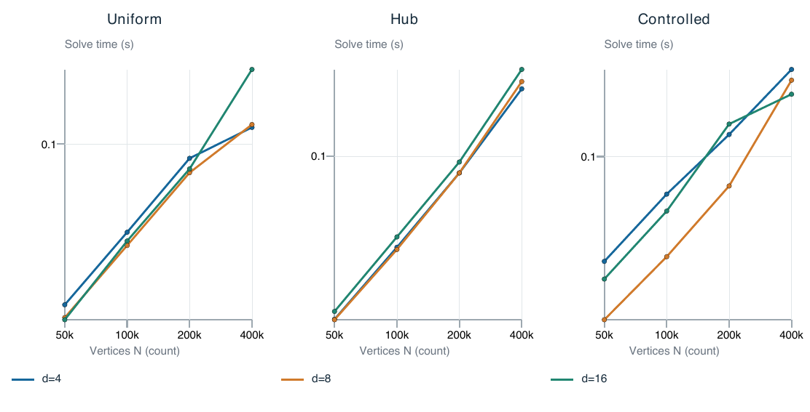
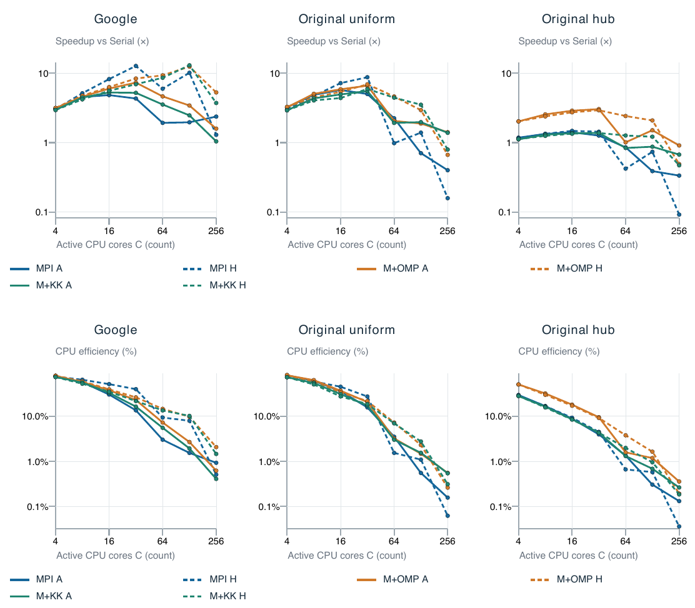
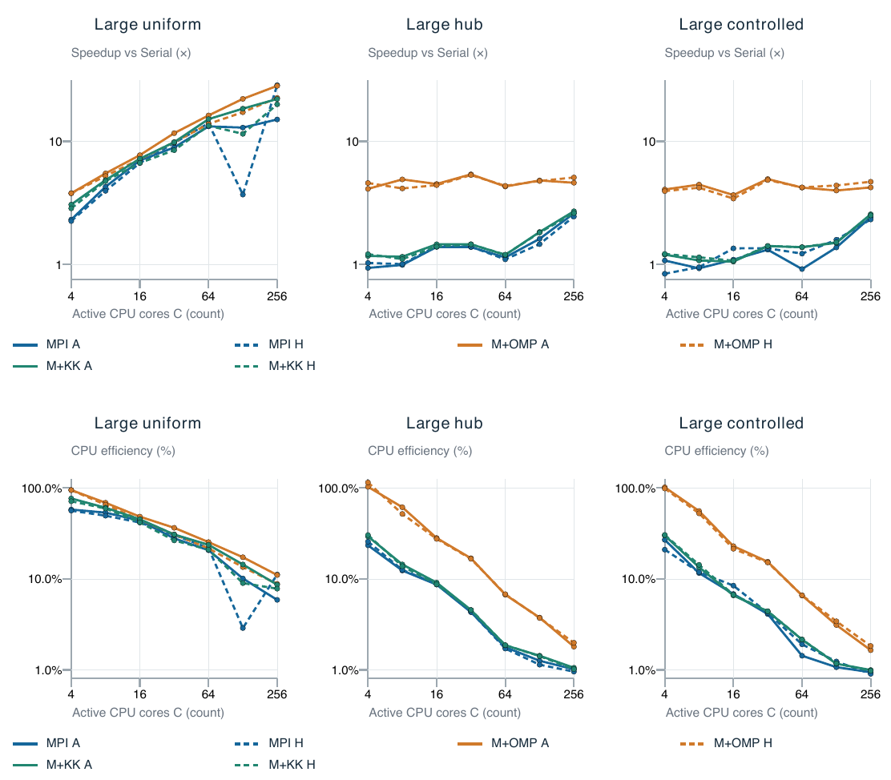
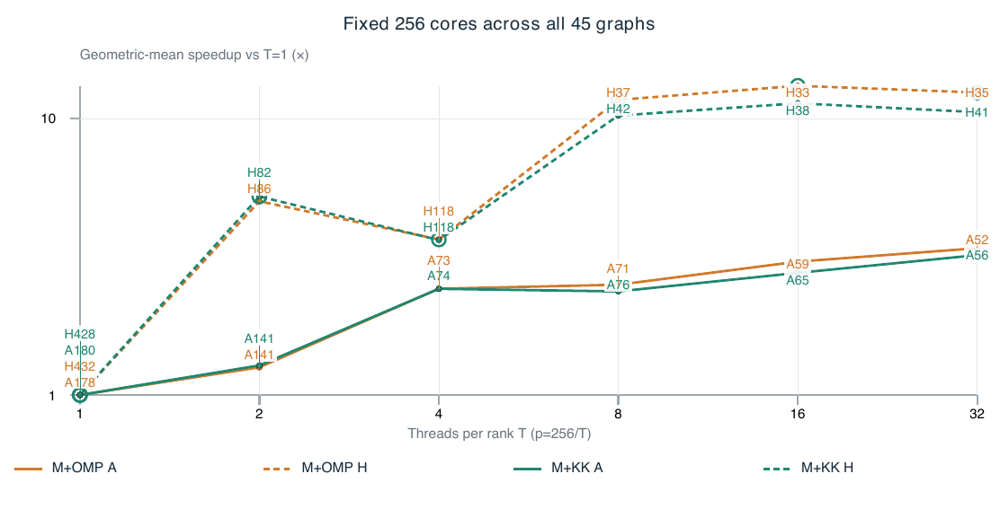
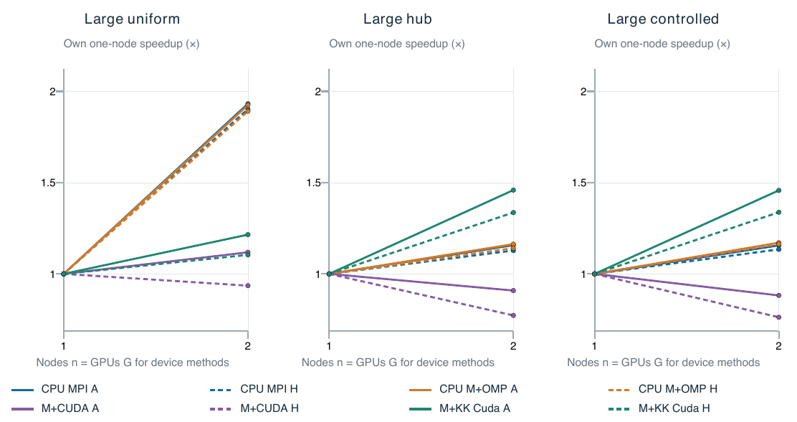
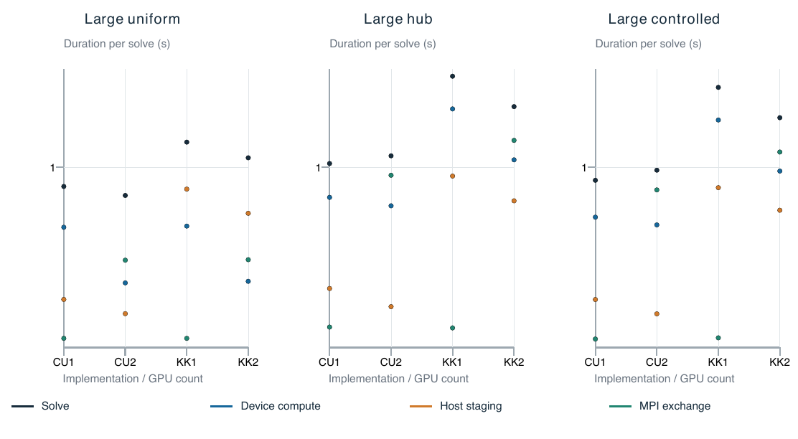
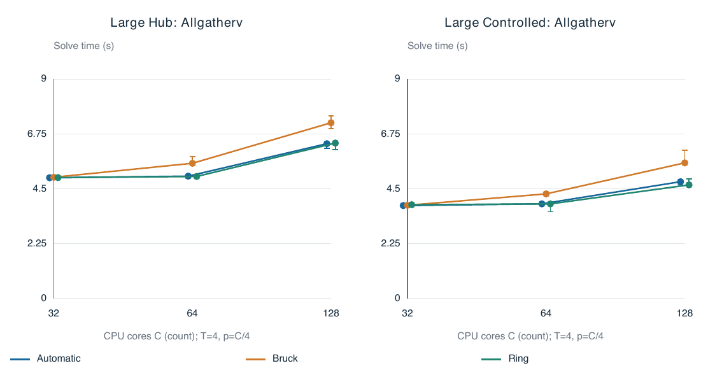
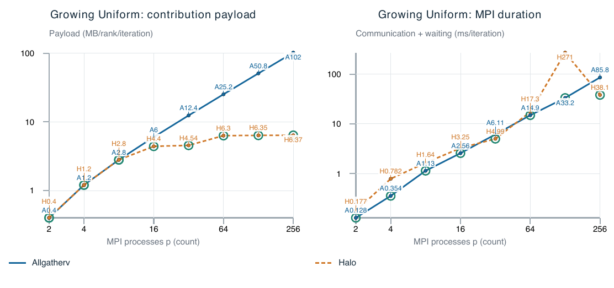

# Parallel PageRank on Vanda

Parallel PageRank experiments - 17 November 2026

CHEN Dedan (A0353553A); HE Xinyi (A0351082M); HONG Xinran (A0356216E)

Project repository: [https://github.com/rosesnack/DSA5208_PROJECT_3](https://github.com/rosesnack/DSA5208_PROJECT_3)

### Abstract

We evaluate synchronous PageRank on 45 fixed directed graphs (3 original, 42 reproducible extensions) using Serial, OpenMP, MPI, MPI+OpenMP, CUDA, and Kokkos OpenMP/CUDA. The 19,530 fixed-input configurations test added parallelism and equal-core process/thread decompositions. A separate suite contains 27 scale-specific inputs, 318 resource-scaled configurations, and 54 fixed-resource size controls: it tests whether iteration time stays constant as work and resources grow together. Vanda measurements use one warm-up and the median of five timed solves, with independent numerical validation. Balanced inputs benefit from distributed execution; concentrated incoming edges limit effective parallelism. Halo reduces contribution traffic but not invariably runtime, and a second GPU need not accelerate the solve.

A further 59 allocation-matched diagnostic settings separate collective policies, node boundaries, and binding effects from graph/partition behavior.

## 1 Introduction to the algorithm and data

### 1.1 PageRank and its relation to PPR

PageRank is the stationary probability of a random surfer: with probability alpha it follows an outgoing edge; otherwise it jumps according to a preference vector. We use uniform preference and uniform dangling-mass redistribution: standard PageRank, the uniform-preference special case of personalized PageRank (PPR).

$$r_v^{(k+1)}=\frac{1-\alpha}{N}+\frac{\alpha D^{(k)}}{N}+\alpha\sum_{u:(u,v)\in\mathcal{E}}\frac{r_u^{(k)}}{d_{\mathrm{out}}(u)}.$$

N is vertex count, script E the directed edge set, r_v the score, and d_out(u) the outgoing degree. D sums scores of dangling vertices (out-degree zero) for uniform redistribution. Scores start at 1/N. We use alpha=0.85, double precision, synchronous old/new buffers, and stop at L1 score change epsilon=10^-8 or 1,000 iterations:

$$D^{(k)}=\sum_{u:d_{\mathrm{out}}(u)=0}r_u^{(k)},\qquad \Delta^{(k)}=\left\|\mathbf{r}^{(k+1)}-\mathbf{r}^{(k)}\right\|_1\leq\varepsilon.$$

Incoming CSR (compressed sparse row) stores one source list per destination. Each update scans that row; work per iteration and storage are O(N+E).

Parallelism requires per-iteration remote source scores and global reductions for dangling mass and convergence. Equal vertex ownership does not balance row scans: a destination with 10,000 incoming edges costs more than one with two. Communication, synchronization, and unequal row lengths make this a nontrivial parallel workload.

### 1.2 Fixed-input graphs for resource comparisons

All 45 inputs stay unchanged across resource and fixed-core comparisons, including the 42 extensions; fixed input does not refer only to the original three files.

Table 1. Fixed-input graph collection. N and E count vertices and directed edges; the grid crosses mean degree with vertex count.

| Source | Graphs | Vertices N | Directed edges E | Purpose |
| --- | --- | --- | --- | --- |
| Original Google | 1 | 875,713 | 5,105,039 | Real web-link graph |
| Original uniform and hub | 2 | 100,000 each | 1,000,000 each | Original synthetic controls |
| Canonical extensions | 3 | 100,000 | 1,000,000 | One per generated family |
| Size-density grid | 36 | 50k / 100k / 200k / 400k | N x 4 / 8 / 16 | 3 families x 4 sizes x 3 densities |
| Large extensions | 3 | 12,800,000 | 204,800,000 | One per generated family |
| **Total fixed graphs** | **45** | **** | **** | **3 original + 42 extensions** |

Extensions use seed 5208, deterministic integer mixing, and unique arithmetic progressions. Uniform has fixed source degree and destinations spread across all vertices. Hub targets approximately 80% of each source's edges at the first 1% of vertices. Controlled adds two source-degree classes: 80% lower-degree and 20% higher-degree sources. Original Uniform/Hub files are preserved and differ from same-size canonical extensions.

At E/N=16, floor(4*d_out/5) sends exactly 75.0% of Hub edges and 77.5% of Controlled edges to the first 1% of destination IDs. These fractions drive the workload model. The hot block aligns with contiguous partitions, so the experiment evaluates structure together with vertex ordering and ownership.

Controlled's hot-block fraction is 65.0% at mean degree 4 and 77.5% at degrees 8 and 16. Density changes both E and exact concentration; the grid characterizes a reproducible generator family rather than an isolated edge-count intervention.

The grid crosses vertex count and mean out-degree independently. The large graphs hold N and E equal across families to isolate structural differences. Every fixed-input configuration uses the same 45 graphs.

### 1.3 Graphs that grow with resource count

Uniform, Hub, and Controlled use scales s=1,2,4,8,16,32,64,128,256, with N=50,000s and E=800,000s: 27 input identifiers. The largest scale (12.8M vertices, 204.8M edges) is also each family's large fixed input; these role-based input counts overlap.

Rank-normalized suites set s=p; core-normalized suites set s=C. CPU records comprise 150 rank-normalized and 84 core-normalized cases. GPU-node records use six inputs (3 families, s=1/2): 84 distributed resource-scaled cases and 54 standalone size controls. Total: 372 records, including 318 resource-scaled cases and 54 fixed-resource controls.

## 2 Methodology

### 2.1 Notation, implementations, and communication

Table 2. Symbols, terminology, and measurement units used in the experiment design.

| Symbol or term | Definition and unit |
| --- | --- |
| N; E | Numbers of vertices and directed edges (counts). Average out-degree is E/N. |
| Node; n | A physical compute machine; n is the number of participating machines (nodes). |
| MPI rank; p | An MPI rank identifies a participating process, not a PageRank score. p is the total process count; rank IDs are 0,...,p-1. Processes have separate local data. |
| r; T | r is the number of MPI processes per node. T is the number of CPU threads per process (threads/process). |
| C; G | C is active CPU parallelism (cores); G is the number of GPUs used by device computation (devices). |
| t; I | t is solve time in seconds; I is the convergence iteration count. T denotes threads, never runtime. |
| CSR; PPR | Compressed sparse row storage; personalized PageRank. We use the uniform-preference special case of PPR. |
| OMP; KK; A; H | Figure abbreviations: OpenMP; Kokkos; Allgatherv; Halo. CUDA and Kokkos CUDA denote GPU computation. |

$$p=nr,\qquad C=pT=nrT.$$

Example: n=4,r=8,T=4 gives p=32 processes and C=128 active CPU cores. Distributed device methods use one process and GPU per node, G=p=n. GPU kernel threads are separate from host CPU threads T.

Table 3. Implemented compute methods, local work distribution, and applicable MPI exchange strategies.

| Implementation | Compute and work distribution | MPI exchange |
| --- | --- | --- |
| Serial | One CPU thread; incoming CSR pull | Not applicable |
| OpenMP | CPU threads; dynamic row scheduling, chunks of 64 vertices | Not applicable |
| Kokkos OpenMP | CPU threads; default static RangePolicy and reductions | Not applicable |
| CUDA / Kokkos CUDA | One GPU; incoming-row vertex kernels | Not applicable |
| MPI | Contiguous destination partitions; one CPU thread per process | Allgatherv; Halo |
| MPI+OpenMP | Threaded pull within each MPI partition | Allgatherv; Halo |
| MPI+CUDA | One GPU per MPI process; host buffers for MPI exchange | Allgatherv; Halo |
| MPI+Kokkos | Distributed driver with OpenMP or CUDA execution space | Allgatherv; Halo |

Standalone methods make no MPI calls: OpenMP threads share host memory; CUDA threads cooperate through device kernels/memory. MPI+OpenMP uses MPI_THREAD_FUNNELED (only the main thread calls MPI).

MPI partitions consecutive destination IDs approximately equally. Each process stores and updates its destinations' incoming rows; the exchanges differ in the source contributions supplied to those rows:

Table 4. The two exact MPI contribution-exchange strategies and the data communicated in each iteration.

| Strategy | Values exchanged each iteration | MPI operation |
| --- | --- | --- |
| Allgatherv | Every process receives the contribution value for every vertex, assembling a complete vector. This is simple but also transfers values that a process may not need. | MPI_Allgatherv |
| Halo | Each process receives only distinct remote-source values referenced by its incoming rows. Required source IDs are determined once; later iterations exchange their current values. | MPI_Alltoallv |

Both exchanges are exact and retain dangling-mass/convergence Allreduce calls. Halo builds request lists before timing; packing and current-value exchange occur inside each timed iteration.

Logical contribution payload excludes reductions, protocol overhead, and collective-internal traffic. Allgatherv counts 8N(p-1) aggregate bytes; Halo counts 8 bytes per requested remote contribution. MB denotes 10^6 bytes. Metadata setup is separate and untimed; smaller payload need not imply lower latency.

Iteration progress waits for the slowest owner and the collectives. MPI phase time includes packing/copies, collective calls, and reduction waits, not only network transfer. Solve and phase times each take the maximum across ranks, then the median across runs; separately reduced phases are not additive components of one critical-path execution.

Distributed device methods stage contributions through host memory, without CUDA-aware MPI or computation/communication overlap. CUDA uses 256-thread blocks; Kokkos uses Views, parallel_for/parallel_reduce, and execution-space fences. Its OpenMP and CUDA backends execute on different hardware.

### 2.2 Hardware, software and timing protocol

All timings are from Vanda: Intel Xeon Platinum 8452Y, GCC 13.3.0, Open MPI 4.1.8, Release builds; GPU nodes add NVIDIA A40 and CUDA toolkit 12.4.1. Toolkit identity comes from build metadata, not driver compatibility. Laptop/mixed-hardware exploratory data are excluded.

**Timing protocol.** One warm-up, five timed solves, median recomputed from the original solve_s values. MPI time is the maximum across ranks. Timed: iterations, MPI, device staging. Untimed: input, distribution, backend construction, Halo setup, and standalone GPU setup/final rank copies. These are solver rather than end-to-end application times.

**Backend boundaries.** OpenMP team creation is timed; Kokkos initialization is not. Compute phases use fenced host clocks, including dispatch/reduction costs, rather than pure-kernel CUDA events. Transfer phases cover explicit staging, not necessarily internal scalar-result copies. These differences matter particularly for small inputs.

Twelve identified MPI+Kokkos cases use lower-memory initialization but identical timed update/communication kernels; their graph construction and memory preparation remain untimed.

### 2.3 Experimental configuration matrix

**Configuration = graph × implementation × valid layout × exchange**, not a timed repeat. All 45 graphs cross every listed row. Derived p=nr, C=pT, G=p=n are not extra dimensions; CPU layouts require rT<=32. Standalone methods have no MPI-exchange dimension.

**CPU nodes:** Q={1,2,4,8,16,32}; each MPI layout runs Allgatherv and Halo.

Table 5. CPU-node fixed-input matrix. Every row is crossed with all 45 graphs; Q={1,2,4,8,16,32} and the constraint rT<=32 selects valid layouts.

| Implementation | Nodes n | Ranks/node r | Processes p | Threads T | CPU cores C | MPI exchange | Configs |
| --- | --- | --- | --- | --- | --- | --- | --- |
| Serial | 1 | 1 | 1 | 1 | 1 | Not applicable | 45 |
| OpenMP | 1 | 1 | 1 | Q | T | Not applicable | 270 |
| Kokkos OpenMP | 1 | 1 | 1 | Q | T | Not applicable | 270 |
| MPI | 1,2,4,8 | Q | nr | 1 | nr | Allgatherv; Halo | 2,160 |
| MPI+OpenMP | 1,2,4,8 | Q | nr | Q; rT<=32 | nrT | Allgatherv; Halo | 7,560 |
| MPI+Kokkos OpenMP | 1,2,4,8 | Q | nr | Q; rT<=32 | nrT | Allgatherv; Halo | 7,560 |

MPI has 4×6=24 layouts/graph; each CPU hybrid has 4×21=84 valid (n,r,T) layouts/graph. Crossing 45 graphs and 2 exchanges gives 2,160 and 7,560 cases respectively; CPU-node total is 17,865. Standalone p=1 denotes one process without an MPI communicator.

**GPU nodes:** the first four rows compute on GPUs; the remaining rows are CPU controls on the same node class (G=0).

Table 6. GPU-node fixed-input matrix, including device-computing methods and same-node-class CPU controls. G counts GPUs used for computation.

| Implementation | Nodes n | Processes p | CPU threads T | GPUs G | MPI exchange | Configs |
| --- | --- | --- | --- | --- | --- | --- |
| CUDA | 1 | 1 | 1 host | 1 | Not applicable | 45 |
| Kokkos CUDA | 1 | 1 | 1 host | 1 | Not applicable | 45 |
| MPI+CUDA | 1,2 | n | 1 host | n | Allgatherv; Halo | 180 |
| MPI+Kokkos CUDA | 1,2 | n | 1 host | n | Allgatherv; Halo | 180 |
| Serial CPU control | 1 | 1 | 1 | 0 | Not applicable | 45 |
| OpenMP CPU control | 1 | 1 | 1,2,4,8,16,32 | 0 | Not applicable | 270 |
| MPI CPU control | 1,2 | n | 1 | 0 | Allgatherv; Halo | 180 |
| MPI+OpenMP CPU control | 1,2 | n | 1,2,4,8 | 0 | Allgatherv; Halo | 720 |

GPU-node total: 450 device cases + 1,215 CPU controls = 1,665; complete fixed-input total: **19,530**. Serial/ordinary OpenMP remain CPU methods; standalone rows have no exchange parameter.

Principal line: n=1/2/4/8, C=32/64/128/256, 32 active cores/node; MPI p=C,T=1, hybrids p=C/4,T=4. Equal-core tests instead vary T in Q and p=C/T within the same C.

### 2.4 Scaling questions and statistical summaries

**Fixed graph, more workers:** hold N, E, structure, and stopping rule fixed; increase C. Ideal doubling of cores halves solve time. With t_ser and t(C) denoting matched Serial and parallel medians:

$$S(C)=\frac{t_{\mathrm{ser}}}{t(C)},\qquad \eta_{\mathrm{CPU}}(C)=\frac{S(C)}{C}.$$

Speedup is dimensionless; CPU efficiency is a percentage (100% means ideal linear speedup). These curves locate communication, synchronization, or granularity limits. The separate C=256 test varies p/T to compare decompositions at equal resources.

**More work with more workers:** grow graph size with resources and ask whether iteration time remains constant. Rank-normalized inputs use N=50,000p,E=800,000p; core-normalized inputs use N=50,000C,E=800,000C, allowing equal nominal work/core across hybrid decompositions. Fixed counts per worker do not ensure constant communication or balanced incoming edges.

Table 7. Growing-input experiment groups. Counts refer to configurations, not five-run repetitions; fixed-resource controls are kept separate.

| Growing-input block | Graph scale | Resource layouts | Configurations |
| --- | --- | --- | --- |
| Rank-normalized CPU | s=p; 3 families | MPI and MPI+Kokkos T1: p=1,...,256 in powers of 2; MPI+OpenMP T4: p=1,...,64; Allgatherv and Halo | 150 |
| Core-normalized CPU | s=C; 3 families | MPI+OpenMP and MPI+Kokkos OpenMP: T4, p=C/4; C=4,...,256 in powers of 2; Allgatherv and Halo | 84 |
| GPU-node resource scaling | s=p=1,2; 3 families | Distributed GPU methods and distributed CPU controls; n=p; Allgatherv and Halo | 84 |
| GPU-node input-size controls | s=1,2; 3 families | Standalone Serial, OpenMP, CUDA, and Kokkos CUDA retain one node while input size increases | 54 |
| **Total** | **** | **318 resource-scaled configurations + 54 fixed-resource controls** | **372** |

Convergence counts I can change with graph size. We therefore compare iteration time tau rather than confounding iteration cost with solve length; C0 is the smallest point in each resource series:

$$\tau(C)=\frac{t(C)}{I(C)},\qquad \eta_{\mathrm{grow,iter}}(C)=\frac{\tau(C_0)}{\tau(C)}.$$

Ideal retained efficiency is 100%; 25% means four times the reference iteration time. The common CPU plot uses C0=4 on identical family inputs: MPI p=C,T=1; hybrids p=C/4,T=4. Rank-normalized p0=1 series and total-solve efficiency remain in the data. CPU/GPU-node speedups use their own Serial reference; two-GPU scaling uses each method's one-GPU time.

**Two statistical levels:** median of five solves for a configuration; geometric mean of matched per-graph median ratios for cross-graph comparisons:

$$\widetilde{t}_{g,a}=\operatorname{median}(t_{g,a,1},\ldots,t_{g,a,5}),\qquad s_g=\frac{\widetilde{t}_{g,a}}{\widetilde{t}_{g,b}},\qquad \overline{s}_{\mathrm{geo}}=\left(\prod_{g=1}^{m}s_g\right)^{1/m}.$$

g indexes m graphs; s_g>1 favors b. Geometric means weight proportional changes equally: 2× and 0.5× combine to 1×. They apply to ratios, never pooled times or the five repeats. Communication pairs additionally match backend, nodes, p, and T. The 45-row overview selects each method's best observed median across layouts; its budgets may differ.

Fixed-core aggregates use 45 graph ratios. Communication aggregates use explicitly counted matched graph/layout pairs. Payload reduction is the fraction of Allgatherv bytes avoided by Halo, summarized by the pairwise median.

### 2.5 Correctness and reproducibility

Independent Python checks stream raw edges to rebuild one update, without reusing the C++ CSR traversal. They check IDs/degrees, finite nonnegative scores, mass error <=10^-10, residual/full-vector L1 error versus Serial <=10^-8, histories, and repeat metadata. Allocation/affinity logs verify layouts. Archived timings and validation proofs support local reanalysis; full vectors remain on Vanda, with the Google vector also archived.

Controls reuse an independently edge-validated Serial vector s and compare every new vector x in full (IDs, degrees, mass, L1 error). PageRank is L1-contractive with alpha=0.85: residual(x) <= residual(s)+1.85||x-s||_1. Requiring this bound <=10^-8 certifies x; its stationary-vector error is at most residual/(1-alpha). Free-queue checks also verify timing/history, actual threads, and all five residuals.

Input identities, software/hardware metadata, original timings, and independent proofs retain each statistic's provenance and matched configuration.

### 2.6 MPI collective selection and controlled policies

**Main matrix: automatic tuned selection.** Vanda Open MPI 4.1.8 records coll_tuned_use_dynamic_rules=false and overrides 0 (ignore): the compiled fixed decision tree selects each operation's implementation. The rules are fixed; the chosen algorithm may vary with p and, for Allgatherv, message size. This is rule-based selection, not online congestion learning.

**Controls: forced policies at selection boundaries.** Around 64 cores and 128 processes, hold graph, binary, layout, and allocation fixed and change only the named collective. coll_tuned_use_dynamic_rules=1 enables forced dispatch in these controls, not in the main matrix.

Table 8. Collective algorithms exposed by the installed Open MPI 4.1.8 tuned component. Algorithm ID 0 retains automatic selection and is not another implementation.

| MPI operation | Algorithm ID | Implementation | Applicability |
| --- | --- | --- | --- |
| Alltoallv (Halo) | 1 | basic_linear | General process counts |
| Alltoallv (Halo) | 2 | pairwise | General process counts |
| Allgatherv | 1 | GatherV followed by Bcast; parameter name default | General process counts |
| Allgatherv | 2 | Bruck | General process counts |
| Allgatherv | 3 | Ring | General process counts |
| Allgatherv | 4 | Neighbor exchange | Applicable at p=8,16,32 |
| Allgatherv | 5 | two_proc | Exactly two processes |

ID 0 preserves automatic selection; it is not an algorithm. Allgatherv ID 1, named default, explicitly selects GatherV+Bcast rather than restoring automatic rules [9]. Allreduce and other collectives retain their own default choices.

Table 9. Compiled automatic Alltoallv selection rules in Open MPI 4.1.8. p is communicator process count, not CPU core count or payload size.

| Alltoallv communicator size p | Default tuned algorithm |
| --- | --- |
| p < 4 | pairwise |
| 4 <= p < 64 | basic_linear |
| 64 <= p < 128 | pairwise |
| 128 <= p < 256 | basic_linear |
| 256 <= p < 1024 | pairwise |
| p >= 1024 | basic_linear |

These Open MPI 4.1.8 rules apply when tuned handles Alltoallv [7]; p=1 can use self and has no remote Halo payload. Selection depends on p, not bytes, cores, or congestion. basic_linear posts nonblocking requests to peers then waits; pairwise performs rank-step exchanges [8]. Both provide blocking Alltoallv (not Barrier) with the same values but different concurrency/order.

**Allgatherv uses p and mean contribution bytes b=8N/p.** For N=12.8M,T=4, C=32→64 gives p=8→16 and b12.8→6.4 MB, switching Bruck→Ring; p=32/64 remain Ring [7]. This boundary differs from Halo's p=128 Alltoallv transition.

Symmetric controls compare automatic/Bruck/Ring at C=32/64/128,T=4 on Hub and Controlled, and automatic/basic_linear/pairwise at p=64/128/256 on Uniform Halo. Allgatherv targets the transition, not its full menu: GatherV+Bcast/neighbor exchange are untested here; two_proc is inapplicable at p=8/16/32.

Table 10. Automatic collective choices on the principal resource line. Pure MPI uses T=1 and CPU hybrids T=4; n is node count.

| Active cores C | Nodes | MPI p / Alltoallv | Hybrid p / Alltoallv | Hybrid Allgatherv |
| --- | --- | --- | --- | --- |
| 32 | 1 | 32 / basic_linear | 8 / basic_linear | Bruck |
| 64 | 2 | 64 / pairwise | 16 / basic_linear | Ring |
| 128 | 4 | 128 / basic_linear | 32 / basic_linear | Ring |
| 256 | 8 | 256 / pairwise | 64 / pairwise | Ring |

Both hybrids use T=4. Forced IDs are Alltoallv 1=basic_linear,2=pairwise; Allgatherv 2=Bruck,3=Ring [9]. Only that operation changes. Policies share binary, graph, allocation, p/T, affinity, transport, and tuned/basic/libnbc/self availability. Component probes are untimed; policy plots show five-run medians and observed ranges.

**Equal cores need not mean equal collectives.** At C=256, p=256/T=1 selects pairwise, p=128/T=2 basic_linear, p=64/T=4 pairwise, and p=32/16/8 basic_linear. Changing p/T alters participation, local work sharing, and selection regime; forced-policy controls isolate one communication choice.

The tree is a general heuristic; controls test its suitability without replacing automatic mainline results by fastest policies. Separately, OpenMP schedule(dynamic,64) redistributes local vertex chunks; OMP_DYNAMIC=false fixes team size without disabling that scheduling.

## 3 Results

**Reading the results:** every MPI curve includes Allgatherv/Halo and automatic tuned selection unless labeled forced. Section 3.5 pairs those same main-matrix records for exchange effects, then uses separate matched allocations for algorithm controls. Green/amber emphasis flags favorable values or costly mechanisms; captions specify the comparison.

### 3.1 Numerical agreement across implementations

Table 11. Numerical consistency of the fixed-input results. L1 differences and probability-mass errors are dimensionless; 90 groups comprise 45 graphs on two node classes.

| Numerical check | Acceptance criterion | Observed outcome |
| --- | --- | --- |
| Full score vector versus Serial | L1 difference <= 10^-8 | **All independently validated configurations pass** |
| Final convergence residual | L1 residual <= 10^-8 | **Maximum 7.520e-09** |
| **Total probability mass** | **Absolute difference from 1 <= 10^-10** | **Maximum 9.726e-12** |
| Iterations on a fixed graph and hardware class | Same stopping rule across implementations | **Identical counts in all 90 graph/hardware groups** |

**All implementations agree within tolerance.** Each performance case therefore solves an equivalent numerical task; its five repeats contribute one median and one configuration.

### 3.2 Graph characteristics and serial reference costs

#### 3.2.1 Graph size, edge density, and iteration cost

The 36-input grid varies N and mean degree within each family, with one process/thread throughout. Solve time combines per-iteration cost and convergence length.

Table 12. Density comparisons at N=100,000 vertices. Mean degree is E/N in edges/vertex; solve and per-iteration times separate convergence length from iteration cost.

| Family | Mean degree | Edges E | Iterations I | Solve time (s) | Time/iteration (ms) |
| --- | --- | --- | --- | --- | --- |
| Uniform | 4 | 400,000 | 22 | 0.042 | 1.91 |
| Uniform | 8 | 800,000 | 16 | 0.0369 | 2.3 |
| Uniform | 16 | 1,600,000 | 12 | 0.0385 | 3.21 |
| Hub | 4 | 400,000 | 23 | 0.0396 | 1.72 |
| Hub | 8 | 800,000 | 17 | 0.0387 | 2.28 |
| Hub | 16 | 1,600,000 | 14 | 0.044 | 3.14 |
| Controlled | 4 | 400,000 | 35 | 0.0647 | 1.85 |
| Controlled | 8 | 800,000 | 22 | 0.0314 | 1.43 |
| Controlled | 16 | 1,600,000 | 17 | 0.0532 | 3.13 |

**Denser does not necessarily mean a longer solve.** Controlled at N=100,000 needs 35/22/17 iterations for d=4/8/16; fewer iterations can offset more edges. Its density changes exact destination concentration too (Section 1.2).

Table 13. Serial baselines for the three original inputs and the three large inputs used in the resource curves. N and E are counts; all times are five-run medians on CPU nodes.

| Graph | Vertices N | Directed edges E | Iterations I | Serial time (s) |
| --- | --- | --- | --- | --- |
| Google | 875,713 | 5,105,039 | 90 | 1.9 |
| Original uniform | 100,000 | 1,000,000 | 15 | 0.0373 |
| Original hub | 100,000 | 1,000,000 | 16 | 0.0255 |
| Large uniform | 12,800,000 | 204,800,000 | 12 | 15.9 |
| Large hub | 12,800,000 | 204,800,000 | 14 | 23.2 |
| Large controlled | 12,800,000 | 204,800,000 | 12 | 15.9 |

#### 3.2.2 PageRank concentration in the real Google graph

**Google scores are concentrated.** 136,259 vertices (15.6%) are dangling, requiring mass redistribution; the top 1% hold 27.1% of score mass. PageRank/in-degree Pearson correlation is 0.901: strongly associated, but degree is not the full weighting rule.

Table 14. Five highest-scoring Google vertices. PageRank is a dimensionless probability score; in-degree and out-degree are edge counts.

| Node ID | PageRank | In-degree | Out-degree |
| --- | --- | --- | --- |
| 597621 | 0.0009237 | 5354 | 22 |
| 41909 | 0.0009211 | 4219 | 10 |
| 163075 | 0.0009040 | 4731 | 36 |
| 537039 | 0.0008988 | 6326 | 27 |
| 384666 | 0.0007869 | 4010 | 20 |

The anonymized edge list does not identify websites or content quality; concentration and correlation describe graph structure, not causal importance.

### 3.3 Fixed graphs with more CPU processes and nodes

#### 3.3.1 Increasing active cores through explicit process layouts

**Fixed input; increasing p and n.** MPI uses p=C,T=1; both hybrids p=C/4,T=4. C=4 is their first common point (lower-core cases remain in the matrix). Up to C=32 uses one node; C=64/128/256 use 2/4/8, so process and node counts grow together.

Table 15. Layouts used in both fixed-graph CPU figures. Each row is measured with Allgatherv and Halo; C=pT for every method. Hybrid denotes MPI+OpenMP and MPI+Kokkos OpenMP.

| Active cores C | Nodes n | MPI processes p | MPI threads T | Hybrid processes p | Hybrid threads T |
| --- | --- | --- | --- | --- | --- |
| 4 | 1 | 4 | 1 | 1 | 4 |
| 8 | 1 | 8 | 1 | 2 | 4 |
| 16 | 1 | 16 | 1 | 4 | 4 |
| 32 | 1 | 32 | 1 | 8 | 4 |
| 64 | 2 | 64 | 1 | 16 | 4 |
| 128 | 4 | 128 | 1 | 32 | 4 |
| 256 | 8 | 256 | 1 | 64 | 4 |

Original and large graphs use parallel displays: speedup above, CPU efficiency below; identical method colors and Allgatherv/Halo line styles. Each uses its CPU Serial reference and automatic selection; forced tests appear in Section 3.5.2.

**More cores help large Uniform, not small Google.** MPI Halo at C=256 gives Uniform 28.6× Serial speedup (11.2% efficiency). Google instead goes from its best pure-MPI Halo point, n=1/p=32 = 0.149 s, to n=8/p=256 = 1.462 s: communication/synchronization outweigh local work. Equal-size Hub/Controlled also benefit less than Uniform.

**Edge ownership, not vertex balance, controls the structural difference.** The next plot measures maximum/mean incoming-edge load under equal contiguous vertex partitions; 1 means perfect edge balance.

$$B_E=\frac{\max_i E_i}{E/p},\qquad p_{\mathrm{edge}}=\frac{E}{\max_i E_i}=\frac{p}{B_E}.$$

Table 16. Work concentration at 256 processes. B_E is dimensionless. The equal-work process proxy assumes equal edge-scanning rates and describes load balance, not measured speedup. Amber marks concentrated work; all 256 processes were launched.

| Large graph, p=256 | Max/mean edge load | Busiest process edge share (%) | Equal-work process proxy |
| --- | --- | --- | --- |
| Large uniform | 1.002 | 0.39% | 255 |
| Large hub | **75.002** | **29.30%** | **3.41** |
| Large controlled | **77.508** | **30.28%** | **3.3** |

**One process owns 29%-30% of Hub/Controlled edges at p=256.** All processes run, but the slowest row scans govern iteration progress. The edge-only load equals about 3.4/3.3 balanced processes under equal scanning rates; Uniform stays balanced. The 75.0%/77.5% hot-edge fractions occupy the first 1% of IDs, fitting one partition for p<=100 and crossing boundaries above it. Halo preserves this ownership.

Table 17. One-node scheduling comparison on the same large graphs. Each method uses one process and 32 CPU threads; times are five-run solve medians. The static-block share is an analytical proxy; amber marks skewed edge ownership and its associated time gap.

| Large graph; T=32 | OpenMP time (s) | Kokkos OpenMP time (s) | Kokkos/OpenMP (×) | Largest static block edge share (%) |
| --- | --- | --- | --- | --- |
| Large uniform | 0.54 | 0.542 | 1 | 3.1% |
| Large hub | 0.704 | 16 | **22.8** | **75.5%** |
| Large controlled | 0.537 | 11.8 | **22** | **78.0%** |

**Local scheduling magnifies the same skew.** OpenMP distributes 64-vertex chunks dynamically; Kokkos RangePolicy defaults to static ranges [6]. A 32-way split puts 75.5%-78.0% of skewed edges in one block. Uniform times are similar, but Hub/Controlled differ by about 22×, implicating the implemented scheduling/ordering combination rather than intrinsic framework overhead.

#### 3.3.2 Fixed 256-core budget: changing the process/thread split

**Fixed n=8,C=256; vary p/T.** Both hybrids use six splits and two exchanges. Each graph's median is divided into its same-method/exchange p=256/T=1 median, then ratios are geometrically averaged over 45 graphs.

Table 18. Equal-core process/thread comparison. Values are geometric means of 45 paired speedups, each based on five-run median times. All rows satisfy pT=256; A=Allgatherv, H=Halo. The reference is the corresponding method's T=1 row, not Serial; green marks each column maximum.

| Processes p | Threads/process T | MPI+OMP A (×) | MPI+OMP H (×) | MPI+KK A (×) | MPI+KK H (×) |
| --- | --- | --- | --- | --- | --- |
| 256 | 1 | 1.00 | 1.00 | 1.00 | 1.00 |
| 128 | 2 | 1.26 | 5.02 | 1.28 | 5.22 |
| 64 | 4 | 2.42 | 3.65 | 2.42 | 3.63 |
| 32 | 8 | 2.50 | 11.67 | 2.37 | 10.24 |
| 16 | 16 | 3.04 | **13.12** | 2.76 | **11.35** |
| 8 | 32 | **3.40** | 12.41 | **3.20** | 10.53 |

**Fewer processes can use the same cores better.** At p=8/T=32, Allgatherv improves the T=1 aggregate by 3.40× (MPI+OpenMP) and 3.20× (MPI+Kokkos). Best Halo splits use T=16/T=16, gaining 13.12×/11.35×. Reduced collective participation and shared hot rows explain the direction; individual graph optima differ.

### 3.4 Standalone methods and one-to-two-GPU execution

#### 3.4.1 Standalone CPU/GPU baselines and MPI overhead

Table 19. Standalone baselines on the same six representative graphs. CPU methods use one node; device methods use one A40. All values are five-run solve medians in seconds. CPU-node and GPU-node Serial references are kept separate.

| Graph | CPU Serial (s) | OpenMP T32 (s) | KK OpenMP T32 (s) | GPU-node Serial (s) | CUDA (s) | KK CUDA (s) |
| --- | --- | --- | --- | --- | --- | --- |
| Google | 1.9 | 0.125 | 0.104 | 1.86 | 0.115 | 0.0936 |
| Original uniform | 0.0373 | 0.00267 | 0.00225 | 0.0288 | 0.00136 | 0.000999 |
| Original hub | 0.0255 | 0.00239 | 0.0101 | 0.0285 | 0.00616 | 0.00851 |
| Large uniform | 15.9 | 0.54 | 0.542 | 15.9 | 0.531 | 0.478 |
| Large hub | 23.2 | 0.704 | 16 | 17.1 | 0.755 | 2.03 |
| Large controlled | 15.9 | 0.537 | 11.8 | 12.9 | 0.594 | 1.77 |

**MPI device overhead persists at one GPU.** Google CUDA/Kokkos CUDA take 0.115/0.094 s standalone versus 0.243/0.383 s under MPI Allgatherv p=1. The distributed path stages contributions every iteration; input/backend setup is excluded.

#### 3.4.2 One versus two GPUs on fixed inputs

**Fixed graph; n=p=G changes 1→2**, one A40/process/node, automatic selection, both exchanges. CPU MPI and MPI+OpenMP T=1 on the same node class are layout-matched controls. Each line uses its own one-node reference.

Table 20. Allgatherv GPU comparisons, presented identically for all three large graphs and both backends. Each ratio divides the p=1 median by the p=2 median; values above 1× favor two GPUs. The edge share is a partition statistic.

| Large graph | GPU method | Busiest p2 edge share (%) | Compute p1/p2 (×) | Solve p1/p2 (×) |
| --- | --- | --- | --- | --- |
| Large uniform | MPI+CUDA | 50.0% | **2** | 1.12 |
| Large uniform | MPI+Kokkos CUDA | 50.0% | **1.99** | 1.22 |
| Large hub | MPI+CUDA | **87.4%** | 1.11 | 0.909 |
| Large hub | MPI+Kokkos CUDA | **87.4%** | 1.88 | 1.46 |
| Large controlled | MPI+CUDA | **88.6%** | 1.1 | 0.882 |
| Large controlled | MPI+Kokkos CUDA | **88.6%** | 1.89 | 1.46 |

**Uniform balances device work; skewed inputs do not.** Uniform obtains about 2× compute acceleration but MPI limits solve gains. Hub/Controlled leave 87%-89% of edges on one GPU: CUDA compute improves only about 1.1× while communication rises. Larger Kokkos gains also involve kernel mapping, reductions, and locality; edge share is a mechanism, not a universal runtime bound.

### 3.5 Communication strategy and MPI implementation choice

**Two levels of control:** Section 3.5.1 changes the exact values exchanged (Allgatherv/Halo), reusing matched main-matrix cases; Section 3.5.2 holds the exchange fixed and changes the MPI collective algorithm in separate matched allocations.

#### 3.5.1 Allgatherv versus exact Halo exchange

Table 21. Populations and statistics behind the communication bars. Speedup is the geometric mean of paired five-run-median ratios. Payload reduction and the fraction of pairs favoring Halo are percentages; they are different statistics.

| Node class | Family | Matched pairs | Halo speedup (×) | Payload reduction (%) | Halo faster (%) |
| --- | --- | --- | --- | --- | --- |
| cpu node | Google | 179 | **1.89** | 58.6% | 87.2% |
| cpu node | Uniform | 2685 | 1.23 | 28.6% | 62.9% |
| cpu node | Hub | 2685 | 1.19 | 70.1% | 69.1% |
| cpu node | Controlled | 2506 | 1.19 | 71.8% | 68.8% |
| gpu node | Google | 7 | 0.969 | 27.7% | 14.3% |
| gpu node | Uniform | 105 | 0.922 | **0.0%** | 16.2% |
| gpu node | Hub | 105 | 0.962 | 11.6% | 24.8% |
| gpu node | Controlled | 98 | 0.975 | 14.8% | 32.7% |

**GPU Uniform savings are 0.0%, not missing.** Of 105 pairs, 91 save no contribution bytes: at p=2 most partitions require all other-process sources. Large Uniform exchanges 102.4 MB globally per iteration under either strategy. This follows from graph dependencies, not GPU arithmetic.

**Payload savings do not determine runtime.** CPU Google gains 1.89× with 58.6% median payload reduction; synthetic families gain 1.19-1.23× in aggregate, while many cases favor Allgatherv. Packing, collective/reduction latency, imbalance, and device staging remain. Untimed Halo setup cannot cause timed-iteration slowdown.

Table 22. Paired Allgatherv/Halo time ratios on the same six inputs at eight nodes and 256 CPU cores. Each cell holds method, p, and T fixed; ratios above 1× favor Halo. The three columns need not use the same process count.

| Graph; C=256 | MPI p256/T1 (×) | MPI+OMP p64/T4 (×) | MPI+KK p64/T4 (×) |
| --- | --- | --- | --- |
| Google | **0.547** | **3.33** | **3.57** |
| Original uniform | **0.396** | **0.473** | **0.575** |
| Original hub | **0.274** | **0.539** | **0.701** |
| Large uniform | **1.9** | **0.798** | **0.905** |
| Large hub | **0.943** | **1.1** | **0.966** |
| Large controlled | **0.959** | **1.11** | **0.98** |

#### 3.5.2 Default tuned selection versus fixed collective algorithms

Controls fix graph, layout, binary, affinity, and allocation within each policy comparison. Automatic uses dynamic_rules=0; forced runs use 1 plus one operation override (Section 2.6), not online learning.

Table 23. Primary matched-policy matrix: nine Alltoallv configurations and eighteen Allgatherv configurations. Uniform uses pure MPI; Hub and Controlled use MPI+OpenMP. Every row compares three policies within one allocation and satisfies C=pT=32n. Each configuration has one warm-up and five timed solves.

| Graph | Nodes n | Cores C | Processes p | Threads T | Exchange | MPI implementations | Configs |
| --- | --- | --- | --- | --- | --- | --- | --- |
| Large uniform | 2 | 64 | 64 | 1 | Halo | Automatic; basic_linear; pairwise | 3 |
| Large uniform | 4 | 128 | 128 | 1 | Halo | Automatic; basic_linear; pairwise | 3 |
| Large uniform | 8 | 256 | 256 | 1 | Halo | Automatic; basic_linear; pairwise | 3 |
| Large hub | 1 | 32 | 8 | 4 | Allgatherv | Automatic; Bruck; Ring | 3 |
| Large hub | 2 | 64 | 16 | 4 | Allgatherv | Automatic; Bruck; Ring | 3 |
| Large hub | 4 | 128 | 32 | 4 | Allgatherv | Automatic; Bruck; Ring | 3 |
| Large controlled | 1 | 32 | 8 | 4 | Allgatherv | Automatic; Bruck; Ring | 3 |
| Large controlled | 2 | 64 | 16 | 4 | Allgatherv | Automatic; Bruck; Ring | 3 |
| Large controlled | 4 | 128 | 32 | 4 | Allgatherv | Automatic; Bruck; Ring | 3 |

**59 unique settings:** 27 primary policies + 30 additional automatic contexts + 2 binding controls. Node-boundary context has 36 cases (2 graphs × 3 methods × 2 exchanges × 3 core counts); 6 overlap the primary matrix. Binding fixes n=8,p=256,T=1,pairwise.

Both Alltoallv algorithms are tested. Allgatherv compares Bruck/Ring around p=8→16; GatherV+Bcast and neighbor exchange are outside this targeted contrast, and two_proc applies only at p=2 (complete menu: Section 2.6).

Table 24. Alltoallv comparison on the same graph and layout within each row. Each value is a five-run median; all policies pass independent validation. The p=128 row highlights automatic/basic_linear cost (amber) and pairwise gain (green).

| Processes p = cores C | Automatic (s) | basic_linear (s) | pairwise (s) | Automatic/pairwise (×) |
| --- | --- | --- | --- | --- |
| 64 | 1.22 | 1.38 | 1.17 | 1.04 |
| 128 | **4.13** | **4.13** | **0.886** | **4.66** |
| 256 | 3.59 | 6.63 | 3.56 | 1.01 |

**At p=128, pairwise improves automatic selection by 4.66×.** Automatic/basic_linear/pairwise take 4.134/4.129/0.886 s. Automatic range: 3.740-4.331 s; pairwise: 0.873-0.965 s. MPI/wait falls 3.949→0.694 s at the same 12 iterations, directly identifying a policy effect.

**The p=128 peak aligns with pairwise→basic_linear→pairwise at p=64/128/256.** The selector sees p, not payload/congestion. Different concurrency, buffering, and progress can change boundary costs. Growing Uniform also peaks at p=128 despite different mean peer payload, supporting a schedule effect beyond one message-size threshold; TCP eager/rendezvous and shared contention may interact.

Table 25. Allgatherv transition controls, presented symmetrically for both graphs and all three resource points. T=4 throughout; only the collective implementation changes within a row. At C=64, amber/green contrast Bruck with Ring.

| Graph | C / p | Automatic (s) | Bruck (s) | Ring (s) | Bruck/Ring (×) |
| --- | --- | --- | --- | --- | --- |
| Large hub | 32 / 8 | 4.96 | 4.98 | 4.96 | 1 |
| Large hub | 64 / 16 | 5.02 | **5.55** | **5.01** | 1.11 |
| Large hub | 128 / 32 | 6.35 | 7.21 | 6.38 | 1.13 |
| Large controlled | 32 / 8 | 3.82 | 3.83 | 3.85 | 0.994 |
| Large controlled | 64 / 16 | 3.89 | **4.29** | **3.88** | 1.11 |
| Large controlled | 128 / 32 | 4.79 | 5.57 | 4.66 | 1.19 |

**At C=64, Ring already matches automatic; Bruck is slower.** Hub: automatic/Ring/Bruck = 5.022/5.010/5.550 s; Controlled: 3.886/3.884/4.294 s. At C=32 automatic matches Bruck. Unlike Uniform p=128, switching back does not help this boundary.

Table 26. Default-policy node-boundary context from the same diagnostic matrix. Each ratio compares two nodes/64 cores with one node/32 cores. MPI uses T=1 and hybrids T=4; graph structure and the policy setting are unchanged.

| Method | Exchange | Hub: time64/time32 (×) | Controlled: time64/time32 (×) |
| --- | --- | --- | --- |
| MPI | Allgatherv | 1.019 | 1.008 |
| MPI | Halo | 1.031 | 0.927 |
| MPI+OMP | Allgatherv | 1.013 | 1.019 |
| MPI+OMP | Halo | 0.989 | 0.981 |
| MPI+KK | Allgatherv | 1.022 | 1.035 |
| MPI+KK | Halo | 1.021 | 1.023 |

**The C=32→64 context is nearly flat (0.93-1.04× time).** The hot block still belongs to one hybrid process: Hub share 77.90→76.33%, Controlled 80.11→78.69%. Extra processes subdivide cold work while the second node adds progress/synchronization cost; the algorithm transition alone need not be harmful.

Table 27. Launch-binding comparison within one eight-node, 256-core allocation. The graph and Alltoallv policy are fixed, and post-initialization affinity confirms one distinct CPU per process for both launchers.

| Binding at p256, fixed pairwise | Solve median (s) | Five-run range (s) | MPI/wait median (s) |
| --- | --- | --- | --- |
| Native core binding | 2.97 | 2.928-3.039 | 2.91 |
| Explicit CPU mask | 3.11 | 2.979-4.509 | 3.05 |

**Binding does not explain the larger between-allocation variation.** Native/explicit binding medians are 2.975/3.111 s with overlapping ranges; a separate policy allocation gives p=256 pairwise 3.563 s. Host/NUMA placement, shared-fabric contention, and peer progress are plausible contributors. These allocation-matched controls remain separate from main curves.

### 3.6 Growing graph size together with resources

#### 3.6.1 Constant nominal work per CPU core

**Constant nominal work/core:** at C=4/8/16/32/64/128/256, all methods use N=50,000C,E=800,000C. MPI p=C,T=1; hybrids p=C/4,T=4. The common C=4 input/core reference permits matched efficiency comparisons; original rank-based p=1 references remain in the data.

Table 28. Common growing-input CPU matrix. All three families and both Allgatherv/Halo settings use every row. Node count follows n=max(1,C/32); the per-core vertex and edge counts remain fixed.

| Active cores C | Vertices N | Directed edges E | MPI p / T | Hybrid p / T |
| --- | --- | --- | --- | --- |
| 4 | 200,000 | 3,200,000 | 4 / 1 | 1 / 4 |
| 8 | 400,000 | 6,400,000 | 8 / 1 | 2 / 4 |
| 16 | 800,000 | 12,800,000 | 16 / 1 | 4 / 4 |
| 32 | 1,600,000 | 25,600,000 | 32 / 1 | 8 / 4 |
| 64 | 3,200,000 | 51,200,000 | 64 / 1 | 16 / 4 |
| 128 | 6,400,000 | 102,400,000 | 128 / 1 | 32 / 4 |
| 256 | 12,800,000 | 204,800,000 | 256 / 1 | 64 / 4 |

Table 29. Retained per-iteration efficiency at 256 CPU cores, using the common C=4 reference of the preceding figure. Each percentage divides its C=4 iteration time by its C=256 iteration time; no Serial baseline enters. Green marks each column maximum, not equal absolute runtime.

| Family | Method | C256 Allgatherv (%) | C256 Halo (%) |
| --- | --- | --- | --- |
| Uniform | MPI | 1.93% | **5.16%** |
| Uniform | MPI+OpenMP | **4.18%** | 3.80% |
| Uniform | MPI+Kokkos OpenMP | 3.63% | 3.66% |
| Hub | MPI | 0.63% | 0.58% |
| Hub | MPI+OpenMP | 0.79% | 0.97% |
| Hub | MPI+Kokkos OpenMP | 1.41% | 1.21% |
| Controlled | MPI | 0.56% | 0.55% |
| Controlled | MPI+OpenMP | 0.66% | 0.86% |
| Controlled | MPI+Kokkos OpenMP | 1.09% | 0.83% |

**Iteration time rises despite constant nominal work/core.** Uniform retains 1.9%-5.2% efficiency at C=256; concentrated inputs retain less. Each method uses its own C=4 time, so higher efficiency need not mean lower absolute time. With N proportional to p, Allgatherv traffic grows as p per process and p² globally; Hub/Controlled additionally retain edge imbalance.

Table 30. Matched contribution volume and communication duration for growing Uniform. Rows compare the two exchanges at the same graph and process count; per-iteration quantities, not total job traffic. Amber marks p=256 costs despite bounded Halo bytes.

| Processes p | Exchange | Payload (MB/rank/iteration) | MPI + waiting (ms/iteration) |
| --- | --- | --- | --- |
| 16 | Allgatherv | 6.00 | 2.56 |
| 16 | Halo | 4.40 | 3.25 |
| 64 | Allgatherv | 25.20 | 14.89 |
| 64 | Halo | 6.30 | 17.28 |
| 256 | Allgatherv | **102.00** | **85.76** |
| 256 | Halo | **6.37** | **38.07** |

**Nearly fixed Halo bytes still cost more at larger p.** Uniform payload stays near 6.4 MB/rank/iteration (Allgatherv reaches 102.0 MB at p=256), yet Halo MPI/wait rises 17.28→38.07 ms from p=64→256. Peer count, collective/reduction latency, packing, and contention matter beyond bytes; skewed inputs also wait for overloaded owners.

#### 3.6.2 Constant nominal work per GPU or MPI process

**GPU-node work/resource growth:** n=p=1→2, N=50,000p,E=800,000p, one GPU/process for device methods; CPU controls retain T=1. Efficiency uses each method/exchange's p=1 iteration time. This one-to-two-resource ratio has a different reference from CPU C=4→256.

Table 31. Per-iteration efficiency retained when both graph size and GPU-node process count double. A=Allgatherv, H=Halo; reference p=1 and measured p=2 each use five-run median time per iteration. CPU controls do not compute on GPUs.

| GPU-node method | Uniform A (%) | Uniform H (%) | Hub A (%) | Hub H (%) | Controlled A (%) | Controlled H (%) |
| --- | --- | --- | --- | --- | --- | --- |
| MPI | 71.3% | 62.2% | 59.0% | 55.9% | 54.6% | 50.0% |
| MPI+OpenMP | 76.5% | 72.9% | 56.7% | 53.2% | 59.8% | 52.1% |
| MPI+CUDA | 40.3% | 38.8% | 59.6% | 57.8% | 59.8% | 54.6% |
| MPI+Kokkos CUDA | 44.8% | 41.6% | 58.1% | 57.6% | 64.0% | 55.1% |

Standalone cases keep one node/device at both input sizes: 54 fixed-resource size controls, not resource-scaling efficiencies. They accompany the 318 scaled cases with their original layouts/reference definitions.

### 3.7 Complete fixed-input summary and additional high-core example

**Overview: values = best observed solve medians (s); color = speedup versus the same node-class Serial.** Budgets may differ across cells; selected layouts remain in the CSV. Bold outlines mark the fastest method in each row. CPU and GPU tables use separate Serial references and the same color scale.

Table 32. CPU-node runtime heatmap: all 45 fixed graphs, seconds in cells; color encodes matched Serial speedup. Bold/outlined cells are row minima (including Serial). KK=Kokkos; o./s.=original/canonical; U/H/C grid labels give vertices and mean degree. Each cell selects its own best legal layout.

| Graph | Serial | OpenMP | KK OMP | MPI | MPI+OMP | MPI+KK |
| --- | --- | --- | --- | --- | --- | --- |
| Google | 1.9 | 0.125 | **0.104** | 0.149 | 0.146 | 0.146 |
| o. hub | 0.0255 | **0.00239** | 0.00935 | 0.0173 | 0.00418 | 0.015 |
| o. uniform | 0.0373 | 0.00267 | **0.00225** | 0.00426 | 0.00416 | 0.00453 |
| s. controlled | 0.0497 | **0.00373** | 0.0119 | 0.0186 | 0.0054 | 0.0196 |
| s. hub | 0.0396 | **0.00301** | 0.00937 | 0.0172 | 0.0044 | 0.0162 |
| s. uniform | 0.0349 | 0.00244 | **0.0018** | 0.00422 | 0.00362 | 0.00433 |
| C 100k/16 | 0.0532 | **0.00302** | 0.0155 | 0.0266 | 0.00473 | 0.0205 |
| C 100k/4 | 0.0647 | **0.00555** | 0.00919 | 0.0184 | 0.00906 | 0.0194 |
| C 100k/8 | 0.0314 | **0.00321** | 0.0103 | 0.0137 | 0.00504 | 0.0147 |
| C 200k/16 | 0.146 | **0.00837** | 0.0428 | 0.0611 | 0.0108 | 0.0433 |
| C 200k/4 | 0.129 | **0.0119** | 0.0209 | 0.0396 | 0.0174 | 0.0333 |
| C 200k/8 | 0.0712 | **0.00742** | 0.0265 | 0.0439 | 0.0122 | 0.0406 |
| C 400k/16 | 0.206 | **0.0174** | 0.124 | 0.159 | 0.0234 | 0.099 |
| C 400k/4 | 0.274 | **0.0219** | 0.0539 | 0.0768 | 0.0271 | 0.0861 |
| C 400k/8 | 0.242 | **0.0188** | 0.0797 | 0.107 | 0.0248 | 0.0845 |
| C 50k/16 | 0.0242 | **0.00212** | 0.00718 | 0.013 | 0.00286 | 0.0108 |
| C 50k/4 | 0.0297 | **0.0033** | 0.00415 | 0.00855 | 0.00457 | 0.0093 |
| C 50k/8 | 0.0151 | **0.00175** | 0.00489 | 0.0101 | 0.00518 | 0.0106 |
| H 100k/16 | 0.044 | **0.00254** | 0.0128 | 0.0215 | 0.00399 | 0.0187 |
| H 100k/4 | 0.0396 | **0.00376** | 0.0067 | 0.00908 | 0.0052 | 0.0101 |
| H 100k/8 | 0.0387 | **0.00279** | 0.0111 | 0.0103 | 0.00398 | 0.0112 |
| H 200k/16 | 0.0942 | **0.00673** | 0.0296 | 0.0525 | 0.00888 | 0.0339 |
| H 200k/4 | 0.0843 | **0.00843** | 0.0163 | 0.0297 | 0.0122 | 0.0284 |
| H 200k/8 | 0.0844 | **0.00804** | 0.0198 | 0.0306 | 0.00979 | 0.0294 |
| H 400k/16 | 0.242 | **0.0173** | 0.15 | 0.157 | 0.0208 | 0.0897 |
| H 400k/4 | 0.198 | **0.018** | 0.0577 | 0.0893 | 0.023 | 0.0685 |
| H 400k/8 | 0.214 | **0.0134** | 0.085 | 0.0993 | 0.0201 | 0.0703 |
| H 50k/16 | 0.0206 | 0.00292 | 0.00566 | 0.00987 | **0.0023** | 0.00971 |
| H 50k/4 | 0.019 | **0.0021** | 0.00328 | 0.00621 | 0.00311 | 0.00658 |
| H 50k/8 | 0.0189 | **0.00155** | 0.00415 | 0.0075 | 0.00253 | 0.00765 |
| U 100k/16 | 0.0385 | 0.00222 | **0.00181** | 0.00434 | 0.00345 | 0.0047 |
| U 100k/4 | 0.042 | 0.00372 | 0.00245 | **0.0024** | 0.00253 | 0.00258 |
| U 100k/8 | 0.0369 | 0.00307 | **0.00222** | 0.0044 | 0.00439 | 0.00461 |
| U 200k/16 | 0.0782 | 0.00449 | **0.00444** | 0.00868 | 0.00663 | 0.0118 |
| U 200k/4 | 0.0868 | 0.00763 | **0.00494** | 0.00692 | 0.00704 | 0.00744 |
| U 200k/8 | 0.0754 | 0.00505 | **0.00362** | 0.00698 | 0.00705 | 0.00783 |
| U 400k/16 | 0.208 | 0.0135 | **0.0116** | 0.0236 | 0.0158 | 0.0216 |
| U 400k/4 | 0.118 | 0.0123 | **0.00679** | 0.0115 | 0.0117 | 0.0133 |
| U 400k/8 | 0.121 | 0.00992 | **0.00643** | 0.0141 | 0.0142 | 0.0185 |
| U 50k/16 | 0.0178 | 0.00122 | **0.00104** | 0.00137 | 0.00152 | 0.00153 |
| U 50k/4 | 0.0206 | 0.00221 | **0.00135** | 0.0014 | 0.00159 | 0.00159 |
| U 50k/8 | 0.0181 | 0.00171 | **0.00112** | 0.00137 | 0.00156 | 0.00155 |
| 12.8M controlled | 15.9 | **0.537** | 10.7 | 6.6 | 0.642 | 5.36 |
| 12.8M hub | 23.2 | **0.704** | 16 | 8.93 | 0.808 | 8.2 |
| 12.8M uniform | 15.9 | 0.54 | 0.542 | 0.554 | **0.519** | 0.574 |

Table 33. GPU-node runtime heatmap: the same 45 graphs and color scale, seconds in cells. Reference is this node class’s CPU Serial, not the CPU-node table. Bold/outlined cells are row minima; distributed methods select over one/two GPUs and Allgatherv/Halo. CPU controls remain in the full results CSV.

| Graph | Serial on GPU node | CUDA | KK CUDA | MPI+CUDA | MPI+KK CUDA |
| --- | --- | --- | --- | --- | --- |
| Google | 1.86 | 0.115 | **0.0936** | 0.243 | 0.381 |
| o. hub | 0.0285 | **0.00616** | 0.00851 | 0.0101 | 0.0148 |
| o. uniform | 0.0288 | 0.00136 | **0.000999** | 0.00514 | 0.00753 |
| s. controlled | 0.0358 | **0.00689** | 0.00931 | 0.0123 | 0.0182 |
| s. hub | 0.0398 | **0.00608** | 0.00844 | 0.0109 | 0.0171 |
| s. uniform | 0.037 | 0.00133 | **0.00102** | 0.00875 | 0.0121 |
| C 100k/16 | 0.053 | **0.00807** | 0.0114 | 0.0128 | 0.0175 |
| C 100k/4 | 0.0634 | **0.00554** | 0.00667 | 0.0156 | 0.0252 |
| C 100k/8 | 0.0496 | **0.00622** | 0.00834 | 0.0127 | 0.0192 |
| C 200k/16 | 0.117 | **0.0101** | 0.0269 | 0.0256 | 0.0487 |
| C 200k/4 | 0.129 | **0.00736** | 0.0136 | 0.0241 | 0.047 |
| C 200k/8 | 0.109 | **0.00816** | 0.0189 | 0.0189 | 0.0373 |
| C 400k/16 | 0.286 | **0.0135** | 0.0601 | 0.0264 | 0.0659 |
| C 400k/4 | 0.179 | **0.0114** | 0.0276 | 0.0359 | 0.0802 |
| C 400k/8 | 0.169 | **0.0111** | 0.0397 | 0.0315 | 0.0761 |
| C 50k/16 | 0.0245 | **0.00626** | 0.00626 | 0.00839 | 0.0098 |
| C 50k/4 | 0.0302 | 0.00412 | **0.00401** | 0.00964 | 0.0123 |
| C 50k/8 | 0.0246 | 0.00475 | **0.00458** | 0.00824 | 0.00982 |
| H 100k/16 | 0.0312 | **0.00723** | 0.0104 | 0.0108 | 0.0171 |
| H 100k/4 | 0.0399 | **0.0044** | 0.00556 | 0.011 | 0.0176 |
| H 100k/8 | 0.0246 | **0.00514** | 0.00706 | 0.00929 | 0.0144 |
| H 200k/16 | 0.0741 | **0.00885** | 0.0239 | 0.0149 | 0.0314 |
| H 200k/4 | 0.0848 | **0.00573** | 0.0111 | 0.0169 | 0.0347 |
| H 200k/8 | 0.0553 | **0.00655** | 0.0152 | 0.0136 | 0.0302 |
| H 400k/16 | 0.226 | **0.0116** | 0.0505 | 0.0226 | 0.0578 |
| H 400k/4 | 0.136 | **0.00829** | 0.0215 | 0.0254 | 0.058 |
| H 400k/8 | 0.212 | **0.00877** | 0.03 | 0.0242 | 0.0556 |
| H 50k/16 | 0.0124 | 0.00527 | **0.00512** | 0.00703 | 0.00772 |
| H 50k/4 | 0.0192 | 0.00327 | **0.00316** | 0.00686 | 0.00862 |
| H 50k/8 | 0.0139 | 0.00382 | **0.00371** | 0.00617 | 0.00712 |
| U 100k/16 | 0.0359 | 0.00134 | **0.00106** | 0.00482 | 0.00717 |
| U 100k/4 | 0.0266 | 0.0016 | **0.0011** | 0.00693 | 0.0103 |
| U 100k/8 | 0.0232 | 0.00133 | **0.000972** | 0.00537 | 0.0076 |
| U 200k/16 | 0.0495 | 0.00251 | **0.00184** | 0.00754 | 0.0121 |
| U 200k/4 | 0.0551 | 0.00286 | **0.00156** | 0.0121 | 0.0201 |
| U 200k/8 | 0.0759 | 0.00248 | **0.00146** | 0.0104 | 0.0188 |
| U 400k/16 | 0.176 | 0.00586 | **0.00436** | 0.0149 | 0.023 |
| U 400k/4 | 0.179 | 0.00582 | **0.00269** | 0.026 | 0.0463 |
| U 400k/8 | 0.125 | 0.00518 | **0.00301** | 0.0173 | 0.0277 |
| U 50k/16 | 0.0182 | 0.000753 | **0.000704** | 0.00428 | 0.00535 |
| U 50k/4 | 0.0129 | 0.00104 | **0.000852** | 0.00389 | 0.00506 |
| U 50k/8 | 0.0115 | 0.000776 | **0.000674** | 0.00287 | 0.00368 |
| 12.8M controlled | 12.9 | **0.594** | 1.77 | 0.851 | 1.85 |
| 12.8M hub | 17.1 | **0.755** | 2.03 | 1.03 | 2.13 |
| 12.8M uniform | 15.9 | 0.531 | **0.478** | 0.705 | 1.13 |

#### 3.7.1 Additional 512-core example

Controlled N=50,000,E=200,000 has five additional measurements on 8 nodes × 64 active cores/node (C=512). They are a small-graph example, separate from the main resource curves and aggregate rankings.

Table 34. Additional 512-core measurements. Every row satisfies pT=512 and uses one warm-up plus five timed solves; speedup uses this graph's CPU-node Serial median. The rows are not a complete 512-core scaling curve. Amber speedups are below 1×.

| Method | Processes p | Threads T | Exchange | Solve time (s) | Speedup (×) | CPU efficiency (%) |
| --- | --- | --- | --- | --- | --- | --- |
| MPI | 512 | 1 | Allgatherv | 0.131 | **0.227** | 0.044% |
| MPI+Kokkos OpenMP | 512 | 1 | Allgatherv | 0.13 | **0.229** | 0.045% |
| MPI+OpenMP | 512 | 1 | Allgatherv | 0.142 | **0.21** | 0.041% |
| MPI+OpenMP | 128 | 4 | Allgatherv | 0.12 | **0.247** | 0.048% |
| MPI | 512 | 1 | Halo | 1.6 | **0.0185** | 0.004% |

**All five are slower than Serial**, especially p=512 Halo. On this small input, exchange/synchronization overhead outweighs the work distributed; this is a workload-size effect, not a general high-core ranking.

## 4 Conclusions and insights

### 4.1 What the experiments establish

**Workload structure determines the useful backend and parallel degree.** Standalone OpenMP/Kokkos OpenMP wins 42/45 CPU-node graphs; only 2 winning cases use multiple ranks. Standalone CUDA/Kokkos CUDA wins all device-only comparisons. Including GPU-node CPU controls gives OpenMP/CUDA/Kokkos CUDA 18/11/16 wins. These are cross-budget optima; matched layouts separately show that larger balanced work benefits from extra participants, while small/skewed inputs favor fewer processes.

Edge ownership is the dominant structural constraint: equal vertex partitions leave 29%-30% of skewed edges on one process at p=256. Local scheduling and p/T determine useful core participation; Halo does not rebalance ownership.

Communication volume alone predicts neither runtime nor multi-GPU benefit. Packing, collective schedules, synchronization, and staging remain; the matched p=128 pairwise control improves Uniform by 4.66×, without establishing a universal best collective.

### 4.2 Design implications supported by the experiments

Choose optimizations by the measured bottleneck:

Table 35. Practical implications of the measured cases. These are workload-dependent design choices, not claims that one backend or communication implementation is universally optimal.

| Workload or decision | Evidence-based implication | Basis in the results |
| --- | --- | --- |
| Small or moderate fixed graph | Evaluate a single-node backend before increasing MPI participation. | Standalone OpenMP/Kokkos OpenMP is fastest in 42 of 45 CPU-node best-observed comparisons. |
| Large, balanced graph | Consider distributed execution and compare both exact exchanges at the target layout. | Large Uniform benefits from MPI resources; the selected 256-core Halo point reaches 28.6× Serial speedup. |
| Concentrated incoming-edge work | Prioritize ownership balance and local scheduling; compare p/T at equal cores. | One process owns roughly 29%-30% of edges at p256. Changing the fixed-core split improves aggregate Halo ratios by over an order of magnitude. |
| Collective-selection boundary | Retain the automatic baseline and test candidate implementations within matched allocations. | At p128 pairwise improves Uniform by 4.66×; at 64 cores Ring already matches or improves on Bruck for the tested concentrated graphs. |
| Adding a second GPU | Measure end-to-end solve and staging/MPI costs alongside device computation. | Uniform obtains about 2× computation acceleration, while concentrated inputs leave most edge work on one GPU. |
| Graph size grows with resources | Track iteration time and contribution volume separately from nominal vertices/edges per worker. | Allgatherv contribution traffic grows with the global vector; Halo bounds Uniform bytes but does not eliminate peer and synchronization costs. |

Google's scores are concentrated and strongly associated with incoming links, though degree alone is not the weighting rule. Numerical agreement preserves this data conclusion across backends.

### 4.3 Scope and reproducibility

The study covers fixed-input resource curves, equal-core splits, proportional work/resource growth, and allocation-matched controls, with five timed repeats and saved CPU/affinity evidence. Shared-cluster placement, NUMA, and dates vary. Solve timing includes iterations/MPI/staging, not input/startup; GPU comparisons use one/two A40s.

Repository [5] contains source, input generators, original timings, independent proofs, and selection records; its tables/figures regenerate without new performance runs.

### 4.4 References

[1] Page, L., Brin, S., Motwani, R. and Winograd, T. The PageRank Citation Ranking: Bringing Order to the Web. Stanford, 1999. http://ilpubs.stanford.edu:8090/422/

[2] Stanford SNAP. Google web graph dataset. https://snap.stanford.edu/data/web-Google.html

[3] MPI Forum. MPI standard and collective communication. https://www.mpi-forum.org/docs/

[4] Kokkos documentation. RangePolicy and execution policies. https://kokkos.org/kokkos-core-wiki/API/core/policies/RangePolicy.html

[5] Project source and Vanda result records, report data snapshot compiled 17 November 2026. https://github.com/rosesnack/DSA5208_PROJECT_3

[6] Kokkos 4.5.01 source, commit 175257a51ff29a0059ec48bcd233ee096b2c0438: traits/Kokkos_ScheduleTrait.hpp and OpenMP/Kokkos_OpenMP_Parallel_Reduce.hpp. https://github.com/kokkos/kokkos/tree/4.5.01/core/src

[7] Open MPI v4.1.8. Fixed Alltoallv and Allgatherv algorithm selection, coll_tuned_decision_fixed.c. https://github.com/open-mpi/ompi/blob/v4.1.8/ompi/mca/coll/tuned/coll_tuned_decision_fixed.c

[8] Open MPI v4.1.8. Pairwise and basic-linear implementations, coll_base_alltoallv.c. https://github.com/open-mpi/ompi/blob/v4.1.8/ompi/mca/coll/base/coll_base_alltoallv.c

[9] Open MPI v4.1.8. Forced collective algorithm parameters, coll_tuned_alltoallv_decision.c and coll_tuned_allgatherv_decision.c. https://github.com/open-mpi/ompi/tree/v4.1.8/ompi/mca/coll/tuned

### AI usage

AI assisted implementation adaptation, experiment/job design, debugging, verification, visualization, and drafting. Compiled programs measured all performance values on Vanda; independent Serial/residual checks validated scores. Stored records generate tables/figures. The authors are responsible for reviewing the code, design, interpretation, and text.
