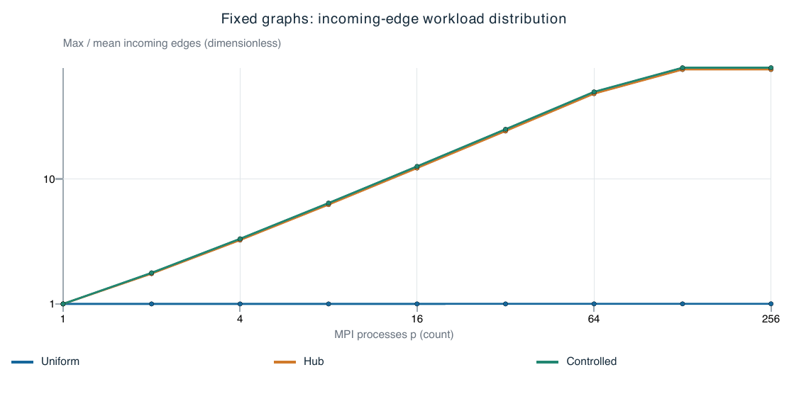
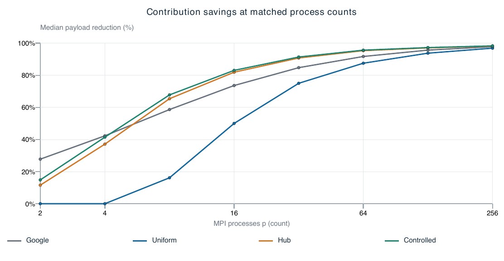

# Parallel PageRank on Vanda

Parallel PageRank experiments - 17 November 2026

CHEN Dedan (A0353553A); HE Xinyi (A0351082M); HONG Xinran (A0356216E)

Project repository: [https://github.com/rosesnack/DSA5208_PROJECT_3](https://github.com/rosesnack/DSA5208_PROJECT_3)

### Abstract

We evaluate synchronous PageRank on 45 fixed directed graphs (3 original, 42 reproducible extensions) using Serial, OpenMP, MPI, MPI+OpenMP, CUDA, and Kokkos OpenMP/CUDA. The 19,530 fixed-input configurations test added parallelism and equal-core process/thread decompositions. A growing-input suite uses 27 scale-specific graph specifications (15 shared with the fixed set; 57 distinct input specifications overall), with 318 resource-scaled configurations and 54 fixed-resource size controls: it tests whether iteration time stays constant as work and resources grow together. Vanda measurements use one warm-up and the median of five timed solves, with independent numerical validation. Balanced inputs benefit from distributed execution; concentrated incoming edges limit effective parallelism. Halo reduces contribution traffic but not invariably runtime, and a second GPU need not accelerate the solve.

A further 59 allocation-matched diagnostic settings separate collective policies, node boundaries, and binding effects from graph/partition behavior.

## 1 Introduction to the algorithm and data

### 1.1 PageRank and its relation to PPR

PageRank is the stationary probability of a random surfer: with probability alpha it follows an outgoing edge; otherwise it jumps according to a preference vector. We use uniform preference and uniform dangling-mass redistribution: standard PageRank, the uniform-preference special case of personalized PageRank (PPR).

$$r_v^{(k+1)}=\frac{1-\alpha}{N}+\frac{\alpha D^{(k)}}{N}+\alpha\sum_{u:(u,v)\in\mathcal{E}}\frac{r_u^{(k)}}{d_{\mathrm{out}}(u)}.$$

N is vertex count, script E the directed edge set, r_v the score, and d_out(u) the outgoing degree. D sums scores of dangling vertices (out-degree zero) for uniform redistribution. Scores start at 1/N. We use alpha=0.85, double precision, synchronous old/new buffers, and stop at L1 score change epsilon=10^-8 or 1,000 iterations:

$$D^{(k)}=\sum_{u:d_{\mathrm{out}}(u)=0}r_u^{(k)},\qquad \Delta^{(k)}=\left\|\mathbf{r}^{(k+1)}-\mathbf{r}^{(k)}\right\|_1\leq\varepsilon.$$

Incoming CSR (compressed sparse row) stores one source list per destination. Each update scans that row; work per iteration and storage are O(N+E).

Parallelism requires per-iteration remote source scores and global reductions for dangling mass and convergence. Equal vertex ownership does not balance row scans: a destination with 10,000 incoming edges costs more than one with two. Communication, synchronization, and unequal row lengths make this a nontrivial parallel workload.

### 1.2 Fixed-input graphs for resource comparisons

All 45 inputs stay unchanged across resource and fixed-core comparisons, including the 42 extensions; fixed input does not refer only to the original three files.

Table 1. Fixed-input graph collection. N and E count vertices and directed edges; the grid crosses mean degree with vertex count.

| Source | Graphs | Vertices N | Directed edges E | Purpose |
| --- | --- | --- | --- | --- |
| Original Google | 1 | 875,713 | 5,105,039 | Real web-link graph |
| Original uniform and hub | 2 | 100,000 each | 1,000,000 each | Original synthetic controls |
| Canonical extensions | 3 | 100,000 | 1,000,000 | One per generated family |
| Size-density grid | 36 | 50k / 100k / 200k / 400k | N x 4 / 8 / 16 | 3 families x 4 sizes x 3 densities |
| Large extensions | 3 | 12,800,000 | 204,800,000 | One per generated family |
| **Total fixed graphs** | **45** |  |  | **3 original + 42 extensions** |

Extensions use seed 5208, deterministic integer mixing, and unique arithmetic progressions. Uniform has fixed source degree and destinations spread across all vertices. Hub targets approximately 80% of each source's edges at the first 1% of vertices. Controlled adds two source-degree classes: 80% lower-degree and 20% higher-degree sources. Original Uniform/Hub files are preserved and differ from same-size canonical extensions.

At E/N=16, floor(4*d_out/5) sends exactly 75.0% of Hub edges and 77.5% of Controlled edges to the first 1% of destination IDs. These fractions drive the workload model. The hot block aligns with contiguous partitions, so the experiment evaluates structure together with vertex ordering and ownership.

Controlled's hot-block fraction is 65.0% at mean degree 4 and 77.5% at degrees 8 and 16. Density changes both E and exact concentration; the grid characterizes a reproducible generator family rather than an isolated edge-count intervention.

The grid crosses vertex count and mean out-degree independently. The large graphs hold N and E equal across families to isolate structural differences. Every fixed-input configuration uses the same 45 graphs.

### 1.3 Graphs that grow with resource count

Uniform, Hub, and Controlled use scales s=1,2,4,8,16,32,64,128,256, with N=50,000s and E=800,000s: 27 input identifiers. Fifteen specifications are shared with the fixed set: the 12 degree-16 grid inputs at s=1/2/4/8, and the three large inputs at s=256. Thus 45+27 denotes experimental roles, covering 57 distinct input specifications rather than 72 different graphs.

Rank-normalized suites set s=p; core-normalized suites set s=C. CPU records comprise 150 rank-normalized and 84 core-normalized cases. GPU-node records use six inputs (3 families, s=1/2): 84 distributed resource-scaled cases and 54 standalone size controls. Total: 372 records, including 318 resource-scaled cases and 54 fixed-resource controls.

## 2 Methodology

### 2.1 Notation, implementations, and communication

Table 2. Symbols, terminology, and measurement units used in the experiment design.

| Symbol or term | Definition and unit |
| --- | --- |
| N; E | Numbers of vertices and directed edges (counts). Average out-degree is E/N. |
| Node; n | A physical compute machine; n is the number of participating machines (nodes). |
| MPI rank; p | An MPI rank identifies a participating process, not a PageRank score. p is the total process count; rank IDs are 0,...,p-1. Processes have separate local data. |
| MPI+OpenMP; MPI+Kokkos OpenMP | MPI processes divide ownership; each process uses OpenMP or Kokkos OpenMP threads to update its owned rows. |
| r; T | r is the number of MPI processes per node. T is the number of CPU threads per process (threads/process). |
| C; c; G | C=pT total active CPU worker slots; c=rT per node; G counts GPUs. C is not reserved/billed slots or measured CPU utilization. |
| t; I | t is solve time in seconds; I is the convergence iteration count. T denotes threads, never runtime. |
| Affinity; NUMA | Affinity pins execution to assigned CPUs. NUMA (non-uniform memory access) means access cost can depend on the memory/socket placement. |
| CSR; PPR | Compressed sparse row storage; personalized PageRank. We use the uniform-preference special case of PPR. |
| OMP; KK; A; H | Figure abbreviations: OpenMP; Kokkos; Allgatherv; Halo. CUDA and Kokkos CUDA denote GPU computation. |

$$p=nr,\qquad c=rT,\qquad C=pT=nc.$$

**How MPI+OpenMP and MPI+Kokkos OpenMP work.** MPI divides the graph among p separate processes. Within each process, T OpenMP or Kokkos OpenMP threads update its assigned rows. The two threaded MPI methods are separate implementations, not a combined program. For example, n=8,p=64,T=4 uses 256 active CPU cores; pure MPI instead uses p=256,T=1 at the same core budget. C=pT counts active-worker parallelism, not measured CPU utilization or reserved/billed slots; n counts participating machines, not exclusive use of every core on a machine.

Example: n=4,r=8,T=4 gives p=32 processes and C=128 active CPU cores. Distributed device methods use one process and GPU per node, G=p=n. GPU kernel threads are separate from host CPU threads T.

Table 3. Implemented compute methods, local work distribution, and applicable MPI exchange strategies.

| Implementation | Compute and work distribution | MPI exchange |
| --- | --- | --- |
| Serial | One CPU thread; incoming CSR pull | Not applicable |
| OpenMP | CPU threads; dynamic row scheduling, chunks of 64 vertices | Not applicable |
| Kokkos OpenMP | CPU threads; default static RangePolicy and reductions | Not applicable |
| CUDA / Kokkos CUDA | One GPU; incoming-row vertex kernels | Not applicable |
| MPI | Contiguous destination partitions; one CPU thread per process | Allgatherv; Halo |
| MPI+OpenMP | Threaded pull within each MPI partition | Allgatherv; Halo |
| MPI+CUDA | One GPU per MPI process; host buffers for MPI exchange | Allgatherv; Halo |
| MPI+Kokkos | Distributed driver with OpenMP or CUDA execution space | Allgatherv; Halo |

Standalone methods make no MPI calls: OpenMP threads share host memory; CUDA threads cooperate through device kernels/memory. MPI+OpenMP uses MPI_THREAD_FUNNELED (only the main thread calls MPI).

MPI partitions consecutive destination IDs approximately equally. Each process stores and updates its destinations' incoming rows; the exchanges differ in the source contributions supplied to those rows:

Table 4. The two exact MPI contribution-exchange strategies and the data communicated in each iteration.

| Strategy | Values exchanged each iteration | MPI operation |
| --- | --- | --- |
| Allgatherv | Every process receives the contribution value for every vertex, assembling a complete vector. This is simple but also transfers values that a process may not need. | MPI_Allgatherv |
| Halo | Each process receives only distinct remote-source values referenced by its incoming rows. Required source IDs are determined once; later iterations exchange their current values. | MPI_Alltoallv |

Both exchanges are exact and retain dangling-mass/convergence Allreduce calls. Halo builds request lists before timing; packing and current-value exchange occur inside each timed iteration.

Logical contribution payload excludes reductions, protocol overhead, and collective-internal traffic. Allgatherv counts 8N(p-1) aggregate bytes; Halo counts 8 bytes per requested remote contribution. MB denotes 10^6 bytes. Metadata setup is separate and untimed; smaller payload need not imply lower latency.

Iteration progress waits for the slowest owner and the collectives. MPI phase time includes packing/copies, collective calls, and reduction waits, not only network transfer. Solve and phase times each take the maximum across ranks, then the median across runs; separately reduced phases are not additive components of one critical-path execution.

**Reading logarithmic axes.** “Log” means logarithmic spacing, not that measured values were replaced by logarithms. Equal distances represent equal ratios: on the axis, 1→10 occupies the same distance as 10→100 because both are a 10× increase. Tick labels remain the actual cores, milliseconds, or payload values. This makes multiplicative changes visible across the wide ranges in the scaling plots.

Distributed device methods stage contributions through host memory, without CUDA-aware MPI or computation/communication overlap. CUDA uses 256-thread blocks; Kokkos uses Views, parallel_for/parallel_reduce, and execution-space fences. Its OpenMP and CUDA backends execute on different hardware.

### 2.2 Hardware, software and timing protocol

All timings are from Vanda: Intel Xeon Platinum 8452Y, GCC 13.3.0, Open MPI 4.1.8, Release builds; GPU nodes add NVIDIA A40 and CUDA toolkit 12.4.1. Toolkit identity comes from build metadata, not driver compatibility. Laptop/mixed-hardware exploratory data are excluded.

**Timing protocol.** One warm-up, five timed solves, median recomputed from the original solve_s values. MPI time is the maximum across ranks. Timed: iterations, MPI, distributed per-iteration device staging. Untimed: input, distribution, backend construction, Halo setup, and standalone GPU setup/final rank copies. These are solver rather than end-to-end application times. Point labels round milliseconds for legibility (k=1,000 ms); statistics use the unrounded stored medians.

Standalone setup/final GPU copies lie outside solver timing; recurring distributed staging lies inside. Section 3.0 explains this algorithmic distinction.

**Backend boundaries.** OpenMP team creation is timed; Kokkos initialization is not. Distributed compute phases use fenced host clocks including dispatch/reduction costs; standalone native CUDA additionally records CUDA-event duration as ancillary metadata. Primary solve comparisons use host-clock time. Transfer phases cover explicit staging, not necessarily internal scalar-result copies. MPI+Kokkos OpenMP retains the shared distributed driver and its host-buffer copies. These comparisons therefore evaluate concrete implementations and scheduling policies.

Twelve identified MPI+Kokkos cases use lower-memory initialization but identical timed update/communication kernels; their graph construction and memory preparation remain untimed.

### 2.3 Experimental configuration matrix

**Configuration = graph × implementation × valid layout × exchange**, not a timed repeat. All 45 graphs cross every listed row. Derived p=nr, C=pT, G=p=n are not extra dimensions; CPU layouts require rT<=32. Standalone methods have no MPI-exchange dimension.

**CPU nodes:** Q={1,2,4,8,16,32}; each MPI layout runs Allgatherv and Halo.

Table 5. Complete CPU configuration matrix. Configs/graph counts layouts and applicable Allgatherv/Halo choices for one graph; all 45 graphs use every row. Derived p=nr and C=pT are not extra Cartesian dimensions.

| Implementation | Nodes n | Ranks/node r | Threads/process T | Configs/graph |
| --- | --- | --- | --- | --- |
| Serial | 1 | 1 | 1 | 1 |
| OpenMP | 1 | 1 | 1,2,4,8,16,32 | 6 |
| Kokkos OpenMP | 1 | 1 | 1,2,4,8,16,32 | 6 |
| MPI | 1,2,4,8 | 1,2,4,8,16,32 | 1 | 48 |
| MPI+OpenMP | 1,2,4,8 | 1,2,4,8,16,32 | 1,2,4,8,16,32; rT<=32 | 168 |
| MPI+Kokkos OpenMP | 1,2,4,8 | 1,2,4,8,16,32 | 1,2,4,8,16,32; rT<=32 | 168 |

MPI has 4×6=24 layouts/graph; each threaded MPI method has 4×21=84 valid (n,r,T) layouts/graph. Crossing 45 graphs and 2 exchanges gives 2,160 and 7,560 cases respectively; CPU-node total is 17,865. Standalone p=1 denotes one process without an MPI communicator.

**GPU nodes:** the first four rows compute on GPUs; the remaining rows are CPU controls on the same node class (G=0).

Table 6. GPU-node fixed-input matrix: counts per graph, including device-computing methods and same-node-class CPU controls. G counts GPUs used for computation.

| Implementation | Nodes n | Processes p | CPU threads T | GPUs G | MPI exchange | Configs/graph |
| --- | --- | --- | --- | --- | --- | --- |
| CUDA | 1 | 1 | 1 host | 1 | Not applicable | 1 |
| Kokkos CUDA | 1 | 1 | 1 host | 1 | Not applicable | 1 |
| MPI+CUDA | 1,2 | n | 1 host | n | Allgatherv; Halo | 4 |
| MPI+Kokkos CUDA | 1,2 | n | 1 host | n | Allgatherv; Halo | 4 |
| Serial CPU control | 1 | 1 | 1 | 0 | Not applicable | 1 |
| OpenMP CPU control | 1 | 1 | 1,2,4,8,16,32 | 0 | Not applicable | 6 |
| MPI CPU control | 1,2 | n | 1 | 0 | Allgatherv; Halo | 4 |
| MPI+OpenMP CPU control | 1,2 | n | 1,2,4,8 | 0 | Allgatherv; Halo | 16 |

GPU-node total: 450 device cases + 1,215 CPU controls = 1,665; complete fixed-input total: **19,530**. Serial/ordinary OpenMP remain CPU methods; standalone rows have no exchange parameter.

All n/r/T layouts are displayed by thread/node groups in complete numerical heatmaps. Equal-core comparisons additionally hold C fixed and vary p=C/T; the C=256 aggregate is a summary across all 45 graphs, not a substitute for individual layouts.

**Per-node concurrency is a measured variable, not always 32.** Ordinary CPU cases span c=rT=1,2,4,8,16,32 active workers/node. The same c permits several process/thread decompositions; total active parallelism is C=nc. CPU host probes record 72 logical CPUs on the machines, with affinity allowances of 1/2/4/8/16/32 in the ordinary records and 64 in the additional high-core records. Thus 32 is the ordinary experiment ceiling, not a statement that the whole machine has only 32 CPUs.

Table 7. Ordinary CPU coverage by per-node active concurrency. Counts include applicable Serial, standalone and MPI variants and sum to 397 per graph; standalone methods use n=1. MPI+CPU choices apply to MPI+OpenMP/Kokkos OpenMP; pure MPI has T=1. These regroup existing cases, not additional configurations.

| Active workers/node c | MPI+CPU r/T choices | Nodes n | Total active C | CPU configs/graph |
| --- | --- | --- | --- | --- |
| 1 | 1/1 | 1,2,4,8 | 1, 2, 4, 8 | 27 |
| 2 | 1/2, 2/1 | 1,2,4,8 | 2, 4, 8, 16 | 42 |
| 4 | 1/4, 2/2, 4/1 | 1,2,4,8 | 4, 8, 16, 32 | 58 |
| 8 | 1/8, 2/4, 4/2, 8/1 | 1,2,4,8 | 8, 16, 32, 64 | 74 |
| 16 | 1/16, 2/8, 4/4, 8/2, 16/1 | 1,2,4,8 | 16, 32, 64, 128 | 90 |
| 32 | 1/32, 2/16, 4/8, 8/4, 16/2, 32/1 | 1,2,4,8 | 32, 64, 128, 256 | 106 |

The design separates three questions: within a fixed n, increase c to study more local workers; at fixed C,p,T, vary n to study compact versus spread placement; at fixed c=32, increase n to study distributed scaling with constant workers/node. The power-of-two c32 budget supports every integer split in Q={1,2,4,8,16,32} and the C=32/64/128/256 node sequence under a common per-node profile. It is a controlled concurrency budget, not a maximum-capacity claim; the full matrix and placement controls retain smaller c. C counts active workers: a multi-configuration job can reserve more CPU slots than a particular row activates. Efficiency S/C and active core-seconds C*t therefore describe algorithmic parallelism, not utilization or scheduler charges. The C=512 supplement uses c=64 and is reported separately because it changes within-node concurrency as well as total C. GPU-node CPU controls follow their own T matrix; device methods use G GPUs and are not assigned 32 CPU workers by this convention.

### 2.4 Scaling questions and statistical summaries

**Fixed graph, more workers:** hold N, E, structure, and stopping rule fixed; increase C. Ideal doubling of cores halves solve time. With t_ser and t(C) denoting matched Serial and parallel medians:

$$S(C)=\frac{t_{\mathrm{ser}}}{t(C)},\qquad \eta_{\mathrm{CPU}}(C)=\frac{S(C)}{C}.$$

Speedup is dimensionless; CPU efficiency S/C is a reference-normalized percentage, not CPU utilization (100% means linear speedup). Values above 100% can reflect cache, memory-placement or code-path differences relative to Serial; the fixed-cost assumptions of an ideal linear model need not hold. These curves locate communication, synchronization, or granularity limits. The separate C=256 test varies p/T to compare decompositions at equal resources.

**More work with more workers:** grow graph size with resources and ask whether iteration time remains constant. Rank-normalized inputs use N=50,000p,E=800,000p; core-normalized inputs use N=50,000C,E=800,000C, allowing equal nominal work/core across process/thread decompositions. Fixed counts per worker do not ensure constant communication or balanced incoming edges.

Table 8. Growing-input experiment groups. Counts refer to configurations, not five-run repetitions; fixed-resource controls are kept separate.

| Growing-input block | Graph scale | Resource layouts | Configurations |
| --- | --- | --- | --- |
| Rank-normalized CPU | s=p; 3 families | MPI and MPI+Kokkos T1: p=1,...,256 in powers of 2; MPI+OpenMP T4: p=1,...,64; Allgatherv and Halo | 150 |
| Core-normalized CPU | s=C; 3 families | MPI+OpenMP and MPI+Kokkos OpenMP: T4, p=C/4; C=4,...,256 in powers of 2; Allgatherv and Halo | 84 |
| GPU-node resource scaling | s=p=1,2; 3 families | n=p; MPI T1, MPI+OpenMP T1/2/4/8, MPI+CUDA and MPI+Kokkos CUDA T1; Allgatherv and Halo | 84 |
| GPU-node input-size controls | s=1,2; 3 families | Standalone Serial, OpenMP, CUDA, and Kokkos CUDA retain one node while input size increases | 54 |
| **Total** |  | **318 resource-scaled configurations + 54 fixed-resource controls** | **372** |

Convergence counts I can change with graph size. We therefore compare iteration time tau rather than confounding iteration cost with solve length; C0 is the smallest point in each resource series:

$$\tau(C)=\frac{t(C)}{I(C)},\qquad \eta_{\mathrm{grow,iter}}(C)=\frac{\tau(C_0)}{\tau(C)}.$$

Ideal retained efficiency is 100%; 25% means four times the reference iteration time. The common CPU plot uses C0=4 on identical family inputs: MPI p=C,T=1; MPI+OpenMP and MPI+Kokkos OpenMP p=C/4,T=4. All rank-normalized p0=1 series are printed in Section 3.6.3. CPU/GPU-node speedups use their own Serial reference; two-GPU scaling uses each method's one-GPU time.

**Two statistical levels:** median of five solves for a configuration; geometric mean of matched per-graph median ratios for cross-graph comparisons:

$$\widetilde{t}_{g,a}=\operatorname{median}(t_{g,a,1},\ldots,t_{g,a,5}),\qquad s_g=\frac{\widetilde{t}_{g,a}}{\widetilde{t}_{g,b}},\qquad \overline{s}_{\mathrm{geo}}=\left(\prod_{g=1}^{m}s_g\right)^{1/m}.$$

g indexes m graphs; s_g>1 favors b. Geometric means weight proportional changes equally: 2× and 0.5× combine to 1×. Speedup is computed from matched per-graph ratios, never pooled seconds or the five repeats. Parentheses on aggregate ratios show the geometric mean of durations for the identical matched population (t_geo); this is descriptive, not a single run or suite wall time. The ratio of the reference and tested t_geo values equals the reported geometric-mean speedup. Communication pairs additionally match backend, nodes, p, and T. Best-observed comparisons in the conclusions can select different resource budgets; Section 3.7 prints every underlying layout, while matched-core comparisons address efficiency.

Fixed-core aggregates use 45 graph ratios. Communication aggregates use explicitly counted matched graph/layout pairs. Payload reduction is the fraction of Allgatherv bytes avoided by Halo, summarized by the pairwise median.

### 2.5 Correctness and reproducibility

Independent Python checks stream raw edges to rebuild one update, without reusing the C++ CSR traversal. They check IDs/degrees, finite nonnegative scores, mass error <=10^-10, residual/full-vector L1 error versus Serial <=10^-8, histories, and repeat metadata. Allocation/affinity logs verify layouts. Archived timings and validation proofs support local reanalysis; full vectors remain on Vanda, with the Google vector also archived.

Controls reuse an independently edge-validated Serial vector s and compare every new vector x in full (IDs, degrees, mass, L1 error). PageRank is L1-contractive with alpha=0.85: residual(x) <= residual(s)+1.85||x-s||_1. Requiring this bound <=10^-8 certifies x; its stationary-vector error is at most residual/(1-alpha). Free-queue checks also verify timing/history, actual threads, and all five residuals.

Input identities, software/hardware metadata, original timings, and independent proofs retain each statistic's provenance and matched configuration.

### 2.6 MPI collective selection and controlled policies

**Main matrix: automatic tuned selection.** Vanda Open MPI 4.1.8 records coll_tuned_use_dynamic_rules=false and overrides 0 (ignore): the compiled fixed decision tree selects each operation's implementation. The rules are fixed; the chosen algorithm may vary with p and, for Allgatherv, message size. This is rule-based selection, not online congestion learning.

**Controls: forced policies at selection boundaries.** Around 64 cores and 128 processes, hold graph, binary, layout, and allocation fixed and change only the named collective. coll_tuned_use_dynamic_rules=1 enables forced dispatch in these controls, not in the main matrix.

Table 9. Collective algorithms exposed by the installed Open MPI 4.1.8 tuned component. Algorithm ID 0 retains automatic selection and is not another implementation.

| MPI operation | Algorithm ID | Implementation | Applicability |
| --- | --- | --- | --- |
| Alltoallv (Halo) | 1 | basic_linear | General process counts |
| Alltoallv (Halo) | 2 | pairwise | General process counts |
| Allgatherv | 1 | GatherV followed by Bcast; parameter name default | General process counts |
| Allgatherv | 2 | Bruck | General process counts |
| Allgatherv | 3 | Ring | General process counts |
| Allgatherv | 4 | Neighbor exchange | Applicable at p=8,16,32 |
| Allgatherv | 5 | two_proc | Exactly two processes |

ID 0 preserves automatic selection; it is not an algorithm. Allgatherv ID 1, named default, explicitly selects GatherV+Bcast rather than restoring automatic rules [9]. Allreduce and other collectives retain their own default choices.

Table 10. Compiled automatic Alltoallv selection rules in Open MPI 4.1.8. p is communicator process count, not CPU core count or payload size.

| Alltoallv communicator size p | Default tuned algorithm |
| --- | --- |
| p < 4 | pairwise |
| 4 <= p < 64 | basic_linear |
| 64 <= p < 128 | pairwise |
| 128 <= p < 256 | basic_linear |
| 256 <= p < 1024 | pairwise |
| p >= 1024 | basic_linear |

These Open MPI 4.1.8 rules apply when tuned handles Alltoallv [7]; p=1 can use self and has no remote Halo payload. Selection depends on p, not bytes, cores, or congestion. basic_linear posts nonblocking requests to peers then waits; pairwise performs rank-step exchanges [8]. Both provide blocking Alltoallv (not Barrier) with the same values but different concurrency/order.

**Allgatherv uses p and mean contribution bytes b=8N/p.** For N=12.8M,T=4, C=32→64 gives p=8→16 and b12.8→6.4 MB, switching Bruck→Ring; p=32/64 remain Ring [7]. This boundary differs from Halo's p=128 Alltoallv transition.

Symmetric controls target each transition: automatic/Bruck/Ring at C=32/64/128,T=4 on Hub and Controlled; automatic/basic_linear/pairwise at p=64/128/256 on Uniform Halo. The Allgatherv comparison tests the two algorithms bordering this transition; the Alltoallv comparison covers its complete two-algorithm menu.

Table 11. Installed tuned default-rule choices at the diagnostic resource points. Pure MPI uses T=1 and MPI+OpenMP and MPI+Kokkos OpenMP T=4; n is node count.

| Active cores C | Nodes | MPI p / Alltoallv | MPI+threads p / Alltoallv | MPI+threads Allgatherv |
| --- | --- | --- | --- | --- |
| 32 | 1 | 32 / basic_linear | 8 / basic_linear | Bruck |
| 64 | 2 | 64 / pairwise | 16 / basic_linear | Ring |
| 128 | 4 | 128 / basic_linear | 32 / basic_linear | Ring |
| 256 | 8 | 256 / pairwise | 64 / pairwise | Ring |

The MPI+OpenMP Allgatherv policy controls use T=4. Forced IDs are Alltoallv 1=basic_linear,2=pairwise; Allgatherv 2=Bruck,3=Ring [9]. Only that operation changes. Policies share binary, graph, allocation, p/T, affinity, transport, and tuned/basic/libnbc/self availability. Component probes are untimed; policy plots show five-run medians and observed ranges.

**Equal cores need not mean equal collectives.** At C=256, p=256/T=1 selects pairwise, p=128/T=2 basic_linear, p=64/T=4 pairwise, and p=32/16/8 basic_linear. Changing p/T alters participation, local work sharing, and selection regime; forced-policy controls isolate one communication choice.

The tree is a general heuristic; controls test its suitability without replacing automatic mainline results by fastest policies. Separately, OpenMP schedule(dynamic,64) redistributes local vertex chunks; OMP_DYNAMIC=false fixes team size without disabling that scheduling.

## 3 Results

**Reading the results:** every MPI curve includes Allgatherv/Halo and retains default MPI settings unless labeled forced. Algorithm-rule tables describe the installed tuned component. Section 3.5 pairs those same main-matrix records for exchange effects, then uses separate matched allocations for algorithm controls. Green/amber emphasis flags favorable values or costly mechanisms; captions specify the comparison.

### 3.0 Timing scope and supporting setup costs

The performance question is the cost of repeated PageRank iterations on an already prepared graph. Solver timing includes local updates, synchronization and per-iteration data movement. One-time preparation is discussed separately so that graph loading and setup do not obscure the parallelization/scaling comparison. This common scope applies to Serial and parallel methods; it does not claim that complete application execution has no preparation cost.

Table 12. Timing accounting. An uninstrumented stage is not a zero-cost stage. Independently rank-maximized phase medians are not additive critical-path components.

| Stage | Recorded timing and boundary | Interpretation |
| --- | --- | --- |
| Graph partition / distribution | No independent phase timer; before timed solves | Contiguous ownership, incoming-CSR construction and initial distribution are preparation, excluded from solver time. |
| Halo dependency setup | communication_setup_s; before warm-up/timing | Measured once per prepared layout; builds remote-ID requests reused by all solves. |
| Local thread scheduling | Embedded in solver/compute time; no scheduler-only timer | OpenMP dynamic chunks and Kokkos static ranges are part of the compared implementations. |
| Device staging | Distributed transfer_median_s is inside solver | Explicit host/device buffer movement is measured; standalone setup/final copies remain outside solver. |
| MPI exchange / waiting | communication_median_s is inside solver | Includes contribution packing/copies, collectives and reduction waits; not pure network transmission. |

Table 13. Supporting one-time Halo setup statistics over all fixed-input layouts on the relevant node classes. These pool different graph sizes/layouts for cost context, not a scaling or backend ranking.

| Implementation | Halo layouts | Median setup (s) | Setup range (s) |
| --- | --- | --- | --- |
| MPI | 1170 | 0.0597 | 0.00115 - 24.9 |
| MPI+OpenMP | 4140 | 0.0546 | 0.00113 - 24.9 |
| MPI+Kokkos OpenMP | 3780 | 0.0598 | 0.00173 - 24.9 |
| MPI+CUDA | 90 | 0.0209 | 0.00116 - 11.2 |
| MPI+Kokkos CUDA | 90 | 0.0211 | 0.00115 - 11.2 |

Table 14. Illustration of recorded solver phases: Large Uniform, Allgatherv, one GPU per process/node. Five-run medians in seconds. Supporting phase times use consistent implementation-specific boundaries; the complete solver-time matrix appears in Section 3.7.

| Implementation | n / p / T | Solve (s) | Compute (s) | Staging (s) | MPI/wait (s) |
| --- | --- | --- | --- | --- | --- |
| MPI+CUDA | 1 / 1 / 1 | 0.788 | 0.475 | 0.193 | 0.119 |
| MPI+CUDA | 2 / 2 / 1 | 0.705 | 0.238 | 0.162 | 0.315 |
| MPI+Kokkos CUDA | 1 / 1 / 1 | 1.37 | 0.481 | 0.763 | 0.119 |
| MPI+Kokkos CUDA | 2 / 2 / 1 | 1.13 | 0.242 | 0.565 | 0.317 |

**Transfer scope follows recurring algorithmic work.** A standalone GPU retains its graph and contribution vector on device during the iterations; setup and final-result copies prepare/return the solve. The MPI+GPU driver stages updated contribution buffers through host memory each iteration, including its p=1 execution path; at p>1 the exchange supplies remote values. This recurring implementation work is charged to solver time. Thus the boundary is consistently the iterative solver, while the distributed implementation performs additional timed data movement. Thread scheduling overhead is included in local computation/solver time; no independent scheduler timer is recorded, so it is not subtracted or reported as an isolated cost.

At one to two GPUs, Large Uniform approximately halves device compute time, while staging and MPI/wait remain material. These clocks explain why a compute-kernel gain need not produce the same solver gain. Scheduling changes how skewed rows reach workers; partitioning fixes destination ownership. Their effects are evaluated through measured solve time and structural load statistics rather than an invented isolated scheduling/partition duration.

All 19,530 fixed configurations, 372 growing-input entries and 59 diagnostic settings are printed in their corresponding Results subsections. Graph/thread/node groups are not replaced by a best-only summary. Bold and green indicate the explicitly named comparison metric; comparisons across different references do not imply identical absolute runtime.

**Decision criteria.** At the same graph, node class and CPU core budget, shorter solve time also means higher Serial speedup and CPU efficiency: these are linked measures, not independent wins. Logical payload is a separate communication-volume objective. We call a configuration observationally dominant over a matched alternative if neither its median time nor its logical payload is higher and at least one is strictly lower. Win percentages describe stored medians, not statistical significance or a universal policy. When resource count changes, solver core-seconds C*t or GPU-seconds G*t capture the resource/time tradeoff; they are not scheduler charges.

### 3.1 Numerical agreement across implementations

Table 15. Numerical consistency of the fixed-input results. L1 differences and probability-mass errors are dimensionless; 90 groups comprise 45 graphs on two node classes.

| Numerical check | Acceptance criterion | Observed outcome |
| --- | --- | --- |
| Full score vector versus Serial | L1 difference <= 10^-8 | **All independently validated configurations pass** |
| Final convergence residual | L1 residual <= 10^-8 | **Maximum 7.520e-09** |
| **Total probability mass** | **Absolute difference from 1 <= 10^-10** | **Maximum 9.726e-12** |
| Iterations on a fixed graph and hardware class | Same stopping rule across implementations | **Identical counts in all 90 graph/hardware groups** |

**All implementations agree within tolerance.** Each performance case therefore solves an equivalent numerical task; its five repeats contribute one median and one configuration.

### 3.2 Graph characteristics and serial reference costs

#### 3.2.1 Graph size, edge density, and iteration cost

The 36-input grid varies N and mean degree within each family, with one process/thread throughout. Solve time combines per-iteration cost and convergence length.

Table 16. Serial density slice: N=100,000, varying E and mean out-degree. One CPU node/process/thread; five-run solve medians and solve/iteration. Column definitions match the baseline table.

| Graph | Vertices N | Edges E | Degree E/N | Iterations I | Solve (s) | Iteration (ms) |
| --- | --- | --- | --- | --- | --- | --- |
| Uniform | 100,000 | 400,000 | 4 | 22 | 0.042 | 1.91 |
| Uniform | 100,000 | 800,000 | 8 | 16 | 0.0369 | 2.3 |
| Uniform | 100,000 | 1,600,000 | 16 | 12 | 0.0385 | 3.21 |
| Hub | 100,000 | 400,000 | 4 | 23 | 0.0396 | 1.72 |
| Hub | 100,000 | 800,000 | 8 | 17 | 0.0387 | 2.28 |
| Hub | 100,000 | 1,600,000 | 16 | 14 | 0.044 | 3.14 |
| Controlled | 100,000 | 400,000 | 4 | 35 | 0.0647 | 1.85 |
| Controlled | 100,000 | 800,000 | 8 | 22 | 0.0314 | 1.43 |
| Controlled | 100,000 | 1,600,000 | 16 | 17 | 0.0532 | 3.13 |

**Sparsity has two distinct meanings here.** Mean degree is E/N; adjacency density is E/N² (self-links are allowed). The grid spans densities 0.001%-0.032%; the large inputs have density 0.000125%. At fixed N, higher degree raises edge work; at fixed degree, increasing N lowers density while increasing CSR work/storage linearly. This is because storage sparsity measures the fraction of possible edges present, whereas Halo depends on distinct remote source IDs touched by an entire partition. Sparse adjacency therefore does not guarantee selective communication: a partition can reference nearly every remote source, explaining Uniform’s small Halo savings at p=2.

**Denser need not mean a longer solve.** Controlled at N=100,000 needs 35/22/17 iterations for degree 4/8/16. Fewer iterations can offset more edge work, while the generator also changes exact destination concentration (Section 1.2). Per-iteration cost also depends on row structure and memory locality, so measured time need not be monotone in E.

Table 17. Original and large Serial inputs, using the same columns, CPU-node context, one-thread layout, and five-run statistic as the density slice. The Google graph has a non-integer mean degree.

| Graph | Vertices N | Edges E | Degree E/N | Iterations I | Solve (s) | Iteration (ms) |
| --- | --- | --- | --- | --- | --- | --- |
| Google | 875,713 | 5,105,039 | 5.83 | 90 | 1.9 | 21.1 |
| Original uniform | 100,000 | 1,000,000 | 10 | 15 | 0.0373 | 2.49 |
| Original hub | 100,000 | 1,000,000 | 10 | 16 | 0.0255 | 1.59 |
| Large uniform | 12,800,000 | 204,800,000 | 16 | 12 | 15.9 | 1.32e+03 |
| Large hub | 12,800,000 | 204,800,000 | 16 | 14 | 23.2 | 1.66e+03 |
| Large controlled | 12,800,000 | 204,800,000 | 16 | 12 | 15.9 | 1.33e+03 |

#### 3.2.2 PageRank concentration in the real Google graph

**Google scores are concentrated.** 136,259 vertices (15.6%) are dangling, requiring mass redistribution; the top 1% hold 27.1% of score mass. PageRank/in-degree Pearson correlation is 0.901: strongly associated, but degree is not the full weighting rule.

Table 18. Five highest-scoring Google vertices. PageRank is a dimensionless probability score; in-degree and out-degree are edge counts.

| Node ID | PageRank | In-degree | Out-degree |
| --- | --- | --- | --- |
| 597621 | 0.0009237 | 5354 | 22 |
| 41909 | 0.0009211 | 4219 | 10 |
| 163075 | 0.0009040 | 4731 | 36 |
| 537039 | 0.0008988 | 6326 | 27 |
| 384666 | 0.0007869 | 4010 | 20 |

This concentration arises because contributions follow directed paths and are divided by each source out-degree: a link from an already high-scoring, low-out-degree source carries more weight. Consequently, in-degree is informative but cannot reproduce PageRank by itself. The anonymized edge list does not identify websites or content quality, so the conclusion concerns link structure and stationary scores.

### 3.3 Fixed graphs with more CPU processes and nodes

#### 3.3.1 Increasing active cores through explicit process layouts

Every measured CPU layout is printed in Section 3.7, grouped by graph and T=1,2,4,8,16,32. Each thread group crosses n=1,2,4,8 with ranks/node r subject to rT<=32. Thus all process/thread/node combinations remain visible; no single thread choice substitutes for the matrix. Pure MPI has one computation thread per process (T=1); MPI+OpenMP and MPI+Kokkos OpenMP use the complete thread range.

Complete heatmaps report every solve median, grouped by node count and T; Serial-relative color shows proportional performance. Bold compares Allgatherv/Halo at identical layout; green marks the lowest time within a graph/node class. These are observed median winners, not significance tests.

**Serial-relative scaling and practical resource efficiency differ.** MPI Halo at C=256 gives Uniform 28.6× Serial speedup (11.2% efficiency). Google instead goes from its best pure-MPI Halo point, n=1/p=32 = 0.149 s, to n=8/p=256 = 1.462 s: communication/synchronization outweigh local work. Equal-size Hub/Controlled also benefit less than Uniform.

A large Serial speedup does not establish an efficient resource choice. Large Uniform standalone OpenMP T=32 takes 0.540 s; the fastest MPI-based result takes 0.519 s on n=8/C=256, only 1.041x faster while using 7.68x as many active solver core-seconds. For skewed large inputs, the standalone baseline is also faster than the best MPI-based result. This is because extra ranks/nodes add vector movement and synchronization, while dynamic local scheduling can already distribute hot rows effectively on one node. The useful choice depends on whether a small time gain justifies the resource cost, not on Serial speedup alone.

The large Hub C=4 Halo MPI+OpenMP point takes 5.06 s: 4.59× its Serial reference and 114.7% normalized efficiency. This is an observed superlinear reference ratio, not greater than 100% hardware utilization; cache/locality, execution-path and placement effects can contribute.

**Edge ownership, not vertex balance, controls the structural difference.** The next plot measures maximum/mean incoming-edge load under equal contiguous vertex partitions; 1 means perfect edge balance.

$$B_E=\frac{\max_i E_i}{E/p},\qquad p_{\mathrm{edge}}=\frac{E}{\max_i E_i}=\frac{p}{B_E}.$$

Table 19. Work concentration at 256 processes. B_E is dimensionless. The equal-work process proxy assumes equal edge-scanning rates and describes load balance, not measured speedup. Amber marks concentrated work; all 256 processes were launched.

| Large graph, p=256 | Max/mean edge load | Busiest process edge share (%) | Equal-work process proxy |
| --- | --- | --- | --- |
| Large uniform | 1.002 | 0.39% | 255 |
| Large hub | **75.002** | **29.30%** | **3.41** |
| Large controlled | **77.508** | **30.28%** | **3.3** |

**One process owns 29%-30% of Hub/Controlled edges at p=256.** All processes run, but the slowest row scans govern iteration progress. The edge-only load equals about 3.4/3.3 balanced processes under equal scanning rates; Uniform stays balanced. The 75.0%/77.5% hot-edge fractions occupy the first 1% of IDs, fitting one partition for p<=100 and crossing boundaries above it. Halo preserves this ownership.

Table 20. One-node scheduling comparison on the same large graphs. Each method uses one process and 32 CPU threads; times are five-run solve medians. Ratio parentheses give Kokkos seconds (>1× means slower). The static-block share is an analytical proxy; amber marks skewed ownership and the associated gap.

| Large graph; T=32 | OpenMP time (s) | Kokkos OpenMP time (s) | Kokkos/OpenMP (×) | Largest static block edge share (%) |
| --- | --- | --- | --- | --- |
| Large uniform | 0.54 | 0.542 | 1× (0.542 s) | 3.1% |
| Large hub | 0.704 | 16 | **22.8× (16 s)** | **75.5%** |
| Large controlled | 0.537 | 11.8 | **22× (11.8 s)** | **78.0%** |

**Static row ranges concentrate the same skew.** OpenMP distributes 64-vertex chunks dynamically; Kokkos RangePolicy defaults to static ranges [6]. A 32-way split puts 75.5%-78.0% of skewed edges in one block. Uniform times are similar, but Hub/Controlled differ by about 22×, implicating the implemented scheduling/ordering combination rather than intrinsic framework overhead.

#### 3.3.2 Fixed 256-core budget: changing the process/thread split

**Fixed n=8,C=256; vary p/T.** MPI+OpenMP and MPI+Kokkos OpenMP use six splits and two exchanges. Each graph's median is divided into its same-method/exchange p=256/T=1 median, then ratios are geometrically averaged over 45 graphs.

Table 21. Equal-core process/thread comparison. Values are geometric means of 45 paired speedups, each based on five-run median times. All rows satisfy pT=256; A=Allgatherv, H=Halo. Cells are speedup (t_geo seconds) over the identical 45 graphs. The reference is the corresponding method's T=1 row; green marks column maxima.

| Processes p | Threads/process T | MPI+OMP A (×) | MPI+OMP H (×) | MPI+KK A (×) | MPI+KK H (×) |
| --- | --- | --- | --- | --- | --- |
| 256 | 1 | 1× (0.178 s) | 1× (0.432 s) | 1× (0.18 s) | 1× (0.428 s) |
| 128 | 2 | 1.26× (0.141 s) | 5.02× (0.0861 s) | 1.28× (0.141 s) | 5.22× (0.082 s) |
| 64 | 4 | 2.42× (0.0733 s) | 3.65× (0.118 s) | 2.42× (0.0745 s) | 3.63× (0.118 s) |
| 32 | 8 | 2.5× (0.0709 s) | 11.7× (0.037 s) | 2.37× (0.0761 s) | 10.2× (0.0418 s) |
| 16 | 16 | 3.04× (0.0585 s) | **13.1× (0.0329 s)** | 2.76× (0.0652 s) | **11.3× (0.0377 s)** |
| 8 | 32 | **3.4× (0.0523 s)** | 12.4× (0.0348 s) | **3.2× (0.0563 s)** | 10.5× (0.0406 s) |

**Fewer processes can use the same cores better.** At p=8/T=32, Allgatherv improves the T=1 aggregate by 3.40× (MPI+OpenMP) and 3.20× (MPI+Kokkos). Best Halo splits use T=16/T=16, gaining 13.12×/11.35×. This is because fewer ranks reduce repeated contribution-vector handling and collective peer participation while sharing local row work across threads. Ownership granularity, memory locality, local scheduling and default collective rules change together, so the result is a decomposition comparison rather than an isolated thread-count effect; individual graph optima differ.

#### 3.3.3 Does the process/thread pattern persist across configurations?

The next figure crosses all 45 graphs, all five T=2/4/8/16/32 choices, both exchanges, both threaded MPI methods, and n=1/2/4/8. Every node uses 32 active cores, giving the same C=32/64/128/256 populations in every thread panel. Each ratio compares its own T=1 reference at the identical graph, method, exchange, n and C; thus it changes the decomposition p=C/T rather than adding resources. T=1 here is the same MPI+ implementation with one thread per process, not the pure-MPI executable. These 3,600 ratios provide the common-population comparison; the following table includes all 10,800 valid-layout ratios, including lower cores/node.

Table 22. All valid CPU layouts, all 45 graphs: gain x (tested t_geo ms); fraction faster than its own T=1 reference. Pair counts differ because rT<=32. Compare t_geo for absolute time; gains use the corresponding method-specific T=1. Use the preceding common-population figure for cross-T comparisons. Lower-core layouts remain included, not silently discarded.

| T | Pairs per method/mode | MPI+OMP Allgatherv | MPI+OMP Halo | MPI+KK Allgatherv | MPI+KK Halo |
| --- | --- | --- | --- | --- | --- |
| 2 | 900 | 1.32x (53.8 ms); 82.3% | 1.38x (44.6 ms); 67.1% | 1.08x (70.1 ms); 60.0% | 1.12x (58 ms); 45.8% |
| 4 | 720 | 1.70x (41.5 ms); 88.5% | 1.93x (32.4 ms); 82.8% | 1.19x (63.1 ms); 66.4% | 1.29x (51.2 ms); 57.8% |
| 8 | 540 | 2.14x (33.2 ms); 97.4% | 2.73x (25 ms); 86.3% | 1.33x (57.1 ms); 79.3% | 1.60x (45.2 ms); 65.4% |
| 16 | 360 | 2.83x (26.5 ms); 98.6% | 3.48x (21.6 ms); 91.4% | 1.59x (50.2 ms); 89.2% | 1.88x (42.1 ms); 76.7% |
| 32 | 180 | 3.63x (22.9 ms); 97.8% | 4.72x (20 ms); 93.3% | 1.84x (48.1 ms); 91.1% | 2.37x (41.5 ms); 80.0% |

**A frequent advantage is not a dominant strategy.** MPI+OpenMP improves on T=1 in 82%-99% of Allgatherv cases for the tested T>1, but MPI+Kokkos OpenMP at T=2/Halo wins only 45.8% despite a 1.12x geometric-mean gain. The mean reflects proportional magnitudes, not majority voting. Every thread group contains counterexamples. Across all 10,800 pairs, the T>1 layout never increases logical contribution payload relative to its matched T=1 reference; consequently, its time wins also improve time without increasing that payload. Fewer ranks can reduce replicated vectors, peer participation and collective overhead, but also reduce rank-level load spreading and alter local scheduling and MPI selection. The C=256 table identifies the best aggregate split at that budget; it does not establish one best T for every graph or node count.

**The local scheduler can amplify the decomposition effect.** With the same pT, default static thread ranges can reproduce the same concentration of hot destination rows, whereas OpenMP dynamic chunks can share them within a process. Matched MPI+OpenMP/Kokkos comparisons have identical payload: OpenMP gains only 1.07x/1.06x on average at T=1 (Allgatherv/Halo), versus 2.10x/2.07x at T=32, winning 88.3%/91.1% of T=32 pairs. This is consistent with the measured hot-row imbalance and scheduling policies, while kernel dispatch, reductions and locality remain bundled in each implementation; it is not a pure framework-overhead estimate.

Table 23. Node placement at fixed graph, p,T,C and exchange: smallest-node-count time / largest-node-count time. Every eligible group with multiple placements contributes once. Values above 1x favor spreading; times in parentheses are larger-placement t_geo ms. Logical payload is identical in each pair. Rows have different eligible populations; they compare placement within each implementation, not backend speed.

| Method | Allgatherv: gain; wins | Halo: gain; wins | Pairs per exchange |
| --- | --- | --- | --- |
| MPI | 0.53x (94.3 ms); 6.7% | 0.62x (75.8 ms); 11.1% | 315 |
| MPI+OpenMP | 0.55x (60 ms); 7.7% | 0.64x (46.5 ms); 10.0% | 1125 |
| MPI+Kokkos OpenMP | 0.66x (78.1 ms); 17.6% | 0.74x (62.7 ms); 20.3% | 1125 |

Table 24. All 45 graphs, C=32 fixed: compact versus spread worker placement. Cells are t_geo milliseconds, lower is better. p,T and logical payload remain fixed within each row. C=32 permits all four node counts for the T=4 methods under the ordinary 32-workers/node ceiling; other eligible budgets enter the preceding all-layout placement analysis.

| Method; fixed p/T | Exchange | n1; c32 (ms) | n2; c16 (ms) | n4; c8 (ms) | n8; c4 (ms) |
| --- | --- | --- | --- | --- | --- |
| MPI 32/1 | Allgatherv | **36.5** | 56.4 | 74.7 | 103 |
| MPI 32/1 | Halo | **24.8** | 37.5 | 45.2 | 55.2 |
| MPI+OpenMP 8/4 | Allgatherv | **18.3** | 39.3 | 55.8 | 62.1 |
| MPI+OpenMP 8/4 | Halo | **18.7** | 27 | 35.2 | 40.3 |
| MPI+Kokkos OpenMP 8/4 | Allgatherv | **36.5** | 63.8 | 73.7 | 73.3 |
| MPI+Kokkos OpenMP 8/4 | Halo | **36.5** | 45.9 | 50.9 | 56.6 |

**More nodes are not free parallelism at fixed pT.** Spreading fixed workers wins only 7%-20% of these contrasts, while logical payload is unchanged. The C=32 table makes the per-node effect explicit: packing 32 workers on one node gives the lowest aggregate time in all six method/exchange rows, although individual graphs can favor spreading. This is consistent with more inter-node messages and progress/synchronization costs replacing shared-memory communication. There are concrete exceptions: Large Uniform MPI p=32/T=1/Halo takes 1.633 s on one node versus 1.470 s on two; Controlled takes 11.800 s on one versus 10.242 s on four, at the same C=32 and payload. More memory channels and changed locality can outweigh communication costs on such inputs. Because n changes physical placement rather than logical ownership here, the result isolates a placement contrast, not a payload reduction or a universal network-only cause.

### 3.4 Standalone methods and one-to-two-GPU execution

#### 3.4.1 Standalone CPU/GPU baselines and MPI overhead

All standalone CPU thread counts and GPU results are printed for every graph in Section 3.7, alongside their matched Serial references and distributed counterparts. This complete matrix also exposes one-process MPI overhead without choosing a single thread count as the standalone result.

**A genuine conditional dominating choice: standalone at one GPU.** For each of the 45 graphs, standalone CUDA beats MPI+CUDA p=1, and standalone Kokkos CUDA beats MPI+Kokkos CUDA p=1, under both exchanges. The geometric-mean MPI/standalone overhead is 2.52x for CUDA and 3.35x-3.36x for Kokkos. Input, backend initialization and final output copies are excluded consistently; the distributed path nevertheless stages contributions and invokes reductions every iteration, including p=1. Thus this conclusion controls the backend and one-GPU budget; it is not a claim that every distributed layout is slower in every possible workload.

#### 3.4.2 One versus two GPUs on fixed inputs

**Fixed graph; n=p=G changes 1→2**, one A40/process/node, automatic selection, both exchanges. CPU MPI and MPI+OpenMP T=1 on the same node class are layout-matched controls. Each line uses its own one-node reference.

Table 25. Allgatherv GPU comparisons, presented identically for all three large graphs and both backends. Each ratio divides the p=1 median by the p=2 median; values above 1× favor two GPUs. Parentheses give the corresponding p=2 compute/solve seconds. The edge share is a partition statistic.

| Large graph | GPU method | Busiest p2 edge share (%) | Compute p1/p2 (×) | Solve p1/p2 (×) |
| --- | --- | --- | --- | --- |
| Large uniform | MPI+CUDA | 50.0% | **2× (0.238 s)** | 1.12× (0.705 s) |
| Large uniform | MPI+Kokkos CUDA | 50.0% | **1.99× (0.242 s)** | 1.22× (1.13 s) |
| Large hub | MPI+CUDA | **87.4%** | 1.11× (0.62 s) | 0.909× (1.15 s) |
| Large hub | MPI+Kokkos CUDA | **87.4%** | 1.88× (1.1 s) | 1.46× (2.13 s) |
| Large controlled | MPI+CUDA | **88.6%** | 1.1× (0.489 s) | 0.882× (0.965 s) |
| Large controlled | MPI+Kokkos CUDA | **88.6%** | 1.89× (0.955 s) | 1.46× (1.85 s) |

**Why the busiest GPU owns 87%-89% of edges.** Partitioning splits consecutive destination IDs, not edges. With two ranks, the entire first 1% hot-destination block lies in the first half of vertices. This is because the generator places hot edges in that contiguous block, while cold edges spread over the remaining 99%. Its predicted first-partition share is q+(1-q)*(0.50-0.01)/0.99: q=0.75 gives 87.37% for Hub and q=0.775 gives 88.64% for Controlled, matching the measured shares. Uniform has no hot block and is approximately 50/50. Halo changes dependencies transferred, not destination ownership, so it cannot fix this imbalance.

Uniform nearly halves device compute time, but every rank still receives a full vector under Allgatherv and performs reductions: per-rank staging and communication need not halve. Native CUDA on the concentrated inputs therefore gains only about 1.1x in compute while solve time worsens. Kokkos compute gains near 1.9x do not contradict the edge-share calculation: the edge-only model assumes traversal-dominated work and constant per-edge rate; cache working sets, kernel/reduction mapping and locality can change with the partition. The compute clock also includes vertex passes and reductions, whose local N/p halves at p=2 even when edge work does not. Different proportions of that balanced vertex/reduction work, edge traversal and memory locality can therefore produce different backend gains. The measured compute phase therefore combines balanced vertex work and unbalanced edge work, with backend-dependent timing weights. A larger relative gain also does not imply a faster backend: Hub p=2 is 1.15 s for CUDA versus 2.13 s for Kokkos CUDA.

Table 26. All 45 fixed graphs, matched within each method/exchange. Ratio is geometric mean of p=1/p=2 solve medians; parentheses are p=2 t_geo seconds. GPU-seconds ratio is 2/(time ratio), a solver resource-use proxy, not billing. One GPU/process/node throughout.

| Implementation | Exchange | p1/p2 time ratio | Two GPUs faster | GPU-seconds p2/p1 |
| --- | --- | --- | --- | --- |
| MPI+CUDA | Allgatherv | 0.624x (0.0267 s) | 2/45 | 3.2x |
| MPI+CUDA | Halo | 0.574x (0.029 s) | 1/45 | 3.48x |
| MPI+Kokkos CUDA | Allgatherv | 0.803x (0.0356 s) | 13/45 | 2.49x |
| MPI+Kokkos CUDA | Halo | 0.77x (0.0372 s) | 15/45 | 2.6x |

**The large-graph examples are not the collection-wide GPU pattern.** Two GPUs are faster on only 1-2 of 45 native-CUDA graphs and 13-15 Kokkos-CUDA graphs, depending on exchange. Small problems do not amortize staging, launch, synchronization and communication, while concentrated rows limit useful concurrent work. Even the largest observed solve speedups remain below 2x, so the second GPU increases solver GPU-seconds in every measured pair. It can improve selected solve times, but is not a resource-efficient default across this collection.

Section 3.7 includes all 37 GPU-node configurations/graph; device kernel threads are independent of host T.

### 3.5 Communication strategy and MPI implementation choice

**Two levels of control:** Section 3.5.1 changes the exact values exchanged (Allgatherv/Halo), reusing matched main-matrix cases; Section 3.5.2 holds the exchange fixed and changes the MPI collective algorithm in separate matched allocations.

#### 3.5.1 Allgatherv versus exact Halo exchange

Allgatherv assembles the complete contribution vector each iteration. Halo precomputes exact remote dependencies and exchanges only their current values through Alltoallv. Both retain the same PageRank equations, dangling-mass and convergence reductions. This comparison changes the exchange strategy; the next subsection changes its MPI implementation.

Table 27. Populations and statistics behind the communication bars. Speedup is the geometric mean of paired five-run-median ratios. Payload reduction and the fraction of pairs favoring Halo are percentages; they are different statistics. Speedup parentheses show matched-population Halo t_geo in seconds.

| Node class | Family | Matched pairs | Halo speedup (×) | Payload reduction (%) | Halo faster (%) |
| --- | --- | --- | --- | --- | --- |
| cpu node | Google | 179 | **1.89× (0.297 s)** | 58.6% | 87.2% |
| cpu node | Uniform | 2685 | 1.23× (0.0287 s) | 28.6% | 62.9% |
| cpu node | Hub | 2685 | 1.19× (0.0531 s) | 70.1% | 69.1% |
| cpu node | Controlled | 2506 | 1.19× (0.0667 s) | 71.8% | 68.8% |
| gpu node | Google | 7 | 0.969× (0.529 s) | 27.7% | 14.3% |
| gpu node | Uniform | 105 | 0.922× (0.0344 s) | **0.0%** | 16.2% |
| gpu node | Hub | 105 | 0.962× (0.042 s) | 11.6% | 24.8% |
| gpu node | Controlled | 98 | 0.975× (0.0508 s) | 14.8% | 32.7% |

**GPU Uniform savings are 0.0%, not missing.** Of 105 pairs, 91 save no contribution bytes: at p=2 most partitions require all other-process sources. Large Uniform exchanges 102.4 MB globally per iteration under either strategy. This follows from graph dependencies, not GPU arithmetic.

**Payload savings do not determine runtime.** CPU Google gains 1.89× with 58.6% median payload reduction; synthetic families gain 1.19-1.23× in aggregate, while many cases favor Allgatherv. Packing, collective/reduction latency, imbalance, and device staging remain. Untimed Halo setup cannot cause timed-iteration slowdown.

Table 28. Paired Allgatherv/Halo time ratios on the same six inputs at eight nodes and 256 CPU cores. Each cell holds method, p, and T fixed; ratios above 1× favor Halo. Parentheses give Halo solve seconds; the method columns use different p but the same total C.

| Graph; C=256 | MPI p256/T1 (×) | MPI+OMP p64/T4 (×) | MPI+KK p64/T4 (×) |
| --- | --- | --- | --- |
| Google | **0.547× (1.46 s)** | **3.33× (0.358 s)** | **3.57× (0.509 s)** |
| Original uniform | **0.396× (0.235 s)** | **0.473× (0.0559 s)** | **0.575× (0.0469 s)** |
| Original hub | **0.274× (0.277 s)** | **0.539× (0.0519 s)** | **0.701× (0.054 s)** |
| Large uniform | **1.9× (0.554 s)** | **0.798× (0.703 s)** | **0.905× (0.793 s)** |
| Large hub | **0.943× (9.47 s)** | **1.1× (4.56 s)** | **0.966× (8.89 s)** |
| Large controlled | **0.959× (6.88 s)** | **1.11× (3.4 s)** | **0.98× (6.37 s)** |

Table 29. All fixed CPU graphs and valid p>1 layouts, stratified by every T: Allgatherv/Halo gain x (Halo t_geo ms); fraction of matched medians favoring Halo. Each pair fixes graph, backend,n,p,T. The pure-MPI result is 1.14x, with Halo faster in 66.5% of 1,035 pairs. Different T groups contain their respective valid layouts, rather than identical p,C populations.

| T | MPI+OMP: gain; Halo faster | MPI+KK OMP: gain; Halo faster | Pairs per method |
| --- | --- | --- | --- |
| 1 | 1.15x (62.2 ms); 67.3% | 1.16x (65.8 ms); 67.9% | 1035 |
| 2 | 1.22x (44.1 ms); 64.1% | 1.22x (57.4 ms); 69.1% | 855 |
| 4 | 1.30x (32.6 ms); 65.0% | 1.25x (51.2 ms); 68.4% | 675 |
| 8 | 1.36x (25.7 ms); 68.7% | 1.29x (46 ms); 69.1% | 495 |
| 16 | 1.26x (23.4 ms); 67.0% | 1.22x (43.8 ms); 70.5% | 315 |
| 32 | 1.20x (24.8 ms); 67.4% | 1.20x (45.9 ms); 68.1% | 135 |

**Halo is payload-dominant, not universally time-dominant.** Its logical contribution payload never exceeds Allgatherv in these matched cases, but CPU time wins are only about 64%-71% across the threaded groups. On GPU nodes, Halo wins only 24.4% of native-CUDA and 26.7% of Kokkos-CUDA p=2 cases; complete-vector Allgatherv is faster in the majority. This is because sparse dependency lists still require packing, peer scheduling and synchronization, and sometimes retain nearly the complete remote vector. Equal payload removes the volume advantage without removing this extra work. Accordingly, a lower-byte choice can form a two-strategy time/payload tradeoff rather than dominate both objectives.

#### 3.5.2 Default tuned selection versus fixed collective algorithms

**Automatic means rule-driven selection.** Main results keep dynamic_rules=false and algorithm IDs 0: MPI chooses from its compiled tree. Alltoallv uses communicator size p; Allgatherv also uses mean contribution bytes b=8N/p. Nodes n and threads T are not direct selector inputs: they affect p through p=nr and C=pT. This is not online network adaptation. Controls enable dynamic_rules=true and override only the named operation.

Table 30. Local guide to the policies compared below, for installed Open MPI 4.1.8. ID 0 preserves automatic selection; Allgatherv ID 1 is an implementation name, not the automatic mode. The algorithm menu and relevant selection boundaries appear in Section 2.6.

| Exchange / MPI operation | Available tuned IDs | Automatic inputs | Fixed controls here |
| --- | --- | --- | --- |
| Halo / Alltoallv | 1 basic_linear; 2 pairwise | p only | Automatic; 1; 2 |
| Allgatherv / Allgatherv | 1 GatherV+Bcast; 2 Bruck; 3 Ring; 4 neighbor exchange; 5 two_proc (p=2) | p and b=8N/p | Automatic; 2; 3 |

Controls fix graph, layout, binary, affinity, and allocation within each policy comparison. Automatic uses dynamic_rules=0; forced runs use 1 plus one operation override (Section 2.6), not online learning.

Table 31. Primary matched-policy matrix: nine Alltoallv configurations and eighteen Allgatherv configurations. Uniform uses pure MPI; Hub and Controlled use MPI+OpenMP. Each row tests the stated automatic choice plus both forced controls in one allocation, with C=pT=32n. Each configuration has one warm-up and five timed solves.

| Graph | Nodes n | Cores C | Processes p | Threads T | Exchange | Default-rule choice | Forced controls | Configs |
| --- | --- | --- | --- | --- | --- | --- | --- | --- |
| Large uniform | 2 | 64 | 64 | 1 | Halo | pairwise | basic_linear; pairwise | 3 |
| Large uniform | 4 | 128 | 128 | 1 | Halo | basic_linear | basic_linear; pairwise | 3 |
| Large uniform | 8 | 256 | 256 | 1 | Halo | pairwise | basic_linear; pairwise | 3 |
| Large hub | 1 | 32 | 8 | 4 | Allgatherv | Bruck | Bruck; Ring | 3 |
| Large hub | 2 | 64 | 16 | 4 | Allgatherv | Ring | Bruck; Ring | 3 |
| Large hub | 4 | 128 | 32 | 4 | Allgatherv | Ring | Bruck; Ring | 3 |
| Large controlled | 1 | 32 | 8 | 4 | Allgatherv | Bruck | Bruck; Ring | 3 |
| Large controlled | 2 | 64 | 16 | 4 | Allgatherv | Ring | Bruck; Ring | 3 |
| Large controlled | 4 | 128 | 32 | 4 | Allgatherv | Ring | Bruck; Ring | 3 |

**59 unique settings:** 27 primary policies + 30 additional automatic contexts + 2 binding controls. Node-boundary context has 36 cases (2 graphs × 3 methods × 2 exchanges × 3 core counts); 6 overlap the primary matrix. Binding fixes n=8,p=256,T=1,pairwise.

Both Alltoallv algorithms are tested. Allgatherv compares Bruck/Ring around p=8→16; GatherV+Bcast and neighbor exchange are outside this targeted contrast, and two_proc applies only at p=2 (complete menu: Section 2.6).

Table 32. Uniform Halo / Alltoallv. Same graph, n/p/T and allocation within each row; five-run medians. Columns match the Allgatherv table: automatic time, two forced times, automatic/forced-2 gain and forced-1/forced-2 gain. Gain parentheses give forced-2 seconds. The p=128 contrast is highlighted.

| Graph | n / p / T | Automatic (s) | basic_linear (s) | pairwise (s) | Auto/pairwise (×) | linear/pairwise (×) |
| --- | --- | --- | --- | --- | --- | --- |
| Large Uniform | 2 / 64 / 1 | 1.22 | 1.38 | 1.17 | 1.04× (1.17 s) | 1.17× (1.17 s) |
| Large Uniform | 4 / 128 / 1 | **4.13** | **4.13** | **0.886** | **4.66× (0.886 s)** | **4.66× (0.886 s)** |
| Large Uniform | 8 / 256 / 1 | 3.59 | 6.63 | 3.56 | 1.01× (3.56 s) | 1.86× (3.56 s) |

**At p=128, pairwise improves automatic selection by 4.66×.** Automatic/basic_linear/pairwise take 4.134/4.129/0.886 s. Automatic range: 3.740-4.331 s; pairwise: 0.873-0.965 s. MPI/wait falls 3.949→0.694 s at the same 12 iterations, directly identifying a policy effect.

**The p=128 peak aligns with pairwise→basic_linear→pairwise at p=64/128/256.** The selector sees p, not payload/congestion. Different concurrency, buffering, and progress can change boundary costs. Growing Uniform also peaks at p=128 despite different mean peer payload, supporting a schedule effect beyond one message-size threshold; TCP eager/rendezvous and shared contention may interact.

Table 33. Hub/Controlled Allgatherv. Identical column roles and five-run statistic to the Alltoallv table; forced alternatives are now Bruck and Ring. C=pT=32/64/128, T=4. Gain parentheses give Ring seconds. Amber/green highlights the C=64 Bruck/Ring contrast.

| Graph | n / p / T | Automatic (s) | Bruck (s) | Ring (s) | Auto/Ring (×) | Bruck/Ring (×) |
| --- | --- | --- | --- | --- | --- | --- |
| Large hub | 1 / 8 / 4 | 4.96 | 4.98 | 4.96 | 0.999× (4.96 s) | 1× (4.96 s) |
| Large hub | 2 / 16 / 4 | 5.02 | **5.55** | **5.01** | 1× (5.01 s) | 1.11× (5.01 s) |
| Large hub | 4 / 32 / 4 | 6.35 | 7.21 | 6.38 | 0.996× (6.38 s) | 1.13× (6.38 s) |
| Large controlled | 1 / 8 / 4 | 3.82 | 3.83 | 3.85 | 0.991× (3.85 s) | 0.994× (3.85 s) |
| Large controlled | 2 / 16 / 4 | 3.89 | **4.29** | **3.88** | 1× (3.88 s) | 1.11× (3.88 s) |
| Large controlled | 4 / 32 / 4 | 4.79 | 5.57 | 4.66 | 1.03× (4.66 s) | 1.19× (4.66 s) |

**At C=64, Ring already matches automatic; Bruck is slower.** Hub: automatic/Ring/Bruck = 5.022/5.010/5.550 s; Controlled: 3.886/3.884/4.294 s. At C=32 automatic matches Bruck. Unlike Uniform p=128, switching back does not help this boundary.

Table 34. Default-policy node-boundary context from the same diagnostic matrix. Each ratio compares two nodes/64 cores with one node/32 cores. MPI uses T=1 and MPI+OpenMP and MPI+Kokkos OpenMP T=4; graph structure and policy are unchanged. Parentheses give the C=64 solve seconds; values above 1 indicate slowdown, not speedup.

| Method | Exchange | Hub: time64/time32 (×) | Controlled: time64/time32 (×) |
| --- | --- | --- | --- |
| MPI | Allgatherv | 1.02× (16.8 s) | 1.01× (12 s) |
| MPI | Halo | 1.03× (16.7 s) | 0.927× (10.8 s) |
| MPI+OMP | Allgatherv | 1.01× (5.02 s) | 1.02× (3.89 s) |
| MPI+OMP | Halo | 0.989× (4.98 s) | 0.981× (3.81 s) |
| MPI+KK | Allgatherv | 1.02× (15.9 s) | 1.04× (11.4 s) |
| MPI+KK | Halo | 1.02× (15.9 s) | 1.02× (11.4 s) |

**The C=32→64 context is nearly flat (0.93-1.04× time).** The hot block still belongs to one MPI+OpenMP process: Hub share 77.90→76.33%, Controlled 80.11→78.69%. Extra processes subdivide cold work while the second node adds progress/synchronization cost; the algorithm transition alone need not be harmful.

### 3.5.3 Complete diagnostic settings

### 3.5.3 All diagnostic settings

| graph | method | n | p | T | exchange | policy | launcher | median s | min s | max s |
|---|---|---|---|---|---|---|---|---|---|---|
| strong_hub | MPI+OpenMP | 1 | 8 | 4 | allgather | default |  | 4.957444464000002 | 4.953687723999998 | 4.973063031999999 |
| strong_hub | MPI+OpenMP | 1 | 8 | 4 | allgather | agv_bruck |  | 4.977072187 | 4.957376952999997 | 4.992302060999997 |
| strong_hub | MPI+OpenMP | 1 | 8 | 4 | allgather | agv_ring |  | 4.962671682 | 4.952364288000002 | 4.964781648999999 |
| strong_hub | MPI+OpenMP | 1 | 8 | 4 | halo | default |  | 5.032715516000003 | 5.016788684999998 | 5.040270647000003 |
| strong_hub | MPI | 1 | 32 | 1 | allgather | default |  | 16.437030470000003 | 16.406522542999994 | 16.475488849 |
| strong_hub | MPI | 1 | 32 | 1 | halo | default |  | 16.154283958999997 | 16.11201943200001 | 16.194623572999987 |
| strong_hub | MPI+Kokkos OpenMP | 1 | 8 | 4 | allgather | default |  | 15.597363271000006 | 15.563662433000005 | 15.661864140999995 |
| strong_hub | MPI+Kokkos OpenMP | 1 | 8 | 4 | halo | default |  | 15.57396076500001 | 15.553235923999999 | 15.638055186000003 |
| strong_controlled | MPI+OpenMP | 1 | 8 | 4 | allgather | default |  | 3.815228046999999 | 3.8014552580000007 | 3.8294632340000003 |
| strong_controlled | MPI+OpenMP | 1 | 8 | 4 | allgather | agv_bruck |  | 3.8268815410000023 | 3.8140645079999977 | 3.860343705000001 |
| strong_controlled | MPI+OpenMP | 1 | 8 | 4 | allgather | agv_ring |  | 3.849294018 | 3.8385785709999993 | 3.858226192 |
| strong_controlled | MPI+OpenMP | 1 | 8 | 4 | halo | default |  | 3.886262804000001 | 3.88460877 | 3.8865430269999983 |
| strong_controlled | MPI | 1 | 32 | 1 | allgather | default |  | 11.873581105 | 11.851097262000001 | 11.928365449000005 |
| strong_controlled | MPI | 1 | 32 | 1 | halo | default |  | 11.628163458999992 | 11.579410703 | 11.783289058999998 |
| strong_controlled | MPI+Kokkos OpenMP | 1 | 8 | 4 | allgather | default |  | 11.056919862 | 10.458365802000003 | 11.104231928 |
| strong_controlled | MPI+Kokkos OpenMP | 1 | 8 | 4 | halo | default |  | 11.113931991000001 | 11.107156698000004 | 11.125307325000001 |
| strong_uniform | MPI | 8 | 256 | 1 | halo | a2av_linear |  | 6.630521314999996 | 6.531927094 | 6.943980802999999 |
| strong_uniform | MPI | 8 | 256 | 1 | halo | a2av_pairwise |  | 3.562751166 | 3.5399245650000033 | 3.627303169000001 |
| strong_uniform | MPI | 8 | 256 | 1 | halo | default |  | 3.593359900000001 | 3.5765393119999995 | 3.638641089 |
| strong_uniform | MPI | 4 | 128 | 1 | halo | a2av_pairwise |  | 0.8862786119999999 | 0.873299351 | 0.9647665539999997 |
| strong_uniform | MPI | 4 | 128 | 1 | halo | default |  | 4.1342234389999994 | 3.739937564 | 4.330697152999999 |
| strong_uniform | MPI | 4 | 128 | 1 | halo | a2av_linear |  | 4.128567044 | 3.755465566 | 4.51703978 |
| strong_hub | MPI+OpenMP | 4 | 32 | 4 | allgather | default |  | 6.353166435 | 6.153772198999999 | 6.390350364 |
| strong_hub | MPI+OpenMP | 4 | 32 | 4 | allgather | agv_bruck |  | 7.213774145000002 | 6.975398441000003 | 7.496599364 |
| strong_hub | MPI+OpenMP | 4 | 32 | 4 | allgather | agv_ring |  | 6.37997471 | 6.114861615000002 | 6.400601072999997 |
| strong_hub | MPI+OpenMP | 4 | 32 | 4 | halo | default |  | 6.538201932000003 | 6.370334455999995 | 7.204538354 |
| strong_hub | MPI | 4 | 128 | 1 | allgather | default |  | 18.410480387999996 | 17.848726476 | 19.036116386999993 |
| strong_hub | MPI | 4 | 128 | 1 | halo | default |  | 23.296910822 | 23.118468245999992 | 24.82769415 |
| strong_hub | MPI+Kokkos OpenMP | 4 | 32 | 4 | allgather | default |  | 17.689743579 | 17.604300718999994 | 18.710652617999997 |
| strong_hub | MPI+Kokkos OpenMP | 4 | 32 | 4 | halo | default |  | 18.171857102000004 | 17.846666865000003 | 18.223306389 |
| strong_controlled | MPI+OpenMP | 4 | 32 | 4 | allgather | default |  | 4.793725646999999 | 4.662755167 | 4.853843658999999 |
| strong_controlled | MPI+OpenMP | 4 | 32 | 4 | allgather | agv_bruck |  | 5.568127715000001 | 5.5460383700000015 | 6.093734588 |
| strong_controlled | MPI+OpenMP | 4 | 32 | 4 | allgather | agv_ring |  | 4.663894287999998 | 4.611221888 | 4.916154759999998 |
| strong_controlled | MPI+OpenMP | 4 | 32 | 4 | halo | default |  | 4.7772562180000016 | 4.296673153999997 | 5.346522615999994 |
| strong_controlled | MPI | 4 | 128 | 1 | allgather | default |  | 14.201021643999994 | 13.997269294000002 | 14.260218025999997 |
| strong_controlled | MPI | 4 | 128 | 1 | halo | default |  | 14.713915925999999 | 14.608062637 | 15.130465783999995 |
| strong_controlled | MPI+Kokkos OpenMP | 4 | 32 | 4 | allgather | default |  | 13.519246746 | 13.355801294999992 | 13.625185137999999 |
| strong_controlled | MPI+Kokkos OpenMP | 4 | 32 | 4 | halo | default |  | 13.375068377999995 | 13.318669145000001 | 13.540239563999997 |
| strong_uniform | MPI | 2 | 64 | 1 | halo | default |  | 1.2153210669999996 | 1.2020835120000015 | 1.3950448419999995 |
| strong_uniform | MPI | 2 | 64 | 1 | halo | a2av_linear |  | 1.3765041489999996 | 1.3240803150000016 | 1.573809451999999 |
| strong_uniform | MPI | 2 | 64 | 1 | halo | a2av_pairwise |  | 1.1724727650000002 | 1.1227865589999997 | 1.218039687 |
| strong_hub | MPI+OpenMP | 2 | 16 | 4 | allgather | default |  | 5.021877778000004 | 4.973175746000003 | 5.031021451 |
| strong_hub | MPI+OpenMP | 2 | 16 | 4 | allgather | agv_bruck |  | 5.550143848999998 | 5.491277301999999 | 5.8147731730000025 |
| strong_hub | MPI+OpenMP | 2 | 16 | 4 | allgather | agv_ring |  | 5.009793158000001 | 4.988782659000002 | 5.047695838000001 |
| strong_hub | MPI+OpenMP | 2 | 16 | 4 | halo | default |  | 4.9751467640000016 | 4.938513527000001 | 5.670986819999996 |
| strong_hub | MPI | 2 | 64 | 1 | allgather | default |  | 16.754982034999998 | 16.598368229000002 | 16.799541255 |
| strong_hub | MPI | 2 | 64 | 1 | halo | default |  | 16.658400636000003 | 16.626783712000005 | 16.685257909 |
| strong_hub | MPI+Kokkos OpenMP | 2 | 16 | 4 | allgather | default |  | 15.945873994 | 14.657778625000006 | 16.088394934 |
| strong_hub | MPI+Kokkos OpenMP | 2 | 16 | 4 | halo | default |  | 15.900271498999999 | 15.857688576000001 | 15.96569397799999 |
| strong_controlled | MPI+OpenMP | 2 | 16 | 4 | allgather | default |  | 3.886228374 | 3.8788606880000005 | 3.9015715469999996 |
| strong_controlled | MPI+OpenMP | 2 | 16 | 4 | allgather | agv_bruck |  | 4.294427348999999 | 4.283283568 | 4.315084413 |
| strong_controlled | MPI+OpenMP | 2 | 16 | 4 | allgather | agv_ring |  | 3.88365265 | 3.5617351070000005 | 3.918786450999999 |
| strong_controlled | MPI+OpenMP | 2 | 16 | 4 | halo | default |  | 3.8139084670000045 | 3.8085578649999974 | 3.8292426000000006 |
| strong_controlled | MPI | 2 | 64 | 1 | allgather | default |  | 11.963860990000008 | 11.906640902 | 12.079164913 |
| strong_controlled | MPI | 2 | 64 | 1 | halo | default |  | 10.778145558999995 | 10.766420893000003 | 12.043384682000003 |
| strong_controlled | MPI+Kokkos OpenMP | 2 | 16 | 4 | allgather | default |  | 11.444760638 | 11.414746781999998 | 11.455256946000006 |
| strong_controlled | MPI+Kokkos OpenMP | 2 | 16 | 4 | halo | default |  | 11.374036790000005 | 11.269637752000001 | 11.639396341999998 |
| strong_uniform | MPI | 8 | 256 | 1 | halo | a2av_pairwise | ompi_core | 2.974793788000003 | 2.928389436 | 3.0394080830000014 |
| strong_uniform | MPI | 8 | 256 | 1 | halo | a2av_pairwise | pin_wrapper | 3.110986186 | 2.978606450000001 | 4.508686406999999 |
### 3.6 Growing inputs: scaling cost and endpoint choices

#### 3.6.1 CPU work growth and all-thread endpoint tradeoffs

**Measured growing-input scope.** CPU growth runs use T=1 for MPI, T=1/T=4 for MPI+Kokkos OpenMP, and T=4 for MPI+OpenMP. The fixed-input experiment independently crosses all six thread counts; it is not restricted to the growth-suite settings. The figure includes every available CPU method/thread series with common N=50,000C,E=800,000C at C=4..256, including Kokkos T=1 from the rank-normalized records. Each curve uses its own C=4 reference; the complete rank-normalized tables retain their original p=1 reference. Rebaselining changes the efficiency percentage, not the measured time. Thus its conclusions concern these measured growth paths; Section 3.3.3 evaluates thread-decomposition consistency using all fixed-input layouts.

Table 35. Complete matched-work/core CPU growth matrix. MPI and Kokkos T=1 use p=C; OpenMP and Kokkos T=4 use p=C/4. All three families and both exchanges use every row. Node count follows n=max(1,C/32); the per-core vertex and edge counts remain fixed.

| Active cores C | Vertices N | Directed edges E | MPI / MPI+KK T1 p/T | MPI+OMP / MPI+KK T4 p/T |
| --- | --- | --- | --- | --- |
| 4 | 200,000 | 3,200,000 | 4 / 1 | 1 / 4 |
| 8 | 400,000 | 6,400,000 | 8 / 1 | 2 / 4 |
| 16 | 800,000 | 12,800,000 | 16 / 1 | 4 / 4 |
| 32 | 1,600,000 | 25,600,000 | 32 / 1 | 8 / 4 |
| 64 | 3,200,000 | 51,200,000 | 64 / 1 | 16 / 4 |
| 128 | 6,400,000 | 102,400,000 | 128 / 1 | 32 / 4 |
| 256 | 12,800,000 | 204,800,000 | 256 / 1 | 64 / 4 |

![Figure 9. Left: all measured common-work/core growth paths (four method/thread settings × two exchanges = eight curves per graph family), C=4..256, N=50,000C, E=800,000C. Right: all 26 MPI-based CPU options per family at the largest input, n=8/C=256 (2 pure MPI + 12 MPI+OpenMP + 12 MPI+Kokkos OpenMP; T=1/2/4/8/16/32). Axes use logarithmic spacing: equal distances mean equal ratios, while ticks show actual values. Left y: iteration ms; right x: global logical MB/iteration and y: iteration ms. A/H and color/shape/fill meanings are printed in the legend. Green marks lowest time on the left and the time/payload Pareto set on the right. The right panel reuses fixed-input results. Efficiency is tabulated because it is the normalized inverse of iteration time.](report_assets/figures/07_core_weak.png)

Table 36. All six thread counts on the common largest CPU input, C=256/n=8 fixed. OMP/KK mean MPI+OpenMP/MPI+Kokkos OpenMP. Payload depends on graph,p,exchange and is identical across these backends at matched layout. Bold compares exchanges within a method; green marks minimum iteration time within family. These reuse fixed-budget endpoint data from Section 3.7; the preceding paragraph defines the measured growth paths.

| Family | T | p | Payload A / H (global MB/iter) | OMP A (ms/iter) | OMP H (ms/iter) | KK A (ms/iter) | KK H (ms/iter) |
| --- | --- | --- | --- | --- | --- | --- | --- |
| Uniform | 1 | 256 | 2.61e+04 / 1.63e+03 | 88.9 | **45.7** | 117 | **47.8** |
| Uniform | 2 | 128 | 1.3e+04 / 1.63e+03 | **57.4** | 403 | **78.4** | 400 |
| Uniform | 4 | 64 | 6.45e+03 / 1.61e+03 | **46.8** | 58.6 | **59.8** | 66.1 |
| Uniform | 8 | 32 | 3.17e+03 / 1.36e+03 | **43.2** | 159 | **54** | 179 |
| Uniform | 16 | 16 | 1.54e+03 / 1.04e+03 | **57.5** | 71.9 | **71.8** | 79.6 |
| Uniform | 32 | 8 | 717 / 717 | **66.8** | 89.5 | **80.5** | 96.7 |
| Hub | 1 | 256 | 2.61e+04 / 680 | **775** | 798 | **771** | 802 |
| Hub | 2 | 128 | 1.3e+04 / 575 | **631** | 1.02e+03 | **672** | 1.06e+03 |
| Hub | 4 | 64 | 6.45e+03 / 448 | 360 | **326** | **613** | 635 |
| Hub | 8 | 32 | 3.17e+03 / 364 | **212** | 216 | 601 | **586** |
| Hub | 16 | 16 | 1.54e+03 / 311 | **107** | 131 | **600** | 601 |
| Hub | 32 | 8 | 717 / 262 | 108 | **72.2** | 610 | **606** |
| Controlled | 1 | 256 | 2.61e+04 / 614 | 1.28e+03 | **1.14e+03** | 1.31e+03 | **1.15e+03** |
| Controlled | 2 | 128 | 1.3e+04 / 529 | **550** | 818 | **626** | 935 |
| Controlled | 4 | 64 | 6.45e+03 / 418 | 315 | **283** | **520** | 531 |
| Controlled | 8 | 32 | 3.17e+03 / 350 | **179** | 184 | 476 | **474** |
| Controlled | 16 | 16 | 1.54e+03 / 305 | **115** | 115 | **458** | 502 |
| Controlled | 32 | 8 | 717 / 260 | 88.5 | **82.3** | 458 | **447** |

Table 37. Observed time/payload Pareto sets among all 26 MPI-based options at the same C=256/n=8. No competitor is faster with no more payload (or lower payload with no greater time). Iteration and solve-time rankings agree because I is identical within each graph. This is a matched-budget comparison, not a cross-budget optimum.

| Large input | Nondominated method | p / T | Exchange | Iteration (ms) | Global payload (MB/iter) |
| --- | --- | --- | --- | --- | --- |
| Large uniform | MPI+OpenMP | 8 / 32 | Allgatherv | 66.8 | 717 |
| Large uniform | MPI+OpenMP | 16 / 16 | Allgatherv | 57.5 | 1.54e+03 |
| Large uniform | MPI+OpenMP | 32 / 8 | Allgatherv | 43.2 | 3.17e+03 |
| Large uniform | MPI+OpenMP | 256 / 1 | Halo | 45.7 | 1.63e+03 |
| Large hub | MPI+OpenMP | 8 / 32 | Halo | 72.2 | 262 |
| Large controlled | MPI+OpenMP | 8 / 32 | Halo | 82.3 | 260 |

**Conditional domination exists, but not everywhere.** At C=256/n=8, 14/45 graphs have one option that dominates all 25 alternatives; the other 31 retain a time/payload tradeoff. Large Hub and Controlled each select MPI+OpenMP p=8/T=32/Halo: about 1.011/0.988 s per solve and 262/260 global MB per iteration. Fewer ranks reduce replicated communication and dynamic local chunks redistribute the hot rows across 32 threads. Uniform instead has four nondominated choices: its fastest option uses about 3,174 MB/iteration, while the lowest-payload option uses 717 MB but is slower. Thus fixing a resource budget does not produce one universal best exchange or thread count. This optimum is conditional on C=256/n=8: standalone OpenMP T=32 takes only 0.704/0.537 s for Hub/Controlled with 32 cores and zero MPI payload, dominating their C=256 candidates across budgets. The fixed-budget frontier chooses among allocations already held fixed; it is not evidence that allocating 256 cores is preferable. These statements concern observed medians; the all-layout tables give the broader evidence.

**Iteration time rises despite constant nominal work/core.** Uniform retains 1.9%-5.2% efficiency at C=256; concentrated inputs retain less. Each method uses its own C=4 time, so higher efficiency need not mean lower absolute time. With N proportional to p, Allgatherv traffic grows as p per process and p² globally; Hub/Controlled additionally retain edge imbalance.

**Why growing skewed graphs degrade more.** Constant N/C and E/C control average work, not the slowest worker. The hot block occupies h=1% of IDs: while p<=100, all hot destinations fit in one MPI partition, so its hot-edge work grows with total E rather than remaining E/p. Once the block spans multiple partitions, the max/mean edge-work ratio remains near q/h=75 or 77.5. This explains a structural synchronization penalty beyond the growing communication volume. T=4 with dynamic local scheduling can distribute hot rows inside their owner; changing Halo payload alone cannot redistribute ownership. These observations describe the measured T=1/T=4 growth paths; the separate all-T fixed-input study tests decomposition effects over the full thread range.

**Reading the figure: rank means one MPI process; p is the number of ranks, not the number of threads.** Here pure MPI uses T=1, so p=128 also means 128 active CPU cores, configured across four nodes. Payload is the logical volume of contribution values delivered per iteration, averaged over ranks: MB/rank/iteration, with MB=10^6 bytes. It excludes reductions, protocol overhead and one-time request metadata; it is neither bandwidth nor elapsed time.

**The 128-rank Halo peak is communication-policy sensitive.** Halo MPI/wait is 17.28, 271.01 and 38.07 ms/iteration at p=64,128,256, while payload is nearly constant at 6.30,6.35,6.37 MB/rank/iteration. The installed Alltoallv rule switches pairwise -> basic_linear -> pairwise at these process counts. In the separate allocation-matched fixed Large Uniform control at p=128, automatic/basic_linear take 4.134/4.129 s, versus 0.886 s for pairwise (4.66x faster than automatic). This directly establishes sensitivity to the selected collective and supports the rule transition as an explanation for the growing-input peak. Request concurrency, MPI progress, buffering and shared-fabric conditions can also affect its amplitude; the fixed-input control uses N=12.8M, whereas the growing p=128 point uses N=6.4M. Kokkos T=1 Halo independently shows iteration times 25.5/278.5/53.9 ms at p=64/128/256. The common communicator-count peak across the two CPU drivers, rather than across all curves at C=128, further supports a collective-policy mechanism.

Table 38. Matched contribution volume and communication duration for growing Uniform. Rows compare the two exchanges at the same graph and process count; per-iteration quantities, not total job traffic. Amber marks p=256 costs despite bounded Halo bytes.

| Processes p | Exchange | Payload (MB/rank/iteration) | MPI + waiting (ms/iteration) |
| --- | --- | --- | --- |
| 16 | Allgatherv | 6.00 | 2.56 |
| 16 | Halo | 4.40 | 3.25 |
| 64 | Allgatherv | 25.20 | 14.89 |
| 64 | Halo | 6.30 | 17.28 |
| 128 | Allgatherv | 50.80 | 33.19 |
| 128 | Halo | 6.35 | 271.01 |
| 256 | Allgatherv | **102.00** | **85.76** |
| 256 | Halo | **6.37** | **38.07** |

**Nearly fixed Halo bytes still cost more at larger p.** Uniform payload stays near 6.4 MB/rank/iteration (Allgatherv reaches 102.0 MB at p=256), yet Halo MPI/wait rises 17.28→38.07 ms from p=64→256. Peer count, collective/reduction latency, packing, and contention matter beyond bytes; skewed inputs also wait for overloaded owners.

#### 3.6.2 Constant nominal work per GPU or MPI process

**GPU-node work/resource growth:** n=p=1→2, N=50,000p,E=800,000p, one GPU/process for device methods; MPI controls use T=1; MPI+OpenMP controls span T=1/2/4/8. Efficiency uses each method/thread/exchange's p=1 iteration time. This one-to-two-resource ratio has a different reference from CPU C=4→256.

Table 39. Every distributed GPU-node growth setting: n=p=1 to 2; all measured CPU-control T values. Cells: own p=1-reference efficiency (p=2 iteration ms). Device rows use one GPU/rank, CPU controls use none. Bold selects within row; green selects retained efficiency within family, not fastest absolute time.

| Family | Method / T | Allgatherv efficiency (%) | Halo efficiency (%) |
| --- | --- | --- | --- |
| Uniform | MPI T1 | **71.3% (1.26 ms)** | 62.2% (1.41 ms) |
| Uniform | MPI+OpenMP T1 | **76.5% (1.17 ms)** | 72.9% (1.22 ms) |
| Uniform | MPI+OpenMP T2 | **64.2% (0.835 ms)** | 51.6% (1.03 ms) |
| Uniform | MPI+OpenMP T4 | **55.3% (0.551 ms)** | 35.9% (0.842 ms) |
| Uniform | MPI+OpenMP T8 | 37.2% (0.494 ms) | **37.9% (0.481 ms)** |
| Uniform | MPI+CUDA T1 | **40.3% (0.48 ms)** | 38.8% (0.507 ms) |
| Uniform | MPI+Kokkos CUDA T1 | **44.8% (0.551 ms)** | 41.6% (0.587 ms) |
| Hub | MPI T1 | **59.0% (1.6 ms)** | 55.9% (1.66 ms) |
| Hub | MPI+OpenMP T1 | **56.7% (1.66 ms)** | 53.2% (1.71 ms) |
| Hub | MPI+OpenMP T2 | **49.2% (1.12 ms)** | 44.1% (1.23 ms) |
| Hub | MPI+OpenMP T4 | **43.4% (0.711 ms)** | 42.7% (0.718 ms) |
| Hub | MPI+OpenMP T8 | 33.4% (0.564 ms) | **35.0% (0.535 ms)** |
| Hub | MPI+CUDA T1 | **59.6% (0.9 ms)** | 57.8% (0.953 ms) |
| Hub | MPI+Kokkos CUDA T1 | **58.1% (1.04 ms)** | 57.6% (1.02 ms) |
| Controlled | MPI T1 | **54.6% (1.73 ms)** | 50.0% (1.86 ms) |
| Controlled | MPI+OpenMP T1 | **59.8% (1.59 ms)** | 52.1% (1.78 ms) |
| Controlled | MPI+OpenMP T2 | 46.1% (1.19 ms) | **48.8% (1.12 ms)** |
| Controlled | MPI+OpenMP T4 | 44.0% (0.711 ms) | **44.5% (0.693 ms)** |
| Controlled | MPI+OpenMP T8 | **39.3% (0.531 ms)** | 35.9% (0.524 ms) |
| Controlled | MPI+CUDA T1 | **59.8% (0.87 ms)** | 54.6% (0.979 ms) |
| Controlled | MPI+Kokkos CUDA T1 | **64.0% (0.91 ms)** | 55.1% (1.04 ms) |

**Growth efficiency and absolute time answer different questions.** For Uniform at p=2, CPU MPI+OpenMP T=1 retains 76.5% at 1.17 ms/iteration, whereas CUDA retains only 40.3% but takes 0.48 ms/iteration. CUDA is faster in absolute time; OpenMP loses a smaller fraction relative to its own p=1 reference. This is because a faster reference leaves the same added communication latency as a larger fraction of its baseline. Comparing efficiencies alone would reverse the practical time ranking.

Standalone cases keep one node/device at both input sizes: 54 fixed-resource size controls, not resource-scaling efficiencies. They accompany the 318 scaled cases with their original layouts/reference definitions.

### 3.6.3 Complete growing-input matrices

### 3.6 Growing matrices | uniform

| suite | graph | method | p | T | exchange | N | E | I | median s | iteration s | efficiency |
|---|---|---|---|---|---|---|---|---|---|---|---|
| rank_cpu_regular | weak_uniform_p001 | MPI | 1 | 1 | Allgatherv | 50000 | 800000 | 12 | 0.016706232 | 0.0013921860000000001 | 1.0 |
| rank_cpu_regular | weak_uniform_p001 | MPI | 1 | 1 | Halo | 50000 | 800000 | 12 | 0.016532634000000004 | 0.0013777195000000003 | 1.0 |
| rank_cpu_regular | weak_uniform_p002 | MPI | 2 | 1 | Allgatherv | 100000 | 1600000 | 12 | 0.018201797000000006 | 0.0015168164166666671 | 0.9178342116440479 |
| rank_cpu_regular | weak_uniform_p002 | MPI | 2 | 1 | Halo | 100000 | 1600000 | 12 | 0.018758604999999998 | 0.001563217083333333 | 0.8813360055291961 |
| rank_cpu_regular | weak_uniform_p004 | MPI | 4 | 1 | Allgatherv | 200000 | 3200000 | 12 | 0.022046507999999965 | 0.001837208999999997 | 0.7577722512789794 |
| rank_cpu_regular | weak_uniform_p004 | MPI | 4 | 1 | Halo | 200000 | 3200000 | 12 | 0.02737593399999999 | 0.0022813278333333326 | 0.6039112309373631 |
| rank_cpu_regular | weak_uniform_p008 | MPI | 8 | 1 | Allgatherv | 400000 | 6400000 | 12 | 0.036001384 | 0.003000115333333333 | 0.4640441600800681 |
| rank_cpu_regular | weak_uniform_p008 | MPI | 8 | 1 | Halo | 400000 | 6400000 | 12 | 0.04486299100000002 | 0.003738582583333335 | 0.36851386034426453 |
| rank_cpu_regular | weak_uniform_p016 | MPI | 16 | 1 | Allgatherv | 800000 | 12800000 | 12 | 0.07352209800000004 | 0.006126841500000003 | 0.22722735686895104 |
| rank_cpu_regular | weak_uniform_p016 | MPI | 16 | 1 | Halo | 800000 | 12800000 | 12 | 0.077699415 | 0.0064749512499999995 | 0.21277681434281076 |
| rank_cpu_regular | weak_uniform_p032 | MPI | 32 | 1 | Allgatherv | 1600000 | 25600000 | 12 | 0.167658025 | 0.013971502083333332 | 0.09964469043459151 |
| rank_cpu_regular | weak_uniform_p032 | MPI | 32 | 1 | Halo | 1600000 | 25600000 | 12 | 0.12106111799999997 | 0.010088426499999997 | 0.13656435916939086 |
| rank_cpu_regular | weak_uniform_p064 | MPI | 64 | 1 | Allgatherv | 3200000 | 51200000 | 12 | 0.2802225810000001 | 0.023351881750000008 | 0.05961772224202016 |
| rank_cpu_regular | weak_uniform_p064 | MPI | 64 | 1 | Halo | 3200000 | 51200000 | 12 | 0.282316974 | 0.0235264145 | 0.058560538410984825 |
| rank_cpu_regular | weak_uniform_p128 | MPI | 128 | 1 | Allgatherv | 6400000 | 102400000 | 12 | 0.5074362190000001 | 0.04228635158333335 | 0.03292282138023734 |
| rank_cpu_regular | weak_uniform_p128 | MPI | 128 | 1 | Halo | 6400000 | 102400000 | 12 | 3.325100019999999 | 0.27709166833333326 | 0.0049720711859969876 |
| rank_cpu_regular | weak_uniform_p256 | MPI | 256 | 1 | Allgatherv | 12800000 | 204800000 | 12 | 1.141291065999999 | 0.09510758883333326 | 0.014638011719965585 |
| rank_cpu_regular | weak_uniform_p256 | MPI | 256 | 1 | Halo | 12800000 | 204800000 | 12 | 0.5305208659999998 | 0.04421007216666665 | 0.031163023095871992 |
| rank_cpu_regular | weak_uniform_p001 | MPI+Kokkos OpenMP | 1 | 1 | Allgatherv | 50000 | 800000 | 12 | 0.018190631 | 0.0015158859166666666 | 1.0 |
| rank_cpu_regular | weak_uniform_p001 | MPI+Kokkos OpenMP | 1 | 1 | Halo | 50000 | 800000 | 12 | 0.018186381999999987 | 0.0015155318333333323 | 1.0 |
| rank_cpu_regular | weak_uniform_p002 | MPI+Kokkos OpenMP | 2 | 1 | Allgatherv | 100000 | 1600000 | 12 | 0.020262031 | 0.0016885025833333334 | 0.8977693795848994 |
| rank_cpu_regular | weak_uniform_p002 | MPI+Kokkos OpenMP | 2 | 1 | Halo | 100000 | 1600000 | 12 | 0.021196547999999996 | 0.0017663789999999996 | 0.8579879138810712 |
| rank_cpu_regular | weak_uniform_p004 | MPI+Kokkos OpenMP | 4 | 1 | Allgatherv | 200000 | 3200000 | 12 | 0.025455251999999984 | 0.002121270999999999 | 0.7146120965528061 |
| rank_cpu_regular | weak_uniform_p004 | MPI+Kokkos OpenMP | 4 | 1 | Halo | 200000 | 3200000 | 12 | 0.02823707199999992 | 0.0023530893333333267 | 0.6440604748254365 |
| rank_cpu_regular | weak_uniform_p008 | MPI+Kokkos OpenMP | 8 | 1 | Allgatherv | 400000 | 6400000 | 12 | 0.044037150000000025 | 0.003669762500000002 | 0.4130746653677631 |
| rank_cpu_regular | weak_uniform_p008 | MPI+Kokkos OpenMP | 8 | 1 | Halo | 400000 | 6400000 | 12 | 0.048367041 | 0.00403058675 | 0.3760077446127 |
| rank_cpu_regular | weak_uniform_p016 | MPI+Kokkos OpenMP | 16 | 1 | Allgatherv | 800000 | 12800000 | 12 | 0.093762188 | 0.007813515666666666 | 0.1940081752358424 |
| rank_cpu_regular | weak_uniform_p016 | MPI+Kokkos OpenMP | 16 | 1 | Halo | 800000 | 12800000 | 12 | 0.093321453 | 0.00777678775 | 0.19487889885297852 |
| rank_cpu_regular | weak_uniform_p032 | MPI+Kokkos OpenMP | 32 | 1 | Allgatherv | 1600000 | 25600000 | 12 | 0.21525197299999999 | 0.017937664416666665 | 0.08450854478346641 |
| rank_cpu_regular | weak_uniform_p032 | MPI+Kokkos OpenMP | 32 | 1 | Halo | 1600000 | 25600000 | 12 | 0.141792763 | 0.011816063583333333 | 0.12826029774171188 |
| rank_cpu_regular | weak_uniform_p064 | MPI+Kokkos OpenMP | 64 | 1 | Allgatherv | 3200000 | 51200000 | 12 | 0.386293298 | 0.03219110816666667 | 0.04709020605374313 |
| rank_cpu_regular | weak_uniform_p064 | MPI+Kokkos OpenMP | 64 | 1 | Halo | 3200000 | 51200000 | 12 | 0.30612423099999986 | 0.025510352583333323 | 0.059408502033934045 |
| rank_cpu_regular | weak_uniform_p128 | MPI+Kokkos OpenMP | 128 | 1 | Allgatherv | 6400000 | 102400000 | 12 | 0.6981347630000001 | 0.05817789691666667 | 0.026056045285342708 |
| rank_cpu_regular | weak_uniform_p128 | MPI+Kokkos OpenMP | 128 | 1 | Halo | 6400000 | 102400000 | 12 | 3.3417795750000003 | 0.27848163125000003 | 0.005442124949249528 |
| rank_cpu_regular | weak_uniform_p256 | MPI+Kokkos OpenMP | 256 | 1 | Allgatherv | 12800000 | 204800000 | 12 | 1.5153978119999998 | 0.12628315099999998 | 0.012003865160655255 |
| rank_cpu_regular | weak_uniform_p256 | MPI+Kokkos OpenMP | 256 | 1 | Halo | 12800000 | 204800000 | 12 | 0.6469678079999999 | 0.05391398399999999 | 0.028110180715514042 |
| rank_cpu_regular | weak_uniform_p001 | MPI+OpenMP | 1 | 4 | Allgatherv | 50000 | 800000 | 12 | 0.0067434199999999965 | 0.0005619516666666664 | 1.0 |
| rank_cpu_regular | weak_uniform_p001 | MPI+OpenMP | 1 | 4 | Halo | 50000 | 800000 | 12 | 0.006821220999999995 | 0.0005684350833333329 | 1.0 |
| rank_cpu_regular | weak_uniform_p002 | MPI+OpenMP | 2 | 4 | Allgatherv | 100000 | 1600000 | 12 | 0.009260267999999995 | 0.0007716889999999996 | 0.7282100258869398 |
| rank_cpu_regular | weak_uniform_p002 | MPI+OpenMP | 2 | 4 | Halo | 100000 | 1600000 | 12 | 0.009665603999999994 | 0.0008054669999999995 | 0.7057211323782765 |
| rank_cpu_regular | weak_uniform_p004 | MPI+OpenMP | 4 | 4 | Allgatherv | 200000 | 3200000 | 12 | 0.018546293999999998 | 0.0015455245 | 0.36359932609717055 |
| rank_cpu_regular | weak_uniform_p004 | MPI+OpenMP | 4 | 4 | Halo | 200000 | 3200000 | 12 | 0.015603896000000006 | 0.0013003246666666672 | 0.4371485813542971 |
| rank_cpu_regular | weak_uniform_p008 | MPI+OpenMP | 8 | 4 | Allgatherv | 400000 | 6400000 | 12 | 0.02111118800000001 | 0.0017592656666666675 | 0.31942399451892495 |
| rank_cpu_regular | weak_uniform_p008 | MPI+OpenMP | 8 | 4 | Halo | 400000 | 6400000 | 12 | 0.027486487999999976 | 0.0022905406666666648 | 0.24816633540087044 |
| rank_cpu_regular | weak_uniform_p016 | MPI+OpenMP | 16 | 4 | Allgatherv | 800000 | 12800000 | 12 | 0.060232317000000035 | 0.005019359750000003 | 0.11195684203880107 |
| rank_cpu_regular | weak_uniform_p016 | MPI+OpenMP | 16 | 4 | Halo | 800000 | 12800000 | 12 | 0.058034688 | 0.004836224 | 0.11753696341057257 |
| rank_cpu_regular | weak_uniform_p032 | MPI+OpenMP | 32 | 4 | Allgatherv | 1600000 | 25600000 | 12 | 0.10139478299999999 | 0.008449565249999999 | 0.06650657756227948 |
| rank_cpu_regular | weak_uniform_p032 | MPI+OpenMP | 32 | 4 | Halo | 1600000 | 25600000 | 12 | 0.07034052800000001 | 0.005861710666666668 | 0.09697426496428906 |
| rank_cpu_regular | weak_uniform_p064 | MPI+OpenMP | 64 | 4 | Allgatherv | 3200000 | 51200000 | 12 | 0.3155790949999999 | 0.02629825791666666 | 0.02136839894290209 |
| rank_cpu_regular | weak_uniform_p064 | MPI+OpenMP | 64 | 4 | Halo | 3200000 | 51200000 | 12 | 0.3404424509999999 | 0.028370204249999992 | 0.020036340885114814 |
| core_cpu | weak_uniform_p004 | MPI+OpenMP | 1 | 4 | Allgatherv | 200000 | 3200000 | 12 | 0.025112191000000006 | 0.0020926825833333337 | 1.0 |
| core_cpu | weak_uniform_p004 | MPI+OpenMP | 1 | 4 | Halo | 200000 | 3200000 | 12 | 0.02535604999999999 | 0.002113004166666666 | 1.0 |
| core_cpu | weak_uniform_p004 | MPI+Kokkos OpenMP | 1 | 4 | Allgatherv | 200000 | 3200000 | 12 | 0.027284951 | 0.002273745916666667 | 1.0 |
| core_cpu | weak_uniform_p004 | MPI+Kokkos OpenMP | 1 | 4 | Halo | 200000 | 3200000 | 12 | 0.02668198699999999 | 0.0022234989166666657 | 1.0 |
| core_cpu | weak_uniform_p008 | MPI+OpenMP | 2 | 4 | Allgatherv | 400000 | 6400000 | 12 | 0.03644292900000001 | 0.003036910750000001 | 0.6890826749957446 |
| core_cpu | weak_uniform_p008 | MPI+OpenMP | 2 | 4 | Halo | 400000 | 6400000 | 12 | 0.039330682000000006 | 0.003277556833333334 | 0.6446887953786306 |
| core_cpu | weak_uniform_p008 | MPI+Kokkos OpenMP | 2 | 4 | Allgatherv | 400000 | 6400000 | 12 | 0.04124360599999999 | 0.0034369671666666657 | 0.6615559027501138 |
| core_cpu | weak_uniform_p008 | MPI+Kokkos OpenMP | 2 | 4 | Halo | 400000 | 6400000 | 12 | 0.04539700399999996 | 0.0037830836666666637 | 0.5877477509308766 |
| core_cpu | weak_uniform_p016 | MPI+OpenMP | 4 | 4 | Allgatherv | 800000 | 12800000 | 12 | 0.05914527700000005 | 0.004928773083333338 | 0.4245848911993426 |
| core_cpu | weak_uniform_p016 | MPI+OpenMP | 4 | 4 | Halo | 800000 | 12800000 | 12 | 0.06936497099999994 | 0.005780414249999995 | 0.3655454566541953 |
| core_cpu | weak_uniform_p016 | MPI+Kokkos OpenMP | 4 | 4 | Allgatherv | 800000 | 12800000 | 12 | 0.06709864899999995 | 0.005591554083333329 | 0.4066393497728996 |
| core_cpu | weak_uniform_p016 | MPI+Kokkos OpenMP | 4 | 4 | Halo | 800000 | 12800000 | 12 | 0.07307181099999993 | 0.006089317583333327 | 0.3651474711636751 |
| core_cpu | weak_uniform_p032 | MPI+OpenMP | 8 | 4 | Allgatherv | 1600000 | 25600000 | 12 | 0.10600935099999997 | 0.008834112583333331 | 0.23688656484652953 |
| core_cpu | weak_uniform_p032 | MPI+OpenMP | 8 | 4 | Halo | 1600000 | 25600000 | 12 | 0.08809667700000001 | 0.007341389750000001 | 0.287820731308628 |
| core_cpu | weak_uniform_p032 | MPI+Kokkos OpenMP | 8 | 4 | Allgatherv | 1600000 | 25600000 | 12 | 0.13492062900000001 | 0.011243385750000001 | 0.2022296456978421 |
| core_cpu | weak_uniform_p032 | MPI+Kokkos OpenMP | 8 | 4 | Halo | 1600000 | 25600000 | 12 | 0.09997615599999998 | 0.008331346333333331 | 0.2668835057030998 |
| core_cpu | weak_uniform_p064 | MPI+OpenMP | 16 | 4 | Allgatherv | 3200000 | 51200000 | 12 | 0.22404764599999982 | 0.018670637166666653 | 0.11208415463557257 |
| core_cpu | weak_uniform_p064 | MPI+OpenMP | 16 | 4 | Halo | 3200000 | 51200000 | 12 | 0.189372812 | 0.015781067666666666 | 0.13389488032738298 |
| core_cpu | weak_uniform_p064 | MPI+Kokkos OpenMP | 16 | 4 | Allgatherv | 3200000 | 51200000 | 12 | 0.283925757 | 0.02366047975 | 0.09609889320467674 |
| core_cpu | weak_uniform_p064 | MPI+Kokkos OpenMP | 16 | 4 | Halo | 3200000 | 51200000 | 12 | 0.21457928500000012 | 0.017881607083333344 | 0.1243455862945949 |
| core_cpu | weak_uniform_p128 | MPI+OpenMP | 32 | 4 | Allgatherv | 6400000 | 102400000 | 12 | 0.35692474799999996 | 0.029743728999999997 | 0.07035710227635997 |
| core_cpu | weak_uniform_p128 | MPI+OpenMP | 32 | 4 | Halo | 6400000 | 102400000 | 12 | 1.248017957 | 0.10400149641666667 | 0.020317055421983796 |
| core_cpu | weak_uniform_p128 | MPI+Kokkos OpenMP | 32 | 4 | Allgatherv | 6400000 | 102400000 | 12 | 0.4442040229999997 | 0.037017001916666646 | 0.06142436715391931 |
| core_cpu | weak_uniform_p128 | MPI+Kokkos OpenMP | 32 | 4 | Halo | 6400000 | 102400000 | 12 | 1.0543900429999997 | 0.08786583691666665 | 0.025305613588765645 |
| core_cpu | weak_uniform_p256 | MPI+OpenMP | 64 | 4 | Allgatherv | 12800000 | 204800000 | 12 | 0.600192507 | 0.050016042250000003 | 0.04184022743889404 |
| core_cpu | weak_uniform_p256 | MPI+OpenMP | 64 | 4 | Halo | 12800000 | 204800000 | 12 | 0.6664399969999999 | 0.05553666641666666 | 0.038047011155004244 |
| core_cpu | weak_uniform_p256 | MPI+Kokkos OpenMP | 64 | 4 | Allgatherv | 12800000 | 204800000 | 12 | 0.7511430739999998 | 0.06259525616666665 | 0.0363245724342524 |
| core_cpu | weak_uniform_p256 | MPI+Kokkos OpenMP | 64 | 4 | Halo | 12800000 | 204800000 | 12 | 0.728983988 | 0.06074866566666667 | 0.03660160914261396 |
| gpu_node | weak_uniform_p001 | Serial | 1 | 1 | none | 50000 | 800000 | 12 | 0.011278943 | 0.0009399119166666666 |  |
| gpu_node | weak_uniform_p001 | OpenMP | 1 | 1 | none | 50000 | 800000 | 12 | 0.011001546 | 0.0009167954999999999 |  |
| gpu_node | weak_uniform_p001 | OpenMP | 1 | 2 | none | 50000 | 800000 | 12 | 0.0065154 | 0.00054295 |  |
| gpu_node | weak_uniform_p001 | OpenMP | 1 | 4 | none | 50000 | 800000 | 12 | 0.003398266 | 0.00028318883333333336 |  |
| gpu_node | weak_uniform_p001 | OpenMP | 1 | 8 | none | 50000 | 800000 | 12 | 0.001874352 | 0.000156196 |  |
| gpu_node | weak_uniform_p001 | OpenMP | 1 | 16 | none | 50000 | 800000 | 12 | 0.001183798 | 9.864983333333334e-05 |  |
| gpu_node | weak_uniform_p001 | OpenMP | 1 | 32 | none | 50000 | 800000 | 12 | 0.001073601 | 8.946675e-05 |  |
| gpu_node | weak_uniform_p001 | CUDA | 1 | 1 | none | 50000 | 800000 | 12 | 0.000773759 | 6.447991666666666e-05 |  |
| gpu_node | weak_uniform_p001 | Kokkos Cuda | 1 | 1 | none | 50000 | 800000 | 12 | 0.00066378 | 5.5315e-05 |  |
| gpu_node | weak_uniform_p001 | MPI | 1 | 1 | Allgatherv | 50000 | 800000 | 12 | 0.010742183000000002 | 0.0008951819166666668 | 1.0 |
| gpu_node | weak_uniform_p001 | MPI+OpenMP | 1 | 1 | Allgatherv | 50000 | 800000 | 12 | 0.010730603000000002 | 0.0008942169166666668 | 1.0 |
| gpu_node | weak_uniform_p001 | MPI+OpenMP | 1 | 2 | Allgatherv | 50000 | 800000 | 12 | 0.006438335000000017 | 0.0005365279166666681 | 1.0 |
| gpu_node | weak_uniform_p001 | MPI+OpenMP | 1 | 4 | Allgatherv | 50000 | 800000 | 12 | 0.0036572789999999994 | 0.00030477324999999997 | 1.0 |
| gpu_node | weak_uniform_p001 | MPI+OpenMP | 1 | 8 | Allgatherv | 50000 | 800000 | 12 | 0.0022039019999999998 | 0.0001836585 | 1.0 |
| gpu_node | weak_uniform_p001 | MPI+CUDA | 1 | 1 | Allgatherv | 50000 | 800000 | 12 | 0.002325855 | 0.00019382125 | 1.0 |
| gpu_node | weak_uniform_p001 | MPI+Kokkos Cuda | 1 | 1 | Allgatherv | 50000 | 800000 | 12 | 0.0029645639999999994 | 0.00024704699999999997 | 1.0 |
| gpu_node | weak_uniform_p001 | MPI | 1 | 1 | Halo | 50000 | 800000 | 12 | 0.010539805999999999 | 0.0008783171666666666 | 1.0 |
| gpu_node | weak_uniform_p001 | MPI+OpenMP | 1 | 1 | Halo | 50000 | 800000 | 12 | 0.010640557000000002 | 0.0008867130833333335 | 1.0 |
| gpu_node | weak_uniform_p001 | MPI+OpenMP | 1 | 2 | Halo | 50000 | 800000 | 12 | 0.006407132999999995 | 0.0005339277499999996 | 1.0 |
| gpu_node | weak_uniform_p001 | MPI+OpenMP | 1 | 4 | Halo | 50000 | 800000 | 12 | 0.003626960000000002 | 0.00030224666666666685 | 1.0 |
| gpu_node | weak_uniform_p001 | MPI+OpenMP | 1 | 8 | Halo | 50000 | 800000 | 12 | 0.002184476000000001 | 0.00018203966666666677 | 1.0 |
| gpu_node | weak_uniform_p001 | MPI+CUDA | 1 | 1 | Halo | 50000 | 800000 | 12 | 0.0023581869999999977 | 0.00019651558333333313 | 1.0 |
| gpu_node | weak_uniform_p001 | MPI+Kokkos Cuda | 1 | 1 | Halo | 50000 | 800000 | 12 | 0.0029289650000000004 | 0.0002440804166666667 | 1.0 |
| gpu_node | weak_uniform_p002 | Serial | 1 | 1 | none | 100000 | 1600000 | 12 | 0.0226121 | 0.0018843416666666666 |  |
| gpu_node | weak_uniform_p002 | OpenMP | 1 | 1 | none | 100000 | 1600000 | 12 | 0.022288849 | 0.0018574040833333333 |  |
| gpu_node | weak_uniform_p002 | OpenMP | 1 | 2 | none | 100000 | 1600000 | 12 | 0.01298284 | 0.0010819033333333333 |  |
| gpu_node | weak_uniform_p002 | OpenMP | 1 | 4 | none | 100000 | 1600000 | 12 | 0.006786427 | 0.0005655355833333334 |  |
| gpu_node | weak_uniform_p002 | OpenMP | 1 | 8 | none | 100000 | 1600000 | 12 | 0.003724443 | 0.00031037025 |  |
| gpu_node | weak_uniform_p002 | OpenMP | 1 | 16 | none | 100000 | 1600000 | 12 | 0.002292267 | 0.00019102225 |  |
| gpu_node | weak_uniform_p002 | OpenMP | 1 | 32 | none | 100000 | 1600000 | 12 | 0.001922153 | 0.00016017941666666668 |  |
| gpu_node | weak_uniform_p002 | CUDA | 1 | 1 | none | 100000 | 1600000 | 12 | 0.001303908 | 0.000108659 |  |
| gpu_node | weak_uniform_p002 | Kokkos Cuda | 1 | 1 | none | 100000 | 1600000 | 12 | 0.001012511 | 8.437591666666666e-05 |  |
| gpu_node | weak_uniform_p002 | MPI | 2 | 1 | Allgatherv | 100000 | 1600000 | 12 | 0.015072639999999984 | 0.001256053333333332 | 0.7126941929217451 |
| gpu_node | weak_uniform_p002 | MPI+OpenMP | 2 | 1 | Allgatherv | 100000 | 1600000 | 12 | 0.014023142999999995 | 0.0011685952499999996 | 0.7652067015219061 |
| gpu_node | weak_uniform_p002 | MPI+OpenMP | 2 | 2 | Allgatherv | 100000 | 1600000 | 12 | 0.010023193 | 0.0008352660833333333 | 0.6423437122282308 |
| gpu_node | weak_uniform_p002 | MPI+OpenMP | 2 | 4 | Allgatherv | 100000 | 1600000 | 12 | 0.006613333000000006 | 0.0005511110833333338 | 0.5530160056963708 |
| gpu_node | weak_uniform_p002 | MPI+OpenMP | 2 | 8 | Allgatherv | 100000 | 1600000 | 12 | 0.005924792000000002 | 0.0004937326666666668 | 0.37197964080426776 |
| gpu_node | weak_uniform_p002 | MPI+CUDA | 2 | 1 | Allgatherv | 100000 | 1600000 | 12 | 0.005764614000000001 | 0.0004803845000000001 | 0.40347107369201124 |
| gpu_node | weak_uniform_p002 | MPI+Kokkos Cuda | 2 | 1 | Allgatherv | 100000 | 1600000 | 12 | 0.006610709999999999 | 0.0005508924999999999 | 0.44844865377546433 |
| gpu_node | weak_uniform_p002 | MPI | 2 | 1 | Halo | 100000 | 1600000 | 12 | 0.01695716299999999 | 0.001413096916666666 | 0.6215547966366782 |
| gpu_node | weak_uniform_p002 | MPI+OpenMP | 2 | 1 | Halo | 100000 | 1600000 | 12 | 0.014591672 | 0.0012159726666666666 | 0.7292212297535199 |
| gpu_node | weak_uniform_p002 | MPI+OpenMP | 2 | 2 | Halo | 100000 | 1600000 | 12 | 0.012419498999999945 | 0.0010349582499999954 | 0.5158930324001011 |
| gpu_node | weak_uniform_p002 | MPI+OpenMP | 2 | 4 | Halo | 100000 | 1600000 | 12 | 0.010104231999999998 | 0.0008420193333333331 | 0.358954544986695 |
| gpu_node | weak_uniform_p002 | MPI+OpenMP | 2 | 8 | Halo | 100000 | 1600000 | 12 | 0.005767367000000002 | 0.00048061391666666685 | 0.3787648679197978 |
| gpu_node | weak_uniform_p002 | MPI+CUDA | 2 | 1 | Halo | 100000 | 1600000 | 12 | 0.00607850900000001 | 0.0005065424166666674 | 0.3879548422154173 |
| gpu_node | weak_uniform_p002 | MPI+Kokkos Cuda | 2 | 1 | Halo | 100000 | 1600000 | 12 | 0.007043015 | 0.0005869179166666667 | 0.41586806218643585 |

### 3.6 Growing matrices | hub

| suite | graph | method | p | T | exchange | N | E | I | median s | iteration s | efficiency |
|---|---|---|---|---|---|---|---|---|---|---|---|
| rank_cpu_regular | weak_hub_p001 | MPI | 1 | 1 | Allgatherv | 50000 | 800000 | 13 | 0.019134832999999962 | 0.0014719102307692278 | 1.0 |
| rank_cpu_regular | weak_hub_p001 | MPI | 1 | 1 | Halo | 50000 | 800000 | 13 | 0.01905991600000001 | 0.0014661473846153854 | 1.0 |
| rank_cpu_regular | weak_hub_p002 | MPI | 2 | 1 | Allgatherv | 100000 | 1600000 | 14 | 0.030387702000000072 | 0.002170550142857148 | 0.6781277251820208 |
| rank_cpu_regular | weak_hub_p002 | MPI | 2 | 1 | Halo | 100000 | 1600000 | 14 | 0.031001873000000013 | 0.002214419500000001 | 0.662091073807553 |
| rank_cpu_regular | weak_hub_p004 | MPI | 4 | 1 | Allgatherv | 200000 | 3200000 | 14 | 0.057545700000000144 | 0.004110407142857153 | 0.3580935366286124 |
| rank_cpu_regular | weak_hub_p004 | MPI | 4 | 1 | Halo | 200000 | 3200000 | 14 | 0.05490411500000003 | 0.003921722500000002 | 0.3738529140232091 |
| rank_cpu_regular | weak_hub_p008 | MPI | 8 | 1 | Allgatherv | 400000 | 6400000 | 14 | 0.16068815700000005 | 0.011477725500000004 | 0.12824058484141543 |
| rank_cpu_regular | weak_hub_p008 | MPI | 8 | 1 | Halo | 400000 | 6400000 | 14 | 0.16853197099999973 | 0.012037997928571409 | 0.12179329098699872 |
| rank_cpu_regular | weak_hub_p016 | MPI | 16 | 1 | Allgatherv | 800000 | 12800000 | 14 | 0.43920605599999973 | 0.03137186114285712 | 0.04691816733685749 |
| rank_cpu_regular | weak_hub_p016 | MPI | 16 | 1 | Halo | 800000 | 12800000 | 14 | 0.4358459960000003 | 0.031131856857142877 | 0.047094761849356036 |
| rank_cpu_regular | weak_hub_p032 | MPI | 32 | 1 | Allgatherv | 1600000 | 25600000 | 14 | 1.1103510990000007 | 0.07931079278571433 | 0.018558763304082772 |
| rank_cpu_regular | weak_hub_p032 | MPI | 32 | 1 | Halo | 1600000 | 25600000 | 14 | 1.0747341529999996 | 0.0767667252142857 | 0.01909873555922569 |
| rank_cpu_regular | weak_hub_p064 | MPI | 64 | 1 | Allgatherv | 3200000 | 51200000 | 14 | 2.369602692000001 | 0.1692573351428572 | 0.008696286217237798 |
| rank_cpu_regular | weak_hub_p064 | MPI | 64 | 1 | Halo | 3200000 | 51200000 | 14 | 2.4847983590000027 | 0.17748559707142877 | 0.00826065556195716 |
| rank_cpu_regular | weak_hub_p128 | MPI | 128 | 1 | Allgatherv | 6400000 | 102400000 | 14 | 4.892428509999995 | 0.3494591792857139 | 0.004211966140874527 |
| rank_cpu_regular | weak_hub_p128 | MPI | 128 | 1 | Halo | 6400000 | 102400000 | 14 | 5.2746230569999994 | 0.37675878978571425 | 0.0038914749286918376 |
| rank_cpu_regular | weak_hub_p256 | MPI | 256 | 1 | Allgatherv | 12800000 | 204800000 | 14 | 9.107350786000012 | 0.650525056142858 | 0.002262649558030229 |
| rank_cpu_regular | weak_hub_p256 | MPI | 256 | 1 | Halo | 12800000 | 204800000 | 14 | 9.486905316999994 | 0.6776360940714282 | 0.002163620558943901 |
| rank_cpu_regular | weak_hub_p001 | MPI+Kokkos OpenMP | 1 | 1 | Allgatherv | 50000 | 800000 | 13 | 0.02051708400000002 | 0.0015782372307692322 | 1.0 |
| rank_cpu_regular | weak_hub_p001 | MPI+Kokkos OpenMP | 1 | 1 | Halo | 50000 | 800000 | 13 | 0.020520565999999962 | 0.001578505076923074 | 1.0 |
| rank_cpu_regular | weak_hub_p002 | MPI+Kokkos OpenMP | 2 | 1 | Allgatherv | 100000 | 1600000 | 14 | 0.032021635999999964 | 0.0022872597142857116 | 0.6900122539263539 |
| rank_cpu_regular | weak_hub_p002 | MPI+Kokkos OpenMP | 2 | 1 | Halo | 100000 | 1600000 | 14 | 0.03274869800000002 | 0.0023391927142857156 | 0.6748076237083692 |
| rank_cpu_regular | weak_hub_p004 | MPI+Kokkos OpenMP | 4 | 1 | Allgatherv | 200000 | 3200000 | 14 | 0.06018073599999996 | 0.0042986239999999966 | 0.367149401941001 |
| rank_cpu_regular | weak_hub_p004 | MPI+Kokkos OpenMP | 4 | 1 | Halo | 200000 | 3200000 | 14 | 0.05867393800000009 | 0.004190995571428578 | 0.37664202932693897 |
| rank_cpu_regular | weak_hub_p008 | MPI+Kokkos OpenMP | 8 | 1 | Allgatherv | 400000 | 6400000 | 14 | 0.17398142299999986 | 0.01242724449999999 | 0.12699816365319228 |
| rank_cpu_regular | weak_hub_p008 | MPI+Kokkos OpenMP | 8 | 1 | Halo | 400000 | 6400000 | 14 | 0.17846308300000002 | 0.012747363071428573 | 0.12382993000811846 |
| rank_cpu_regular | weak_hub_p016 | MPI+Kokkos OpenMP | 16 | 1 | Allgatherv | 800000 | 12800000 | 14 | 0.4635491139999992 | 0.03311065099999994 | 0.047665545167602866 |
| rank_cpu_regular | weak_hub_p016 | MPI+Kokkos OpenMP | 16 | 1 | Halo | 800000 | 12800000 | 14 | 0.4530789360000007 | 0.03236278114285719 | 0.04877532218121701 |
| rank_cpu_regular | weak_hub_p032 | MPI+Kokkos OpenMP | 32 | 1 | Allgatherv | 1600000 | 25600000 | 14 | 1.161181731000001 | 0.08294155221428579 | 0.01902830594117333 |
| rank_cpu_regular | weak_hub_p032 | MPI+Kokkos OpenMP | 32 | 1 | Halo | 1600000 | 25600000 | 14 | 1.116077585000001 | 0.07971982750000008 | 0.019800658461322843 |
| rank_cpu_regular | weak_hub_p064 | MPI+Kokkos OpenMP | 64 | 1 | Allgatherv | 3200000 | 51200000 | 14 | 2.6451869210000005 | 0.18894192292857145 | 0.008353028307888434 |
| rank_cpu_regular | weak_hub_p064 | MPI+Kokkos OpenMP | 64 | 1 | Halo | 3200000 | 51200000 | 14 | 2.531077996999997 | 0.1807912854999998 | 0.008731090508912145 |
| rank_cpu_regular | weak_hub_p128 | MPI+Kokkos OpenMP | 128 | 1 | Allgatherv | 6400000 | 102400000 | 14 | 5.172650036 | 0.36947500257142857 | 0.0042715670066586445 |
| rank_cpu_regular | weak_hub_p128 | MPI+Kokkos OpenMP | 128 | 1 | Halo | 6400000 | 102400000 | 14 | 4.7645195820000055 | 0.34032282728571467 | 0.0046382580020054185 |
| rank_cpu_regular | weak_hub_p256 | MPI+Kokkos OpenMP | 256 | 1 | Allgatherv | 12800000 | 204800000 | 14 | 9.735921028000007 | 0.6954229305714291 | 0.0022694638922423718 |
| rank_cpu_regular | weak_hub_p256 | MPI+Kokkos OpenMP | 256 | 1 | Halo | 12800000 | 204800000 | 14 | 9.630199312000002 | 0.6878713794285716 | 0.0022947677780028727 |
| rank_cpu_regular | weak_hub_p001 | MPI+OpenMP | 1 | 4 | Allgatherv | 50000 | 800000 | 13 | 0.007367975999999998 | 0.0005667673846153845 | 1.0 |
| rank_cpu_regular | weak_hub_p001 | MPI+OpenMP | 1 | 4 | Halo | 50000 | 800000 | 13 | 0.0073554089999999794 | 0.0005658006923076908 | 1.0 |
| rank_cpu_regular | weak_hub_p002 | MPI+OpenMP | 2 | 4 | Allgatherv | 100000 | 1600000 | 14 | 0.012848523999999917 | 0.0009177517142857083 | 0.6175606929337124 |
| rank_cpu_regular | weak_hub_p002 | MPI+OpenMP | 2 | 4 | Halo | 100000 | 1600000 | 14 | 0.01339271799999997 | 0.0009566227142857121 | 0.5914564685307111 |
| rank_cpu_regular | weak_hub_p004 | MPI+OpenMP | 4 | 4 | Allgatherv | 200000 | 3200000 | 14 | 0.019839350000000033 | 0.001417096428571431 | 0.3999497657239461 |
| rank_cpu_regular | weak_hub_p004 | MPI+OpenMP | 4 | 4 | Halo | 200000 | 3200000 | 14 | 0.01960817200000009 | 0.0014005837142857208 | 0.4039749188403505 |
| rank_cpu_regular | weak_hub_p008 | MPI+OpenMP | 8 | 4 | Allgatherv | 400000 | 6400000 | 14 | 0.05307327200000023 | 0.003790948000000016 | 0.1495054494589169 |
| rank_cpu_regular | weak_hub_p008 | MPI+OpenMP | 8 | 4 | Halo | 400000 | 6400000 | 14 | 0.05701822900000009 | 0.004072730642857149 | 0.13892416217114809 |
| rank_cpu_regular | weak_hub_p016 | MPI+OpenMP | 16 | 4 | Allgatherv | 800000 | 12800000 | 14 | 0.16641154800000013 | 0.011886539142857153 | 0.04768144687059444 |
| rank_cpu_regular | weak_hub_p016 | MPI+OpenMP | 16 | 4 | Halo | 800000 | 12800000 | 14 | 0.14707468699999993 | 0.01050533478571428 | 0.05385841611417249 |
| rank_cpu_regular | weak_hub_p032 | MPI+OpenMP | 32 | 4 | Allgatherv | 1600000 | 25600000 | 14 | 0.3800355230000001 | 0.027145394500000006 | 0.020878951846339325 |
| rank_cpu_regular | weak_hub_p032 | MPI+OpenMP | 32 | 4 | Halo | 1600000 | 25600000 | 14 | 0.327170658 | 0.023369332714285714 | 0.02421124724549006 |
| rank_cpu_regular | weak_hub_p064 | MPI+OpenMP | 64 | 4 | Allgatherv | 3200000 | 51200000 | 14 | 0.8870201599999987 | 0.06335858285714277 | 0.008945392385011174 |
| rank_cpu_regular | weak_hub_p064 | MPI+OpenMP | 64 | 4 | Halo | 3200000 | 51200000 | 14 | 0.9633482640000004 | 0.06881059028571432 | 0.008222581581677784 |
| core_cpu | weak_hub_p004 | MPI+OpenMP | 1 | 4 | Allgatherv | 200000 | 3200000 | 14 | 0.03883168600000006 | 0.0027736918571428615 | 1.0 |
| core_cpu | weak_hub_p004 | MPI+OpenMP | 1 | 4 | Halo | 200000 | 3200000 | 14 | 0.03809654800000002 | 0.0027211820000000017 | 1.0 |
| core_cpu | weak_hub_p004 | MPI+Kokkos OpenMP | 1 | 4 | Allgatherv | 200000 | 3200000 | 14 | 0.09589195100000003 | 0.006849425071428573 | 1.0 |
| core_cpu | weak_hub_p004 | MPI+Kokkos OpenMP | 1 | 4 | Halo | 200000 | 3200000 | 14 | 0.084249311 | 0.006017807928571428 | 1.0 |
| core_cpu | weak_hub_p008 | MPI+OpenMP | 2 | 4 | Allgatherv | 400000 | 6400000 | 14 | 0.07456763299999997 | 0.005326259499999998 | 0.5207579272363396 |
| core_cpu | weak_hub_p008 | MPI+OpenMP | 2 | 4 | Halo | 400000 | 6400000 | 14 | 0.06892366000000005 | 0.004923118571428575 | 0.5527354177070689 |
| core_cpu | weak_hub_p008 | MPI+Kokkos OpenMP | 2 | 4 | Allgatherv | 400000 | 6400000 | 14 | 0.17384519200000004 | 0.012417513714285717 | 0.551593920411673 |
| core_cpu | weak_hub_p008 | MPI+Kokkos OpenMP | 2 | 4 | Halo | 400000 | 6400000 | 14 | 0.15845181099999994 | 0.011317986499999997 | 0.5317030488215753 |
| core_cpu | weak_hub_p016 | MPI+OpenMP | 4 | 4 | Allgatherv | 800000 | 12800000 | 14 | 0.15331197599999996 | 0.010950855428571426 | 0.2532854054402121 |
| core_cpu | weak_hub_p016 | MPI+OpenMP | 4 | 4 | Halo | 800000 | 12800000 | 14 | 0.15991799399999995 | 0.011422713857142854 | 0.2382255245147712 |
| core_cpu | weak_hub_p016 | MPI+Kokkos OpenMP | 4 | 4 | Allgatherv | 800000 | 12800000 | 14 | 0.45746124299999996 | 0.03267580307142857 | 0.20961765060390053 |
| core_cpu | weak_hub_p016 | MPI+Kokkos OpenMP | 4 | 4 | Halo | 800000 | 12800000 | 14 | 0.4624308939999997 | 0.03303077814285712 | 0.18218789465221166 |
| core_cpu | weak_hub_p032 | MPI+OpenMP | 8 | 4 | Allgatherv | 1600000 | 25600000 | 14 | 0.3575956269999998 | 0.025542544785714272 | 0.10859105388332974 |
| core_cpu | weak_hub_p032 | MPI+OpenMP | 8 | 4 | Halo | 1600000 | 25600000 | 14 | 0.374207411 | 0.026729100785714284 | 0.1018059687759632 |
| core_cpu | weak_hub_p032 | MPI+Kokkos OpenMP | 8 | 4 | Allgatherv | 1600000 | 25600000 | 14 | 1.142855223 | 0.08163251592857143 | 0.08390559807591659 |
| core_cpu | weak_hub_p032 | MPI+Kokkos OpenMP | 8 | 4 | Halo | 1600000 | 25600000 | 14 | 1.0511056879999998 | 0.0750789777142857 | 0.08015303500098651 |
| core_cpu | weak_hub_p064 | MPI+OpenMP | 16 | 4 | Allgatherv | 3200000 | 51200000 | 14 | 0.725455593 | 0.05181825664285714 | 0.05352730942416218 |
| core_cpu | weak_hub_p064 | MPI+OpenMP | 16 | 4 | Halo | 3200000 | 51200000 | 14 | 0.707299345 | 0.05052138178571429 | 0.05386198682256665 |
| core_cpu | weak_hub_p064 | MPI+Kokkos OpenMP | 16 | 4 | Allgatherv | 3200000 | 51200000 | 14 | 2.3780030320000005 | 0.16985735942857147 | 0.04032457053654421 |
| core_cpu | weak_hub_p064 | MPI+Kokkos OpenMP | 16 | 4 | Halo | 3200000 | 51200000 | 14 | 2.1384154550000005 | 0.1527439610714286 | 0.03939800884014841 |
| core_cpu | weak_hub_p128 | MPI+OpenMP | 32 | 4 | Allgatherv | 6400000 | 102400000 | 14 | 2.1674615040000003 | 0.15481867885714287 | 0.01791574426043419 |
| core_cpu | weak_hub_p128 | MPI+OpenMP | 32 | 4 | Halo | 6400000 | 102400000 | 14 | 1.4193277049999988 | 0.10138055035714277 | 0.02684126284986458 |
| core_cpu | weak_hub_p128 | MPI+Kokkos OpenMP | 32 | 4 | Allgatherv | 6400000 | 102400000 | 14 | 5.687287645000001 | 0.4062348317857144 | 0.01686075278508267 |
| core_cpu | weak_hub_p128 | MPI+Kokkos OpenMP | 32 | 4 | Halo | 6400000 | 102400000 | 14 | 3.6688232989999996 | 0.26205880707142853 | 0.022963578273983265 |
| core_cpu | weak_hub_p256 | MPI+OpenMP | 64 | 4 | Allgatherv | 12800000 | 204800000 | 14 | 4.885921818 | 0.3489944155714286 | 0.007947668310397851 |
| core_cpu | weak_hub_p256 | MPI+OpenMP | 64 | 4 | Halo | 12800000 | 204800000 | 14 | 3.9343093020000026 | 0.2810220930000002 | 0.00968316039123657 |
| core_cpu | weak_hub_p256 | MPI+Kokkos OpenMP | 64 | 4 | Allgatherv | 12800000 | 204800000 | 14 | 6.783124958000002 | 0.4845089255714287 | 0.014136839818482965 |
| core_cpu | weak_hub_p256 | MPI+Kokkos OpenMP | 64 | 4 | Halo | 12800000 | 204800000 | 14 | 6.947215161000003 | 0.49622965435714306 | 0.012127062290074934 |
| gpu_node | weak_hub_p001 | Serial | 1 | 1 | none | 50000 | 800000 | 13 | 0.012450246 | 0.0009577112307692307 |  |
| gpu_node | weak_hub_p001 | OpenMP | 1 | 1 | none | 50000 | 800000 | 13 | 0.012015881 | 0.0009242985384615385 |  |
| gpu_node | weak_hub_p001 | OpenMP | 1 | 2 | none | 50000 | 800000 | 13 | 0.007034404 | 0.000541108 |  |
| gpu_node | weak_hub_p001 | OpenMP | 1 | 4 | none | 50000 | 800000 | 13 | 0.003741173 | 0.0002877825384615385 |  |
| gpu_node | weak_hub_p001 | OpenMP | 1 | 8 | none | 50000 | 800000 | 13 | 0.002118816 | 0.00016298584615384614 |  |
| gpu_node | weak_hub_p001 | OpenMP | 1 | 16 | none | 50000 | 800000 | 13 | 0.001469513 | 0.00011303946153846154 |  |
| gpu_node | weak_hub_p001 | OpenMP | 1 | 32 | none | 50000 | 800000 | 13 | 0.00145999 | 0.00011230692307692308 |  |
| gpu_node | weak_hub_p001 | CUDA | 1 | 1 | none | 50000 | 800000 | 13 | 0.005224164 | 0.0004018587692307692 |  |
| gpu_node | weak_hub_p001 | Kokkos Cuda | 1 | 1 | none | 50000 | 800000 | 13 | 0.005115296 | 0.0003934843076923077 |  |
| gpu_node | weak_hub_p001 | MPI | 1 | 1 | Allgatherv | 50000 | 800000 | 13 | 0.012240254000000006 | 0.0009415580000000004 | 1.0 |
| gpu_node | weak_hub_p001 | MPI+OpenMP | 1 | 1 | Allgatherv | 50000 | 800000 | 13 | 0.012249288999999997 | 0.0009422529999999998 | 1.0 |
| gpu_node | weak_hub_p001 | MPI+OpenMP | 1 | 2 | Allgatherv | 50000 | 800000 | 13 | 0.007149632000000072 | 0.0005499716923076978 | 1.0 |
| gpu_node | weak_hub_p001 | MPI+OpenMP | 1 | 4 | Allgatherv | 50000 | 800000 | 13 | 0.004014521999999965 | 0.0003088093846153819 | 1.0 |
| gpu_node | weak_hub_p001 | MPI+OpenMP | 1 | 8 | Allgatherv | 50000 | 800000 | 13 | 0.002449578000000008 | 0.00018842907692307752 | 1.0 |
| gpu_node | weak_hub_p001 | MPI+CUDA | 1 | 1 | Allgatherv | 50000 | 800000 | 13 | 0.006973503999999964 | 0.0005364233846153818 | 1.0 |
| gpu_node | weak_hub_p001 | MPI+Kokkos Cuda | 1 | 1 | Allgatherv | 50000 | 800000 | 13 | 0.007869646000000008 | 0.0006053573846153853 | 1.0 |
| gpu_node | weak_hub_p001 | MPI | 1 | 1 | Halo | 50000 | 800000 | 13 | 0.012068210999999995 | 0.0009283239230769227 | 1.0 |
| gpu_node | weak_hub_p001 | MPI+OpenMP | 1 | 1 | Halo | 50000 | 800000 | 13 | 0.011848104999999998 | 0.0009113926923076921 | 1.0 |
| gpu_node | weak_hub_p001 | MPI+OpenMP | 1 | 2 | Halo | 50000 | 800000 | 13 | 0.007072596999999958 | 0.0005440459230769199 | 1.0 |
| gpu_node | weak_hub_p001 | MPI+OpenMP | 1 | 4 | Halo | 50000 | 800000 | 13 | 0.003983120000000007 | 0.00030639384615384666 | 1.0 |
| gpu_node | weak_hub_p001 | MPI+OpenMP | 1 | 8 | Halo | 50000 | 800000 | 13 | 0.0024346499999999827 | 0.0001872807692307679 | 1.0 |
| gpu_node | weak_hub_p001 | MPI+CUDA | 1 | 1 | Halo | 50000 | 800000 | 13 | 0.007154871000000007 | 0.0005503746923076929 | 1.0 |
| gpu_node | weak_hub_p001 | MPI+Kokkos Cuda | 1 | 1 | Halo | 50000 | 800000 | 13 | 0.007653974000000008 | 0.0005887672307692313 | 1.0 |
| gpu_node | weak_hub_p002 | Serial | 1 | 1 | none | 100000 | 1600000 | 14 | 0.027528324 | 0.001966308857142857 |  |
| gpu_node | weak_hub_p002 | OpenMP | 1 | 1 | none | 100000 | 1600000 | 14 | 0.026745836 | 0.001910416857142857 |  |
| gpu_node | weak_hub_p002 | OpenMP | 1 | 2 | none | 100000 | 1600000 | 14 | 0.015499961 | 0.0011071400714285713 |  |
| gpu_node | weak_hub_p002 | OpenMP | 1 | 4 | none | 100000 | 1600000 | 14 | 0.008033293 | 0.0005738066428571429 |  |
| gpu_node | weak_hub_p002 | OpenMP | 1 | 8 | none | 100000 | 1600000 | 14 | 0.004552291 | 0.00032516364285714285 |  |
| gpu_node | weak_hub_p002 | OpenMP | 1 | 16 | none | 100000 | 1600000 | 14 | 0.003031484 | 0.00021653457142857142 |  |
| gpu_node | weak_hub_p002 | OpenMP | 1 | 32 | none | 100000 | 1600000 | 14 | 0.002170729 | 0.00015505207142857145 |  |
| gpu_node | weak_hub_p002 | CUDA | 1 | 1 | none | 100000 | 1600000 | 14 | 0.007205299 | 0.0005146642142857142 |  |
| gpu_node | weak_hub_p002 | Kokkos Cuda | 1 | 1 | none | 100000 | 1600000 | 14 | 0.010414105 | 0.0007438646428571428 |  |
| gpu_node | weak_hub_p002 | MPI | 2 | 1 | Allgatherv | 100000 | 1600000 | 14 | 0.022352782000000015 | 0.0015966272857142869 | 0.5897168415099291 |
| gpu_node | weak_hub_p002 | MPI+OpenMP | 2 | 1 | Allgatherv | 100000 | 1600000 | 14 | 0.023245559000000027 | 0.0016603970714285734 | 0.5674865465700344 |
| gpu_node | weak_hub_p002 | MPI+OpenMP | 2 | 2 | Allgatherv | 100000 | 1600000 | 14 | 0.015653465000000033 | 0.0011181046428571453 | 0.49187855163746513 |
| gpu_node | weak_hub_p002 | MPI+OpenMP | 2 | 4 | Allgatherv | 100000 | 1600000 | 14 | 0.009956214000000019 | 0.0007111581428571442 | 0.434234477544912 |
| gpu_node | weak_hub_p002 | MPI+OpenMP | 2 | 8 | Allgatherv | 100000 | 1600000 | 14 | 0.0078903629999999 | 0.00056359735714285 | 0.3343327901293158 |
| gpu_node | weak_hub_p002 | MPI+CUDA | 2 | 1 | Allgatherv | 100000 | 1600000 | 14 | 0.012603433999999969 | 0.0009002452857142835 | 0.5958635864332977 |
| gpu_node | weak_hub_p002 | MPI+Kokkos Cuda | 2 | 1 | Allgatherv | 100000 | 1600000 | 14 | 0.014578724000000043 | 0.0010413374285714316 | 0.5813268283709445 |
| gpu_node | weak_hub_p002 | MPI | 2 | 1 | Halo | 100000 | 1600000 | 14 | 0.023232107999999974 | 0.0016594362857142839 | 0.5594212511011456 |
| gpu_node | weak_hub_p002 | MPI+OpenMP | 2 | 1 | Halo | 100000 | 1600000 | 14 | 0.023991238999999887 | 0.0017136599285714205 | 0.5318398808960116 |
| gpu_node | weak_hub_p002 | MPI+OpenMP | 2 | 2 | Halo | 100000 | 1600000 | 14 | 0.017270118 | 0.0012335798571428572 | 0.4410301610606759 |
| gpu_node | weak_hub_p002 | MPI+OpenMP | 2 | 4 | Halo | 100000 | 1600000 | 14 | 0.010046529000000026 | 0.0007176092142857161 | 0.4269647602822669 |
| gpu_node | weak_hub_p002 | MPI+OpenMP | 2 | 8 | Halo | 100000 | 1600000 | 14 | 0.007495076999999961 | 0.0005353626428571401 | 0.3498203913356413 |
| gpu_node | weak_hub_p002 | MPI+CUDA | 2 | 1 | Halo | 100000 | 1600000 | 14 | 0.013341705999999953 | 0.0009529789999999967 | 0.5775307664782695 |
| gpu_node | weak_hub_p002 | MPI+Kokkos Cuda | 2 | 1 | Halo | 100000 | 1600000 | 14 | 0.014300821000000075 | 0.0010214872142857196 | 0.5763823790794386 |

### 3.6 Growing matrices | controlled

| suite | graph | method | p | T | exchange | N | E | I | median s | iteration s | efficiency |
|---|---|---|---|---|---|---|---|---|---|---|---|
| rank_cpu_regular | weak_controlled_p001 | MPI | 1 | 1 | Allgatherv | 50000 | 800000 | 16 | 0.02378290500000002 | 0.0014864315625000013 | 1.0 |
| rank_cpu_regular | weak_controlled_p001 | MPI | 1 | 1 | Halo | 50000 | 800000 | 16 | 0.023632697000000036 | 0.0014770435625000022 | 1.0 |
| rank_cpu_regular | weak_controlled_p002 | MPI | 2 | 1 | Allgatherv | 100000 | 1600000 | 17 | 0.03713184300000005 | 0.0021842260588235325 | 0.6805300927966325 |
| rank_cpu_regular | weak_controlled_p002 | MPI | 2 | 1 | Halo | 100000 | 1600000 | 17 | 0.03779887900000012 | 0.002223463470588242 | 0.6642985513538632 |
| rank_cpu_regular | weak_controlled_p004 | MPI | 4 | 1 | Allgatherv | 200000 | 3200000 | 17 | 0.051813939999999725 | 0.0030478788235293957 | 0.4876937859290406 |
| rank_cpu_regular | weak_controlled_p004 | MPI | 4 | 1 | Halo | 200000 | 3200000 | 17 | 0.05425389199999975 | 0.003191405411764691 | 0.4628191570569749 |
| rank_cpu_regular | weak_controlled_p008 | MPI | 8 | 1 | Allgatherv | 400000 | 6400000 | 17 | 0.1616304210000008 | 0.009507671823529459 | 0.15634022609209128 |
| rank_cpu_regular | weak_controlled_p008 | MPI | 8 | 1 | Halo | 400000 | 6400000 | 17 | 0.1693632590000007 | 0.009962544647058865 | 0.1482596680694479 |
| rank_cpu_regular | weak_controlled_p016 | MPI | 16 | 1 | Allgatherv | 800000 | 12800000 | 15 | 0.401386368999999 | 0.0267590912666666 | 0.0555486562561871 |
| rank_cpu_regular | weak_controlled_p016 | MPI | 16 | 1 | Halo | 800000 | 12800000 | 15 | 0.39781540399999926 | 0.026521026933333285 | 0.05569330200572141 |
| rank_cpu_regular | weak_controlled_p032 | MPI | 32 | 1 | Allgatherv | 1600000 | 25600000 | 14 | 1.0098577180000028 | 0.07213269414285735 | 0.020606904818446868 |
| rank_cpu_regular | weak_controlled_p032 | MPI | 32 | 1 | Halo | 1600000 | 25600000 | 14 | 0.9855812129999997 | 0.07039865807142855 | 0.020981132353422853 |
| rank_cpu_regular | weak_controlled_p064 | MPI | 64 | 1 | Allgatherv | 3200000 | 51200000 | 13 | 2.083750694999999 | 0.16028851499999994 | 0.00927347516133643 |
| rank_cpu_regular | weak_controlled_p064 | MPI | 64 | 1 | Halo | 3200000 | 51200000 | 13 | 2.178390331000003 | 0.1675684870000002 | 0.008814566443510351 |
| rank_cpu_regular | weak_controlled_p128 | MPI | 128 | 1 | Allgatherv | 6400000 | 102400000 | 13 | 4.358611451999991 | 0.3352778039999993 | 0.0044334326482882965 |
| rank_cpu_regular | weak_controlled_p128 | MPI | 128 | 1 | Halo | 6400000 | 102400000 | 13 | 6.36883103400001 | 0.48991007953846233 | 0.0030149278902191707 |
| rank_cpu_regular | weak_controlled_p256 | MPI | 256 | 1 | Allgatherv | 12800000 | 204800000 | 12 | 6.541733864000008 | 0.5451444886666673 | 0.0027266744751204687 |
| rank_cpu_regular | weak_controlled_p256 | MPI | 256 | 1 | Halo | 12800000 | 204800000 | 12 | 6.962297651 | 0.5801914709166667 | 0.002545786411107293 |
| rank_cpu_regular | weak_controlled_p001 | MPI+Kokkos OpenMP | 1 | 1 | Allgatherv | 50000 | 800000 | 16 | 0.025460005000000008 | 0.0015912503125000005 | 1.0 |
| rank_cpu_regular | weak_controlled_p001 | MPI+Kokkos OpenMP | 1 | 1 | Halo | 50000 | 800000 | 16 | 0.02527612400000001 | 0.0015797577500000007 | 1.0 |
| rank_cpu_regular | weak_controlled_p002 | MPI+Kokkos OpenMP | 2 | 1 | Allgatherv | 100000 | 1600000 | 17 | 0.039229873000000026 | 0.0023076395882352958 | 0.6895575550932829 |
| rank_cpu_regular | weak_controlled_p002 | MPI+Kokkos OpenMP | 2 | 1 | Halo | 100000 | 1600000 | 17 | 0.03998413099999998 | 0.002352007705882352 | 0.6716635094557895 |
| rank_cpu_regular | weak_controlled_p004 | MPI+Kokkos OpenMP | 4 | 1 | Allgatherv | 200000 | 3200000 | 17 | 0.05313341100000013 | 0.00312549476470589 | 0.5091194938058831 |
| rank_cpu_regular | weak_controlled_p004 | MPI+Kokkos OpenMP | 4 | 1 | Halo | 200000 | 3200000 | 17 | 0.056294332000000225 | 0.0033114312941176604 | 0.477061913622137 |
| rank_cpu_regular | weak_controlled_p008 | MPI+Kokkos OpenMP | 8 | 1 | Allgatherv | 400000 | 6400000 | 17 | 0.17825202299999976 | 0.010485413117647044 | 0.15175847576495693 |
| rank_cpu_regular | weak_controlled_p008 | MPI+Kokkos OpenMP | 8 | 1 | Halo | 400000 | 6400000 | 17 | 0.1832817200000001 | 0.010781277647058829 | 0.14652787932151662 |
| rank_cpu_regular | weak_controlled_p016 | MPI+Kokkos OpenMP | 16 | 1 | Allgatherv | 800000 | 12800000 | 15 | 0.42983975900000004 | 0.028655983933333337 | 0.05552942506535326 |
| rank_cpu_regular | weak_controlled_p016 | MPI+Kokkos OpenMP | 16 | 1 | Halo | 800000 | 12800000 | 15 | 0.4152355570000008 | 0.02768237046666672 | 0.057067285906827976 |
| rank_cpu_regular | weak_controlled_p032 | MPI+Kokkos OpenMP | 32 | 1 | Allgatherv | 1600000 | 25600000 | 14 | 1.0660764779999994 | 0.07614831985714281 | 0.020896722547329313 |
| rank_cpu_regular | weak_controlled_p032 | MPI+Kokkos OpenMP | 32 | 1 | Halo | 1600000 | 25600000 | 14 | 1.0413613080000026 | 0.07438295057142875 | 0.021238170008905263 |
| rank_cpu_regular | weak_controlled_p064 | MPI+Kokkos OpenMP | 64 | 1 | Allgatherv | 3200000 | 51200000 | 13 | 2.3265839559999932 | 0.1789679966153841 | 0.008891256216717444 |
| rank_cpu_regular | weak_controlled_p064 | MPI+Kokkos OpenMP | 64 | 1 | Halo | 3200000 | 51200000 | 13 | 2.224913169000004 | 0.17114716684615416 | 0.009230405499029148 |
| rank_cpu_regular | weak_controlled_p128 | MPI+Kokkos OpenMP | 128 | 1 | Allgatherv | 6400000 | 102400000 | 13 | 4.446038947000005 | 0.3420029959230773 | 0.004652737933494307 |
| rank_cpu_regular | weak_controlled_p128 | MPI+Kokkos OpenMP | 128 | 1 | Halo | 6400000 | 102400000 | 13 | 6.362910266 | 0.48945463584615384 | 0.0032275876747371386 |
| rank_cpu_regular | weak_controlled_p256 | MPI+Kokkos OpenMP | 256 | 1 | Allgatherv | 12800000 | 204800000 | 12 | 7.0659974840000075 | 0.5888331236666673 | 0.0027023790757409764 |
| rank_cpu_regular | weak_controlled_p256 | MPI+Kokkos OpenMP | 256 | 1 | Halo | 12800000 | 204800000 | 12 | 7.239116107000001 | 0.6032596755833334 | 0.0026187027145025466 |
| rank_cpu_regular | weak_controlled_p001 | MPI+OpenMP | 1 | 4 | Allgatherv | 50000 | 800000 | 16 | 0.00919103500000007 | 0.0005744396875000043 | 1.0 |
| rank_cpu_regular | weak_controlled_p001 | MPI+OpenMP | 1 | 4 | Halo | 50000 | 800000 | 16 | 0.009020739999999972 | 0.0005637962499999982 | 1.0 |
| rank_cpu_regular | weak_controlled_p002 | MPI+OpenMP | 2 | 4 | Allgatherv | 100000 | 1600000 | 17 | 0.015425923000000008 | 0.0009074072352941181 | 0.6330561022183288 |
| rank_cpu_regular | weak_controlled_p002 | MPI+OpenMP | 2 | 4 | Halo | 100000 | 1600000 | 17 | 0.013107905999999891 | 0.0007710532941176407 | 0.7312026993480155 |
| rank_cpu_regular | weak_controlled_p004 | MPI+OpenMP | 4 | 4 | Allgatherv | 200000 | 3200000 | 17 | 0.021935674999999932 | 0.0012903338235294077 | 0.44518687879448 |
| rank_cpu_regular | weak_controlled_p004 | MPI+OpenMP | 4 | 4 | Halo | 200000 | 3200000 | 17 | 0.023485670999999986 | 0.0013815100588235286 | 0.4081014440677456 |
| rank_cpu_regular | weak_controlled_p008 | MPI+OpenMP | 8 | 4 | Allgatherv | 400000 | 6400000 | 17 | 0.05968827800000032 | 0.003511075176470607 | 0.16360791456406268 |
| rank_cpu_regular | weak_controlled_p008 | MPI+OpenMP | 8 | 4 | Halo | 400000 | 6400000 | 17 | 0.06144424399999959 | 0.003614367294117623 | 0.1559875364403545 |
| rank_cpu_regular | weak_controlled_p016 | MPI+OpenMP | 16 | 4 | Allgatherv | 800000 | 12800000 | 15 | 0.15269711700000066 | 0.010179807800000044 | 0.05642932546329626 |
| rank_cpu_regular | weak_controlled_p016 | MPI+OpenMP | 16 | 4 | Halo | 800000 | 12800000 | 15 | 0.13999489699999934 | 0.00933299313333329 | 0.06040894297740019 |
| rank_cpu_regular | weak_controlled_p032 | MPI+OpenMP | 32 | 4 | Allgatherv | 1600000 | 25600000 | 14 | 0.3491336460000021 | 0.02493811757142872 | 0.023034604991923387 |
| rank_cpu_regular | weak_controlled_p032 | MPI+OpenMP | 32 | 4 | Halo | 1600000 | 25600000 | 14 | 0.32699423999999766 | 0.02335673142857126 | 0.024138490941002604 |
| rank_cpu_regular | weak_controlled_p064 | MPI+OpenMP | 64 | 4 | Allgatherv | 3200000 | 51200000 | 13 | 0.7705303850000007 | 0.05927156807692313 | 0.009691656659977205 |
| rank_cpu_regular | weak_controlled_p064 | MPI+OpenMP | 64 | 4 | Halo | 3200000 | 51200000 | 13 | 0.7957921479999968 | 0.061214780615384365 | 0.009210132656398121 |
| core_cpu | weak_controlled_p004 | MPI+OpenMP | 1 | 4 | Allgatherv | 200000 | 3200000 | 17 | 0.035005586000000005 | 0.002059152117647059 | 1.0 |
| core_cpu | weak_controlled_p004 | MPI+OpenMP | 1 | 4 | Halo | 200000 | 3200000 | 17 | 0.036713196999999975 | 0.0021595998235294104 | 1.0 |
| core_cpu | weak_controlled_p004 | MPI+Kokkos OpenMP | 1 | 4 | Allgatherv | 200000 | 3200000 | 17 | 0.07509740900000006 | 0.004417494647058827 | 1.0 |
| core_cpu | weak_controlled_p004 | MPI+Kokkos OpenMP | 1 | 4 | Halo | 200000 | 3200000 | 17 | 0.07441354 | 0.004377267058823529 | 1.0 |
| core_cpu | weak_controlled_p008 | MPI+OpenMP | 2 | 4 | Allgatherv | 400000 | 6400000 | 17 | 0.0675073639999999 | 0.0039710214117647 | 0.5185447027675388 |
| core_cpu | weak_controlled_p008 | MPI+OpenMP | 2 | 4 | Halo | 400000 | 6400000 | 17 | 0.06872819699999999 | 0.004042835117647059 | 0.5341795449690028 |
| core_cpu | weak_controlled_p008 | MPI+Kokkos OpenMP | 2 | 4 | Allgatherv | 400000 | 6400000 | 17 | 0.19265632199999994 | 0.011332724823529408 | 0.38979986859709737 |
| core_cpu | weak_controlled_p008 | MPI+Kokkos OpenMP | 2 | 4 | Halo | 400000 | 6400000 | 17 | 0.16742681400000003 | 0.009848636117647061 | 0.44445413624128316 |
| core_cpu | weak_controlled_p016 | MPI+OpenMP | 4 | 4 | Allgatherv | 800000 | 12800000 | 15 | 0.13077885800000003 | 0.008718590533333336 | 0.2361794730208294 |
| core_cpu | weak_controlled_p016 | MPI+OpenMP | 4 | 4 | Halo | 800000 | 12800000 | 15 | 0.14211448400000015 | 0.009474298933333344 | 0.22794296852206225 |
| core_cpu | weak_controlled_p016 | MPI+Kokkos OpenMP | 4 | 4 | Allgatherv | 800000 | 12800000 | 15 | 0.38737042599999993 | 0.025824695066666663 | 0.1710569915987402 |
| core_cpu | weak_controlled_p016 | MPI+Kokkos OpenMP | 4 | 4 | Halo | 800000 | 12800000 | 15 | 0.39561356700000005 | 0.026374237800000002 | 0.16596752831369135 |
| core_cpu | weak_controlled_p032 | MPI+OpenMP | 8 | 4 | Allgatherv | 1600000 | 25600000 | 14 | 0.30443533700000014 | 0.021745381214285726 | 0.09469376955756885 |
| core_cpu | weak_controlled_p032 | MPI+OpenMP | 8 | 4 | Halo | 1600000 | 25600000 | 14 | 0.31807242300000027 | 0.022719458785714304 | 0.09505507344599856 |
| core_cpu | weak_controlled_p032 | MPI+Kokkos OpenMP | 8 | 4 | Allgatherv | 1600000 | 25600000 | 14 | 0.9330815800000001 | 0.06664868428571429 | 0.06628029786937127 |
| core_cpu | weak_controlled_p032 | MPI+Kokkos OpenMP | 8 | 4 | Halo | 1600000 | 25600000 | 14 | 0.936008385 | 0.06685774178571428 | 0.06547135667329455 |
| core_cpu | weak_controlled_p064 | MPI+OpenMP | 16 | 4 | Allgatherv | 3200000 | 51200000 | 13 | 0.6356470609999998 | 0.048895927769230754 | 0.042112957286861076 |
| core_cpu | weak_controlled_p064 | MPI+OpenMP | 16 | 4 | Halo | 3200000 | 51200000 | 13 | 0.6087967799999996 | 0.046830521538461505 | 0.046115220428535046 |
| core_cpu | weak_controlled_p064 | MPI+Kokkos OpenMP | 16 | 4 | Allgatherv | 3200000 | 51200000 | 13 | 2.0576997650000006 | 0.15828459730769234 | 0.027908556626464277 |
| core_cpu | weak_controlled_p064 | MPI+Kokkos OpenMP | 16 | 4 | Halo | 3200000 | 51200000 | 13 | 2.0262195179999996 | 0.15586303984615382 | 0.028084060615936622 |
| core_cpu | weak_controlled_p128 | MPI+OpenMP | 32 | 4 | Allgatherv | 6400000 | 102400000 | 13 | 1.5796204119999997 | 0.12150926246153844 | 0.016946462153853058 |
| core_cpu | weak_controlled_p128 | MPI+OpenMP | 32 | 4 | Halo | 6400000 | 102400000 | 13 | 1.3456871330000002 | 0.10351439484615386 | 0.020862797166897137 |
| core_cpu | weak_controlled_p128 | MPI+Kokkos OpenMP | 32 | 4 | Allgatherv | 6400000 | 102400000 | 13 | 3.703886521000001 | 0.28491434776923086 | 0.015504640891713953 |
| core_cpu | weak_controlled_p128 | MPI+Kokkos OpenMP | 32 | 4 | Halo | 6400000 | 102400000 | 13 | 3.371657259000001 | 0.2593582506923078 | 0.0168773002098034 |
| core_cpu | weak_controlled_p256 | MPI+OpenMP | 64 | 4 | Allgatherv | 12800000 | 204800000 | 12 | 3.7210839349999993 | 0.31009032791666663 | 0.006640491277110821 |
| core_cpu | weak_controlled_p256 | MPI+OpenMP | 64 | 4 | Halo | 12800000 | 204800000 | 12 | 3.016466496999996 | 0.251372208083333 | 0.008591243399562597 |
| core_cpu | weak_controlled_p256 | MPI+Kokkos OpenMP | 64 | 4 | Allgatherv | 12800000 | 204800000 | 12 | 4.851697963000001 | 0.40430816358333344 | 0.010926058499306855 |
| core_cpu | weak_controlled_p256 | MPI+Kokkos OpenMP | 64 | 4 | Halo | 12800000 | 204800000 | 12 | 6.354454099999998 | 0.5295378416666665 | 0.008266202553242515 |
| gpu_node | weak_controlled_p001 | Serial | 1 | 1 | none | 50000 | 800000 | 16 | 0.015417742 | 0.000963608875 |  |
| gpu_node | weak_controlled_p001 | OpenMP | 1 | 1 | none | 50000 | 800000 | 16 | 0.015053914 | 0.000940869625 |  |
| gpu_node | weak_controlled_p001 | OpenMP | 1 | 2 | none | 50000 | 800000 | 16 | 0.008688701 | 0.0005430438125 |  |
| gpu_node | weak_controlled_p001 | OpenMP | 1 | 4 | none | 50000 | 800000 | 16 | 0.004550522 | 0.000284407625 |  |
| gpu_node | weak_controlled_p001 | OpenMP | 1 | 8 | none | 50000 | 800000 | 16 | 0.002695794 | 0.000168487125 |  |
| gpu_node | weak_controlled_p001 | OpenMP | 1 | 16 | none | 50000 | 800000 | 16 | 0.001578857 | 9.86785625e-05 |  |
| gpu_node | weak_controlled_p001 | OpenMP | 1 | 32 | none | 50000 | 800000 | 16 | 0.001824417 | 0.0001140260625 |  |
| gpu_node | weak_controlled_p001 | CUDA | 1 | 1 | none | 50000 | 800000 | 16 | 0.006177226 | 0.000386076625 |  |
| gpu_node | weak_controlled_p001 | Kokkos Cuda | 1 | 1 | none | 50000 | 800000 | 16 | 0.006217404 | 0.00038858775 |  |
| gpu_node | weak_controlled_p001 | MPI | 1 | 1 | Allgatherv | 50000 | 800000 | 16 | 0.015087332000000009 | 0.0009429582500000006 | 1.0 |
| gpu_node | weak_controlled_p001 | MPI+OpenMP | 1 | 1 | Allgatherv | 50000 | 800000 | 16 | 0.015170919000000005 | 0.0009481824375000003 | 1.0 |
| gpu_node | weak_controlled_p001 | MPI+OpenMP | 1 | 2 | Allgatherv | 50000 | 800000 | 16 | 0.008807853999999948 | 0.0005504908749999968 | 1.0 |
| gpu_node | weak_controlled_p001 | MPI+OpenMP | 1 | 4 | Allgatherv | 50000 | 800000 | 16 | 0.004998626000000117 | 0.0003124141250000073 | 1.0 |
| gpu_node | weak_controlled_p001 | MPI+OpenMP | 1 | 8 | Allgatherv | 50000 | 800000 | 16 | 0.0033391569999999815 | 0.00020869731249999884 | 1.0 |
| gpu_node | weak_controlled_p001 | MPI+CUDA | 1 | 1 | Allgatherv | 50000 | 800000 | 16 | 0.008320009000000073 | 0.0005200005625000045 | 1.0 |
| gpu_node | weak_controlled_p001 | MPI+Kokkos Cuda | 1 | 1 | Allgatherv | 50000 | 800000 | 16 | 0.009323265000000025 | 0.0005827040625000016 | 1.0 |
| gpu_node | weak_controlled_p001 | MPI | 1 | 1 | Halo | 50000 | 800000 | 16 | 0.01490356599999998 | 0.0009314728749999987 | 1.0 |
| gpu_node | weak_controlled_p001 | MPI+OpenMP | 1 | 1 | Halo | 50000 | 800000 | 16 | 0.014848353999999953 | 0.000928022124999997 | 1.0 |
| gpu_node | weak_controlled_p001 | MPI+OpenMP | 1 | 2 | Halo | 50000 | 800000 | 16 | 0.008748153000000092 | 0.0005467595625000057 | 1.0 |
| gpu_node | weak_controlled_p001 | MPI+OpenMP | 1 | 4 | Halo | 50000 | 800000 | 16 | 0.004926992000000019 | 0.0003079370000000012 | 1.0 |
| gpu_node | weak_controlled_p001 | MPI+OpenMP | 1 | 8 | Halo | 50000 | 800000 | 16 | 0.0030056800000000106 | 0.00018785500000000066 | 1.0 |
| gpu_node | weak_controlled_p001 | MPI+CUDA | 1 | 1 | Halo | 50000 | 800000 | 16 | 0.008552136000000043 | 0.0005345085000000027 | 1.0 |
| gpu_node | weak_controlled_p001 | MPI+Kokkos Cuda | 1 | 1 | Halo | 50000 | 800000 | 16 | 0.009168567999999988 | 0.0005730354999999993 | 1.0 |
| gpu_node | weak_controlled_p002 | Serial | 1 | 1 | none | 100000 | 1600000 | 17 | 0.033814284 | 0.0019890755294117647 |  |
| gpu_node | weak_controlled_p002 | OpenMP | 1 | 1 | none | 100000 | 1600000 | 17 | 0.032729658 | 0.001925274 |  |
| gpu_node | weak_controlled_p002 | OpenMP | 1 | 2 | none | 100000 | 1600000 | 17 | 0.018750823 | 0.0011029895882352942 |  |
| gpu_node | weak_controlled_p002 | OpenMP | 1 | 4 | none | 100000 | 1600000 | 17 | 0.009818163 | 0.000577539 |  |
| gpu_node | weak_controlled_p002 | OpenMP | 1 | 8 | none | 100000 | 1600000 | 17 | 0.005534768 | 0.0003255745882352941 |  |
| gpu_node | weak_controlled_p002 | OpenMP | 1 | 16 | none | 100000 | 1600000 | 17 | 0.003599511 | 0.00021173594117647059 |  |
| gpu_node | weak_controlled_p002 | OpenMP | 1 | 32 | none | 100000 | 1600000 | 17 | 0.002598629 | 0.0001528605294117647 |  |
| gpu_node | weak_controlled_p002 | CUDA | 1 | 1 | none | 100000 | 1600000 | 17 | 0.008030145 | 0.00047236147058823534 |  |
| gpu_node | weak_controlled_p002 | Kokkos Cuda | 1 | 1 | none | 100000 | 1600000 | 17 | 0.011397471 | 0.0006704394705882353 |  |
| gpu_node | weak_controlled_p002 | MPI | 2 | 1 | Allgatherv | 100000 | 1600000 | 17 | 0.02938589200000008 | 0.0017285818823529458 | 0.54550973814237 |
| gpu_node | weak_controlled_p002 | MPI+OpenMP | 2 | 1 | Allgatherv | 100000 | 1600000 | 17 | 0.026965235000000032 | 0.001586190294117649 | 0.5977734456050535 |
| gpu_node | weak_controlled_p002 | MPI+OpenMP | 2 | 2 | Allgatherv | 100000 | 1600000 | 17 | 0.02031433699999985 | 0.0011949609999999911 | 0.4606768547258035 |
| gpu_node | weak_controlled_p002 | MPI+OpenMP | 2 | 4 | Allgatherv | 100000 | 1600000 | 17 | 0.01208057100000004 | 0.0007106218235294141 | 0.4396348587330936 |
| gpu_node | weak_controlled_p002 | MPI+OpenMP | 2 | 8 | Allgatherv | 100000 | 1600000 | 17 | 0.009033538000000063 | 0.0005313845882352978 | 0.39274250160899926 |
| gpu_node | weak_controlled_p002 | MPI+CUDA | 2 | 1 | Allgatherv | 100000 | 1600000 | 17 | 0.01478270600000009 | 0.0008695709411764759 | 0.5979967106495944 |
| gpu_node | weak_controlled_p002 | MPI+Kokkos Cuda | 2 | 1 | Allgatherv | 100000 | 1600000 | 17 | 0.015468422999999953 | 0.0009099072352941149 | 0.6403994164434252 |
| gpu_node | weak_controlled_p002 | MPI | 2 | 1 | Halo | 100000 | 1600000 | 17 | 0.03167611500000023 | 0.0018633008823529546 | 0.49990470343348176 |
| gpu_node | weak_controlled_p002 | MPI+OpenMP | 2 | 1 | Halo | 100000 | 1600000 | 17 | 0.030275480999999882 | 0.0017809106470588166 | 0.5210941528889338 |
| gpu_node | weak_controlled_p002 | MPI+OpenMP | 2 | 2 | Halo | 100000 | 1600000 | 17 | 0.019037916999999904 | 0.0011198774705882297 | 0.4882315939553757 |
| gpu_node | weak_controlled_p002 | MPI+OpenMP | 2 | 4 | Halo | 100000 | 1600000 | 17 | 0.011776305999999792 | 0.0006927238823529289 | 0.44453065333051917 |
| gpu_node | weak_controlled_p002 | MPI+OpenMP | 2 | 8 | Halo | 100000 | 1600000 | 17 | 0.008903505999999783 | 0.0005237356470588108 | 0.35868286043723546 |
| gpu_node | weak_controlled_p002 | MPI+CUDA | 2 | 1 | Halo | 100000 | 1600000 | 17 | 0.016643010999999985 | 0.0009790006470588226 | 0.5459735921582972 |
| gpu_node | weak_controlled_p002 | MPI+Kokkos Cuda | 2 | 1 | Halo | 100000 | 1600000 | 17 | 0.017686811999999996 | 0.0010404007058823527 | 0.5507834594498991 |

### 3.7 Complete fixed-input heatmaps | google, uniform

| graph | node class | method | n | p | T | exchange | median s | speedup x | CPU efficiency |
|---|---|---|---|---|---|---|---|---|---|
| google | cpu_node | Serial | 1 | 1 | 1 | none | 1.895993348 | 1.0 | 1.0 |
| google | cpu_node | OpenMP | 1 | 1 | 1 | none | 1.825019604 | 1.0388893049940082 | 1.0388893049940082 |
| google | cpu_node | Kokkos OpenMP | 1 | 1 | 1 | none | 1.736001342 | 1.0921612225343544 | 1.0921612225343544 |
| google | cpu_node | OpenMP | 1 | 1 | 2 | none | 1.022234621 | 1.8547536045543502 | 0.9273768022771751 |
| google | cpu_node | Kokkos OpenMP | 1 | 1 | 2 | none | 0.924061606 | 2.0518040525536128 | 1.0259020262768064 |
| google | cpu_node | OpenMP | 1 | 1 | 4 | none | 0.522260422 | 3.6303600045725846 | 0.9075900011431461 |
| google | cpu_node | Kokkos OpenMP | 1 | 1 | 4 | none | 0.45603635 | 4.157548730490453 | 1.0393871826226133 |
| google | cpu_node | OpenMP | 1 | 1 | 8 | none | 0.307546799 | 6.164893779304138 | 0.7706117224130172 |
| google | cpu_node | Kokkos OpenMP | 1 | 1 | 8 | none | 0.23511682 | 8.064048110211766 | 1.0080060137764708 |
| google | cpu_node | OpenMP | 1 | 1 | 16 | none | 0.188906203 | 10.03669184965832 | 0.627293240603645 |
| google | cpu_node | Kokkos OpenMP | 1 | 1 | 16 | none | 0.180557021 | 10.500801007344931 | 0.6563000629590582 |
| google | cpu_node | OpenMP | 1 | 1 | 32 | none | 0.124646077 | 15.211015008518881 | 0.47534421901621504 |
| google | cpu_node | Kokkos OpenMP | 1 | 1 | 32 | none | 0.103958258 | 18.23802538130256 | 0.569938293165705 |
| google | cpu_node | MPI | 1 | 1 | 1 | Allgatherv | 1.8682330859999992 | 1.014859099867157 | 1.014859099867157 |
| google | cpu_node | MPI+Kokkos OpenMP | 1 | 1 | 1 | Allgatherv | 2.0382079390000003 | 0.9302256711502288 | 0.9302256711502288 |
| google | cpu_node | MPI+OpenMP | 1 | 1 | 1 | Allgatherv | 1.962349518 | 0.9661853459889096 | 0.9661853459889096 |
| google | cpu_node | MPI+OpenMP | 1 | 1 | 2 | Allgatherv | 1.1485599740000003 | 1.6507569399244966 | 0.8253784699622483 |
| google | cpu_node | MPI+Kokkos OpenMP | 1 | 1 | 2 | Allgatherv | 1.1399399229999996 | 1.663239710922907 | 0.8316198554614534 |
| google | cpu_node | MPI+OpenMP | 1 | 1 | 4 | Allgatherv | 0.6065527180000001 | 3.1258508811100567 | 0.7814627202775142 |
| google | cpu_node | MPI+Kokkos OpenMP | 1 | 1 | 4 | Allgatherv | 0.6411088560000002 | 2.9573657113855236 | 0.7393414278463809 |
| google | cpu_node | MPI+OpenMP | 1 | 1 | 8 | Allgatherv | 0.37130178300000005 | 5.106340542404559 | 0.6382925678005699 |
| google | cpu_node | MPI+Kokkos OpenMP | 1 | 1 | 8 | Allgatherv | 0.401841228 | 4.718264866540772 | 0.5897831083175965 |
| google | cpu_node | MPI+OpenMP | 1 | 1 | 16 | Allgatherv | 0.240545628 | 7.882052830326228 | 0.49262830189538925 |
| google | cpu_node | MPI+Kokkos OpenMP | 1 | 1 | 16 | Allgatherv | 0.285920564 | 6.631189171828858 | 0.4144493232393036 |
| google | cpu_node | MPI+OpenMP | 1 | 1 | 32 | Allgatherv | 0.18552644100000004 | 10.219531716236606 | 0.31936036613239394 |
| google | cpu_node | MPI+Kokkos OpenMP | 1 | 1 | 32 | Allgatherv | 0.243166169 | 7.797109917868551 | 0.2436596849333922 |
| google | cpu_node | MPI | 1 | 1 | 1 | Halo | 1.8927110370000002 | 1.0017341849526076 | 1.0017341849526076 |
| google | cpu_node | MPI+Kokkos OpenMP | 1 | 1 | 1 | Halo | 2.0375136429999996 | 0.9305426515860636 | 0.9305426515860636 |
| google | cpu_node | MPI+OpenMP | 1 | 1 | 1 | Halo | 1.9842666099999997 | 0.9555134065376427 | 0.9555134065376427 |
| google | cpu_node | MPI+OpenMP | 1 | 1 | 2 | Halo | 1.1451092100000002 | 1.6557314633771913 | 0.8278657316885957 |
| google | cpu_node | MPI+Kokkos OpenMP | 1 | 1 | 2 | Halo | 1.140303813 | 1.6627089433401727 | 0.8313544716700864 |
| google | cpu_node | MPI+OpenMP | 1 | 1 | 4 | Halo | 0.5997115380000002 | 3.1615088719537012 | 0.7903772179884253 |
| google | cpu_node | MPI+Kokkos OpenMP | 1 | 1 | 4 | Halo | 0.6429937059999999 | 2.9486965895743933 | 0.7371741473935983 |
| google | cpu_node | MPI+OpenMP | 1 | 1 | 8 | Halo | 0.3794861410000001 | 4.996212359702484 | 0.6245265449628105 |
| google | cpu_node | MPI+Kokkos OpenMP | 1 | 1 | 8 | Halo | 0.397436741 | 4.770553782293621 | 0.5963192227867026 |
| google | cpu_node | MPI+OpenMP | 1 | 1 | 16 | Halo | 0.24194918499999996 | 7.8363287233226275 | 0.4897705452076642 |
| google | cpu_node | MPI+Kokkos OpenMP | 1 | 1 | 16 | Halo | 0.2843350760000001 | 6.668165513283347 | 0.41676034458020916 |
| google | cpu_node | MPI+OpenMP | 1 | 1 | 32 | Halo | 0.25151605499999996 | 7.538259726600754 | 0.23557061645627356 |
| google | cpu_node | MPI+Kokkos OpenMP | 1 | 1 | 32 | Halo | 0.24201469200000003 | 7.834207635625691 | 0.24481898861330284 |
| google | cpu_node | MPI | 1 | 2 | 1 | Allgatherv | 0.9918977460000002 | 1.9114806497402803 | 0.9557403248701402 |
| google | cpu_node | MPI+Kokkos OpenMP | 1 | 2 | 1 | Allgatherv | 1.1195142150000001 | 1.6935857737188265 | 0.8467928868594132 |
| google | cpu_node | MPI+OpenMP | 1 | 2 | 1 | Allgatherv | 1.0331211880000004 | 1.835209044226861 | 0.9176045221134305 |
| google | cpu_node | MPI+OpenMP | 1 | 2 | 2 | Allgatherv | 0.6348508990000004 | 2.986517544491969 | 0.7466293861229922 |
| google | cpu_node | MPI+Kokkos OpenMP | 1 | 2 | 2 | Allgatherv | 0.6972971079999999 | 2.7190609659032177 | 0.6797652414758044 |
| google | cpu_node | MPI+OpenMP | 1 | 2 | 4 | Allgatherv | 0.4132501770000001 | 4.588003716692902 | 0.5735004645866127 |
| google | cpu_node | MPI+Kokkos OpenMP | 1 | 2 | 4 | Allgatherv | 0.424588827 | 4.4654810193580525 | 0.5581851274197566 |
| google | cpu_node | MPI+OpenMP | 1 | 2 | 8 | Allgatherv | 0.2661049769999999 | 7.124982664266368 | 0.445311416516648 |
| google | cpu_node | MPI+Kokkos OpenMP | 1 | 2 | 8 | Allgatherv | 0.3015923650000001 | 6.286609238267684 | 0.39291307739173026 |
| google | cpu_node | MPI+OpenMP | 1 | 2 | 16 | Allgatherv | 0.18479639800000003 | 10.259904243371668 | 0.32062200760536463 |
| google | cpu_node | MPI+Kokkos OpenMP | 1 | 2 | 16 | Allgatherv | 0.24698977599999994 | 7.676404176341293 | 0.23988763051066542 |
| google | cpu_node | MPI | 1 | 2 | 1 | Halo | 1.0468140789999998 | 1.8112035231807389 | 0.9056017615903694 |
| google | cpu_node | MPI+Kokkos OpenMP | 1 | 2 | 1 | Halo | 1.15632096 | 1.639677402371051 | 0.8198387011855255 |
| google | cpu_node | MPI+OpenMP | 1 | 2 | 1 | Halo | 1.082304522 | 1.7518113520364649 | 0.8759056760182324 |
| google | cpu_node | MPI+OpenMP | 1 | 2 | 2 | Halo | 0.6764882160000001 | 2.8026997413359225 | 0.7006749353339806 |
| google | cpu_node | MPI+Kokkos OpenMP | 1 | 2 | 2 | Halo | 0.7262168170000001 | 2.610781385967271 | 0.6526953464918177 |
| google | cpu_node | MPI+OpenMP | 1 | 2 | 4 | Halo | 0.399855133 | 4.741700659873735 | 0.5927125824842169 |
| google | cpu_node | MPI+Kokkos OpenMP | 1 | 2 | 4 | Halo | 0.4519420639999998 | 4.195213278487839 | 0.5244016598109799 |
| google | cpu_node | MPI+OpenMP | 1 | 2 | 8 | Halo | 0.2914110019999999 | 6.506251771509987 | 0.4066407357193742 |
| google | cpu_node | MPI+Kokkos OpenMP | 1 | 2 | 8 | Halo | 0.33834397800000016 | 5.6037449202066165 | 0.35023405751291353 |
| google | cpu_node | MPI+OpenMP | 1 | 2 | 16 | Halo | 0.22824245199999993 | 8.30692682884427 | 0.25959146340138345 |
| google | cpu_node | MPI+Kokkos OpenMP | 1 | 2 | 16 | Halo | 0.27193557300000004 | 6.9722152459987266 | 0.2178817264374602 |
| google | cpu_node | MPI | 1 | 4 | 1 | Allgatherv | 0.6043444889999998 | 3.137272503530682 | 0.7843181258826705 |
| google | cpu_node | MPI+Kokkos OpenMP | 1 | 4 | 1 | Allgatherv | 0.7430264340000003 | 2.5517172219474484 | 0.6379293054868621 |
| google | cpu_node | MPI+OpenMP | 1 | 4 | 1 | Allgatherv | 0.6130985649999996 | 3.092477223462432 | 0.773119305865608 |
| google | cpu_node | MPI+OpenMP | 1 | 4 | 2 | Allgatherv | 0.4279407919999998 | 4.430503900175053 | 0.5538129875218816 |
| google | cpu_node | MPI+Kokkos OpenMP | 1 | 4 | 2 | Allgatherv | 0.4888287039999999 | 3.878645694259395 | 0.4848307117824244 |
| google | cpu_node | MPI+OpenMP | 1 | 4 | 4 | Allgatherv | 0.31549741099999995 | 6.009536946723155 | 0.37559605917019717 |
| google | cpu_node | MPI+Kokkos OpenMP | 1 | 4 | 4 | Allgatherv | 0.3592950399999999 | 5.276981691703845 | 0.3298113557314903 |
| google | cpu_node | MPI+OpenMP | 1 | 4 | 8 | Allgatherv | 0.22795495900000007 | 8.317403386692718 | 0.2599188558341474 |
| google | cpu_node | MPI+Kokkos OpenMP | 1 | 4 | 8 | Allgatherv | 0.296426132 | 6.396174774496602 | 0.19988046170301882 |
| google | cpu_node | MPI | 1 | 4 | 1 | Halo | 0.6238759279999999 | 3.039055143669528 | 0.759763785917382 |
| google | cpu_node | MPI+Kokkos OpenMP | 1 | 4 | 1 | Halo | 0.698888483 | 2.712869641035421 | 0.6782174102588553 |
| google | cpu_node | MPI+OpenMP | 1 | 4 | 1 | Halo | 0.6359776459999997 | 2.981226399897711 | 0.7453065999744277 |
| google | cpu_node | MPI+OpenMP | 1 | 4 | 2 | Halo | 0.431796917 | 4.390937668505864 | 0.548867208563233 |
| google | cpu_node | MPI+Kokkos OpenMP | 1 | 4 | 2 | Halo | 0.4709310689999997 | 4.026052797973287 | 0.5032565997466609 |
| google | cpu_node | MPI+OpenMP | 1 | 4 | 4 | Halo | 0.3003105610000001 | 6.313442130328542 | 0.3945901331455339 |
| google | cpu_node | MPI+Kokkos OpenMP | 1 | 4 | 4 | Halo | 0.33983209999999997 | 5.579206166810022 | 0.34870038542562637 |
| google | cpu_node | MPI+OpenMP | 1 | 4 | 8 | Halo | 0.23241739299999997 | 8.157708523991577 | 0.2549283913747368 |
| google | cpu_node | MPI+Kokkos OpenMP | 1 | 4 | 8 | Halo | 0.286395457 | 6.620193517943966 | 0.20688104743574895 |
| google | cpu_node | MPI | 1 | 8 | 1 | Allgatherv | 0.416789714 | 4.549040641631573 | 0.5686300802039467 |
| google | cpu_node | MPI+Kokkos OpenMP | 1 | 8 | 1 | Allgatherv | 0.5891876859999998 | 3.217978571262945 | 0.4022473214078681 |
| google | cpu_node | MPI+OpenMP | 1 | 8 | 1 | Allgatherv | 0.42763104099999993 | 4.43371309895158 | 0.5542141373689475 |
| google | cpu_node | MPI+OpenMP | 1 | 8 | 2 | Allgatherv | 0.30969524700000006 | 6.122126078350823 | 0.38263287989692646 |
| google | cpu_node | MPI+Kokkos OpenMP | 1 | 8 | 2 | Allgatherv | 0.4343740719999998 | 4.364886097529323 | 0.27280538109558267 |
| google | cpu_node | MPI+OpenMP | 1 | 8 | 4 | Allgatherv | 0.259034411 | 7.319465165576013 | 0.2287332864242504 |
| google | cpu_node | MPI+Kokkos OpenMP | 1 | 8 | 4 | Allgatherv | 0.363558831 | 5.215093641887081 | 0.16297167630897127 |
| google | cpu_node | MPI | 1 | 8 | 1 | Halo | 0.368709661 | 5.1422394055467935 | 0.6427799256933492 |
| google | cpu_node | MPI+Kokkos OpenMP | 1 | 8 | 1 | Halo | 0.4325249219999998 | 4.383547054890864 | 0.547943381861358 |
| google | cpu_node | MPI+OpenMP | 1 | 8 | 1 | Halo | 0.37531697199999997 | 5.051712257765951 | 0.6314640322207439 |
| google | cpu_node | MPI+OpenMP | 1 | 8 | 2 | Halo | 0.2824271960000001 | 6.7132109614542905 | 0.41957568509089316 |
| google | cpu_node | MPI+Kokkos OpenMP | 1 | 8 | 2 | Halo | 0.3393799110000002 | 5.586639888063377 | 0.3491649930039611 |
| google | cpu_node | MPI+OpenMP | 1 | 8 | 4 | Halo | 0.22622889199999996 | 8.38086298897667 | 0.26190196840552094 |
| google | cpu_node | MPI+Kokkos OpenMP | 1 | 8 | 4 | Halo | 0.2734529910000001 | 6.9335257261823084 | 0.21667267894319714 |
| google | cpu_node | MPI | 1 | 16 | 1 | Allgatherv | 0.3919786329999999 | 4.836981376992558 | 0.30231133606203486 |
| google | cpu_node | MPI+Kokkos OpenMP | 1 | 16 | 1 | Allgatherv | 0.5710399230000001 | 3.3202465740735954 | 0.2075154108795997 |
| google | cpu_node | MPI+OpenMP | 1 | 16 | 1 | Allgatherv | 0.401225795 | 4.725502127798139 | 0.2953438829873837 |
| google | cpu_node | MPI+OpenMP | 1 | 16 | 2 | Allgatherv | 0.3224701750000001 | 5.879592889481948 | 0.18373727779631088 |
| google | cpu_node | MPI+Kokkos OpenMP | 1 | 16 | 2 | Allgatherv | 0.49493619199999994 | 3.830783399246746 | 0.11971198122646082 |
| google | cpu_node | MPI | 1 | 16 | 1 | Halo | 0.2305519250000001 | 8.223715104525798 | 0.5139821940328624 |
| google | cpu_node | MPI+Kokkos OpenMP | 1 | 16 | 1 | Halo | 0.289287995 | 6.553999408098493 | 0.4096249630061558 |
| google | cpu_node | MPI+OpenMP | 1 | 16 | 1 | Halo | 0.23273395799999985 | 8.146612399381793 | 0.509163274961362 |
| google | cpu_node | MPI+OpenMP | 1 | 16 | 2 | Halo | 0.20728979199999997 | 9.146583291472453 | 0.28583072785851416 |
| google | cpu_node | MPI+Kokkos OpenMP | 1 | 16 | 2 | Halo | 0.2593968659999999 | 7.3092376836966135 | 0.22841367761551917 |
| google | cpu_node | MPI | 1 | 32 | 1 | Allgatherv | 0.43879528700000026 | 4.320906363791457 | 0.13502832386848304 |
| google | cpu_node | MPI+Kokkos OpenMP | 1 | 32 | 1 | Allgatherv | 0.6475603690000002 | 2.927902074872033 | 0.09149693983975103 |
| google | cpu_node | MPI+OpenMP | 1 | 32 | 1 | Allgatherv | 0.442715489 | 4.282645164014128 | 0.1338326613754415 |
| google | cpu_node | MPI | 1 | 32 | 1 | Halo | 0.149019075 | 12.72315874997882 | 0.39759871093683813 |
| google | cpu_node | MPI+Kokkos OpenMP | 1 | 32 | 1 | Halo | 0.20317790300000005 | 9.331690700636868 | 0.2916153343949021 |
| google | cpu_node | MPI+OpenMP | 1 | 32 | 1 | Halo | 0.1525107189999999 | 12.431869447812394 | 0.3884959202441373 |
| google | cpu_node | MPI | 2 | 2 | 1 | Allgatherv | 1.0240816810000002 | 1.8514083233561909 | 0.9257041616780954 |
| google | cpu_node | MPI+Kokkos OpenMP | 2 | 2 | 1 | Allgatherv | 1.153790538 | 1.6432734413705168 | 0.8216367206852584 |
| google | cpu_node | MPI+OpenMP | 2 | 2 | 1 | Allgatherv | 1.0626598500000002 | 1.7841959005038157 | 0.8920979502519079 |
| google | cpu_node | MPI+OpenMP | 2 | 2 | 2 | Allgatherv | 0.6882706679999999 | 2.7547205425874695 | 0.6886801356468674 |
| google | cpu_node | MPI+Kokkos OpenMP | 2 | 2 | 2 | Allgatherv | 0.7689840850000005 | 2.465582038671189 | 0.6163955096677972 |
| google | cpu_node | MPI+OpenMP | 2 | 2 | 4 | Allgatherv | 0.47929839399999996 | 3.955768205641015 | 0.49447102570512685 |
| google | cpu_node | MPI+Kokkos OpenMP | 2 | 2 | 4 | Allgatherv | 0.5468948520000001 | 3.4668334160878143 | 0.4333541770109768 |
| google | cpu_node | MPI+OpenMP | 2 | 2 | 8 | Allgatherv | 0.3760048629999999 | 5.042470283156951 | 0.31515439269730944 |
| google | cpu_node | MPI+Kokkos OpenMP | 2 | 2 | 8 | Allgatherv | 0.40447499 | 4.6875416153666265 | 0.29297135096041416 |
| google | cpu_node | MPI+OpenMP | 2 | 2 | 16 | Allgatherv | 0.29514798500000006 | 6.423873596833126 | 0.2007460499010352 |
| google | cpu_node | MPI+Kokkos OpenMP | 2 | 2 | 16 | Allgatherv | 0.3386556829999998 | 5.598587128980797 | 0.1749558477806499 |
| google | cpu_node | MPI+OpenMP | 2 | 2 | 32 | Allgatherv | 0.25288399500000003 | 7.49748258287362 | 0.11714816535740032 |
| google | cpu_node | MPI+Kokkos OpenMP | 2 | 2 | 32 | Allgatherv | 0.26817212899999987 | 7.070061139724184 | 0.11046970530819038 |
| google | cpu_node | MPI | 2 | 2 | 1 | Halo | 1.03409863 | 1.8334743833864282 | 0.9167371916932141 |
| google | cpu_node | MPI+Kokkos OpenMP | 2 | 2 | 1 | Halo | 1.1353992400000008 | 1.6698913309119343 | 0.8349456654559672 |
| google | cpu_node | MPI+OpenMP | 2 | 2 | 1 | Halo | 1.064052286 | 1.781861072943553 | 0.8909305364717764 |
| google | cpu_node | MPI+OpenMP | 2 | 2 | 2 | Halo | 0.7049587670000008 | 2.6895095667346993 | 0.6723773916836748 |
| google | cpu_node | MPI+Kokkos OpenMP | 2 | 2 | 2 | Halo | 0.7749165009999999 | 2.4467066394292725 | 0.6116766598573181 |
| google | cpu_node | MPI+OpenMP | 2 | 2 | 4 | Halo | 0.4644146450000002 | 4.082544270325496 | 0.510318033790687 |
| google | cpu_node | MPI+Kokkos OpenMP | 2 | 2 | 4 | Halo | 0.508549583 | 3.728236953445698 | 0.46602961918071223 |
| google | cpu_node | MPI+OpenMP | 2 | 2 | 8 | Halo | 0.3545026529999997 | 5.348319207077983 | 0.33426995044237395 |
| google | cpu_node | MPI+Kokkos OpenMP | 2 | 2 | 8 | Halo | 0.4040939510000001 | 4.691961716595949 | 0.2932476072872468 |
| google | cpu_node | MPI+OpenMP | 2 | 2 | 16 | Halo | 0.2852768699999999 | 6.646151677140879 | 0.20769223991065247 |
| google | cpu_node | MPI+Kokkos OpenMP | 2 | 2 | 16 | Halo | 0.32138158299999997 | 5.899508398401286 | 0.1843596374500402 |
| google | cpu_node | MPI+OpenMP | 2 | 2 | 32 | Halo | 0.2598168139999999 | 7.297423591684874 | 0.11402224362007615 |
| google | cpu_node | MPI+Kokkos OpenMP | 2 | 2 | 32 | Halo | 0.288138714 | 6.580140938645266 | 0.10281470216633228 |
| google | cpu_node | MPI | 2 | 4 | 1 | Allgatherv | 0.6409765470000002 | 2.957976164453954 | 0.7394940411134885 |
| google | cpu_node | MPI+Kokkos OpenMP | 2 | 4 | 1 | Allgatherv | 0.747238317 | 2.5373342143534643 | 0.6343335535883661 |
| google | cpu_node | MPI+OpenMP | 2 | 4 | 1 | Allgatherv | 0.6598954049999999 | 2.8731725264854666 | 0.7182931316213667 |
| google | cpu_node | MPI+OpenMP | 2 | 4 | 2 | Allgatherv | 0.508223479 | 3.730629194327325 | 0.4663286492909156 |
| google | cpu_node | MPI+Kokkos OpenMP | 2 | 4 | 2 | Allgatherv | 0.5640656759999998 | 3.361298920801557 | 0.4201623651001946 |
| google | cpu_node | MPI+OpenMP | 2 | 4 | 4 | Allgatherv | 0.37467912400000003 | 5.060312215313068 | 0.3162695134570668 |
| google | cpu_node | MPI+Kokkos OpenMP | 2 | 4 | 4 | Allgatherv | 0.448955046 | 4.223125154494866 | 0.26394532215592914 |
| google | cpu_node | MPI+OpenMP | 2 | 4 | 8 | Allgatherv | 0.3139562720000002 | 6.039036378926039 | 0.18871988684143873 |
| google | cpu_node | MPI+Kokkos OpenMP | 2 | 4 | 8 | Allgatherv | 0.37396110699999996 | 5.070028172742574 | 0.15843838039820543 |
| google | cpu_node | MPI+OpenMP | 2 | 4 | 16 | Allgatherv | 0.28875115900000003 | 6.566184373306705 | 0.10259663083291727 |
| google | cpu_node | MPI+Kokkos OpenMP | 2 | 4 | 16 | Allgatherv | 0.31966771399999994 | 5.931138069201447 | 0.09267403233127261 |
| google | cpu_node | MPI | 2 | 4 | 1 | Halo | 0.6233040570000004 | 3.041843425703868 | 0.760460856425967 |
| google | cpu_node | MPI+Kokkos OpenMP | 2 | 4 | 1 | Halo | 0.6744013450000002 | 2.811372429869634 | 0.7028431074674085 |
| google | cpu_node | MPI+OpenMP | 2 | 4 | 1 | Halo | 0.634703129 | 2.987212858060449 | 0.7468032145151122 |
| google | cpu_node | MPI+OpenMP | 2 | 4 | 2 | Halo | 0.453831133 | 4.177750731790364 | 0.5222188414737955 |
| google | cpu_node | MPI+Kokkos OpenMP | 2 | 4 | 2 | Halo | 0.5036575239999999 | 3.764449566725822 | 0.4705561958407278 |
| google | cpu_node | MPI+OpenMP | 2 | 4 | 4 | Halo | 0.3425248179999998 | 5.535345903023007 | 0.34595911893893794 |
| google | cpu_node | MPI+Kokkos OpenMP | 2 | 4 | 4 | Halo | 0.369645785 | 5.129216739208862 | 0.32057604620055385 |
| google | cpu_node | MPI+OpenMP | 2 | 4 | 8 | Halo | 0.29551821300000025 | 6.415825707500466 | 0.20049455335938957 |
| google | cpu_node | MPI+Kokkos OpenMP | 2 | 4 | 8 | Halo | 0.312831767 | 6.06074429774902 | 0.18939825930465687 |
| google | cpu_node | MPI+OpenMP | 2 | 4 | 16 | Halo | 0.23665390500000005 | 8.01167150823055 | 0.12518236731610236 |
| google | cpu_node | MPI+Kokkos OpenMP | 2 | 4 | 16 | Halo | 0.2695613419999999 | 7.033624828889598 | 0.10990038795139997 |
| google | cpu_node | MPI | 2 | 8 | 1 | Allgatherv | 0.5770821510000004 | 3.285482569014682 | 0.41068532112683526 |
| google | cpu_node | MPI+Kokkos OpenMP | 2 | 8 | 1 | Allgatherv | 0.6784206530000003 | 2.794716433846537 | 0.34933955423081714 |
| google | cpu_node | MPI+OpenMP | 2 | 8 | 1 | Allgatherv | 0.5860521680000002 | 3.2351955193176583 | 0.4043994399147073 |
| google | cpu_node | MPI+OpenMP | 2 | 8 | 2 | Allgatherv | 0.4896665969999998 | 3.8720087496595172 | 0.24200054685371983 |
| google | cpu_node | MPI+Kokkos OpenMP | 2 | 8 | 2 | Allgatherv | 0.564358986 | 3.3595519784990184 | 0.20997199865618865 |
| google | cpu_node | MPI+OpenMP | 2 | 8 | 4 | Allgatherv | 0.416365577 | 4.553674589674353 | 0.14230233092732353 |
| google | cpu_node | MPI+Kokkos OpenMP | 2 | 8 | 4 | Allgatherv | 0.48064649599999987 | 3.944673192832348 | 0.12327103727601088 |
| google | cpu_node | MPI+OpenMP | 2 | 8 | 8 | Allgatherv | 0.39290108299999993 | 4.825625151051061 | 0.07540039298517283 |
| google | cpu_node | MPI+Kokkos OpenMP | 2 | 8 | 8 | Allgatherv | 0.4446364570000001 | 4.264142802847135 | 0.06662723129448649 |
| google | cpu_node | MPI | 2 | 8 | 1 | Halo | 0.37421870299999993 | 5.066538184223251 | 0.6333172730279064 |
| google | cpu_node | MPI+Kokkos OpenMP | 2 | 8 | 1 | Halo | 0.42061359899999995 | 4.507684374703254 | 0.5634605468379067 |
| google | cpu_node | MPI+OpenMP | 2 | 8 | 1 | Halo | 0.379033186 | 5.002182969804654 | 0.6252728712255817 |
| google | cpu_node | MPI+OpenMP | 2 | 8 | 2 | Halo | 0.3178927269999998 | 5.964255193545214 | 0.3727659495965759 |
| google | cpu_node | MPI+Kokkos OpenMP | 2 | 8 | 2 | Halo | 0.3363981440000001 | 5.636158765489501 | 0.3522599228430938 |
| google | cpu_node | MPI+OpenMP | 2 | 8 | 4 | Halo | 0.2275321990000001 | 8.33285731132937 | 0.2604017909790428 |
| google | cpu_node | MPI+Kokkos OpenMP | 2 | 8 | 4 | Halo | 0.2891124329999999 | 6.557979289669637 | 0.20493685280217616 |
| google | cpu_node | MPI+OpenMP | 2 | 8 | 8 | Halo | 0.21641761300000006 | 8.760808890355886 | 0.13688763891181072 |
| google | cpu_node | MPI+Kokkos OpenMP | 2 | 8 | 8 | Halo | 0.23027832300000006 | 8.233485997724586 | 0.12864821871444665 |
| google | cpu_node | MPI | 2 | 16 | 1 | Allgatherv | 0.46962315399999977 | 4.037265479461434 | 0.2523290924663396 |
| google | cpu_node | MPI+Kokkos OpenMP | 2 | 16 | 1 | Allgatherv | 0.5962439970000002 | 3.1798950723859436 | 0.19874344202412147 |
| google | cpu_node | MPI+OpenMP | 2 | 16 | 1 | Allgatherv | 0.4900036510000001 | 3.869345349020674 | 0.24183408431379214 |
| google | cpu_node | MPI+OpenMP | 2 | 16 | 2 | Allgatherv | 0.4468935089999999 | 4.242606593778028 | 0.13258145605556337 |
| google | cpu_node | MPI+Kokkos OpenMP | 2 | 16 | 2 | Allgatherv | 0.5386187899999997 | 3.520102497723856 | 0.1100032030538705 |
| google | cpu_node | MPI+OpenMP | 2 | 16 | 4 | Allgatherv | 0.4088722680000001 | 4.637128747504097 | 0.07245513667975152 |
| google | cpu_node | MPI+Kokkos OpenMP | 2 | 16 | 4 | Allgatherv | 0.5354681060000002 | 3.540814712874793 | 0.05532522988866864 |
| google | cpu_node | MPI | 2 | 16 | 1 | Halo | 0.2443147109999999 | 7.7604551123407415 | 0.48502844452129634 |
| google | cpu_node | MPI+Kokkos OpenMP | 2 | 16 | 1 | Halo | 0.2706685339999999 | 7.004853205433922 | 0.43780332533962013 |
| google | cpu_node | MPI+OpenMP | 2 | 16 | 1 | Halo | 0.25060563700000005 | 7.565645253223093 | 0.4728528283264433 |
| google | cpu_node | MPI+OpenMP | 2 | 16 | 2 | Halo | 0.21205255200000006 | 8.941148456444889 | 0.2794108892639028 |
| google | cpu_node | MPI+Kokkos OpenMP | 2 | 16 | 2 | Halo | 0.25878811600000007 | 7.326431280175166 | 0.22895097750547394 |
| google | cpu_node | MPI+OpenMP | 2 | 16 | 4 | Halo | 0.20362394399999995 | 9.311249506099344 | 0.14548827353280225 |
| google | cpu_node | MPI+Kokkos OpenMP | 2 | 16 | 4 | Halo | 0.22064941700000001 | 8.592786574187956 | 0.13426229022168681 |
| google | cpu_node | MPI | 2 | 32 | 1 | Allgatherv | 0.6884997079999999 | 2.7538041424993605 | 0.08605637945310501 |
| google | cpu_node | MPI+Kokkos OpenMP | 2 | 32 | 1 | Allgatherv | 0.881804151 | 2.1501297605027943 | 0.06719155501571232 |
| google | cpu_node | MPI+OpenMP | 2 | 32 | 1 | Allgatherv | 0.694971625 | 2.728159366218729 | 0.08525498019433528 |
| google | cpu_node | MPI+OpenMP | 2 | 32 | 2 | Allgatherv | 0.6259136750000001 | 3.0291610867904426 | 0.047330641981100666 |
| google | cpu_node | MPI+Kokkos OpenMP | 2 | 32 | 2 | Allgatherv | 0.7841965360000003 | 2.4177527710986975 | 0.03777738704841715 |
| google | cpu_node | MPI | 2 | 32 | 1 | Halo | 0.17004830999999998 | 11.14973355512913 | 0.3484291735977853 |
| google | cpu_node | MPI+Kokkos OpenMP | 2 | 32 | 1 | Halo | 0.19247815199999996 | 9.850434079396193 | 0.307826064981131 |
| google | cpu_node | MPI+OpenMP | 2 | 32 | 1 | Halo | 0.1682437149999999 | 11.269326452997076 | 0.3521664516561586 |
| google | cpu_node | MPI+OpenMP | 2 | 32 | 2 | Halo | 0.166030205 | 11.419568794726237 | 0.17843076241759745 |
| google | cpu_node | MPI+Kokkos OpenMP | 2 | 32 | 2 | Halo | 0.19099307799999998 | 9.927026507211954 | 0.15510978917518678 |
| google | cpu_node | MPI | 2 | 64 | 1 | Allgatherv | 0.984178558 | 1.9264729276900179 | 0.03010113949515653 |
| google | cpu_node | MPI+Kokkos OpenMP | 2 | 64 | 1 | Allgatherv | 1.180889219 | 1.6055641100742406 | 0.02508693921991001 |
| google | cpu_node | MPI+OpenMP | 2 | 64 | 1 | Allgatherv | 0.9162832330000001 | 2.0692219171056245 | 0.03233159245477538 |
| google | cpu_node | MPI | 2 | 64 | 1 | Halo | 0.3173011120000002 | 5.975375680372651 | 0.09336524500582268 |
| google | cpu_node | MPI+Kokkos OpenMP | 2 | 64 | 1 | Halo | 0.32987722900000005 | 5.747572676500201 | 0.08980582307031564 |
| google | cpu_node | MPI+OpenMP | 2 | 64 | 1 | Halo | 0.3192319079999999 | 5.939235084232246 | 0.09280054819112885 |
| google | cpu_node | MPI | 4 | 4 | 1 | Allgatherv | 0.6761552609999999 | 2.804079857629031 | 0.7010199644072578 |
| google | cpu_node | MPI+Kokkos OpenMP | 4 | 4 | 1 | Allgatherv | 0.7694216009999999 | 2.464180035413381 | 0.6160450088533452 |
| google | cpu_node | MPI+OpenMP | 4 | 4 | 1 | Allgatherv | 0.7223334439999998 | 2.6248173385143727 | 0.6562043346285932 |
| google | cpu_node | MPI+OpenMP | 4 | 4 | 2 | Allgatherv | 0.5303454950000002 | 3.5750154679828086 | 0.44687693349785107 |
| google | cpu_node | MPI+Kokkos OpenMP | 4 | 4 | 2 | Allgatherv | 0.6405346170000001 | 2.960016988433897 | 0.3700021235542371 |
| google | cpu_node | MPI+OpenMP | 4 | 4 | 4 | Allgatherv | 0.3788480449999998 | 5.004627509691916 | 0.3127892193557448 |
| google | cpu_node | MPI+Kokkos OpenMP | 4 | 4 | 4 | Allgatherv | 0.5068075669999998 | 3.7410517747853604 | 0.23381573592408503 |
| google | cpu_node | MPI+OpenMP | 4 | 4 | 8 | Allgatherv | 0.324166678 | 5.848822462868932 | 0.18277570196465412 |
| google | cpu_node | MPI+Kokkos OpenMP | 4 | 4 | 8 | Allgatherv | 0.4017044540000001 | 4.719871360948364 | 0.14749598002963638 |
| google | cpu_node | MPI+OpenMP | 4 | 4 | 16 | Allgatherv | 0.2639553560000001 | 7.183007674979701 | 0.11223449492155783 |
| google | cpu_node | MPI+Kokkos OpenMP | 4 | 4 | 16 | Allgatherv | 0.3520526850000001 | 5.3855386673162275 | 0.08414904167681606 |
| google | cpu_node | MPI+OpenMP | 4 | 4 | 32 | Allgatherv | 0.2526505189999999 | 7.504411055652732 | 0.05862821137228697 |
| google | cpu_node | MPI+Kokkos OpenMP | 4 | 4 | 32 | Allgatherv | 0.3663284819999999 | 5.175664577454287 | 0.04043487951136162 |
| google | cpu_node | MPI | 4 | 4 | 1 | Halo | 0.6126492090000002 | 3.094745443472856 | 0.773686360868214 |
| google | cpu_node | MPI+Kokkos OpenMP | 4 | 4 | 1 | Halo | 0.6722906749999997 | 2.820198789757125 | 0.7050496974392813 |
| google | cpu_node | MPI+OpenMP | 4 | 4 | 1 | Halo | 0.6387761190000001 | 2.9681656712028706 | 0.7420414178007176 |
| google | cpu_node | MPI+OpenMP | 4 | 4 | 2 | Halo | 0.44159517700000017 | 4.293510089672015 | 0.5366887612090019 |
| google | cpu_node | MPI+Kokkos OpenMP | 4 | 4 | 2 | Halo | 0.515627797 | 3.677058062096679 | 0.4596322577620849 |
| google | cpu_node | MPI+OpenMP | 4 | 4 | 4 | Halo | 0.3240342890000001 | 5.851212085767872 | 0.365700755360492 |
| google | cpu_node | MPI+Kokkos OpenMP | 4 | 4 | 4 | Halo | 0.38847742899999993 | 4.880575308790978 | 0.3050359567994361 |
| google | cpu_node | MPI+OpenMP | 4 | 4 | 8 | Halo | 0.25562913500000006 | 7.416968914752223 | 0.23178027858600697 |
| google | cpu_node | MPI+Kokkos OpenMP | 4 | 4 | 8 | Halo | 0.33958413099999996 | 5.583280179838558 | 0.17447750561995493 |
| google | cpu_node | MPI+OpenMP | 4 | 4 | 16 | Halo | 0.21561030300000006 | 8.793612000999783 | 0.1374001875156216 |
| google | cpu_node | MPI+Kokkos OpenMP | 4 | 4 | 16 | Halo | 0.28246254000000004 | 6.712370950144397 | 0.1048807960960062 |
| google | cpu_node | MPI+OpenMP | 4 | 4 | 32 | Halo | 0.20438735600000002 | 9.276470840006365 | 0.07247242843754972 |
| google | cpu_node | MPI+Kokkos OpenMP | 4 | 4 | 32 | Halo | 0.2782378959999998 | 6.8142886905671585 | 0.053236630395055926 |
| google | cpu_node | MPI | 4 | 8 | 1 | Allgatherv | 0.5148153499999999 | 3.6828609481049863 | 0.4603576185131233 |
| google | cpu_node | MPI+Kokkos OpenMP | 4 | 8 | 1 | Allgatherv | 0.6597463779999999 | 2.873821533886466 | 0.35922769173580826 |
| google | cpu_node | MPI+OpenMP | 4 | 8 | 1 | Allgatherv | 0.5362918560000001 | 3.535375983781487 | 0.4419219979726859 |
| google | cpu_node | MPI+OpenMP | 4 | 8 | 2 | Allgatherv | 0.463480562 | 4.0907720915381125 | 0.25567325572113203 |
| google | cpu_node | MPI+Kokkos OpenMP | 4 | 8 | 2 | Allgatherv | 0.6002362940000001 | 3.158744925877474 | 0.1974215578673421 |
| google | cpu_node | MPI+OpenMP | 4 | 8 | 4 | Allgatherv | 0.41186860800000025 | 4.603393682288112 | 0.1438560525715035 |
| google | cpu_node | MPI+Kokkos OpenMP | 4 | 8 | 4 | Allgatherv | 0.4981814 | 3.8058292581778446 | 0.11893216431805764 |
| google | cpu_node | MPI+OpenMP | 4 | 8 | 8 | Allgatherv | 0.361342217 | 5.247085058981635 | 0.08198570404658805 |
| google | cpu_node | MPI+Kokkos OpenMP | 4 | 8 | 8 | Allgatherv | 0.45246642400000003 | 4.190351476776097 | 0.06547424182462652 |
| google | cpu_node | MPI+OpenMP | 4 | 8 | 16 | Allgatherv | 0.3345483309999999 | 5.667322692457254 | 0.044275958534822295 |
| google | cpu_node | MPI+Kokkos OpenMP | 4 | 8 | 16 | Allgatherv | 0.427903688 | 4.430888074047167 | 0.03461631307849349 |
| google | cpu_node | MPI | 4 | 8 | 1 | Halo | 0.352252751 | 5.38247988870923 | 0.6728099860886537 |
| google | cpu_node | MPI+Kokkos OpenMP | 4 | 8 | 1 | Halo | 0.38754281599999985 | 4.892345489898078 | 0.6115431862372598 |
| google | cpu_node | MPI+OpenMP | 4 | 8 | 1 | Halo | 0.3478567750000001 | 5.450499988105735 | 0.6813124985132168 |
| google | cpu_node | MPI+OpenMP | 4 | 8 | 2 | Halo | 0.27551156899999996 | 6.881719540423365 | 0.4301074712764603 |
| google | cpu_node | MPI+Kokkos OpenMP | 4 | 8 | 2 | Halo | 0.32622117100000003 | 5.811987438424098 | 0.36324921490150613 |
| google | cpu_node | MPI+OpenMP | 4 | 8 | 4 | Halo | 0.2214127939999999 | 8.563160753935477 | 0.26759877356048367 |
| google | cpu_node | MPI+Kokkos OpenMP | 4 | 8 | 4 | Halo | 0.27142101500000004 | 6.985433121307868 | 0.21829478504087088 |
| google | cpu_node | MPI+OpenMP | 4 | 8 | 8 | Halo | 0.18559428300000003 | 10.21579607600305 | 0.15962181368754766 |
| google | cpu_node | MPI+Kokkos OpenMP | 4 | 8 | 8 | Halo | 0.23861066400000003 | 7.945970713194947 | 0.12415579239367104 |
| google | cpu_node | MPI+OpenMP | 4 | 8 | 16 | Halo | 0.17132354900000002 | 11.066741023442141 | 0.08645891424564173 |
| google | cpu_node | MPI+Kokkos OpenMP | 4 | 8 | 16 | Halo | 0.20698407000000002 | 9.160093083491883 | 0.07156322721478034 |
| google | cpu_node | MPI | 4 | 16 | 1 | Allgatherv | 0.5181792679999999 | 3.6589525384099315 | 0.22868453365062072 |
| google | cpu_node | MPI+Kokkos OpenMP | 4 | 16 | 1 | Allgatherv | 0.574196164 | 3.3019958454476894 | 0.2063747403404806 |
| google | cpu_node | MPI+OpenMP | 4 | 16 | 1 | Allgatherv | 0.5218110230000002 | 3.633486577381098 | 0.22709291108631863 |
| google | cpu_node | MPI+OpenMP | 4 | 16 | 2 | Allgatherv | 0.4483395840000002 | 4.2289224856844205 | 0.13215382767763814 |
| google | cpu_node | MPI+Kokkos OpenMP | 4 | 16 | 2 | Allgatherv | 0.5496891220000002 | 3.4492102392377326 | 0.10778781997617914 |
| google | cpu_node | MPI+OpenMP | 4 | 16 | 4 | Allgatherv | 0.42349769000000004 | 4.476986280609936 | 0.06995291063453025 |
| google | cpu_node | MPI+Kokkos OpenMP | 4 | 16 | 4 | Allgatherv | 0.5091552030000002 | 3.723802362872052 | 0.05818441191987581 |
| google | cpu_node | MPI+OpenMP | 4 | 16 | 8 | Allgatherv | 0.39668426300000004 | 4.77960313742015 | 0.03734064951109492 |
| google | cpu_node | MPI+Kokkos OpenMP | 4 | 16 | 8 | Allgatherv | 0.46819738499999985 | 4.049559883808408 | 0.03163718659225319 |
| google | cpu_node | MPI | 4 | 16 | 1 | Halo | 0.242321856 | 7.82427709698625 | 0.4890173185616406 |
| google | cpu_node | MPI+Kokkos OpenMP | 4 | 16 | 1 | Halo | 0.2987185669999999 | 6.347089057909148 | 0.39669306611932176 |
| google | cpu_node | MPI+OpenMP | 4 | 16 | 1 | Halo | 0.22712393099999995 | 8.347836089540033 | 0.5217397555962521 |
| google | cpu_node | MPI+OpenMP | 4 | 16 | 2 | Halo | 0.191799504 | 9.885288066229826 | 0.30891525206968207 |
| google | cpu_node | MPI+Kokkos OpenMP | 4 | 16 | 2 | Halo | 0.229399468 | 8.26502940277089 | 0.25828216883659033 |
| google | cpu_node | MPI+OpenMP | 4 | 16 | 4 | Halo | 0.20105281799999997 | 9.430324662248704 | 0.147348822847636 |
| google | cpu_node | MPI+Kokkos OpenMP | 4 | 16 | 4 | Halo | 0.20710137600000011 | 9.15490463955198 | 0.14304538499299968 |
| google | cpu_node | MPI+OpenMP | 4 | 16 | 8 | Halo | 0.15618863900000002 | 12.139124587672473 | 0.0948369108411912 |
| google | cpu_node | MPI+Kokkos OpenMP | 4 | 16 | 8 | Halo | 0.17465612500000005 | 10.855578915425951 | 0.08480921027676525 |
| google | cpu_node | MPI | 4 | 32 | 1 | Allgatherv | 0.6254405220000003 | 3.0314526822424193 | 0.0947328963200756 |
| google | cpu_node | MPI+Kokkos OpenMP | 4 | 32 | 1 | Allgatherv | 0.806552173 | 2.350738627295224 | 0.07346058210297575 |
| google | cpu_node | MPI+OpenMP | 4 | 32 | 1 | Allgatherv | 0.7106490039999995 | 2.6679743971047643 | 0.08337419990952388 |
| google | cpu_node | MPI+OpenMP | 4 | 32 | 2 | Allgatherv | 0.6511864969999999 | 2.9115980701915576 | 0.04549371984674309 |
| google | cpu_node | MPI+Kokkos OpenMP | 4 | 32 | 2 | Allgatherv | 0.8104368730000004 | 2.339470736297556 | 0.036554230254649316 |
| google | cpu_node | MPI+OpenMP | 4 | 32 | 4 | Allgatherv | 0.5535336429999997 | 3.4252540418758266 | 0.026759797202154895 |
| google | cpu_node | MPI+Kokkos OpenMP | 4 | 32 | 4 | Allgatherv | 0.7674468580000005 | 2.4705206989068147 | 0.01930094296020949 |
| google | cpu_node | MPI | 4 | 32 | 1 | Halo | 0.16545946300000003 | 11.458959878287528 | 0.35809249619648525 |
| google | cpu_node | MPI+Kokkos OpenMP | 4 | 32 | 1 | Halo | 0.1780964690000001 | 10.645878375050765 | 0.3326836992203364 |
| google | cpu_node | MPI+OpenMP | 4 | 32 | 1 | Halo | 0.16866141099999998 | 11.241417564092359 | 0.3512942988778862 |
| google | cpu_node | MPI+OpenMP | 4 | 32 | 2 | Halo | 0.154618755 | 12.262376242778569 | 0.19159962879341513 |
| google | cpu_node | MPI+Kokkos OpenMP | 4 | 32 | 2 | Halo | 0.16466408100000002 | 11.514310446368688 | 0.17991110072451075 |
| google | cpu_node | MPI+OpenMP | 4 | 32 | 4 | Halo | 0.15212230100000002 | 12.46361207749546 | 0.09737196935543328 |
| google | cpu_node | MPI+Kokkos OpenMP | 4 | 32 | 4 | Halo | 0.14581948600000005 | 13.002331855702737 | 0.10158071762267763 |
| google | cpu_node | MPI | 4 | 64 | 1 | Allgatherv | 1.0219407090000001 | 1.8552870350524413 | 0.028988859922694395 |
| google | cpu_node | MPI+Kokkos OpenMP | 4 | 64 | 1 | Allgatherv | 1.2110675679999998 | 1.565555381134606 | 0.024461802830228217 |
| google | cpu_node | MPI+OpenMP | 4 | 64 | 1 | Allgatherv | 1.0562399730000003 | 1.7950403283970389 | 0.028047505131203732 |
| google | cpu_node | MPI+OpenMP | 4 | 64 | 2 | Allgatherv | 0.9576465300000003 | 1.9798467269546722 | 0.015467552554333377 |
| google | cpu_node | MPI+Kokkos OpenMP | 4 | 64 | 2 | Allgatherv | 1.1783214269999998 | 1.6090629471342035 | 0.012570804274485965 |
| google | cpu_node | MPI | 4 | 64 | 1 | Halo | 0.363206476 | 5.22015292480633 | 0.0815648894500989 |
| google | cpu_node | MPI+Kokkos OpenMP | 4 | 64 | 1 | Halo | 0.36659699200000007 | 5.1718737179381975 | 0.08081052684278434 |
| google | cpu_node | MPI+OpenMP | 4 | 64 | 1 | Halo | 0.3548653239999999 | 5.342853245362458 | 0.08348208195878841 |
| google | cpu_node | MPI+OpenMP | 4 | 64 | 2 | Halo | 0.35761935999999994 | 5.30170779344832 | 0.041419592136315 |
| google | cpu_node | MPI+Kokkos OpenMP | 4 | 64 | 2 | Halo | 0.3640293419999998 | 5.2083530892957555 | 0.04069025851012309 |
| google | cpu_node | MPI | 4 | 128 | 1 | Allgatherv | 0.9653994940000001 | 1.9639469046583111 | 0.015343335192643056 |
| google | cpu_node | MPI+Kokkos OpenMP | 4 | 128 | 1 | Allgatherv | 1.2525773089999999 | 1.5136737144900652 | 0.011825575894453634 |
| google | cpu_node | MPI+OpenMP | 4 | 128 | 1 | Allgatherv | 0.9767019140000004 | 1.9412200599004859 | 0.015165781717972546 |
| google | cpu_node | MPI | 4 | 128 | 1 | Halo | 0.186951443 | 10.141635269431967 | 0.07923152554243724 |
| google | cpu_node | MPI+Kokkos OpenMP | 4 | 128 | 1 | Halo | 0.186343029 | 10.174747926846246 | 0.0794902181784863 |
| google | cpu_node | MPI+OpenMP | 4 | 128 | 1 | Halo | 0.17770134599999998 | 10.669549728677914 | 0.0833558572552962 |
| google | cpu_node | MPI | 8 | 8 | 1 | Allgatherv | 0.5368769750000001 | 3.5315229303696616 | 0.4414403662962077 |
| google | cpu_node | MPI+Kokkos OpenMP | 8 | 8 | 1 | Allgatherv | 0.6016347930000001 | 3.1514024289482867 | 0.39392530361853584 |
| google | cpu_node | MPI+OpenMP | 8 | 8 | 1 | Allgatherv | 0.544588369 | 3.48151641850434 | 0.4351895523130425 |
| google | cpu_node | MPI+OpenMP | 8 | 8 | 2 | Allgatherv | 0.46067308800000006 | 4.115702430613875 | 0.2572314019133672 |
| google | cpu_node | MPI+Kokkos OpenMP | 8 | 8 | 2 | Allgatherv | 0.5486636460000001 | 3.455656961824658 | 0.21597856011404112 |
| google | cpu_node | MPI+OpenMP | 8 | 8 | 4 | Allgatherv | 0.3712294999999999 | 5.107334810407041 | 0.15960421282522003 |
| google | cpu_node | MPI+Kokkos OpenMP | 8 | 8 | 4 | Allgatherv | 0.468503739 | 4.046911881742741 | 0.12646599630446065 |
| google | cpu_node | MPI+OpenMP | 8 | 8 | 8 | Allgatherv | 0.3369667220000001 | 5.626648639802477 | 0.0879163849969137 |
| google | cpu_node | MPI+Kokkos OpenMP | 8 | 8 | 8 | Allgatherv | 0.44078791800000006 | 4.30137322411818 | 0.06720895662684656 |
| google | cpu_node | MPI+OpenMP | 8 | 8 | 16 | Allgatherv | 0.33144549199999995 | 5.720377539483929 | 0.04469044952721819 |
| google | cpu_node | MPI+Kokkos OpenMP | 8 | 8 | 16 | Allgatherv | 0.4125485320000002 | 4.59580679831385 | 0.035904740611826955 |
| google | cpu_node | MPI+OpenMP | 8 | 8 | 32 | Allgatherv | 0.31552365399999993 | 6.009037116437554 | 0.023472801236084195 |
| google | cpu_node | MPI+Kokkos OpenMP | 8 | 8 | 32 | Allgatherv | 0.42063255600000016 | 4.507481223112933 | 0.017607348527784894 |
| google | cpu_node | MPI | 8 | 8 | 1 | Halo | 0.36391669700000007 | 5.209965257516061 | 0.6512456571895077 |
| google | cpu_node | MPI+Kokkos OpenMP | 8 | 8 | 1 | Halo | 0.4044449750000001 | 4.6878894910240865 | 0.5859861863780108 |
| google | cpu_node | MPI+OpenMP | 8 | 8 | 1 | Halo | 0.369196316 | 5.135461178328767 | 0.6419326472910959 |
| google | cpu_node | MPI+OpenMP | 8 | 8 | 2 | Halo | 0.29646674900000003 | 6.395298475782861 | 0.3997061547364288 |
| google | cpu_node | MPI+Kokkos OpenMP | 8 | 8 | 2 | Halo | 0.322859185 | 5.872508623225324 | 0.3670317889515827 |
| google | cpu_node | MPI+OpenMP | 8 | 8 | 4 | Halo | 0.24074169700000003 | 7.875633393080218 | 0.2461135435337568 |
| google | cpu_node | MPI+Kokkos OpenMP | 8 | 8 | 4 | Halo | 0.25513300399999994 | 7.431391933910676 | 0.23223099793470864 |
| google | cpu_node | MPI+OpenMP | 8 | 8 | 8 | Halo | 0.19150149000000005 | 9.900671519579296 | 0.1546979924934265 |
| google | cpu_node | MPI+Kokkos OpenMP | 8 | 8 | 8 | Halo | 0.24898950400000008 | 7.614752098144664 | 0.11898050153351038 |
| google | cpu_node | MPI+OpenMP | 8 | 8 | 16 | Halo | 0.18404439500000003 | 10.301826078430695 | 0.0804830162377398 |
| google | cpu_node | MPI+Kokkos OpenMP | 8 | 8 | 16 | Halo | 0.22874427199999992 | 8.288703063130693 | 0.06475549268070854 |
| google | cpu_node | MPI+OpenMP | 8 | 8 | 32 | Halo | 0.18250980699999997 | 10.388446402773306 | 0.04057986876083323 |
| google | cpu_node | MPI+Kokkos OpenMP | 8 | 8 | 32 | Halo | 0.22235432199999994 | 8.52690125807404 | 0.03330820803935172 |
| google | cpu_node | MPI | 8 | 16 | 1 | Allgatherv | 0.5123467509999999 | 3.7006057797758927 | 0.2312878612359933 |
| google | cpu_node | MPI+Kokkos OpenMP | 8 | 16 | 1 | Allgatherv | 0.5711874909999999 | 3.3193887784212706 | 0.2074617986513294 |
| google | cpu_node | MPI+OpenMP | 8 | 16 | 1 | Allgatherv | 0.5297804460000002 | 3.5788284794490117 | 0.22367677996556323 |
| google | cpu_node | MPI+OpenMP | 8 | 16 | 2 | Allgatherv | 0.46852039999999984 | 4.046767969975268 | 0.12646149906172713 |
| google | cpu_node | MPI+Kokkos OpenMP | 8 | 16 | 2 | Allgatherv | 0.5447213830000002 | 3.48066627668993 | 0.10877082114656031 |
| google | cpu_node | MPI+OpenMP | 8 | 16 | 4 | Allgatherv | 0.43477359300000007 | 4.36087512794274 | 0.06813867387410531 |
| google | cpu_node | MPI+Kokkos OpenMP | 8 | 16 | 4 | Allgatherv | 0.522426217 | 3.629207888699812 | 0.05670637326093456 |
| google | cpu_node | MPI+OpenMP | 8 | 16 | 8 | Allgatherv | 0.41077015800000005 | 4.615703724027585 | 0.03606018534396551 |
| google | cpu_node | MPI+Kokkos OpenMP | 8 | 16 | 8 | Allgatherv | 0.5986164559999998 | 3.167292393979895 | 0.02474447182796793 |
| google | cpu_node | MPI+OpenMP | 8 | 16 | 16 | Allgatherv | 0.40674796000000013 | 4.661346913700561 | 0.018208386381642818 |
| google | cpu_node | MPI+Kokkos OpenMP | 8 | 16 | 16 | Allgatherv | 0.582861394 | 3.252906038240714 | 0.012706664211877789 |
| google | cpu_node | MPI | 8 | 16 | 1 | Halo | 0.24196685499999993 | 7.835756463421408 | 0.489734778963838 |
| google | cpu_node | MPI+Kokkos OpenMP | 8 | 16 | 1 | Halo | 0.24253631999999992 | 7.817358439346324 | 0.48858490245914526 |
| google | cpu_node | MPI+OpenMP | 8 | 16 | 1 | Halo | 0.24832516299999996 | 7.635123742977268 | 0.47719523393607927 |
| google | cpu_node | MPI+OpenMP | 8 | 16 | 2 | Halo | 0.19733931000000005 | 9.607783406154605 | 0.3002432314423314 |
| google | cpu_node | MPI+Kokkos OpenMP | 8 | 16 | 2 | Halo | 0.21945605499999998 | 8.639512580320465 | 0.26998476813501454 |
| google | cpu_node | MPI+OpenMP | 8 | 16 | 4 | Halo | 0.18239463299999992 | 10.395006239026786 | 0.16242197248479354 |
| google | cpu_node | MPI+Kokkos OpenMP | 8 | 16 | 4 | Halo | 0.19820380299999996 | 9.56587774453551 | 0.14946683975836733 |
| google | cpu_node | MPI+OpenMP | 8 | 16 | 8 | Halo | 0.15675923999999997 | 12.09493837811411 | 0.09449170607901648 |
| google | cpu_node | MPI+Kokkos OpenMP | 8 | 16 | 8 | Halo | 0.200587599 | 9.452196234723363 | 0.07384528308377628 |
| google | cpu_node | MPI+OpenMP | 8 | 16 | 16 | Halo | 0.14638484399999996 | 12.952115097379894 | 0.05059419959914021 |
| google | cpu_node | MPI+Kokkos OpenMP | 8 | 16 | 16 | Halo | 0.19899845900000002 | 9.52767854348058 | 0.037217494310471014 |
| google | cpu_node | MPI | 8 | 32 | 1 | Allgatherv | 0.7262859019999994 | 2.6105330459794627 | 0.08157915768685821 |
| google | cpu_node | MPI+Kokkos OpenMP | 8 | 32 | 1 | Allgatherv | 0.840839682 | 2.2548809108179078 | 0.07046502846305962 |
| google | cpu_node | MPI+OpenMP | 8 | 32 | 1 | Allgatherv | 0.761653142 | 2.48931336779019 | 0.07779104274344344 |
| google | cpu_node | MPI+OpenMP | 8 | 32 | 2 | Allgatherv | 0.7235411230000002 | 2.620436195994902 | 0.04094431556242034 |
| google | cpu_node | MPI+Kokkos OpenMP | 8 | 32 | 2 | Allgatherv | 0.8033674729999998 | 2.3600573980420547 | 0.036875896844407105 |
| google | cpu_node | MPI+OpenMP | 8 | 32 | 4 | Allgatherv | 0.7387849590000002 | 2.566367012352778 | 0.020049742284006078 |
| google | cpu_node | MPI+Kokkos OpenMP | 8 | 32 | 4 | Allgatherv | 0.9906997069999999 | 1.9137921759777003 | 0.014951501374825784 |
| google | cpu_node | MPI+OpenMP | 8 | 32 | 8 | Allgatherv | 0.7174390019999999 | 2.6427241099446115 | 0.010323141054471139 |
| google | cpu_node | MPI+Kokkos OpenMP | 8 | 32 | 8 | Allgatherv | 1.0202696580000001 | 1.858325721179096 | 0.007259084848355844 |
| google | cpu_node | MPI | 8 | 32 | 1 | Halo | 0.157653857 | 12.026304868646505 | 0.3758220271452033 |
| google | cpu_node | MPI+Kokkos OpenMP | 8 | 32 | 1 | Halo | 0.176659336 | 10.732483156169002 | 0.3353900986302813 |
| google | cpu_node | MPI+OpenMP | 8 | 32 | 1 | Halo | 0.16280948800000003 | 11.645472086983036 | 0.36392100271821987 |
| google | cpu_node | MPI+OpenMP | 8 | 32 | 2 | Halo | 0.15775323799999996 | 12.01872856644629 | 0.18779263385072328 |
| google | cpu_node | MPI+Kokkos OpenMP | 8 | 32 | 2 | Halo | 0.15409627700000006 | 12.303952989078375 | 0.19224926545434962 |
| google | cpu_node | MPI+OpenMP | 8 | 32 | 4 | Halo | 0.15108034300000006 | 12.54957005227344 | 0.09804351603338625 |
| google | cpu_node | MPI+Kokkos OpenMP | 8 | 32 | 4 | Halo | 0.156596061 | 12.10754175994248 | 0.09459016999955062 |
| google | cpu_node | MPI+OpenMP | 8 | 32 | 8 | Halo | 0.17788894299999997 | 10.658297902191707 | 0.041633976180436356 |
| google | cpu_node | MPI+Kokkos OpenMP | 8 | 32 | 8 | Halo | 0.14754500299999998 | 12.850271506653467 | 0.050196373072865105 |
| google | cpu_node | MPI | 8 | 64 | 1 | Allgatherv | 1.190686716 | 1.592352818354614 | 0.024880512786790845 |
| google | cpu_node | MPI+Kokkos OpenMP | 8 | 64 | 1 | Allgatherv | 1.3106215490000004 | 1.4466367880542146 | 0.022603699813347103 |
| google | cpu_node | MPI+OpenMP | 8 | 64 | 1 | Allgatherv | 1.1727092630000007 | 1.6167633426461636 | 0.025261927228846306 |
| google | cpu_node | MPI+OpenMP | 8 | 64 | 2 | Allgatherv | 1.1688409239999995 | 1.6221141038692797 | 0.012672766436478747 |
| google | cpu_node | MPI+Kokkos OpenMP | 8 | 64 | 2 | Allgatherv | 1.306690519 | 1.4509888305082284 | 0.011335850238345534 |
| google | cpu_node | MPI+OpenMP | 8 | 64 | 4 | Allgatherv | 1.1926463820000004 | 1.589736385080485 | 0.006209907754220645 |
| google | cpu_node | MPI+Kokkos OpenMP | 8 | 64 | 4 | Allgatherv | 1.818327082 | 1.0427130337378983 | 0.004073097788038665 |
| google | cpu_node | MPI | 8 | 64 | 1 | Halo | 0.364346646 | 5.203817213127303 | 0.08130964395511411 |
| google | cpu_node | MPI+Kokkos OpenMP | 8 | 64 | 1 | Halo | 0.363643833 | 5.213874610105102 | 0.08146679078289222 |
| google | cpu_node | MPI+OpenMP | 8 | 64 | 1 | Halo | 0.35777231700000023 | 5.299441175042055 | 0.08280376836003212 |
| google | cpu_node | MPI+OpenMP | 8 | 64 | 2 | Halo | 0.35274173500000006 | 5.375018490511194 | 0.041992331957118705 |
| google | cpu_node | MPI+Kokkos OpenMP | 8 | 64 | 2 | Halo | 0.35770036299999997 | 5.300507195739134 | 0.04141021246671198 |
| google | cpu_node | MPI+OpenMP | 8 | 64 | 4 | Halo | 0.3584656960000001 | 5.2891904836550925 | 0.020660900326777705 |
| google | cpu_node | MPI+Kokkos OpenMP | 8 | 64 | 4 | Halo | 0.5086329999999999 | 3.7276255138773937 | 0.01456103716358357 |
| google | cpu_node | MPI | 8 | 128 | 1 | Allgatherv | 1.2279122659999997 | 1.544078840564331 | 0.012063115941908837 |
| google | cpu_node | MPI+Kokkos OpenMP | 8 | 128 | 1 | Allgatherv | 1.3688782210000001 | 1.385070869646044 | 0.01082086616910972 |
| google | cpu_node | MPI+OpenMP | 8 | 128 | 1 | Allgatherv | 1.2142634509999999 | 1.5614349146707538 | 0.012198710270865264 |
| google | cpu_node | MPI+OpenMP | 8 | 128 | 2 | Allgatherv | 1.144198615 | 1.657049154879461 | 0.006472848261247895 |
| google | cpu_node | MPI+Kokkos OpenMP | 8 | 128 | 2 | Allgatherv | 1.3227412239999996 | 1.433381914465834 | 0.005599148103382164 |
| google | cpu_node | MPI | 8 | 128 | 1 | Halo | 0.206577572 | 9.17811807760041 | 0.0717040474812532 |
| google | cpu_node | MPI+Kokkos OpenMP | 8 | 128 | 1 | Halo | 0.1864132460000001 | 10.170915365102323 | 0.0794602762898619 |
| google | cpu_node | MPI+OpenMP | 8 | 128 | 1 | Halo | 0.18878985199999998 | 10.042877452968183 | 0.07845998010131393 |
| google | cpu_node | MPI+OpenMP | 8 | 128 | 2 | Halo | 0.19115762599999997 | 9.91848134795313 | 0.03874406776544191 |
| google | cpu_node | MPI+Kokkos OpenMP | 8 | 128 | 2 | Halo | 0.26071733999999996 | 7.272218058070093 | 0.028407101789336302 |
| google | cpu_node | MPI | 8 | 256 | 1 | Allgatherv | 0.7991196460000003 | 2.372602597734156 | 0.009267978897399047 |
| google | cpu_node | MPI+Kokkos OpenMP | 8 | 256 | 1 | Allgatherv | 1.0117820720000004 | 1.8739147494995338 | 0.007319979490232554 |
| google | cpu_node | MPI+OpenMP | 8 | 256 | 1 | Allgatherv | 0.8057095660000001 | 2.3531970178941624 | 0.009192175851149072 |
| google | cpu_node | MPI | 8 | 256 | 1 | Halo | 1.4620322509999997 | 1.296820468018527 | 0.005065704953197371 |
| google | cpu_node | MPI+Kokkos OpenMP | 8 | 256 | 1 | Halo | 1.401642453 | 1.3526940083342354 | 0.005283960970055607 |
| google | cpu_node | MPI+OpenMP | 8 | 256 | 1 | Halo | 1.4283000970000002 | 1.327447468485329 | 0.0051853416737708165 |
| google | gpu_node | Serial | 1 | 1 | 1 | none | 1.861709867 | 1.0 |  |
| google | gpu_node | OpenMP | 1 | 1 | 1 | none | 1.794358975 | 1.0375347926130556 |  |
| google | gpu_node | OpenMP | 1 | 1 | 2 | none | 1.014329994 | 1.8354084745718366 |  |
| google | gpu_node | OpenMP | 1 | 1 | 4 | none | 0.514870954 | 3.6158766629511594 |  |
| google | gpu_node | OpenMP | 1 | 1 | 8 | none | 0.263343247 | 7.069518160076457 |  |
| google | gpu_node | OpenMP | 1 | 1 | 16 | none | 0.144037508 | 12.92517409423662 |  |
| google | gpu_node | OpenMP | 1 | 1 | 32 | none | 0.118167028 | 15.754901333390565 |  |
| google | gpu_node | CUDA | 1 | 1 | 1 | none | 0.115463104 | 16.123850845028382 |  |
| google | gpu_node | Kokkos CUDA | 1 | 1 | 1 | none | 0.093596842 | 19.890733781381215 |  |
| google | gpu_node | MPI | 1 | 1 | 1 | Allgatherv | 1.887516765 | 0.9863275926982297 |  |
| google | gpu_node | MPI+OpenMP | 1 | 1 | 1 | Allgatherv | 1.9241889159999999 | 0.967529670044103 |  |
| google | gpu_node | MPI+OpenMP | 1 | 1 | 2 | Allgatherv | 1.1209627799999997 | 1.6608132760661336 |  |
| google | gpu_node | MPI+OpenMP | 1 | 1 | 4 | Allgatherv | 0.5930108070000002 | 3.1394197964422585 |  |
| google | gpu_node | MPI+OpenMP | 1 | 1 | 8 | Allgatherv | 0.32686835700000016 | 5.695595266812563 |  |
| google | gpu_node | MPI+CUDA | 1 | 1 | 1 | Allgatherv | 0.243003713 | 7.661240414873825 |  |
| google | gpu_node | MPI+Kokkos CUDA | 1 | 1 | 1 | Allgatherv | 0.3830480249999999 | 4.860251836568014 |  |
| google | gpu_node | MPI | 1 | 1 | 1 | Halo | 1.883586685000001 | 0.9883855528528538 |  |
| google | gpu_node | MPI+OpenMP | 1 | 1 | 1 | Halo | 1.9562759280000002 | 0.9516601622263584 |  |
| google | gpu_node | MPI+OpenMP | 1 | 1 | 2 | Halo | 1.1272301810000003 | 1.6515791524925463 |  |
| google | gpu_node | MPI+OpenMP | 1 | 1 | 4 | Halo | 0.5908567140000001 | 3.1508652146753806 |  |
| google | gpu_node | MPI+OpenMP | 1 | 1 | 8 | Halo | 0.3250992990000001 | 5.726588376925412 |  |
| google | gpu_node | MPI+CUDA | 1 | 1 | 1 | Halo | 0.2547894530000001 | 7.306856092665654 |  |
| google | gpu_node | MPI+Kokkos CUDA | 1 | 1 | 1 | Halo | 0.3824694219999998 | 4.867604466952658 |  |
| google | gpu_node | MPI | 2 | 2 | 1 | Allgatherv | 0.9891992070000004 | 1.8820373629757665 |  |
| google | gpu_node | MPI+OpenMP | 2 | 2 | 1 | Allgatherv | 1.0363068109999998 | 1.7964852177353878 |  |
| google | gpu_node | MPI+OpenMP | 2 | 2 | 2 | Allgatherv | 0.664612752 | 2.801194923506373 |  |
| google | gpu_node | MPI+OpenMP | 2 | 2 | 4 | Allgatherv | 0.44741763999999984 | 4.161011324899932 |  |
| google | gpu_node | MPI+OpenMP | 2 | 2 | 8 | Allgatherv | 0.3038617509999999 | 6.1268318927050505 |  |
| google | gpu_node | MPI+CUDA | 2 | 2 | 1 | Allgatherv | 0.26317426899999985 | 7.074057331189931 |  |
| google | gpu_node | MPI+Kokkos CUDA | 2 | 2 | 1 | Allgatherv | 0.3821205019999998 | 4.872049150087218 |  |
| google | gpu_node | MPI | 2 | 2 | 1 | Halo | 1.0119180179999994 | 1.8397832965555527 |  |
| google | gpu_node | MPI+OpenMP | 2 | 2 | 1 | Halo | 1.0760556069999998 | 1.7301242193146253 |  |
| google | gpu_node | MPI+OpenMP | 2 | 2 | 2 | Halo | 0.684430877 | 2.720084568890658 |  |
| google | gpu_node | MPI+OpenMP | 2 | 2 | 4 | Halo | 0.46527102899999995 | 4.001344917179445 |  |
| google | gpu_node | MPI+OpenMP | 2 | 2 | 8 | Halo | 0.320838693 | 5.8026351173298165 |  |
| google | gpu_node | MPI+CUDA | 2 | 2 | 1 | Halo | 0.27395699800000006 | 6.795628075176965 |  |
| google | gpu_node | MPI+Kokkos CUDA | 2 | 2 | 1 | Halo | 0.38072081700000004 | 4.889960789824634 |  |
| uniform | cpu_node | Serial | 1 | 1 | 1 | none | 0.037309532 | 1.0 | 1.0 |
| uniform | cpu_node | OpenMP | 1 | 1 | 1 | none | 0.03550088 | 1.050946680758336 | 1.050946680758336 |
| uniform | cpu_node | Kokkos OpenMP | 1 | 1 | 1 | none | 0.038634815 | 0.9656971827094292 | 0.9656971827094292 |
| uniform | cpu_node | OpenMP | 1 | 1 | 2 | none | 0.019666327 | 1.8971276131023347 | 0.9485638065511673 |
| uniform | cpu_node | Kokkos OpenMP | 1 | 1 | 2 | none | 0.019516955 | 1.9116471806180833 | 0.9558235903090416 |
| uniform | cpu_node | OpenMP | 1 | 1 | 4 | none | 0.010364605 | 3.599706115187216 | 0.899926528796804 |
| uniform | cpu_node | Kokkos OpenMP | 1 | 1 | 4 | none | 0.010069283 | 3.7052818954437967 | 0.9263204738609492 |
| uniform | cpu_node | OpenMP | 1 | 1 | 8 | none | 0.005948387 | 6.272209928506669 | 0.7840262410633336 |
| uniform | cpu_node | Kokkos OpenMP | 1 | 1 | 8 | none | 0.005669531 | 6.58070870412385 | 0.8225885880154813 |
| uniform | cpu_node | OpenMP | 1 | 1 | 16 | none | 0.003317402 | 11.24661165574748 | 0.7029132284842174 |
| uniform | cpu_node | Kokkos OpenMP | 1 | 1 | 16 | none | 0.003357322 | 11.112884614582695 | 0.6945552884114184 |
| uniform | cpu_node | OpenMP | 1 | 1 | 32 | none | 0.002673999 | 13.952709780370151 | 0.4360221806365672 |
| uniform | cpu_node | Kokkos OpenMP | 1 | 1 | 32 | none | 0.002246708 | 16.60631110050794 | 0.5189472218908732 |
| uniform | cpu_node | MPI | 1 | 1 | 1 | Allgatherv | 0.03623767 | 1.029578667723394 | 1.029578667723394 |
| uniform | cpu_node | MPI+Kokkos OpenMP | 1 | 1 | 1 | Allgatherv | 0.039947744 | 0.9339584232841784 | 0.9339584232841784 |
| uniform | cpu_node | MPI+OpenMP | 1 | 1 | 1 | Allgatherv | 0.036357628 | 1.0261816859999777 | 1.0261816859999777 |
| uniform | cpu_node | MPI+OpenMP | 1 | 1 | 2 | Allgatherv | 0.020527185000000003 | 1.817566899699106 | 0.908783449849553 |
| uniform | cpu_node | MPI+Kokkos OpenMP | 1 | 1 | 2 | Allgatherv | 0.021729332000000018 | 1.717012377554909 | 0.8585061887774545 |
| uniform | cpu_node | MPI+OpenMP | 1 | 1 | 4 | Allgatherv | 0.011565589000000001 | 3.2259085118795072 | 0.8064771279698768 |
| uniform | cpu_node | MPI+Kokkos OpenMP | 1 | 1 | 4 | Allgatherv | 0.012761550999999996 | 2.923589146805119 | 0.7308972867012797 |
| uniform | cpu_node | MPI+OpenMP | 1 | 1 | 8 | Allgatherv | 0.007017878999999998 | 5.316354414204065 | 0.6645443017755082 |
| uniform | cpu_node | MPI+Kokkos OpenMP | 1 | 1 | 8 | Allgatherv | 0.008196336 | 4.551976883329331 | 0.5689971104161664 |
| uniform | cpu_node | MPI+OpenMP | 1 | 1 | 16 | Allgatherv | 0.004759863000000003 | 7.838362574721158 | 0.48989766092007236 |
| uniform | cpu_node | MPI+Kokkos OpenMP | 1 | 1 | 16 | Allgatherv | 0.005975671000000002 | 6.243571977105163 | 0.3902232485690727 |
| uniform | cpu_node | MPI+OpenMP | 1 | 1 | 32 | Allgatherv | 0.004227188 | 8.826087697069541 | 0.27581524053342316 |
| uniform | cpu_node | MPI+Kokkos OpenMP | 1 | 1 | 32 | Allgatherv | 0.005025397000000001 | 7.4241959391466965 | 0.23200612309833427 |
| uniform | cpu_node | MPI | 1 | 1 | 1 | Halo | 0.036747474999999974 | 1.0152951189163344 | 1.0152951189163344 |
| uniform | cpu_node | MPI+Kokkos OpenMP | 1 | 1 | 1 | Halo | 0.039918233 | 0.9346488858863067 | 0.9346488858863067 |
| uniform | cpu_node | MPI+OpenMP | 1 | 1 | 1 | Halo | 0.035546639000000005 | 1.049593802665844 | 1.049593802665844 |
| uniform | cpu_node | MPI+OpenMP | 1 | 1 | 2 | Halo | 0.020163095 | 1.850387155344951 | 0.9251935776724755 |
| uniform | cpu_node | MPI+Kokkos OpenMP | 1 | 1 | 2 | Halo | 0.02178013000000001 | 1.7130077735991467 | 0.8565038867995733 |
| uniform | cpu_node | MPI+OpenMP | 1 | 1 | 4 | Halo | 0.011391184999999998 | 3.275298575170187 | 0.8188246437925467 |
| uniform | cpu_node | MPI+Kokkos OpenMP | 1 | 1 | 4 | Halo | 0.012776558999999993 | 2.920154949388174 | 0.7300387373470435 |
| uniform | cpu_node | MPI+OpenMP | 1 | 1 | 8 | Halo | 0.006946701999999999 | 5.370826616716825 | 0.6713533270896032 |
| uniform | cpu_node | MPI+Kokkos OpenMP | 1 | 1 | 8 | Halo | 0.00815273100000001 | 4.576323197711289 | 0.5720403997139111 |
| uniform | cpu_node | MPI+OpenMP | 1 | 1 | 16 | Halo | 0.004639397999999996 | 8.041890779795144 | 0.5026181737371965 |
| uniform | cpu_node | MPI+Kokkos OpenMP | 1 | 1 | 16 | Halo | 0.006028221 | 6.189144691277908 | 0.3868215432048692 |
| uniform | cpu_node | MPI+OpenMP | 1 | 1 | 32 | Halo | 0.004203157000000006 | 8.876549698238716 | 0.27739217806995986 |
| uniform | cpu_node | MPI+Kokkos OpenMP | 1 | 1 | 32 | Halo | 0.004954541999999999 | 7.530369507413602 | 0.23532404710667507 |
| uniform | cpu_node | MPI | 1 | 2 | 1 | Allgatherv | 0.019154127000000007 | 1.9478586520805665 | 0.9739293260402833 |
| uniform | cpu_node | MPI+Kokkos OpenMP | 1 | 2 | 1 | Allgatherv | 0.021500391000000008 | 1.735295511602556 | 0.867647755801278 |
| uniform | cpu_node | MPI+OpenMP | 1 | 2 | 1 | Allgatherv | 0.01956197400000001 | 1.9072478063819112 | 0.9536239031909556 |
| uniform | cpu_node | MPI+OpenMP | 1 | 2 | 2 | Allgatherv | 0.011768936000000008 | 3.170170353547676 | 0.792542588386919 |
| uniform | cpu_node | MPI+Kokkos OpenMP | 1 | 2 | 2 | Allgatherv | 0.012863704000000004 | 2.9003723966285286 | 0.7250930991571322 |
| uniform | cpu_node | MPI+OpenMP | 1 | 2 | 4 | Allgatherv | 0.007394128 | 5.045832584991767 | 0.6307290731239709 |
| uniform | cpu_node | MPI+Kokkos OpenMP | 1 | 2 | 4 | Allgatherv | 0.008592019999999992 | 4.342346968466092 | 0.5427933710582615 |
| uniform | cpu_node | MPI+OpenMP | 1 | 2 | 8 | Allgatherv | 0.005184062999999996 | 7.1969673208061 | 0.44981045755038124 |
| uniform | cpu_node | MPI+Kokkos OpenMP | 1 | 2 | 8 | Allgatherv | 0.006351623999999998 | 5.874014582727191 | 0.3671259114204494 |
| uniform | cpu_node | MPI+OpenMP | 1 | 2 | 16 | Allgatherv | 0.004164641 | 8.958643013887631 | 0.27995759418398847 |
| uniform | cpu_node | MPI+Kokkos OpenMP | 1 | 2 | 16 | Allgatherv | 0.005225794000000006 | 7.139495357069176 | 0.22310922990841175 |
| uniform | cpu_node | MPI | 1 | 2 | 1 | Halo | 0.01996620099999999 | 1.8686344988713686 | 0.9343172494356843 |
| uniform | cpu_node | MPI+Kokkos OpenMP | 1 | 2 | 1 | Halo | 0.022283796999999994 | 1.674289709244794 | 0.837144854622397 |
| uniform | cpu_node | MPI+OpenMP | 1 | 2 | 1 | Halo | 0.019853627000000013 | 1.8792300268359015 | 0.9396150134179507 |
| uniform | cpu_node | MPI+OpenMP | 1 | 2 | 2 | Halo | 0.012487602 | 2.987725906062669 | 0.7469314765156673 |
| uniform | cpu_node | MPI+Kokkos OpenMP | 1 | 2 | 2 | Halo | 0.01366261399999999 | 2.730775530948911 | 0.6826938827372278 |
| uniform | cpu_node | MPI+OpenMP | 1 | 2 | 4 | Halo | 0.008303347000000016 | 4.493312395591793 | 0.5616640494489741 |
| uniform | cpu_node | MPI+Kokkos OpenMP | 1 | 2 | 4 | Halo | 0.009205724999999998 | 4.0528618875753954 | 0.5066077359469244 |
| uniform | cpu_node | MPI+OpenMP | 1 | 2 | 8 | Halo | 0.006034361000000002 | 6.18284719790546 | 0.38642794986909124 |
| uniform | cpu_node | MPI+Kokkos OpenMP | 1 | 2 | 8 | Halo | 0.006903829 | 5.404179622641291 | 0.33776122641508066 |
| uniform | cpu_node | MPI+OpenMP | 1 | 2 | 16 | Halo | 0.0049662330000000005 | 7.512642278362693 | 0.23477007119883417 |
| uniform | cpu_node | MPI+Kokkos OpenMP | 1 | 2 | 16 | Halo | 0.005870946000000002 | 6.354943819956782 | 0.19859199437364944 |
| uniform | cpu_node | MPI | 1 | 4 | 1 | Allgatherv | 0.011561471000000004 | 3.227057525811377 | 0.8067643814528442 |
| uniform | cpu_node | MPI+Kokkos OpenMP | 1 | 4 | 1 | Allgatherv | 0.013509086 | 2.7618102364586323 | 0.6904525591146581 |
| uniform | cpu_node | MPI+OpenMP | 1 | 4 | 1 | Allgatherv | 0.011997633000000008 | 3.1097410630913593 | 0.7774352657728398 |
| uniform | cpu_node | MPI+OpenMP | 1 | 4 | 2 | Allgatherv | 0.007919461000000003 | 4.711120112846062 | 0.5888900141057577 |
| uniform | cpu_node | MPI+Kokkos OpenMP | 1 | 4 | 2 | Allgatherv | 0.008992721 | 4.148859060566874 | 0.5186073825708593 |
| uniform | cpu_node | MPI+OpenMP | 1 | 4 | 4 | Allgatherv | 0.006355811000000003 | 5.870144974417896 | 0.3668840609011185 |
| uniform | cpu_node | MPI+Kokkos OpenMP | 1 | 4 | 4 | Allgatherv | 0.0075410519999999995 | 4.947523502025978 | 0.3092202188766236 |
| uniform | cpu_node | MPI+OpenMP | 1 | 4 | 8 | Allgatherv | 0.004891342 | 7.627667826130334 | 0.23836461956657293 |
| uniform | cpu_node | MPI+Kokkos OpenMP | 1 | 4 | 8 | Allgatherv | 0.006095256 | 6.12107711308598 | 0.19128365978393688 |
| uniform | cpu_node | MPI | 1 | 4 | 1 | Halo | 0.012438396000000074 | 2.999545278989331 | 0.7498863197473328 |
| uniform | cpu_node | MPI+Kokkos OpenMP | 1 | 4 | 1 | Halo | 0.013852255999999993 | 2.6933903040775466 | 0.6733475760193867 |
| uniform | cpu_node | MPI+OpenMP | 1 | 4 | 1 | Halo | 0.012431295999999994 | 3.0012584367711956 | 0.7503146091927989 |
| uniform | cpu_node | MPI+OpenMP | 1 | 4 | 2 | Halo | 0.008785242999999998 | 4.24684120860402 | 0.5308551510755025 |
| uniform | cpu_node | MPI+Kokkos OpenMP | 1 | 4 | 2 | Halo | 0.009769791 | 3.8188669542674964 | 0.47735836928343706 |
| uniform | cpu_node | MPI+OpenMP | 1 | 4 | 4 | Halo | 0.006923523000000001 | 5.388807403398529 | 0.33680046271240804 |
| uniform | cpu_node | MPI+Kokkos OpenMP | 1 | 4 | 4 | Halo | 0.008496059 | 4.391392762220695 | 0.27446204763879345 |
| uniform | cpu_node | MPI+OpenMP | 1 | 4 | 8 | Halo | 0.005887031000000001 | 6.337580352473088 | 0.198049386014784 |
| uniform | cpu_node | MPI+Kokkos OpenMP | 1 | 4 | 8 | Halo | 0.006975057 | 5.348993133676184 | 0.16715603542738075 |
| uniform | cpu_node | MPI | 1 | 8 | 1 | Allgatherv | 0.007639521 | 4.883752790260018 | 0.6104690987825022 |
| uniform | cpu_node | MPI+Kokkos OpenMP | 1 | 8 | 1 | Allgatherv | 0.009021135999999999 | 4.135790880439005 | 0.5169738600548757 |
| uniform | cpu_node | MPI+OpenMP | 1 | 8 | 1 | Allgatherv | 0.008064553 | 4.626360816278348 | 0.5782951020347935 |
| uniform | cpu_node | MPI+OpenMP | 1 | 8 | 2 | Allgatherv | 0.007084911999999943 | 5.2660543984174115 | 0.3291283999010882 |
| uniform | cpu_node | MPI+Kokkos OpenMP | 1 | 8 | 2 | Allgatherv | 0.007327473000000001 | 5.091732443094638 | 0.31823327769341486 |
| uniform | cpu_node | MPI+OpenMP | 1 | 8 | 4 | Allgatherv | 0.0056429900000000005 | 6.611660130533635 | 0.2066143790791761 |
| uniform | cpu_node | MPI+Kokkos OpenMP | 1 | 8 | 4 | Allgatherv | 0.0067471969999999964 | 5.529634305919928 | 0.17280107205999776 |
| uniform | cpu_node | MPI | 1 | 8 | 1 | Halo | 0.007938172 | 4.700015570335337 | 0.5875019462919171 |
| uniform | cpu_node | MPI+Kokkos OpenMP | 1 | 8 | 1 | Halo | 0.008788154000000006 | 4.245434479186411 | 0.5306793098983014 |
| uniform | cpu_node | MPI+OpenMP | 1 | 8 | 1 | Halo | 0.007821803000000002 | 4.769940127615077 | 0.5962425159518846 |
| uniform | cpu_node | MPI+OpenMP | 1 | 8 | 2 | Halo | 0.006323681999999997 | 5.899969669569092 | 0.36874810434806826 |
| uniform | cpu_node | MPI+Kokkos OpenMP | 1 | 8 | 2 | Halo | 0.006777125999999994 | 5.505214452261922 | 0.3440759032663701 |
| uniform | cpu_node | MPI+OpenMP | 1 | 8 | 4 | Halo | 0.005392524000000003 | 6.918751219280615 | 0.21621097560251923 |
| uniform | cpu_node | MPI+Kokkos OpenMP | 1 | 8 | 4 | Halo | 0.0062925280000000194 | 5.929180132372853 | 0.18528687913665165 |
| uniform | cpu_node | MPI | 1 | 16 | 1 | Allgatherv | 0.006506102999999999 | 5.734543704580147 | 0.35840898153625916 |
| uniform | cpu_node | MPI+Kokkos OpenMP | 1 | 16 | 1 | Allgatherv | 0.007540453000000001 | 4.9479165243785745 | 0.3092447827736609 |
| uniform | cpu_node | MPI+OpenMP | 1 | 16 | 1 | Allgatherv | 0.006492320999999999 | 5.746717083151004 | 0.35916981769693773 |
| uniform | cpu_node | MPI+OpenMP | 1 | 16 | 2 | Allgatherv | 0.005584821 | 6.6805242280817945 | 0.20876638212755608 |
| uniform | cpu_node | MPI+Kokkos OpenMP | 1 | 16 | 2 | Allgatherv | 0.0065266950000000025 | 5.7164509755703286 | 0.17863909298657277 |
| uniform | cpu_node | MPI | 1 | 16 | 1 | Halo | 0.005182224999999999 | 7.1995198973413945 | 0.44996999358383716 |
| uniform | cpu_node | MPI+Kokkos OpenMP | 1 | 16 | 1 | Halo | 0.005643399 | 6.611180956724839 | 0.41319880979530244 |
| uniform | cpu_node | MPI+OpenMP | 1 | 16 | 1 | Halo | 0.0050794570000000025 | 7.34518118767419 | 0.4590738242296369 |
| uniform | cpu_node | MPI+OpenMP | 1 | 16 | 2 | Halo | 0.004655641000000002 | 8.013833540859354 | 0.2504322981518548 |
| uniform | cpu_node | MPI+Kokkos OpenMP | 1 | 16 | 2 | Halo | 0.004824789000000003 | 7.732883655637578 | 0.24165261423867432 |
| uniform | cpu_node | MPI | 1 | 32 | 1 | Allgatherv | 0.007433818 | 5.018892310788345 | 0.1568403847121358 |
| uniform | cpu_node | MPI+Kokkos OpenMP | 1 | 32 | 1 | Allgatherv | 0.008023160000000001 | 4.650229086793732 | 0.14531965896230412 |
| uniform | cpu_node | MPI+OpenMP | 1 | 32 | 1 | Allgatherv | 0.007614918000000002 | 4.899531682416014 | 0.15311036507550044 |
| uniform | cpu_node | MPI | 1 | 32 | 1 | Halo | 0.004263504999999999 | 8.750906120668326 | 0.2734658162708852 |
| uniform | cpu_node | MPI+Kokkos OpenMP | 1 | 32 | 1 | Halo | 0.004528325 | 8.239146262690952 | 0.25747332070909223 |
| uniform | cpu_node | MPI+OpenMP | 1 | 32 | 1 | Halo | 0.004347543999999995 | 8.581749143884466 | 0.26817966074638955 |
| uniform | cpu_node | MPI | 2 | 2 | 1 | Allgatherv | 0.023764304 | 1.5699821042518223 | 0.7849910521259111 |
| uniform | cpu_node | MPI+Kokkos OpenMP | 2 | 2 | 1 | Allgatherv | 0.02645771999999999 | 1.410156733082065 | 0.7050783665410325 |
| uniform | cpu_node | MPI+OpenMP | 2 | 2 | 1 | Allgatherv | 0.023058338999999997 | 1.6180494180435114 | 0.8090247090217557 |
| uniform | cpu_node | MPI+OpenMP | 2 | 2 | 2 | Allgatherv | 0.017305053 | 2.1559906230856387 | 0.5389976557714097 |
| uniform | cpu_node | MPI+Kokkos OpenMP | 2 | 2 | 2 | Allgatherv | 0.019659254 | 1.897810161056976 | 0.474452540264244 |
| uniform | cpu_node | MPI+OpenMP | 2 | 2 | 4 | Allgatherv | 0.0116039 | 3.21525797361232 | 0.40190724670154 |
| uniform | cpu_node | MPI+Kokkos OpenMP | 2 | 2 | 4 | Allgatherv | 0.010498996000000003 | 3.5536285564829235 | 0.44420356956036544 |
| uniform | cpu_node | MPI+OpenMP | 2 | 2 | 8 | Allgatherv | 0.007619459000000002 | 4.896611688572639 | 0.30603823053578993 |
| uniform | cpu_node | MPI+Kokkos OpenMP | 2 | 2 | 8 | Allgatherv | 0.008049407999999994 | 4.635065336481891 | 0.2896915835301182 |
| uniform | cpu_node | MPI+OpenMP | 2 | 2 | 16 | Allgatherv | 0.006476573000000006 | 5.760690414513967 | 0.18002157545356146 |
| uniform | cpu_node | MPI+Kokkos OpenMP | 2 | 2 | 16 | Allgatherv | 0.0066734060000000015 | 5.590778082436463 | 0.17471181507613948 |
| uniform | cpu_node | MPI+OpenMP | 2 | 2 | 32 | Allgatherv | 0.008007175000000005 | 4.659512499726804 | 0.07280488280823132 |
| uniform | cpu_node | MPI+Kokkos OpenMP | 2 | 2 | 32 | Allgatherv | 0.008574442000000002 | 4.351248979233866 | 0.06798826530052916 |
| uniform | cpu_node | MPI | 2 | 2 | 1 | Halo | 0.023838789000000013 | 1.5650766488180243 | 0.7825383244090122 |
| uniform | cpu_node | MPI+Kokkos OpenMP | 2 | 2 | 1 | Halo | 0.027618147999999995 | 1.3509063677984492 | 0.6754531838992246 |
| uniform | cpu_node | MPI+OpenMP | 2 | 2 | 1 | Halo | 0.023163532999999986 | 1.6107012691026028 | 0.8053506345513014 |
| uniform | cpu_node | MPI+OpenMP | 2 | 2 | 2 | Halo | 0.015139371999999998 | 2.4644042038203438 | 0.6161010509550859 |
| uniform | cpu_node | MPI+Kokkos OpenMP | 2 | 2 | 2 | Halo | 0.01601783400000001 | 2.32924951026462 | 0.582312377566155 |
| uniform | cpu_node | MPI+OpenMP | 2 | 2 | 4 | Halo | 0.012545316 | 2.9739810459935803 | 0.37174763074919753 |
| uniform | cpu_node | MPI+Kokkos OpenMP | 2 | 2 | 4 | Halo | 0.011428969000000011 | 3.264470487232922 | 0.4080588109041153 |
| uniform | cpu_node | MPI+OpenMP | 2 | 2 | 8 | Halo | 0.007854065999999993 | 4.7503461264522135 | 0.29689663290326335 |
| uniform | cpu_node | MPI+Kokkos OpenMP | 2 | 2 | 8 | Halo | 0.009980876 | 3.73810194616184 | 0.233631371635115 |
| uniform | cpu_node | MPI+OpenMP | 2 | 2 | 16 | Halo | 0.008284918000000002 | 4.503307335087684 | 0.14072835422149013 |
| uniform | cpu_node | MPI+Kokkos OpenMP | 2 | 2 | 16 | Halo | 0.007909061999999994 | 4.717314392022724 | 0.1474160747507101 |
| uniform | cpu_node | MPI+OpenMP | 2 | 2 | 32 | Halo | 0.007417852999999988 | 5.029694171615434 | 0.07858897143149116 |
| uniform | cpu_node | MPI+Kokkos OpenMP | 2 | 2 | 32 | Halo | 0.009647410999999995 | 3.8673103073974997 | 0.06042672355308593 |
| uniform | cpu_node | MPI | 2 | 4 | 1 | Allgatherv | 0.017697484 | 2.108182835481021 | 0.5270457088702553 |
| uniform | cpu_node | MPI+Kokkos OpenMP | 2 | 4 | 1 | Allgatherv | 0.02081082 | 1.7927949018827705 | 0.4481987254706926 |
| uniform | cpu_node | MPI+OpenMP | 2 | 4 | 1 | Allgatherv | 0.016502563000000005 | 2.2608325749157867 | 0.5652081437289467 |
| uniform | cpu_node | MPI+OpenMP | 2 | 4 | 2 | Allgatherv | 0.015348072000000004 | 2.430893730495921 | 0.3038617163119901 |
| uniform | cpu_node | MPI+Kokkos OpenMP | 2 | 4 | 2 | Allgatherv | 0.016394783000000003 | 2.2756953843182917 | 0.28446192303978646 |
| uniform | cpu_node | MPI+OpenMP | 2 | 4 | 4 | Allgatherv | 0.013879969000000006 | 2.688012631728499 | 0.16800078948303118 |
| uniform | cpu_node | MPI+Kokkos OpenMP | 2 | 4 | 4 | Allgatherv | 0.015424901999999997 | 2.4187856752671757 | 0.15117410470419848 |
| uniform | cpu_node | MPI+OpenMP | 2 | 4 | 8 | Allgatherv | 0.01331576999999999 | 2.8019057102968903 | 0.08755955344677782 |
| uniform | cpu_node | MPI+Kokkos OpenMP | 2 | 4 | 8 | Allgatherv | 0.012766220000000002 | 2.9225199001740525 | 0.09132874688043914 |
| uniform | cpu_node | MPI+OpenMP | 2 | 4 | 16 | Allgatherv | 0.010518068999999998 | 3.547184564010752 | 0.055424758812668 |
| uniform | cpu_node | MPI+Kokkos OpenMP | 2 | 4 | 16 | Allgatherv | 0.011275089000000002 | 3.309023281323987 | 0.0517034887706873 |
| uniform | cpu_node | MPI | 2 | 4 | 1 | Halo | 0.016596605 | 2.2480219297862423 | 0.5620054824465606 |
| uniform | cpu_node | MPI+Kokkos OpenMP | 2 | 4 | 1 | Halo | 0.018806696999999983 | 1.9838428832027246 | 0.49596072080068115 |
| uniform | cpu_node | MPI+OpenMP | 2 | 4 | 1 | Halo | 0.016222422999999986 | 2.2998741926529735 | 0.5749685481632434 |
| uniform | cpu_node | MPI+OpenMP | 2 | 4 | 2 | Halo | 0.012832657000000025 | 2.9073894829418356 | 0.36342368536772945 |
| uniform | cpu_node | MPI+Kokkos OpenMP | 2 | 4 | 2 | Halo | 0.013968711000000009 | 2.6709359224340727 | 0.3338669903042591 |
| uniform | cpu_node | MPI+OpenMP | 2 | 4 | 4 | Halo | 0.010358845999999922 | 3.601707371651271 | 0.22510671072820443 |
| uniform | cpu_node | MPI+Kokkos OpenMP | 2 | 4 | 4 | Halo | 0.011844358999999999 | 3.149983211417351 | 0.19687395071358443 |
| uniform | cpu_node | MPI+OpenMP | 2 | 4 | 8 | Halo | 0.009550943 | 3.90637154886172 | 0.12207411090192875 |
| uniform | cpu_node | MPI+Kokkos OpenMP | 2 | 4 | 8 | Halo | 0.01103722 | 3.380337802453879 | 0.10563555632668371 |
| uniform | cpu_node | MPI+OpenMP | 2 | 4 | 16 | Halo | 0.009136118999999998 | 4.08373971486142 | 0.06380843304470969 |
| uniform | cpu_node | MPI+Kokkos OpenMP | 2 | 4 | 16 | Halo | 0.012704319000000006 | 2.9367596956594038 | 0.045886870244678184 |
| uniform | cpu_node | MPI | 2 | 8 | 1 | Allgatherv | 0.018120167999999992 | 2.059005854691856 | 0.257375731836482 |
| uniform | cpu_node | MPI+Kokkos OpenMP | 2 | 8 | 1 | Allgatherv | 0.017283899000000005 | 2.1586293694495664 | 0.2698286711811958 |
| uniform | cpu_node | MPI+OpenMP | 2 | 8 | 1 | Allgatherv | 0.016066312 | 2.3222213038063746 | 0.2902776629757968 |
| uniform | cpu_node | MPI+OpenMP | 2 | 8 | 2 | Allgatherv | 0.01678438 | 2.222872218098017 | 0.13892951363112607 |
| uniform | cpu_node | MPI+Kokkos OpenMP | 2 | 8 | 2 | Allgatherv | 0.01673891899999999 | 2.228909286197037 | 0.1393068303873148 |
| uniform | cpu_node | MPI+OpenMP | 2 | 8 | 4 | Allgatherv | 0.014268337999999998 | 2.6148477839535342 | 0.08171399324854794 |
| uniform | cpu_node | MPI+Kokkos OpenMP | 2 | 8 | 4 | Allgatherv | 0.016591071000000006 | 2.2487717640410305 | 0.0702741176262822 |
| uniform | cpu_node | MPI+OpenMP | 2 | 8 | 8 | Allgatherv | 0.015434832000000002 | 2.417229549372484 | 0.03776921170894506 |
| uniform | cpu_node | MPI+Kokkos OpenMP | 2 | 8 | 8 | Allgatherv | 0.016424975999999997 | 2.271512116669151 | 0.03549237682295549 |
| uniform | cpu_node | MPI | 2 | 8 | 1 | Halo | 0.012950266000000002 | 2.8809857650800375 | 0.3601232206350047 |
| uniform | cpu_node | MPI+Kokkos OpenMP | 2 | 8 | 1 | Halo | 0.014536907000000002 | 2.5665385353294203 | 0.32081731691617754 |
| uniform | cpu_node | MPI+OpenMP | 2 | 8 | 1 | Halo | 0.014435704000000008 | 2.584531519903704 | 0.323066439987963 |
| uniform | cpu_node | MPI+OpenMP | 2 | 8 | 2 | Halo | 0.011960815999999999 | 3.1193132642455166 | 0.1949570790153448 |
| uniform | cpu_node | MPI+Kokkos OpenMP | 2 | 8 | 2 | Halo | 0.013358065000000002 | 2.7930341707425432 | 0.17456463567140895 |
| uniform | cpu_node | MPI+OpenMP | 2 | 8 | 4 | Halo | 0.010175516999999995 | 3.6665981689185934 | 0.11458119277870604 |
| uniform | cpu_node | MPI+Kokkos OpenMP | 2 | 8 | 4 | Halo | 0.011925218000000001 | 3.1286247345750824 | 0.09776952295547132 |
| uniform | cpu_node | MPI+OpenMP | 2 | 8 | 8 | Halo | 0.009912015999999996 | 3.764071002306697 | 0.05881360941104214 |
| uniform | cpu_node | MPI+Kokkos OpenMP | 2 | 8 | 8 | Halo | 0.011109160000000007 | 3.3584476234026672 | 0.052475744115666675 |
| uniform | cpu_node | MPI | 2 | 16 | 1 | Allgatherv | 0.019009138999999994 | 1.962715512785719 | 0.12266971954910744 |
| uniform | cpu_node | MPI+Kokkos OpenMP | 2 | 16 | 1 | Allgatherv | 0.019909625 | 1.8739444866490453 | 0.11712153041556533 |
| uniform | cpu_node | MPI+OpenMP | 2 | 16 | 1 | Allgatherv | 0.018106008999999992 | 2.0606160087515706 | 0.12878850054697316 |
| uniform | cpu_node | MPI+OpenMP | 2 | 16 | 2 | Allgatherv | 0.017102052000000006 | 2.1815821867457768 | 0.06817444333580552 |
| uniform | cpu_node | MPI+Kokkos OpenMP | 2 | 16 | 2 | Allgatherv | 0.018892921 | 1.9747889699004193 | 0.0617121553093881 |
| uniform | cpu_node | MPI+OpenMP | 2 | 16 | 4 | Allgatherv | 0.01816964900000001 | 2.053398609956636 | 0.032084353280572436 |
| uniform | cpu_node | MPI+Kokkos OpenMP | 2 | 16 | 4 | Allgatherv | 0.019382902999999993 | 1.9248681170204491 | 0.030076064328444518 |
| uniform | cpu_node | MPI | 2 | 16 | 1 | Halo | 0.008973080999999994 | 4.157939953957846 | 0.25987124712236537 |
| uniform | cpu_node | MPI+Kokkos OpenMP | 2 | 16 | 1 | Halo | 0.010972915 | 3.400147727381466 | 0.21250923296134164 |
| uniform | cpu_node | MPI+OpenMP | 2 | 16 | 1 | Halo | 0.010272175000000001 | 3.632096610503617 | 0.22700603815647608 |
| uniform | cpu_node | MPI+OpenMP | 2 | 16 | 2 | Halo | 0.008764387999999991 | 4.25694663449405 | 0.13302958232793907 |
| uniform | cpu_node | MPI+Kokkos OpenMP | 2 | 16 | 2 | Halo | 0.008505154999999931 | 4.3866963035947375 | 0.13708425948733555 |
| uniform | cpu_node | MPI+OpenMP | 2 | 16 | 4 | Halo | 0.008070955999999962 | 4.622690546200496 | 0.07222953978438275 |
| uniform | cpu_node | MPI+Kokkos OpenMP | 2 | 16 | 4 | Halo | 0.008394739999999998 | 4.44439398956966 | 0.06944365608702593 |
| uniform | cpu_node | MPI | 2 | 32 | 1 | Allgatherv | 0.014284616000000007 | 2.611868040414946 | 0.08162087626296706 |
| uniform | cpu_node | MPI+Kokkos OpenMP | 2 | 32 | 1 | Allgatherv | 0.013945698 | 2.6753434643429106 | 0.08360448326071596 |
| uniform | cpu_node | MPI+OpenMP | 2 | 32 | 1 | Allgatherv | 0.014868701999999998 | 2.509266242608131 | 0.0784145700815041 |
| uniform | cpu_node | MPI+OpenMP | 2 | 32 | 2 | Allgatherv | 0.012920729999999998 | 2.8875715226616454 | 0.04511830504158821 |
| uniform | cpu_node | MPI+Kokkos OpenMP | 2 | 32 | 2 | Allgatherv | 0.014224525999999987 | 2.6229015996736926 | 0.04098283749490145 |
| uniform | cpu_node | MPI | 2 | 32 | 1 | Halo | 0.008984609999999997 | 4.152604509266403 | 0.12976889091457508 |
| uniform | cpu_node | MPI+Kokkos OpenMP | 2 | 32 | 1 | Halo | 0.009167839999999997 | 4.069609853575107 | 0.1271753079242221 |
| uniform | cpu_node | MPI+OpenMP | 2 | 32 | 1 | Halo | 0.00937025 | 3.981700808409594 | 0.12442815026279981 |
| uniform | cpu_node | MPI+OpenMP | 2 | 32 | 2 | Halo | 0.008512758000000002 | 4.382778413294492 | 0.06848091270772644 |
| uniform | cpu_node | MPI+Kokkos OpenMP | 2 | 32 | 2 | Halo | 0.008878081999999995 | 4.202431561231358 | 0.06566299314423997 |
| uniform | cpu_node | MPI | 2 | 64 | 1 | Allgatherv | 0.016639926 | 2.2421693461857943 | 0.035033896034153036 |
| uniform | cpu_node | MPI+Kokkos OpenMP | 2 | 64 | 1 | Allgatherv | 0.016594105999999997 | 2.2483604720856913 | 0.03513063237633893 |
| uniform | cpu_node | MPI+OpenMP | 2 | 64 | 1 | Allgatherv | 0.016916131 | 2.205559415447894 | 0.03446186586637334 |
| uniform | cpu_node | MPI | 2 | 64 | 1 | Halo | 0.03795303 | 0.983044884690366 | 0.015360076323286969 |
| uniform | cpu_node | MPI+Kokkos OpenMP | 2 | 64 | 1 | Halo | 0.036232557999999984 | 1.0297239295111325 | 0.016089436398611445 |
| uniform | cpu_node | MPI+OpenMP | 2 | 64 | 1 | Halo | 0.039139482 | 0.9532454210814542 | 0.014894459704397721 |
| uniform | cpu_node | MPI | 4 | 4 | 1 | Allgatherv | 0.030523231999999956 | 1.2223322877472496 | 0.3055830719368124 |
| uniform | cpu_node | MPI+Kokkos OpenMP | 4 | 4 | 1 | Allgatherv | 0.031214057000000017 | 1.1952798061463135 | 0.29881995153657837 |
| uniform | cpu_node | MPI+OpenMP | 4 | 4 | 1 | Allgatherv | 0.02626291600000008 | 1.4206165073215742 | 0.35515412683039355 |
| uniform | cpu_node | MPI+OpenMP | 4 | 4 | 2 | Allgatherv | 0.027284964999999994 | 1.3674025969980173 | 0.17092532462475216 |
| uniform | cpu_node | MPI+Kokkos OpenMP | 4 | 4 | 2 | Allgatherv | 0.025468644 | 1.464920236821403 | 0.18311502960267537 |
| uniform | cpu_node | MPI+OpenMP | 4 | 4 | 4 | Allgatherv | 0.022568567999999997 | 1.6531634616782067 | 0.10332271635488792 |
| uniform | cpu_node | MPI+Kokkos OpenMP | 4 | 4 | 4 | Allgatherv | 0.020893125 | 1.7857324837715758 | 0.11160828023572349 |
| uniform | cpu_node | MPI+OpenMP | 4 | 4 | 8 | Allgatherv | 0.019894811999999998 | 1.8753397619439682 | 0.05860436756074901 |
| uniform | cpu_node | MPI+Kokkos OpenMP | 4 | 4 | 8 | Allgatherv | 0.018498215999999998 | 2.0169259565354847 | 0.0630289361417339 |
| uniform | cpu_node | MPI+OpenMP | 4 | 4 | 16 | Allgatherv | 0.016318898 | 2.2862776640922693 | 0.03572308850144171 |
| uniform | cpu_node | MPI+Kokkos OpenMP | 4 | 4 | 16 | Allgatherv | 0.017931024000000004 | 2.080725116423914 | 0.03251132994412365 |
| uniform | cpu_node | MPI+OpenMP | 4 | 4 | 32 | Allgatherv | 0.012032452000000055 | 3.1007422261065183 | 0.024224548641457174 |
| uniform | cpu_node | MPI+Kokkos OpenMP | 4 | 4 | 32 | Allgatherv | 0.012669103000000001 | 2.9449229357437536 | 0.023007210435498075 |
| uniform | cpu_node | MPI | 4 | 4 | 1 | Halo | 0.024707941999999997 | 1.5100218383222692 | 0.3775054595805673 |
| uniform | cpu_node | MPI+Kokkos OpenMP | 4 | 4 | 1 | Halo | 0.025888784999999997 | 1.441146504171594 | 0.3602866260428985 |
| uniform | cpu_node | MPI+OpenMP | 4 | 4 | 1 | Halo | 0.026777454000000006 | 1.3933188719136627 | 0.34832971797841566 |
| uniform | cpu_node | MPI+OpenMP | 4 | 4 | 2 | Halo | 0.020687010000000006 | 1.8035246272902652 | 0.22544057841128315 |
| uniform | cpu_node | MPI+Kokkos OpenMP | 4 | 4 | 2 | Halo | 0.017253790999999997 | 2.1623961945522585 | 0.2702995243190323 |
| uniform | cpu_node | MPI+OpenMP | 4 | 4 | 4 | Halo | 0.019334267999999988 | 1.9297100878088596 | 0.12060688048805372 |
| uniform | cpu_node | MPI+Kokkos OpenMP | 4 | 4 | 4 | Halo | 0.017095064000000007 | 2.1824739585648807 | 0.13640462241030504 |
| uniform | cpu_node | MPI+OpenMP | 4 | 4 | 8 | Halo | 0.016595585999999996 | 2.2481599625346167 | 0.07025499882920677 |
| uniform | cpu_node | MPI+Kokkos OpenMP | 4 | 4 | 8 | Halo | 0.019575267000000007 | 1.9059526493304018 | 0.059561020291575055 |
| uniform | cpu_node | MPI+OpenMP | 4 | 4 | 16 | Halo | 0.015131276000000013 | 2.465722785044696 | 0.03852691851632337 |
| uniform | cpu_node | MPI+Kokkos OpenMP | 4 | 4 | 16 | Halo | 0.015676300000000004 | 2.3799960449851043 | 0.037187438202892255 |
| uniform | cpu_node | MPI+OpenMP | 4 | 4 | 32 | Halo | 0.010788115000000001 | 3.4583921287453827 | 0.027018688505823302 |
| uniform | cpu_node | MPI+Kokkos OpenMP | 4 | 4 | 32 | Halo | 0.011081402000000073 | 3.366860258295814 | 0.026303595767936047 |
| uniform | cpu_node | MPI | 4 | 8 | 1 | Allgatherv | 0.03634155800000005 | 1.0266354568508027 | 0.12832943210635034 |
| uniform | cpu_node | MPI+Kokkos OpenMP | 4 | 8 | 1 | Allgatherv | 0.03530614899999998 | 1.0567431752468959 | 0.13209289690586198 |
| uniform | cpu_node | MPI+OpenMP | 4 | 8 | 1 | Allgatherv | 0.033891089999999985 | 1.1008655077189908 | 0.13760818846487385 |
| uniform | cpu_node | MPI+OpenMP | 4 | 8 | 2 | Allgatherv | 0.034621549 | 1.077639016093705 | 0.06735243850585657 |
| uniform | cpu_node | MPI+Kokkos OpenMP | 4 | 8 | 2 | Allgatherv | 0.029802342999999995 | 1.2518992885894913 | 0.0782437055368432 |
| uniform | cpu_node | MPI+OpenMP | 4 | 8 | 4 | Allgatherv | 0.032230233 | 1.1575942376836061 | 0.03617481992761269 |
| uniform | cpu_node | MPI+Kokkos OpenMP | 4 | 8 | 4 | Allgatherv | 0.024140714999999993 | 1.5455023598099729 | 0.04829694874406165 |
| uniform | cpu_node | MPI+OpenMP | 4 | 8 | 8 | Allgatherv | 0.03045679000000001 | 1.2249988262059128 | 0.019140606659467388 |
| uniform | cpu_node | MPI+Kokkos OpenMP | 4 | 8 | 8 | Allgatherv | 0.022891943999999997 | 1.6298105569365364 | 0.02546578995213338 |
| uniform | cpu_node | MPI+OpenMP | 4 | 8 | 16 | Allgatherv | 0.015786544000000007 | 2.3633755431207732 | 0.01846387143063104 |
| uniform | cpu_node | MPI+Kokkos OpenMP | 4 | 8 | 16 | Allgatherv | 0.021044533000000018 | 1.7728847677446664 | 0.013850662248005206 |
| uniform | cpu_node | MPI | 4 | 8 | 1 | Halo | 0.023965891000000017 | 1.5567763368363803 | 0.19459704210454754 |
| uniform | cpu_node | MPI+Kokkos OpenMP | 4 | 8 | 1 | Halo | 0.02409568700000002 | 1.548390465065386 | 0.19354880813317324 |
| uniform | cpu_node | MPI+OpenMP | 4 | 8 | 1 | Halo | 0.023840498000000016 | 1.564964456698848 | 0.195620557087356 |
| uniform | cpu_node | MPI+OpenMP | 4 | 8 | 2 | Halo | 0.020839444 | 1.7903324100201523 | 0.11189577562625952 |
| uniform | cpu_node | MPI+Kokkos OpenMP | 4 | 8 | 2 | Halo | 0.01827683300000002 | 2.0413565085373357 | 0.12758478178358348 |
| uniform | cpu_node | MPI+OpenMP | 4 | 8 | 4 | Halo | 0.020384621000000006 | 1.8302784241119807 | 0.0571962007534994 |
| uniform | cpu_node | MPI+Kokkos OpenMP | 4 | 8 | 4 | Halo | 0.016070268999999984 | 2.3216495007021996 | 0.07255154689694374 |
| uniform | cpu_node | MPI+OpenMP | 4 | 8 | 8 | Halo | 0.018807352 | 1.98377379229144 | 0.03099646550455375 |
| uniform | cpu_node | MPI+Kokkos OpenMP | 4 | 8 | 8 | Halo | 0.016692352999999993 | 2.23512718668243 | 0.034923862291912966 |
| uniform | cpu_node | MPI+OpenMP | 4 | 8 | 16 | Halo | 0.011805419000000011 | 3.1603733844601334 | 0.024690417066094792 |
| uniform | cpu_node | MPI+Kokkos OpenMP | 4 | 8 | 16 | Halo | 0.014290774999999999 | 2.6107423845102873 | 0.02039642487898662 |
| uniform | cpu_node | MPI | 4 | 16 | 1 | Allgatherv | 0.038329803999999995 | 0.9733817579656814 | 0.060836359872855086 |
| uniform | cpu_node | MPI+Kokkos OpenMP | 4 | 16 | 1 | Allgatherv | 0.03825151099999999 | 0.9753740708438945 | 0.060960879427743406 |
| uniform | cpu_node | MPI+OpenMP | 4 | 16 | 1 | Allgatherv | 0.038317778000000025 | 0.9736872529508359 | 0.060855453309427245 |
| uniform | cpu_node | MPI+OpenMP | 4 | 16 | 2 | Allgatherv | 0.035093079 | 1.063159262827864 | 0.03322372696337075 |
| uniform | cpu_node | MPI+Kokkos OpenMP | 4 | 16 | 2 | Allgatherv | 0.03043291499999999 | 1.2259598530078375 | 0.03831124540649492 |
| uniform | cpu_node | MPI+OpenMP | 4 | 16 | 4 | Allgatherv | 0.031967472 | 1.1671092415440296 | 0.018236081899125463 |
| uniform | cpu_node | MPI+Kokkos OpenMP | 4 | 16 | 4 | Allgatherv | 0.026561567999999994 | 1.4046434306890319 | 0.021947553604516123 |
| uniform | cpu_node | MPI+OpenMP | 4 | 16 | 8 | Allgatherv | 0.02359995599999999 | 1.580915320350598 | 0.012350900940239046 |
| uniform | cpu_node | MPI+Kokkos OpenMP | 4 | 16 | 8 | Allgatherv | 0.021786487000000007 | 1.7125079412757085 | 0.013378968291216473 |
| uniform | cpu_node | MPI | 4 | 16 | 1 | Halo | 0.01643763000000001 | 2.269763463467664 | 0.141860216466729 |
| uniform | cpu_node | MPI+Kokkos OpenMP | 4 | 16 | 1 | Halo | 0.016468632999999996 | 2.2654905237125638 | 0.14159315773203524 |
| uniform | cpu_node | MPI+OpenMP | 4 | 16 | 1 | Halo | 0.016022816999999967 | 2.3285251276351766 | 0.14553282047719854 |
| uniform | cpu_node | MPI+OpenMP | 4 | 16 | 2 | Halo | 0.015502120000000008 | 2.4067374010780447 | 0.0752105437836889 |
| uniform | cpu_node | MPI+Kokkos OpenMP | 4 | 16 | 2 | Halo | 0.013471346999999995 | 2.769547247205496 | 0.08654835147517174 |
| uniform | cpu_node | MPI+OpenMP | 4 | 16 | 4 | Halo | 0.015697764000000003 | 2.376741808578597 | 0.03713659075904058 |
| uniform | cpu_node | MPI+Kokkos OpenMP | 4 | 16 | 4 | Halo | 0.012817395999999995 | 2.910851158846931 | 0.045482049356983294 |
| uniform | cpu_node | MPI+OpenMP | 4 | 16 | 8 | Halo | 0.010615264999999999 | 3.5147056620819175 | 0.02745863798501498 |
| uniform | cpu_node | MPI+Kokkos OpenMP | 4 | 16 | 8 | Halo | 0.009252757 | 4.032261087154888 | 0.03150203974339756 |
| uniform | cpu_node | MPI | 4 | 32 | 1 | Allgatherv | 0.02428878199999998 | 1.5360808129448413 | 0.04800252540452629 |
| uniform | cpu_node | MPI+Kokkos OpenMP | 4 | 32 | 1 | Allgatherv | 0.024117005999999996 | 1.5470217157137998 | 0.04834442861605624 |
| uniform | cpu_node | MPI+OpenMP | 4 | 32 | 1 | Allgatherv | 0.027714832999999994 | 1.346193642949247 | 0.042068551342163966 |
| uniform | cpu_node | MPI+OpenMP | 4 | 32 | 2 | Allgatherv | 0.021858431999999997 | 1.706871380344208 | 0.02666986531787825 |
| uniform | cpu_node | MPI+Kokkos OpenMP | 4 | 32 | 2 | Allgatherv | 0.023278061000000003 | 1.6027766230185578 | 0.025043384734664966 |
| uniform | cpu_node | MPI+OpenMP | 4 | 32 | 4 | Allgatherv | 0.019800843 | 1.884239575052436 | 0.014720621680097157 |
| uniform | cpu_node | MPI+Kokkos OpenMP | 4 | 32 | 4 | Allgatherv | 0.018890688999999995 | 1.9750222980220578 | 0.015429861703297326 |
| uniform | cpu_node | MPI | 4 | 32 | 1 | Halo | 0.013545426 | 2.7544007844419216 | 0.08607502451381005 |
| uniform | cpu_node | MPI+Kokkos OpenMP | 4 | 32 | 1 | Halo | 0.013938815 | 2.6766645514701213 | 0.08364576723344129 |
| uniform | cpu_node | MPI+OpenMP | 4 | 32 | 1 | Halo | 0.017686319 | 2.109513686822001 | 0.06592230271318752 |
| uniform | cpu_node | MPI+OpenMP | 4 | 32 | 2 | Halo | 0.015880795999999996 | 2.349348987292577 | 0.036708577926446516 |
| uniform | cpu_node | MPI+Kokkos OpenMP | 4 | 32 | 2 | Halo | 0.013170618999999998 | 2.8327850042583425 | 0.0442622656915366 |
| uniform | cpu_node | MPI+OpenMP | 4 | 32 | 4 | Halo | 0.012695541999999997 | 2.938790009910566 | 0.022959296952426298 |
| uniform | cpu_node | MPI+Kokkos OpenMP | 4 | 32 | 4 | Halo | 0.010608709000000008 | 3.516877689830117 | 0.02747560695179779 |
| uniform | cpu_node | MPI | 4 | 64 | 1 | Allgatherv | 0.028122466999999998 | 1.3266806215827367 | 0.02072938471223026 |
| uniform | cpu_node | MPI+Kokkos OpenMP | 4 | 64 | 1 | Allgatherv | 0.025584218 | 1.4583026145258768 | 0.022785978351966826 |
| uniform | cpu_node | MPI+OpenMP | 4 | 64 | 1 | Allgatherv | 0.029279462 | 1.274256063858004 | 0.019910250997781313 |
| uniform | cpu_node | MPI+OpenMP | 4 | 64 | 2 | Allgatherv | 0.025362918000000012 | 1.4710267958915446 | 0.011492396842902692 |
| uniform | cpu_node | MPI+Kokkos OpenMP | 4 | 64 | 2 | Allgatherv | 0.024858543999999996 | 1.5008735829419457 | 0.011725574866733951 |
| uniform | cpu_node | MPI | 4 | 64 | 1 | Halo | 0.09542208699999999 | 0.39099471802581726 | 0.006109292469153395 |
| uniform | cpu_node | MPI+Kokkos OpenMP | 4 | 64 | 1 | Halo | 0.08056806399999994 | 0.46308090510900235 | 0.007235639142328162 |
| uniform | cpu_node | MPI+OpenMP | 4 | 64 | 1 | Halo | 0.09080159100000007 | 0.4108907298771887 | 0.006420167654331074 |
| uniform | cpu_node | MPI+OpenMP | 4 | 64 | 2 | Halo | 0.05626592 | 0.6630928988631128 | 0.005180413272368069 |
| uniform | cpu_node | MPI+Kokkos OpenMP | 4 | 64 | 2 | Halo | 0.05550549099999999 | 0.6721773166550316 | 0.005251385286367434 |
| uniform | cpu_node | MPI | 4 | 128 | 1 | Allgatherv | 0.05289494000000006 | 0.7053516272066848 | 0.005510559587552225 |
| uniform | cpu_node | MPI+Kokkos OpenMP | 4 | 128 | 1 | Allgatherv | 0.08577952900000002 | 0.4349468041495074 | 0.0033980219074180268 |
| uniform | cpu_node | MPI+OpenMP | 4 | 128 | 1 | Allgatherv | 0.06464238300000003 | 0.5771682643568382 | 0.0045091270652877985 |
| uniform | cpu_node | MPI | 4 | 128 | 1 | Halo | 0.026766020000000168 | 1.3939140746364145 | 0.010889953708096988 |
| uniform | cpu_node | MPI+Kokkos OpenMP | 4 | 128 | 1 | Halo | 0.025743675999999993 | 1.4492697934824852 | 0.011322420261581916 |
| uniform | cpu_node | MPI+OpenMP | 4 | 128 | 1 | Halo | 0.03314112800000002 | 1.1257773724539484 | 0.008795135722296472 |
| uniform | cpu_node | MPI | 8 | 8 | 1 | Allgatherv | 0.02859260899999999 | 1.3048663030365648 | 0.1631082878795706 |
| uniform | cpu_node | MPI+Kokkos OpenMP | 8 | 8 | 1 | Allgatherv | 0.031103485 | 1.1995289916869445 | 0.14994112396086806 |
| uniform | cpu_node | MPI+OpenMP | 8 | 8 | 1 | Allgatherv | 0.026062148 | 1.4315601308073302 | 0.17894501635091628 |
| uniform | cpu_node | MPI+OpenMP | 8 | 8 | 2 | Allgatherv | 0.031745841 | 1.1752573195336045 | 0.07345358247085028 |
| uniform | cpu_node | MPI+Kokkos OpenMP | 8 | 8 | 2 | Allgatherv | 0.020936247999999998 | 1.7820543585460014 | 0.11137839740912509 |
| uniform | cpu_node | MPI+OpenMP | 8 | 8 | 4 | Allgatherv | 0.02786045000000001 | 1.339157551295833 | 0.04184867347799478 |
| uniform | cpu_node | MPI+Kokkos OpenMP | 8 | 8 | 4 | Allgatherv | 0.020126427000000002 | 1.8537583446878074 | 0.05792994827149398 |
| uniform | cpu_node | MPI+OpenMP | 8 | 8 | 8 | Allgatherv | 0.027251444 | 1.3690845886918872 | 0.021391946698310738 |
| uniform | cpu_node | MPI+Kokkos OpenMP | 8 | 8 | 8 | Allgatherv | 0.019175901000000002 | 1.9456468825115438 | 0.030400732539242872 |
| uniform | cpu_node | MPI+OpenMP | 8 | 8 | 16 | Allgatherv | 0.023304213000000004 | 1.600977986255103 | 0.012507640517617992 |
| uniform | cpu_node | MPI+Kokkos OpenMP | 8 | 8 | 16 | Allgatherv | 0.018584415999999937 | 2.0075708593694914 | 0.015684147338824152 |
| uniform | cpu_node | MPI+OpenMP | 8 | 8 | 32 | Allgatherv | 0.019846964999999994 | 1.8798608250682163 | 0.00734320634792272 |
| uniform | cpu_node | MPI+Kokkos OpenMP | 8 | 8 | 32 | Allgatherv | 0.01604306100000008 | 2.3255868689896406 | 0.009084323706990784 |
| uniform | cpu_node | MPI | 8 | 8 | 1 | Halo | 0.02101191 | 1.7756373409176032 | 0.2219546676147004 |
| uniform | cpu_node | MPI+Kokkos OpenMP | 8 | 8 | 1 | Halo | 0.021981322999999997 | 1.6973287731589224 | 0.2121660966448653 |
| uniform | cpu_node | MPI+OpenMP | 8 | 8 | 1 | Halo | 0.020916971000000006 | 1.7836966929867613 | 0.22296208662334516 |
| uniform | cpu_node | MPI+OpenMP | 8 | 8 | 2 | Halo | 0.020147922999999998 | 1.8517805532609988 | 0.11573628457881242 |
| uniform | cpu_node | MPI+Kokkos OpenMP | 8 | 8 | 2 | Halo | 0.016616082000000004 | 2.245386848716803 | 0.14033667804480018 |
| uniform | cpu_node | MPI+OpenMP | 8 | 8 | 4 | Halo | 0.01810991699999999 | 2.060171341481025 | 0.06438035442128204 |
| uniform | cpu_node | MPI+Kokkos OpenMP | 8 | 8 | 4 | Halo | 0.013512889 | 2.761032966377508 | 0.08628228019929712 |
| uniform | cpu_node | MPI+OpenMP | 8 | 8 | 8 | Halo | 0.017517576000000007 | 2.1298341734038995 | 0.03327865895943593 |
| uniform | cpu_node | MPI+Kokkos OpenMP | 8 | 8 | 8 | Halo | 0.014400444999999998 | 2.5908596574619747 | 0.040482182147843354 |
| uniform | cpu_node | MPI+OpenMP | 8 | 8 | 16 | Halo | 0.017281496000000007 | 2.1589295278603187 | 0.01686663693640874 |
| uniform | cpu_node | MPI+Kokkos OpenMP | 8 | 8 | 16 | Halo | 0.013020306000000002 | 2.865488107575966 | 0.022386625840437234 |
| uniform | cpu_node | MPI+OpenMP | 8 | 8 | 32 | Halo | 0.013648912000000006 | 2.7335169279426803 | 0.010677800499776095 |
| uniform | cpu_node | MPI+Kokkos OpenMP | 8 | 8 | 32 | Halo | 0.012758647999999997 | 2.924254356731215 | 0.01142286858098131 |
| uniform | cpu_node | MPI | 8 | 16 | 1 | Allgatherv | 0.03375436899999999 | 1.1053245285077025 | 0.0690827830317314 |
| uniform | cpu_node | MPI+Kokkos OpenMP | 8 | 16 | 1 | Allgatherv | 0.03562357299999999 | 1.0473270606516647 | 0.06545794129072904 |
| uniform | cpu_node | MPI+OpenMP | 8 | 16 | 1 | Allgatherv | 0.03578969600000001 | 1.0424657420951546 | 0.06515410888094716 |
| uniform | cpu_node | MPI+OpenMP | 8 | 16 | 2 | Allgatherv | 0.033500440000000006 | 1.1137027453967767 | 0.03480321079364927 |
| uniform | cpu_node | MPI+Kokkos OpenMP | 8 | 16 | 2 | Allgatherv | 0.02222001600000001 | 1.6790956406151996 | 0.052471738769224986 |
| uniform | cpu_node | MPI+OpenMP | 8 | 16 | 4 | Allgatherv | 0.029270458 | 1.2746480427467175 | 0.01991637566791746 |
| uniform | cpu_node | MPI+Kokkos OpenMP | 8 | 16 | 4 | Allgatherv | 0.023207899 | 1.6076221290001305 | 0.02511909576562704 |
| uniform | cpu_node | MPI+OpenMP | 8 | 16 | 8 | Allgatherv | 0.027305850999999992 | 1.3663566830420342 | 0.010674661586265892 |
| uniform | cpu_node | MPI+Kokkos OpenMP | 8 | 16 | 8 | Allgatherv | 0.020412305000000006 | 1.8277961259152256 | 0.0142796572337127 |
| uniform | cpu_node | MPI+OpenMP | 8 | 16 | 16 | Allgatherv | 0.021941969000000006 | 1.7003730157489507 | 0.006642082092769339 |
| uniform | cpu_node | MPI+Kokkos OpenMP | 8 | 16 | 16 | Allgatherv | 0.02199699999999999 | 1.696119107150976 | 0.0066254652623085 |
| uniform | cpu_node | MPI | 8 | 16 | 1 | Halo | 0.015825351 | 2.357580062521204 | 0.14734875390757524 |
| uniform | cpu_node | MPI+Kokkos OpenMP | 8 | 16 | 1 | Halo | 0.015420908999999997 | 2.4194119814856574 | 0.1512132488428536 |
| uniform | cpu_node | MPI+OpenMP | 8 | 16 | 1 | Halo | 0.015367903000000002 | 2.427756864420604 | 0.15173480402628775 |
| uniform | cpu_node | MPI+OpenMP | 8 | 16 | 2 | Halo | 0.014416325 | 2.588005750425299 | 0.0808751797007906 |
| uniform | cpu_node | MPI+Kokkos OpenMP | 8 | 16 | 2 | Halo | 0.012003528 | 3.1082138517942393 | 0.09713168286856998 |
| uniform | cpu_node | MPI+OpenMP | 8 | 16 | 4 | Halo | 0.014252427999999928 | 2.61776674121772 | 0.04090260533152688 |
| uniform | cpu_node | MPI+Kokkos OpenMP | 8 | 16 | 4 | Halo | 0.012018126000000004 | 3.104438412444668 | 0.048506850194447934 |
| uniform | cpu_node | MPI+OpenMP | 8 | 16 | 8 | Halo | 0.013857608000000007 | 2.6923500794653723 | 0.02103398499582322 |
| uniform | cpu_node | MPI+Kokkos OpenMP | 8 | 16 | 8 | Halo | 0.010803634 | 3.4534242829773762 | 0.026979877210760752 |
| uniform | cpu_node | MPI+OpenMP | 8 | 16 | 16 | Halo | 0.010663645 | 3.4987597580377066 | 0.013667030304834791 |
| uniform | cpu_node | MPI+Kokkos OpenMP | 8 | 16 | 16 | Halo | 0.010824666999999996 | 3.44671406519942 | 0.013463726817185235 |
| uniform | cpu_node | MPI | 8 | 32 | 1 | Allgatherv | 0.027454966999999997 | 1.358935598065006 | 0.042466737439531436 |
| uniform | cpu_node | MPI+Kokkos OpenMP | 8 | 32 | 1 | Allgatherv | 0.030682457999999996 | 1.2159890188719562 | 0.03799965683974863 |
| uniform | cpu_node | MPI+OpenMP | 8 | 32 | 1 | Allgatherv | 0.030697542999999994 | 1.2153914728615254 | 0.03798098352692267 |
| uniform | cpu_node | MPI+OpenMP | 8 | 32 | 2 | Allgatherv | 0.029384421 | 1.269704514511278 | 0.01983913303923872 |
| uniform | cpu_node | MPI+Kokkos OpenMP | 8 | 32 | 2 | Allgatherv | 0.025376736999999996 | 1.4702257425767546 | 0.02297227722776179 |
| uniform | cpu_node | MPI+OpenMP | 8 | 32 | 4 | Allgatherv | 0.028494395000000006 | 1.3093638941974375 | 0.01022940542341748 |
| uniform | cpu_node | MPI+Kokkos OpenMP | 8 | 32 | 4 | Allgatherv | 0.024541904000000003 | 1.5202378755943302 | 0.011876858403080705 |
| uniform | cpu_node | MPI+OpenMP | 8 | 32 | 8 | Allgatherv | 0.023265565000000044 | 1.6036374788233136 | 0.006264208901653569 |
| uniform | cpu_node | MPI+Kokkos OpenMP | 8 | 32 | 8 | Allgatherv | 0.025516675000000003 | 1.4621627621937419 | 0.005711573289819304 |
| uniform | cpu_node | MPI | 8 | 32 | 1 | Halo | 0.015201813999999994 | 2.4542815745541957 | 0.07669629920481862 |
| uniform | cpu_node | MPI+Kokkos OpenMP | 8 | 32 | 1 | Halo | 0.015427369999999996 | 2.4183987290121394 | 0.07557496028162936 |
| uniform | cpu_node | MPI+OpenMP | 8 | 32 | 1 | Halo | 0.015384902000000006 | 2.425074400863911 | 0.07578357502699722 |
| uniform | cpu_node | MPI+OpenMP | 8 | 32 | 2 | Halo | 0.015009029999999993 | 2.485805678314989 | 0.038840713723671705 |
| uniform | cpu_node | MPI+Kokkos OpenMP | 8 | 32 | 2 | Halo | 0.011689126999999994 | 3.191815094489094 | 0.04987211085139209 |
| uniform | cpu_node | MPI+OpenMP | 8 | 32 | 4 | Halo | 0.014431056999999997 | 2.585363774808734 | 0.020198154490693235 |
| uniform | cpu_node | MPI+Kokkos OpenMP | 8 | 32 | 4 | Halo | 0.011801351000000002 | 3.1614627850658787 | 0.024698928008327178 |
| uniform | cpu_node | MPI+OpenMP | 8 | 32 | 8 | Halo | 0.011970786000000011 | 3.1167153100890754 | 0.012174669180035451 |
| uniform | cpu_node | MPI+Kokkos OpenMP | 8 | 32 | 8 | Halo | 0.011380526000000002 | 3.2783662196281607 | 0.012806118045422503 |
| uniform | cpu_node | MPI | 8 | 64 | 1 | Allgatherv | 0.03287854900000005 | 1.134768204034793 | 0.01773075318804364 |
| uniform | cpu_node | MPI+Kokkos OpenMP | 8 | 64 | 1 | Allgatherv | 0.030245920000000003 | 1.2335393335696185 | 0.01927405208702529 |
| uniform | cpu_node | MPI+OpenMP | 8 | 64 | 1 | Allgatherv | 0.03257844700000001 | 1.1452213176398491 | 0.017894083088122643 |
| uniform | cpu_node | MPI+OpenMP | 8 | 64 | 2 | Allgatherv | 0.029082080999999982 | 1.282904479909812 | 0.010022691249295406 |
| uniform | cpu_node | MPI+Kokkos OpenMP | 8 | 64 | 2 | Allgatherv | 0.029351744000000013 | 1.2711180637170991 | 0.009930609872789837 |
| uniform | cpu_node | MPI+OpenMP | 8 | 64 | 4 | Allgatherv | 0.026428603999999994 | 1.4117102817840854 | 0.005514493288219084 |
| uniform | cpu_node | MPI+Kokkos OpenMP | 8 | 64 | 4 | Allgatherv | 0.026939563000000014 | 1.384934566310522 | 0.005409900649650476 |
| uniform | cpu_node | MPI | 8 | 64 | 1 | Halo | 0.08631256799999998 | 0.4322607108619455 | 0.0067540736072178986 |
| uniform | cpu_node | MPI+Kokkos OpenMP | 8 | 64 | 1 | Halo | 0.08671837999999998 | 0.43023788036630767 | 0.006722466880723557 |
| uniform | cpu_node | MPI+OpenMP | 8 | 64 | 1 | Halo | 0.085035101 | 0.4387544856329388 | 0.0068555388380146685 |
| uniform | cpu_node | MPI+OpenMP | 8 | 64 | 2 | Halo | 0.08149395400000004 | 0.45781963162567846 | 0.003576715872075613 |
| uniform | cpu_node | MPI+Kokkos OpenMP | 8 | 64 | 2 | Halo | 0.051162283 | 0.7292389981893497 | 0.005697179673354294 |
| uniform | cpu_node | MPI+OpenMP | 8 | 64 | 4 | Halo | 0.05588818200000001 | 0.6675746224845889 | 0.0026077133690804253 |
| uniform | cpu_node | MPI+Kokkos OpenMP | 8 | 64 | 4 | Halo | 0.046891128000000004 | 0.7956629236984872 | 0.0031080582956972158 |
| uniform | cpu_node | MPI | 8 | 128 | 1 | Allgatherv | 0.08132262599999995 | 0.4587841519038013 | 0.0035842511867484475 |
| uniform | cpu_node | MPI+Kokkos OpenMP | 8 | 128 | 1 | Allgatherv | 0.07140667500000009 | 0.5224936184187257 | 0.004081981393896294 |
| uniform | cpu_node | MPI+OpenMP | 8 | 128 | 1 | Allgatherv | 0.07637592999999998 | 0.4884985623088322 | 0.0038163950180377516 |
| uniform | cpu_node | MPI+OpenMP | 8 | 128 | 2 | Allgatherv | 0.06096467699999997 | 0.6119860521855962 | 0.002390570516349985 |
| uniform | cpu_node | MPI+Kokkos OpenMP | 8 | 128 | 2 | Allgatherv | 0.06409221000000001 | 0.5821227259911929 | 0.002273916898403097 |
| uniform | cpu_node | MPI | 8 | 128 | 1 | Halo | 0.03209221499999998 | 1.1625726675456969 | 0.009082598965200757 |
| uniform | cpu_node | MPI+Kokkos OpenMP | 8 | 128 | 1 | Halo | 0.03271255800000003 | 1.1405262774008673 | 0.008910361542194276 |
| uniform | cpu_node | MPI+OpenMP | 8 | 128 | 1 | Halo | 0.034099757999999994 | 1.0941289378065382 | 0.00854788232661358 |
| uniform | cpu_node | MPI+OpenMP | 8 | 128 | 2 | Halo | 0.025701047000000005 | 1.4516736224792708 | 0.0056706000878096515 |
| uniform | cpu_node | MPI+Kokkos OpenMP | 8 | 128 | 2 | Halo | 0.028213573000000006 | 1.322396564235235 | 0.005165611579043887 |
| uniform | cpu_node | MPI | 8 | 256 | 1 | Allgatherv | 0.09306929700000002 | 0.4008790568172014 | 0.0015659338156921929 |
| uniform | cpu_node | MPI+Kokkos OpenMP | 8 | 256 | 1 | Allgatherv | 0.09294343699999996 | 0.4014219099730518 | 0.0015680543358322337 |
| uniform | cpu_node | MPI+OpenMP | 8 | 256 | 1 | Allgatherv | 0.094561989 | 0.3945510494708397 | 0.0015412150369954675 |
| uniform | cpu_node | MPI | 8 | 256 | 1 | Halo | 0.23521843099999995 | 0.15861653290255986 | 0.0006195958316506245 |
| uniform | cpu_node | MPI+Kokkos OpenMP | 8 | 256 | 1 | Halo | 0.22712489099999988 | 0.16426879429960858 | 0.000641674977732846 |
| uniform | cpu_node | MPI+OpenMP | 8 | 256 | 1 | Halo | 0.24095829999999996 | 0.15483812759303167 | 0.00060483643591028 |
| uniform | gpu_node | Serial | 1 | 1 | 1 | none | 0.028816815 | 1.0 |  |
| uniform | gpu_node | OpenMP | 1 | 1 | 1 | none | 0.029929093 | 0.9628362276130452 |  |
| uniform | gpu_node | OpenMP | 1 | 1 | 2 | none | 0.017231857 | 1.672298870632457 |  |
| uniform | gpu_node | OpenMP | 1 | 1 | 4 | none | 0.009914308 | 2.906588639368476 |  |
| uniform | gpu_node | OpenMP | 1 | 1 | 8 | none | 0.005740603 | 5.019823701447391 |  |
| uniform | gpu_node | OpenMP | 1 | 1 | 16 | none | 0.003701608 | 7.784945083325949 |  |
| uniform | gpu_node | OpenMP | 1 | 1 | 32 | none | 0.003131891 | 9.201091289575531 |  |
| uniform | gpu_node | CUDA | 1 | 1 | 1 | none | 0.001361707 | 21.162272794367656 |  |
| uniform | gpu_node | Kokkos CUDA | 1 | 1 | 1 | none | 0.000998551 | 28.858631156545833 |  |
| uniform | gpu_node | MPI | 1 | 1 | 1 | Allgatherv | 0.02633630700000003 | 1.0941858704791056 |  |
| uniform | gpu_node | MPI+OpenMP | 1 | 1 | 1 | Allgatherv | 0.025777001 | 1.1179273725442302 |  |
| uniform | gpu_node | MPI+OpenMP | 1 | 1 | 2 | Allgatherv | 0.015674559000000005 | 1.8384450241949384 |  |
| uniform | gpu_node | MPI+OpenMP | 1 | 1 | 4 | Allgatherv | 0.009287403999999999 | 3.102784696347871 |  |
| uniform | gpu_node | MPI+OpenMP | 1 | 1 | 8 | Allgatherv | 0.005831413000000001 | 4.9416522204824105 |  |
| uniform | gpu_node | MPI+CUDA | 1 | 1 | 1 | Allgatherv | 0.005215064000000002 | 5.525687700093419 |  |
| uniform | gpu_node | MPI+Kokkos CUDA | 1 | 1 | 1 | Allgatherv | 0.0075362419999999986 | 3.823764550023739 |  |
| uniform | gpu_node | MPI | 1 | 1 | 1 | Halo | 0.026680953999999923 | 1.0800518976945157 |  |
| uniform | gpu_node | MPI+OpenMP | 1 | 1 | 1 | Halo | 0.02627895100000001 | 1.0965740223040101 |  |
| uniform | gpu_node | MPI+OpenMP | 1 | 1 | 2 | Halo | 0.015859361999999995 | 1.817022336711906 |  |
| uniform | gpu_node | MPI+OpenMP | 1 | 1 | 4 | Halo | 0.009563771999999998 | 3.013122332903796 |  |
| uniform | gpu_node | MPI+OpenMP | 1 | 1 | 8 | Halo | 0.005847537999999999 | 4.9280252646498415 |  |
| uniform | gpu_node | MPI+CUDA | 1 | 1 | 1 | Halo | 0.005137007000000006 | 5.609650716847372 |  |
| uniform | gpu_node | MPI+Kokkos CUDA | 1 | 1 | 1 | Halo | 0.007534782000000004 | 3.824505473416482 |  |
| uniform | gpu_node | MPI | 2 | 2 | 1 | Allgatherv | 0.017710891999999992 | 1.627067400106105 |  |
| uniform | gpu_node | MPI+OpenMP | 2 | 2 | 1 | Allgatherv | 0.01680485 | 1.714791563149924 |  |
| uniform | gpu_node | MPI+OpenMP | 2 | 2 | 2 | Allgatherv | 0.012634135000000001 | 2.280869644023908 |  |
| uniform | gpu_node | MPI+OpenMP | 2 | 2 | 4 | Allgatherv | 0.009136389000000002 | 3.1540704976550358 |  |
| uniform | gpu_node | MPI+OpenMP | 2 | 2 | 8 | Allgatherv | 0.009295953000000003 | 3.0999312281376628 |  |
| uniform | gpu_node | MPI+CUDA | 2 | 2 | 1 | Allgatherv | 0.00784236 | 3.6745080562483743 |  |
| uniform | gpu_node | MPI+Kokkos CUDA | 2 | 2 | 1 | Allgatherv | 0.009514374000000006 | 3.0287662646013263 |  |
| uniform | gpu_node | MPI | 2 | 2 | 1 | Halo | 0.019967177000000003 | 1.4432092728982167 |  |
| uniform | gpu_node | MPI+OpenMP | 2 | 2 | 1 | Halo | 0.019494757 | 1.4781828262850363 |  |
| uniform | gpu_node | MPI+OpenMP | 2 | 2 | 2 | Halo | 0.013010630000000009 | 2.2148669972168893 |  |
| uniform | gpu_node | MPI+OpenMP | 2 | 2 | 4 | Halo | 0.010445527999999996 | 2.7587705475491533 |  |
| uniform | gpu_node | MPI+OpenMP | 2 | 2 | 8 | Halo | 0.008635570000000009 | 3.3369904939685475 |  |
| uniform | gpu_node | MPI+CUDA | 2 | 2 | 1 | Halo | 0.008380858000000005 | 3.4384086927615267 |  |
| uniform | gpu_node | MPI+Kokkos CUDA | 2 | 2 | 1 | Halo | 0.009761521000000002 | 2.952082467476123 |  |

### 3.7 Complete fixed-input heatmaps | hub, synthetic_uniform

| graph | node class | method | n | p | T | exchange | median s | speedup x | CPU efficiency |
|---|---|---|---|---|---|---|---|---|---|
| hub | cpu_node | Serial | 1 | 1 | 1 | none | 0.02548847 | 1.0 | 1.0 |
| hub | cpu_node | OpenMP | 1 | 1 | 1 | none | 0.024312305 | 1.0483773545947206 | 1.0483773545947206 |
| hub | cpu_node | Kokkos OpenMP | 1 | 1 | 1 | none | 0.023783866 | 1.071670602247759 | 1.071670602247759 |
| hub | cpu_node | OpenMP | 1 | 1 | 2 | none | 0.014546142 | 1.752249496808157 | 0.8761247484040785 |
| hub | cpu_node | Kokkos OpenMP | 1 | 1 | 2 | none | 0.01733662 | 1.4702098794343994 | 0.7351049397171997 |
| hub | cpu_node | OpenMP | 1 | 1 | 4 | none | 0.007716829 | 3.3029719849953914 | 0.8257429962488478 |
| hub | cpu_node | Kokkos OpenMP | 1 | 1 | 4 | none | 0.012684647 | 2.0093952949577547 | 0.5023488237394387 |
| hub | cpu_node | OpenMP | 1 | 1 | 8 | none | 0.004420583 | 5.765861652184792 | 0.720732706523099 |
| hub | cpu_node | Kokkos OpenMP | 1 | 1 | 8 | none | 0.01031594 | 2.4707850181369806 | 0.3088481272671226 |
| hub | cpu_node | OpenMP | 1 | 1 | 16 | none | 0.0031531 | 8.083622466778726 | 0.5052264041736704 |
| hub | cpu_node | Kokkos OpenMP | 1 | 1 | 16 | none | 0.009353501 | 2.725019220075991 | 0.17031370125474943 |
| hub | cpu_node | OpenMP | 1 | 1 | 32 | none | 0.00239026 | 10.66347175621062 | 0.3332334923815819 |
| hub | cpu_node | Kokkos OpenMP | 1 | 1 | 32 | none | 0.010125335 | 2.5172964647589438 | 0.07866551452371699 |
| hub | cpu_node | MPI | 1 | 1 | 1 | Allgatherv | 0.038886329000000025 | 0.6554609461849685 | 0.6554609461849685 |
| hub | cpu_node | MPI+Kokkos OpenMP | 1 | 1 | 1 | Allgatherv | 0.042983889 | 0.592977289700334 | 0.592977289700334 |
| hub | cpu_node | MPI+OpenMP | 1 | 1 | 1 | Allgatherv | 0.038965634 | 0.6541269160409401 | 0.6541269160409401 |
| hub | cpu_node | MPI+OpenMP | 1 | 1 | 2 | Allgatherv | 0.022593484999999996 | 1.1281336190499165 | 0.5640668095249582 |
| hub | cpu_node | MPI+Kokkos OpenMP | 1 | 1 | 2 | Allgatherv | 0.030059461000000003 | 0.8479350311703858 | 0.4239675155851929 |
| hub | cpu_node | MPI+OpenMP | 1 | 1 | 4 | Allgatherv | 0.012598449000000001 | 2.0231434837732802 | 0.5057858709433201 |
| hub | cpu_node | MPI+Kokkos OpenMP | 1 | 1 | 4 | Allgatherv | 0.022819973 | 1.1169369043512891 | 0.2792342260878223 |
| hub | cpu_node | MPI+OpenMP | 1 | 1 | 8 | Allgatherv | 0.007830207000000002 | 3.2551463837418337 | 0.4068932979677292 |
| hub | cpu_node | MPI+Kokkos OpenMP | 1 | 1 | 8 | Allgatherv | 0.019146760999999998 | 1.331215760200903 | 0.16640197002511287 |
| hub | cpu_node | MPI+OpenMP | 1 | 1 | 16 | Allgatherv | 0.0053335629999999995 | 4.778882334379476 | 0.2986801458987173 |
| hub | cpu_node | MPI+Kokkos OpenMP | 1 | 1 | 16 | Allgatherv | 0.017725699 | 1.4379387802985935 | 0.08987117376866209 |
| hub | cpu_node | MPI+OpenMP | 1 | 1 | 32 | Allgatherv | 0.004330727999999999 | 5.885493154961477 | 0.18392166109254615 |
| hub | cpu_node | MPI+Kokkos OpenMP | 1 | 1 | 32 | Allgatherv | 0.017335434999999996 | 1.4703103787127352 | 0.045947199334772974 |
| hub | cpu_node | MPI | 1 | 1 | 1 | Halo | 0.039503226 | 0.6452250254194429 | 0.6452250254194429 |
| hub | cpu_node | MPI+Kokkos OpenMP | 1 | 1 | 1 | Halo | 0.04414236800000004 | 0.5774151037841915 | 0.5774151037841915 |
| hub | cpu_node | MPI+OpenMP | 1 | 1 | 1 | Halo | 0.03955256900000001 | 0.6444200881110906 | 0.6444200881110906 |
| hub | cpu_node | MPI+OpenMP | 1 | 1 | 2 | Halo | 0.022724877000000004 | 1.1216109112493764 | 0.5608054556246882 |
| hub | cpu_node | MPI+Kokkos OpenMP | 1 | 1 | 2 | Halo | 0.029878101000000018 | 0.8530819947358764 | 0.4265409973679382 |
| hub | cpu_node | MPI+OpenMP | 1 | 1 | 4 | Halo | 0.012589649999999994 | 2.0245574737979224 | 0.5061393684494806 |
| hub | cpu_node | MPI+Kokkos OpenMP | 1 | 1 | 4 | Halo | 0.022660397999999998 | 1.1248023975571833 | 0.2812005993892958 |
| hub | cpu_node | MPI+OpenMP | 1 | 1 | 8 | Halo | 0.007862286000000003 | 3.2418650250067205 | 0.40523312812584006 |
| hub | cpu_node | MPI+Kokkos OpenMP | 1 | 1 | 8 | Halo | 0.019208298999999998 | 1.3269509184545702 | 0.16586886480682128 |
| hub | cpu_node | MPI+OpenMP | 1 | 1 | 16 | Halo | 0.005273422999999999 | 4.833382415937429 | 0.3020864009960893 |
| hub | cpu_node | MPI+Kokkos OpenMP | 1 | 1 | 16 | Halo | 0.017864349 | 1.4267785520759808 | 0.0891736595047488 |
| hub | cpu_node | MPI+OpenMP | 1 | 1 | 32 | Halo | 0.004178919000000003 | 6.099297449890744 | 0.19060304530908576 |
| hub | cpu_node | MPI+Kokkos OpenMP | 1 | 1 | 32 | Halo | 0.017205419 | 1.4814210569356085 | 0.04629440802923777 |
| hub | cpu_node | MPI | 1 | 2 | 1 | Allgatherv | 0.026346550999999996 | 0.9674309931497297 | 0.48371549657486484 |
| hub | cpu_node | MPI+Kokkos OpenMP | 1 | 2 | 1 | Allgatherv | 0.028890864000000002 | 0.8822328747246879 | 0.44111643736234396 |
| hub | cpu_node | MPI+OpenMP | 1 | 2 | 1 | Allgatherv | 0.026574227 | 0.9591424804190918 | 0.4795712402095459 |
| hub | cpu_node | MPI+OpenMP | 1 | 2 | 2 | Allgatherv | 0.016117176000000004 | 1.5814476431851332 | 0.3953619107962833 |
| hub | cpu_node | MPI+Kokkos OpenMP | 1 | 2 | 2 | Allgatherv | 0.023116546999999987 | 1.1026071497615977 | 0.2756517874403994 |
| hub | cpu_node | MPI+OpenMP | 1 | 2 | 4 | Allgatherv | 0.009992276000000001 | 2.5508172512448613 | 0.31885215640560766 |
| hub | cpu_node | MPI+Kokkos OpenMP | 1 | 2 | 4 | Allgatherv | 0.019582898 | 1.3015678271928903 | 0.1626959783991113 |
| hub | cpu_node | MPI+OpenMP | 1 | 2 | 8 | Allgatherv | 0.006702188999999997 | 3.803006748989026 | 0.2376879218118141 |
| hub | cpu_node | MPI+Kokkos OpenMP | 1 | 2 | 8 | Allgatherv | 0.017893634000000005 | 1.4244434640833712 | 0.0890277165052107 |
| hub | cpu_node | MPI+OpenMP | 1 | 2 | 16 | Allgatherv | 0.005028013999999997 | 5.069291772059508 | 0.15841536787685961 |
| hub | cpu_node | MPI+Kokkos OpenMP | 1 | 2 | 16 | Allgatherv | 0.017439041999999995 | 1.4615751255143492 | 0.04567422267232341 |
| hub | cpu_node | MPI | 1 | 2 | 1 | Halo | 0.027603184000000003 | 0.923388765585883 | 0.4616943827929415 |
| hub | cpu_node | MPI+Kokkos OpenMP | 1 | 2 | 1 | Halo | 0.030134820999999992 | 0.8458145478946102 | 0.4229072739473051 |
| hub | cpu_node | MPI+OpenMP | 1 | 2 | 1 | Halo | 0.027719228999999998 | 0.9195230502262527 | 0.45976152511312635 |
| hub | cpu_node | MPI+OpenMP | 1 | 2 | 2 | Halo | 0.017235738 | 1.4788151223927863 | 0.3697037805981966 |
| hub | cpu_node | MPI+Kokkos OpenMP | 1 | 2 | 2 | Halo | 0.023882804000000007 | 1.0672310504243971 | 0.2668077626060993 |
| hub | cpu_node | MPI+OpenMP | 1 | 2 | 4 | Halo | 0.010676391999999993 | 2.387367380291021 | 0.29842092253637764 |
| hub | cpu_node | MPI+Kokkos OpenMP | 1 | 2 | 4 | Halo | 0.020355433999999978 | 1.2521703049907964 | 0.15652128812384955 |
| hub | cpu_node | MPI+OpenMP | 1 | 2 | 8 | Halo | 0.007474081000000021 | 3.4102480291556816 | 0.2131405018222301 |
| hub | cpu_node | MPI+Kokkos OpenMP | 1 | 2 | 8 | Halo | 0.018727107999999992 | 1.361046777751269 | 0.08506542360945431 |
| hub | cpu_node | MPI+OpenMP | 1 | 2 | 16 | Halo | 0.005993394000000013 | 4.252760622779004 | 0.13289876946184387 |
| hub | cpu_node | MPI+Kokkos OpenMP | 1 | 2 | 16 | Halo | 0.018332372 | 1.3903530868782283 | 0.043448533964944636 |
| hub | cpu_node | MPI | 1 | 4 | 1 | Allgatherv | 0.021608812000000005 | 1.1795405504013823 | 0.29488513760034557 |
| hub | cpu_node | MPI+Kokkos OpenMP | 1 | 4 | 1 | Allgatherv | 0.023715627000000017 | 1.0747542116428117 | 0.2686885529107029 |
| hub | cpu_node | MPI+OpenMP | 1 | 4 | 1 | Allgatherv | 0.021626733 | 1.1785631237043523 | 0.2946407809260881 |
| hub | cpu_node | MPI+OpenMP | 1 | 4 | 2 | Allgatherv | 0.013282683000000003 | 1.9189248136088162 | 0.23986560170110202 |
| hub | cpu_node | MPI+Kokkos OpenMP | 1 | 4 | 2 | Allgatherv | 0.020468663999999998 | 1.2452434609313046 | 0.15565543261641307 |
| hub | cpu_node | MPI+OpenMP | 1 | 4 | 4 | Allgatherv | 0.008838758000000002 | 2.8837162415805473 | 0.1802322650987842 |
| hub | cpu_node | MPI+Kokkos OpenMP | 1 | 4 | 4 | Allgatherv | 0.018639068999999994 | 1.367475489253246 | 0.08546721807832787 |
| hub | cpu_node | MPI+OpenMP | 1 | 4 | 8 | Allgatherv | 0.006460847000000002 | 3.945066335729664 | 0.123283322991552 |
| hub | cpu_node | MPI+Kokkos OpenMP | 1 | 4 | 8 | Allgatherv | 0.018278074000000033 | 1.3944833574916018 | 0.043577604921612556 |
| hub | cpu_node | MPI | 1 | 4 | 1 | Halo | 0.02202663099999999 | 1.1571660686557108 | 0.2892915171639277 |
| hub | cpu_node | MPI+Kokkos OpenMP | 1 | 4 | 1 | Halo | 0.022834357 | 1.116233314561912 | 0.279058328640478 |
| hub | cpu_node | MPI+OpenMP | 1 | 4 | 1 | Halo | 0.021271737000000013 | 1.1982317193936718 | 0.29955792984841795 |
| hub | cpu_node | MPI+OpenMP | 1 | 4 | 2 | Halo | 0.014313998000000008 | 1.7806674277864216 | 0.2225834284733027 |
| hub | cpu_node | MPI+Kokkos OpenMP | 1 | 4 | 2 | Halo | 0.020578921 | 1.2385717404717185 | 0.1548214675589648 |
| hub | cpu_node | MPI+OpenMP | 1 | 4 | 4 | Halo | 0.009320152999999998 | 2.7347694828614943 | 0.1709230926788434 |
| hub | cpu_node | MPI+Kokkos OpenMP | 1 | 4 | 4 | Halo | 0.018954696999999993 | 1.3447046924569677 | 0.08404404327856048 |
| hub | cpu_node | MPI+OpenMP | 1 | 4 | 8 | Halo | 0.007135997999999991 | 3.5718157432219058 | 0.11161924197568455 |
| hub | cpu_node | MPI+Kokkos OpenMP | 1 | 4 | 8 | Halo | 0.01843307899999999 | 1.3827570532302287 | 0.043211157913444646 |
| hub | cpu_node | MPI | 1 | 8 | 1 | Allgatherv | 0.019082297999999998 | 1.3357128161398593 | 0.1669641020174824 |
| hub | cpu_node | MPI+Kokkos OpenMP | 1 | 8 | 1 | Allgatherv | 0.020345424000000056 | 1.252786375943796 | 0.1565982969929745 |
| hub | cpu_node | MPI+OpenMP | 1 | 8 | 1 | Allgatherv | 0.019012008999999996 | 1.3406510590227474 | 0.16758138237784342 |
| hub | cpu_node | MPI+OpenMP | 1 | 8 | 2 | Allgatherv | 0.012151711999999981 | 2.0975209089879714 | 0.1310950568117482 |
| hub | cpu_node | MPI+Kokkos OpenMP | 1 | 8 | 2 | Allgatherv | 0.018875837000000003 | 1.3503226373484787 | 0.08439516483427992 |
| hub | cpu_node | MPI+OpenMP | 1 | 8 | 4 | Allgatherv | 0.008386332999999996 | 3.039286658423892 | 0.09497770807574663 |
| hub | cpu_node | MPI+Kokkos OpenMP | 1 | 8 | 4 | Allgatherv | 0.018468847000000066 | 1.3800791137638375 | 0.04312747230511992 |
| hub | cpu_node | MPI | 1 | 8 | 1 | Halo | 0.019029617999999998 | 1.3394104915821223 | 0.1674263114477653 |
| hub | cpu_node | MPI+Kokkos OpenMP | 1 | 8 | 1 | Halo | 0.019906307000000067 | 1.2804218281170843 | 0.16005272851463553 |
| hub | cpu_node | MPI+OpenMP | 1 | 8 | 1 | Halo | 0.019455866000000016 | 1.3100660746738273 | 0.1637582593342284 |
| hub | cpu_node | MPI+OpenMP | 1 | 8 | 2 | Halo | 0.012817863000000013 | 1.9885116575204442 | 0.12428197859502776 |
| hub | cpu_node | MPI+Kokkos OpenMP | 1 | 8 | 2 | Halo | 0.018977831 | 1.3430654957355241 | 0.08394159348347026 |
| hub | cpu_node | MPI+OpenMP | 1 | 8 | 4 | Halo | 0.008701513999999994 | 2.929199447360542 | 0.09153748273001694 |
| hub | cpu_node | MPI+Kokkos OpenMP | 1 | 8 | 4 | Halo | 0.018508901000000022 | 1.3770925675165677 | 0.04303414273489274 |
| hub | cpu_node | MPI | 1 | 16 | 1 | Allgatherv | 0.018067394 | 1.4107441283452389 | 0.08817150802157743 |
| hub | cpu_node | MPI+Kokkos OpenMP | 1 | 16 | 1 | Allgatherv | 0.018947304999999998 | 1.3452293083369906 | 0.08407683177106191 |
| hub | cpu_node | MPI+OpenMP | 1 | 16 | 1 | Allgatherv | 0.017890169999999997 | 1.4247192732098133 | 0.08904495457561333 |
| hub | cpu_node | MPI+OpenMP | 1 | 16 | 2 | Allgatherv | 0.011783741 | 2.1630202157362417 | 0.06759438174175755 |
| hub | cpu_node | MPI+Kokkos OpenMP | 1 | 16 | 2 | Allgatherv | 0.018588727000000027 | 1.371178887074944 | 0.042849340221092 |
| hub | cpu_node | MPI | 1 | 16 | 1 | Halo | 0.017254311999999966 | 1.477223200785986 | 0.09232645004912413 |
| hub | cpu_node | MPI+Kokkos OpenMP | 1 | 16 | 1 | Halo | 0.018575583999999992 | 1.3721490532949063 | 0.08575931583093165 |
| hub | cpu_node | MPI+OpenMP | 1 | 16 | 1 | Halo | 0.017285307 | 1.4745743306728656 | 0.0921608956670541 |
| hub | cpu_node | MPI+OpenMP | 1 | 16 | 2 | Halo | 0.012035707999999992 | 2.1177374858213587 | 0.06617929643191746 |
| hub | cpu_node | MPI+Kokkos OpenMP | 1 | 16 | 2 | Halo | 0.01824001 | 1.3973934224816762 | 0.04366854445255238 |
| hub | cpu_node | MPI | 1 | 32 | 1 | Allgatherv | 0.020176452000000004 | 1.263278102611896 | 0.03947744070662175 |
| hub | cpu_node | MPI+Kokkos OpenMP | 1 | 32 | 1 | Allgatherv | 0.021461043 | 1.1876622212629648 | 0.03711444441446765 |
| hub | cpu_node | MPI+OpenMP | 1 | 32 | 1 | Allgatherv | 0.02050271499999999 | 1.2431753550688291 | 0.03884922984590091 |
| hub | cpu_node | MPI | 1 | 32 | 1 | Halo | 0.01775073499999999 | 1.4359106820083796 | 0.04487220881276186 |
| hub | cpu_node | MPI+Kokkos OpenMP | 1 | 32 | 1 | Halo | 0.018950789000000023 | 1.3449819952087465 | 0.04203068735027333 |
| hub | cpu_node | MPI+OpenMP | 1 | 32 | 1 | Halo | 0.017631780000000014 | 1.4455982322828427 | 0.045174944758838834 |
| hub | cpu_node | MPI | 2 | 2 | 1 | Allgatherv | 0.03805286899999999 | 0.669817300766468 | 0.334908650383234 |
| hub | cpu_node | MPI+Kokkos OpenMP | 2 | 2 | 1 | Allgatherv | 0.03485289800000001 | 0.7313156570222652 | 0.3656578285111326 |
| hub | cpu_node | MPI+OpenMP | 2 | 2 | 1 | Allgatherv | 0.029087627000000005 | 0.8762650181123401 | 0.43813250905617007 |
| hub | cpu_node | MPI+OpenMP | 2 | 2 | 2 | Allgatherv | 0.022590238000000012 | 1.128295770943183 | 0.2820739427357957 |
| hub | cpu_node | MPI+Kokkos OpenMP | 2 | 2 | 2 | Allgatherv | 0.026890371000000003 | 0.9478660595645927 | 0.23696651489114817 |
| hub | cpu_node | MPI+OpenMP | 2 | 2 | 4 | Allgatherv | 0.016284685000000007 | 1.5651804133761253 | 0.19564755167201567 |
| hub | cpu_node | MPI+Kokkos OpenMP | 2 | 2 | 4 | Allgatherv | 0.022394460999999997 | 1.1381595654389718 | 0.14226994567987147 |
| hub | cpu_node | MPI+OpenMP | 2 | 2 | 8 | Allgatherv | 0.014333789999999999 | 1.7782086942811357 | 0.11113804339257098 |
| hub | cpu_node | MPI+Kokkos OpenMP | 2 | 2 | 8 | Allgatherv | 0.020865823000000006 | 1.221541561049377 | 0.07634634756558606 |
| hub | cpu_node | MPI+OpenMP | 2 | 2 | 16 | Allgatherv | 0.014280311000000004 | 1.7848679906200917 | 0.055777124706877866 |
| hub | cpu_node | MPI+Kokkos OpenMP | 2 | 2 | 16 | Allgatherv | 0.017374861999999998 | 1.4669739535197461 | 0.04584293604749207 |
| hub | cpu_node | MPI+OpenMP | 2 | 2 | 32 | Allgatherv | 0.011680796 | 2.182083310075786 | 0.034095051719934155 |
| hub | cpu_node | MPI+Kokkos OpenMP | 2 | 2 | 32 | Allgatherv | 0.017327244 | 1.4710054293689176 | 0.02298445983388934 |
| hub | cpu_node | MPI | 2 | 2 | 1 | Halo | 0.034794255999999996 | 0.7325482114059286 | 0.3662741057029643 |
| hub | cpu_node | MPI+Kokkos OpenMP | 2 | 2 | 1 | Halo | 0.03634585399999998 | 0.7012758594143919 | 0.35063792970719593 |
| hub | cpu_node | MPI+OpenMP | 2 | 2 | 1 | Halo | 0.03447988100000002 | 0.7392273192590191 | 0.36961365962950954 |
| hub | cpu_node | MPI+OpenMP | 2 | 2 | 2 | Halo | 0.021219531000000014 | 1.2011797056212026 | 0.30029492640530064 |
| hub | cpu_node | MPI+Kokkos OpenMP | 2 | 2 | 2 | Halo | 0.026343999000000062 | 0.9675247102765202 | 0.24188117756913005 |
| hub | cpu_node | MPI+OpenMP | 2 | 2 | 4 | Halo | 0.017246023 | 1.4779332023388814 | 0.18474165029236017 |
| hub | cpu_node | MPI+Kokkos OpenMP | 2 | 2 | 4 | Halo | 0.02256065500000004 | 1.1297752658333702 | 0.14122190822917127 |
| hub | cpu_node | MPI+OpenMP | 2 | 2 | 8 | Halo | 0.014679129999999999 | 1.736374703405447 | 0.10852341896284044 |
| hub | cpu_node | MPI+Kokkos OpenMP | 2 | 2 | 8 | Halo | 0.023508105 | 1.084241796605894 | 0.06776511228786837 |
| hub | cpu_node | MPI+OpenMP | 2 | 2 | 16 | Halo | 0.012667045000000002 | 2.012187530714543 | 0.06288086033482947 |
| hub | cpu_node | MPI+Kokkos OpenMP | 2 | 2 | 16 | Halo | 0.014958291999999991 | 1.7039692767061918 | 0.053249039897068494 |
| hub | cpu_node | MPI+OpenMP | 2 | 2 | 32 | Halo | 0.00921887099999999 | 2.764814693686464 | 0.043200229588851 |
| hub | cpu_node | MPI+Kokkos OpenMP | 2 | 2 | 32 | Halo | 0.01675342000000002 | 1.521389065635552 | 0.0237717041505555 |
| hub | cpu_node | MPI | 2 | 4 | 1 | Allgatherv | 0.03521492200000001 | 0.7237974288286083 | 0.18094935720715208 |
| hub | cpu_node | MPI+Kokkos OpenMP | 2 | 4 | 1 | Allgatherv | 0.039785118 | 0.6406533719467666 | 0.16016334298669166 |
| hub | cpu_node | MPI+OpenMP | 2 | 4 | 1 | Allgatherv | 0.03713495999999994 | 0.6863739721276134 | 0.17159349303190335 |
| hub | cpu_node | MPI+OpenMP | 2 | 4 | 2 | Allgatherv | 0.031204076999999997 | 0.8168314031528637 | 0.10210392539410797 |
| hub | cpu_node | MPI+Kokkos OpenMP | 2 | 4 | 2 | Allgatherv | 0.028796044999999992 | 0.885137872232107 | 0.11064223402901338 |
| hub | cpu_node | MPI+OpenMP | 2 | 4 | 4 | Allgatherv | 0.025179015999999957 | 1.012290154627172 | 0.06326813466419826 |
| hub | cpu_node | MPI+Kokkos OpenMP | 2 | 4 | 4 | Allgatherv | 0.026566721 | 0.9594134707102167 | 0.05996334191938854 |
| hub | cpu_node | MPI+OpenMP | 2 | 4 | 8 | Allgatherv | 0.019199763999999994 | 1.3275407968556283 | 0.041485649901738385 |
| hub | cpu_node | MPI+Kokkos OpenMP | 2 | 4 | 8 | Allgatherv | 0.025588538000000008 | 0.9960893428143488 | 0.0311277919629484 |
| hub | cpu_node | MPI+OpenMP | 2 | 4 | 16 | Allgatherv | 0.010474341000000002 | 2.4334199163460495 | 0.03802218619290702 |
| hub | cpu_node | MPI+Kokkos OpenMP | 2 | 4 | 16 | Allgatherv | 0.025228003000000013 | 1.0103245191464416 | 0.01578632061166315 |
| hub | cpu_node | MPI | 2 | 4 | 1 | Halo | 0.03058883100000001 | 0.8332606760944866 | 0.20831516902362165 |
| hub | cpu_node | MPI+Kokkos OpenMP | 2 | 4 | 1 | Halo | 0.031199378 | 0.8169544277453223 | 0.20423860693633059 |
| hub | cpu_node | MPI+OpenMP | 2 | 4 | 1 | Halo | 0.030726604000000046 | 0.8295244733196016 | 0.2073811183299004 |
| hub | cpu_node | MPI+OpenMP | 2 | 4 | 2 | Halo | 0.022922992000000003 | 1.1119172401229296 | 0.1389896550153662 |
| hub | cpu_node | MPI+Kokkos OpenMP | 2 | 4 | 2 | Halo | 0.025234070999999997 | 1.01008156789287 | 0.12626019598660876 |
| hub | cpu_node | MPI+OpenMP | 2 | 4 | 4 | Halo | 0.016386614999999993 | 1.5554444892981258 | 0.09721528058113287 |
| hub | cpu_node | MPI+Kokkos OpenMP | 2 | 4 | 4 | Halo | 0.020853434000000004 | 1.2222672774181937 | 0.07639170483863711 |
| hub | cpu_node | MPI+OpenMP | 2 | 4 | 8 | Halo | 0.015559696999999983 | 1.6381083770461613 | 0.05119088678269254 |
| hub | cpu_node | MPI+Kokkos OpenMP | 2 | 4 | 8 | Halo | 0.022955721999999956 | 1.1103318815239203 | 0.03469787129762251 |
| hub | cpu_node | MPI+OpenMP | 2 | 4 | 16 | Halo | 0.009161817999999988 | 2.7820319067678523 | 0.04346924854324769 |
| hub | cpu_node | MPI+Kokkos OpenMP | 2 | 4 | 16 | Halo | 0.023292302000000015 | 1.094287288564264 | 0.017098238883816626 |
| hub | cpu_node | MPI | 2 | 8 | 1 | Allgatherv | 0.04018527699999999 | 0.6342738411383853 | 0.07928423014229816 |
| hub | cpu_node | MPI+Kokkos OpenMP | 2 | 8 | 1 | Allgatherv | 0.040723816999999995 | 0.6258860754629165 | 0.07823575943286457 |
| hub | cpu_node | MPI+OpenMP | 2 | 8 | 1 | Allgatherv | 0.039012641000000015 | 0.6533387473050078 | 0.08166734341312598 |
| hub | cpu_node | MPI+OpenMP | 2 | 8 | 2 | Allgatherv | 0.0318774 | 0.7995780709844592 | 0.0499736294365287 |
| hub | cpu_node | MPI+Kokkos OpenMP | 2 | 8 | 2 | Allgatherv | 0.029037474999999993 | 0.8777784569767173 | 0.05486115356104483 |
| hub | cpu_node | MPI+OpenMP | 2 | 8 | 4 | Allgatherv | 0.024736369999999994 | 1.030404622828653 | 0.032200144463395405 |
| hub | cpu_node | MPI+Kokkos OpenMP | 2 | 8 | 4 | Allgatherv | 0.028819696 | 0.8844114802598889 | 0.02763785875812153 |
| hub | cpu_node | MPI+OpenMP | 2 | 8 | 8 | Allgatherv | 0.017994302000000004 | 1.41647450398465 | 0.022132414124760157 |
| hub | cpu_node | MPI+Kokkos OpenMP | 2 | 8 | 8 | Allgatherv | 0.028382910999999997 | 0.8980217004520784 | 0.014031589069563725 |
| hub | cpu_node | MPI | 2 | 8 | 1 | Halo | 0.027024823000000003 | 0.9431503029640562 | 0.11789378787050703 |
| hub | cpu_node | MPI+Kokkos OpenMP | 2 | 8 | 1 | Halo | 0.027424946999999977 | 0.9293899455849457 | 0.11617374319811821 |
| hub | cpu_node | MPI+OpenMP | 2 | 8 | 1 | Halo | 0.02525957899999999 | 1.0090615524510527 | 0.12613269405638158 |
| hub | cpu_node | MPI+OpenMP | 2 | 8 | 2 | Halo | 0.01908302399999995 | 1.3356619999010675 | 0.08347887499381672 |
| hub | cpu_node | MPI+Kokkos OpenMP | 2 | 8 | 2 | Halo | 0.022348317999999978 | 1.1405095452821112 | 0.07128184658013195 |
| hub | cpu_node | MPI+OpenMP | 2 | 8 | 4 | Halo | 0.015835072000000006 | 1.6096213518953366 | 0.05030066724672927 |
| hub | cpu_node | MPI+Kokkos OpenMP | 2 | 8 | 4 | Halo | 0.021628158999999994 | 1.1784854180145432 | 0.036827669312954475 |
| hub | cpu_node | MPI+OpenMP | 2 | 8 | 8 | Halo | 0.011483148999999998 | 2.2196411454732496 | 0.034681892898019526 |
| hub | cpu_node | MPI+Kokkos OpenMP | 2 | 8 | 8 | Halo | 0.022743237000000027 | 1.1207054651015582 | 0.017511022892211847 |
| hub | cpu_node | MPI | 2 | 16 | 1 | Allgatherv | 0.040536282 | 0.6287816430722482 | 0.03929885269201551 |
| hub | cpu_node | MPI+Kokkos OpenMP | 2 | 16 | 1 | Allgatherv | 0.042143510999999995 | 0.6048017688891655 | 0.03780011055557284 |
| hub | cpu_node | MPI+OpenMP | 2 | 16 | 1 | Allgatherv | 0.04143134000000004 | 0.6151978188492088 | 0.03844986367807555 |
| hub | cpu_node | MPI+OpenMP | 2 | 16 | 2 | Allgatherv | 0.031794505 | 0.801662740149595 | 0.025051960629674845 |
| hub | cpu_node | MPI+Kokkos OpenMP | 2 | 16 | 2 | Allgatherv | 0.031919338000000005 | 0.7985275258528229 | 0.024953985182900717 |
| hub | cpu_node | MPI+OpenMP | 2 | 16 | 4 | Allgatherv | 0.025239539000000005 | 1.0098627395690545 | 0.015779105305766476 |
| hub | cpu_node | MPI+Kokkos OpenMP | 2 | 16 | 4 | Allgatherv | 0.03042668399999998 | 0.8377012098985225 | 0.013089081404664414 |
| hub | cpu_node | MPI | 2 | 16 | 1 | Halo | 0.019994961000000006 | 1.27474467192009 | 0.07967154199500562 |
| hub | cpu_node | MPI+Kokkos OpenMP | 2 | 16 | 1 | Halo | 0.021571886999999984 | 1.1815595918892037 | 0.07384747449307523 |
| hub | cpu_node | MPI+OpenMP | 2 | 16 | 1 | Halo | 0.019968068000000005 | 1.2764614984283904 | 0.0797788436517744 |
| hub | cpu_node | MPI+OpenMP | 2 | 16 | 2 | Halo | 0.015362202999999991 | 1.65916763370462 | 0.05184898855326937 |
| hub | cpu_node | MPI+Kokkos OpenMP | 2 | 16 | 2 | Halo | 0.020176819999999984 | 1.2632550619968865 | 0.039476720687402704 |
| hub | cpu_node | MPI+OpenMP | 2 | 16 | 4 | Halo | 0.010547131999999987 | 2.416625676060566 | 0.037759776188446344 |
| hub | cpu_node | MPI+Kokkos OpenMP | 2 | 16 | 4 | Halo | 0.02012293500000001 | 1.2666377941388762 | 0.01979121553341994 |
| hub | cpu_node | MPI | 2 | 32 | 1 | Allgatherv | 0.02955603000000001 | 0.8623779986689684 | 0.02694931245840526 |
| hub | cpu_node | MPI+Kokkos OpenMP | 2 | 32 | 1 | Allgatherv | 0.027771030000000002 | 0.917807873888725 | 0.028681496059022656 |
| hub | cpu_node | MPI+OpenMP | 2 | 32 | 1 | Allgatherv | 0.02966429599999998 | 0.8592305713238574 | 0.026850955353870543 |
| hub | cpu_node | MPI+OpenMP | 2 | 32 | 2 | Allgatherv | 0.018859609 | 1.351484540321064 | 0.021116945942516625 |
| hub | cpu_node | MPI+Kokkos OpenMP | 2 | 32 | 2 | Allgatherv | 0.025487997999999984 | 1.0000185185199721 | 0.015625289351874565 |
| hub | cpu_node | MPI | 2 | 32 | 1 | Halo | 0.020433913999999997 | 1.247361127192764 | 0.038980035224773876 |
| hub | cpu_node | MPI+Kokkos OpenMP | 2 | 32 | 1 | Halo | 0.021540375 | 1.183288127527956 | 0.03697775398524863 |
| hub | cpu_node | MPI+OpenMP | 2 | 32 | 1 | Halo | 0.020868737999999998 | 1.2213709329236873 | 0.03816784165386523 |
| hub | cpu_node | MPI+OpenMP | 2 | 32 | 2 | Halo | 0.015073538999999997 | 1.690941324396348 | 0.026420958193692938 |
| hub | cpu_node | MPI+Kokkos OpenMP | 2 | 32 | 2 | Halo | 0.020939559999999996 | 1.2172399993123066 | 0.01901937498925479 |
| hub | cpu_node | MPI | 2 | 64 | 1 | Allgatherv | 0.02978192599999996 | 0.8558368589056341 | 0.013372450920400533 |
| hub | cpu_node | MPI+Kokkos OpenMP | 2 | 64 | 1 | Allgatherv | 0.03161744 | 0.8061522374993042 | 0.012596128710926628 |
| hub | cpu_node | MPI+OpenMP | 2 | 64 | 1 | Allgatherv | 0.03031398199999999 | 0.840815634184912 | 0.01313774428413925 |
| hub | cpu_node | MPI | 2 | 64 | 1 | Halo | 0.060337854999999996 | 0.42242916988016893 | 0.0066004557793776395 |
| hub | cpu_node | MPI+Kokkos OpenMP | 2 | 64 | 1 | Halo | 0.062492253 | 0.4078660758158295 | 0.006372907434622336 |
| hub | cpu_node | MPI+OpenMP | 2 | 64 | 1 | Halo | 0.06177725899999997 | 0.4125866121706696 | 0.006446665815166713 |
| hub | cpu_node | MPI | 4 | 4 | 1 | Allgatherv | 0.027874302000000004 | 0.9144074710821457 | 0.22860186777053643 |
| hub | cpu_node | MPI+Kokkos OpenMP | 4 | 4 | 1 | Allgatherv | 0.030953851000000004 | 0.8234345380805767 | 0.20585863452014416 |
| hub | cpu_node | MPI+OpenMP | 4 | 4 | 1 | Allgatherv | 0.030503741 | 0.8355850516826772 | 0.2088962629206693 |
| hub | cpu_node | MPI+OpenMP | 4 | 4 | 2 | Allgatherv | 0.02097560000000001 | 1.2151485535574662 | 0.15189356919468328 |
| hub | cpu_node | MPI+Kokkos OpenMP | 4 | 4 | 2 | Allgatherv | 0.02942476799999999 | 0.8662250115277037 | 0.10827812644096296 |
| hub | cpu_node | MPI+OpenMP | 4 | 4 | 4 | Allgatherv | 0.016029889999999998 | 1.5900589461312586 | 0.09937868413320367 |
| hub | cpu_node | MPI+Kokkos OpenMP | 4 | 4 | 4 | Allgatherv | 0.03244432300000001 | 0.7856064680406489 | 0.04910040425254056 |
| hub | cpu_node | MPI+OpenMP | 4 | 4 | 8 | Allgatherv | 0.012683003999999998 | 2.009655598941702 | 0.06280173746692819 |
| hub | cpu_node | MPI+Kokkos OpenMP | 4 | 4 | 8 | Allgatherv | 0.029259805 | 0.8711086762198176 | 0.0272221461318693 |
| hub | cpu_node | MPI+OpenMP | 4 | 4 | 16 | Allgatherv | 0.013624065000000005 | 1.8708417788670262 | 0.029231902794797284 |
| hub | cpu_node | MPI+Kokkos OpenMP | 4 | 4 | 16 | Allgatherv | 0.028826305999999996 | 0.8842086807792855 | 0.013815760637176336 |
| hub | cpu_node | MPI+OpenMP | 4 | 4 | 32 | Allgatherv | 0.013191431 | 1.932199016164357 | 0.015095304813784039 |
| hub | cpu_node | MPI+Kokkos OpenMP | 4 | 4 | 32 | Allgatherv | 0.024236537999999995 | 1.0516547371575926 | 0.008216052634043692 |
| hub | cpu_node | MPI | 4 | 4 | 1 | Halo | 0.026945916999999986 | 0.945912139490373 | 0.23647803487259325 |
| hub | cpu_node | MPI+Kokkos OpenMP | 4 | 4 | 1 | Halo | 0.028101607 | 0.9070111186168107 | 0.22675277965420268 |
| hub | cpu_node | MPI+OpenMP | 4 | 4 | 1 | Halo | 0.025298226000000007 | 1.0075200529871142 | 0.25188001324677856 |
| hub | cpu_node | MPI+OpenMP | 4 | 4 | 2 | Halo | 0.020649609 | 1.2343318461865307 | 0.15429148077331634 |
| hub | cpu_node | MPI+Kokkos OpenMP | 4 | 4 | 2 | Halo | 0.028026503000000008 | 0.9094416809689027 | 0.11368021012111283 |
| hub | cpu_node | MPI+OpenMP | 4 | 4 | 4 | Halo | 0.014054973000000026 | 1.8134840956293514 | 0.11334275597683446 |
| hub | cpu_node | MPI+Kokkos OpenMP | 4 | 4 | 4 | Halo | 0.02447670199999999 | 1.0413359610293909 | 0.06508349756433693 |
| hub | cpu_node | MPI+OpenMP | 4 | 4 | 8 | Halo | 0.011121979000000004 | 2.2917207450220856 | 0.07161627328194017 |
| hub | cpu_node | MPI+Kokkos OpenMP | 4 | 4 | 8 | Halo | 0.024291006000000004 | 1.0492965997373676 | 0.032790518741792736 |
| hub | cpu_node | MPI+OpenMP | 4 | 4 | 16 | Halo | 0.010528503999999994 | 2.4209013930184207 | 0.03782658426591282 |
| hub | cpu_node | MPI+Kokkos OpenMP | 4 | 4 | 16 | Halo | 0.024348203000000013 | 1.0468316696718845 | 0.016356744838623195 |
| hub | cpu_node | MPI+OpenMP | 4 | 4 | 32 | Halo | 0.008262674000000012 | 3.084772556680799 | 0.02409978559906874 |
| hub | cpu_node | MPI+Kokkos OpenMP | 4 | 4 | 32 | Halo | 0.021822141000000003 | 1.168009591726128 | 0.009125074935360375 |
| hub | cpu_node | MPI | 4 | 8 | 1 | Allgatherv | 0.03111629700000007 | 0.8191357088537862 | 0.10239196360672327 |
| hub | cpu_node | MPI+Kokkos OpenMP | 4 | 8 | 1 | Allgatherv | 0.030960506999999998 | 0.8232575131925327 | 0.10290718914906659 |
| hub | cpu_node | MPI+OpenMP | 4 | 8 | 1 | Allgatherv | 0.029525937000000002 | 0.8632569391447255 | 0.10790711739309068 |
| hub | cpu_node | MPI+OpenMP | 4 | 8 | 2 | Allgatherv | 0.023635629999999998 | 1.0783918177768057 | 0.06739948861105036 |
| hub | cpu_node | MPI+Kokkos OpenMP | 4 | 8 | 2 | Allgatherv | 0.038221573 | 0.6668608327553656 | 0.04167880204721035 |
| hub | cpu_node | MPI+OpenMP | 4 | 8 | 4 | Allgatherv | 0.020011748000000003 | 1.2736753431034609 | 0.03980235447198315 |
| hub | cpu_node | MPI+Kokkos OpenMP | 4 | 8 | 4 | Allgatherv | 0.041118666 | 0.6198758977248922 | 0.01937112180390288 |
| hub | cpu_node | MPI+OpenMP | 4 | 8 | 8 | Allgatherv | 0.01704083399999999 | 1.495729023591217 | 0.023370765993612767 |
| hub | cpu_node | MPI+Kokkos OpenMP | 4 | 8 | 8 | Allgatherv | 0.037822305 | 0.6739004933728919 | 0.010529695208951436 |
| hub | cpu_node | MPI+OpenMP | 4 | 8 | 16 | Allgatherv | 0.01716549399999999 | 1.4848666749701473 | 0.011600520898204276 |
| hub | cpu_node | MPI+Kokkos OpenMP | 4 | 8 | 16 | Allgatherv | 0.029208292999999996 | 0.8726449710703739 | 0.006817538836487296 |
| hub | cpu_node | MPI | 4 | 8 | 1 | Halo | 0.022278165999999988 | 1.1441009102813944 | 0.1430126137851743 |
| hub | cpu_node | MPI+Kokkos OpenMP | 4 | 8 | 1 | Halo | 0.023658921 | 1.077330196081216 | 0.134666274510152 |
| hub | cpu_node | MPI+OpenMP | 4 | 8 | 1 | Halo | 0.022228753000000004 | 1.1466441684785464 | 0.1433305210598183 |
| hub | cpu_node | MPI+OpenMP | 4 | 8 | 2 | Halo | 0.016977448000000006 | 1.5013133893857304 | 0.09383208683660815 |
| hub | cpu_node | MPI+Kokkos OpenMP | 4 | 8 | 2 | Halo | 0.026922718999999984 | 0.9467271860617055 | 0.05917044912885659 |
| hub | cpu_node | MPI+OpenMP | 4 | 8 | 4 | Halo | 0.013648733999999996 | 1.8674603813071606 | 0.05835813691584877 |
| hub | cpu_node | MPI+Kokkos OpenMP | 4 | 8 | 4 | Halo | 0.025797800000000093 | 0.98800944266565 | 0.030875295083301564 |
| hub | cpu_node | MPI+OpenMP | 4 | 8 | 8 | Halo | 0.010001724000000017 | 2.5484076545203562 | 0.039818869601880566 |
| hub | cpu_node | MPI+Kokkos OpenMP | 4 | 8 | 8 | Halo | 0.025795387000000003 | 0.9881018648799491 | 0.015439091638749205 |
| hub | cpu_node | MPI+OpenMP | 4 | 8 | 16 | Halo | 0.008808074999999999 | 2.89376169026717 | 0.022607513205212267 |
| hub | cpu_node | MPI+Kokkos OpenMP | 4 | 8 | 16 | Halo | 0.021496583999999985 | 1.1856986207669096 | 0.009263270474741481 |
| hub | cpu_node | MPI | 4 | 16 | 1 | Allgatherv | 0.030639633000000006 | 0.831879089413375 | 0.051992443088335935 |
| hub | cpu_node | MPI+Kokkos OpenMP | 4 | 16 | 1 | Allgatherv | 0.03254634000000001 | 0.7831439725634278 | 0.04894649828521424 |
| hub | cpu_node | MPI+OpenMP | 4 | 16 | 1 | Allgatherv | 0.032560976999999935 | 0.7827919291242412 | 0.04892449557026508 |
| hub | cpu_node | MPI+OpenMP | 4 | 16 | 2 | Allgatherv | 0.026514973999999997 | 0.9612858756716112 | 0.03004018361473785 |
| hub | cpu_node | MPI+Kokkos OpenMP | 4 | 16 | 2 | Allgatherv | 0.043931645 | 0.5801847392693809 | 0.018130773102168152 |
| hub | cpu_node | MPI+OpenMP | 4 | 16 | 4 | Allgatherv | 0.020129137000000075 | 1.2662475296382505 | 0.019785117650597664 |
| hub | cpu_node | MPI+Kokkos OpenMP | 4 | 16 | 4 | Allgatherv | 0.041260484000000014 | 0.6177452983828302 | 0.009652270287231722 |
| hub | cpu_node | MPI+OpenMP | 4 | 16 | 8 | Allgatherv | 0.020077777000000005 | 1.269486656814646 | 0.009917864506364421 |
| hub | cpu_node | MPI+Kokkos OpenMP | 4 | 16 | 8 | Allgatherv | 0.034869384 | 0.7309698961128764 | 0.005710702313381847 |
| hub | cpu_node | MPI | 4 | 16 | 1 | Halo | 0.02032271699999999 | 1.2541861405637844 | 0.07838663378523653 |
| hub | cpu_node | MPI+Kokkos OpenMP | 4 | 16 | 1 | Halo | 0.021440930999999996 | 1.1887762709557717 | 0.07429851693473573 |
| hub | cpu_node | MPI+OpenMP | 4 | 16 | 1 | Halo | 0.020248512999999968 | 1.2587823115702392 | 0.07867389447313995 |
| hub | cpu_node | MPI+OpenMP | 4 | 16 | 2 | Halo | 0.014740855999999997 | 1.729103791530153 | 0.05403449348531728 |
| hub | cpu_node | MPI+Kokkos OpenMP | 4 | 16 | 2 | Halo | 0.022570022999999995 | 1.1293063369939855 | 0.03529082303106205 |
| hub | cpu_node | MPI+OpenMP | 4 | 16 | 4 | Halo | 0.011455978000000006 | 2.224905634420735 | 0.03476415053782399 |
| hub | cpu_node | MPI+Kokkos OpenMP | 4 | 16 | 4 | Halo | 0.021616677 | 1.1791113870092058 | 0.01842361542201884 |
| hub | cpu_node | MPI+OpenMP | 4 | 16 | 8 | Halo | 0.009411041999999994 | 2.7083579055326727 | 0.021159046136974006 |
| hub | cpu_node | MPI+Kokkos OpenMP | 4 | 16 | 8 | Halo | 0.01920015700000001 | 1.3275136239771366 | 0.01037120018732138 |
| hub | cpu_node | MPI | 4 | 32 | 1 | Allgatherv | 0.030987477000000013 | 0.822540989703679 | 0.025704405928239967 |
| hub | cpu_node | MPI+Kokkos OpenMP | 4 | 32 | 1 | Allgatherv | 0.028632814999999992 | 0.890183867705638 | 0.027818245865801186 |
| hub | cpu_node | MPI+OpenMP | 4 | 32 | 1 | Allgatherv | 0.030585202000000006 | 0.8333595442658837 | 0.026042485758308864 |
| hub | cpu_node | MPI+OpenMP | 4 | 32 | 2 | Allgatherv | 0.021095749999999996 | 1.208227723593615 | 0.018878558181150234 |
| hub | cpu_node | MPI+Kokkos OpenMP | 4 | 32 | 2 | Allgatherv | 0.03515636899999999 | 0.7250029148345781 | 0.011328170544290283 |
| hub | cpu_node | MPI+OpenMP | 4 | 32 | 4 | Allgatherv | 0.016890067999999994 | 1.5090803660470762 | 0.011789690359742783 |
| hub | cpu_node | MPI+Kokkos OpenMP | 4 | 32 | 4 | Allgatherv | 0.029160929000000002 | 0.8740623455446155 | 0.0068286120745673085 |
| hub | cpu_node | MPI | 4 | 32 | 1 | Halo | 0.022972358999999998 | 1.109527758990707 | 0.0346727424684596 |
| hub | cpu_node | MPI+Kokkos OpenMP | 4 | 32 | 1 | Halo | 0.023934300999999936 | 1.064934797970497 | 0.03327921243657803 |
| hub | cpu_node | MPI+OpenMP | 4 | 32 | 1 | Halo | 0.02271529 | 1.1220842877198574 | 0.03506513399124554 |
| hub | cpu_node | MPI+OpenMP | 4 | 32 | 2 | Halo | 0.017092365999999998 | 1.4912195304032223 | 0.02330030516255035 |
| hub | cpu_node | MPI+Kokkos OpenMP | 4 | 32 | 2 | Halo | 0.022193056000000017 | 1.14848851821038 | 0.017945133097037186 |
| hub | cpu_node | MPI+OpenMP | 4 | 32 | 4 | Halo | 0.012208032000000008 | 2.0878442979179597 | 0.01631128357748406 |
| hub | cpu_node | MPI+Kokkos OpenMP | 4 | 32 | 4 | Halo | 0.020952697000000006 | 1.2164768096441232 | 0.009503725075344712 |
| hub | cpu_node | MPI | 4 | 64 | 1 | Allgatherv | 0.035079871 | 0.7265839147470069 | 0.011352873667921983 |
| hub | cpu_node | MPI+Kokkos OpenMP | 4 | 64 | 1 | Allgatherv | 0.03345730999999999 | 0.7618206604177086 | 0.011903447819026696 |
| hub | cpu_node | MPI+OpenMP | 4 | 64 | 1 | Allgatherv | 0.032923586000000005 | 0.7741705292977501 | 0.012096414520277345 |
| hub | cpu_node | MPI+OpenMP | 4 | 64 | 2 | Allgatherv | 0.028464414999999993 | 0.895450336850415 | 0.006995705756643867 |
| hub | cpu_node | MPI+Kokkos OpenMP | 4 | 64 | 2 | Allgatherv | 0.035113269 | 0.7258928241628542 | 0.005671037688772298 |
| hub | cpu_node | MPI | 4 | 64 | 1 | Halo | 0.058918464000000004 | 0.43260581267020126 | 0.006759465822971895 |
| hub | cpu_node | MPI+Kokkos OpenMP | 4 | 64 | 1 | Halo | 0.085616735 | 0.2977042981141479 | 0.004651629658033561 |
| hub | cpu_node | MPI+OpenMP | 4 | 64 | 1 | Halo | 0.060742715 | 0.41961361127832364 | 0.006556462676223807 |
| hub | cpu_node | MPI+OpenMP | 4 | 64 | 2 | Halo | 0.053068298999999985 | 0.4802955904051118 | 0.003752309300039936 |
| hub | cpu_node | MPI+Kokkos OpenMP | 4 | 64 | 2 | Halo | 0.068348925 | 0.3729169112754882 | 0.0029134133693397516 |
| hub | cpu_node | MPI | 4 | 128 | 1 | Allgatherv | 0.06556032199999995 | 0.388778901970616 | 0.0030373351716454374 |
| hub | cpu_node | MPI+Kokkos OpenMP | 4 | 128 | 1 | Allgatherv | 0.06201461499999997 | 0.41100746977144037 | 0.003210995857589378 |
| hub | cpu_node | MPI+OpenMP | 4 | 128 | 1 | Allgatherv | 0.05718899600000005 | 0.44568836284518754 | 0.0034819403347280276 |
| hub | cpu_node | MPI | 4 | 128 | 1 | Halo | 0.03453442399999995 | 0.7380597979569613 | 0.00576609217153876 |
| hub | cpu_node | MPI+Kokkos OpenMP | 4 | 128 | 1 | Halo | 0.03480687499999996 | 0.7322826309457551 | 0.0057209580542637115 |
| hub | cpu_node | MPI+OpenMP | 4 | 128 | 1 | Halo | 0.03556029799999999 | 0.7167676153895 | 0.005599746995230468 |
| hub | cpu_node | MPI | 8 | 8 | 1 | Allgatherv | 0.03320856899999999 | 0.7675268994577876 | 0.09594086243222345 |
| hub | cpu_node | MPI+Kokkos OpenMP | 8 | 8 | 1 | Allgatherv | 0.034609448 | 0.736459882284167 | 0.09205748528552088 |
| hub | cpu_node | MPI+OpenMP | 8 | 8 | 1 | Allgatherv | 0.03289475900000002 | 0.7748489660617359 | 0.09685612075771699 |
| hub | cpu_node | MPI+OpenMP | 8 | 8 | 2 | Allgatherv | 0.031188447000000008 | 0.8172407558478302 | 0.051077547240489386 |
| hub | cpu_node | MPI+Kokkos OpenMP | 8 | 8 | 2 | Allgatherv | 0.032155179000000006 | 0.7926707545307086 | 0.049541922158169285 |
| hub | cpu_node | MPI+OpenMP | 8 | 8 | 4 | Allgatherv | 0.025765268000000008 | 0.9892569330154063 | 0.030914279156731447 |
| hub | cpu_node | MPI+Kokkos OpenMP | 8 | 8 | 4 | Allgatherv | 0.032037814 | 0.7955745669788832 | 0.0248617052180901 |
| hub | cpu_node | MPI+OpenMP | 8 | 8 | 8 | Allgatherv | 0.025952028000000002 | 0.9821378891853846 | 0.015345904518521634 |
| hub | cpu_node | MPI+Kokkos OpenMP | 8 | 8 | 8 | Allgatherv | 0.02983239800000001 | 0.8543889096679386 | 0.01334982671356154 |
| hub | cpu_node | MPI+OpenMP | 8 | 8 | 16 | Allgatherv | 0.024240273999999992 | 1.051492652269525 | 0.008214786345855664 |
| hub | cpu_node | MPI+Kokkos OpenMP | 8 | 8 | 16 | Allgatherv | 0.028627371 | 0.8903531518839086 | 0.006955883999093036 |
| hub | cpu_node | MPI+OpenMP | 8 | 8 | 32 | Allgatherv | 0.019075196999999933 | 1.3362100532959156 | 0.00521957052068717 |
| hub | cpu_node | MPI+Kokkos OpenMP | 8 | 8 | 32 | Allgatherv | 0.02533036700000002 | 1.0062416387413564 | 0.0039306314013334235 |
| hub | cpu_node | MPI | 8 | 8 | 1 | Halo | 0.020141745999999988 | 1.26545484189901 | 0.15818185523737624 |
| hub | cpu_node | MPI+Kokkos OpenMP | 8 | 8 | 1 | Halo | 0.023022350999999996 | 1.1071184693518052 | 0.13838980866897566 |
| hub | cpu_node | MPI+OpenMP | 8 | 8 | 1 | Halo | 0.02022719499999992 | 1.260108977047984 | 0.157513622130998 |
| hub | cpu_node | MPI+OpenMP | 8 | 8 | 2 | Halo | 0.01784084400000001 | 1.4286583078692907 | 0.08929114424183067 |
| hub | cpu_node | MPI+Kokkos OpenMP | 8 | 8 | 2 | Halo | 0.025467655000000006 | 1.0008173112129874 | 0.06255108195081172 |
| hub | cpu_node | MPI+OpenMP | 8 | 8 | 4 | Halo | 0.014388981000000009 | 1.7713881198397567 | 0.0553558787449924 |
| hub | cpu_node | MPI+Kokkos OpenMP | 8 | 8 | 4 | Halo | 0.024317750000000027 | 1.0481426118781536 | 0.0327544566211923 |
| hub | cpu_node | MPI+OpenMP | 8 | 8 | 8 | Halo | 0.014552283999999999 | 1.7515099347978642 | 0.02736734273121663 |
| hub | cpu_node | MPI+Kokkos OpenMP | 8 | 8 | 8 | Halo | 0.023675982000000012 | 1.0765538679662785 | 0.0168211541869731 |
| hub | cpu_node | MPI+OpenMP | 8 | 8 | 16 | Halo | 0.010097899999999993 | 2.5241357113855374 | 0.01971981024519951 |
| hub | cpu_node | MPI+Kokkos OpenMP | 8 | 8 | 16 | Halo | 0.021497794999999986 | 1.1856318287526704 | 0.009262748662130237 |
| hub | cpu_node | MPI+OpenMP | 8 | 8 | 32 | Halo | 0.00987717099999999 | 2.5805435584743877 | 0.010080248275290577 |
| hub | cpu_node | MPI+Kokkos OpenMP | 8 | 8 | 32 | Halo | 0.01682724000000002 | 1.5147148314280874 | 0.005916854810265966 |
| hub | cpu_node | MPI | 8 | 16 | 1 | Allgatherv | 0.03700746499999999 | 0.6887386098993813 | 0.04304616311871133 |
| hub | cpu_node | MPI+Kokkos OpenMP | 8 | 16 | 1 | Allgatherv | 0.036938842 | 0.6900181115585594 | 0.04312613197240996 |
| hub | cpu_node | MPI+OpenMP | 8 | 16 | 1 | Allgatherv | 0.037293667 | 0.6834530377503504 | 0.0427158148593969 |
| hub | cpu_node | MPI+OpenMP | 8 | 16 | 2 | Allgatherv | 0.032121241999999994 | 0.7935082335857375 | 0.024797132299554298 |
| hub | cpu_node | MPI+Kokkos OpenMP | 8 | 16 | 2 | Allgatherv | 0.03460350500000001 | 0.7365863660343076 | 0.023018323938572113 |
| hub | cpu_node | MPI+OpenMP | 8 | 16 | 4 | Allgatherv | 0.03151224899999994 | 0.8088432533012814 | 0.012638175832832521 |
| hub | cpu_node | MPI+Kokkos OpenMP | 8 | 16 | 4 | Allgatherv | 0.03610938199999998 | 0.7058683529947982 | 0.011029193015543722 |
| hub | cpu_node | MPI+OpenMP | 8 | 16 | 8 | Allgatherv | 0.024638555999999992 | 1.0344952845450848 | 0.008081994410508475 |
| hub | cpu_node | MPI+Kokkos OpenMP | 8 | 16 | 8 | Allgatherv | 0.03208120099999995 | 0.7944986224175348 | 0.00620702048763699 |
| hub | cpu_node | MPI+OpenMP | 8 | 16 | 16 | Allgatherv | 0.022841582 | 1.1158802398187657 | 0.004358907186792054 |
| hub | cpu_node | MPI+Kokkos OpenMP | 8 | 16 | 16 | Allgatherv | 0.02728815200000001 | 0.9340489601494447 | 0.0036486287505837684 |
| hub | cpu_node | MPI | 8 | 16 | 1 | Halo | 0.018233719999999995 | 1.3978754746700073 | 0.08736721716687545 |
| hub | cpu_node | MPI+Kokkos OpenMP | 8 | 16 | 1 | Halo | 0.01899249599999997 | 1.3420284516579621 | 0.08387677822862263 |
| hub | cpu_node | MPI+OpenMP | 8 | 16 | 1 | Halo | 0.018817983999999982 | 1.3544739967894555 | 0.08465462479934097 |
| hub | cpu_node | MPI+OpenMP | 8 | 16 | 2 | Halo | 0.01567434000000001 | 1.6261271606970364 | 0.05081647377178239 |
| hub | cpu_node | MPI+Kokkos OpenMP | 8 | 16 | 2 | Halo | 0.024662236000000004 | 1.0335019906548617 | 0.03229693720796443 |
| hub | cpu_node | MPI+OpenMP | 8 | 16 | 4 | Halo | 0.013226426 | 1.9270867277373342 | 0.030110730120895848 |
| hub | cpu_node | MPI+Kokkos OpenMP | 8 | 16 | 4 | Halo | 0.02478572899999998 | 1.0283526459923782 | 0.01606801009363091 |
| hub | cpu_node | MPI+OpenMP | 8 | 16 | 8 | Halo | 0.011509222 | 2.2146127687866306 | 0.01730166225614555 |
| hub | cpu_node | MPI+Kokkos OpenMP | 8 | 16 | 8 | Halo | 0.023473931000000003 | 1.08582026589411 | 0.008482970827297735 |
| hub | cpu_node | MPI+OpenMP | 8 | 16 | 16 | Halo | 0.008490206 | 3.0021026580509353 | 0.011726963508011466 |
| hub | cpu_node | MPI+Kokkos OpenMP | 8 | 16 | 16 | Halo | 0.017692183000000083 | 1.4406628057148108 | 0.0056275890848234795 |
| hub | cpu_node | MPI | 8 | 32 | 1 | Allgatherv | 0.035767126999999954 | 0.7126227946684125 | 0.02226946233338789 |
| hub | cpu_node | MPI+Kokkos OpenMP | 8 | 32 | 1 | Allgatherv | 0.035588941 | 0.7161907402639488 | 0.0223809606332484 |
| hub | cpu_node | MPI+OpenMP | 8 | 32 | 1 | Allgatherv | 0.038487044 | 0.6622610455612024 | 0.020695657673787574 |
| hub | cpu_node | MPI+OpenMP | 8 | 32 | 2 | Allgatherv | 0.028902249000000005 | 0.8818853508597201 | 0.013779458607183126 |
| hub | cpu_node | MPI+Kokkos OpenMP | 8 | 32 | 2 | Allgatherv | 0.036039839 | 0.7072304068838932 | 0.01105047510756083 |
| hub | cpu_node | MPI+OpenMP | 8 | 32 | 4 | Allgatherv | 0.027096241999999993 | 0.9406643917632566 | 0.007348940560650442 |
| hub | cpu_node | MPI+Kokkos OpenMP | 8 | 32 | 4 | Allgatherv | 0.036076608999999996 | 0.7065095835365237 | 0.0055196061213790915 |
| hub | cpu_node | MPI+OpenMP | 8 | 32 | 8 | Allgatherv | 0.024775514 | 1.0287766380951775 | 0.004018658742559287 |
| hub | cpu_node | MPI+Kokkos OpenMP | 8 | 32 | 8 | Allgatherv | 0.030818209999999985 | 0.8270587422176697 | 0.0032306982117877724 |
| hub | cpu_node | MPI | 8 | 32 | 1 | Halo | 0.020082992999999993 | 1.269156942891929 | 0.03966115446537278 |
| hub | cpu_node | MPI+Kokkos OpenMP | 8 | 32 | 1 | Halo | 0.02173890599999999 | 1.1724817247013264 | 0.03664005389691645 |
| hub | cpu_node | MPI+OpenMP | 8 | 32 | 1 | Halo | 0.019955007000000025 | 1.2772969711311035 | 0.039915530347846985 |
| hub | cpu_node | MPI+OpenMP | 8 | 32 | 2 | Halo | 0.016722823999999997 | 1.5241725919019422 | 0.023815196748467847 |
| hub | cpu_node | MPI+Kokkos OpenMP | 8 | 32 | 2 | Halo | 0.026169567999999976 | 0.9739736628438047 | 0.015218338481934449 |
| hub | cpu_node | MPI+OpenMP | 8 | 32 | 4 | Halo | 0.014314139000000003 | 1.7806498874993455 | 0.013911327246088637 |
| hub | cpu_node | MPI+Kokkos OpenMP | 8 | 32 | 4 | Halo | 0.024606289000000003 | 1.035851850719952 | 0.008092592583749624 |
| hub | cpu_node | MPI+OpenMP | 8 | 32 | 8 | Halo | 0.011407053 | 2.2344482838819104 | 0.008728313608913713 |
| hub | cpu_node | MPI+Kokkos OpenMP | 8 | 32 | 8 | Halo | 0.019151446999999988 | 1.330890036664071 | 0.005198789205719027 |
| hub | cpu_node | MPI | 8 | 64 | 1 | Allgatherv | 0.038901262000000006 | 0.6552093348539694 | 0.010237645857093271 |
| hub | cpu_node | MPI+Kokkos OpenMP | 8 | 64 | 1 | Allgatherv | 0.03716887199999999 | 0.6857477407439215 | 0.010714808449123774 |
| hub | cpu_node | MPI+OpenMP | 8 | 64 | 1 | Allgatherv | 0.035306644 | 0.72191709866279 | 0.011279954666606093 |
| hub | cpu_node | MPI+OpenMP | 8 | 64 | 2 | Allgatherv | 0.027646240000000002 | 0.921950688411878 | 0.007202739753217797 |
| hub | cpu_node | MPI+Kokkos OpenMP | 8 | 64 | 2 | Allgatherv | 0.03873487600000003 | 0.6580237923054144 | 0.00514081087738605 |
| hub | cpu_node | MPI+OpenMP | 8 | 64 | 4 | Allgatherv | 0.02798386800000001 | 0.9108272666237559 | 0.0035579190102490465 |
| hub | cpu_node | MPI+Kokkos OpenMP | 8 | 64 | 4 | Allgatherv | 0.037881439999999995 | 0.6728484978395753 | 0.002628314444685841 |
| hub | cpu_node | MPI | 8 | 64 | 1 | Halo | 0.080899838 | 0.31506206477199616 | 0.00492284476206244 |
| hub | cpu_node | MPI+Kokkos OpenMP | 8 | 64 | 1 | Halo | 0.08074038299999997 | 0.3156842840341742 | 0.004932566938033972 |
| hub | cpu_node | MPI+OpenMP | 8 | 64 | 1 | Halo | 0.08131291199999996 | 0.313461532407055 | 0.004897836443860234 |
| hub | cpu_node | MPI+OpenMP | 8 | 64 | 2 | Halo | 0.07409716199999994 | 0.3439871286838222 | 0.002687399442842361 |
| hub | cpu_node | MPI+Kokkos OpenMP | 8 | 64 | 2 | Halo | 0.062445713000000014 | 0.40817005324288624 | 0.0031888285409600488 |
| hub | cpu_node | MPI+OpenMP | 8 | 64 | 4 | Halo | 0.05194927799999993 | 0.49064146762540245 | 0.0019165682329117283 |
| hub | cpu_node | MPI+Kokkos OpenMP | 8 | 64 | 4 | Halo | 0.05403237100000002 | 0.4717259214851036 | 0.001842679380801186 |
| hub | cpu_node | MPI | 8 | 128 | 1 | Allgatherv | 0.081948205 | 0.31103146188497965 | 0.0024299332959764035 |
| hub | cpu_node | MPI+Kokkos OpenMP | 8 | 128 | 1 | Allgatherv | 0.06836672400000002 | 0.3728198238663592 | 0.0029126548739559313 |
| hub | cpu_node | MPI+OpenMP | 8 | 128 | 1 | Allgatherv | 0.08876726899999998 | 0.28713815674559057 | 0.0022432668495749263 |
| hub | cpu_node | MPI+OpenMP | 8 | 128 | 2 | Allgatherv | 0.06472165200000002 | 0.3938167400300597 | 0.0015383466407424206 |
| hub | cpu_node | MPI+Kokkos OpenMP | 8 | 128 | 2 | Allgatherv | 0.071743635 | 0.3552715164209341 | 0.0013877793610192737 |
| hub | cpu_node | MPI | 8 | 128 | 1 | Halo | 0.032500372 | 0.7842516387197045 | 0.006126965927497691 |
| hub | cpu_node | MPI+Kokkos OpenMP | 8 | 128 | 1 | Halo | 0.033748979999999984 | 0.7552367508588411 | 0.005900287116084696 |
| hub | cpu_node | MPI+OpenMP | 8 | 128 | 1 | Halo | 0.03340239900000003 | 0.7630730355625049 | 0.00596150809033207 |
| hub | cpu_node | MPI+OpenMP | 8 | 128 | 2 | Halo | 0.028506851 | 0.8941173474404451 | 0.003492645888439239 |
| hub | cpu_node | MPI+Kokkos OpenMP | 8 | 128 | 2 | Halo | 0.03153613500000002 | 0.8082306217930632 | 0.003157150866379153 |
| hub | cpu_node | MPI | 8 | 256 | 1 | Allgatherv | 0.076035709 | 0.3352171017436031 | 0.0013094418036859496 |
| hub | cpu_node | MPI+Kokkos OpenMP | 8 | 256 | 1 | Allgatherv | 0.08082713899999994 | 0.3153454435644446 | 0.0012318181389236117 |
| hub | cpu_node | MPI+OpenMP | 8 | 256 | 1 | Allgatherv | 0.07883201400000006 | 0.32332638361871585 | 0.0012629936860106088 |
| hub | cpu_node | MPI | 8 | 256 | 1 | Halo | 0.277235433 | 0.09193799553031881 | 0.00035913279504030786 |
| hub | cpu_node | MPI+Kokkos OpenMP | 8 | 256 | 1 | Halo | 0.236039981 | 0.107983697897349 | 0.00042181131991151955 |
| hub | cpu_node | MPI+OpenMP | 8 | 256 | 1 | Halo | 0.27436063599999994 | 0.09290133734782567 | 0.00036289584901494403 |
| hub | gpu_node | Serial | 1 | 1 | 1 | none | 0.02850912 | 1.0 |  |
| hub | gpu_node | OpenMP | 1 | 1 | 1 | none | 0.027531696 | 1.0355017722119262 |  |
| hub | gpu_node | OpenMP | 1 | 1 | 2 | none | 0.016164108 | 1.763729863720287 |  |
| hub | gpu_node | OpenMP | 1 | 1 | 4 | none | 0.009476467 | 3.008412312310062 |  |
| hub | gpu_node | OpenMP | 1 | 1 | 8 | none | 0.00585547 | 4.868801308861628 |  |
| hub | gpu_node | OpenMP | 1 | 1 | 16 | none | 0.004221147 | 6.753879928843985 |  |
| hub | gpu_node | OpenMP | 1 | 1 | 32 | none | 0.003345952 | 8.520480867627509 |  |
| hub | gpu_node | CUDA | 1 | 1 | 1 | none | 0.006159262 | 4.628658433429199 |  |
| hub | gpu_node | Kokkos CUDA | 1 | 1 | 1 | none | 0.008514833 | 3.3481713616696887 |  |
| hub | gpu_node | MPI | 1 | 1 | 1 | Allgatherv | 0.028609480000000007 | 0.9964920718586984 |  |
| hub | gpu_node | MPI+OpenMP | 1 | 1 | 1 | Allgatherv | 0.028121104000000008 | 1.0137980358096892 |  |
| hub | gpu_node | MPI+OpenMP | 1 | 1 | 2 | Allgatherv | 0.017274802000000006 | 1.6503297693368635 |  |
| hub | gpu_node | MPI+OpenMP | 1 | 1 | 4 | Allgatherv | 0.010182046 | 2.799940208480692 |  |
| hub | gpu_node | MPI+OpenMP | 1 | 1 | 8 | Allgatherv | 0.006440271000000001 | 4.426695708922807 |  |
| hub | gpu_node | MPI+CUDA | 1 | 1 | 1 | Allgatherv | 0.010133968000000007 | 2.8132238033512618 |  |
| hub | gpu_node | MPI+Kokkos CUDA | 1 | 1 | 1 | Allgatherv | 0.015913932 | 1.7914566934180691 |  |
| hub | gpu_node | MPI | 1 | 1 | 1 | Halo | 0.028773852999999988 | 0.9907995290029462 |  |
| hub | gpu_node | MPI+OpenMP | 1 | 1 | 1 | Halo | 0.028686854999999997 | 0.993804305142547 |  |
| hub | gpu_node | MPI+OpenMP | 1 | 1 | 2 | Halo | 0.017422697999999986 | 1.6363206203769372 |  |
| hub | gpu_node | MPI+OpenMP | 1 | 1 | 4 | Halo | 0.010203714999999995 | 2.7939941482097463 |  |
| hub | gpu_node | MPI+OpenMP | 1 | 1 | 8 | Halo | 0.006440307999999999 | 4.426670277260032 |  |
| hub | gpu_node | MPI+CUDA | 1 | 1 | 1 | Halo | 0.010118088 | 2.8176390638231252 |  |
| hub | gpu_node | MPI+Kokkos CUDA | 1 | 1 | 1 | Halo | 0.015911057999999992 | 1.791780282618542 |  |
| hub | gpu_node | MPI | 2 | 2 | 1 | Allgatherv | 0.024653969000000026 | 1.1563704002385973 |  |
| hub | gpu_node | MPI+OpenMP | 2 | 2 | 1 | Allgatherv | 0.024378722000000005 | 1.1694263546710937 |  |
| hub | gpu_node | MPI+OpenMP | 2 | 2 | 2 | Allgatherv | 0.019077662999999995 | 1.4943717162841175 |  |
| hub | gpu_node | MPI+OpenMP | 2 | 2 | 4 | Allgatherv | 0.012580301000000002 | 2.2661715327797003 |  |
| hub | gpu_node | MPI+OpenMP | 2 | 2 | 8 | Allgatherv | 0.008522033999999998 | 3.3453422035162035 |  |
| hub | gpu_node | MPI+CUDA | 2 | 2 | 1 | Allgatherv | 0.012891123000000004 | 2.2115311443386267 |  |
| hub | gpu_node | MPI+Kokkos CUDA | 2 | 2 | 1 | Allgatherv | 0.014835840000000003 | 1.9216384107674385 |  |
| hub | gpu_node | MPI | 2 | 2 | 1 | Halo | 0.02471052600000001 | 1.15372372081436 |  |
| hub | gpu_node | MPI+OpenMP | 2 | 2 | 1 | Halo | 0.02359023199999999 | 1.2085137611194334 |  |
| hub | gpu_node | MPI+OpenMP | 2 | 2 | 2 | Halo | 0.019206589999999996 | 1.484340531036483 |  |
| hub | gpu_node | MPI+OpenMP | 2 | 2 | 4 | Halo | 0.013776574999999971 | 2.0693909770752206 |  |
| hub | gpu_node | MPI+OpenMP | 2 | 2 | 8 | Halo | 0.008771814999999988 | 3.2500822235763107 |  |
| hub | gpu_node | MPI+CUDA | 2 | 2 | 1 | Halo | 0.012832544000000001 | 2.221626514586663 |  |
| hub | gpu_node | MPI+Kokkos CUDA | 2 | 2 | 1 | Halo | 0.017993037000000003 | 1.5844529192042451 |  |
| synthetic_uniform | cpu_node | Serial | 1 | 1 | 1 | none | 0.034887576 | 1.0 | 1.0 |
| synthetic_uniform | cpu_node | OpenMP | 1 | 1 | 1 | none | 0.033202237 | 1.0507598027205214 | 1.0507598027205214 |
| synthetic_uniform | cpu_node | Kokkos OpenMP | 1 | 1 | 1 | none | 0.036047629 | 0.9678188820684989 | 0.9678188820684989 |
| synthetic_uniform | cpu_node | OpenMP | 1 | 1 | 2 | none | 0.018381817 | 1.8979394692048122 | 0.9489697346024061 |
| synthetic_uniform | cpu_node | Kokkos OpenMP | 1 | 1 | 2 | none | 0.018413407 | 1.8946833684825408 | 0.9473416842412704 |
| synthetic_uniform | cpu_node | OpenMP | 1 | 1 | 4 | none | 0.009704037 | 3.5951610654411144 | 0.8987902663602786 |
| synthetic_uniform | cpu_node | Kokkos OpenMP | 1 | 1 | 4 | none | 0.009591402 | 3.6373802286672996 | 0.9093450571668249 |
| synthetic_uniform | cpu_node | OpenMP | 1 | 1 | 8 | none | 0.005358338 | 6.5108949827353175 | 0.8138618728419147 |
| synthetic_uniform | cpu_node | Kokkos OpenMP | 1 | 1 | 8 | none | 0.004965213 | 7.02640068009167 | 0.8783000850114587 |
| synthetic_uniform | cpu_node | OpenMP | 1 | 1 | 16 | none | 0.003415478 | 10.214551521046248 | 0.6384094700653905 |
| synthetic_uniform | cpu_node | Kokkos OpenMP | 1 | 1 | 16 | none | 0.003284667 | 10.621343350787157 | 0.6638339594241973 |
| synthetic_uniform | cpu_node | OpenMP | 1 | 1 | 32 | none | 0.002439032 | 14.30386153195202 | 0.4469956728735006 |
| synthetic_uniform | cpu_node | Kokkos OpenMP | 1 | 1 | 32 | none | 0.00180495 | 19.32883237762819 | 0.6040260118008809 |
| synthetic_uniform | cpu_node | MPI | 1 | 1 | 1 | Allgatherv | 0.03374806599999999 | 1.0337651941299393 | 1.0337651941299393 |
| synthetic_uniform | cpu_node | MPI+Kokkos OpenMP | 1 | 1 | 1 | Allgatherv | 0.03688040000000001 | 0.9459652281428615 | 0.9459652281428615 |
| synthetic_uniform | cpu_node | MPI+OpenMP | 1 | 1 | 1 | Allgatherv | 0.021418280000000005 | 1.6288691715674644 | 1.6288691715674644 |
| synthetic_uniform | cpu_node | MPI+OpenMP | 1 | 1 | 2 | Allgatherv | 0.015351295999999987 | 2.272614377313813 | 1.1363071886569065 |
| synthetic_uniform | cpu_node | MPI+Kokkos OpenMP | 1 | 1 | 2 | Allgatherv | 0.020975603 | 1.663245438045333 | 0.8316227190226665 |
| synthetic_uniform | cpu_node | MPI+OpenMP | 1 | 1 | 4 | Allgatherv | 0.009685517000000001 | 3.602035492787839 | 0.9005088731969597 |
| synthetic_uniform | cpu_node | MPI+Kokkos OpenMP | 1 | 1 | 4 | Allgatherv | 0.012106490000000004 | 2.881725091252707 | 0.7204312728131768 |
| synthetic_uniform | cpu_node | MPI+OpenMP | 1 | 1 | 8 | Allgatherv | 0.006154241000000001 | 5.668867371297288 | 0.708608421412161 |
| synthetic_uniform | cpu_node | MPI+Kokkos OpenMP | 1 | 1 | 8 | Allgatherv | 0.008046827999999999 | 4.3355687483316405 | 0.5419460935414551 |
| synthetic_uniform | cpu_node | MPI+OpenMP | 1 | 1 | 16 | Allgatherv | 0.003981090000000003 | 8.763322607627552 | 0.547707662976722 |
| synthetic_uniform | cpu_node | MPI+Kokkos OpenMP | 1 | 1 | 16 | Allgatherv | 0.005682644000000001 | 6.139321062519488 | 0.383707566407468 |
| synthetic_uniform | cpu_node | MPI+OpenMP | 1 | 1 | 32 | Allgatherv | 0.003616168000000001 | 9.647664599653552 | 0.3014895187391735 |
| synthetic_uniform | cpu_node | MPI+Kokkos OpenMP | 1 | 1 | 32 | Allgatherv | 0.004718151000000004 | 7.394332228875245 | 0.23107288215235142 |
| synthetic_uniform | cpu_node | MPI | 1 | 1 | 1 | Halo | 0.034133334 | 1.0220969331621692 | 1.0220969331621692 |
| synthetic_uniform | cpu_node | MPI+Kokkos OpenMP | 1 | 1 | 1 | Halo | 0.036705737000000016 | 0.9504665714790029 | 0.9504665714790029 |
| synthetic_uniform | cpu_node | MPI+OpenMP | 1 | 1 | 1 | Halo | 0.020915112999999985 | 1.6680558216443784 | 1.6680558216443784 |
| synthetic_uniform | cpu_node | MPI+OpenMP | 1 | 1 | 2 | Halo | 0.015143617999999998 | 2.3037807741848746 | 1.1518903870924373 |
| synthetic_uniform | cpu_node | MPI+Kokkos OpenMP | 1 | 1 | 2 | Halo | 0.020825486000000004 | 1.675234661990601 | 0.8376173309953004 |
| synthetic_uniform | cpu_node | MPI+OpenMP | 1 | 1 | 4 | Halo | 0.009617646 | 3.6274547846739207 | 0.9068636961684802 |
| synthetic_uniform | cpu_node | MPI+Kokkos OpenMP | 1 | 1 | 4 | Halo | 0.012067518 | 2.8910316106427185 | 0.7227579026606796 |
| synthetic_uniform | cpu_node | MPI+OpenMP | 1 | 1 | 8 | Halo | 0.005949649000000001 | 5.863804066424757 | 0.7329755083030947 |
| synthetic_uniform | cpu_node | MPI+Kokkos OpenMP | 1 | 1 | 8 | Halo | 0.007972797 | 4.375826450867869 | 0.5469783063584837 |
| synthetic_uniform | cpu_node | MPI+OpenMP | 1 | 1 | 16 | Halo | 0.004103022 | 8.50289762033935 | 0.5314311012712094 |
| synthetic_uniform | cpu_node | MPI+Kokkos OpenMP | 1 | 1 | 16 | Halo | 0.005659666000000001 | 6.164246441397777 | 0.3852654025873611 |
| synthetic_uniform | cpu_node | MPI+OpenMP | 1 | 1 | 32 | Halo | 0.0036279520000000003 | 9.616327889674393 | 0.3005102465523248 |
| synthetic_uniform | cpu_node | MPI+Kokkos OpenMP | 1 | 1 | 32 | Halo | 0.004673289000000001 | 7.465315327171076 | 0.23329110397409614 |
| synthetic_uniform | cpu_node | MPI | 1 | 2 | 1 | Allgatherv | 0.017823881 | 1.9573501416442354 | 0.9786750708221177 |
| synthetic_uniform | cpu_node | MPI+Kokkos OpenMP | 1 | 2 | 1 | Allgatherv | 0.020041334999999938 | 1.740781040783965 | 0.8703905203919825 |
| synthetic_uniform | cpu_node | MPI+OpenMP | 1 | 2 | 1 | Allgatherv | 0.017938550999999997 | 1.9448380195256574 | 0.9724190097628287 |
| synthetic_uniform | cpu_node | MPI+OpenMP | 1 | 2 | 2 | Allgatherv | 0.011037110000000003 | 3.1609339763760613 | 0.7902334940940153 |
| synthetic_uniform | cpu_node | MPI+Kokkos OpenMP | 1 | 2 | 2 | Allgatherv | 0.012388369999999996 | 2.8161554748526245 | 0.7040388687131561 |
| synthetic_uniform | cpu_node | MPI+OpenMP | 1 | 2 | 4 | Allgatherv | 0.006839820999999999 | 5.100656289104641 | 0.6375820361380802 |
| synthetic_uniform | cpu_node | MPI+Kokkos OpenMP | 1 | 2 | 4 | Allgatherv | 0.008062903000000003 | 4.326924930139924 | 0.5408656162674905 |
| synthetic_uniform | cpu_node | MPI+OpenMP | 1 | 2 | 8 | Allgatherv | 0.004807522000000002 | 7.256872875464738 | 0.4535545547165461 |
| synthetic_uniform | cpu_node | MPI+Kokkos OpenMP | 1 | 2 | 8 | Allgatherv | 0.006099700999999999 | 5.719555106061756 | 0.3574721941288598 |
| synthetic_uniform | cpu_node | MPI+OpenMP | 1 | 2 | 16 | Allgatherv | 0.003938383 | 8.858350241710873 | 0.2768234450534648 |
| synthetic_uniform | cpu_node | MPI+Kokkos OpenMP | 1 | 2 | 16 | Allgatherv | 0.005000352 | 6.977024017509168 | 0.2180320005471615 |
| synthetic_uniform | cpu_node | MPI | 1 | 2 | 1 | Halo | 0.018768609000000103 | 1.8588258724980529 | 0.9294129362490264 |
| synthetic_uniform | cpu_node | MPI+Kokkos OpenMP | 1 | 2 | 1 | Halo | 0.020788186000000014 | 1.6782405160315563 | 0.8391202580157782 |
| synthetic_uniform | cpu_node | MPI+OpenMP | 1 | 2 | 1 | Halo | 0.018286254000000016 | 1.907858000878691 | 0.9539290004393455 |
| synthetic_uniform | cpu_node | MPI+OpenMP | 1 | 2 | 2 | Halo | 0.011741630000000058 | 2.9712719613886507 | 0.7428179903471627 |
| synthetic_uniform | cpu_node | MPI+Kokkos OpenMP | 1 | 2 | 2 | Halo | 0.01314633200000001 | 2.6537878398324315 | 0.6634469599581079 |
| synthetic_uniform | cpu_node | MPI+OpenMP | 1 | 2 | 4 | Halo | 0.007686786000000001 | 4.538642808580854 | 0.5673303510726068 |
| synthetic_uniform | cpu_node | MPI+Kokkos OpenMP | 1 | 2 | 4 | Halo | 0.008777174000000006 | 3.974807381054537 | 0.4968509226318171 |
| synthetic_uniform | cpu_node | MPI+OpenMP | 1 | 2 | 8 | Halo | 0.005878499000000002 | 5.934776207327752 | 0.3709235129579845 |
| synthetic_uniform | cpu_node | MPI+Kokkos OpenMP | 1 | 2 | 8 | Halo | 0.006721226999999996 | 5.190655813291237 | 0.3244159883307023 |
| synthetic_uniform | cpu_node | MPI+OpenMP | 1 | 2 | 16 | Halo | 0.004652458999999998 | 7.498739053906765 | 0.2343355954345864 |
| synthetic_uniform | cpu_node | MPI+Kokkos OpenMP | 1 | 2 | 16 | Halo | 0.005729999000000041 | 6.088583261532811 | 0.19026822692290035 |
| synthetic_uniform | cpu_node | MPI | 1 | 4 | 1 | Allgatherv | 0.010773385000000024 | 3.238311449929611 | 0.8095778624824027 |
| synthetic_uniform | cpu_node | MPI+Kokkos OpenMP | 1 | 4 | 1 | Allgatherv | 0.012374123 | 2.8193978676306997 | 0.7048494669076749 |
| synthetic_uniform | cpu_node | MPI+OpenMP | 1 | 4 | 1 | Allgatherv | 0.011145840999999997 | 3.1300981235960577 | 0.7825245308990144 |
| synthetic_uniform | cpu_node | MPI+OpenMP | 1 | 4 | 2 | Allgatherv | 0.007819289 | 4.4617325181356 | 0.55771656476695 |
| synthetic_uniform | cpu_node | MPI+Kokkos OpenMP | 1 | 4 | 2 | Allgatherv | 0.008858145 | 3.9384742516632993 | 0.4923092814579124 |
| synthetic_uniform | cpu_node | MPI+OpenMP | 1 | 4 | 4 | Allgatherv | 0.005955389000000002 | 5.858152338999179 | 0.3661345211874487 |
| synthetic_uniform | cpu_node | MPI+Kokkos OpenMP | 1 | 4 | 4 | Allgatherv | 0.007677024999999997 | 4.5444134935082285 | 0.2840258433442643 |
| synthetic_uniform | cpu_node | MPI+OpenMP | 1 | 4 | 8 | Allgatherv | 0.004658880000000001 | 7.488404079950544 | 0.2340126274984545 |
| synthetic_uniform | cpu_node | MPI+Kokkos OpenMP | 1 | 4 | 8 | Allgatherv | 0.005956019 | 5.857532690879595 | 0.18304789658998735 |
| synthetic_uniform | cpu_node | MPI | 1 | 4 | 1 | Halo | 0.012151294 | 2.871099654077993 | 0.7177749135194983 |
| synthetic_uniform | cpu_node | MPI+Kokkos OpenMP | 1 | 4 | 1 | Halo | 0.013281781000000006 | 2.626724232239636 | 0.656681058059909 |
| synthetic_uniform | cpu_node | MPI+OpenMP | 1 | 4 | 1 | Halo | 0.011928191000000005 | 2.9248002484198974 | 0.7312000621049743 |
| synthetic_uniform | cpu_node | MPI+OpenMP | 1 | 4 | 2 | Halo | 0.008600330000000003 | 4.056539225820402 | 0.5070674032275503 |
| synthetic_uniform | cpu_node | MPI+Kokkos OpenMP | 1 | 4 | 2 | Halo | 0.009641216999999994 | 3.6185863257719455 | 0.4523232907214932 |
| synthetic_uniform | cpu_node | MPI+OpenMP | 1 | 4 | 4 | Halo | 0.007027957000000001 | 4.964113468537157 | 0.3102570917835723 |
| synthetic_uniform | cpu_node | MPI+Kokkos OpenMP | 1 | 4 | 4 | Halo | 0.008006160999999998 | 4.357591110146299 | 0.2723494443841437 |
| synthetic_uniform | cpu_node | MPI+OpenMP | 1 | 4 | 8 | Halo | 0.005854883999999998 | 5.958713443340638 | 0.18620979510439495 |
| synthetic_uniform | cpu_node | MPI+Kokkos OpenMP | 1 | 4 | 8 | Halo | 0.0071009109999999875 | 4.9131126977932915 | 0.15353477180604036 |
| synthetic_uniform | cpu_node | MPI | 1 | 8 | 1 | Allgatherv | 0.007216001000000003 | 4.834752101614174 | 0.6043440127017717 |
| synthetic_uniform | cpu_node | MPI+Kokkos OpenMP | 1 | 8 | 1 | Allgatherv | 0.008524219999999999 | 4.092758750947301 | 0.5115948438684126 |
| synthetic_uniform | cpu_node | MPI+OpenMP | 1 | 8 | 1 | Allgatherv | 0.007499865000000001 | 4.651760531689569 | 0.5814700664611961 |
| synthetic_uniform | cpu_node | MPI+OpenMP | 1 | 8 | 2 | Allgatherv | 0.006215053 | 5.613399596109638 | 0.3508374747568524 |
| synthetic_uniform | cpu_node | MPI+Kokkos OpenMP | 1 | 8 | 2 | Allgatherv | 0.0069678629999999995 | 5.00692622687903 | 0.3129328891799394 |
| synthetic_uniform | cpu_node | MPI+OpenMP | 1 | 8 | 4 | Allgatherv | 0.005319085999999997 | 6.558941893400486 | 0.20496693416876519 |
| synthetic_uniform | cpu_node | MPI+Kokkos OpenMP | 1 | 8 | 4 | Allgatherv | 0.006252156000000002 | 5.580087253101168 | 0.1743777266594115 |
| synthetic_uniform | cpu_node | MPI | 1 | 8 | 1 | Halo | 0.008098855999999995 | 4.307716546633255 | 0.5384645683291569 |
| synthetic_uniform | cpu_node | MPI+Kokkos OpenMP | 1 | 8 | 1 | Halo | 0.00908936299999999 | 3.838286137323379 | 0.47978576716542237 |
| synthetic_uniform | cpu_node | MPI+OpenMP | 1 | 8 | 1 | Halo | 0.007897510999999996 | 4.4175406656603595 | 0.5521925832075449 |
| synthetic_uniform | cpu_node | MPI+OpenMP | 1 | 8 | 2 | Halo | 0.006612539000000001 | 5.275972814678294 | 0.3297483009173934 |
| synthetic_uniform | cpu_node | MPI+Kokkos OpenMP | 1 | 8 | 2 | Halo | 0.007407740000000003 | 4.709611298452697 | 0.29435070615329356 |
| synthetic_uniform | cpu_node | MPI+OpenMP | 1 | 8 | 4 | Halo | 0.005967905999999995 | 5.845865534745357 | 0.1826832979607924 |
| synthetic_uniform | cpu_node | MPI+Kokkos OpenMP | 1 | 8 | 4 | Halo | 0.006645031000000003 | 5.250175055616743 | 0.1640679704880232 |
| synthetic_uniform | cpu_node | MPI | 1 | 16 | 1 | Allgatherv | 0.0060422240000000006 | 5.7739626998270825 | 0.36087266873919266 |
| synthetic_uniform | cpu_node | MPI+Kokkos OpenMP | 1 | 16 | 1 | Allgatherv | 0.006941932999999997 | 5.025628452478584 | 0.3141017782799115 |
| synthetic_uniform | cpu_node | MPI+OpenMP | 1 | 16 | 1 | Allgatherv | 0.005997790999999999 | 5.816737528866878 | 0.3635460955541799 |
| synthetic_uniform | cpu_node | MPI+OpenMP | 1 | 16 | 2 | Allgatherv | 0.005329838 | 6.54571039495009 | 0.20455344984219032 |
| synthetic_uniform | cpu_node | MPI+Kokkos OpenMP | 1 | 16 | 2 | Allgatherv | 0.006246322999999998 | 5.585298102579711 | 0.17454056570561596 |
| synthetic_uniform | cpu_node | MPI | 1 | 16 | 1 | Halo | 0.00551604 | 6.3247503643918455 | 0.39529689777449034 |
| synthetic_uniform | cpu_node | MPI+Kokkos OpenMP | 1 | 16 | 1 | Halo | 0.006143039999999999 | 5.679203781840913 | 0.35495023636505707 |
| synthetic_uniform | cpu_node | MPI+OpenMP | 1 | 16 | 1 | Halo | 0.00553886 | 6.298692510733256 | 0.3936682819208285 |
| synthetic_uniform | cpu_node | MPI+OpenMP | 1 | 16 | 2 | Halo | 0.0051990560000000005 | 6.710367420547113 | 0.2096989818920973 |
| synthetic_uniform | cpu_node | MPI+Kokkos OpenMP | 1 | 16 | 2 | Halo | 0.005564936999999999 | 6.26917717127795 | 0.19591178660243594 |
| synthetic_uniform | cpu_node | MPI | 1 | 32 | 1 | Allgatherv | 0.006922578999999998 | 5.039678998246175 | 0.15748996869519297 |
| synthetic_uniform | cpu_node | MPI+Kokkos OpenMP | 1 | 32 | 1 | Allgatherv | 0.007573530000000002 | 4.60651453153285 | 0.14395357911040157 |
| synthetic_uniform | cpu_node | MPI+OpenMP | 1 | 32 | 1 | Allgatherv | 0.007212446999999997 | 4.837134470450876 | 0.15116045220158988 |
| synthetic_uniform | cpu_node | MPI | 1 | 32 | 1 | Halo | 0.004216250000000001 | 8.274551082122736 | 0.2585797213163355 |
| synthetic_uniform | cpu_node | MPI+Kokkos OpenMP | 1 | 32 | 1 | Halo | 0.004334323000000001 | 8.049140777002542 | 0.25153564928132943 |
| synthetic_uniform | cpu_node | MPI+OpenMP | 1 | 32 | 1 | Halo | 0.004326004000000001 | 8.064619450190056 | 0.25201935781843926 |
| synthetic_uniform | cpu_node | MPI | 2 | 2 | 1 | Allgatherv | 0.021617724000000005 | 1.613841309103585 | 0.8069206545517925 |
| synthetic_uniform | cpu_node | MPI+Kokkos OpenMP | 2 | 2 | 1 | Allgatherv | 0.02619506299999999 | 1.3318378352439928 | 0.6659189176219964 |
| synthetic_uniform | cpu_node | MPI+OpenMP | 2 | 2 | 1 | Allgatherv | 0.022818529000000004 | 1.5289143309807565 | 0.7644571654903782 |
| synthetic_uniform | cpu_node | MPI+OpenMP | 2 | 2 | 2 | Allgatherv | 0.014803013000000004 | 2.356788851026476 | 0.589197212756619 |
| synthetic_uniform | cpu_node | MPI+Kokkos OpenMP | 2 | 2 | 2 | Allgatherv | 0.015507990000000013 | 2.249651695674292 | 0.562412923918573 |
| synthetic_uniform | cpu_node | MPI+OpenMP | 2 | 2 | 4 | Allgatherv | 0.010470882 | 3.331866026185759 | 0.4164832532732199 |
| synthetic_uniform | cpu_node | MPI+Kokkos OpenMP | 2 | 2 | 4 | Allgatherv | 0.010581638000000004 | 3.2969920157918824 | 0.4121240019739853 |
| synthetic_uniform | cpu_node | MPI+OpenMP | 2 | 2 | 8 | Allgatherv | 0.010003622000000004 | 3.487494429517627 | 0.2179684018448517 |
| synthetic_uniform | cpu_node | MPI+Kokkos OpenMP | 2 | 2 | 8 | Allgatherv | 0.007472151 | 4.66901378197523 | 0.2918133613734519 |
| synthetic_uniform | cpu_node | MPI+OpenMP | 2 | 2 | 16 | Allgatherv | 0.009505686999999999 | 3.6701793358018207 | 0.1146931042438069 |
| synthetic_uniform | cpu_node | MPI+Kokkos OpenMP | 2 | 2 | 16 | Allgatherv | 0.0070771609999999985 | 4.929600442889458 | 0.15405001384029557 |
| synthetic_uniform | cpu_node | MPI+OpenMP | 2 | 2 | 32 | Allgatherv | 0.008870356000000003 | 3.9330525178470834 | 0.06145394559136068 |
| synthetic_uniform | cpu_node | MPI+Kokkos OpenMP | 2 | 2 | 32 | Allgatherv | 0.005702258999999987 | 6.118202628116344 | 0.09559691606431787 |
| synthetic_uniform | cpu_node | MPI | 2 | 2 | 1 | Halo | 0.023232763000000003 | 1.501654194122326 | 0.750827097061163 |
| synthetic_uniform | cpu_node | MPI+Kokkos OpenMP | 2 | 2 | 1 | Halo | 0.02425192199999998 | 1.4385489117109986 | 0.7192744558554993 |
| synthetic_uniform | cpu_node | MPI+OpenMP | 2 | 2 | 1 | Halo | 0.02212576799999999 | 1.5767848600780778 | 0.7883924300390389 |
| synthetic_uniform | cpu_node | MPI+OpenMP | 2 | 2 | 2 | Halo | 0.016132393000000002 | 2.1625791040424067 | 0.5406447760106017 |
| synthetic_uniform | cpu_node | MPI+Kokkos OpenMP | 2 | 2 | 2 | Halo | 0.019455760000000016 | 1.7931746690954231 | 0.4482936672738558 |
| synthetic_uniform | cpu_node | MPI+OpenMP | 2 | 2 | 4 | Halo | 0.010860907999999989 | 3.2122154059310724 | 0.40152692574138404 |
| synthetic_uniform | cpu_node | MPI+Kokkos OpenMP | 2 | 2 | 4 | Halo | 0.01210854700000008 | 2.8812355437857047 | 0.3601544429732131 |
| synthetic_uniform | cpu_node | MPI+OpenMP | 2 | 2 | 8 | Halo | 0.008886327 | 3.925983817611033 | 0.24537398860068957 |
| synthetic_uniform | cpu_node | MPI+Kokkos OpenMP | 2 | 2 | 8 | Halo | 0.010012395 | 3.484438638307817 | 0.21777741489423857 |
| synthetic_uniform | cpu_node | MPI+OpenMP | 2 | 2 | 16 | Halo | 0.007481486000000093 | 4.663188035104198 | 0.14572462609700618 |
| synthetic_uniform | cpu_node | MPI+Kokkos OpenMP | 2 | 2 | 16 | Halo | 0.007544476999999994 | 4.624253742174576 | 0.1445079294429555 |
| synthetic_uniform | cpu_node | MPI+OpenMP | 2 | 2 | 32 | Halo | 0.007240178999999999 | 4.818606832786869 | 0.07529073176229482 |
| synthetic_uniform | cpu_node | MPI+Kokkos OpenMP | 2 | 2 | 32 | Halo | 0.00921604899999999 | 3.785524143806097 | 0.059148814746970264 |
| synthetic_uniform | cpu_node | MPI | 2 | 4 | 1 | Allgatherv | 0.018753388000000003 | 1.8603345699454408 | 0.4650836424863602 |
| synthetic_uniform | cpu_node | MPI+Kokkos OpenMP | 2 | 4 | 1 | Allgatherv | 0.019236784999999992 | 1.813586625831708 | 0.453396656457927 |
| synthetic_uniform | cpu_node | MPI+OpenMP | 2 | 4 | 1 | Allgatherv | 0.01986945400000001 | 1.7558396924243607 | 0.43895992310609017 |
| synthetic_uniform | cpu_node | MPI+OpenMP | 2 | 4 | 2 | Allgatherv | 0.017027813000000003 | 2.0488583002409055 | 0.2561072875301132 |
| synthetic_uniform | cpu_node | MPI+Kokkos OpenMP | 2 | 4 | 2 | Allgatherv | 0.015519058000000002 | 2.248047271941376 | 0.281005908992672 |
| synthetic_uniform | cpu_node | MPI+OpenMP | 2 | 4 | 4 | Allgatherv | 0.014528713999999998 | 2.4012845183682465 | 0.1500802823980154 |
| synthetic_uniform | cpu_node | MPI+Kokkos OpenMP | 2 | 4 | 4 | Allgatherv | 0.014576360999999996 | 2.3934352339380185 | 0.14958970212112616 |
| synthetic_uniform | cpu_node | MPI+OpenMP | 2 | 4 | 8 | Allgatherv | 0.013503269999999998 | 2.5836390740909425 | 0.08073872106534195 |
| synthetic_uniform | cpu_node | MPI+Kokkos OpenMP | 2 | 4 | 8 | Allgatherv | 0.011596447999999995 | 3.0084708697007922 | 0.09401471467814976 |
| synthetic_uniform | cpu_node | MPI+OpenMP | 2 | 4 | 16 | Allgatherv | 0.010234826999999998 | 3.40871184241805 | 0.05326112253778203 |
| synthetic_uniform | cpu_node | MPI+Kokkos OpenMP | 2 | 4 | 16 | Allgatherv | 0.011705706000000003 | 2.980390588999928 | 0.04656860295312387 |
| synthetic_uniform | cpu_node | MPI | 2 | 4 | 1 | Halo | 0.017037875999999993 | 2.047648192767691 | 0.5119120481919227 |
| synthetic_uniform | cpu_node | MPI+Kokkos OpenMP | 2 | 4 | 1 | Halo | 0.017837829 | 1.955819623565177 | 0.48895490589129426 |
| synthetic_uniform | cpu_node | MPI+OpenMP | 2 | 4 | 1 | Halo | 0.017271125999999998 | 2.019994295681706 | 0.5049985739204265 |
| synthetic_uniform | cpu_node | MPI+OpenMP | 2 | 4 | 2 | Halo | 0.018115348000000003 | 1.9258573448326795 | 0.24073216810408493 |
| synthetic_uniform | cpu_node | MPI+Kokkos OpenMP | 2 | 4 | 2 | Halo | 0.013324420000000003 | 2.6183185459479654 | 0.3272898182434957 |
| synthetic_uniform | cpu_node | MPI+OpenMP | 2 | 4 | 4 | Halo | 0.011823816000000001 | 2.9506189879815445 | 0.18441368674884653 |
| synthetic_uniform | cpu_node | MPI+Kokkos OpenMP | 2 | 4 | 4 | Halo | 0.012063308000000009 | 2.892040558029354 | 0.18075253487683463 |
| synthetic_uniform | cpu_node | MPI+OpenMP | 2 | 4 | 8 | Halo | 0.011555449000000002 | 3.019144993846625 | 0.09434828105770703 |
| synthetic_uniform | cpu_node | MPI+Kokkos OpenMP | 2 | 4 | 8 | Halo | 0.011071721999999992 | 3.1510523837213418 | 0.09847038699129193 |
| synthetic_uniform | cpu_node | MPI+OpenMP | 2 | 4 | 16 | Halo | 0.009661927999999993 | 3.6108296397986015 | 0.05641921312185315 |
| synthetic_uniform | cpu_node | MPI+Kokkos OpenMP | 2 | 4 | 16 | Halo | 0.010738262999999998 | 3.2489031047200094 | 0.05076411101125015 |
| synthetic_uniform | cpu_node | MPI | 2 | 8 | 1 | Allgatherv | 0.017491987 | 1.9944890194578806 | 0.24931112743223507 |
| synthetic_uniform | cpu_node | MPI+Kokkos OpenMP | 2 | 8 | 1 | Allgatherv | 0.019639805999999996 | 1.776370703458069 | 0.22204633793225861 |
| synthetic_uniform | cpu_node | MPI+OpenMP | 2 | 8 | 1 | Allgatherv | 0.018410754 | 1.8949563934209317 | 0.23686954917761646 |
| synthetic_uniform | cpu_node | MPI+OpenMP | 2 | 8 | 2 | Allgatherv | 0.016152380000000008 | 2.159903122635796 | 0.13499394516473726 |
| synthetic_uniform | cpu_node | MPI+Kokkos OpenMP | 2 | 8 | 2 | Allgatherv | 0.016685579 | 2.090881952613092 | 0.13068012203831825 |
| synthetic_uniform | cpu_node | MPI+OpenMP | 2 | 8 | 4 | Allgatherv | 0.015723029 | 2.2188839058937053 | 0.06934012205917829 |
| synthetic_uniform | cpu_node | MPI+Kokkos OpenMP | 2 | 8 | 4 | Allgatherv | 0.014454293999999993 | 2.4136478751573764 | 0.07542649609866801 |
| synthetic_uniform | cpu_node | MPI+OpenMP | 2 | 8 | 8 | Allgatherv | 0.016538793999999996 | 2.1094389349066205 | 0.032959983357915945 |
| synthetic_uniform | cpu_node | MPI+Kokkos OpenMP | 2 | 8 | 8 | Allgatherv | 0.014706879000000006 | 2.3721943996411463 | 0.03706553749439291 |
| synthetic_uniform | cpu_node | MPI | 2 | 8 | 1 | Halo | 0.015043376999999997 | 2.319131934272471 | 0.2898914917840589 |
| synthetic_uniform | cpu_node | MPI+Kokkos OpenMP | 2 | 8 | 1 | Halo | 0.014095995 | 2.474999175297664 | 0.309374896912208 |
| synthetic_uniform | cpu_node | MPI+OpenMP | 2 | 8 | 1 | Halo | 0.014025290999999995 | 2.4874760887314213 | 0.31093451109142767 |
| synthetic_uniform | cpu_node | MPI+OpenMP | 2 | 8 | 2 | Halo | 0.010927401000000003 | 3.192669144291491 | 0.1995418215182182 |
| synthetic_uniform | cpu_node | MPI+Kokkos OpenMP | 2 | 8 | 2 | Halo | 0.014239791999999987 | 2.450006011323763 | 0.15312537570773518 |
| synthetic_uniform | cpu_node | MPI+OpenMP | 2 | 8 | 4 | Halo | 0.011143465000000005 | 3.130765520419365 | 0.09783642251310516 |
| synthetic_uniform | cpu_node | MPI+Kokkos OpenMP | 2 | 8 | 4 | Halo | 0.012391923999999999 | 2.815347802326741 | 0.08797961882271066 |
| synthetic_uniform | cpu_node | MPI+OpenMP | 2 | 8 | 8 | Halo | 0.010864204000000002 | 3.211240878761112 | 0.050175638730642375 |
| synthetic_uniform | cpu_node | MPI+Kokkos OpenMP | 2 | 8 | 8 | Halo | 0.010378133999999997 | 3.3616424686750053 | 0.05252566357304696 |
| synthetic_uniform | cpu_node | MPI | 2 | 16 | 1 | Allgatherv | 0.017949299999999994 | 1.9436733465929037 | 0.12147958416205648 |
| synthetic_uniform | cpu_node | MPI+Kokkos OpenMP | 2 | 16 | 1 | Allgatherv | 0.020464786999999998 | 1.7047612564938985 | 0.10654757853086866 |
| synthetic_uniform | cpu_node | MPI+OpenMP | 2 | 16 | 1 | Allgatherv | 0.017691319999999996 | 1.9720165595331498 | 0.12325103497082186 |
| synthetic_uniform | cpu_node | MPI+OpenMP | 2 | 16 | 2 | Allgatherv | 0.018716694000000002 | 1.8639817480587113 | 0.05824942962683473 |
| synthetic_uniform | cpu_node | MPI+Kokkos OpenMP | 2 | 16 | 2 | Allgatherv | 0.017573335000000023 | 1.985256412627424 | 0.062039262894607 |
| synthetic_uniform | cpu_node | MPI+OpenMP | 2 | 16 | 4 | Allgatherv | 0.018145770999999998 | 1.9226284735986143 | 0.03004106989997835 |
| synthetic_uniform | cpu_node | MPI+Kokkos OpenMP | 2 | 16 | 4 | Allgatherv | 0.018146437999999994 | 1.922557804457272 | 0.030039965694644875 |
| synthetic_uniform | cpu_node | MPI | 2 | 16 | 1 | Halo | 0.009701465999999999 | 3.5961138244467383 | 0.22475711402792115 |
| synthetic_uniform | cpu_node | MPI+Kokkos OpenMP | 2 | 16 | 1 | Halo | 0.010453071000000001 | 3.3375431966357056 | 0.2085964497897316 |
| synthetic_uniform | cpu_node | MPI+OpenMP | 2 | 16 | 1 | Halo | 0.009860922000000001 | 3.5379628801444727 | 0.22112268000902954 |
| synthetic_uniform | cpu_node | MPI+OpenMP | 2 | 16 | 2 | Halo | 0.009736225000000001 | 3.583275448133131 | 0.11197735775416034 |
| synthetic_uniform | cpu_node | MPI+Kokkos OpenMP | 2 | 16 | 2 | Halo | 0.009948809000000003 | 3.5067087929821534 | 0.1095846497806923 |
| synthetic_uniform | cpu_node | MPI+OpenMP | 2 | 16 | 4 | Halo | 0.009156202000000002 | 3.810267182834104 | 0.059535424731782874 |
| synthetic_uniform | cpu_node | MPI+Kokkos OpenMP | 2 | 16 | 4 | Halo | 0.008854771999999997 | 3.9399745131777544 | 0.06156210176840241 |
| synthetic_uniform | cpu_node | MPI | 2 | 32 | 1 | Allgatherv | 0.014016634 | 2.4890124119670953 | 0.07778163787397173 |
| synthetic_uniform | cpu_node | MPI+Kokkos OpenMP | 2 | 32 | 1 | Allgatherv | 0.016070033999999997 | 2.170970889047279 | 0.06784284028272747 |
| synthetic_uniform | cpu_node | MPI+OpenMP | 2 | 32 | 1 | Allgatherv | 0.015375598 | 2.2690223820888136 | 0.07090694944027542 |
| synthetic_uniform | cpu_node | MPI+OpenMP | 2 | 32 | 2 | Allgatherv | 0.013959685 | 2.499166421018812 | 0.03904947532841894 |
| synthetic_uniform | cpu_node | MPI+Kokkos OpenMP | 2 | 32 | 2 | Allgatherv | 0.012972086 | 2.6894345288799344 | 0.042022414513748975 |
| synthetic_uniform | cpu_node | MPI | 2 | 32 | 1 | Halo | 0.008233335000000001 | 4.237356551142398 | 0.13241739222319993 |
| synthetic_uniform | cpu_node | MPI+Kokkos OpenMP | 2 | 32 | 1 | Halo | 0.008791793 | 3.968198068357615 | 0.12400618963617546 |
| synthetic_uniform | cpu_node | MPI+OpenMP | 2 | 32 | 1 | Halo | 0.00896232600000002 | 3.8926921426424252 | 0.12164662945757579 |
| synthetic_uniform | cpu_node | MPI+OpenMP | 2 | 32 | 2 | Halo | 0.008358709999999998 | 4.1737990670809255 | 0.06521561042313946 |
| synthetic_uniform | cpu_node | MPI+Kokkos OpenMP | 2 | 32 | 2 | Halo | 0.008262404000000001 | 4.2224485754993335 | 0.06597575899217709 |
| synthetic_uniform | cpu_node | MPI | 2 | 64 | 1 | Allgatherv | 0.016049918999999996 | 2.1736917176965194 | 0.033963933089008115 |
| synthetic_uniform | cpu_node | MPI+Kokkos OpenMP | 2 | 64 | 1 | Allgatherv | 0.017574905999999998 | 1.9850789529116117 | 0.031016858639243933 |
| synthetic_uniform | cpu_node | MPI+OpenMP | 2 | 64 | 1 | Allgatherv | 0.017643009 | 1.9774164372981953 | 0.0308971318327843 |
| synthetic_uniform | cpu_node | MPI | 2 | 64 | 1 | Halo | 0.03772138400000001 | 0.9248752908960071 | 0.01445117642025011 |
| synthetic_uniform | cpu_node | MPI+Kokkos OpenMP | 2 | 64 | 1 | Halo | 0.03594792899999999 | 0.970503085170776 | 0.015164110705793375 |
| synthetic_uniform | cpu_node | MPI+OpenMP | 2 | 64 | 1 | Halo | 0.037210511 | 0.9375731496941817 | 0.01464958046397159 |
| synthetic_uniform | cpu_node | MPI | 4 | 4 | 1 | Allgatherv | 0.016256988 | 2.14600490570578 | 0.536501226426445 |
| synthetic_uniform | cpu_node | MPI+Kokkos OpenMP | 4 | 4 | 1 | Allgatherv | 0.021630034000000076 | 1.6129228460759644 | 0.4032307115189911 |
| synthetic_uniform | cpu_node | MPI+OpenMP | 4 | 4 | 1 | Allgatherv | 0.018677309000000003 | 1.867912342190194 | 0.4669780855475485 |
| synthetic_uniform | cpu_node | MPI+OpenMP | 4 | 4 | 2 | Allgatherv | 0.015598809000000002 | 2.236553829205806 | 0.27956922865072575 |
| synthetic_uniform | cpu_node | MPI+Kokkos OpenMP | 4 | 4 | 2 | Allgatherv | 0.018308976000000005 | 1.9054902906639883 | 0.23818628633299854 |
| synthetic_uniform | cpu_node | MPI+OpenMP | 4 | 4 | 4 | Allgatherv | 0.014109113 | 2.4726980356596475 | 0.15454362722872797 |
| synthetic_uniform | cpu_node | MPI+Kokkos OpenMP | 4 | 4 | 4 | Allgatherv | 0.015672823000000002 | 2.225991833124128 | 0.139124489570258 |
| synthetic_uniform | cpu_node | MPI+OpenMP | 4 | 4 | 8 | Allgatherv | 0.01269218200000001 | 2.748745329999205 | 0.08589829156247515 |
| synthetic_uniform | cpu_node | MPI+Kokkos OpenMP | 4 | 4 | 8 | Allgatherv | 0.013331897999999995 | 2.6168499038921547 | 0.08177655949662983 |
| synthetic_uniform | cpu_node | MPI+OpenMP | 4 | 4 | 16 | Allgatherv | 0.011272604999999998 | 3.094899182575811 | 0.04835779972774705 |
| synthetic_uniform | cpu_node | MPI+Kokkos OpenMP | 4 | 4 | 16 | Allgatherv | 0.012731987 | 2.7401517139469274 | 0.04281487053042074 |
| synthetic_uniform | cpu_node | MPI+OpenMP | 4 | 4 | 32 | Allgatherv | 0.010699780999999998 | 3.2605878568916506 | 0.02547334263196602 |
| synthetic_uniform | cpu_node | MPI+Kokkos OpenMP | 4 | 4 | 32 | Allgatherv | 0.014999435000000002 | 2.325926009879705 | 0.018171296952185195 |
| synthetic_uniform | cpu_node | MPI | 4 | 4 | 1 | Halo | 0.020322001999999992 | 1.7167391283594997 | 0.4291847820898749 |
| synthetic_uniform | cpu_node | MPI+Kokkos OpenMP | 4 | 4 | 1 | Halo | 0.019902936999999996 | 1.7528858178066888 | 0.4382214544516722 |
| synthetic_uniform | cpu_node | MPI+OpenMP | 4 | 4 | 1 | Halo | 0.019674830000000004 | 1.773208510569087 | 0.4433021276422717 |
| synthetic_uniform | cpu_node | MPI+OpenMP | 4 | 4 | 2 | Halo | 0.013969821999999993 | 2.497352936923607 | 0.31216911711545087 |
| synthetic_uniform | cpu_node | MPI+Kokkos OpenMP | 4 | 4 | 2 | Halo | 0.015499869 | 2.2508303779857752 | 0.2813537972482219 |
| synthetic_uniform | cpu_node | MPI+OpenMP | 4 | 4 | 4 | Halo | 0.011891277999999998 | 2.9338794366761927 | 0.18336746479226204 |
| synthetic_uniform | cpu_node | MPI+Kokkos OpenMP | 4 | 4 | 4 | Halo | 0.010861925999999994 | 3.2119143511012704 | 0.2007446469438294 |
| synthetic_uniform | cpu_node | MPI+OpenMP | 4 | 4 | 8 | Halo | 0.011052374000000004 | 3.156568534506703 | 0.09864276670333447 |
| synthetic_uniform | cpu_node | MPI+Kokkos OpenMP | 4 | 4 | 8 | Halo | 0.011560930999999997 | 3.01771336581803 | 0.09430354268181344 |
| synthetic_uniform | cpu_node | MPI+OpenMP | 4 | 4 | 16 | Halo | 0.010955597999999997 | 3.1844520034415287 | 0.049757062553773886 |
| synthetic_uniform | cpu_node | MPI+Kokkos OpenMP | 4 | 4 | 16 | Halo | 0.011825911999999994 | 2.9500960264206273 | 0.0460952504128223 |
| synthetic_uniform | cpu_node | MPI+OpenMP | 4 | 4 | 32 | Halo | 0.009820973999999996 | 3.5523539722231225 | 0.027752765407993145 |
| synthetic_uniform | cpu_node | MPI+Kokkos OpenMP | 4 | 4 | 32 | Halo | 0.010939939000000003 | 3.189010103255602 | 0.02491414143168439 |
| synthetic_uniform | cpu_node | MPI | 4 | 8 | 1 | Allgatherv | 0.02000519 | 1.7439262511378297 | 0.21799078139222872 |
| synthetic_uniform | cpu_node | MPI+Kokkos OpenMP | 4 | 8 | 1 | Allgatherv | 0.019982857999999992 | 1.7458751896250282 | 0.21823439870312852 |
| synthetic_uniform | cpu_node | MPI+OpenMP | 4 | 8 | 1 | Allgatherv | 0.018230296 | 1.9137141821504158 | 0.23921427276880197 |
| synthetic_uniform | cpu_node | MPI+OpenMP | 4 | 8 | 2 | Allgatherv | 0.016826753 | 2.073339758419227 | 0.12958373490120167 |
| synthetic_uniform | cpu_node | MPI+Kokkos OpenMP | 4 | 8 | 2 | Allgatherv | 0.017151818 | 2.0340453705840393 | 0.12712783566150246 |
| synthetic_uniform | cpu_node | MPI+OpenMP | 4 | 8 | 4 | Allgatherv | 0.018347660999999994 | 1.9014726727292381 | 0.05942102102278869 |
| synthetic_uniform | cpu_node | MPI+Kokkos OpenMP | 4 | 8 | 4 | Allgatherv | 0.024863812000000006 | 1.403146709764375 | 0.04384833468013672 |
| synthetic_uniform | cpu_node | MPI+OpenMP | 4 | 8 | 8 | Allgatherv | 0.014841314000000008 | 2.350706682710168 | 0.03672979191734638 |
| synthetic_uniform | cpu_node | MPI+Kokkos OpenMP | 4 | 8 | 8 | Allgatherv | 0.01827580000000001 | 1.9089493209599568 | 0.029827333139999326 |
| synthetic_uniform | cpu_node | MPI+OpenMP | 4 | 8 | 16 | Allgatherv | 0.014806399000000005 | 2.3562498889838093 | 0.01840820225768601 |
| synthetic_uniform | cpu_node | MPI+Kokkos OpenMP | 4 | 8 | 16 | Allgatherv | 0.019547882000000003 | 1.784724094405726 | 0.013943156987544735 |
| synthetic_uniform | cpu_node | MPI | 4 | 8 | 1 | Halo | 0.015558747000000012 | 2.2423127003736205 | 0.28028908754670256 |
| synthetic_uniform | cpu_node | MPI+Kokkos OpenMP | 4 | 8 | 1 | Halo | 0.016981030999999994 | 2.0545028155239815 | 0.2568128519404977 |
| synthetic_uniform | cpu_node | MPI+OpenMP | 4 | 8 | 1 | Halo | 0.015060976999999996 | 2.3164218363788756 | 0.28955272954735944 |
| synthetic_uniform | cpu_node | MPI+OpenMP | 4 | 8 | 2 | Halo | 0.012223363000000001 | 2.8541716383617173 | 0.17838572739760733 |
| synthetic_uniform | cpu_node | MPI+Kokkos OpenMP | 4 | 8 | 2 | Halo | 0.0144291 | 2.4178622367299414 | 0.15111638979562134 |
| synthetic_uniform | cpu_node | MPI+OpenMP | 4 | 8 | 4 | Halo | 0.012987462999999998 | 2.6862502707418687 | 0.0839453209606834 |
| synthetic_uniform | cpu_node | MPI+Kokkos OpenMP | 4 | 8 | 4 | Halo | 0.017440942 | 2.0003263585189375 | 0.0625101987037168 |
| synthetic_uniform | cpu_node | MPI+OpenMP | 4 | 8 | 8 | Halo | 0.012644193999999997 | 2.759177532391547 | 0.04311214894361792 |
| synthetic_uniform | cpu_node | MPI+Kokkos OpenMP | 4 | 8 | 8 | Halo | 0.016223480999999998 | 2.1504371349157436 | 0.033600580233058494 |
| synthetic_uniform | cpu_node | MPI+OpenMP | 4 | 8 | 16 | Halo | 0.011777509000000005 | 2.962220279347694 | 0.02314234593240386 |
| synthetic_uniform | cpu_node | MPI+Kokkos OpenMP | 4 | 8 | 16 | Halo | 0.014026313999999998 | 2.4872946662965054 | 0.01943198958044145 |
| synthetic_uniform | cpu_node | MPI | 4 | 16 | 1 | Allgatherv | 0.019116479000000006 | 1.8250000954673706 | 0.11406250596671066 |
| synthetic_uniform | cpu_node | MPI+Kokkos OpenMP | 4 | 16 | 1 | Allgatherv | 0.021549753000000005 | 1.6189315951788399 | 0.10118322469867749 |
| synthetic_uniform | cpu_node | MPI+OpenMP | 4 | 16 | 1 | Allgatherv | 0.019631937000000002 | 1.777082719855916 | 0.11106766999099475 |
| synthetic_uniform | cpu_node | MPI+OpenMP | 4 | 16 | 2 | Allgatherv | 0.019005930000000032 | 1.8356153053283863 | 0.05736297829151207 |
| synthetic_uniform | cpu_node | MPI+Kokkos OpenMP | 4 | 16 | 2 | Allgatherv | 0.019235674000000008 | 1.8136913736425342 | 0.05667785542632919 |
| synthetic_uniform | cpu_node | MPI+OpenMP | 4 | 16 | 4 | Allgatherv | 0.019479225000000003 | 1.7910145809189015 | 0.027984602826857836 |
| synthetic_uniform | cpu_node | MPI+Kokkos OpenMP | 4 | 16 | 4 | Allgatherv | 0.02686223700000001 | 1.298759146529754 | 0.020293111664527408 |
| synthetic_uniform | cpu_node | MPI+OpenMP | 4 | 16 | 8 | Allgatherv | 0.017742251999999972 | 1.9663555674894062 | 0.015362152871010986 |
| synthetic_uniform | cpu_node | MPI+Kokkos OpenMP | 4 | 16 | 8 | Allgatherv | 0.022907900000000092 | 1.5229495501551804 | 0.011898043360587347 |
| synthetic_uniform | cpu_node | MPI | 4 | 16 | 1 | Halo | 0.011750519000000001 | 2.9690242618219664 | 0.1855640163638729 |
| synthetic_uniform | cpu_node | MPI+Kokkos OpenMP | 4 | 16 | 1 | Halo | 0.012545007000000004 | 2.7809929480310362 | 0.17381205925193977 |
| synthetic_uniform | cpu_node | MPI+OpenMP | 4 | 16 | 1 | Halo | 0.011530244999999995 | 3.025744552695976 | 0.1891090345434985 |
| synthetic_uniform | cpu_node | MPI+OpenMP | 4 | 16 | 2 | Halo | 0.011054924 | 3.1558404200698256 | 0.09862001312718205 |
| synthetic_uniform | cpu_node | MPI+Kokkos OpenMP | 4 | 16 | 2 | Halo | 0.011612578999999998 | 3.0042918114916595 | 0.09388411910911436 |
| synthetic_uniform | cpu_node | MPI+OpenMP | 4 | 16 | 4 | Halo | 0.010409123 | 3.351634522908414 | 0.05236928942044397 |
| synthetic_uniform | cpu_node | MPI+Kokkos OpenMP | 4 | 16 | 4 | Halo | 0.013258998999999994 | 2.631237546665477 | 0.04111308666664808 |
| synthetic_uniform | cpu_node | MPI+OpenMP | 4 | 16 | 8 | Halo | 0.009658393000000008 | 3.6121512139752405 | 0.028219931359181567 |
| synthetic_uniform | cpu_node | MPI+Kokkos OpenMP | 4 | 16 | 8 | Halo | 0.011164265999999999 | 3.124932351128144 | 0.024413533993188626 |
| synthetic_uniform | cpu_node | MPI | 4 | 32 | 1 | Allgatherv | 0.01671738199999999 | 2.086904277236712 | 0.06521575866364725 |
| synthetic_uniform | cpu_node | MPI+Kokkos OpenMP | 4 | 32 | 1 | Allgatherv | 0.017594929999999995 | 1.9828198236651131 | 0.061963119489534785 |
| synthetic_uniform | cpu_node | MPI+OpenMP | 4 | 32 | 1 | Allgatherv | 0.01623198 | 2.1493111746071643 | 0.06716597420647388 |
| synthetic_uniform | cpu_node | MPI+OpenMP | 4 | 32 | 2 | Allgatherv | 0.015962343 | 2.1856174873575887 | 0.03415027323996232 |
| synthetic_uniform | cpu_node | MPI+Kokkos OpenMP | 4 | 32 | 2 | Allgatherv | 0.017049384999999993 | 2.046265950355395 | 0.031972905474303044 |
| synthetic_uniform | cpu_node | MPI+OpenMP | 4 | 32 | 4 | Allgatherv | 0.015219789999999997 | 2.2922508129218606 | 0.017908209475952036 |
| synthetic_uniform | cpu_node | MPI+Kokkos OpenMP | 4 | 32 | 4 | Allgatherv | 0.016155865000000005 | 2.1594372074785215 | 0.01687060318342595 |
| synthetic_uniform | cpu_node | MPI | 4 | 32 | 1 | Halo | 0.009440447000000005 | 3.6955428063946525 | 0.11548571269983289 |
| synthetic_uniform | cpu_node | MPI+Kokkos OpenMP | 4 | 32 | 1 | Halo | 0.010087940999999996 | 3.458344571999381 | 0.10807326787498066 |
| synthetic_uniform | cpu_node | MPI+OpenMP | 4 | 32 | 1 | Halo | 0.01041535799999993 | 3.349628116479552 | 0.104675878639986 |
| synthetic_uniform | cpu_node | MPI+OpenMP | 4 | 32 | 2 | Halo | 0.009688317000000002 | 3.6009944761303734 | 0.056265538689537084 |
| synthetic_uniform | cpu_node | MPI+Kokkos OpenMP | 4 | 32 | 2 | Halo | 0.010162037999999998 | 3.4331278824188614 | 0.05364262316279471 |
| synthetic_uniform | cpu_node | MPI+OpenMP | 4 | 32 | 4 | Halo | 0.009459993 | 3.687907168641668 | 0.02881177475501303 |
| synthetic_uniform | cpu_node | MPI+Kokkos OpenMP | 4 | 32 | 4 | Halo | 0.010416024999999995 | 3.3494136198789857 | 0.026167293905304576 |
| synthetic_uniform | cpu_node | MPI | 4 | 64 | 1 | Allgatherv | 0.020456620999999994 | 1.705441773594965 | 0.026647527712421328 |
| synthetic_uniform | cpu_node | MPI+Kokkos OpenMP | 4 | 64 | 1 | Allgatherv | 0.021731823999999997 | 1.6053680537814037 | 0.025083875840334433 |
| synthetic_uniform | cpu_node | MPI+OpenMP | 4 | 64 | 1 | Allgatherv | 0.021127523999999995 | 1.6512855931438064 | 0.025801337392871975 |
| synthetic_uniform | cpu_node | MPI+OpenMP | 4 | 64 | 2 | Allgatherv | 0.020696124 | 1.685705787228565 | 0.013169576462723164 |
| synthetic_uniform | cpu_node | MPI+Kokkos OpenMP | 4 | 64 | 2 | Allgatherv | 0.020319703999999994 | 1.7169332781619264 | 0.01341354123564005 |
| synthetic_uniform | cpu_node | MPI | 4 | 64 | 1 | Halo | 0.04627377599999999 | 0.7539383861822732 | 0.011780287284098018 |
| synthetic_uniform | cpu_node | MPI+Kokkos OpenMP | 4 | 64 | 1 | Halo | 0.04568675 | 0.7636256901618084 | 0.011931651408778256 |
| synthetic_uniform | cpu_node | MPI+OpenMP | 4 | 64 | 1 | Halo | 0.04423624599999999 | 0.7886649332766619 | 0.012322889582447842 |
| synthetic_uniform | cpu_node | MPI+OpenMP | 4 | 64 | 2 | Halo | 0.042842732999999994 | 0.8143172378848941 | 0.006361853420975735 |
| synthetic_uniform | cpu_node | MPI+Kokkos OpenMP | 4 | 64 | 2 | Halo | 0.04156500499999999 | 0.8393497366354222 | 0.006557419817464236 |
| synthetic_uniform | cpu_node | MPI | 4 | 128 | 1 | Allgatherv | 0.04920739699999996 | 0.7089904796224037 | 0.005538988122050029 |
| synthetic_uniform | cpu_node | MPI+Kokkos OpenMP | 4 | 128 | 1 | Allgatherv | 0.05152534200000003 | 0.6770954766297326 | 0.005289808411169786 |
| synthetic_uniform | cpu_node | MPI+OpenMP | 4 | 128 | 1 | Allgatherv | 0.03318523599999999 | 1.0512981134140498 | 0.008213266511047264 |
| synthetic_uniform | cpu_node | MPI | 4 | 128 | 1 | Halo | 0.02485248100000001 | 1.4037864469144945 | 0.010967081616519488 |
| synthetic_uniform | cpu_node | MPI+Kokkos OpenMP | 4 | 128 | 1 | Halo | 0.024818070999999997 | 1.405732782374585 | 0.010982287362301446 |
| synthetic_uniform | cpu_node | MPI+OpenMP | 4 | 128 | 1 | Halo | 0.027160409999999982 | 1.2845010808010637 | 0.01003516469375831 |
| synthetic_uniform | cpu_node | MPI | 8 | 8 | 1 | Allgatherv | 0.034217398999999996 | 1.0195858545531178 | 0.12744823181913972 |
| synthetic_uniform | cpu_node | MPI+Kokkos OpenMP | 8 | 8 | 1 | Allgatherv | 0.03732641099999999 | 0.9346619475416483 | 0.11683274344270604 |
| synthetic_uniform | cpu_node | MPI+OpenMP | 8 | 8 | 1 | Allgatherv | 0.03703903 | 0.9419138676147836 | 0.11773923345184795 |
| synthetic_uniform | cpu_node | MPI+OpenMP | 8 | 8 | 2 | Allgatherv | 0.035499762000000004 | 0.9827552083306923 | 0.06142220052066827 |
| synthetic_uniform | cpu_node | MPI+Kokkos OpenMP | 8 | 8 | 2 | Allgatherv | 0.035996099999999996 | 0.9692043304691341 | 0.06057527065432088 |
| synthetic_uniform | cpu_node | MPI+OpenMP | 8 | 8 | 4 | Allgatherv | 0.033015003 | 1.0567188499119626 | 0.03302246405974883 |
| synthetic_uniform | cpu_node | MPI+Kokkos OpenMP | 8 | 8 | 4 | Allgatherv | 0.03540953400000002 | 0.9852593936988828 | 0.030789356053090088 |
| synthetic_uniform | cpu_node | MPI+OpenMP | 8 | 8 | 8 | Allgatherv | 0.032231736000000004 | 1.0823982921676945 | 0.016912473315120226 |
| synthetic_uniform | cpu_node | MPI+Kokkos OpenMP | 8 | 8 | 8 | Allgatherv | 0.03316951499999998 | 1.0517963859284651 | 0.016434318530132268 |
| synthetic_uniform | cpu_node | MPI+OpenMP | 8 | 8 | 16 | Allgatherv | 0.031337575000000006 | 1.1132825689288335 | 0.008697520069756512 |
| synthetic_uniform | cpu_node | MPI+Kokkos OpenMP | 8 | 8 | 16 | Allgatherv | 0.030940649000000015 | 1.1275644541263494 | 0.008809097297862105 |
| synthetic_uniform | cpu_node | MPI+OpenMP | 8 | 8 | 32 | Allgatherv | 0.025953535 | 1.34423214409906 | 0.005250906812886953 |
| synthetic_uniform | cpu_node | MPI+Kokkos OpenMP | 8 | 8 | 32 | Allgatherv | 0.029483355000000003 | 1.1832973554061263 | 0.004622255294555181 |
| synthetic_uniform | cpu_node | MPI | 8 | 8 | 1 | Halo | 0.02629405900000001 | 1.3268235231388195 | 0.16585294039235243 |
| synthetic_uniform | cpu_node | MPI+Kokkos OpenMP | 8 | 8 | 1 | Halo | 0.027077223000000004 | 1.2884473418858349 | 0.16105591773572936 |
| synthetic_uniform | cpu_node | MPI+OpenMP | 8 | 8 | 1 | Halo | 0.028326344000000003 | 1.2316300331592382 | 0.15395375414490478 |
| synthetic_uniform | cpu_node | MPI+OpenMP | 8 | 8 | 2 | Halo | 0.026456968999999997 | 1.318653546443661 | 0.08241584665272882 |
| synthetic_uniform | cpu_node | MPI+Kokkos OpenMP | 8 | 8 | 2 | Halo | 0.025180092 | 1.3855221815710599 | 0.08659513634819124 |
| synthetic_uniform | cpu_node | MPI+OpenMP | 8 | 8 | 4 | Halo | 0.02442938 | 1.4280991167192945 | 0.04462809739747795 |
| synthetic_uniform | cpu_node | MPI+Kokkos OpenMP | 8 | 8 | 4 | Halo | 0.023471157000000006 | 1.4864020550840331 | 0.046450064221376035 |
| synthetic_uniform | cpu_node | MPI+OpenMP | 8 | 8 | 8 | Halo | 0.025139666999999997 | 1.3877501241364891 | 0.021683595689632643 |
| synthetic_uniform | cpu_node | MPI+Kokkos OpenMP | 8 | 8 | 8 | Halo | 0.023109476000000018 | 1.5096653857491174 | 0.02358852165232996 |
| synthetic_uniform | cpu_node | MPI+OpenMP | 8 | 8 | 16 | Halo | 0.02295432900000001 | 1.5198691279540335 | 0.011873977562140887 |
| synthetic_uniform | cpu_node | MPI+Kokkos OpenMP | 8 | 8 | 16 | Halo | 0.022150661999999988 | 1.5750127919427426 | 0.012304787437052676 |
| synthetic_uniform | cpu_node | MPI+OpenMP | 8 | 8 | 32 | Halo | 0.022337112999999992 | 1.56186594032989 | 0.006101038829413633 |
| synthetic_uniform | cpu_node | MPI+Kokkos OpenMP | 8 | 8 | 32 | Halo | 0.020247931999999996 | 1.7230192199381154 | 0.006730543827883263 |
| synthetic_uniform | cpu_node | MPI | 8 | 16 | 1 | Allgatherv | 0.03821598599999998 | 0.9129052957053108 | 0.05705658098158192 |
| synthetic_uniform | cpu_node | MPI+Kokkos OpenMP | 8 | 16 | 1 | Allgatherv | 0.039840738 | 0.8756759475690434 | 0.054729746723065215 |
| synthetic_uniform | cpu_node | MPI+OpenMP | 8 | 16 | 1 | Allgatherv | 0.03936066 | 0.886356478778557 | 0.055397279923659816 |
| synthetic_uniform | cpu_node | MPI+OpenMP | 8 | 16 | 2 | Allgatherv | 0.03998620499999998 | 0.8724903000922446 | 0.027265321877882644 |
| synthetic_uniform | cpu_node | MPI+Kokkos OpenMP | 8 | 16 | 2 | Allgatherv | 0.037812750000000006 | 0.9226405379137986 | 0.028832516809806207 |
| synthetic_uniform | cpu_node | MPI+OpenMP | 8 | 16 | 4 | Allgatherv | 0.03646239700000001 | 0.956809723727159 | 0.01495015193323686 |
| synthetic_uniform | cpu_node | MPI+Kokkos OpenMP | 8 | 16 | 4 | Allgatherv | 0.036661938000000005 | 0.9516020675175434 | 0.014868782304961616 |
| synthetic_uniform | cpu_node | MPI+OpenMP | 8 | 16 | 8 | Allgatherv | 0.032921610000000004 | 1.0597165812972085 | 0.008279035791384441 |
| synthetic_uniform | cpu_node | MPI+Kokkos OpenMP | 8 | 16 | 8 | Allgatherv | 0.03705810399999998 | 0.9414290596194563 | 0.007354914528277003 |
| synthetic_uniform | cpu_node | MPI+OpenMP | 8 | 16 | 16 | Allgatherv | 0.03230656899999999 | 1.079891089641862 | 0.004218324568913524 |
| synthetic_uniform | cpu_node | MPI+Kokkos OpenMP | 8 | 16 | 16 | Allgatherv | 0.03383121700000001 | 1.0312243866367559 | 0.004028220260299828 |
| synthetic_uniform | cpu_node | MPI | 8 | 16 | 1 | Halo | 0.021833113000000015 | 1.5979203698528914 | 0.09987002311580571 |
| synthetic_uniform | cpu_node | MPI+Kokkos OpenMP | 8 | 16 | 1 | Halo | 0.022624118 | 1.5420524238779165 | 0.09637827649236978 |
| synthetic_uniform | cpu_node | MPI+OpenMP | 8 | 16 | 1 | Halo | 0.02213327799999998 | 1.5762498442390698 | 0.09851561526494186 |
| synthetic_uniform | cpu_node | MPI+OpenMP | 8 | 16 | 2 | Halo | 0.021242238999999996 | 1.6423681138320685 | 0.05132400355725214 |
| synthetic_uniform | cpu_node | MPI+Kokkos OpenMP | 8 | 16 | 2 | Halo | 0.021721266000000003 | 1.606148370909872 | 0.0501921365909335 |
| synthetic_uniform | cpu_node | MPI+OpenMP | 8 | 16 | 4 | Halo | 0.020924025 | 1.6673453601780728 | 0.026052271252782387 |
| synthetic_uniform | cpu_node | MPI+Kokkos OpenMP | 8 | 16 | 4 | Halo | 0.02075212799999998 | 1.6811565541615794 | 0.026268071158774678 |
| synthetic_uniform | cpu_node | MPI+OpenMP | 8 | 16 | 8 | Halo | 0.02049601999999999 | 1.7021634444150626 | 0.013298151909492677 |
| synthetic_uniform | cpu_node | MPI+Kokkos OpenMP | 8 | 16 | 8 | Halo | 0.020723561 | 1.6834739936828422 | 0.013152140575647205 |
| synthetic_uniform | cpu_node | MPI+OpenMP | 8 | 16 | 16 | Halo | 0.017822573999999994 | 1.9574936818890476 | 0.007646459694879092 |
| synthetic_uniform | cpu_node | MPI+Kokkos OpenMP | 8 | 16 | 16 | Halo | 0.017314769999999993 | 2.014902652475315 | 0.007870713486231699 |
| synthetic_uniform | cpu_node | MPI | 8 | 32 | 1 | Allgatherv | 0.03403769499999999 | 1.0249688176593628 | 0.032030275551855086 |
| synthetic_uniform | cpu_node | MPI+Kokkos OpenMP | 8 | 32 | 1 | Allgatherv | 0.036156848999999935 | 0.9648953646375562 | 0.03015298014492363 |
| synthetic_uniform | cpu_node | MPI+OpenMP | 8 | 32 | 1 | Allgatherv | 0.03735854700000002 | 0.9338579468842827 | 0.029183060840133834 |
| synthetic_uniform | cpu_node | MPI+OpenMP | 8 | 32 | 2 | Allgatherv | 0.03462805899999999 | 1.0074944137065265 | 0.015742100214164476 |
| synthetic_uniform | cpu_node | MPI+Kokkos OpenMP | 8 | 32 | 2 | Allgatherv | 0.034655189 | 1.0067056913179724 | 0.01572977642684332 |
| synthetic_uniform | cpu_node | MPI+OpenMP | 8 | 32 | 4 | Allgatherv | 0.034319132000000016 | 1.0165634725260528 | 0.007941902129109788 |
| synthetic_uniform | cpu_node | MPI+Kokkos OpenMP | 8 | 32 | 4 | Allgatherv | 0.033799766999999994 | 1.0321839200844196 | 0.008063936875659528 |
| synthetic_uniform | cpu_node | MPI+OpenMP | 8 | 32 | 8 | Allgatherv | 0.028480634000000005 | 1.2249578432839658 | 0.004784991575327992 |
| synthetic_uniform | cpu_node | MPI+Kokkos OpenMP | 8 | 32 | 8 | Allgatherv | 0.031856028 | 1.09516402986587 | 0.004277984491663555 |
| synthetic_uniform | cpu_node | MPI | 8 | 32 | 1 | Halo | 0.020167876 | 1.7298587119436868 | 0.05405808474824021 |
| synthetic_uniform | cpu_node | MPI+Kokkos OpenMP | 8 | 32 | 1 | Halo | 0.02062931700000005 | 1.6911648601841696 | 0.0528489018807553 |
| synthetic_uniform | cpu_node | MPI+OpenMP | 8 | 32 | 1 | Halo | 0.019321488999999997 | 1.8056359942031384 | 0.056426124818848074 |
| synthetic_uniform | cpu_node | MPI+OpenMP | 8 | 32 | 2 | Halo | 0.019469006000000004 | 1.7919546585994164 | 0.02799929154061588 |
| synthetic_uniform | cpu_node | MPI+Kokkos OpenMP | 8 | 32 | 2 | Halo | 0.019359943000000004 | 1.8020495204970381 | 0.02815702375776622 |
| synthetic_uniform | cpu_node | MPI+OpenMP | 8 | 32 | 4 | Halo | 0.019478700000000015 | 1.791062853270494 | 0.013992678541175734 |
| synthetic_uniform | cpu_node | MPI+Kokkos OpenMP | 8 | 32 | 4 | Halo | 0.018840155000000025 | 1.8517669307922333 | 0.014466929146814323 |
| synthetic_uniform | cpu_node | MPI+OpenMP | 8 | 32 | 8 | Halo | 0.017673657000000002 | 1.9739873869907056 | 0.007710888230432444 |
| synthetic_uniform | cpu_node | MPI+Kokkos OpenMP | 8 | 32 | 8 | Halo | 0.01682034300000001 | 2.074129879515535 | 0.00810206984185756 |
| synthetic_uniform | cpu_node | MPI | 8 | 64 | 1 | Allgatherv | 0.03663656000000004 | 0.9522612385005568 | 0.0148790818515712 |
| synthetic_uniform | cpu_node | MPI+Kokkos OpenMP | 8 | 64 | 1 | Allgatherv | 0.040857613 | 0.8538818946667295 | 0.013341904604167648 |
| synthetic_uniform | cpu_node | MPI+OpenMP | 8 | 64 | 1 | Allgatherv | 0.040427133999999976 | 0.8629742588232947 | 0.01348397279411398 |
| synthetic_uniform | cpu_node | MPI+OpenMP | 8 | 64 | 2 | Allgatherv | 0.04059066899999997 | 0.8594974376992905 | 0.006714823732025707 |
| synthetic_uniform | cpu_node | MPI+Kokkos OpenMP | 8 | 64 | 2 | Allgatherv | 0.040607294000000016 | 0.8591455515356424 | 0.0067120746213722065 |
| synthetic_uniform | cpu_node | MPI+OpenMP | 8 | 64 | 4 | Allgatherv | 0.033722588 | 1.0345462216600931 | 0.004041196178359739 |
| synthetic_uniform | cpu_node | MPI+Kokkos OpenMP | 8 | 64 | 4 | Allgatherv | 0.03531052499999998 | 0.9880220132665831 | 0.0038594609893225903 |
| synthetic_uniform | cpu_node | MPI | 8 | 64 | 1 | Halo | 0.09595800399999999 | 0.363571297293762 | 0.005680801520215031 |
| synthetic_uniform | cpu_node | MPI+Kokkos OpenMP | 8 | 64 | 1 | Halo | 0.09494417899999999 | 0.36745355394562945 | 0.00574146178040046 |
| synthetic_uniform | cpu_node | MPI+OpenMP | 8 | 64 | 1 | Halo | 0.08243455199999994 | 0.4232154497546129 | 0.0066127414024158265 |
| synthetic_uniform | cpu_node | MPI+OpenMP | 8 | 64 | 2 | Halo | 0.08379507499999994 | 0.41634399157707086 | 0.003252687434195866 |
| synthetic_uniform | cpu_node | MPI+Kokkos OpenMP | 8 | 64 | 2 | Halo | 0.095334798 | 0.3659479721140228 | 0.002858968532140803 |
| synthetic_uniform | cpu_node | MPI+OpenMP | 8 | 64 | 4 | Halo | 0.07717901199999999 | 0.4520344987054253 | 0.0017657597605680675 |
| synthetic_uniform | cpu_node | MPI+Kokkos OpenMP | 8 | 64 | 4 | Halo | 0.07792644200000004 | 0.4476988183292133 | 0.0017488235090984895 |
| synthetic_uniform | cpu_node | MPI | 8 | 128 | 1 | Allgatherv | 0.08530834099999995 | 0.4089585565847543 | 0.0031949887233183928 |
| synthetic_uniform | cpu_node | MPI+Kokkos OpenMP | 8 | 128 | 1 | Allgatherv | 0.10861058600000006 | 0.32121708651861963 | 0.002509508488426716 |
| synthetic_uniform | cpu_node | MPI+OpenMP | 8 | 128 | 1 | Allgatherv | 0.08173788700000001 | 0.42682258228671843 | 0.0033345514241149878 |
| synthetic_uniform | cpu_node | MPI+OpenMP | 8 | 128 | 2 | Allgatherv | 0.073958087 | 0.4717209086276122 | 0.00184265979932661 |
| synthetic_uniform | cpu_node | MPI+Kokkos OpenMP | 8 | 128 | 2 | Allgatherv | 0.08145078900000002 | 0.42832704788163545 | 0.0016731525307876385 |
| synthetic_uniform | cpu_node | MPI | 8 | 128 | 1 | Halo | 0.05566537599999999 | 0.6267374534576036 | 0.004896386355137528 |
| synthetic_uniform | cpu_node | MPI+Kokkos OpenMP | 8 | 128 | 1 | Halo | 0.054009057999999985 | 0.6459578687708274 | 0.005046545849772089 |
| synthetic_uniform | cpu_node | MPI+OpenMP | 8 | 128 | 1 | Halo | 0.05464027199999999 | 0.6384956502412726 | 0.0049882472675099425 |
| synthetic_uniform | cpu_node | MPI+OpenMP | 8 | 128 | 2 | Halo | 0.05594038499999998 | 0.6236563441599483 | 0.002436157594374798 |
| synthetic_uniform | cpu_node | MPI+Kokkos OpenMP | 8 | 128 | 2 | Halo | 0.053456563999999984 | 0.6526340899875271 | 0.002549351914013778 |
| synthetic_uniform | cpu_node | MPI | 8 | 256 | 1 | Allgatherv | 0.067173338 | 0.519366418861007 | 0.0020287750736758085 |
| synthetic_uniform | cpu_node | MPI+Kokkos OpenMP | 8 | 256 | 1 | Allgatherv | 0.07309479600000002 | 0.4772922001177757 | 0.0018644226567100612 |
| synthetic_uniform | cpu_node | MPI+OpenMP | 8 | 256 | 1 | Allgatherv | 0.07154253300000002 | 0.48764804008267343 | 0.001904875156572943 |
| synthetic_uniform | cpu_node | MPI | 8 | 256 | 1 | Halo | 0.31428731500000007 | 0.11100535826589115 | 0.0004336146807261373 |
| synthetic_uniform | cpu_node | MPI+Kokkos OpenMP | 8 | 256 | 1 | Halo | 0.2929879019999999 | 0.11907514188077298 | 0.00046513727297176944 |
| synthetic_uniform | cpu_node | MPI+OpenMP | 8 | 256 | 1 | Halo | 0.2939844170000001 | 0.11867151448370811 | 0.0004635606034519848 |
| synthetic_uniform | gpu_node | Serial | 1 | 1 | 1 | none | 0.036998384 | 1.0 |  |
| synthetic_uniform | gpu_node | OpenMP | 1 | 1 | 1 | none | 0.03573836 | 1.035256906024787 |  |
| synthetic_uniform | gpu_node | OpenMP | 1 | 1 | 2 | none | 0.022953855 | 1.6118592715689806 |  |
| synthetic_uniform | gpu_node | OpenMP | 1 | 1 | 4 | none | 0.011618038 | 3.1845638652584887 |  |
| synthetic_uniform | gpu_node | OpenMP | 1 | 1 | 8 | none | 0.007285808 | 5.078144249752396 |  |
| synthetic_uniform | gpu_node | OpenMP | 1 | 1 | 16 | none | 0.005906141 | 6.264392265609643 |  |
| synthetic_uniform | gpu_node | OpenMP | 1 | 1 | 32 | none | 0.005740449 | 6.445207334826946 |  |
| synthetic_uniform | gpu_node | CUDA | 1 | 1 | 1 | none | 0.001327804 | 27.864341423884852 |  |
| synthetic_uniform | gpu_node | Kokkos CUDA | 1 | 1 | 1 | none | 0.00102069 | 36.24840451067415 |  |
| synthetic_uniform | gpu_node | MPI | 1 | 1 | 1 | Allgatherv | 0.03776581800000001 | 0.9796791373617274 |  |
| synthetic_uniform | gpu_node | MPI+OpenMP | 1 | 1 | 1 | Allgatherv | 0.036968390999999996 | 1.000811314725599 |  |
| synthetic_uniform | gpu_node | MPI+OpenMP | 1 | 1 | 2 | Allgatherv | 0.02607471 | 1.4189375068792711 |  |
| synthetic_uniform | gpu_node | MPI+OpenMP | 1 | 1 | 4 | Allgatherv | 0.013701654000000008 | 2.7002859654754077 |  |
| synthetic_uniform | gpu_node | MPI+OpenMP | 1 | 1 | 8 | Allgatherv | 0.009072540000000004 | 4.07806237283054 |  |
| synthetic_uniform | gpu_node | MPI+CUDA | 1 | 1 | 1 | Allgatherv | 0.009827645999999968 | 3.7647249402349376 |  |
| synthetic_uniform | gpu_node | MPI+Kokkos CUDA | 1 | 1 | 1 | Allgatherv | 0.012112254000000003 | 3.0546241847306037 |  |
| synthetic_uniform | gpu_node | MPI | 1 | 1 | 1 | Halo | 0.037727114000000006 | 0.9806841837941804 |  |
| synthetic_uniform | gpu_node | MPI+OpenMP | 1 | 1 | 1 | Halo | 0.03742758899999998 | 0.9885323898368131 |  |
| synthetic_uniform | gpu_node | MPI+OpenMP | 1 | 1 | 2 | Halo | 0.026392412000000004 | 1.401856867041936 |  |
| synthetic_uniform | gpu_node | MPI+OpenMP | 1 | 1 | 4 | Halo | 0.014444424000000011 | 2.5614302100242954 |  |
| synthetic_uniform | gpu_node | MPI+OpenMP | 1 | 1 | 8 | Halo | 0.009766506999999994 | 3.788292375155214 |  |
| synthetic_uniform | gpu_node | MPI+CUDA | 1 | 1 | 1 | Halo | 0.008751019999999998 | 4.227893891226396 |  |
| synthetic_uniform | gpu_node | MPI+Kokkos CUDA | 1 | 1 | 1 | Halo | 0.012790778000000003 | 2.892582765489323 |  |
| synthetic_uniform | gpu_node | MPI | 2 | 2 | 1 | Allgatherv | 0.030785271000000003 | 1.2018209617189985 |  |
| synthetic_uniform | gpu_node | MPI+OpenMP | 2 | 2 | 1 | Allgatherv | 0.030823559 | 1.2003280996850494 |  |
| synthetic_uniform | gpu_node | MPI+OpenMP | 2 | 2 | 2 | Allgatherv | 0.026408003 | 1.4010292258752017 |  |
| synthetic_uniform | gpu_node | MPI+OpenMP | 2 | 2 | 4 | Allgatherv | 0.021279984000000002 | 1.7386471719151668 |  |
| synthetic_uniform | gpu_node | MPI+OpenMP | 2 | 2 | 8 | Allgatherv | 0.018267206999999994 | 2.0253990662064547 |  |
| synthetic_uniform | gpu_node | MPI+CUDA | 2 | 2 | 1 | Allgatherv | 0.017675382000000003 | 2.093215524281172 |  |
| synthetic_uniform | gpu_node | MPI+Kokkos CUDA | 2 | 2 | 1 | Allgatherv | 0.020653617 | 1.7913755251683037 |  |
| synthetic_uniform | gpu_node | MPI | 2 | 2 | 1 | Halo | 0.03259171800000002 | 1.1352081531878737 |  |
| synthetic_uniform | gpu_node | MPI+OpenMP | 2 | 2 | 1 | Halo | 0.03159826499999996 | 1.1708992250049188 |  |
| synthetic_uniform | gpu_node | MPI+OpenMP | 2 | 2 | 2 | Halo | 0.02788141800000002 | 1.326990757787139 |  |
| synthetic_uniform | gpu_node | MPI+OpenMP | 2 | 2 | 4 | Halo | 0.020400201000000007 | 1.8136284049358136 |  |
| synthetic_uniform | gpu_node | MPI+OpenMP | 2 | 2 | 8 | Halo | 0.015007491999999997 | 2.465327584382521 |  |
| synthetic_uniform | gpu_node | MPI+CUDA | 2 | 2 | 1 | Halo | 0.01928568500000001 | 1.9184376391090066 |  |
| synthetic_uniform | gpu_node | MPI+Kokkos CUDA | 2 | 2 | 1 | Halo | 0.02122390199999999 | 1.7432413700364815 |  |

### 3.7 Complete fixed-input heatmaps | synthetic_hub, synthetic_controlled

| graph | node class | method | n | p | T | exchange | median s | speedup x | CPU efficiency |
|---|---|---|---|---|---|---|---|---|---|
| synthetic_hub | cpu_node | Serial | 1 | 1 | 1 | none | 0.039590574 | 1.0 | 1.0 |
| synthetic_hub | cpu_node | OpenMP | 1 | 1 | 1 | none | 0.024538946 | 1.6133771189683537 | 1.6133771189683537 |
| synthetic_hub | cpu_node | Kokkos OpenMP | 1 | 1 | 1 | none | 0.024090065 | 1.643439899394211 | 1.643439899394211 |
| synthetic_hub | cpu_node | OpenMP | 1 | 1 | 2 | none | 0.017504331 | 2.261758761303131 | 1.1308793806515656 |
| synthetic_hub | cpu_node | Kokkos OpenMP | 1 | 1 | 2 | none | 0.017145487 | 2.309095915444105 | 1.1545479577220525 |
| synthetic_hub | cpu_node | OpenMP | 1 | 1 | 4 | none | 0.01063227 | 3.7236238357378064 | 0.9309059589344516 |
| synthetic_hub | cpu_node | Kokkos OpenMP | 1 | 1 | 4 | none | 0.013262917 | 2.985057811942878 | 0.7462644529857195 |
| synthetic_hub | cpu_node | OpenMP | 1 | 1 | 8 | none | 0.006313736 | 6.27054631362477 | 0.7838182892030963 |
| synthetic_hub | cpu_node | Kokkos OpenMP | 1 | 1 | 8 | none | 0.010843111 | 3.651219101233954 | 0.45640238765424423 |
| synthetic_hub | cpu_node | OpenMP | 1 | 1 | 16 | none | 0.00368435 | 10.74560614491023 | 0.6716003840568894 |
| synthetic_hub | cpu_node | Kokkos OpenMP | 1 | 1 | 16 | none | 0.009368648 | 4.225857775849835 | 0.26411611099061466 |
| synthetic_hub | cpu_node | OpenMP | 1 | 1 | 32 | none | 0.003008557 | 13.159323223724863 | 0.411228850741402 |
| synthetic_hub | cpu_node | Kokkos OpenMP | 1 | 1 | 32 | none | 0.010382434 | 3.8132266480095134 | 0.1191633327502973 |
| synthetic_hub | cpu_node | MPI | 1 | 1 | 1 | Allgatherv | 0.03835554299999999 | 1.0321995441441152 | 1.0321995441441152 |
| synthetic_hub | cpu_node | MPI+Kokkos OpenMP | 1 | 1 | 1 | Allgatherv | 0.04205440400000002 | 0.9414132702962569 | 0.9414132702962569 |
| synthetic_hub | cpu_node | MPI+OpenMP | 1 | 1 | 1 | Allgatherv | 0.039312951999999984 | 1.0070618456736604 | 1.0070618456736604 |
| synthetic_hub | cpu_node | MPI+OpenMP | 1 | 1 | 2 | Allgatherv | 0.022630065000000005 | 1.749467975456544 | 0.874733987728272 |
| synthetic_hub | cpu_node | MPI+Kokkos OpenMP | 1 | 1 | 2 | Allgatherv | 0.030598479000000012 | 1.293873920988033 | 0.6469369604940165 |
| synthetic_hub | cpu_node | MPI+OpenMP | 1 | 1 | 4 | Allgatherv | 0.012693408000000003 | 3.1189869576397444 | 0.7797467394099361 |
| synthetic_hub | cpu_node | MPI+Kokkos OpenMP | 1 | 1 | 4 | Allgatherv | 0.023076558999999996 | 1.715618606742886 | 0.4289046516857215 |
| synthetic_hub | cpu_node | MPI+OpenMP | 1 | 1 | 8 | Allgatherv | 0.007823769000000001 | 5.0602943415123836 | 0.6325367926890479 |
| synthetic_hub | cpu_node | MPI+Kokkos OpenMP | 1 | 1 | 8 | Allgatherv | 0.019914841000000003 | 1.9879934768246454 | 0.24849918460308068 |
| synthetic_hub | cpu_node | MPI+OpenMP | 1 | 1 | 16 | Allgatherv | 0.005346667999999999 | 7.40471897637931 | 0.46279493602370686 |
| synthetic_hub | cpu_node | MPI+Kokkos OpenMP | 1 | 1 | 16 | Allgatherv | 0.01785993899999999 | 2.216725040326287 | 0.13854531502039294 |
| synthetic_hub | cpu_node | MPI+OpenMP | 1 | 1 | 32 | Allgatherv | 0.004472377 | 8.852244343444214 | 0.2766326357326317 |
| synthetic_hub | cpu_node | MPI+Kokkos OpenMP | 1 | 1 | 32 | Allgatherv | 0.018174372000000008 | 2.1783737011655746 | 0.0680741781614242 |
| synthetic_hub | cpu_node | MPI | 1 | 1 | 1 | Halo | 0.03924788100000001 | 1.008731503237079 | 1.008731503237079 |
| synthetic_hub | cpu_node | MPI+Kokkos OpenMP | 1 | 1 | 1 | Halo | 0.042001309000000014 | 0.942603336481727 | 0.942603336481727 |
| synthetic_hub | cpu_node | MPI+OpenMP | 1 | 1 | 1 | Halo | 0.039487786 | 1.002603032745366 | 1.002603032745366 |
| synthetic_hub | cpu_node | MPI+OpenMP | 1 | 1 | 2 | Halo | 0.022754168000000005 | 1.739926241205567 | 0.8699631206027835 |
| synthetic_hub | cpu_node | MPI+Kokkos OpenMP | 1 | 1 | 2 | Halo | 0.030503617999999996 | 1.297897646108734 | 0.648948823054367 |
| synthetic_hub | cpu_node | MPI+OpenMP | 1 | 1 | 4 | Halo | 0.012708975 | 3.1151665653603064 | 0.7787916413400766 |
| synthetic_hub | cpu_node | MPI+Kokkos OpenMP | 1 | 1 | 4 | Halo | 0.023488805 | 1.6855082240241681 | 0.42137705600604203 |
| synthetic_hub | cpu_node | MPI+OpenMP | 1 | 1 | 8 | Halo | 0.007843541000000002 | 5.047538350344569 | 0.6309422937930711 |
| synthetic_hub | cpu_node | MPI+Kokkos OpenMP | 1 | 1 | 8 | Halo | 0.020154954000000003 | 1.9643098168321296 | 0.2455387271040162 |
| synthetic_hub | cpu_node | MPI+OpenMP | 1 | 1 | 16 | Halo | 0.005313594999999997 | 7.450807598245636 | 0.46567547489035227 |
| synthetic_hub | cpu_node | MPI+Kokkos OpenMP | 1 | 1 | 16 | Halo | 0.017913086 | 2.210148156492968 | 0.1381342597808105 |
| synthetic_hub | cpu_node | MPI+OpenMP | 1 | 1 | 32 | Halo | 0.0043985039999999975 | 9.00091803940613 | 0.2812786887314416 |
| synthetic_hub | cpu_node | MPI+Kokkos OpenMP | 1 | 1 | 32 | Halo | 0.017692347999999983 | 2.237722997535434 | 0.06992884367298231 |
| synthetic_hub | cpu_node | MPI | 1 | 2 | 1 | Allgatherv | 0.026419021 | 1.4985632510758065 | 0.7492816255379032 |
| synthetic_hub | cpu_node | MPI+Kokkos OpenMP | 1 | 2 | 1 | Allgatherv | 0.028637642000000074 | 1.382466265902755 | 0.6912331329513774 |
| synthetic_hub | cpu_node | MPI+OpenMP | 1 | 2 | 1 | Allgatherv | 0.026828743999999998 | 1.4756775046942192 | 0.7378387523471096 |
| synthetic_hub | cpu_node | MPI+OpenMP | 1 | 2 | 2 | Allgatherv | 0.016077361 | 2.462504511779017 | 0.6156261279447542 |
| synthetic_hub | cpu_node | MPI+Kokkos OpenMP | 1 | 2 | 2 | Allgatherv | 0.023681341 | 1.6718045654593632 | 0.4179511413648408 |
| synthetic_hub | cpu_node | MPI+OpenMP | 1 | 2 | 4 | Allgatherv | 0.009638112 | 4.107710514258394 | 0.5134638142822993 |
| synthetic_hub | cpu_node | MPI+Kokkos OpenMP | 1 | 2 | 4 | Allgatherv | 0.020610556999999988 | 1.9208881157360291 | 0.24011101446700364 |
| synthetic_hub | cpu_node | MPI+OpenMP | 1 | 2 | 8 | Allgatherv | 0.006640172 | 5.962281398734853 | 0.3726425874209283 |
| synthetic_hub | cpu_node | MPI+Kokkos OpenMP | 1 | 2 | 8 | Allgatherv | 0.018253041999999997 | 2.1689849834345427 | 0.13556156146465892 |
| synthetic_hub | cpu_node | MPI+OpenMP | 1 | 2 | 16 | Allgatherv | 0.004994547000000002 | 7.926759724155161 | 0.2477112413798488 |
| synthetic_hub | cpu_node | MPI+Kokkos OpenMP | 1 | 2 | 16 | Allgatherv | 0.018651827999999995 | 2.1226109312181096 | 0.06633159160056593 |
| synthetic_hub | cpu_node | MPI | 1 | 2 | 1 | Halo | 0.027638125 | 1.4324623685579252 | 0.7162311842789626 |
| synthetic_hub | cpu_node | MPI+Kokkos OpenMP | 1 | 2 | 1 | Halo | 0.029566302000000003 | 1.339043820901241 | 0.6695219104506205 |
| synthetic_hub | cpu_node | MPI+OpenMP | 1 | 2 | 1 | Halo | 0.02770239499999999 | 1.4291390329247713 | 0.7145695164623856 |
| synthetic_hub | cpu_node | MPI+OpenMP | 1 | 2 | 2 | Halo | 0.01718886800000001 | 2.3032682547797783 | 0.5758170636949446 |
| synthetic_hub | cpu_node | MPI+Kokkos OpenMP | 1 | 2 | 2 | Halo | 0.02481903099999999 | 1.5951700128824537 | 0.39879250322061344 |
| synthetic_hub | cpu_node | MPI+OpenMP | 1 | 2 | 4 | Halo | 0.010666251000000002 | 3.711760955184722 | 0.46397011939809024 |
| synthetic_hub | cpu_node | MPI+Kokkos OpenMP | 1 | 2 | 4 | Halo | 0.02065575399999997 | 1.9166850069961163 | 0.23958562587451454 |
| synthetic_hub | cpu_node | MPI+OpenMP | 1 | 2 | 8 | Halo | 0.007502943999999956 | 5.276671930378294 | 0.32979199564864337 |
| synthetic_hub | cpu_node | MPI+Kokkos OpenMP | 1 | 2 | 8 | Halo | 0.01959376900000001 | 2.020569600468393 | 0.12628560002927455 |
| synthetic_hub | cpu_node | MPI+OpenMP | 1 | 2 | 16 | Halo | 0.005723596999999997 | 6.9170792423016545 | 0.2161587263219267 |
| synthetic_hub | cpu_node | MPI+Kokkos OpenMP | 1 | 2 | 16 | Halo | 0.018858491000000005 | 2.099350048739318 | 0.0656046890231037 |
| synthetic_hub | cpu_node | MPI | 1 | 4 | 1 | Allgatherv | 0.021175096000000043 | 1.8696762460958818 | 0.46741906152397045 |
| synthetic_hub | cpu_node | MPI+Kokkos OpenMP | 1 | 4 | 1 | Allgatherv | 0.02268257800000001 | 1.7454177386715033 | 0.4363544346678758 |
| synthetic_hub | cpu_node | MPI+OpenMP | 1 | 4 | 1 | Allgatherv | 0.021633792 | 1.8300339579857292 | 0.4575084894964323 |
| synthetic_hub | cpu_node | MPI+OpenMP | 1 | 4 | 2 | Allgatherv | 0.013338636000000001 | 2.9681126316064104 | 0.3710140789508013 |
| synthetic_hub | cpu_node | MPI+Kokkos OpenMP | 1 | 4 | 2 | Allgatherv | 0.021707686000000004 | 1.8238044349821532 | 0.22797555437276915 |
| synthetic_hub | cpu_node | MPI+OpenMP | 1 | 4 | 4 | Allgatherv | 0.009194815000000002 | 4.305749925365545 | 0.26910937033534654 |
| synthetic_hub | cpu_node | MPI+Kokkos OpenMP | 1 | 4 | 4 | Allgatherv | 0.01971941699999999 | 2.0076949536591284 | 0.12548093460369553 |
| synthetic_hub | cpu_node | MPI+OpenMP | 1 | 4 | 8 | Allgatherv | 0.006411262000000001 | 6.175160834169621 | 0.19297377606780067 |
| synthetic_hub | cpu_node | MPI+Kokkos OpenMP | 1 | 4 | 8 | Allgatherv | 0.01928930999999999 | 2.0524619076576625 | 0.06413943461430195 |
| synthetic_hub | cpu_node | MPI | 1 | 4 | 1 | Halo | 0.021761995999999978 | 1.8192528847078202 | 0.45481322117695505 |
| synthetic_hub | cpu_node | MPI+Kokkos OpenMP | 1 | 4 | 1 | Halo | 0.022875917999999995 | 1.7306660217963716 | 0.4326665054490929 |
| synthetic_hub | cpu_node | MPI+OpenMP | 1 | 4 | 1 | Halo | 0.021602412000000015 | 1.8326922938049683 | 0.4581730734512421 |
| synthetic_hub | cpu_node | MPI+OpenMP | 1 | 4 | 2 | Halo | 0.014054401999999994 | 2.8169518703108123 | 0.35211898378885154 |
| synthetic_hub | cpu_node | MPI+Kokkos OpenMP | 1 | 4 | 2 | Halo | 0.021888241000000003 | 1.8087599638545646 | 0.22609499548182058 |
| synthetic_hub | cpu_node | MPI+OpenMP | 1 | 4 | 4 | Halo | 0.009366257000000044 | 4.226936544662379 | 0.26418353404139866 |
| synthetic_hub | cpu_node | MPI+Kokkos OpenMP | 1 | 4 | 4 | Halo | 0.019727348000000006 | 2.006887798603238 | 0.12543048741270238 |
| synthetic_hub | cpu_node | MPI+OpenMP | 1 | 4 | 8 | Halo | 0.006973873000000005 | 5.676985227577269 | 0.17740578836178966 |
| synthetic_hub | cpu_node | MPI+Kokkos OpenMP | 1 | 4 | 8 | Halo | 0.019608381999999924 | 2.019063786089039 | 0.06309574331528246 |
| synthetic_hub | cpu_node | MPI | 1 | 8 | 1 | Allgatherv | 0.018886889 | 2.0961935022755736 | 0.2620241877844467 |
| synthetic_hub | cpu_node | MPI+Kokkos OpenMP | 1 | 8 | 1 | Allgatherv | 0.019889218999999996 | 1.9905544807968585 | 0.2488193100996073 |
| synthetic_hub | cpu_node | MPI+OpenMP | 1 | 8 | 1 | Allgatherv | 0.019236668 | 2.058078561214448 | 0.257259820151806 |
| synthetic_hub | cpu_node | MPI+OpenMP | 1 | 8 | 2 | Allgatherv | 0.012456549000000004 | 3.1782939239431394 | 0.1986433702464462 |
| synthetic_hub | cpu_node | MPI+Kokkos OpenMP | 1 | 8 | 2 | Allgatherv | 0.019445867999999998 | 2.035937608956309 | 0.12724610055976932 |
| synthetic_hub | cpu_node | MPI+OpenMP | 1 | 8 | 4 | Allgatherv | 0.008494375999999998 | 4.660798391782988 | 0.14564994974321838 |
| synthetic_hub | cpu_node | MPI+Kokkos OpenMP | 1 | 8 | 4 | Allgatherv | 0.019947896000000007 | 1.9846992384560251 | 0.062021851201750786 |
| synthetic_hub | cpu_node | MPI | 1 | 8 | 1 | Halo | 0.018721807000000007 | 2.1146769646754713 | 0.2643346205844339 |
| synthetic_hub | cpu_node | MPI+Kokkos OpenMP | 1 | 8 | 1 | Halo | 0.019680546999999993 | 2.0116602450124996 | 0.25145753062656245 |
| synthetic_hub | cpu_node | MPI+OpenMP | 1 | 8 | 1 | Halo | 0.018464498999999995 | 2.144145584453714 | 0.26801819805671423 |
| synthetic_hub | cpu_node | MPI+OpenMP | 1 | 8 | 2 | Halo | 0.012476375999999997 | 3.1732430955912205 | 0.19832769347445128 |
| synthetic_hub | cpu_node | MPI+Kokkos OpenMP | 1 | 8 | 2 | Halo | 0.01984108399999998 | 1.9953836191611325 | 0.12471147619757078 |
| synthetic_hub | cpu_node | MPI+OpenMP | 1 | 8 | 4 | Halo | 0.008586818999999996 | 4.6106216982097825 | 0.1440819280690557 |
| synthetic_hub | cpu_node | MPI+Kokkos OpenMP | 1 | 8 | 4 | Halo | 0.02007231699999998 | 1.9723968089981863 | 0.06163740028119332 |
| synthetic_hub | cpu_node | MPI | 1 | 16 | 1 | Allgatherv | 0.018148170000000005 | 2.1815187977630797 | 0.13634492486019248 |
| synthetic_hub | cpu_node | MPI+Kokkos OpenMP | 1 | 16 | 1 | Allgatherv | 0.018860350999999997 | 2.0991430117074708 | 0.13119643823171692 |
| synthetic_hub | cpu_node | MPI+OpenMP | 1 | 16 | 1 | Allgatherv | 0.018456366000000002 | 2.1450904257100234 | 0.13406815160687646 |
| synthetic_hub | cpu_node | MPI+OpenMP | 1 | 16 | 2 | Allgatherv | 0.011831143999999998 | 3.346301422753371 | 0.10457191946104284 |
| synthetic_hub | cpu_node | MPI+Kokkos OpenMP | 1 | 16 | 2 | Allgatherv | 0.018723510000000006 | 2.1144846238766126 | 0.06607764449614414 |
| synthetic_hub | cpu_node | MPI | 1 | 16 | 1 | Halo | 0.017241468999999995 | 2.296241346952514 | 0.14351508418453213 |
| synthetic_hub | cpu_node | MPI+Kokkos OpenMP | 1 | 16 | 1 | Halo | 0.018603675999999986 | 2.128104897118184 | 0.1330065560698865 |
| synthetic_hub | cpu_node | MPI+OpenMP | 1 | 16 | 1 | Halo | 0.01742992800000001 | 2.27141351358422 | 0.14196334459901375 |
| synthetic_hub | cpu_node | MPI+OpenMP | 1 | 16 | 2 | Halo | 0.011970959000000003 | 3.307218243751398 | 0.10335057011723119 |
| synthetic_hub | cpu_node | MPI+Kokkos OpenMP | 1 | 16 | 2 | Halo | 0.018965399999999993 | 2.0875158973710026 | 0.06523487179284383 |
| synthetic_hub | cpu_node | MPI | 1 | 32 | 1 | Allgatherv | 0.01997143300000001 | 1.982360204197665 | 0.06194875638117703 |
| synthetic_hub | cpu_node | MPI+Kokkos OpenMP | 1 | 32 | 1 | Allgatherv | 0.020697773000000003 | 1.9127939029962304 | 0.0597748094686322 |
| synthetic_hub | cpu_node | MPI+OpenMP | 1 | 32 | 1 | Allgatherv | 0.020468878999999995 | 1.9341837918920726 | 0.06044324349662727 |
| synthetic_hub | cpu_node | MPI | 1 | 32 | 1 | Halo | 0.01747367900000002 | 2.265726296105128 | 0.07080394675328525 |
| synthetic_hub | cpu_node | MPI+Kokkos OpenMP | 1 | 32 | 1 | Halo | 0.01881611399999994 | 2.1040781321796906 | 0.06575244163061533 |
| synthetic_hub | cpu_node | MPI+OpenMP | 1 | 32 | 1 | Halo | 0.017715661999999993 | 2.2347781302217222 | 0.06983681656942882 |
| synthetic_hub | cpu_node | MPI | 2 | 2 | 1 | Allgatherv | 0.03006477399999999 | 1.3168425613310786 | 0.6584212806655393 |
| synthetic_hub | cpu_node | MPI+Kokkos OpenMP | 2 | 2 | 1 | Allgatherv | 0.03251346200000002 | 1.2176671312332097 | 0.6088335656166048 |
| synthetic_hub | cpu_node | MPI+OpenMP | 2 | 2 | 1 | Allgatherv | 0.023251939 | 1.7026783873809408 | 0.8513391936904704 |
| synthetic_hub | cpu_node | MPI+OpenMP | 2 | 2 | 2 | Allgatherv | 0.015427109000000001 | 2.566298974098128 | 0.641574743524532 |
| synthetic_hub | cpu_node | MPI+Kokkos OpenMP | 2 | 2 | 2 | Allgatherv | 0.02719872199999998 | 1.4556042008150247 | 0.3639010502037562 |
| synthetic_hub | cpu_node | MPI+OpenMP | 2 | 2 | 4 | Allgatherv | 0.01176286 | 3.3657268725463028 | 0.42071585906828785 |
| synthetic_hub | cpu_node | MPI+Kokkos OpenMP | 2 | 2 | 4 | Allgatherv | 0.025222385 | 1.5696602046158603 | 0.19620752557698254 |
| synthetic_hub | cpu_node | MPI+OpenMP | 2 | 2 | 8 | Allgatherv | 0.008827309999999998 | 4.4850100426970405 | 0.28031312766856503 |
| synthetic_hub | cpu_node | MPI+Kokkos OpenMP | 2 | 2 | 8 | Allgatherv | 0.021532920999999997 | 1.8386067547454434 | 0.11491292217159021 |
| synthetic_hub | cpu_node | MPI+OpenMP | 2 | 2 | 16 | Allgatherv | 0.007124662000000004 | 5.556835397945893 | 0.17365110618580915 |
| synthetic_hub | cpu_node | MPI+Kokkos OpenMP | 2 | 2 | 16 | Allgatherv | 0.028360854000000005 | 1.3959584573863677 | 0.04362370179332399 |
| synthetic_hub | cpu_node | MPI+OpenMP | 2 | 2 | 32 | Allgatherv | 0.007412479 | 5.341070645866249 | 0.08345422884166014 |
| synthetic_hub | cpu_node | MPI+Kokkos OpenMP | 2 | 2 | 32 | Allgatherv | 0.040005244999999995 | 0.9896345841651516 | 0.015463040377580494 |
| synthetic_hub | cpu_node | MPI | 2 | 2 | 1 | Halo | 0.03162705599999999 | 1.2517944762231432 | 0.6258972381115716 |
| synthetic_hub | cpu_node | MPI+Kokkos OpenMP | 2 | 2 | 1 | Halo | 0.03256382499999999 | 1.2157838951658786 | 0.6078919475829393 |
| synthetic_hub | cpu_node | MPI+OpenMP | 2 | 2 | 1 | Halo | 0.023230263000000015 | 1.7042671449737774 | 0.8521335724868887 |
| synthetic_hub | cpu_node | MPI+OpenMP | 2 | 2 | 2 | Halo | 0.016293292 | 2.429869543858908 | 0.607467385964727 |
| synthetic_hub | cpu_node | MPI+Kokkos OpenMP | 2 | 2 | 2 | Halo | 0.029567613999999992 | 1.3389844036789718 | 0.33474610091974294 |
| synthetic_hub | cpu_node | MPI+OpenMP | 2 | 2 | 4 | Halo | 0.012350909000000007 | 3.2054785603229674 | 0.4006848200403709 |
| synthetic_hub | cpu_node | MPI+Kokkos OpenMP | 2 | 2 | 4 | Halo | 0.025502284000000014 | 1.5524324801653053 | 0.19405406002066317 |
| synthetic_hub | cpu_node | MPI+OpenMP | 2 | 2 | 8 | Halo | 0.008885450000000003 | 4.4556633597623065 | 0.27847895998514416 |
| synthetic_hub | cpu_node | MPI+Kokkos OpenMP | 2 | 2 | 8 | Halo | 0.026244250999999996 | 1.5085427280816668 | 0.09428392050510417 |
| synthetic_hub | cpu_node | MPI+OpenMP | 2 | 2 | 16 | Halo | 0.007903387000000012 | 5.0093173977182115 | 0.1565411686786941 |
| synthetic_hub | cpu_node | MPI+Kokkos OpenMP | 2 | 2 | 16 | Halo | 0.023764034000000003 | 1.6659870962985492 | 0.052062096759329664 |
| synthetic_hub | cpu_node | MPI+OpenMP | 2 | 2 | 32 | Halo | 0.0073701280000000036 | 5.371762064376627 | 0.0839337822558848 |
| synthetic_hub | cpu_node | MPI+Kokkos OpenMP | 2 | 2 | 32 | Halo | 0.042593760999999994 | 0.929492326352679 | 0.014523317599260609 |
| synthetic_hub | cpu_node | MPI | 2 | 4 | 1 | Allgatherv | 0.03657266700000006 | 1.0825181001976132 | 0.2706295250494033 |
| synthetic_hub | cpu_node | MPI+Kokkos OpenMP | 2 | 4 | 1 | Allgatherv | 0.03546943999999999 | 1.1161883018170011 | 0.2790470754542503 |
| synthetic_hub | cpu_node | MPI+OpenMP | 2 | 4 | 1 | Allgatherv | 0.02407405 | 1.6445331799177956 | 0.4111332949794489 |
| synthetic_hub | cpu_node | MPI+OpenMP | 2 | 4 | 2 | Allgatherv | 0.018398440000000002 | 2.1518440693884915 | 0.26898050867356144 |
| synthetic_hub | cpu_node | MPI+Kokkos OpenMP | 2 | 4 | 2 | Allgatherv | 0.02756985 | 1.4360097715439148 | 0.17950122144298936 |
| synthetic_hub | cpu_node | MPI+OpenMP | 2 | 4 | 4 | Allgatherv | 0.013994291000000006 | 2.8290517897619814 | 0.17681573686012383 |
| synthetic_hub | cpu_node | MPI+Kokkos OpenMP | 2 | 4 | 4 | Allgatherv | 0.029378270999999997 | 1.3476141601389682 | 0.08422588500868551 |
| synthetic_hub | cpu_node | MPI+OpenMP | 2 | 4 | 8 | Allgatherv | 0.010559474999999999 | 3.7492937859126525 | 0.11716543080977039 |
| synthetic_hub | cpu_node | MPI+Kokkos OpenMP | 2 | 4 | 8 | Allgatherv | 0.025097514000000043 | 1.577469943835869 | 0.04929593574487091 |
| synthetic_hub | cpu_node | MPI+OpenMP | 2 | 4 | 16 | Allgatherv | 0.010780817000000005 | 3.6723166713617332 | 0.05737994799002708 |
| synthetic_hub | cpu_node | MPI+Kokkos OpenMP | 2 | 4 | 16 | Allgatherv | 0.05484344200000002 | 0.7218834660304506 | 0.011279429156725791 |
| synthetic_hub | cpu_node | MPI | 2 | 4 | 1 | Halo | 0.02725612799999999 | 1.452538453004037 | 0.36313461325100926 |
| synthetic_hub | cpu_node | MPI+Kokkos OpenMP | 2 | 4 | 1 | Halo | 0.027212859000000006 | 1.454848018725265 | 0.36371200468131626 |
| synthetic_hub | cpu_node | MPI+OpenMP | 2 | 4 | 1 | Halo | 0.018793496000000007 | 2.106610393297766 | 0.5266525983244414 |
| synthetic_hub | cpu_node | MPI+OpenMP | 2 | 4 | 2 | Halo | 0.017727909999999958 | 2.2332341488647054 | 0.2791542686080882 |
| synthetic_hub | cpu_node | MPI+Kokkos OpenMP | 2 | 4 | 2 | Halo | 0.02640308799999999 | 1.4994675622790794 | 0.18743344528488493 |
| synthetic_hub | cpu_node | MPI+OpenMP | 2 | 4 | 4 | Halo | 0.011670302000000007 | 3.392420693140587 | 0.2120262933212867 |
| synthetic_hub | cpu_node | MPI+Kokkos OpenMP | 2 | 4 | 4 | Halo | 0.023461811000000013 | 1.6874474864706728 | 0.10546546790441705 |
| synthetic_hub | cpu_node | MPI+OpenMP | 2 | 4 | 8 | Halo | 0.009808199000000004 | 4.03647744096546 | 0.12613992003017063 |
| synthetic_hub | cpu_node | MPI+Kokkos OpenMP | 2 | 4 | 8 | Halo | 0.02391981400000001 | 1.655137201317702 | 0.051723037541178185 |
| synthetic_hub | cpu_node | MPI+OpenMP | 2 | 4 | 16 | Halo | 0.0071763320000000005 | 5.516825865915902 | 0.08620040415493598 |
| synthetic_hub | cpu_node | MPI+Kokkos OpenMP | 2 | 4 | 16 | Halo | 0.041461314 | 0.9548798670490762 | 0.014919997922641816 |
| synthetic_hub | cpu_node | MPI | 2 | 8 | 1 | Allgatherv | 0.039038401 | 1.0141443549391278 | 0.12676804436739098 |
| synthetic_hub | cpu_node | MPI+Kokkos OpenMP | 2 | 8 | 1 | Allgatherv | 0.041942088 | 0.9439342647891064 | 0.1179917830986383 |
| synthetic_hub | cpu_node | MPI+OpenMP | 2 | 8 | 1 | Allgatherv | 0.02258433 | 1.753010782254776 | 0.219126347781847 |
| synthetic_hub | cpu_node | MPI+OpenMP | 2 | 8 | 2 | Allgatherv | 0.017704004999999995 | 2.236249594371444 | 0.13976559964821525 |
| synthetic_hub | cpu_node | MPI+Kokkos OpenMP | 2 | 8 | 2 | Allgatherv | 0.031714667999999994 | 1.2483363849181712 | 0.0780210240573857 |
| synthetic_hub | cpu_node | MPI+OpenMP | 2 | 8 | 4 | Allgatherv | 0.015784117 | 2.5082539618782604 | 0.07838293630869564 |
| synthetic_hub | cpu_node | MPI+Kokkos OpenMP | 2 | 8 | 4 | Allgatherv | 0.02747685900000002 | 1.4408697151301018 | 0.04502717859781568 |
| synthetic_hub | cpu_node | MPI+OpenMP | 2 | 8 | 8 | Allgatherv | 0.015124536999999993 | 2.617638741602472 | 0.04090060533753862 |
| synthetic_hub | cpu_node | MPI+Kokkos OpenMP | 2 | 8 | 8 | Allgatherv | 0.065911671 | 0.6006610574324538 | 0.00938532902238209 |
| synthetic_hub | cpu_node | MPI | 2 | 8 | 1 | Halo | 0.02510394399999999 | 1.5770658984898955 | 0.19713323731123694 |
| synthetic_hub | cpu_node | MPI+Kokkos OpenMP | 2 | 8 | 1 | Halo | 0.024822096999999987 | 1.5949729791161489 | 0.1993716223895186 |
| synthetic_hub | cpu_node | MPI+OpenMP | 2 | 8 | 1 | Halo | 0.017017795999999974 | 2.3264219408905866 | 0.29080274261132333 |
| synthetic_hub | cpu_node | MPI+OpenMP | 2 | 8 | 2 | Halo | 0.013095429999999991 | 3.0232358922158364 | 0.18895224326348978 |
| synthetic_hub | cpu_node | MPI+Kokkos OpenMP | 2 | 8 | 2 | Halo | 0.023136509 | 1.7111731938470063 | 0.10694832461543789 |
| synthetic_hub | cpu_node | MPI+OpenMP | 2 | 8 | 4 | Halo | 0.010030134999999996 | 3.947162625428274 | 0.12334883204463357 |
| synthetic_hub | cpu_node | MPI+Kokkos OpenMP | 2 | 8 | 4 | Halo | 0.02323740099999999 | 1.7037436329475926 | 0.05324198852961227 |
| synthetic_hub | cpu_node | MPI+OpenMP | 2 | 8 | 8 | Halo | 0.008135293000000002 | 4.866520972262461 | 0.07603939019160096 |
| synthetic_hub | cpu_node | MPI+Kokkos OpenMP | 2 | 8 | 8 | Halo | 0.04098755900000001 | 0.9659168529650667 | 0.015092450827579167 |
| synthetic_hub | cpu_node | MPI | 2 | 16 | 1 | Allgatherv | 0.04352544500000001 | 0.9095960765019173 | 0.05684975478136983 |
| synthetic_hub | cpu_node | MPI+Kokkos OpenMP | 2 | 16 | 1 | Allgatherv | 0.04592392499999999 | 0.8620903809942206 | 0.05388064881213879 |
| synthetic_hub | cpu_node | MPI+OpenMP | 2 | 16 | 1 | Allgatherv | 0.026582742999999992 | 1.4893336628202747 | 0.09308335392626717 |
| synthetic_hub | cpu_node | MPI+OpenMP | 2 | 16 | 2 | Allgatherv | 0.02347154199999999 | 1.686747892405195 | 0.052710871637662346 |
| synthetic_hub | cpu_node | MPI+Kokkos OpenMP | 2 | 16 | 2 | Allgatherv | 0.033586538 | 1.178763169934335 | 0.03683634906044797 |
| synthetic_hub | cpu_node | MPI+OpenMP | 2 | 16 | 4 | Allgatherv | 0.019715473999999997 | 2.0080964829960473 | 0.03137650754681324 |
| synthetic_hub | cpu_node | MPI+Kokkos OpenMP | 2 | 16 | 4 | Allgatherv | 0.06774992099999999 | 0.5843633972650685 | 0.009130678082266695 |
| synthetic_hub | cpu_node | MPI | 2 | 16 | 1 | Halo | 0.019280284999999994 | 2.053422654281304 | 0.1283389158925815 |
| synthetic_hub | cpu_node | MPI+Kokkos OpenMP | 2 | 16 | 1 | Halo | 0.020580620999999993 | 1.9236821862663918 | 0.12023013664164948 |
| synthetic_hub | cpu_node | MPI+OpenMP | 2 | 16 | 1 | Halo | 0.015199253999999995 | 2.604770865728016 | 0.162798179108001 |
| synthetic_hub | cpu_node | MPI+OpenMP | 2 | 16 | 2 | Halo | 0.011707442999999929 | 3.3816584885359036 | 0.10567682776674699 |
| synthetic_hub | cpu_node | MPI+Kokkos OpenMP | 2 | 16 | 2 | Halo | 0.021854457999999993 | 1.8115559763596065 | 0.056611124261237704 |
| synthetic_hub | cpu_node | MPI+OpenMP | 2 | 16 | 4 | Halo | 0.008576344999999999 | 4.616252494506694 | 0.07212894522666709 |
| synthetic_hub | cpu_node | MPI+Kokkos OpenMP | 2 | 16 | 4 | Halo | 0.032987801999999955 | 1.2001579856699776 | 0.0187524685260934 |
| synthetic_hub | cpu_node | MPI | 2 | 32 | 1 | Allgatherv | 0.031793394 | 1.245245285860327 | 0.038913915183135216 |
| synthetic_hub | cpu_node | MPI+Kokkos OpenMP | 2 | 32 | 1 | Allgatherv | 0.031514790000000015 | 1.256253777988049 | 0.03925793056212653 |
| synthetic_hub | cpu_node | MPI+OpenMP | 2 | 32 | 1 | Allgatherv | 0.022008501 | 1.798876443243454 | 0.05621488885135794 |
| synthetic_hub | cpu_node | MPI+OpenMP | 2 | 32 | 2 | Allgatherv | 0.016901081999999998 | 2.3424875401468386 | 0.03660136781479435 |
| synthetic_hub | cpu_node | MPI+Kokkos OpenMP | 2 | 32 | 2 | Allgatherv | 0.050540374 | 0.7833454892913931 | 0.012239773270178018 |
| synthetic_hub | cpu_node | MPI | 2 | 32 | 1 | Halo | 0.021684839999999928 | 1.8257258988307101 | 0.05705393433845969 |
| synthetic_hub | cpu_node | MPI+Kokkos OpenMP | 2 | 32 | 1 | Halo | 0.023348479000000005 | 1.6956382469282043 | 0.052988695216506385 |
| synthetic_hub | cpu_node | MPI+OpenMP | 2 | 32 | 1 | Halo | 0.01599537399999995 | 2.4751264959481487 | 0.07734770299837965 |
| synthetic_hub | cpu_node | MPI+OpenMP | 2 | 32 | 2 | Halo | 0.012728455 | 3.1103990232907295 | 0.04859998473891765 |
| synthetic_hub | cpu_node | MPI+Kokkos OpenMP | 2 | 32 | 2 | Halo | 0.038813403000000024 | 1.0200232636133446 | 0.01593786349395851 |
| synthetic_hub | cpu_node | MPI | 2 | 64 | 1 | Allgatherv | 0.037150889000000006 | 1.065669626371525 | 0.01665108791205508 |
| synthetic_hub | cpu_node | MPI+Kokkos OpenMP | 2 | 64 | 1 | Allgatherv | 0.034779921000000005 | 1.1383169616745248 | 0.01778620252616445 |
| synthetic_hub | cpu_node | MPI+OpenMP | 2 | 64 | 1 | Allgatherv | 0.024693787999999994 | 1.6032604637247234 | 0.025050944745698803 |
| synthetic_hub | cpu_node | MPI | 2 | 64 | 1 | Halo | 0.04776746000000004 | 0.8288189072644845 | 0.01295029542600757 |
| synthetic_hub | cpu_node | MPI+Kokkos OpenMP | 2 | 64 | 1 | Halo | 0.04748918699999993 | 0.8336755480779248 | 0.013026180438717574 |
| synthetic_hub | cpu_node | MPI+OpenMP | 2 | 64 | 1 | Halo | 0.048091408 | 0.8232359094165012 | 0.01286306108463283 |
| synthetic_hub | cpu_node | MPI | 4 | 4 | 1 | Allgatherv | 0.040350153 | 0.9811753130155418 | 0.24529382825388546 |
| synthetic_hub | cpu_node | MPI+Kokkos OpenMP | 4 | 4 | 1 | Allgatherv | 0.04671359599999997 | 0.8475171553909066 | 0.21187928884772664 |
| synthetic_hub | cpu_node | MPI+OpenMP | 4 | 4 | 1 | Allgatherv | 0.042468122000000025 | 0.9322421650761948 | 0.2330605412690487 |
| synthetic_hub | cpu_node | MPI+OpenMP | 4 | 4 | 2 | Allgatherv | 0.037427034000000026 | 1.0578068783115429 | 0.13222585978894286 |
| synthetic_hub | cpu_node | MPI+Kokkos OpenMP | 4 | 4 | 2 | Allgatherv | 0.028737431 | 1.3776657349781893 | 0.17220821687227367 |
| synthetic_hub | cpu_node | MPI+OpenMP | 4 | 4 | 4 | Allgatherv | 0.030296408999999996 | 1.306774476143361 | 0.08167340475896007 |
| synthetic_hub | cpu_node | MPI+Kokkos OpenMP | 4 | 4 | 4 | Allgatherv | 0.025495619999999997 | 1.55283825221744 | 0.09705239076359 |
| synthetic_hub | cpu_node | MPI+OpenMP | 4 | 4 | 8 | Allgatherv | 0.026676086 | 1.48412229590203 | 0.046378821746938435 |
| synthetic_hub | cpu_node | MPI+Kokkos OpenMP | 4 | 4 | 8 | Allgatherv | 0.033145837000000004 | 1.1944357899304217 | 0.03732611843532568 |
| synthetic_hub | cpu_node | MPI+OpenMP | 4 | 4 | 16 | Allgatherv | 0.027916369999999996 | 1.4181848857856523 | 0.022159138840400817 |
| synthetic_hub | cpu_node | MPI+Kokkos OpenMP | 4 | 4 | 16 | Allgatherv | 0.028514943 | 1.388414979472342 | 0.021693984054255343 |
| synthetic_hub | cpu_node | MPI+OpenMP | 4 | 4 | 32 | Allgatherv | 0.025687642000000004 | 1.5412303706194597 | 0.012040862270464529 |
| synthetic_hub | cpu_node | MPI+Kokkos OpenMP | 4 | 4 | 32 | Allgatherv | 0.03593869099999991 | 1.1016142463285628 | 0.008606361299441896 |
| synthetic_hub | cpu_node | MPI | 4 | 4 | 1 | Halo | 0.03637431099999999 | 1.0884212762133147 | 0.2721053190533287 |
| synthetic_hub | cpu_node | MPI+Kokkos OpenMP | 4 | 4 | 1 | Halo | 0.03763894899999999 | 1.051851208704048 | 0.262962802176012 |
| synthetic_hub | cpu_node | MPI+OpenMP | 4 | 4 | 1 | Halo | 0.03699535799999998 | 1.0701497739256915 | 0.2675374434814229 |
| synthetic_hub | cpu_node | MPI+OpenMP | 4 | 4 | 2 | Halo | 0.028549459000000055 | 1.3867364001538498 | 0.17334205001923123 |
| synthetic_hub | cpu_node | MPI+Kokkos OpenMP | 4 | 4 | 2 | Halo | 0.025939760000000006 | 1.5262505898281247 | 0.19078132372851558 |
| synthetic_hub | cpu_node | MPI+OpenMP | 4 | 4 | 4 | Halo | 0.023768228999999974 | 1.665693056053947 | 0.10410581600337168 |
| synthetic_hub | cpu_node | MPI+Kokkos OpenMP | 4 | 4 | 4 | Halo | 0.023099091000000016 | 1.7139451071905807 | 0.10712156919941129 |
| synthetic_hub | cpu_node | MPI+OpenMP | 4 | 4 | 8 | Halo | 0.021318901 | 1.8570644893937076 | 0.05803326529355336 |
| synthetic_hub | cpu_node | MPI+Kokkos OpenMP | 4 | 4 | 8 | Halo | 0.024550133000000002 | 1.6126419355854407 | 0.05039506048704502 |
| synthetic_hub | cpu_node | MPI+OpenMP | 4 | 4 | 16 | Halo | 0.018427832999999977 | 2.148411807291723 | 0.03356893448893317 |
| synthetic_hub | cpu_node | MPI+Kokkos OpenMP | 4 | 4 | 16 | Halo | 0.023042712999999992 | 1.71813857161698 | 0.02684591518151531 |
| synthetic_hub | cpu_node | MPI+OpenMP | 4 | 4 | 32 | Halo | 0.018071338999999992 | 2.1907936097042957 | 0.01711557507581481 |
| synthetic_hub | cpu_node | MPI+Kokkos OpenMP | 4 | 4 | 32 | Halo | 0.030325696000000013 | 1.3055124604559771 | 0.010199316097312321 |
| synthetic_hub | cpu_node | MPI | 4 | 8 | 1 | Allgatherv | 0.049793225999999996 | 0.7950995984875534 | 0.09938744981094418 |
| synthetic_hub | cpu_node | MPI+Kokkos OpenMP | 4 | 8 | 1 | Allgatherv | 0.052406261999999995 | 0.7554550255845381 | 0.09443187819806727 |
| synthetic_hub | cpu_node | MPI+OpenMP | 4 | 8 | 1 | Allgatherv | 0.05090634599999999 | 0.7777139219538564 | 0.09721424024423204 |
| synthetic_hub | cpu_node | MPI+OpenMP | 4 | 8 | 2 | Allgatherv | 0.04444609599999996 | 0.8907548145510921 | 0.055672175909443254 |
| synthetic_hub | cpu_node | MPI+Kokkos OpenMP | 4 | 8 | 2 | Allgatherv | 0.032127947000000004 | 1.2322783650010378 | 0.07701739781256486 |
| synthetic_hub | cpu_node | MPI+OpenMP | 4 | 8 | 4 | Allgatherv | 0.039188779 | 1.0102528073150736 | 0.03157040022859605 |
| synthetic_hub | cpu_node | MPI+Kokkos OpenMP | 4 | 8 | 4 | Allgatherv | 0.03871054099999999 | 1.0227336786639074 | 0.031960427458247107 |
| synthetic_hub | cpu_node | MPI+OpenMP | 4 | 8 | 8 | Allgatherv | 0.03682200299999999 | 1.0751879521600172 | 0.016799811752500268 |
| synthetic_hub | cpu_node | MPI+Kokkos OpenMP | 4 | 8 | 8 | Allgatherv | 0.030378008999999997 | 1.303264279104006 | 0.020363504361000095 |
| synthetic_hub | cpu_node | MPI+OpenMP | 4 | 8 | 16 | Allgatherv | 0.032037223000000004 | 1.2357679690277774 | 0.009654437258029511 |
| synthetic_hub | cpu_node | MPI+Kokkos OpenMP | 4 | 8 | 16 | Allgatherv | 0.04150384700000001 | 0.9539013094376527 | 0.007452353979981662 |
| synthetic_hub | cpu_node | MPI | 4 | 8 | 1 | Halo | 0.035929352000000025 | 1.1019005853487136 | 0.1377375731685892 |
| synthetic_hub | cpu_node | MPI+Kokkos OpenMP | 4 | 8 | 1 | Halo | 0.03560859400000002 | 1.111826375396905 | 0.13897829692461314 |
| synthetic_hub | cpu_node | MPI+OpenMP | 4 | 8 | 1 | Halo | 0.03420377300000002 | 1.1574914264575424 | 0.1446864283071928 |
| synthetic_hub | cpu_node | MPI+OpenMP | 4 | 8 | 2 | Halo | 0.026953038000000012 | 1.468872414308175 | 0.09180452589426094 |
| synthetic_hub | cpu_node | MPI+Kokkos OpenMP | 4 | 8 | 2 | Halo | 0.028217641999999987 | 1.4030433159510642 | 0.08769020724694152 |
| synthetic_hub | cpu_node | MPI+OpenMP | 4 | 8 | 4 | Halo | 0.02132382399999999 | 1.8566357516362928 | 0.05801986723863415 |
| synthetic_hub | cpu_node | MPI+Kokkos OpenMP | 4 | 8 | 4 | Halo | 0.023333789000000008 | 1.6967057514748243 | 0.05302205473358826 |
| synthetic_hub | cpu_node | MPI+OpenMP | 4 | 8 | 8 | Halo | 0.018315053999999997 | 2.1616411286584256 | 0.0337756426352879 |
| synthetic_hub | cpu_node | MPI+Kokkos OpenMP | 4 | 8 | 8 | Halo | 0.022593167999999997 | 1.7523250391445773 | 0.02738007873663402 |
| synthetic_hub | cpu_node | MPI+OpenMP | 4 | 8 | 16 | Halo | 0.017203797999999992 | 2.3012694057440117 | 0.01797866723237509 |
| synthetic_hub | cpu_node | MPI+Kokkos OpenMP | 4 | 8 | 16 | Halo | 0.027652228 | 1.4317317939082523 | 0.011185404639908221 |
| synthetic_hub | cpu_node | MPI | 4 | 16 | 1 | Allgatherv | 0.05154240299999999 | 0.7681165738430941 | 0.04800728586519338 |
| synthetic_hub | cpu_node | MPI+Kokkos OpenMP | 4 | 16 | 1 | Allgatherv | 0.05214219299999999 | 0.7592809531428801 | 0.04745505957143001 |
| synthetic_hub | cpu_node | MPI+OpenMP | 4 | 16 | 1 | Allgatherv | 0.052173760000000007 | 0.7588215608765786 | 0.04742634755478616 |
| synthetic_hub | cpu_node | MPI+OpenMP | 4 | 16 | 2 | Allgatherv | 0.046715956 | 0.8474743404587504 | 0.02648357313933595 |
| synthetic_hub | cpu_node | MPI+Kokkos OpenMP | 4 | 16 | 2 | Allgatherv | 0.046301115999999976 | 0.855067381097251 | 0.026720855659289094 |
| synthetic_hub | cpu_node | MPI+OpenMP | 4 | 16 | 4 | Allgatherv | 0.040809890000000015 | 0.9701220463961061 | 0.015158156974939158 |
| synthetic_hub | cpu_node | MPI+Kokkos OpenMP | 4 | 16 | 4 | Allgatherv | 0.04613626700000001 | 0.8581226131711088 | 0.013408165830798575 |
| synthetic_hub | cpu_node | MPI+OpenMP | 4 | 16 | 8 | Allgatherv | 0.03645525699999999 | 1.0860045232982452 | 0.00848441033826754 |
| synthetic_hub | cpu_node | MPI+Kokkos OpenMP | 4 | 16 | 8 | Allgatherv | 0.04718450299999999 | 0.8390588325154132 | 0.006555147129026666 |
| synthetic_hub | cpu_node | MPI | 4 | 16 | 1 | Halo | 0.024605877000000026 | 1.608988535543763 | 0.10056178347148519 |
| synthetic_hub | cpu_node | MPI+Kokkos OpenMP | 4 | 16 | 1 | Halo | 0.027444323999999964 | 1.4425778532566536 | 0.09016111582854085 |
| synthetic_hub | cpu_node | MPI+OpenMP | 4 | 16 | 1 | Halo | 0.024343877999999985 | 1.626305143330082 | 0.10164407145813012 |
| synthetic_hub | cpu_node | MPI+OpenMP | 4 | 16 | 2 | Halo | 0.02034329500000001 | 1.946123968609804 | 0.060816374019056374 |
| synthetic_hub | cpu_node | MPI+Kokkos OpenMP | 4 | 16 | 2 | Halo | 0.023151037000000013 | 1.7100993791336423 | 0.05344060559792632 |
| synthetic_hub | cpu_node | MPI+OpenMP | 4 | 16 | 4 | Halo | 0.016044562000000012 | 2.4675384719134104 | 0.03855528862364704 |
| synthetic_hub | cpu_node | MPI+Kokkos OpenMP | 4 | 16 | 4 | Halo | 0.111895203 | 0.35381833124696155 | 0.005528411425733774 |
| synthetic_hub | cpu_node | MPI+OpenMP | 4 | 16 | 8 | Halo | 0.014136918999999998 | 2.800509361339625 | 0.02187897938546582 |
| synthetic_hub | cpu_node | MPI+Kokkos OpenMP | 4 | 16 | 8 | Halo | 0.024452995000000005 | 1.6190480552586706 | 0.012648812931708364 |
| synthetic_hub | cpu_node | MPI | 4 | 32 | 1 | Allgatherv | 0.04118324100000001 | 0.9613273030162923 | 0.030041478219259135 |
| synthetic_hub | cpu_node | MPI+Kokkos OpenMP | 4 | 32 | 1 | Allgatherv | 0.04222909199999998 | 0.9375189502061759 | 0.029297467193942998 |
| synthetic_hub | cpu_node | MPI+OpenMP | 4 | 32 | 1 | Allgatherv | 0.041106158000000004 | 0.9631300011059171 | 0.03009781253455991 |
| synthetic_hub | cpu_node | MPI+OpenMP | 4 | 32 | 2 | Allgatherv | 0.03282218999999999 | 1.2062136621596553 | 0.018847088471244614 |
| synthetic_hub | cpu_node | MPI+Kokkos OpenMP | 4 | 32 | 2 | Allgatherv | 0.030530796 | 1.2967422795003447 | 0.020261598117192886 |
| synthetic_hub | cpu_node | MPI+OpenMP | 4 | 32 | 4 | Allgatherv | 0.02859529100000001 | 1.3845137648712857 | 0.01081651378805692 |
| synthetic_hub | cpu_node | MPI+Kokkos OpenMP | 4 | 32 | 4 | Allgatherv | 0.039025064000000054 | 1.014490943563858 | 0.007925710496592641 |
| synthetic_hub | cpu_node | MPI | 4 | 32 | 1 | Halo | 0.029823774999999997 | 1.3274836602676894 | 0.04148386438336529 |
| synthetic_hub | cpu_node | MPI+Kokkos OpenMP | 4 | 32 | 1 | Halo | 0.030777365000000056 | 1.2863535913487048 | 0.04019854972964702 |
| synthetic_hub | cpu_node | MPI+OpenMP | 4 | 32 | 1 | Halo | 0.030265249000000022 | 1.3081198836328747 | 0.040878746363527334 |
| synthetic_hub | cpu_node | MPI+OpenMP | 4 | 32 | 2 | Halo | 0.024637406 | 1.6069294795077047 | 0.025108273117307886 |
| synthetic_hub | cpu_node | MPI+Kokkos OpenMP | 4 | 32 | 2 | Halo | 0.022696018000000012 | 1.7443841470340737 | 0.027256002297407402 |
| synthetic_hub | cpu_node | MPI+OpenMP | 4 | 32 | 4 | Halo | 0.01845989199999999 | 2.144680694773297 | 0.01675531792791638 |
| synthetic_hub | cpu_node | MPI+Kokkos OpenMP | 4 | 32 | 4 | Halo | 0.030144541999999996 | 1.3133579538212923 | 0.010260609014228846 |
| synthetic_hub | cpu_node | MPI | 4 | 64 | 1 | Allgatherv | 0.04444992099999995 | 0.8906781634100104 | 0.013916846303281412 |
| synthetic_hub | cpu_node | MPI+Kokkos OpenMP | 4 | 64 | 1 | Allgatherv | 0.04516867100000002 | 0.8765051776706023 | 0.013695393401103161 |
| synthetic_hub | cpu_node | MPI+OpenMP | 4 | 64 | 1 | Allgatherv | 0.045300755 | 0.8739495401345961 | 0.013655461564603065 |
| synthetic_hub | cpu_node | MPI+OpenMP | 4 | 64 | 2 | Allgatherv | 0.036228555999999995 | 1.0928002209086116 | 0.008537501725848528 |
| synthetic_hub | cpu_node | MPI+Kokkos OpenMP | 4 | 64 | 2 | Allgatherv | 0.04540709299999998 | 0.8719028544725385 | 0.006811741050566707 |
| synthetic_hub | cpu_node | MPI | 4 | 64 | 1 | Halo | 0.11988824000000009 | 0.3302290032783864 | 0.005159828176224787 |
| synthetic_hub | cpu_node | MPI+Kokkos OpenMP | 4 | 64 | 1 | Halo | 0.11839434599999998 | 0.33439581650292666 | 0.005224934632858229 |
| synthetic_hub | cpu_node | MPI+OpenMP | 4 | 64 | 1 | Halo | 0.11901529600000005 | 0.33265114090881215 | 0.00519767407670019 |
| synthetic_hub | cpu_node | MPI+OpenMP | 4 | 64 | 2 | Halo | 0.09580406499999994 | 0.41324524173374094 | 0.003228478451044851 |
| synthetic_hub | cpu_node | MPI+Kokkos OpenMP | 4 | 64 | 2 | Halo | 0.09942200899999998 | 0.3982073426015764 | 0.0031109948640748158 |
| synthetic_hub | cpu_node | MPI | 4 | 128 | 1 | Allgatherv | 0.09381408399999999 | 0.4220109850456996 | 0.0032969608206695282 |
| synthetic_hub | cpu_node | MPI+Kokkos OpenMP | 4 | 128 | 1 | Allgatherv | 0.09388348400000002 | 0.4216990285533076 | 0.0032945236605727156 |
| synthetic_hub | cpu_node | MPI+OpenMP | 4 | 128 | 1 | Allgatherv | 0.09101185799999989 | 0.4350045683058141 | 0.0033984731898891725 |
| synthetic_hub | cpu_node | MPI | 4 | 128 | 1 | Halo | 0.07311290399999992 | 0.5414991312614261 | 0.004230461962979892 |
| synthetic_hub | cpu_node | MPI+Kokkos OpenMP | 4 | 128 | 1 | Halo | 0.07925263700000007 | 0.4995489803071154 | 0.0039027264086493392 |
| synthetic_hub | cpu_node | MPI+OpenMP | 4 | 128 | 1 | Halo | 0.077273641 | 0.5123425464059601 | 0.004002676143796563 |
| synthetic_hub | cpu_node | MPI | 8 | 8 | 1 | Allgatherv | 0.05681891 | 0.6967851724012306 | 0.08709814655015383 |
| synthetic_hub | cpu_node | MPI+Kokkos OpenMP | 8 | 8 | 1 | Allgatherv | 0.05634237799999997 | 0.7026784350493694 | 0.08783480438117118 |
| synthetic_hub | cpu_node | MPI+OpenMP | 8 | 8 | 1 | Allgatherv | 0.05023604099999998 | 0.7880910440374873 | 0.09851138050468591 |
| synthetic_hub | cpu_node | MPI+OpenMP | 8 | 8 | 2 | Allgatherv | 0.05497606000000002 | 0.720142076387431 | 0.04500887977421444 |
| synthetic_hub | cpu_node | MPI+Kokkos OpenMP | 8 | 8 | 2 | Allgatherv | 0.05287036700000001 | 0.7488235139355094 | 0.04680146962096934 |
| synthetic_hub | cpu_node | MPI+OpenMP | 8 | 8 | 4 | Allgatherv | 0.04753280599999998 | 0.8329105165809066 | 0.026028453643153333 |
| synthetic_hub | cpu_node | MPI+Kokkos OpenMP | 8 | 8 | 4 | Allgatherv | 0.05354898400000001 | 0.7393338032333162 | 0.02310418135104113 |
| synthetic_hub | cpu_node | MPI+OpenMP | 8 | 8 | 8 | Allgatherv | 0.043910827 | 0.9016130349810993 | 0.014087703671579677 |
| synthetic_hub | cpu_node | MPI+Kokkos OpenMP | 8 | 8 | 8 | Allgatherv | 0.067226656 | 0.5889118447301619 | 0.00920174757390878 |
| synthetic_hub | cpu_node | MPI+OpenMP | 8 | 8 | 16 | Allgatherv | 0.03848954299999996 | 1.0286059774728955 | 0.008035984199006996 |
| synthetic_hub | cpu_node | MPI+Kokkos OpenMP | 8 | 8 | 16 | Allgatherv | 0.02912498200000002 | 1.359333852978861 | 0.010619795726397352 |
| synthetic_hub | cpu_node | MPI+OpenMP | 8 | 8 | 32 | Allgatherv | 0.031029742 | 1.2758911756340097 | 0.00498394990482035 |
| synthetic_hub | cpu_node | MPI+Kokkos OpenMP | 8 | 8 | 32 | Allgatherv | 0.02581510699999999 | 1.5336203719783157 | 0.005990704578040296 |
| synthetic_hub | cpu_node | MPI | 8 | 8 | 1 | Halo | 0.037834540999999944 | 1.0464134876117583 | 0.1308016859514698 |
| synthetic_hub | cpu_node | MPI+Kokkos OpenMP | 8 | 8 | 1 | Halo | 0.03774090200000002 | 1.0490097454480547 | 0.13112621818100684 |
| synthetic_hub | cpu_node | MPI+OpenMP | 8 | 8 | 1 | Halo | 0.03613521399999997 | 1.09562306729386 | 0.1369528834117325 |
| synthetic_hub | cpu_node | MPI+OpenMP | 8 | 8 | 2 | Halo | 0.03288774999999999 | 1.2038091386610519 | 0.07523807116631574 |
| synthetic_hub | cpu_node | MPI+Kokkos OpenMP | 8 | 8 | 2 | Halo | 0.028794226000000006 | 1.374948366384288 | 0.085934272899018 |
| synthetic_hub | cpu_node | MPI+OpenMP | 8 | 8 | 4 | Halo | 0.027000800999999963 | 1.4662740560918937 | 0.04582106425287168 |
| synthetic_hub | cpu_node | MPI+Kokkos OpenMP | 8 | 8 | 4 | Halo | 0.048207624999999976 | 0.8212512854553615 | 0.025664102670480048 |
| synthetic_hub | cpu_node | MPI+OpenMP | 8 | 8 | 8 | Halo | 0.024582795999999962 | 1.6104992288102649 | 0.02516405045016039 |
| synthetic_hub | cpu_node | MPI+Kokkos OpenMP | 8 | 8 | 8 | Halo | 0.051517986000000016 | 0.7684806234467316 | 0.012007509741355182 |
| synthetic_hub | cpu_node | MPI+OpenMP | 8 | 8 | 16 | Halo | 0.02628686400000002 | 1.5060972659195853 | 0.01176638488999676 |
| synthetic_hub | cpu_node | MPI+Kokkos OpenMP | 8 | 8 | 16 | Halo | 0.022013718999999987 | 1.798450048353939 | 0.014050391002765148 |
| synthetic_hub | cpu_node | MPI+OpenMP | 8 | 8 | 32 | Halo | 0.019160056999999994 | 2.0663077359321016 | 0.008071514593484772 |
| synthetic_hub | cpu_node | MPI+Kokkos OpenMP | 8 | 8 | 32 | Halo | 0.016166841999999987 | 2.448874925603902 | 0.009565917678140242 |
| synthetic_hub | cpu_node | MPI | 8 | 16 | 1 | Allgatherv | 0.060790966 | 0.6512575240209212 | 0.040703595251307574 |
| synthetic_hub | cpu_node | MPI+Kokkos OpenMP | 8 | 16 | 1 | Allgatherv | 0.06448854599999998 | 0.6139163689626375 | 0.03836977306016484 |
| synthetic_hub | cpu_node | MPI+OpenMP | 8 | 16 | 1 | Allgatherv | 0.06154787200000003 | 0.643248461945199 | 0.04020302887157494 |
| synthetic_hub | cpu_node | MPI+OpenMP | 8 | 16 | 2 | Allgatherv | 0.05975781999999996 | 0.6625170396108833 | 0.020703657487840102 |
| synthetic_hub | cpu_node | MPI+Kokkos OpenMP | 8 | 16 | 2 | Allgatherv | 0.05461891699999995 | 0.7248509522808745 | 0.022651592258777328 |
| synthetic_hub | cpu_node | MPI+OpenMP | 8 | 16 | 4 | Allgatherv | 0.05078676800000004 | 0.7795450578780673 | 0.012180391529344801 |
| synthetic_hub | cpu_node | MPI+Kokkos OpenMP | 8 | 16 | 4 | Allgatherv | 0.07103140999999999 | 0.557367142226235 | 0.008708861597284921 |
| synthetic_hub | cpu_node | MPI+OpenMP | 8 | 16 | 8 | Allgatherv | 0.047570144000000036 | 0.8322567617201237 | 0.006502005950938467 |
| synthetic_hub | cpu_node | MPI+Kokkos OpenMP | 8 | 16 | 8 | Allgatherv | 0.033167101000000004 | 1.1936700165624967 | 0.009325547004394506 |
| synthetic_hub | cpu_node | MPI+OpenMP | 8 | 16 | 16 | Allgatherv | 0.036128009 | 1.095841567134242 | 0.004280631121618133 |
| synthetic_hub | cpu_node | MPI+Kokkos OpenMP | 8 | 16 | 16 | Allgatherv | 0.028319694 | 1.3979873511345144 | 0.005460888090369197 |
| synthetic_hub | cpu_node | MPI | 8 | 16 | 1 | Halo | 0.03133625200000001 | 1.2634112720308732 | 0.07896320450192958 |
| synthetic_hub | cpu_node | MPI+Kokkos OpenMP | 8 | 16 | 1 | Halo | 0.03231267900000001 | 1.225233413794009 | 0.07657708836212557 |
| synthetic_hub | cpu_node | MPI+OpenMP | 8 | 16 | 1 | Halo | 0.03225673200000001 | 1.2273584937246584 | 0.07670990585779115 |
| synthetic_hub | cpu_node | MPI+OpenMP | 8 | 16 | 2 | Halo | 0.028803283000000013 | 1.374516023051955 | 0.042953625720373596 |
| synthetic_hub | cpu_node | MPI+Kokkos OpenMP | 8 | 16 | 2 | Halo | 0.05007705999999998 | 0.7905930180405962 | 0.024706031813768632 |
| synthetic_hub | cpu_node | MPI+OpenMP | 8 | 16 | 4 | Halo | 0.023592502999999987 | 1.6780997760178318 | 0.02622030900027862 |
| synthetic_hub | cpu_node | MPI+Kokkos OpenMP | 8 | 16 | 4 | Halo | 0.05096267000000004 | 0.7768543916556956 | 0.012138349869620244 |
| synthetic_hub | cpu_node | MPI+OpenMP | 8 | 16 | 8 | Halo | 0.02183096199999998 | 1.8135056989243092 | 0.014168013272846166 |
| synthetic_hub | cpu_node | MPI+Kokkos OpenMP | 8 | 16 | 8 | Halo | 0.021956528000000003 | 1.8031345393042104 | 0.014086988588314144 |
| synthetic_hub | cpu_node | MPI+OpenMP | 8 | 16 | 16 | Halo | 0.017234923000000013 | 2.297113482897485 | 0.008973099542568301 |
| synthetic_hub | cpu_node | MPI+Kokkos OpenMP | 8 | 16 | 16 | Halo | 0.017713818999999992 | 2.235010643385259 | 0.008730510325723667 |
| synthetic_hub | cpu_node | MPI | 8 | 32 | 1 | Allgatherv | 0.063663464 | 0.621872758918679 | 0.01943352371620872 |
| synthetic_hub | cpu_node | MPI+Kokkos OpenMP | 8 | 32 | 1 | Allgatherv | 0.059673428000000084 | 0.6634539916158319 | 0.020732937237994745 |
| synthetic_hub | cpu_node | MPI+OpenMP | 8 | 32 | 1 | Allgatherv | 0.06114366600000004 | 0.6475008220802458 | 0.020234400690007683 |
| synthetic_hub | cpu_node | MPI+OpenMP | 8 | 32 | 2 | Allgatherv | 0.052775706000000006 | 0.7501666391729558 | 0.011721353737077434 |
| synthetic_hub | cpu_node | MPI+Kokkos OpenMP | 8 | 32 | 2 | Allgatherv | 0.05751141100000001 | 0.6883951082333903 | 0.010756173566146724 |
| synthetic_hub | cpu_node | MPI+OpenMP | 8 | 32 | 4 | Allgatherv | 0.042567723 | 0.9300608820443603 | 0.007266100640971565 |
| synthetic_hub | cpu_node | MPI+Kokkos OpenMP | 8 | 32 | 4 | Allgatherv | 0.035469851 | 1.116175368202139 | 0.00872012006407921 |
| synthetic_hub | cpu_node | MPI+OpenMP | 8 | 32 | 8 | Allgatherv | 0.03506474800000001 | 1.1290705411600277 | 0.004410431801406358 |
| synthetic_hub | cpu_node | MPI+Kokkos OpenMP | 8 | 32 | 8 | Allgatherv | 0.027945994000000085 | 1.416681546557259 | 0.005533912291239293 |
| synthetic_hub | cpu_node | MPI | 8 | 32 | 1 | Halo | 0.034134837999999945 | 1.15982897003935 | 0.03624465531372969 |
| synthetic_hub | cpu_node | MPI+Kokkos OpenMP | 8 | 32 | 1 | Halo | 0.037465570999999975 | 1.0567188205939801 | 0.03302246314356188 |
| synthetic_hub | cpu_node | MPI+OpenMP | 8 | 32 | 1 | Halo | 0.033756777000000016 | 1.1728185424811137 | 0.036650579452534804 |
| synthetic_hub | cpu_node | MPI+OpenMP | 8 | 32 | 2 | Halo | 0.030096394999999942 | 1.315459010954637 | 0.0205540470461662 |
| synthetic_hub | cpu_node | MPI+Kokkos OpenMP | 8 | 32 | 2 | Halo | 0.05016330499999999 | 0.7892337636046909 | 0.012331777556323295 |
| synthetic_hub | cpu_node | MPI+OpenMP | 8 | 32 | 4 | Halo | 0.026446027999999983 | 1.4970329003659841 | 0.011695569534109251 |
| synthetic_hub | cpu_node | MPI+Kokkos OpenMP | 8 | 32 | 4 | Halo | 0.024511892000000007 | 1.6151578180909083 | 0.012618420453835221 |
| synthetic_hub | cpu_node | MPI+OpenMP | 8 | 32 | 8 | Halo | 0.02171258399999998 | 1.823393014852587 | 0.007122628964267918 |
| synthetic_hub | cpu_node | MPI+Kokkos OpenMP | 8 | 32 | 8 | Halo | 0.018693063000000065 | 2.1179286669070696 | 0.00827315885510574 |
| synthetic_hub | cpu_node | MPI | 8 | 64 | 1 | Allgatherv | 0.06656204399999999 | 0.5947920409415314 | 0.009293625639711428 |
| synthetic_hub | cpu_node | MPI+Kokkos OpenMP | 8 | 64 | 1 | Allgatherv | 0.06480089300000003 | 0.6109572286295497 | 0.009546206697336714 |
| synthetic_hub | cpu_node | MPI+OpenMP | 8 | 64 | 1 | Allgatherv | 0.069483293 | 0.5697855166421085 | 0.008902898697532946 |
| synthetic_hub | cpu_node | MPI+OpenMP | 8 | 64 | 2 | Allgatherv | 0.05192824600000001 | 0.762409229073518 | 0.00595632210213686 |
| synthetic_hub | cpu_node | MPI+Kokkos OpenMP | 8 | 64 | 2 | Allgatherv | 0.04215522599999999 | 0.9391617067834013 | 0.0073372008342453224 |
| synthetic_hub | cpu_node | MPI+OpenMP | 8 | 64 | 4 | Allgatherv | 0.040618171999999994 | 0.9747010279044563 | 0.0038074258902517826 |
| synthetic_hub | cpu_node | MPI+Kokkos OpenMP | 8 | 64 | 4 | Allgatherv | 0.03567794400000002 | 1.109665231830623 | 0.004334629811838371 |
| synthetic_hub | cpu_node | MPI | 8 | 64 | 1 | Halo | 0.15352024600000003 | 0.25788503491585074 | 0.004029453670560168 |
| synthetic_hub | cpu_node | MPI+Kokkos OpenMP | 8 | 64 | 1 | Halo | 0.153275964 | 0.25829603655273703 | 0.004035875571136516 |
| synthetic_hub | cpu_node | MPI+OpenMP | 8 | 64 | 1 | Halo | 0.14909793500000001 | 0.2655340196361539 | 0.004148969056814905 |
| synthetic_hub | cpu_node | MPI+OpenMP | 8 | 64 | 2 | Halo | 0.14006877299999987 | 0.28265096603652007 | 0.002208210672160313 |
| synthetic_hub | cpu_node | MPI+Kokkos OpenMP | 8 | 64 | 2 | Halo | 0.08543718500000003 | 0.4633880903262437 | 0.0036202194556737787 |
| synthetic_hub | cpu_node | MPI+OpenMP | 8 | 64 | 4 | Halo | 0.09834618500000003 | 0.40256339379102496 | 0.0015725132569961912 |
| synthetic_hub | cpu_node | MPI+Kokkos OpenMP | 8 | 64 | 4 | Halo | 0.06115969700000001 | 0.6473311010680775 | 0.0025286371135471775 |
| synthetic_hub | cpu_node | MPI | 8 | 128 | 1 | Allgatherv | 0.140018474 | 0.28275250307327304 | 0.0022090039302599456 |
| synthetic_hub | cpu_node | MPI+Kokkos OpenMP | 8 | 128 | 1 | Allgatherv | 0.13347146399999998 | 0.2966220105295317 | 0.0023173594572619663 |
| synthetic_hub | cpu_node | MPI+OpenMP | 8 | 128 | 1 | Allgatherv | 0.12900582900000002 | 0.3068898072814989 | 0.00239757661938671 |
| synthetic_hub | cpu_node | MPI+OpenMP | 8 | 128 | 2 | Allgatherv | 0.09333277099999998 | 0.4241872771569164 | 0.0016569815513942047 |
| synthetic_hub | cpu_node | MPI+Kokkos OpenMP | 8 | 128 | 2 | Allgatherv | 0.07036532000000001 | 0.5626432737035801 | 0.00219782528790461 |
| synthetic_hub | cpu_node | MPI | 8 | 128 | 1 | Halo | 0.069547208 | 0.5692618746104086 | 0.004447358395393817 |
| synthetic_hub | cpu_node | MPI+Kokkos OpenMP | 8 | 128 | 1 | Halo | 0.07215033900000001 | 0.5487233261648292 | 0.004286900985662728 |
| synthetic_hub | cpu_node | MPI+OpenMP | 8 | 128 | 1 | Halo | 0.06282054799999998 | 0.630216947486673 | 0.004923569902239633 |
| synthetic_hub | cpu_node | MPI+OpenMP | 8 | 128 | 2 | Halo | 0.06914405400000001 | 0.5725810349505974 | 0.002236644667775771 |
| synthetic_hub | cpu_node | MPI+Kokkos OpenMP | 8 | 128 | 2 | Halo | 0.031221211999999998 | 1.2680665311775854 | 0.004953384887412443 |
| synthetic_hub | cpu_node | MPI | 8 | 256 | 1 | Allgatherv | 0.11403980199999997 | 0.3471645276970931 | 0.00135611143631677 |
| synthetic_hub | cpu_node | MPI+Kokkos OpenMP | 8 | 256 | 1 | Allgatherv | 0.11761164899999998 | 0.3366211964258745 | 0.0013149265485385723 |
| synthetic_hub | cpu_node | MPI+OpenMP | 8 | 256 | 1 | Allgatherv | 0.1063830509999999 | 0.37215114276051403 | 0.001453715401408258 |
| synthetic_hub | cpu_node | MPI | 8 | 256 | 1 | Halo | 0.359480499 | 0.1101327446415946 | 0.0004302060337562289 |
| synthetic_hub | cpu_node | MPI+Kokkos OpenMP | 8 | 256 | 1 | Halo | 0.35722485299999995 | 0.11082816233953355 | 0.0004329225091388029 |
| synthetic_hub | cpu_node | MPI+OpenMP | 8 | 256 | 1 | Halo | 0.332183739 | 0.11918275746784826 | 0.00046555764635878227 |
| synthetic_hub | gpu_node | Serial | 1 | 1 | 1 | none | 0.039831984 | 1.0 |  |
| synthetic_hub | gpu_node | OpenMP | 1 | 1 | 1 | none | 0.038839169 | 1.0255622101492439 |  |
| synthetic_hub | gpu_node | OpenMP | 1 | 1 | 2 | none | 0.021856435 | 1.8224373737071027 |  |
| synthetic_hub | gpu_node | OpenMP | 1 | 1 | 4 | none | 0.011568471 | 3.443150265925376 |  |
| synthetic_hub | gpu_node | OpenMP | 1 | 1 | 8 | none | 0.006376674 | 6.246514091829064 |  |
| synthetic_hub | gpu_node | OpenMP | 1 | 1 | 16 | none | 0.003852946 | 10.338059240902936 |  |
| synthetic_hub | gpu_node | OpenMP | 1 | 1 | 32 | none | 0.002707564 | 14.711373027562784 |  |
| synthetic_hub | gpu_node | CUDA | 1 | 1 | 1 | none | 0.006081542 | 6.5496520454845175 |  |
| synthetic_hub | gpu_node | Kokkos CUDA | 1 | 1 | 1 | none | 0.008442979 | 4.7177641919990565 |  |
| synthetic_hub | gpu_node | MPI | 1 | 1 | 1 | Allgatherv | 0.045680390000000015 | 0.8719711893878311 |  |
| synthetic_hub | gpu_node | MPI+OpenMP | 1 | 1 | 1 | Allgatherv | 0.039026261000000007 | 1.0206456621606665 |  |
| synthetic_hub | gpu_node | MPI+OpenMP | 1 | 1 | 2 | Allgatherv | 0.023046968 | 1.72829606046227 |  |
| synthetic_hub | gpu_node | MPI+OpenMP | 1 | 1 | 4 | Allgatherv | 0.013010597999999998 | 3.0615029378357557 |  |
| synthetic_hub | gpu_node | MPI+OpenMP | 1 | 1 | 8 | Allgatherv | 0.007819725 | 5.093783221276963 |  |
| synthetic_hub | gpu_node | MPI+CUDA | 1 | 1 | 1 | Allgatherv | 0.010901228999999998 | 3.6538984732822333 |  |
| synthetic_hub | gpu_node | MPI+Kokkos CUDA | 1 | 1 | 1 | Allgatherv | 0.017066849999999998 | 2.3338802415208435 |  |
| synthetic_hub | gpu_node | MPI | 1 | 1 | 1 | Halo | 0.039428534000000015 | 1.010232437249632 |  |
| synthetic_hub | gpu_node | MPI+OpenMP | 1 | 1 | 1 | Halo | 0.039812823 | 1.0004812771000942 |  |
| synthetic_hub | gpu_node | MPI+OpenMP | 1 | 1 | 2 | Halo | 0.023320488 | 1.7080253209109517 |  |
| synthetic_hub | gpu_node | MPI+OpenMP | 1 | 1 | 4 | Halo | 0.012968576000000002 | 3.0714231076719596 |  |
| synthetic_hub | gpu_node | MPI+OpenMP | 1 | 1 | 8 | Halo | 0.007851898000000003 | 5.072911543170834 |  |
| synthetic_hub | gpu_node | MPI+CUDA | 1 | 1 | 1 | Halo | 0.010961917000000002 | 3.633669548857193 |  |
| synthetic_hub | gpu_node | MPI+Kokkos CUDA | 1 | 1 | 1 | Halo | 0.017103661000000006 | 2.328857196128945 |  |
| synthetic_hub | gpu_node | MPI | 2 | 2 | 1 | Allgatherv | 0.038304058999999994 | 1.0398893756925345 |  |
| synthetic_hub | gpu_node | MPI+OpenMP | 2 | 2 | 1 | Allgatherv | 0.036923019 | 1.0787845923433292 |  |
| synthetic_hub | gpu_node | MPI+OpenMP | 2 | 2 | 2 | Allgatherv | 0.02913895999999999 | 1.3669665629795988 |  |
| synthetic_hub | gpu_node | MPI+OpenMP | 2 | 2 | 4 | Allgatherv | 0.021406421999999998 | 1.8607492648701407 |  |
| synthetic_hub | gpu_node | MPI+OpenMP | 2 | 2 | 8 | Allgatherv | 0.010453662000000002 | 3.810337850984659 |  |
| synthetic_hub | gpu_node | MPI+CUDA | 2 | 2 | 1 | Allgatherv | 0.021435674000000002 | 1.8582100100981196 |  |
| synthetic_hub | gpu_node | MPI+Kokkos CUDA | 2 | 2 | 1 | Allgatherv | 0.022902023000000007 | 1.7392343025766759 |  |
| synthetic_hub | gpu_node | MPI | 2 | 2 | 1 | Halo | 0.041271793 | 0.9651139702120526 |  |
| synthetic_hub | gpu_node | MPI+OpenMP | 2 | 2 | 1 | Halo | 0.04126862100000006 | 0.9651881510651869 |  |
| synthetic_hub | gpu_node | MPI+OpenMP | 2 | 2 | 2 | Halo | 0.028011291000000008 | 1.421997436676517 |  |
| synthetic_hub | gpu_node | MPI+OpenMP | 2 | 2 | 4 | Halo | 0.021068124999999993 | 1.8906278560621799 |  |
| synthetic_hub | gpu_node | MPI+OpenMP | 2 | 2 | 8 | Halo | 0.01706327399999999 | 2.3343693595965243 |  |
| synthetic_hub | gpu_node | MPI+CUDA | 2 | 2 | 1 | Halo | 0.02133099500000002 | 1.8673289267565796 |  |
| synthetic_hub | gpu_node | MPI+Kokkos CUDA | 2 | 2 | 1 | Halo | 0.023890588000000004 | 1.6672667914243047 |  |
| synthetic_controlled | cpu_node | Serial | 1 | 1 | 1 | none | 0.049681955 | 1.0 | 1.0 |
| synthetic_controlled | cpu_node | OpenMP | 1 | 1 | 1 | none | 0.030489702 | 1.6294667294550795 | 1.6294667294550795 |
| synthetic_controlled | cpu_node | Kokkos OpenMP | 1 | 1 | 1 | none | 0.029808555 | 1.6667012205053213 | 1.6667012205053213 |
| synthetic_controlled | cpu_node | OpenMP | 1 | 1 | 2 | none | 0.02187728 | 2.2709383890501926 | 1.1354691945250963 |
| synthetic_controlled | cpu_node | Kokkos OpenMP | 1 | 1 | 2 | none | 0.021517108 | 2.308951323755962 | 1.154475661877981 |
| synthetic_controlled | cpu_node | OpenMP | 1 | 1 | 4 | none | 0.013037475 | 3.810703759738753 | 0.9526759399346882 |
| synthetic_controlled | cpu_node | Kokkos OpenMP | 1 | 1 | 4 | none | 0.016609348 | 2.9912044109136615 | 0.7478011027284154 |
| synthetic_controlled | cpu_node | OpenMP | 1 | 1 | 8 | none | 0.007811695 | 6.359945568791408 | 0.794993196098926 |
| synthetic_controlled | cpu_node | Kokkos OpenMP | 1 | 1 | 8 | none | 0.013609651 | 3.6504944175276792 | 0.4563118021909599 |
| synthetic_controlled | cpu_node | OpenMP | 1 | 1 | 16 | none | 0.005077893 | 9.783970438132508 | 0.6114981523832818 |
| synthetic_controlled | cpu_node | Kokkos OpenMP | 1 | 1 | 16 | none | 0.011922051 | 4.167232215329393 | 0.26045201345808705 |
| synthetic_controlled | cpu_node | OpenMP | 1 | 1 | 32 | none | 0.003726463 | 13.332201339447083 | 0.41663129185772135 |
| synthetic_controlled | cpu_node | Kokkos OpenMP | 1 | 1 | 32 | none | 0.013075793 | 3.799536670548394 | 0.11873552095463731 |
| synthetic_controlled | cpu_node | MPI | 1 | 1 | 1 | Allgatherv | 0.05050048600000001 | 0.9837916213321193 | 0.9837916213321193 |
| synthetic_controlled | cpu_node | MPI+Kokkos OpenMP | 1 | 1 | 1 | Allgatherv | 0.05425183299999997 | 0.9157654636295888 | 0.9157654636295888 |
| synthetic_controlled | cpu_node | MPI+OpenMP | 1 | 1 | 1 | Allgatherv | 0.04882802 | 1.0174886264075422 | 1.0174886264075422 |
| synthetic_controlled | cpu_node | MPI+OpenMP | 1 | 1 | 2 | Allgatherv | 0.028980630000000035 | 1.7143159068660667 | 0.8571579534330334 |
| synthetic_controlled | cpu_node | MPI+Kokkos OpenMP | 1 | 1 | 2 | Allgatherv | 0.037527051000000006 | 1.3238971269018711 | 0.6619485634509356 |
| synthetic_controlled | cpu_node | MPI+OpenMP | 1 | 1 | 4 | Allgatherv | 0.016403945000000003 | 3.0286589597807105 | 0.7571647399451776 |
| synthetic_controlled | cpu_node | MPI+Kokkos OpenMP | 1 | 1 | 4 | Allgatherv | 0.028562816000000005 | 1.7393927475498212 | 0.4348481868874553 |
| synthetic_controlled | cpu_node | MPI+OpenMP | 1 | 1 | 8 | Allgatherv | 0.010125662 | 4.90653895024345 | 0.6133173687804313 |
| synthetic_controlled | cpu_node | MPI+Kokkos OpenMP | 1 | 1 | 8 | Allgatherv | 0.024006412000000005 | 2.069528549289248 | 0.258691068661156 |
| synthetic_controlled | cpu_node | MPI+OpenMP | 1 | 1 | 16 | Allgatherv | 0.007002137000000002 | 7.095256062542048 | 0.443453503908878 |
| synthetic_controlled | cpu_node | MPI+Kokkos OpenMP | 1 | 1 | 16 | Allgatherv | 0.022219775 | 2.235934207254574 | 0.13974588795341086 |
| synthetic_controlled | cpu_node | MPI+OpenMP | 1 | 1 | 32 | Allgatherv | 0.005401866000000005 | 9.197183899045248 | 0.287411996845164 |
| synthetic_controlled | cpu_node | MPI+Kokkos OpenMP | 1 | 1 | 32 | Allgatherv | 0.021584438999999997 | 2.301748727404961 | 0.07192964773140503 |
| synthetic_controlled | cpu_node | MPI | 1 | 1 | 1 | Halo | 0.05180600799999996 | 0.9589998712118494 | 0.9589998712118494 |
| synthetic_controlled | cpu_node | MPI+Kokkos OpenMP | 1 | 1 | 1 | Halo | 0.05656468199999998 | 0.8783211227104577 | 0.8783211227104577 |
| synthetic_controlled | cpu_node | MPI+OpenMP | 1 | 1 | 1 | Halo | 0.049974094999999996 | 0.9941541712761383 | 0.9941541712761383 |
| synthetic_controlled | cpu_node | MPI+OpenMP | 1 | 1 | 2 | Halo | 0.029766339000000003 | 1.669065013336037 | 0.8345325066680185 |
| synthetic_controlled | cpu_node | MPI+Kokkos OpenMP | 1 | 1 | 2 | Halo | 0.037647985999999994 | 1.3196444293195393 | 0.6598222146597696 |
| synthetic_controlled | cpu_node | MPI+OpenMP | 1 | 1 | 4 | Halo | 0.016316238999999996 | 3.044939155402174 | 0.7612347888505435 |
| synthetic_controlled | cpu_node | MPI+Kokkos OpenMP | 1 | 1 | 4 | Halo | 0.028599846000000012 | 1.7371406475405489 | 0.4342851618851372 |
| synthetic_controlled | cpu_node | MPI+OpenMP | 1 | 1 | 8 | Halo | 0.009781734 | 5.079053979590939 | 0.6348817474488674 |
| synthetic_controlled | cpu_node | MPI+Kokkos OpenMP | 1 | 1 | 8 | Halo | 0.024087391 | 2.0625710356094604 | 0.25782137945118255 |
| synthetic_controlled | cpu_node | MPI+OpenMP | 1 | 1 | 16 | Halo | 0.006558361999999991 | 7.575360280509076 | 0.47346001753181727 |
| synthetic_controlled | cpu_node | MPI+Kokkos OpenMP | 1 | 1 | 16 | Halo | 0.022413017000000007 | 2.2166562850507803 | 0.13854101781567377 |
| synthetic_controlled | cpu_node | MPI+OpenMP | 1 | 1 | 32 | Halo | 0.005797007 | 8.570276868735885 | 0.2678211521479964 |
| synthetic_controlled | cpu_node | MPI+Kokkos OpenMP | 1 | 1 | 32 | Halo | 0.02155165299999999 | 2.305250321170261 | 0.07203907253657066 |
| synthetic_controlled | cpu_node | MPI | 1 | 2 | 1 | Allgatherv | 0.034045756999999996 | 1.4592700934803713 | 0.7296350467401856 |
| synthetic_controlled | cpu_node | MPI+Kokkos OpenMP | 1 | 2 | 1 | Allgatherv | 0.03794919399999999 | 1.3091702290172489 | 0.6545851145086244 |
| synthetic_controlled | cpu_node | MPI+OpenMP | 1 | 2 | 1 | Allgatherv | 0.03391243099999999 | 1.4650071827643383 | 0.7325035913821691 |
| synthetic_controlled | cpu_node | MPI+OpenMP | 1 | 2 | 2 | Allgatherv | 0.02074013500000005 | 2.3954499331850965 | 0.5988624832962741 |
| synthetic_controlled | cpu_node | MPI+Kokkos OpenMP | 1 | 2 | 2 | Allgatherv | 0.029403955999999898 | 1.6896350613502542 | 0.42240876533756355 |
| synthetic_controlled | cpu_node | MPI+OpenMP | 1 | 2 | 4 | Allgatherv | 0.012301489999999998 | 4.03869409315457 | 0.5048367616443212 |
| synthetic_controlled | cpu_node | MPI+Kokkos OpenMP | 1 | 2 | 4 | Allgatherv | 0.024651475 | 2.0153745364121214 | 0.2519218170515152 |
| synthetic_controlled | cpu_node | MPI+OpenMP | 1 | 2 | 8 | Allgatherv | 0.008467783000000006 | 5.867173851762612 | 0.36669836573516323 |
| synthetic_controlled | cpu_node | MPI+Kokkos OpenMP | 1 | 2 | 8 | Allgatherv | 0.022522684999999987 | 2.205862888905121 | 0.13786643055657005 |
| synthetic_controlled | cpu_node | MPI+OpenMP | 1 | 2 | 16 | Allgatherv | 0.006581295999999993 | 7.548962240871714 | 0.23590507002724107 |
| synthetic_controlled | cpu_node | MPI+Kokkos OpenMP | 1 | 2 | 16 | Allgatherv | 0.021790336999999993 | 2.2799993868841963 | 0.07124998084013114 |
| synthetic_controlled | cpu_node | MPI | 1 | 2 | 1 | Halo | 0.035414743 | 1.402860808562129 | 0.7014304042810645 |
| synthetic_controlled | cpu_node | MPI+Kokkos OpenMP | 1 | 2 | 1 | Halo | 0.036987243 | 1.3432186605527747 | 0.6716093302763874 |
| synthetic_controlled | cpu_node | MPI+OpenMP | 1 | 2 | 1 | Halo | 0.03865299600000002 | 1.2853325781008016 | 0.6426662890504008 |
| synthetic_controlled | cpu_node | MPI+OpenMP | 1 | 2 | 2 | Halo | 0.021923690999999995 | 2.2661309630755153 | 0.5665327407688788 |
| synthetic_controlled | cpu_node | MPI+Kokkos OpenMP | 1 | 2 | 2 | Halo | 0.030130181000000006 | 1.6489099418287594 | 0.41222748545718985 |
| synthetic_controlled | cpu_node | MPI+OpenMP | 1 | 2 | 4 | Halo | 0.013915628999999999 | 3.570227044713538 | 0.4462783805891922 |
| synthetic_controlled | cpu_node | MPI+Kokkos OpenMP | 1 | 2 | 4 | Halo | 0.025446405999999977 | 1.952415402002155 | 0.24405192525026936 |
| synthetic_controlled | cpu_node | MPI+OpenMP | 1 | 2 | 8 | Halo | 0.009042203999999998 | 5.494451905752182 | 0.3434032441095114 |
| synthetic_controlled | cpu_node | MPI+Kokkos OpenMP | 1 | 2 | 8 | Halo | 0.023493558999999997 | 2.11470535392275 | 0.13216908462017188 |
| synthetic_controlled | cpu_node | MPI+OpenMP | 1 | 2 | 16 | Halo | 0.007525954000000001 | 6.601416245701208 | 0.20629425767816276 |
| synthetic_controlled | cpu_node | MPI+Kokkos OpenMP | 1 | 2 | 16 | Halo | 0.022647608000000014 | 2.1936954666470725 | 0.06855298333272102 |
| synthetic_controlled | cpu_node | MPI | 1 | 4 | 1 | Allgatherv | 0.027146822000000015 | 1.830120483347921 | 0.45753012083698025 |
| synthetic_controlled | cpu_node | MPI+Kokkos OpenMP | 1 | 4 | 1 | Allgatherv | 0.029185202 | 1.7022995078122125 | 0.4255748769530531 |
| synthetic_controlled | cpu_node | MPI+OpenMP | 1 | 4 | 1 | Allgatherv | 0.028070460999999998 | 1.769901641444364 | 0.442475410361091 |
| synthetic_controlled | cpu_node | MPI+OpenMP | 1 | 4 | 2 | Allgatherv | 0.016862171999999998 | 2.946355605908895 | 0.3682944507386119 |
| synthetic_controlled | cpu_node | MPI+Kokkos OpenMP | 1 | 4 | 2 | Allgatherv | 0.025293907000000004 | 1.9641866715173735 | 0.24552333393967168 |
| synthetic_controlled | cpu_node | MPI+OpenMP | 1 | 4 | 4 | Allgatherv | 0.011411286000000003 | 4.35375600962065 | 0.2721097506012906 |
| synthetic_controlled | cpu_node | MPI+Kokkos OpenMP | 1 | 4 | 4 | Allgatherv | 0.023415991999999997 | 2.121710453266298 | 0.13260690332914363 |
| synthetic_controlled | cpu_node | MPI+OpenMP | 1 | 4 | 8 | Allgatherv | 0.008110545999999996 | 6.125599312302775 | 0.19142497850946172 |
| synthetic_controlled | cpu_node | MPI+Kokkos OpenMP | 1 | 4 | 8 | Allgatherv | 0.022733567999999996 | 2.185400681494432 | 0.068293771296701 |
| synthetic_controlled | cpu_node | MPI | 1 | 4 | 1 | Halo | 0.027570207000000013 | 1.8020160312905875 | 0.4505040078226469 |
| synthetic_controlled | cpu_node | MPI+Kokkos OpenMP | 1 | 4 | 1 | Halo | 0.029066608999999993 | 1.709244962148836 | 0.427311240537209 |
| synthetic_controlled | cpu_node | MPI+OpenMP | 1 | 4 | 1 | Halo | 0.028262899000000008 | 1.75785063662436 | 0.43946265915609 |
| synthetic_controlled | cpu_node | MPI+OpenMP | 1 | 4 | 2 | Halo | 0.018531382000000013 | 2.680963297826356 | 0.3351204122282945 |
| synthetic_controlled | cpu_node | MPI+Kokkos OpenMP | 1 | 4 | 2 | Halo | 0.026041632999999953 | 1.9077895383903187 | 0.23847369229878984 |
| synthetic_controlled | cpu_node | MPI+OpenMP | 1 | 4 | 4 | Halo | 0.012023329999999999 | 4.132129368486102 | 0.2582580855303814 |
| synthetic_controlled | cpu_node | MPI+Kokkos OpenMP | 1 | 4 | 4 | Halo | 0.024008278999999993 | 2.069367612730592 | 0.129335475795662 |
| synthetic_controlled | cpu_node | MPI+OpenMP | 1 | 4 | 8 | Halo | 0.009399104000000005 | 5.2858182013945125 | 0.16518181879357852 |
| synthetic_controlled | cpu_node | MPI+Kokkos OpenMP | 1 | 4 | 8 | Halo | 0.023475199000000002 | 2.116359269201509 | 0.06613622716254716 |
| synthetic_controlled | cpu_node | MPI | 1 | 8 | 1 | Allgatherv | 0.024167387 | 2.055743759141193 | 0.25696796989264914 |
| synthetic_controlled | cpu_node | MPI+Kokkos OpenMP | 1 | 8 | 1 | Allgatherv | 0.02575588000000001 | 1.9289558345511775 | 0.24111947931889718 |
| synthetic_controlled | cpu_node | MPI+OpenMP | 1 | 8 | 1 | Allgatherv | 0.024631799 | 2.01698442732502 | 0.2521230534156275 |
| synthetic_controlled | cpu_node | MPI+OpenMP | 1 | 8 | 2 | Allgatherv | 0.015364302999999996 | 3.2335964085061337 | 0.20209977553163336 |
| synthetic_controlled | cpu_node | MPI+Kokkos OpenMP | 1 | 8 | 2 | Allgatherv | 0.02354343099999999 | 2.1102257780524862 | 0.1318891111282804 |
| synthetic_controlled | cpu_node | MPI+OpenMP | 1 | 8 | 4 | Allgatherv | 0.011470585000000005 | 4.331248580608572 | 0.13535151814401788 |
| synthetic_controlled | cpu_node | MPI+Kokkos OpenMP | 1 | 8 | 4 | Allgatherv | 0.023032285 | 2.1570571482594976 | 0.0674080358831093 |
| synthetic_controlled | cpu_node | MPI | 1 | 8 | 1 | Halo | 0.024048907000000064 | 2.0658716423162127 | 0.2582339552895266 |
| synthetic_controlled | cpu_node | MPI+Kokkos OpenMP | 1 | 8 | 1 | Halo | 0.026081103999999994 | 1.904902300148031 | 0.23811278751850387 |
| synthetic_controlled | cpu_node | MPI+OpenMP | 1 | 8 | 1 | Halo | 0.023340602000000016 | 2.1285635648986245 | 0.26607044561232807 |
| synthetic_controlled | cpu_node | MPI+OpenMP | 1 | 8 | 2 | Halo | 0.01776915400000001 | 2.7959662570317065 | 0.17474789106448166 |
| synthetic_controlled | cpu_node | MPI+Kokkos OpenMP | 1 | 8 | 2 | Halo | 0.02389728599999999 | 2.078978968574089 | 0.12993618553588057 |
| synthetic_controlled | cpu_node | MPI+OpenMP | 1 | 8 | 4 | Halo | 0.011839568999999994 | 4.1962638166980595 | 0.13113324427181436 |
| synthetic_controlled | cpu_node | MPI+Kokkos OpenMP | 1 | 8 | 4 | Halo | 0.023716721000000024 | 2.0948070772515286 | 0.06546272116411027 |
| synthetic_controlled | cpu_node | MPI | 1 | 16 | 1 | Allgatherv | 0.022765808 | 2.1823058070242887 | 0.13639411293901804 |
| synthetic_controlled | cpu_node | MPI+Kokkos OpenMP | 1 | 16 | 1 | Allgatherv | 0.024386803999999998 | 2.0372474802356226 | 0.12732796751472641 |
| synthetic_controlled | cpu_node | MPI+OpenMP | 1 | 16 | 1 | Allgatherv | 0.023392322999999993 | 2.12385725863994 | 0.13274107866499624 |
| synthetic_controlled | cpu_node | MPI+OpenMP | 1 | 16 | 2 | Allgatherv | 0.01521003 | 3.2663942806161463 | 0.10207482126925457 |
| synthetic_controlled | cpu_node | MPI+Kokkos OpenMP | 1 | 16 | 2 | Allgatherv | 0.023326986999999993 | 2.129805919641487 | 0.06655643498879647 |
| synthetic_controlled | cpu_node | MPI | 1 | 16 | 1 | Halo | 0.023099276000000002 | 2.150801393082623 | 0.13442508706766393 |
| synthetic_controlled | cpu_node | MPI+Kokkos OpenMP | 1 | 16 | 1 | Halo | 0.02559403099999999 | 1.9411539745341413 | 0.12132212340838383 |
| synthetic_controlled | cpu_node | MPI+OpenMP | 1 | 16 | 1 | Halo | 0.021792335999999995 | 2.2797902436893414 | 0.14248689023058383 |
| synthetic_controlled | cpu_node | MPI+OpenMP | 1 | 16 | 2 | Halo | 0.015824433 | 3.1395725205446543 | 0.09811164126702045 |
| synthetic_controlled | cpu_node | MPI+Kokkos OpenMP | 1 | 16 | 2 | Halo | 0.023795214000000064 | 2.087896961128396 | 0.06524678003526238 |
| synthetic_controlled | cpu_node | MPI | 1 | 32 | 1 | Allgatherv | 0.025419361 | 1.9544926798120534 | 0.06107789624412667 |
| synthetic_controlled | cpu_node | MPI+Kokkos OpenMP | 1 | 32 | 1 | Allgatherv | 0.026622213000000002 | 1.8661842649970533 | 0.058318258281157914 |
| synthetic_controlled | cpu_node | MPI+OpenMP | 1 | 32 | 1 | Allgatherv | 0.025869652000000007 | 1.9204724903141328 | 0.06001476532231665 |
| synthetic_controlled | cpu_node | MPI | 1 | 32 | 1 | Halo | 0.022337493999999958 | 2.2241507932805753 | 0.06950471229001798 |
| synthetic_controlled | cpu_node | MPI+Kokkos OpenMP | 1 | 32 | 1 | Halo | 0.024366106999999998 | 2.038977954090081 | 0.06371806106531504 |
| synthetic_controlled | cpu_node | MPI+OpenMP | 1 | 32 | 1 | Halo | 0.023696472999999996 | 2.09659703365982 | 0.06551865730186937 |
| synthetic_controlled | cpu_node | MPI | 2 | 2 | 1 | Allgatherv | 0.028497739999999994 | 1.7433647369931795 | 0.8716823684965898 |
| synthetic_controlled | cpu_node | MPI+Kokkos OpenMP | 2 | 2 | 1 | Allgatherv | 0.027984725000000002 | 1.7753240383816526 | 0.8876620191908263 |
| synthetic_controlled | cpu_node | MPI+OpenMP | 2 | 2 | 1 | Allgatherv | 0.029940401000000005 | 1.6593617099517135 | 0.8296808549758568 |
| synthetic_controlled | cpu_node | MPI+OpenMP | 2 | 2 | 2 | Allgatherv | 0.021846977000000004 | 2.2740883097922424 | 0.5685220774480606 |
| synthetic_controlled | cpu_node | MPI+Kokkos OpenMP | 2 | 2 | 2 | Allgatherv | 0.033562649 | 1.480275141571811 | 0.37006878539295274 |
| synthetic_controlled | cpu_node | MPI+OpenMP | 2 | 2 | 4 | Allgatherv | 0.015793757999999998 | 3.145670270495471 | 0.39320878381193386 |
| synthetic_controlled | cpu_node | MPI+Kokkos OpenMP | 2 | 2 | 4 | Allgatherv | 0.03237724799999997 | 1.5344712126243727 | 0.1918089015780466 |
| synthetic_controlled | cpu_node | MPI+OpenMP | 2 | 2 | 8 | Allgatherv | 0.010219244000000002 | 4.861607668825599 | 0.3038504793015999 |
| synthetic_controlled | cpu_node | MPI+Kokkos OpenMP | 2 | 2 | 8 | Allgatherv | 0.030350058000000013 | 1.6369640875150875 | 0.10231025546969297 |
| synthetic_controlled | cpu_node | MPI+OpenMP | 2 | 2 | 16 | Allgatherv | 0.009418550999999997 | 5.274904281985628 | 0.16484075881205087 |
| synthetic_controlled | cpu_node | MPI+Kokkos OpenMP | 2 | 2 | 16 | Allgatherv | 0.028638424999999995 | 1.7348005345964386 | 0.054212516706138705 |
| synthetic_controlled | cpu_node | MPI+OpenMP | 2 | 2 | 32 | Allgatherv | 0.010525062000000002 | 4.720347965646187 | 0.07375543696322168 |
| synthetic_controlled | cpu_node | MPI+Kokkos OpenMP | 2 | 2 | 32 | Allgatherv | 0.051556252999999996 | 0.9636455736998576 | 0.015056962089060275 |
| synthetic_controlled | cpu_node | MPI | 2 | 2 | 1 | Halo | 0.029914431000000005 | 1.6608022729899155 | 0.8304011364949577 |
| synthetic_controlled | cpu_node | MPI+Kokkos OpenMP | 2 | 2 | 1 | Halo | 0.02923241800000001 | 1.6995499653843202 | 0.8497749826921601 |
| synthetic_controlled | cpu_node | MPI+OpenMP | 2 | 2 | 1 | Halo | 0.03042690299999999 | 1.6328298348339958 | 0.8164149174169979 |
| synthetic_controlled | cpu_node | MPI+OpenMP | 2 | 2 | 2 | Halo | 0.023584818999999993 | 2.1065226322067603 | 0.5266306580516901 |
| synthetic_controlled | cpu_node | MPI+Kokkos OpenMP | 2 | 2 | 2 | Halo | 0.03913823899999991 | 1.2693967912046353 | 0.31734919780115883 |
| synthetic_controlled | cpu_node | MPI+OpenMP | 2 | 2 | 4 | Halo | 0.014472523000000001 | 3.4328468505456855 | 0.4291058563182107 |
| synthetic_controlled | cpu_node | MPI+Kokkos OpenMP | 2 | 2 | 4 | Halo | 0.032703640000000006 | 1.519156736069746 | 0.18989459200871825 |
| synthetic_controlled | cpu_node | MPI+OpenMP | 2 | 2 | 8 | Halo | 0.012803896000000002 | 3.880221691897528 | 0.2425138557435955 |
| synthetic_controlled | cpu_node | MPI+Kokkos OpenMP | 2 | 2 | 8 | Halo | 0.031636625 | 1.570393649765106 | 0.09814960311031913 |
| synthetic_controlled | cpu_node | MPI+OpenMP | 2 | 2 | 16 | Halo | 0.009644475999999999 | 5.151337926498029 | 0.1609793102030634 |
| synthetic_controlled | cpu_node | MPI+Kokkos OpenMP | 2 | 2 | 16 | Halo | 0.026393550999999987 | 1.8823520563792278 | 0.05882350176185087 |
| synthetic_controlled | cpu_node | MPI+OpenMP | 2 | 2 | 32 | Halo | 0.008959424000000007 | 5.545217527376756 | 0.08664402386526181 |
| synthetic_controlled | cpu_node | MPI+Kokkos OpenMP | 2 | 2 | 32 | Halo | 0.05287436000000001 | 0.9396228152927051 | 0.014681606488948517 |
| synthetic_controlled | cpu_node | MPI | 2 | 4 | 1 | Allgatherv | 0.02806117899999999 | 1.7704870846659726 | 0.44262177116649315 |
| synthetic_controlled | cpu_node | MPI+Kokkos OpenMP | 2 | 4 | 1 | Allgatherv | 0.029154982999999995 | 1.7040639330847838 | 0.42601598327119594 |
| synthetic_controlled | cpu_node | MPI+OpenMP | 2 | 4 | 1 | Allgatherv | 0.030660226999999998 | 1.6204040172305314 | 0.40510100430763285 |
| synthetic_controlled | cpu_node | MPI+OpenMP | 2 | 4 | 2 | Allgatherv | 0.02482230500000001 | 2.0015044936398927 | 0.2501880617049866 |
| synthetic_controlled | cpu_node | MPI+Kokkos OpenMP | 2 | 4 | 2 | Allgatherv | 0.038112020999999996 | 1.3035770262616093 | 0.16294712828270116 |
| synthetic_controlled | cpu_node | MPI+OpenMP | 2 | 4 | 4 | Allgatherv | 0.016089484000000036 | 3.0878525998720585 | 0.19299078749200366 |
| synthetic_controlled | cpu_node | MPI+Kokkos OpenMP | 2 | 4 | 4 | Allgatherv | 0.03648833100000001 | 1.3615847488338115 | 0.08509904680211322 |
| synthetic_controlled | cpu_node | MPI+OpenMP | 2 | 4 | 8 | Allgatherv | 0.018171446000000008 | 2.734067228331745 | 0.08543960088536703 |
| synthetic_controlled | cpu_node | MPI+Kokkos OpenMP | 2 | 4 | 8 | Allgatherv | 0.03389545500000002 | 1.4657409083312194 | 0.045804403385350606 |
| synthetic_controlled | cpu_node | MPI+OpenMP | 2 | 4 | 16 | Allgatherv | 0.013560701000000008 | 3.663671590428841 | 0.05724486860045064 |
| synthetic_controlled | cpu_node | MPI+Kokkos OpenMP | 2 | 4 | 16 | Allgatherv | 0.068535119 | 0.7249123620840288 | 0.01132675565756295 |
| synthetic_controlled | cpu_node | MPI | 2 | 4 | 1 | Halo | 0.022073279 | 2.250773661674824 | 0.562693415418706 |
| synthetic_controlled | cpu_node | MPI+Kokkos OpenMP | 2 | 4 | 1 | Halo | 0.026031242999999996 | 1.908551005420679 | 0.4771377513551697 |
| synthetic_controlled | cpu_node | MPI+OpenMP | 2 | 4 | 1 | Halo | 0.022243341 | 2.2335653173684653 | 0.5583913293421163 |
| synthetic_controlled | cpu_node | MPI+OpenMP | 2 | 4 | 2 | Halo | 0.018007999999999996 | 2.7588824411372728 | 0.3448603051421591 |
| synthetic_controlled | cpu_node | MPI+Kokkos OpenMP | 2 | 4 | 2 | Halo | 0.03670305799999998 | 1.3536189545841117 | 0.16920236932301397 |
| synthetic_controlled | cpu_node | MPI+OpenMP | 2 | 4 | 4 | Halo | 0.011951699000000003 | 4.156894764501682 | 0.2598059227813551 |
| synthetic_controlled | cpu_node | MPI+Kokkos OpenMP | 2 | 4 | 4 | Halo | 0.029972606999999984 | 1.6575787017792623 | 0.10359866886120389 |
| synthetic_controlled | cpu_node | MPI+OpenMP | 2 | 4 | 8 | Halo | 0.010558482000000008 | 4.705406989375931 | 0.14704396841799786 |
| synthetic_controlled | cpu_node | MPI+Kokkos OpenMP | 2 | 4 | 8 | Halo | 0.028840889000000036 | 1.7226221771457855 | 0.053831943035805796 |
| synthetic_controlled | cpu_node | MPI+OpenMP | 2 | 4 | 16 | Halo | 0.013807958000000009 | 3.598066781489339 | 0.05621979346077092 |
| synthetic_controlled | cpu_node | MPI+Kokkos OpenMP | 2 | 4 | 16 | Halo | 0.05211996000000002 | 0.9532231989433603 | 0.014894112483490004 |
| synthetic_controlled | cpu_node | MPI | 2 | 8 | 1 | Allgatherv | 0.031264509000000024 | 1.5890847670116925 | 0.19863559587646157 |
| synthetic_controlled | cpu_node | MPI+Kokkos OpenMP | 2 | 8 | 1 | Allgatherv | 0.031991985 | 1.5529500592101428 | 0.19411875740126786 |
| synthetic_controlled | cpu_node | MPI+OpenMP | 2 | 8 | 1 | Allgatherv | 0.028985552999999997 | 1.714024741911945 | 0.21425309273899312 |
| synthetic_controlled | cpu_node | MPI+OpenMP | 2 | 8 | 2 | Allgatherv | 0.027431283 | 1.8111422276530047 | 0.1131963892283128 |
| synthetic_controlled | cpu_node | MPI+Kokkos OpenMP | 2 | 8 | 2 | Allgatherv | 0.035437146999999995 | 1.4019738947946347 | 0.08762336842466467 |
| synthetic_controlled | cpu_node | MPI+OpenMP | 2 | 8 | 4 | Allgatherv | 0.02140277199999996 | 2.321285999776108 | 0.07254018749300338 |
| synthetic_controlled | cpu_node | MPI+Kokkos OpenMP | 2 | 8 | 4 | Allgatherv | 0.039147503 | 1.2690963967740165 | 0.03965926239918802 |
| synthetic_controlled | cpu_node | MPI+OpenMP | 2 | 8 | 8 | Allgatherv | 0.020798850999999993 | 2.388687480861323 | 0.037323241888458175 |
| synthetic_controlled | cpu_node | MPI+Kokkos OpenMP | 2 | 8 | 8 | Allgatherv | 0.08050498899999997 | 0.6171288961979737 | 0.00964263900309334 |
| synthetic_controlled | cpu_node | MPI | 2 | 8 | 1 | Halo | 0.02149970300000001 | 2.310820526218431 | 0.2888525657773039 |
| synthetic_controlled | cpu_node | MPI+Kokkos OpenMP | 2 | 8 | 1 | Halo | 0.021885704000000006 | 2.2700642848866086 | 0.2837580356108261 |
| synthetic_controlled | cpu_node | MPI+OpenMP | 2 | 8 | 1 | Halo | 0.022408774000000006 | 2.217075998892219 | 0.2771344998615274 |
| synthetic_controlled | cpu_node | MPI+OpenMP | 2 | 8 | 2 | Halo | 0.016590043999999998 | 2.9946849447777235 | 0.18716780904860772 |
| synthetic_controlled | cpu_node | MPI+Kokkos OpenMP | 2 | 8 | 2 | Halo | 0.028471968999999986 | 1.7449427189247089 | 0.1090589199327943 |
| synthetic_controlled | cpu_node | MPI+OpenMP | 2 | 8 | 4 | Halo | 0.011790531000000007 | 4.2137164984342075 | 0.13167864057606898 |
| synthetic_controlled | cpu_node | MPI+Kokkos OpenMP | 2 | 8 | 4 | Halo | 0.027674598999999994 | 1.795218604612844 | 0.056100581394151375 |
| synthetic_controlled | cpu_node | MPI+OpenMP | 2 | 8 | 8 | Halo | 0.01087655600000001 | 4.567802068963738 | 0.07137190732755841 |
| synthetic_controlled | cpu_node | MPI+Kokkos OpenMP | 2 | 8 | 8 | Halo | 0.05187470399999994 | 0.9577298985648199 | 0.014964529665075312 |
| synthetic_controlled | cpu_node | MPI | 2 | 16 | 1 | Allgatherv | 0.03394646400000001 | 1.463538440999333 | 0.09147115256245832 |
| synthetic_controlled | cpu_node | MPI+Kokkos OpenMP | 2 | 16 | 1 | Allgatherv | 0.03276955700000003 | 1.516100904263062 | 0.09475630651644137 |
| synthetic_controlled | cpu_node | MPI+OpenMP | 2 | 16 | 1 | Allgatherv | 0.032785367999999995 | 1.5153697527506784 | 0.0947106095469174 |
| synthetic_controlled | cpu_node | MPI+OpenMP | 2 | 16 | 2 | Allgatherv | 0.02852413899999995 | 1.7417512584691894 | 0.05442972682716217 |
| synthetic_controlled | cpu_node | MPI+Kokkos OpenMP | 2 | 16 | 2 | Allgatherv | 0.03898376 | 1.2744269665111831 | 0.03982584270347447 |
| synthetic_controlled | cpu_node | MPI+OpenMP | 2 | 16 | 4 | Allgatherv | 0.025339114999999995 | 1.9606823284870054 | 0.03063566138260946 |
| synthetic_controlled | cpu_node | MPI+Kokkos OpenMP | 2 | 16 | 4 | Allgatherv | 0.08570181899999998 | 0.5797071238359598 | 0.009057923809936872 |
| synthetic_controlled | cpu_node | MPI | 2 | 16 | 1 | Halo | 0.01858778100000001 | 2.6728287254944507 | 0.16705179534340317 |
| synthetic_controlled | cpu_node | MPI+Kokkos OpenMP | 2 | 16 | 1 | Halo | 0.01963593799999999 | 2.5301544036246204 | 0.15813465022653878 |
| synthetic_controlled | cpu_node | MPI+OpenMP | 2 | 16 | 1 | Halo | 0.01867031899999999 | 2.6610126479360114 | 0.16631329049600072 |
| synthetic_controlled | cpu_node | MPI+OpenMP | 2 | 16 | 2 | Halo | 0.014394686000000004 | 3.4514094298409836 | 0.10785654468253074 |
| synthetic_controlled | cpu_node | MPI+Kokkos OpenMP | 2 | 16 | 2 | Halo | 0.02593583399999999 | 1.9155719071921888 | 0.0598616220997559 |
| synthetic_controlled | cpu_node | MPI+OpenMP | 2 | 16 | 4 | Halo | 0.010692993999999997 | 4.6462155501069216 | 0.07259711797042065 |
| synthetic_controlled | cpu_node | MPI+Kokkos OpenMP | 2 | 16 | 4 | Halo | 0.04173806399999999 | 1.1903272514029402 | 0.01859886330317094 |
| synthetic_controlled | cpu_node | MPI | 2 | 32 | 1 | Allgatherv | 0.02749711099999999 | 1.8068063586752812 | 0.056462698708602536 |
| synthetic_controlled | cpu_node | MPI+Kokkos OpenMP | 2 | 32 | 1 | Allgatherv | 0.027995682999999993 | 1.774629145500755 | 0.055457160796898594 |
| synthetic_controlled | cpu_node | MPI+OpenMP | 2 | 32 | 1 | Allgatherv | 0.028213704 | 1.7609157237915305 | 0.05502861636848533 |
| synthetic_controlled | cpu_node | MPI+OpenMP | 2 | 32 | 2 | Allgatherv | 0.021585412999999998 | 2.301644865446865 | 0.035963201022607263 |
| synthetic_controlled | cpu_node | MPI+Kokkos OpenMP | 2 | 32 | 2 | Allgatherv | 0.061462265000000016 | 0.8083326411742227 | 0.012630197518347229 |
| synthetic_controlled | cpu_node | MPI | 2 | 32 | 1 | Halo | 0.020200494999999985 | 2.459442454256692 | 0.07685757669552162 |
| synthetic_controlled | cpu_node | MPI+Kokkos OpenMP | 2 | 32 | 1 | Halo | 0.02072032 | 2.397740720220537 | 0.07492939750689179 |
| synthetic_controlled | cpu_node | MPI+OpenMP | 2 | 32 | 1 | Halo | 0.019659601 | 2.5271090191504904 | 0.07897215684845282 |
| synthetic_controlled | cpu_node | MPI+OpenMP | 2 | 32 | 2 | Halo | 0.015164512000000019 | 3.276198732936473 | 0.05119060520213239 |
| synthetic_controlled | cpu_node | MPI+Kokkos OpenMP | 2 | 32 | 2 | Halo | 0.04880852000000002 | 1.0178951338823627 | 0.015904611466911918 |
| synthetic_controlled | cpu_node | MPI | 2 | 64 | 1 | Allgatherv | 0.03201847199999999 | 1.551665394900794 | 0.024244771795324905 |
| synthetic_controlled | cpu_node | MPI+Kokkos OpenMP | 2 | 64 | 1 | Allgatherv | 0.033359849 | 1.4892739772293335 | 0.023269905894208336 |
| synthetic_controlled | cpu_node | MPI+OpenMP | 2 | 64 | 1 | Allgatherv | 0.03297508400000004 | 1.5066513553081453 | 0.02354142742668977 |
| synthetic_controlled | cpu_node | MPI | 2 | 64 | 1 | Halo | 0.056321179 | 0.8821185188612618 | 0.013783101857207216 |
| synthetic_controlled | cpu_node | MPI+Kokkos OpenMP | 2 | 64 | 1 | Halo | 0.05794549999999998 | 0.8573910830004058 | 0.01339673567188134 |
| synthetic_controlled | cpu_node | MPI+OpenMP | 2 | 64 | 1 | Halo | 0.05733170700000001 | 0.8665703081193796 | 0.013540161064365307 |
| synthetic_controlled | cpu_node | MPI | 4 | 4 | 1 | Allgatherv | 0.04487192699999998 | 1.1071945940721473 | 0.2767986485180368 |
| synthetic_controlled | cpu_node | MPI+Kokkos OpenMP | 4 | 4 | 1 | Allgatherv | 0.049579806000000004 | 1.0020602944674692 | 0.2505150736168673 |
| synthetic_controlled | cpu_node | MPI+OpenMP | 4 | 4 | 1 | Allgatherv | 0.042552064 | 1.1675568780870418 | 0.29188921952176045 |
| synthetic_controlled | cpu_node | MPI+OpenMP | 4 | 4 | 2 | Allgatherv | 0.039043826000000004 | 1.2724663561404048 | 0.1590582945175506 |
| synthetic_controlled | cpu_node | MPI+Kokkos OpenMP | 4 | 4 | 2 | Allgatherv | 0.03820004700000004 | 1.3005731380382841 | 0.16257164225478551 |
| synthetic_controlled | cpu_node | MPI+OpenMP | 4 | 4 | 4 | Allgatherv | 0.039812829999999994 | 1.2478880551822116 | 0.07799300344888822 |
| synthetic_controlled | cpu_node | MPI+Kokkos OpenMP | 4 | 4 | 4 | Allgatherv | 0.034715160999999994 | 1.4311313434496244 | 0.08944570896560153 |
| synthetic_controlled | cpu_node | MPI+OpenMP | 4 | 4 | 8 | Allgatherv | 0.03643391200000001 | 1.363618460735152 | 0.0426130768979735 |
| synthetic_controlled | cpu_node | MPI+Kokkos OpenMP | 4 | 4 | 8 | Allgatherv | 0.03593026699999999 | 1.3827326971992726 | 0.04321039678747727 |
| synthetic_controlled | cpu_node | MPI+OpenMP | 4 | 4 | 16 | Allgatherv | 0.03508388199999998 | 1.4160905854146935 | 0.022126415397104585 |
| synthetic_controlled | cpu_node | MPI+Kokkos OpenMP | 4 | 4 | 16 | Allgatherv | 0.035871343999999986 | 1.385004002080324 | 0.021640687532505063 |
| synthetic_controlled | cpu_node | MPI+OpenMP | 4 | 4 | 32 | Allgatherv | 0.032611591999999995 | 1.5234446389492426 | 0.011901911241790958 |
| synthetic_controlled | cpu_node | MPI+Kokkos OpenMP | 4 | 4 | 32 | Allgatherv | 0.044569171000000005 | 1.114715707860036 | 0.008708716467656532 |
| synthetic_controlled | cpu_node | MPI | 4 | 4 | 1 | Halo | 0.04609927899999999 | 1.0777165300134088 | 0.2694291325033522 |
| synthetic_controlled | cpu_node | MPI+Kokkos OpenMP | 4 | 4 | 1 | Halo | 0.044955144 | 1.105145053033308 | 0.276286263258327 |
| synthetic_controlled | cpu_node | MPI+OpenMP | 4 | 4 | 1 | Halo | 0.03254280300000001 | 1.5266648973046355 | 0.3816662243261589 |
| synthetic_controlled | cpu_node | MPI+OpenMP | 4 | 4 | 2 | Halo | 0.02833281700000001 | 1.7535127198965066 | 0.21918908998706332 |
| synthetic_controlled | cpu_node | MPI+Kokkos OpenMP | 4 | 4 | 2 | Halo | 0.038074776000000005 | 1.304852194008968 | 0.163106524251121 |
| synthetic_controlled | cpu_node | MPI+OpenMP | 4 | 4 | 4 | Halo | 0.03033262600000003 | 1.6379048421326907 | 0.10236905263329317 |
| synthetic_controlled | cpu_node | MPI+Kokkos OpenMP | 4 | 4 | 4 | Halo | 0.031349144999999995 | 1.5847945773321732 | 0.09904966108326083 |
| synthetic_controlled | cpu_node | MPI+OpenMP | 4 | 4 | 8 | Halo | 0.024433832000000016 | 2.0333263730388245 | 0.06354144915746326 |
| synthetic_controlled | cpu_node | MPI+Kokkos OpenMP | 4 | 4 | 8 | Halo | 0.03333844400000002 | 1.4902301679106549 | 0.046569692747207965 |
| synthetic_controlled | cpu_node | MPI+OpenMP | 4 | 4 | 16 | Halo | 0.023177087999999957 | 2.1435805481689543 | 0.03349344606513991 |
| synthetic_controlled | cpu_node | MPI+Kokkos OpenMP | 4 | 4 | 16 | Halo | 0.030675952000000006 | 1.6195733713496483 | 0.025305833927338255 |
| synthetic_controlled | cpu_node | MPI+OpenMP | 4 | 4 | 32 | Halo | 0.021164842000000003 | 2.3473813317387386 | 0.018338916654208896 |
| synthetic_controlled | cpu_node | MPI+Kokkos OpenMP | 4 | 4 | 32 | Halo | 0.03405434700000001 | 1.4589020015565115 | 0.011397671887160246 |
| synthetic_controlled | cpu_node | MPI | 4 | 8 | 1 | Allgatherv | 0.060231548999999995 | 0.8248493659029091 | 0.10310617073786364 |
| synthetic_controlled | cpu_node | MPI+Kokkos OpenMP | 4 | 8 | 1 | Allgatherv | 0.05729593800000002 | 0.8671112950450341 | 0.10838891188062927 |
| synthetic_controlled | cpu_node | MPI+OpenMP | 4 | 8 | 1 | Allgatherv | 0.063191343 | 0.786214576892281 | 0.09827682211153513 |
| synthetic_controlled | cpu_node | MPI+OpenMP | 4 | 8 | 2 | Allgatherv | 0.053893733 | 0.9218503197765128 | 0.05761564498603205 |
| synthetic_controlled | cpu_node | MPI+Kokkos OpenMP | 4 | 8 | 2 | Allgatherv | 0.04981453599999999 | 0.9973385077801389 | 0.06233365673625868 |
| synthetic_controlled | cpu_node | MPI+OpenMP | 4 | 8 | 4 | Allgatherv | 0.047347497 | 1.0493047816234087 | 0.03279077442573152 |
| synthetic_controlled | cpu_node | MPI+Kokkos OpenMP | 4 | 8 | 4 | Allgatherv | 0.04303130999999999 | 1.154553626185213 | 0.036079800818287905 |
| synthetic_controlled | cpu_node | MPI+OpenMP | 4 | 8 | 8 | Allgatherv | 0.045206307 | 1.0990049463673288 | 0.017171952286989513 |
| synthetic_controlled | cpu_node | MPI+Kokkos OpenMP | 4 | 8 | 8 | Allgatherv | 0.03803319199999999 | 1.3062788682054352 | 0.020410607315709924 |
| synthetic_controlled | cpu_node | MPI+OpenMP | 4 | 8 | 16 | Allgatherv | 0.043764115000000006 | 1.1352212880347288 | 0.008868916312771319 |
| synthetic_controlled | cpu_node | MPI+Kokkos OpenMP | 4 | 8 | 16 | Allgatherv | 0.052771294000000024 | 0.9414579638695231 | 0.007355140342730649 |
| synthetic_controlled | cpu_node | MPI | 4 | 8 | 1 | Halo | 0.032449333 | 1.5310624412526448 | 0.1913828051565806 |
| synthetic_controlled | cpu_node | MPI+Kokkos OpenMP | 4 | 8 | 1 | Halo | 0.034302859000000074 | 1.4483327759939746 | 0.18104159699924682 |
| synthetic_controlled | cpu_node | MPI+OpenMP | 4 | 8 | 1 | Halo | 0.04093215799999998 | 1.2137633935645422 | 0.15172042419556778 |
| synthetic_controlled | cpu_node | MPI+OpenMP | 4 | 8 | 2 | Halo | 0.03269069799999999 | 1.5197581587275995 | 0.09498488492047497 |
| synthetic_controlled | cpu_node | MPI+Kokkos OpenMP | 4 | 8 | 2 | Halo | 0.04044745800000005 | 1.2283084637852877 | 0.07676927898658048 |
| synthetic_controlled | cpu_node | MPI+OpenMP | 4 | 8 | 4 | Halo | 0.027232306999999983 | 1.8243755477639125 | 0.05701173586762227 |
| synthetic_controlled | cpu_node | MPI+Kokkos OpenMP | 4 | 8 | 4 | Halo | 0.029949987999999997 | 1.6588305477785168 | 0.05183845461807865 |
| synthetic_controlled | cpu_node | MPI+OpenMP | 4 | 8 | 8 | Halo | 0.02427862 | 2.046325326563042 | 0.03197383322754753 |
| synthetic_controlled | cpu_node | MPI+Kokkos OpenMP | 4 | 8 | 8 | Halo | 0.029778876000000065 | 1.668362331741463 | 0.02606816143346036 |
| synthetic_controlled | cpu_node | MPI+OpenMP | 4 | 8 | 16 | Halo | 0.019683492999999996 | 2.524041591601654 | 0.01971907493438792 |
| synthetic_controlled | cpu_node | MPI+Kokkos OpenMP | 4 | 8 | 16 | Halo | 0.034373932000000024 | 1.4453381417057545 | 0.011291704232076207 |
| synthetic_controlled | cpu_node | MPI | 4 | 16 | 1 | Allgatherv | 0.054676171999999995 | 0.9086582542757383 | 0.056791140892233645 |
| synthetic_controlled | cpu_node | MPI+Kokkos OpenMP | 4 | 16 | 1 | Allgatherv | 0.05547451300000006 | 0.8955816340379581 | 0.05597385212737238 |
| synthetic_controlled | cpu_node | MPI+OpenMP | 4 | 16 | 1 | Allgatherv | 0.064353415 | 0.7720173824497115 | 0.04825108640310697 |
| synthetic_controlled | cpu_node | MPI+OpenMP | 4 | 16 | 2 | Allgatherv | 0.05882942400000002 | 0.844508608481361 | 0.02639089401504253 |
| synthetic_controlled | cpu_node | MPI+Kokkos OpenMP | 4 | 16 | 2 | Allgatherv | 0.04185610799999995 | 1.186970250554592 | 0.037092820329831 |
| synthetic_controlled | cpu_node | MPI+OpenMP | 4 | 16 | 4 | Allgatherv | 0.05164374299999999 | 0.9620130554828299 | 0.015031453991919217 |
| synthetic_controlled | cpu_node | MPI+Kokkos OpenMP | 4 | 16 | 4 | Allgatherv | 0.04428984800000002 | 1.1217458908416207 | 0.017527279544400323 |
| synthetic_controlled | cpu_node | MPI+OpenMP | 4 | 16 | 8 | Allgatherv | 0.04526807199999999 | 1.0975054338519212 | 0.008574261201968135 |
| synthetic_controlled | cpu_node | MPI+Kokkos OpenMP | 4 | 16 | 8 | Allgatherv | 0.057352840000000016 | 0.8662509999504817 | 0.006767585937113138 |
| synthetic_controlled | cpu_node | MPI | 4 | 16 | 1 | Halo | 0.027172732000000033 | 1.8283754095833993 | 0.11427346309896246 |
| synthetic_controlled | cpu_node | MPI+Kokkos OpenMP | 4 | 16 | 1 | Halo | 0.030605738999999993 | 1.6232888544204083 | 0.10145555340127552 |
| synthetic_controlled | cpu_node | MPI+OpenMP | 4 | 16 | 1 | Halo | 0.031186891999999994 | 1.5930396334460006 | 0.09956497709037504 |
| synthetic_controlled | cpu_node | MPI+OpenMP | 4 | 16 | 2 | Halo | 0.02487420100000004 | 1.9973286780146193 | 0.062416521187956854 |
| synthetic_controlled | cpu_node | MPI+Kokkos OpenMP | 4 | 16 | 2 | Halo | 0.02654101999999997 | 1.871893205310122 | 0.058496662665941314 |
| synthetic_controlled | cpu_node | MPI+OpenMP | 4 | 16 | 4 | Halo | 0.02146120700000001 | 2.3149655562243066 | 0.03617133681600479 |
| synthetic_controlled | cpu_node | MPI+Kokkos OpenMP | 4 | 16 | 4 | Halo | 0.02878917200000003 | 1.7257167034883791 | 0.026964323492005924 |
| synthetic_controlled | cpu_node | MPI+OpenMP | 4 | 16 | 8 | Halo | 0.016820017999999992 | 2.953739704678082 | 0.023076091442797514 |
| synthetic_controlled | cpu_node | MPI+Kokkos OpenMP | 4 | 16 | 8 | Halo | 0.030036687000000006 | 1.6540424381690295 | 0.012922206548195543 |
| synthetic_controlled | cpu_node | MPI | 4 | 32 | 1 | Allgatherv | 0.04814250399999999 | 1.0319769615639438 | 0.032249280048873244 |
| synthetic_controlled | cpu_node | MPI+Kokkos OpenMP | 4 | 32 | 1 | Allgatherv | 0.046517129000000004 | 1.0680357121781956 | 0.03337611600556861 |
| synthetic_controlled | cpu_node | MPI+OpenMP | 4 | 32 | 1 | Allgatherv | 0.049426038000000005 | 1.005177776944209 | 0.03141180552950653 |
| synthetic_controlled | cpu_node | MPI+OpenMP | 4 | 32 | 2 | Allgatherv | 0.041263263999999994 | 1.2040238746018737 | 0.018812873040654276 |
| synthetic_controlled | cpu_node | MPI+Kokkos OpenMP | 4 | 32 | 2 | Allgatherv | 0.037242942 | 1.3339965193941983 | 0.020843695615534348 |
| synthetic_controlled | cpu_node | MPI+OpenMP | 4 | 32 | 4 | Allgatherv | 0.036112923000000005 | 1.3757389563841176 | 0.010747960596750919 |
| synthetic_controlled | cpu_node | MPI+Kokkos OpenMP | 4 | 32 | 4 | Allgatherv | 0.04831752200000006 | 1.0282388860918807 | 0.008033116297592818 |
| synthetic_controlled | cpu_node | MPI | 4 | 32 | 1 | Halo | 0.036986619 | 1.3432413219494326 | 0.04197629131091977 |
| synthetic_controlled | cpu_node | MPI+Kokkos OpenMP | 4 | 32 | 1 | Halo | 0.03896845199999999 | 1.2749276004086592 | 0.0398414875127706 |
| synthetic_controlled | cpu_node | MPI+OpenMP | 4 | 32 | 1 | Halo | 0.03576934600000001 | 1.388953407199561 | 0.04340479397498628 |
| synthetic_controlled | cpu_node | MPI+OpenMP | 4 | 32 | 2 | Halo | 0.031207411000000018 | 1.5919922033904053 | 0.024874878177975082 |
| synthetic_controlled | cpu_node | MPI+Kokkos OpenMP | 4 | 32 | 2 | Halo | 0.029791493000000002 | 1.6676557633415685 | 0.026057121302212008 |
| synthetic_controlled | cpu_node | MPI+OpenMP | 4 | 32 | 4 | Halo | 0.020604432000000006 | 2.411226623475958 | 0.018837707995905922 |
| synthetic_controlled | cpu_node | MPI+Kokkos OpenMP | 4 | 32 | 4 | Halo | 0.03644317 | 1.3632720479585065 | 0.010650562874675832 |
| synthetic_controlled | cpu_node | MPI | 4 | 64 | 1 | Allgatherv | 0.05536206199999999 | 0.8974007326533467 | 0.014021886447708543 |
| synthetic_controlled | cpu_node | MPI+Kokkos OpenMP | 4 | 64 | 1 | Allgatherv | 0.05808623800000001 | 0.8553136975405429 | 0.013364276524070982 |
| synthetic_controlled | cpu_node | MPI+OpenMP | 4 | 64 | 1 | Allgatherv | 0.05552212300000001 | 0.8948136763430317 | 0.01398146369285987 |
| synthetic_controlled | cpu_node | MPI+OpenMP | 4 | 64 | 2 | Allgatherv | 0.04782843 | 1.038753624151995 | 0.008115262688687461 |
| synthetic_controlled | cpu_node | MPI+Kokkos OpenMP | 4 | 64 | 2 | Allgatherv | 0.05357435799999999 | 0.9273457835929646 | 0.007244888934320036 |
| synthetic_controlled | cpu_node | MPI | 4 | 64 | 1 | Halo | 0.121989652 | 0.4072636833163521 | 0.0063634950518180015 |
| synthetic_controlled | cpu_node | MPI+Kokkos OpenMP | 4 | 64 | 1 | Halo | 0.11099461299999991 | 0.4476069032287183 | 0.006993857862948724 |
| synthetic_controlled | cpu_node | MPI+OpenMP | 4 | 64 | 1 | Halo | 0.14693963399999999 | 0.33811132944566885 | 0.005282989522588576 |
| synthetic_controlled | cpu_node | MPI+OpenMP | 4 | 64 | 2 | Halo | 0.12062127099999997 | 0.41188386250713616 | 0.0032178426758370012 |
| synthetic_controlled | cpu_node | MPI+Kokkos OpenMP | 4 | 64 | 2 | Halo | 0.12248162200000001 | 0.40562783370063465 | 0.0031689674507862082 |
| synthetic_controlled | cpu_node | MPI | 4 | 128 | 1 | Allgatherv | 0.076576168 | 0.6487913445864776 | 0.005068682379581856 |
| synthetic_controlled | cpu_node | MPI+Kokkos OpenMP | 4 | 128 | 1 | Allgatherv | 0.07364183699999999 | 0.6746430700798516 | 0.0052706489849988405 |
| synthetic_controlled | cpu_node | MPI+OpenMP | 4 | 128 | 1 | Allgatherv | 0.111263426 | 0.44652548268646697 | 0.003488480333488023 |
| synthetic_controlled | cpu_node | MPI | 4 | 128 | 1 | Halo | 0.041338581999999985 | 1.2018301692109328 | 0.009389298196960412 |
| synthetic_controlled | cpu_node | MPI+Kokkos OpenMP | 4 | 128 | 1 | Halo | 0.06121570700000001 | 0.811588355910028 | 0.006340534030547094 |
| synthetic_controlled | cpu_node | MPI+OpenMP | 4 | 128 | 1 | Halo | 0.09496400400000005 | 0.5231661777866904 | 0.004087235763958519 |
| synthetic_controlled | cpu_node | MPI | 8 | 8 | 1 | Allgatherv | 0.06313727000000002 | 0.7868879189740067 | 0.09836098987175083 |
| synthetic_controlled | cpu_node | MPI+Kokkos OpenMP | 8 | 8 | 1 | Allgatherv | 0.064841856 | 0.7662019267307832 | 0.0957752408413479 |
| synthetic_controlled | cpu_node | MPI+OpenMP | 8 | 8 | 1 | Allgatherv | 0.066069187 | 0.7519686143557359 | 0.09399607679446699 |
| synthetic_controlled | cpu_node | MPI+OpenMP | 8 | 8 | 2 | Allgatherv | 0.055901829999999986 | 0.8887357533733692 | 0.055545984585835574 |
| synthetic_controlled | cpu_node | MPI+Kokkos OpenMP | 8 | 8 | 2 | Allgatherv | 0.045111029 | 1.1013261302463306 | 0.06883288314039566 |
| synthetic_controlled | cpu_node | MPI+OpenMP | 8 | 8 | 4 | Allgatherv | 0.05253880200000002 | 0.9456240551507051 | 0.029550751723459535 |
| synthetic_controlled | cpu_node | MPI+Kokkos OpenMP | 8 | 8 | 4 | Allgatherv | 0.06456035699999998 | 0.7695427551616546 | 0.024048211098801706 |
| synthetic_controlled | cpu_node | MPI+OpenMP | 8 | 8 | 8 | Allgatherv | 0.04540204500000003 | 1.0942668992112572 | 0.017097920300175894 |
| synthetic_controlled | cpu_node | MPI+Kokkos OpenMP | 8 | 8 | 8 | Allgatherv | 0.05639163200000008 | 0.8810164422976786 | 0.013765881910901228 |
| synthetic_controlled | cpu_node | MPI+OpenMP | 8 | 8 | 16 | Allgatherv | 0.04079371000000001 | 1.2178827324114425 | 0.009514708846964395 |
| synthetic_controlled | cpu_node | MPI+Kokkos OpenMP | 8 | 8 | 16 | Allgatherv | 0.04690815100000001 | 1.0591326654508295 | 0.008274473948834606 |
| synthetic_controlled | cpu_node | MPI+OpenMP | 8 | 8 | 32 | Allgatherv | 0.025297901999999997 | 1.963876490627563 | 0.007671392541513918 |
| synthetic_controlled | cpu_node | MPI+Kokkos OpenMP | 8 | 8 | 32 | Allgatherv | 0.032316006999999924 | 1.5373791384560636 | 0.006005387259593998 |
| synthetic_controlled | cpu_node | MPI | 8 | 8 | 1 | Halo | 0.04026845800000001 | 1.2337684994046703 | 0.15422106242558378 |
| synthetic_controlled | cpu_node | MPI+Kokkos OpenMP | 8 | 8 | 1 | Halo | 0.041057220000000005 | 1.2100662197781533 | 0.15125827747226916 |
| synthetic_controlled | cpu_node | MPI+OpenMP | 8 | 8 | 1 | Halo | 0.03819368499999998 | 1.300789777158188 | 0.1625987221447735 |
| synthetic_controlled | cpu_node | MPI+OpenMP | 8 | 8 | 2 | Halo | 0.03134648100000004 | 1.5849292620756996 | 0.09905807887973123 |
| synthetic_controlled | cpu_node | MPI+Kokkos OpenMP | 8 | 8 | 2 | Halo | 0.029120408999999903 | 1.706087129476793 | 0.10663044559229956 |
| synthetic_controlled | cpu_node | MPI+OpenMP | 8 | 8 | 4 | Halo | 0.026500506000000007 | 1.8747549575091127 | 0.05858609242215977 |
| synthetic_controlled | cpu_node | MPI+Kokkos OpenMP | 8 | 8 | 4 | Halo | 0.06049183799999999 | 0.8213001396981855 | 0.025665629365568297 |
| synthetic_controlled | cpu_node | MPI+OpenMP | 8 | 8 | 8 | Halo | 0.023013828000000014 | 2.1587870996515646 | 0.033731048432055696 |
| synthetic_controlled | cpu_node | MPI+Kokkos OpenMP | 8 | 8 | 8 | Halo | 0.03095746499999999 | 1.6048457133037222 | 0.02507571427037066 |
| synthetic_controlled | cpu_node | MPI+OpenMP | 8 | 8 | 16 | Halo | 0.024584557000000007 | 2.0208602904660835 | 0.015787971019266277 |
| synthetic_controlled | cpu_node | MPI+Kokkos OpenMP | 8 | 8 | 16 | Halo | 0.03174452399999994 | 1.5650559132655475 | 0.01222699932238709 |
| synthetic_controlled | cpu_node | MPI+OpenMP | 8 | 8 | 32 | Halo | 0.01514336799999999 | 3.2807731410872423 | 0.01281552008237204 |
| synthetic_controlled | cpu_node | MPI+Kokkos OpenMP | 8 | 8 | 32 | Halo | 0.02186363799999999 | 2.2723553600731963 | 0.008876388125285923 |
| synthetic_controlled | cpu_node | MPI | 8 | 16 | 1 | Allgatherv | 0.07040971099999999 | 0.7056122556730848 | 0.0441007659795678 |
| synthetic_controlled | cpu_node | MPI+Kokkos OpenMP | 8 | 16 | 1 | Allgatherv | 0.06824020200000003 | 0.7280452510969997 | 0.04550282819356248 |
| synthetic_controlled | cpu_node | MPI+OpenMP | 8 | 16 | 1 | Allgatherv | 0.06447680099999997 | 0.7705400117477916 | 0.04815875073423698 |
| synthetic_controlled | cpu_node | MPI+OpenMP | 8 | 16 | 2 | Allgatherv | 0.06226904100000004 | 0.7978596458551525 | 0.024933113932973514 |
| synthetic_controlled | cpu_node | MPI+Kokkos OpenMP | 8 | 16 | 2 | Allgatherv | 0.06322966400000002 | 0.7857380833148185 | 0.02455431510358808 |
| synthetic_controlled | cpu_node | MPI+OpenMP | 8 | 16 | 4 | Allgatherv | 0.055846225 | 0.8896206502767197 | 0.013900322660573745 |
| synthetic_controlled | cpu_node | MPI+Kokkos OpenMP | 8 | 16 | 4 | Allgatherv | 0.05996045900000002 | 0.8285786304604503 | 0.012946541100944536 |
| synthetic_controlled | cpu_node | MPI+OpenMP | 8 | 16 | 8 | Allgatherv | 0.048202519 | 1.0306920889341904 | 0.008052281944798362 |
| synthetic_controlled | cpu_node | MPI+Kokkos OpenMP | 8 | 16 | 8 | Allgatherv | 0.052660821 | 0.9434329745827549 | 0.0073705701139277725 |
| synthetic_controlled | cpu_node | MPI+OpenMP | 8 | 16 | 16 | Allgatherv | 0.035599890999999995 | 1.3955648066450543 | 0.0054514250259572435 |
| synthetic_controlled | cpu_node | MPI+Kokkos OpenMP | 8 | 16 | 16 | Allgatherv | 0.04019007399999999 | 1.2361747579763105 | 0.004828807648344963 |
| synthetic_controlled | cpu_node | MPI | 8 | 16 | 1 | Halo | 0.03517238300000003 | 1.4125274082225239 | 0.08828296301390774 |
| synthetic_controlled | cpu_node | MPI+Kokkos OpenMP | 8 | 16 | 1 | Halo | 0.03626223399999998 | 1.3700743037508398 | 0.08562964398442749 |
| synthetic_controlled | cpu_node | MPI+OpenMP | 8 | 16 | 1 | Halo | 0.035949064000000086 | 1.382009695718361 | 0.08637560598239756 |
| synthetic_controlled | cpu_node | MPI+OpenMP | 8 | 16 | 2 | Halo | 0.028392944000000003 | 1.7497993515572037 | 0.054681229736162615 |
| synthetic_controlled | cpu_node | MPI+Kokkos OpenMP | 8 | 16 | 2 | Halo | 0.03148985900000012 | 1.577712843998438 | 0.04930352637495119 |
| synthetic_controlled | cpu_node | MPI+OpenMP | 8 | 16 | 4 | Halo | 0.02428614100000001 | 2.0456916148185083 | 0.03196393148153919 |
| synthetic_controlled | cpu_node | MPI+Kokkos OpenMP | 8 | 16 | 4 | Halo | 0.03012171900000002 | 1.649373164924617 | 0.02577145570194714 |
| synthetic_controlled | cpu_node | MPI+OpenMP | 8 | 16 | 8 | Halo | 0.02208460199999998 | 2.249619667132785 | 0.017575153649474883 |
| synthetic_controlled | cpu_node | MPI+Kokkos OpenMP | 8 | 16 | 8 | Halo | 0.028329520999999996 | 1.753716732450224 | 0.013700911972267376 |
| synthetic_controlled | cpu_node | MPI+OpenMP | 8 | 16 | 16 | Halo | 0.014549377000000002 | 3.4147135647113958 | 0.01333872486215389 |
| synthetic_controlled | cpu_node | MPI+Kokkos OpenMP | 8 | 16 | 16 | Halo | 0.02205251900000002 | 2.252892515362982 | 0.00880036138813665 |
| synthetic_controlled | cpu_node | MPI | 8 | 32 | 1 | Allgatherv | 0.05773213399999999 | 0.860559822715024 | 0.0268924944598445 |
| synthetic_controlled | cpu_node | MPI+Kokkos OpenMP | 8 | 32 | 1 | Allgatherv | 0.06578049100000005 | 0.7552688379902783 | 0.023602151187196198 |
| synthetic_controlled | cpu_node | MPI+OpenMP | 8 | 32 | 1 | Allgatherv | 0.06569491600000002 | 0.7562526604037363 | 0.02363289563761676 |
| synthetic_controlled | cpu_node | MPI+OpenMP | 8 | 32 | 2 | Allgatherv | 0.05476820199999999 | 0.9071313862010663 | 0.01417392790939166 |
| synthetic_controlled | cpu_node | MPI+Kokkos OpenMP | 8 | 32 | 2 | Allgatherv | 0.055491382000000034 | 0.8953093833561393 | 0.013989209114939677 |
| synthetic_controlled | cpu_node | MPI+OpenMP | 8 | 32 | 4 | Allgatherv | 0.04820613800000001 | 1.0306147113465092 | 0.008051677432394603 |
| synthetic_controlled | cpu_node | MPI+Kokkos OpenMP | 8 | 32 | 4 | Allgatherv | 0.048066240999999996 | 1.0336143198716123 | 0.008075111873996971 |
| synthetic_controlled | cpu_node | MPI+OpenMP | 8 | 32 | 8 | Allgatherv | 0.03365566700000001 | 1.4761839365715137 | 0.005766343502232475 |
| synthetic_controlled | cpu_node | MPI+Kokkos OpenMP | 8 | 32 | 8 | Allgatherv | 0.03607954699999999 | 1.3770116071579284 | 0.005378951590460658 |
| synthetic_controlled | cpu_node | MPI | 8 | 32 | 1 | Halo | 0.036722208000000034 | 1.352913065576012 | 0.042278533299250375 |
| synthetic_controlled | cpu_node | MPI+Kokkos OpenMP | 8 | 32 | 1 | Halo | 0.03849270799999999 | 1.290684848673157 | 0.04033390152103616 |
| synthetic_controlled | cpu_node | MPI+OpenMP | 8 | 32 | 1 | Halo | 0.037219261999999975 | 1.3348452476032446 | 0.041713913987601395 |
| synthetic_controlled | cpu_node | MPI+OpenMP | 8 | 32 | 2 | Halo | 0.029611318000000025 | 1.6778028927992992 | 0.02621567019998905 |
| synthetic_controlled | cpu_node | MPI+Kokkos OpenMP | 8 | 32 | 2 | Halo | 0.03053260000000002 | 1.6271773448707272 | 0.025424646013605112 |
| synthetic_controlled | cpu_node | MPI+OpenMP | 8 | 32 | 4 | Halo | 0.024724242000000007 | 2.0094429993040834 | 0.015698773432063152 |
| synthetic_controlled | cpu_node | MPI+Kokkos OpenMP | 8 | 32 | 4 | Halo | 0.031709828999999995 | 1.5667683039224212 | 0.012240377374393915 |
| synthetic_controlled | cpu_node | MPI+OpenMP | 8 | 32 | 8 | Halo | 0.016465335999999997 | 3.017366605819645 | 0.011786588303982989 |
| synthetic_controlled | cpu_node | MPI+Kokkos OpenMP | 8 | 32 | 8 | Halo | 0.024272489000000008 | 2.0468422088892484 | 0.007995477378473627 |
| synthetic_controlled | cpu_node | MPI | 8 | 64 | 1 | Allgatherv | 0.06549841300000003 | 0.7585215079943994 | 0.011851898562412491 |
| synthetic_controlled | cpu_node | MPI+Kokkos OpenMP | 8 | 64 | 1 | Allgatherv | 0.06905366800000001 | 0.7194687326385036 | 0.01124169894747662 |
| synthetic_controlled | cpu_node | MPI+OpenMP | 8 | 64 | 1 | Allgatherv | 0.06798481 | 0.7307802287010877 | 0.011418441073454496 |
| synthetic_controlled | cpu_node | MPI+OpenMP | 8 | 64 | 2 | Allgatherv | 0.05534270000000008 | 0.8977146940788926 | 0.007013396047491348 |
| synthetic_controlled | cpu_node | MPI+Kokkos OpenMP | 8 | 64 | 2 | Allgatherv | 0.06400491599999997 | 0.7762209234053213 | 0.006064225964104073 |
| synthetic_controlled | cpu_node | MPI+OpenMP | 8 | 64 | 4 | Allgatherv | 0.04029517000000002 | 1.2329506241070574 | 0.004816213375418193 |
| synthetic_controlled | cpu_node | MPI+Kokkos OpenMP | 8 | 64 | 4 | Allgatherv | 0.04323948999999999 | 1.148994934954136 | 0.004488261464664594 |
| synthetic_controlled | cpu_node | MPI | 8 | 64 | 1 | Halo | 0.164895169 | 0.30129418163851723 | 0.004707721588101832 |
| synthetic_controlled | cpu_node | MPI+Kokkos OpenMP | 8 | 64 | 1 | Halo | 0.15850505399999992 | 0.31344082567865644 | 0.004897512901229007 |
| synthetic_controlled | cpu_node | MPI+OpenMP | 8 | 64 | 1 | Halo | 0.163151037 | 0.3045151040014536 | 0.0047580485000227124 |
| synthetic_controlled | cpu_node | MPI+OpenMP | 8 | 64 | 2 | Halo | 0.14759753200000003 | 0.33660423942590034 | 0.0026297206205148464 |
| synthetic_controlled | cpu_node | MPI+Kokkos OpenMP | 8 | 64 | 2 | Halo | 0.11408485099999999 | 0.4354824901335937 | 0.0034022069541687007 |
| synthetic_controlled | cpu_node | MPI+OpenMP | 8 | 64 | 4 | Halo | 0.08808231699999997 | 0.5640400558491214 | 0.0022032814681606306 |
| synthetic_controlled | cpu_node | MPI+Kokkos OpenMP | 8 | 64 | 4 | Halo | 0.07942881500000004 | 0.6254903211133135 | 0.002443321566848881 |
| synthetic_controlled | cpu_node | MPI | 8 | 128 | 1 | Allgatherv | 0.17050123499999992 | 0.2913876547580434 | 0.002276466052797214 |
| synthetic_controlled | cpu_node | MPI+Kokkos OpenMP | 8 | 128 | 1 | Allgatherv | 0.16747496100000003 | 0.29665303221058814 | 0.00231760181414522 |
| synthetic_controlled | cpu_node | MPI+OpenMP | 8 | 128 | 1 | Allgatherv | 0.119336762 | 0.41631727028088794 | 0.003252478674069437 |
| synthetic_controlled | cpu_node | MPI+OpenMP | 8 | 128 | 2 | Allgatherv | 0.08566818799999998 | 0.5799347010818066 | 0.002265369926100807 |
| synthetic_controlled | cpu_node | MPI+Kokkos OpenMP | 8 | 128 | 2 | Allgatherv | 0.10000243399999997 | 0.49680745770647955 | 0.0019406541316659357 |
| synthetic_controlled | cpu_node | MPI | 8 | 128 | 1 | Halo | 0.05910067699999999 | 0.8406325870006532 | 0.0065674420859426035 |
| synthetic_controlled | cpu_node | MPI+Kokkos OpenMP | 8 | 128 | 1 | Halo | 0.05825773500000003 | 0.8527958562069049 | 0.0066624676266164445 |
| synthetic_controlled | cpu_node | MPI+OpenMP | 8 | 128 | 1 | Halo | 0.06291950899999998 | 0.7896112952820407 | 0.006168838244390943 |
| synthetic_controlled | cpu_node | MPI+OpenMP | 8 | 128 | 2 | Halo | 0.04572706500000001 | 1.086489041008864 | 0.004244097816440875 |
| synthetic_controlled | cpu_node | MPI+Kokkos OpenMP | 8 | 128 | 2 | Halo | 0.039567933 | 1.2556115832484855 | 0.004904732747064397 |
| synthetic_controlled | cpu_node | MPI | 8 | 256 | 1 | Allgatherv | 0.1318678929999999 | 0.37675550787787315 | 0.001471701202647942 |
| synthetic_controlled | cpu_node | MPI+Kokkos OpenMP | 8 | 256 | 1 | Allgatherv | 0.10291594100000001 | 0.4827430475517879 | 0.0018857150294991714 |
| synthetic_controlled | cpu_node | MPI+OpenMP | 8 | 256 | 1 | Allgatherv | 0.13914551400000003 | 0.35705035377568833 | 0.0013947279444362826 |
| synthetic_controlled | cpu_node | MPI | 8 | 256 | 1 | Halo | 0.29946907099999986 | 0.16590012061713053 | 0.0006480473461606661 |
| synthetic_controlled | cpu_node | MPI+Kokkos OpenMP | 8 | 256 | 1 | Halo | 0.30919616799999994 | 0.1606810178837663 | 0.0006276602261084621 |
| synthetic_controlled | cpu_node | MPI+OpenMP | 8 | 256 | 1 | Halo | 0.3327050469999998 | 0.14932732595427092 | 0.0005833098670088708 |
| synthetic_controlled | gpu_node | Serial | 1 | 1 | 1 | none | 0.035837148 | 1.0 |  |
| synthetic_controlled | gpu_node | OpenMP | 1 | 1 | 1 | none | 0.034729054 | 1.0319068293654068 |  |
| synthetic_controlled | gpu_node | OpenMP | 1 | 1 | 2 | none | 0.02023486 | 1.7710598442489842 |  |
| synthetic_controlled | gpu_node | OpenMP | 1 | 1 | 4 | none | 0.011796262 | 3.0380088200821582 |  |
| synthetic_controlled | gpu_node | OpenMP | 1 | 1 | 8 | none | 0.00725528 | 4.93945760880352 |  |
| synthetic_controlled | gpu_node | OpenMP | 1 | 1 | 16 | none | 0.005222081 | 6.862618178461805 |  |
| synthetic_controlled | gpu_node | OpenMP | 1 | 1 | 32 | none | 0.004114768 | 8.709396981798244 |  |
| synthetic_controlled | gpu_node | CUDA | 1 | 1 | 1 | none | 0.006885482 | 5.204740641250678 |  |
| synthetic_controlled | gpu_node | Kokkos CUDA | 1 | 1 | 1 | none | 0.0093059 | 3.8510136580019125 |  |
| synthetic_controlled | gpu_node | MPI | 1 | 1 | 1 | Allgatherv | 0.035451152000000014 | 1.0108881087982693 |  |
| synthetic_controlled | gpu_node | MPI+OpenMP | 1 | 1 | 1 | Allgatherv | 0.035095338000000004 | 1.0211369954607645 |  |
| synthetic_controlled | gpu_node | MPI+OpenMP | 1 | 1 | 2 | Allgatherv | 0.021652287 | 1.65512068078536 |  |
| synthetic_controlled | gpu_node | MPI+OpenMP | 1 | 1 | 4 | Allgatherv | 0.012730318000000004 | 2.8151023407270728 |  |
| synthetic_controlled | gpu_node | MPI+OpenMP | 1 | 1 | 8 | Allgatherv | 0.008084293999999992 | 4.432934774514638 |  |
| synthetic_controlled | gpu_node | MPI+CUDA | 1 | 1 | 1 | Allgatherv | 0.012398141000000001 | 2.8905259264271956 |  |
| synthetic_controlled | gpu_node | MPI+Kokkos CUDA | 1 | 1 | 1 | Allgatherv | 0.018171499999999993 | 1.972162342129159 |  |
| synthetic_controlled | gpu_node | MPI | 1 | 1 | 1 | Halo | 0.035734106000000015 | 1.002883575707756 |  |
| synthetic_controlled | gpu_node | MPI+OpenMP | 1 | 1 | 1 | Halo | 0.035621791 | 1.0060456533474131 |  |
| synthetic_controlled | gpu_node | MPI+OpenMP | 1 | 1 | 2 | Halo | 0.021754612 | 1.6473356546188918 |  |
| synthetic_controlled | gpu_node | MPI+OpenMP | 1 | 1 | 4 | Halo | 0.01278184300000007 | 2.8037543568638577 |  |
| synthetic_controlled | gpu_node | MPI+OpenMP | 1 | 1 | 8 | Halo | 0.008049976 | 4.451832899874484 |  |
| synthetic_controlled | gpu_node | MPI+CUDA | 1 | 1 | 1 | Halo | 0.012307223000000006 | 2.9118793085978845 |  |
| synthetic_controlled | gpu_node | MPI+Kokkos CUDA | 1 | 1 | 1 | Halo | 0.018219405 | 1.9669768579160514 |  |
| synthetic_controlled | gpu_node | MPI | 2 | 2 | 1 | Allgatherv | 0.03346882399999995 | 1.070762091909774 |  |
| synthetic_controlled | gpu_node | MPI+OpenMP | 2 | 2 | 1 | Allgatherv | 0.032534619000000015 | 1.1015081504412265 |  |
| synthetic_controlled | gpu_node | MPI+OpenMP | 2 | 2 | 2 | Allgatherv | 0.019497526000000008 | 1.8380356564212292 |  |
| synthetic_controlled | gpu_node | MPI+OpenMP | 2 | 2 | 4 | Allgatherv | 0.020553793 | 1.743578326394549 |  |
| synthetic_controlled | gpu_node | MPI+OpenMP | 2 | 2 | 8 | Allgatherv | 0.017154399 | 2.0890937653951034 |  |
| synthetic_controlled | gpu_node | MPI+CUDA | 2 | 2 | 1 | Allgatherv | 0.020918084999999996 | 1.7132136139613166 |  |
| synthetic_controlled | gpu_node | MPI+Kokkos CUDA | 2 | 2 | 1 | Allgatherv | 0.024672468000000003 | 1.452515735353269 |  |
| synthetic_controlled | gpu_node | MPI | 2 | 2 | 1 | Halo | 0.036242173000000016 | 0.988824483565044 |  |
| synthetic_controlled | gpu_node | MPI+OpenMP | 2 | 2 | 1 | Halo | 0.036657739999999994 | 0.9776147683954332 |  |
| synthetic_controlled | gpu_node | MPI+OpenMP | 2 | 2 | 2 | Halo | 0.027284418000000032 | 1.3134657297802708 |  |
| synthetic_controlled | gpu_node | MPI+OpenMP | 2 | 2 | 4 | Halo | 0.021346576000000006 | 1.6788241823887817 |  |
| synthetic_controlled | gpu_node | MPI+OpenMP | 2 | 2 | 8 | Halo | 0.016895872000000006 | 2.121059392495397 |  |
| synthetic_controlled | gpu_node | MPI+CUDA | 2 | 2 | 1 | Halo | 0.02240264000000003 | 1.5996841443686973 |  |
| synthetic_controlled | gpu_node | MPI+Kokkos CUDA | 2 | 2 | 1 | Halo | 0.025699269999999996 | 1.3944811661965497 |  |

### 3.7 Complete fixed-input heatmaps | grid_uniform_n50000_d4, grid_uniform_n50000_d8

| graph | node class | method | n | p | T | exchange | median s | speedup x | CPU efficiency |
|---|---|---|---|---|---|---|---|---|---|
| grid_uniform_n50000_d4 | cpu_node | Serial | 1 | 1 | 1 | none | 0.020584902 | 1.0 | 1.0 |
| grid_uniform_n50000_d4 | cpu_node | OpenMP | 1 | 1 | 1 | none | 0.019438073 | 1.0589991096339642 | 1.0589991096339642 |
| grid_uniform_n50000_d4 | cpu_node | Kokkos OpenMP | 1 | 1 | 1 | none | 0.012935438 | 1.5913571693513584 | 1.5913571693513584 |
| grid_uniform_n50000_d4 | cpu_node | OpenMP | 1 | 1 | 2 | none | 0.010777221 | 1.9100380329957045 | 0.9550190164978523 |
| grid_uniform_n50000_d4 | cpu_node | Kokkos OpenMP | 1 | 1 | 2 | none | 0.006646035 | 3.0973207333395023 | 1.5486603666697512 |
| grid_uniform_n50000_d4 | cpu_node | OpenMP | 1 | 1 | 4 | none | 0.005925787 | 3.4737836510154683 | 0.8684459127538671 |
| grid_uniform_n50000_d4 | cpu_node | Kokkos OpenMP | 1 | 1 | 4 | none | 0.005431801 | 3.7897010586359845 | 0.9474252646589961 |
| grid_uniform_n50000_d4 | cpu_node | OpenMP | 1 | 1 | 8 | none | 0.003441246 | 5.9818164699646585 | 0.7477270587455823 |
| grid_uniform_n50000_d4 | cpu_node | Kokkos OpenMP | 1 | 1 | 8 | none | 0.002984373 | 6.897563407791185 | 0.8621954259738981 |
| grid_uniform_n50000_d4 | cpu_node | OpenMP | 1 | 1 | 16 | none | 0.002206838 | 9.327781196444867 | 0.5829863247778042 |
| grid_uniform_n50000_d4 | cpu_node | Kokkos OpenMP | 1 | 1 | 16 | none | 0.001696039 | 12.137045197663495 | 0.7585653248539684 |
| grid_uniform_n50000_d4 | cpu_node | OpenMP | 1 | 1 | 32 | none | 0.002358435 | 8.72820408448823 | 0.2727563776402572 |
| grid_uniform_n50000_d4 | cpu_node | Kokkos OpenMP | 1 | 1 | 32 | none | 0.001349582 | 15.252798273835898 | 0.4766499460573718 |
| grid_uniform_n50000_d4 | cpu_node | MPI | 1 | 1 | 1 | Allgatherv | 0.019615605 | 1.0494145859890631 | 1.0494145859890631 |
| grid_uniform_n50000_d4 | cpu_node | MPI+Kokkos OpenMP | 1 | 1 | 1 | Allgatherv | 0.022123731999999993 | 0.9304443752979834 | 0.9304443752979834 |
| grid_uniform_n50000_d4 | cpu_node | MPI+OpenMP | 1 | 1 | 1 | Allgatherv | 0.019584665 | 1.0510724589876823 | 1.0510724589876823 |
| grid_uniform_n50000_d4 | cpu_node | MPI+OpenMP | 1 | 1 | 2 | Allgatherv | 0.011304236000000002 | 1.82099011379451 | 0.910495056897255 |
| grid_uniform_n50000_d4 | cpu_node | MPI+Kokkos OpenMP | 1 | 1 | 2 | Allgatherv | 0.012413831 | 1.65822315447987 | 0.829111577239935 |
| grid_uniform_n50000_d4 | cpu_node | MPI+OpenMP | 1 | 1 | 4 | Allgatherv | 0.006412932 | 3.209904923364227 | 0.8024762308410568 |
| grid_uniform_n50000_d4 | cpu_node | MPI+Kokkos OpenMP | 1 | 1 | 4 | Allgatherv | 0.007219597999999999 | 2.8512532138216007 | 0.7128133034554002 |
| grid_uniform_n50000_d4 | cpu_node | MPI+OpenMP | 1 | 1 | 8 | Allgatherv | 0.004132182999999998 | 4.981604638516738 | 0.6227005798145923 |
| grid_uniform_n50000_d4 | cpu_node | MPI+Kokkos OpenMP | 1 | 1 | 8 | Allgatherv | 0.004687864 | 4.391104776077121 | 0.5488880970096401 |
| grid_uniform_n50000_d4 | cpu_node | MPI+OpenMP | 1 | 1 | 16 | Allgatherv | 0.0031844019999999994 | 6.464291254684554 | 0.4040182034177846 |
| grid_uniform_n50000_d4 | cpu_node | MPI+Kokkos OpenMP | 1 | 1 | 16 | Allgatherv | 0.0034769899999999992 | 5.920322462819854 | 0.3700201539262409 |
| grid_uniform_n50000_d4 | cpu_node | MPI+OpenMP | 1 | 1 | 32 | Allgatherv | 0.003243988999999999 | 6.345552343118304 | 0.198298510722447 |
| grid_uniform_n50000_d4 | cpu_node | MPI+Kokkos OpenMP | 1 | 1 | 32 | Allgatherv | 0.0035914890000000007 | 5.731578740739564 | 0.17911183564811137 |
| grid_uniform_n50000_d4 | cpu_node | MPI | 1 | 1 | 1 | Halo | 0.019496048999999988 | 1.0558499314399554 | 1.0558499314399554 |
| grid_uniform_n50000_d4 | cpu_node | MPI+Kokkos OpenMP | 1 | 1 | 1 | Halo | 0.02208358499999999 | 0.9321358828288074 | 0.9321358828288074 |
| grid_uniform_n50000_d4 | cpu_node | MPI+OpenMP | 1 | 1 | 1 | Halo | 0.019660652999999997 | 1.0470100865927496 | 1.0470100865927496 |
| grid_uniform_n50000_d4 | cpu_node | MPI+OpenMP | 1 | 1 | 2 | Halo | 0.011355026 | 1.8128449904033683 | 0.9064224952016842 |
| grid_uniform_n50000_d4 | cpu_node | MPI+Kokkos OpenMP | 1 | 1 | 2 | Halo | 0.01233482100000001 | 1.6688448093409691 | 0.8344224046704846 |
| grid_uniform_n50000_d4 | cpu_node | MPI+OpenMP | 1 | 1 | 4 | Halo | 0.006381025999999998 | 3.225954885624977 | 0.8064887214062443 |
| grid_uniform_n50000_d4 | cpu_node | MPI+Kokkos OpenMP | 1 | 1 | 4 | Halo | 0.007483588999999999 | 2.7506724380507803 | 0.6876681095126951 |
| grid_uniform_n50000_d4 | cpu_node | MPI+OpenMP | 1 | 1 | 8 | Halo | 0.004161577 | 4.946418629284043 | 0.6183023286605054 |
| grid_uniform_n50000_d4 | cpu_node | MPI+Kokkos OpenMP | 1 | 1 | 8 | Halo | 0.004691437999999999 | 4.387759573930211 | 0.5484699467412764 |
| grid_uniform_n50000_d4 | cpu_node | MPI+OpenMP | 1 | 1 | 16 | Halo | 0.0031795969999999993 | 6.474060077424907 | 0.4046287548390567 |
| grid_uniform_n50000_d4 | cpu_node | MPI+Kokkos OpenMP | 1 | 1 | 16 | Halo | 0.003713118999999999 | 5.5438304024191 | 0.3464894001511937 |
| grid_uniform_n50000_d4 | cpu_node | MPI+OpenMP | 1 | 1 | 32 | Halo | 0.0032393409999999997 | 6.354657320732828 | 0.19858304127290088 |
| grid_uniform_n50000_d4 | cpu_node | MPI+Kokkos OpenMP | 1 | 1 | 32 | Halo | 0.00346865 | 5.934557248497253 | 0.18545491401553915 |
| grid_uniform_n50000_d4 | cpu_node | MPI | 1 | 2 | 1 | Allgatherv | 0.010412360999999998 | 1.976967759761691 | 0.9884838798808455 |
| grid_uniform_n50000_d4 | cpu_node | MPI+Kokkos OpenMP | 1 | 2 | 1 | Allgatherv | 0.012066298999999996 | 1.7059830856172225 | 0.8529915428086112 |
| grid_uniform_n50000_d4 | cpu_node | MPI+OpenMP | 1 | 2 | 1 | Allgatherv | 0.010675834000000002 | 1.928177414523305 | 0.9640887072616525 |
| grid_uniform_n50000_d4 | cpu_node | MPI+OpenMP | 1 | 2 | 2 | Allgatherv | 0.006586360999999999 | 3.1253831971858212 | 0.7813457992964553 |
| grid_uniform_n50000_d4 | cpu_node | MPI+Kokkos OpenMP | 1 | 2 | 2 | Allgatherv | 0.007735816999999999 | 2.660986163452419 | 0.6652465408631048 |
| grid_uniform_n50000_d4 | cpu_node | MPI+OpenMP | 1 | 2 | 4 | Allgatherv | 0.004261141000000001 | 4.830842724988446 | 0.6038553406235557 |
| grid_uniform_n50000_d4 | cpu_node | MPI+Kokkos OpenMP | 1 | 2 | 4 | Allgatherv | 0.004907601999999999 | 4.194492951954947 | 0.5243116189943684 |
| grid_uniform_n50000_d4 | cpu_node | MPI+OpenMP | 1 | 2 | 8 | Allgatherv | 0.003240284999999999 | 6.352806003175648 | 0.397050375198478 |
| grid_uniform_n50000_d4 | cpu_node | MPI+Kokkos OpenMP | 1 | 2 | 8 | Allgatherv | 0.004000682999999998 | 5.145346932011361 | 0.3215841832507101 |
| grid_uniform_n50000_d4 | cpu_node | MPI+OpenMP | 1 | 2 | 16 | Allgatherv | 0.0029008429999999308 | 7.096179283056853 | 0.22175560259552665 |
| grid_uniform_n50000_d4 | cpu_node | MPI+Kokkos OpenMP | 1 | 2 | 16 | Allgatherv | 0.0037438479999999975 | 5.498327389359828 | 0.17182273091749461 |
| grid_uniform_n50000_d4 | cpu_node | MPI | 1 | 2 | 1 | Halo | 0.010970032000000005 | 1.8764669054748417 | 0.9382334527374209 |
| grid_uniform_n50000_d4 | cpu_node | MPI+Kokkos OpenMP | 1 | 2 | 1 | Halo | 0.012901832000000002 | 1.5955022511531691 | 0.7977511255765846 |
| grid_uniform_n50000_d4 | cpu_node | MPI+OpenMP | 1 | 2 | 1 | Halo | 0.011290264000000105 | 1.8232436371726832 | 0.9116218185863416 |
| grid_uniform_n50000_d4 | cpu_node | MPI+OpenMP | 1 | 2 | 2 | Halo | 0.007311951000000004 | 2.815240692942279 | 0.7038101732355697 |
| grid_uniform_n50000_d4 | cpu_node | MPI+Kokkos OpenMP | 1 | 2 | 2 | Halo | 0.008250800999999995 | 2.4948974045065455 | 0.6237243511266364 |
| grid_uniform_n50000_d4 | cpu_node | MPI+OpenMP | 1 | 2 | 4 | Halo | 0.0049716529999999995 | 4.140454291560574 | 0.5175567864450717 |
| grid_uniform_n50000_d4 | cpu_node | MPI+Kokkos OpenMP | 1 | 2 | 4 | Halo | 0.005658901000000001 | 3.637614794816166 | 0.45470184935202074 |
| grid_uniform_n50000_d4 | cpu_node | MPI+OpenMP | 1 | 2 | 8 | Halo | 0.003914232000000004 | 5.258988736487765 | 0.32868679603048534 |
| grid_uniform_n50000_d4 | cpu_node | MPI+Kokkos OpenMP | 1 | 2 | 8 | Halo | 0.004504625000000002 | 4.569726003829396 | 0.28560787523933723 |
| grid_uniform_n50000_d4 | cpu_node | MPI+OpenMP | 1 | 2 | 16 | Halo | 0.0035068179999999984 | 5.869965877898427 | 0.18343643368432586 |
| grid_uniform_n50000_d4 | cpu_node | MPI+Kokkos OpenMP | 1 | 2 | 16 | Halo | 0.004166426000000001 | 4.940661852628606 | 0.15439568289464395 |
| grid_uniform_n50000_d4 | cpu_node | MPI | 1 | 4 | 1 | Allgatherv | 0.006563645999999999 | 3.1361993014248486 | 0.7840498253562121 |
| grid_uniform_n50000_d4 | cpu_node | MPI+Kokkos OpenMP | 1 | 4 | 1 | Allgatherv | 0.007633931 | 2.696500924621928 | 0.674125231155482 |
| grid_uniform_n50000_d4 | cpu_node | MPI+OpenMP | 1 | 4 | 1 | Allgatherv | 0.006675419000000002 | 3.0836868816773886 | 0.7709217204193471 |
| grid_uniform_n50000_d4 | cpu_node | MPI+OpenMP | 1 | 4 | 2 | Allgatherv | 0.004931028 | 4.174566033695205 | 0.5218207542119007 |
| grid_uniform_n50000_d4 | cpu_node | MPI+Kokkos OpenMP | 1 | 4 | 2 | Allgatherv | 0.005635923000000001 | 3.6524455710271404 | 0.45655569637839255 |
| grid_uniform_n50000_d4 | cpu_node | MPI+OpenMP | 1 | 4 | 4 | Allgatherv | 0.003955502999999999 | 5.204117403020552 | 0.3252573376887845 |
| grid_uniform_n50000_d4 | cpu_node | MPI+Kokkos OpenMP | 1 | 4 | 4 | Allgatherv | 0.004727543000000001 | 4.354249554155297 | 0.27214059713470606 |
| grid_uniform_n50000_d4 | cpu_node | MPI+OpenMP | 1 | 4 | 8 | Allgatherv | 0.0033279230000000017 | 6.1855103017708 | 0.1932971969303375 |
| grid_uniform_n50000_d4 | cpu_node | MPI+Kokkos OpenMP | 1 | 4 | 8 | Allgatherv | 0.004623466 | 4.452266330064934 | 0.1391333228145292 |
| grid_uniform_n50000_d4 | cpu_node | MPI | 1 | 4 | 1 | Halo | 0.007283289999999998 | 2.826319149724919 | 0.7065797874312297 |
| grid_uniform_n50000_d4 | cpu_node | MPI+Kokkos OpenMP | 1 | 4 | 1 | Halo | 0.008150268000000002 | 2.5256717938600293 | 0.6314179484650073 |
| grid_uniform_n50000_d4 | cpu_node | MPI+OpenMP | 1 | 4 | 1 | Halo | 0.007167941000000004 | 2.871801260640955 | 0.7179503151602388 |
| grid_uniform_n50000_d4 | cpu_node | MPI+OpenMP | 1 | 4 | 2 | Halo | 0.0053031160000000035 | 3.8816616494905984 | 0.4852077061863248 |
| grid_uniform_n50000_d4 | cpu_node | MPI+Kokkos OpenMP | 1 | 4 | 2 | Halo | 0.006205809999999999 | 3.317037099105516 | 0.4146296373881895 |
| grid_uniform_n50000_d4 | cpu_node | MPI+OpenMP | 1 | 4 | 4 | Halo | 0.004444427000000001 | 4.631621129112931 | 0.2894763205695582 |
| grid_uniform_n50000_d4 | cpu_node | MPI+Kokkos OpenMP | 1 | 4 | 4 | Halo | 0.005353297 | 3.8452755376733254 | 0.24032972110458284 |
| grid_uniform_n50000_d4 | cpu_node | MPI+OpenMP | 1 | 4 | 8 | Halo | 0.004014972000000002 | 5.127035007965183 | 0.16021984399891198 |
| grid_uniform_n50000_d4 | cpu_node | MPI+Kokkos OpenMP | 1 | 4 | 8 | Halo | 0.004862563 | 4.233344020427087 | 0.13229200063834648 |
| grid_uniform_n50000_d4 | cpu_node | MPI | 1 | 8 | 1 | Allgatherv | 0.004657678 | 4.419563138542424 | 0.552445392317803 |
| grid_uniform_n50000_d4 | cpu_node | MPI+Kokkos OpenMP | 1 | 8 | 1 | Allgatherv | 0.005606585999999999 | 3.6715573434528608 | 0.4589446679316076 |
| grid_uniform_n50000_d4 | cpu_node | MPI+OpenMP | 1 | 8 | 1 | Allgatherv | 0.004764395000000001 | 4.32056997793004 | 0.540071247241255 |
| grid_uniform_n50000_d4 | cpu_node | MPI+OpenMP | 1 | 8 | 2 | Allgatherv | 0.004076241999999999 | 5.049970536587377 | 0.3156231585367111 |
| grid_uniform_n50000_d4 | cpu_node | MPI+Kokkos OpenMP | 1 | 8 | 2 | Allgatherv | 0.005164665999999998 | 3.985717953493993 | 0.24910737209337455 |
| grid_uniform_n50000_d4 | cpu_node | MPI+OpenMP | 1 | 8 | 4 | Allgatherv | 0.003822860000000001 | 5.384686334315145 | 0.16827144794734827 |
| grid_uniform_n50000_d4 | cpu_node | MPI+Kokkos OpenMP | 1 | 8 | 4 | Allgatherv | 0.004719858 | 4.361339260630298 | 0.1362918518946968 |
| grid_uniform_n50000_d4 | cpu_node | MPI | 1 | 8 | 1 | Halo | 0.004021011000000001 | 5.119334913532938 | 0.6399168641916172 |
| grid_uniform_n50000_d4 | cpu_node | MPI+Kokkos OpenMP | 1 | 8 | 1 | Halo | 0.004522158000000002 | 4.552008576436292 | 0.5690010720545365 |
| grid_uniform_n50000_d4 | cpu_node | MPI+OpenMP | 1 | 8 | 1 | Halo | 0.004069026999999999 | 5.058924897770401 | 0.6323656122213002 |
| grid_uniform_n50000_d4 | cpu_node | MPI+OpenMP | 1 | 8 | 2 | Halo | 0.003521970000000001 | 5.844712476256184 | 0.3652945297660115 |
| grid_uniform_n50000_d4 | cpu_node | MPI+Kokkos OpenMP | 1 | 8 | 2 | Halo | 0.003917594 | 5.254475578633212 | 0.32840472366457574 |
| grid_uniform_n50000_d4 | cpu_node | MPI+OpenMP | 1 | 8 | 4 | Halo | 0.0032778380000000017 | 6.280024211080593 | 0.19625075659626853 |
| grid_uniform_n50000_d4 | cpu_node | MPI+Kokkos OpenMP | 1 | 8 | 4 | Halo | 0.004486817999999997 | 4.587862043880544 | 0.143370688871267 |
| grid_uniform_n50000_d4 | cpu_node | MPI | 1 | 16 | 1 | Allgatherv | 0.003872993 | 5.3149855938288555 | 0.33218659961430347 |
| grid_uniform_n50000_d4 | cpu_node | MPI+Kokkos OpenMP | 1 | 16 | 1 | Allgatherv | 0.004464625999999999 | 4.610666604548736 | 0.288166662784296 |
| grid_uniform_n50000_d4 | cpu_node | MPI+OpenMP | 1 | 16 | 1 | Allgatherv | 0.004162650999999999 | 4.945142410449495 | 0.30907140065309346 |
| grid_uniform_n50000_d4 | cpu_node | MPI+OpenMP | 1 | 16 | 2 | Allgatherv | 0.0038119599999999997 | 5.400083421651853 | 0.16875260692662042 |
| grid_uniform_n50000_d4 | cpu_node | MPI+Kokkos OpenMP | 1 | 16 | 2 | Allgatherv | 0.005698999999999999 | 3.6120200035093877 | 0.11287562510966836 |
| grid_uniform_n50000_d4 | cpu_node | MPI | 1 | 16 | 1 | Halo | 0.0027319560000000007 | 7.534858540913541 | 0.47092865880709633 |
| grid_uniform_n50000_d4 | cpu_node | MPI+Kokkos OpenMP | 1 | 16 | 1 | Halo | 0.002955279 | 6.965468234978829 | 0.4353417646861768 |
| grid_uniform_n50000_d4 | cpu_node | MPI+OpenMP | 1 | 16 | 1 | Halo | 0.0028046550000000005 | 7.339548714547777 | 0.45872179465923607 |
| grid_uniform_n50000_d4 | cpu_node | MPI+OpenMP | 1 | 16 | 2 | Halo | 0.0028110110000000004 | 7.322953200823474 | 0.22884228752573357 |
| grid_uniform_n50000_d4 | cpu_node | MPI+Kokkos OpenMP | 1 | 16 | 2 | Halo | 0.003114729 | 6.608890211636389 | 0.20652781911363716 |
| grid_uniform_n50000_d4 | cpu_node | MPI | 1 | 32 | 1 | Allgatherv | 0.006338872000000001 | 3.2474077406832 | 0.10148149189635 |
| grid_uniform_n50000_d4 | cpu_node | MPI+Kokkos OpenMP | 1 | 32 | 1 | Allgatherv | 0.0066184170000000014 | 3.110245546631467 | 0.09719517333223335 |
| grid_uniform_n50000_d4 | cpu_node | MPI+OpenMP | 1 | 32 | 1 | Allgatherv | 0.0066270459999999975 | 3.1061957318539823 | 0.09706861662043695 |
| grid_uniform_n50000_d4 | cpu_node | MPI | 1 | 32 | 1 | Halo | 0.0014041220000000007 | 14.660337207165751 | 0.45813553772392973 |
| grid_uniform_n50000_d4 | cpu_node | MPI+Kokkos OpenMP | 1 | 32 | 1 | Halo | 0.0015896869999999994 | 12.949028330734293 | 0.40465713533544667 |
| grid_uniform_n50000_d4 | cpu_node | MPI+OpenMP | 1 | 32 | 1 | Halo | 0.001591663 | 12.932952515702128 | 0.4041547661156915 |
| grid_uniform_n50000_d4 | cpu_node | MPI | 2 | 2 | 1 | Allgatherv | 0.0160215 | 1.284829884842243 | 0.6424149424211215 |
| grid_uniform_n50000_d4 | cpu_node | MPI+Kokkos OpenMP | 2 | 2 | 1 | Allgatherv | 0.018807348999999994 | 1.0945137456639957 | 0.5472568728319979 |
| grid_uniform_n50000_d4 | cpu_node | MPI+OpenMP | 2 | 2 | 1 | Allgatherv | 0.019578784000000002 | 1.0513881760991897 | 0.5256940880495948 |
| grid_uniform_n50000_d4 | cpu_node | MPI+OpenMP | 2 | 2 | 2 | Allgatherv | 0.011766464 | 1.7494552314102179 | 0.43736380785255446 |
| grid_uniform_n50000_d4 | cpu_node | MPI+Kokkos OpenMP | 2 | 2 | 2 | Allgatherv | 0.011560778 | 1.7805810301002232 | 0.4451452575250558 |
| grid_uniform_n50000_d4 | cpu_node | MPI+OpenMP | 2 | 2 | 4 | Allgatherv | 0.009932035999999998 | 2.0725762572749438 | 0.25907203215936797 |
| grid_uniform_n50000_d4 | cpu_node | MPI+Kokkos OpenMP | 2 | 2 | 4 | Allgatherv | 0.010570699999999995 | 1.947354669038002 | 0.24341933362975024 |
| grid_uniform_n50000_d4 | cpu_node | MPI+OpenMP | 2 | 2 | 8 | Allgatherv | 0.011239079000000003 | 1.8315470511418235 | 0.11447169069636397 |
| grid_uniform_n50000_d4 | cpu_node | MPI+Kokkos OpenMP | 2 | 2 | 8 | Allgatherv | 0.006869257 | 2.9966708189837705 | 0.18729192618648566 |
| grid_uniform_n50000_d4 | cpu_node | MPI+OpenMP | 2 | 2 | 16 | Allgatherv | 0.007359731999999997 | 2.7969635307372616 | 0.08740511033553942 |
| grid_uniform_n50000_d4 | cpu_node | MPI+Kokkos OpenMP | 2 | 2 | 16 | Allgatherv | 0.014212856000000003 | 1.4483297375277702 | 0.04526030429774282 |
| grid_uniform_n50000_d4 | cpu_node | MPI+OpenMP | 2 | 2 | 32 | Allgatherv | 0.006929774 | 2.970501202492318 | 0.04641408128894247 |
| grid_uniform_n50000_d4 | cpu_node | MPI+Kokkos OpenMP | 2 | 2 | 32 | Allgatherv | 0.026488803000000005 | 0.7771171086892826 | 0.012142454823270041 |
| grid_uniform_n50000_d4 | cpu_node | MPI | 2 | 2 | 1 | Halo | 0.018942522999999996 | 1.0867032865685318 | 0.5433516432842659 |
| grid_uniform_n50000_d4 | cpu_node | MPI+Kokkos OpenMP | 2 | 2 | 1 | Halo | 0.017202923 | 1.1965932766193281 | 0.5982966383096641 |
| grid_uniform_n50000_d4 | cpu_node | MPI+OpenMP | 2 | 2 | 1 | Halo | 0.017962860999999997 | 1.14597012135205 | 0.572985060676025 |
| grid_uniform_n50000_d4 | cpu_node | MPI+OpenMP | 2 | 2 | 2 | Halo | 0.012204172999999995 | 1.6867101113692837 | 0.42167752784232093 |
| grid_uniform_n50000_d4 | cpu_node | MPI+Kokkos OpenMP | 2 | 2 | 2 | Halo | 0.01601047999999998 | 1.285714232177925 | 0.3214285580444812 |
| grid_uniform_n50000_d4 | cpu_node | MPI+OpenMP | 2 | 2 | 4 | Halo | 0.00887205 | 2.3201967978088494 | 0.29002459972610617 |
| grid_uniform_n50000_d4 | cpu_node | MPI+Kokkos OpenMP | 2 | 2 | 4 | Halo | 0.009493587999999997 | 2.1682952746632784 | 0.2710369093329098 |
| grid_uniform_n50000_d4 | cpu_node | MPI+OpenMP | 2 | 2 | 8 | Halo | 0.008782371 | 2.34388891109246 | 0.14649305694327874 |
| grid_uniform_n50000_d4 | cpu_node | MPI+Kokkos OpenMP | 2 | 2 | 8 | Halo | 0.010558862000000002 | 1.949537933159842 | 0.12184612082249012 |
| grid_uniform_n50000_d4 | cpu_node | MPI+OpenMP | 2 | 2 | 16 | Halo | 0.012585571000000004 | 1.6355953973006065 | 0.051112356165643955 |
| grid_uniform_n50000_d4 | cpu_node | MPI+Kokkos OpenMP | 2 | 2 | 16 | Halo | 0.007935862999999994 | 2.5939084381875057 | 0.08105963869335955 |
| grid_uniform_n50000_d4 | cpu_node | MPI+OpenMP | 2 | 2 | 32 | Halo | 0.011514221999999998 | 1.7877805378426785 | 0.027934070903791852 |
| grid_uniform_n50000_d4 | cpu_node | MPI+Kokkos OpenMP | 2 | 2 | 32 | Halo | 0.020772444 | 0.9909715967942914 | 0.015483931199910803 |
| grid_uniform_n50000_d4 | cpu_node | MPI | 2 | 4 | 1 | Allgatherv | 0.014311006000000001 | 1.4383965739375693 | 0.3595991434843923 |
| grid_uniform_n50000_d4 | cpu_node | MPI+Kokkos OpenMP | 2 | 4 | 1 | Allgatherv | 0.016508425999999993 | 1.246933051037089 | 0.31173326275927227 |
| grid_uniform_n50000_d4 | cpu_node | MPI+OpenMP | 2 | 4 | 1 | Allgatherv | 0.01910360099999999 | 1.0775404071724493 | 0.2693851017931123 |
| grid_uniform_n50000_d4 | cpu_node | MPI+OpenMP | 2 | 4 | 2 | Allgatherv | 0.01563754499999992 | 1.3163768353664278 | 0.16454710442080347 |
| grid_uniform_n50000_d4 | cpu_node | MPI+Kokkos OpenMP | 2 | 4 | 2 | Allgatherv | 0.015510703 | 1.327141780743271 | 0.16589272259290888 |
| grid_uniform_n50000_d4 | cpu_node | MPI+OpenMP | 2 | 4 | 4 | Allgatherv | 0.011403480999999997 | 1.805141956214949 | 0.11282137226343432 |
| grid_uniform_n50000_d4 | cpu_node | MPI+Kokkos OpenMP | 2 | 4 | 4 | Allgatherv | 0.011979995 | 1.7182730042875642 | 0.10739206276797277 |
| grid_uniform_n50000_d4 | cpu_node | MPI+OpenMP | 2 | 4 | 8 | Allgatherv | 0.011800127 | 1.7444644451708018 | 0.054514513911587556 |
| grid_uniform_n50000_d4 | cpu_node | MPI+Kokkos OpenMP | 2 | 4 | 8 | Allgatherv | 0.020100607000000006 | 1.024093551005698 | 0.032002923468928066 |
| grid_uniform_n50000_d4 | cpu_node | MPI+OpenMP | 2 | 4 | 16 | Allgatherv | 0.014297728999999995 | 1.4397322819589045 | 0.022495816905607882 |
| grid_uniform_n50000_d4 | cpu_node | MPI+Kokkos OpenMP | 2 | 4 | 16 | Allgatherv | 0.03710101899999999 | 0.554833871274533 | 0.008669279238664578 |
| grid_uniform_n50000_d4 | cpu_node | MPI | 2 | 4 | 1 | Halo | 0.011239165000000002 | 1.8315330364844715 | 0.4578832591211179 |
| grid_uniform_n50000_d4 | cpu_node | MPI+Kokkos OpenMP | 2 | 4 | 1 | Halo | 0.013568405999999991 | 1.5171201392411173 | 0.37928003481027933 |
| grid_uniform_n50000_d4 | cpu_node | MPI+OpenMP | 2 | 4 | 1 | Halo | 0.014679653 | 1.4022744270590046 | 0.35056860676475116 |
| grid_uniform_n50000_d4 | cpu_node | MPI+OpenMP | 2 | 4 | 2 | Halo | 0.011866265 | 1.7347414708840563 | 0.21684268386050704 |
| grid_uniform_n50000_d4 | cpu_node | MPI+Kokkos OpenMP | 2 | 4 | 2 | Halo | 0.011189807999999996 | 1.8396117252413988 | 0.22995146565517485 |
| grid_uniform_n50000_d4 | cpu_node | MPI+OpenMP | 2 | 4 | 4 | Halo | 0.013753459000000003 | 1.4967072646961026 | 0.09354420404350641 |
| grid_uniform_n50000_d4 | cpu_node | MPI+Kokkos OpenMP | 2 | 4 | 4 | Halo | 0.011692772000000004 | 1.7604809193234925 | 0.11003005745771828 |
| grid_uniform_n50000_d4 | cpu_node | MPI+OpenMP | 2 | 4 | 8 | Halo | 0.010998961000000002 | 1.8715315019300456 | 0.058485359435313924 |
| grid_uniform_n50000_d4 | cpu_node | MPI+Kokkos OpenMP | 2 | 4 | 8 | Halo | 0.015540836999999988 | 1.3245684257546755 | 0.04139276330483361 |
| grid_uniform_n50000_d4 | cpu_node | MPI+OpenMP | 2 | 4 | 16 | Halo | 0.009959693999999998 | 2.0668207276247648 | 0.03229407386913695 |
| grid_uniform_n50000_d4 | cpu_node | MPI+Kokkos OpenMP | 2 | 4 | 16 | Halo | 0.023583667000000023 | 0.872845685957149 | 0.013638213843080452 |
| grid_uniform_n50000_d4 | cpu_node | MPI | 2 | 8 | 1 | Allgatherv | 0.014995078999999994 | 1.3727771624277543 | 0.17159714530346928 |
| grid_uniform_n50000_d4 | cpu_node | MPI+Kokkos OpenMP | 2 | 8 | 1 | Allgatherv | 0.017517840000000007 | 1.175082201915304 | 0.146885275239413 |
| grid_uniform_n50000_d4 | cpu_node | MPI+OpenMP | 2 | 8 | 1 | Allgatherv | 0.019549750000000005 | 1.0529496285118731 | 0.13161870356398414 |
| grid_uniform_n50000_d4 | cpu_node | MPI+OpenMP | 2 | 8 | 2 | Allgatherv | 0.020352591000000003 | 1.0114143206631527 | 0.06321339504144705 |
| grid_uniform_n50000_d4 | cpu_node | MPI+Kokkos OpenMP | 2 | 8 | 2 | Allgatherv | 0.020137166999999997 | 1.022234259665225 | 0.06388964122907656 |
| grid_uniform_n50000_d4 | cpu_node | MPI+OpenMP | 2 | 8 | 4 | Allgatherv | 0.01746098900000001 | 1.1789081363031606 | 0.03684087925947377 |
| grid_uniform_n50000_d4 | cpu_node | MPI+Kokkos OpenMP | 2 | 8 | 4 | Allgatherv | 0.025060190999999996 | 0.8214184002029356 | 0.025669325006341736 |
| grid_uniform_n50000_d4 | cpu_node | MPI+OpenMP | 2 | 8 | 8 | Allgatherv | 0.019893403000000004 | 1.0347602167411978 | 0.016168128386581215 |
| grid_uniform_n50000_d4 | cpu_node | MPI+Kokkos OpenMP | 2 | 8 | 8 | Allgatherv | 0.040539996999999994 | 0.5077677238111291 | 0.007933870684548892 |
| grid_uniform_n50000_d4 | cpu_node | MPI | 2 | 8 | 1 | Halo | 0.009202982999999984 | 2.236764101378872 | 0.279595512672359 |
| grid_uniform_n50000_d4 | cpu_node | MPI+Kokkos OpenMP | 2 | 8 | 1 | Halo | 0.008906634999999996 | 2.311187333937004 | 0.2888984167421255 |
| grid_uniform_n50000_d4 | cpu_node | MPI+OpenMP | 2 | 8 | 1 | Halo | 0.009770912999999999 | 2.1067531764943563 | 0.26334414706179454 |
| grid_uniform_n50000_d4 | cpu_node | MPI+OpenMP | 2 | 8 | 2 | Halo | 0.008176393999999997 | 2.5176015245840655 | 0.1573500952865041 |
| grid_uniform_n50000_d4 | cpu_node | MPI+Kokkos OpenMP | 2 | 8 | 2 | Halo | 0.008561644 | 2.4043165074371227 | 0.15026978171482017 |
| grid_uniform_n50000_d4 | cpu_node | MPI+OpenMP | 2 | 8 | 4 | Halo | 0.009083405000000003 | 2.266209862931356 | 0.07081905821660488 |
| grid_uniform_n50000_d4 | cpu_node | MPI+Kokkos OpenMP | 2 | 8 | 4 | Halo | 0.013593550999999995 | 1.51431380954101 | 0.04732230654815656 |
| grid_uniform_n50000_d4 | cpu_node | MPI+OpenMP | 2 | 8 | 8 | Halo | 0.007091429000000003 | 2.9027861662296823 | 0.045356033847338786 |
| grid_uniform_n50000_d4 | cpu_node | MPI+Kokkos OpenMP | 2 | 8 | 8 | Halo | 0.018331763 | 1.1229090186252133 | 0.017545453416018958 |
| grid_uniform_n50000_d4 | cpu_node | MPI | 2 | 16 | 1 | Allgatherv | 0.022347995999999995 | 0.9211072885461409 | 0.057569205534133805 |
| grid_uniform_n50000_d4 | cpu_node | MPI+Kokkos OpenMP | 2 | 16 | 1 | Allgatherv | 0.021767723999999995 | 0.9456616594366964 | 0.05910385371479353 |
| grid_uniform_n50000_d4 | cpu_node | MPI+OpenMP | 2 | 16 | 1 | Allgatherv | 0.019463626000000005 | 1.057608792935088 | 0.066100549558443 |
| grid_uniform_n50000_d4 | cpu_node | MPI+OpenMP | 2 | 16 | 2 | Allgatherv | 0.023763378 | 0.866244773785949 | 0.027070149180810906 |
| grid_uniform_n50000_d4 | cpu_node | MPI+Kokkos OpenMP | 2 | 16 | 2 | Allgatherv | 0.027834982 | 0.7395335121826196 | 0.023110422255706864 |
| grid_uniform_n50000_d4 | cpu_node | MPI+OpenMP | 2 | 16 | 4 | Allgatherv | 0.021694658000000006 | 0.9488465778073106 | 0.014825727778239229 |
| grid_uniform_n50000_d4 | cpu_node | MPI+Kokkos OpenMP | 2 | 16 | 4 | Allgatherv | 0.04522460199999999 | 0.455170440195361 | 0.007112038128052516 |
| grid_uniform_n50000_d4 | cpu_node | MPI | 2 | 16 | 1 | Halo | 0.007867927000000004 | 2.616305667299657 | 0.16351910420622856 |
| grid_uniform_n50000_d4 | cpu_node | MPI+Kokkos OpenMP | 2 | 16 | 1 | Halo | 0.009001086999999998 | 2.2869351223913292 | 0.14293344514945808 |
| grid_uniform_n50000_d4 | cpu_node | MPI+OpenMP | 2 | 16 | 1 | Halo | 0.00950942499999996 | 2.1646841948908673 | 0.1352927621806792 |
| grid_uniform_n50000_d4 | cpu_node | MPI+OpenMP | 2 | 16 | 2 | Halo | 0.007826230000000003 | 2.630244958300483 | 0.0821951549468901 |
| grid_uniform_n50000_d4 | cpu_node | MPI+Kokkos OpenMP | 2 | 16 | 2 | Halo | 0.013654691999999996 | 1.5075332347298647 | 0.04711041358530827 |
| grid_uniform_n50000_d4 | cpu_node | MPI+OpenMP | 2 | 16 | 4 | Halo | 0.00881794200000001 | 2.334433816870192 | 0.03647552838859675 |
| grid_uniform_n50000_d4 | cpu_node | MPI+Kokkos OpenMP | 2 | 16 | 4 | Halo | 0.018834368000000004 | 1.0929436018240695 | 0.017077243778501085 |
| grid_uniform_n50000_d4 | cpu_node | MPI | 2 | 32 | 1 | Allgatherv | 0.014802868 | 1.3906022805850866 | 0.04345632126828396 |
| grid_uniform_n50000_d4 | cpu_node | MPI+Kokkos OpenMP | 2 | 32 | 1 | Allgatherv | 0.017519924999999992 | 1.174942358486124 | 0.03671694870269138 |
| grid_uniform_n50000_d4 | cpu_node | MPI+OpenMP | 2 | 32 | 1 | Allgatherv | 0.015773335999999995 | 1.3050442848614905 | 0.04078263390192158 |
| grid_uniform_n50000_d4 | cpu_node | MPI+OpenMP | 2 | 32 | 2 | Allgatherv | 0.018239955000000002 | 1.1285610079630128 | 0.017633765749422076 |
| grid_uniform_n50000_d4 | cpu_node | MPI+Kokkos OpenMP | 2 | 32 | 2 | Allgatherv | 0.03223989699999999 | 0.6384915559748843 | 0.009976430562107567 |
| grid_uniform_n50000_d4 | cpu_node | MPI | 2 | 32 | 1 | Halo | 0.010614857999999998 | 1.9392536386261598 | 0.060601676207067495 |
| grid_uniform_n50000_d4 | cpu_node | MPI+Kokkos OpenMP | 2 | 32 | 1 | Halo | 0.009607204000000001 | 2.1426527426710202 | 0.06695789820846938 |
| grid_uniform_n50000_d4 | cpu_node | MPI+OpenMP | 2 | 32 | 1 | Halo | 0.010981427999999998 | 1.8745195979976377 | 0.05857873743742618 |
| grid_uniform_n50000_d4 | cpu_node | MPI+OpenMP | 2 | 32 | 2 | Halo | 0.009997938000000001 | 2.0589147482210826 | 0.032170542940954415 |
| grid_uniform_n50000_d4 | cpu_node | MPI+Kokkos OpenMP | 2 | 32 | 2 | Halo | 0.022471385000000003 | 0.9160495447877376 | 0.0143132741373084 |
| grid_uniform_n50000_d4 | cpu_node | MPI | 2 | 64 | 1 | Allgatherv | 0.022356902000000005 | 0.9207403601804934 | 0.01438656812782021 |
| grid_uniform_n50000_d4 | cpu_node | MPI+Kokkos OpenMP | 2 | 64 | 1 | Allgatherv | 0.022171859000000002 | 0.9284247207236884 | 0.014506636261307632 |
| grid_uniform_n50000_d4 | cpu_node | MPI+OpenMP | 2 | 64 | 1 | Allgatherv | 0.021984605000000004 | 0.936332583642053 | 0.014630196619407078 |
| grid_uniform_n50000_d4 | cpu_node | MPI | 2 | 64 | 1 | Halo | 0.05731462300000001 | 0.3591561964910769 | 0.005611815570173076 |
| grid_uniform_n50000_d4 | cpu_node | MPI+Kokkos OpenMP | 2 | 64 | 1 | Halo | 0.05524918599999999 | 0.3725829010403882 | 0.005821607828756066 |
| grid_uniform_n50000_d4 | cpu_node | MPI+OpenMP | 2 | 64 | 1 | Halo | 0.057714118000000036 | 0.35667013052161667 | 0.0055729707894002604 |
| grid_uniform_n50000_d4 | cpu_node | MPI | 4 | 4 | 1 | Allgatherv | 0.03747481600000001 | 0.5492996149734263 | 0.13732490374335657 |
| grid_uniform_n50000_d4 | cpu_node | MPI+Kokkos OpenMP | 4 | 4 | 1 | Allgatherv | 0.03707898899999995 | 0.5551635186169727 | 0.13879087965424317 |
| grid_uniform_n50000_d4 | cpu_node | MPI+OpenMP | 4 | 4 | 1 | Allgatherv | 0.02947152399999997 | 0.6984675105366122 | 0.17461687763415304 |
| grid_uniform_n50000_d4 | cpu_node | MPI+OpenMP | 4 | 4 | 2 | Allgatherv | 0.035619425999999996 | 0.5779122324991987 | 0.07223902906239983 |
| grid_uniform_n50000_d4 | cpu_node | MPI+Kokkos OpenMP | 4 | 4 | 2 | Allgatherv | 0.030372716999999994 | 0.6777431864261602 | 0.08471789830327002 |
| grid_uniform_n50000_d4 | cpu_node | MPI+OpenMP | 4 | 4 | 4 | Allgatherv | 0.03360855299999999 | 0.6124899813449274 | 0.03828062383405796 |
| grid_uniform_n50000_d4 | cpu_node | MPI+Kokkos OpenMP | 4 | 4 | 4 | Allgatherv | 0.01689165699999999 | 1.2186431443641088 | 0.0761651965227568 |
| grid_uniform_n50000_d4 | cpu_node | MPI+OpenMP | 4 | 4 | 8 | Allgatherv | 0.021118432000000006 | 0.9747362872395068 | 0.030460508976234587 |
| grid_uniform_n50000_d4 | cpu_node | MPI+Kokkos OpenMP | 4 | 4 | 8 | Allgatherv | 0.017603956999999948 | 1.1693338037578744 | 0.036541681367433576 |
| grid_uniform_n50000_d4 | cpu_node | MPI+OpenMP | 4 | 4 | 16 | Allgatherv | 0.023102455000000008 | 0.8910266030168652 | 0.013922290672138519 |
| grid_uniform_n50000_d4 | cpu_node | MPI+Kokkos OpenMP | 4 | 4 | 16 | Allgatherv | 0.012949088000000025 | 1.5896796747384803 | 0.024838744917788754 |
| grid_uniform_n50000_d4 | cpu_node | MPI+OpenMP | 4 | 4 | 32 | Allgatherv | 0.015080302000000004 | 1.3650192151324285 | 0.010664212618222098 |
| grid_uniform_n50000_d4 | cpu_node | MPI+Kokkos OpenMP | 4 | 4 | 32 | Allgatherv | 0.029522397000000006 | 0.6972639111925768 | 0.005447374306192006 |
| grid_uniform_n50000_d4 | cpu_node | MPI | 4 | 4 | 1 | Halo | 0.027746739999999992 | 0.7418854250985883 | 0.1854713562746471 |
| grid_uniform_n50000_d4 | cpu_node | MPI+Kokkos OpenMP | 4 | 4 | 1 | Halo | 0.028914213999999994 | 0.7119301946094749 | 0.17798254865236873 |
| grid_uniform_n50000_d4 | cpu_node | MPI+OpenMP | 4 | 4 | 1 | Halo | 0.028432625000000017 | 0.7239887980796703 | 0.18099719951991758 |
| grid_uniform_n50000_d4 | cpu_node | MPI+OpenMP | 4 | 4 | 2 | Halo | 0.024968459 | 0.8244362217147642 | 0.10305452771434552 |
| grid_uniform_n50000_d4 | cpu_node | MPI+Kokkos OpenMP | 4 | 4 | 2 | Halo | 0.014780973000000003 | 1.3926621745402008 | 0.1740827718175251 |
| grid_uniform_n50000_d4 | cpu_node | MPI+OpenMP | 4 | 4 | 4 | Halo | 0.026248105999999993 | 0.7842433278804956 | 0.04901520799253097 |
| grid_uniform_n50000_d4 | cpu_node | MPI+Kokkos OpenMP | 4 | 4 | 4 | Halo | 0.01440996500000001 | 1.4285185286709567 | 0.0892824080419348 |
| grid_uniform_n50000_d4 | cpu_node | MPI+OpenMP | 4 | 4 | 8 | Halo | 0.02434210199999999 | 0.8456501414709382 | 0.02642656692096682 |
| grid_uniform_n50000_d4 | cpu_node | MPI+Kokkos OpenMP | 4 | 4 | 8 | Halo | 0.014241583999999998 | 1.4454081793148852 | 0.04516900560359016 |
| grid_uniform_n50000_d4 | cpu_node | MPI+OpenMP | 4 | 4 | 16 | Halo | 0.01984725400000001 | 1.037166249799594 | 0.016205722653118655 |
| grid_uniform_n50000_d4 | cpu_node | MPI+Kokkos OpenMP | 4 | 4 | 16 | Halo | 0.014773237999999994 | 1.3933913472456076 | 0.02177173980071262 |
| grid_uniform_n50000_d4 | cpu_node | MPI+OpenMP | 4 | 4 | 32 | Halo | 0.014639610999999997 | 1.4061099027836192 | 0.010985233615497025 |
| grid_uniform_n50000_d4 | cpu_node | MPI+Kokkos OpenMP | 4 | 4 | 32 | Halo | 0.02330268199999999 | 0.883370506450717 | 0.006901332081646227 |
| grid_uniform_n50000_d4 | cpu_node | MPI | 4 | 8 | 1 | Allgatherv | 0.03894462900000001 | 0.5285684452148715 | 0.06607105565185893 |
| grid_uniform_n50000_d4 | cpu_node | MPI+Kokkos OpenMP | 4 | 8 | 1 | Allgatherv | 0.042253004999999996 | 0.4871819649277016 | 0.0608977456159627 |
| grid_uniform_n50000_d4 | cpu_node | MPI+OpenMP | 4 | 8 | 1 | Allgatherv | 0.043055889000000014 | 0.47809724704557816 | 0.05976215588069727 |
| grid_uniform_n50000_d4 | cpu_node | MPI+OpenMP | 4 | 8 | 2 | Allgatherv | 0.04048428600000001 | 0.5084664701756132 | 0.031779154385975825 |
| grid_uniform_n50000_d4 | cpu_node | MPI+Kokkos OpenMP | 4 | 8 | 2 | Allgatherv | 0.021457686000000004 | 0.9593253438418288 | 0.0599578339901143 |
| grid_uniform_n50000_d4 | cpu_node | MPI+OpenMP | 4 | 8 | 4 | Allgatherv | 0.034805884999999995 | 0.5914201578267584 | 0.0184818799320862 |
| grid_uniform_n50000_d4 | cpu_node | MPI+Kokkos OpenMP | 4 | 8 | 4 | Allgatherv | 0.03106071299999999 | 0.6627311485090508 | 0.020710348390907837 |
| grid_uniform_n50000_d4 | cpu_node | MPI+OpenMP | 4 | 8 | 8 | Allgatherv | 0.031706698000000005 | 0.6492288159429277 | 0.010144200249108245 |
| grid_uniform_n50000_d4 | cpu_node | MPI+Kokkos OpenMP | 4 | 8 | 8 | Allgatherv | 0.021478680999999993 | 0.9583876216607531 | 0.014974806588449267 |
| grid_uniform_n50000_d4 | cpu_node | MPI+OpenMP | 4 | 8 | 16 | Allgatherv | 0.020055158000000003 | 1.0264143518590079 | 0.008018862123898499 |
| grid_uniform_n50000_d4 | cpu_node | MPI+Kokkos OpenMP | 4 | 8 | 16 | Allgatherv | 0.035837144999999994 | 0.57440128112884 | 0.004487510008819063 |
| grid_uniform_n50000_d4 | cpu_node | MPI | 4 | 8 | 1 | Halo | 0.019286546 | 1.0673192597575532 | 0.13341490746969414 |
| grid_uniform_n50000_d4 | cpu_node | MPI+Kokkos OpenMP | 4 | 8 | 1 | Halo | 0.02037437099999999 | 1.0103331288116826 | 0.12629164110146032 |
| grid_uniform_n50000_d4 | cpu_node | MPI+OpenMP | 4 | 8 | 1 | Halo | 0.019352128999999996 | 1.0637021900794483 | 0.13296277375993104 |
| grid_uniform_n50000_d4 | cpu_node | MPI+OpenMP | 4 | 8 | 2 | Halo | 0.018872724 | 1.090722356772663 | 0.06817014729829143 |
| grid_uniform_n50000_d4 | cpu_node | MPI+Kokkos OpenMP | 4 | 8 | 2 | Halo | 0.010465868000000045 | 1.9668604648940642 | 0.12292877905587901 |
| grid_uniform_n50000_d4 | cpu_node | MPI+OpenMP | 4 | 8 | 4 | Halo | 0.01851153500000001 | 1.1120040558495008 | 0.0347501267452969 |
| grid_uniform_n50000_d4 | cpu_node | MPI+Kokkos OpenMP | 4 | 8 | 4 | Halo | 0.014703767999999999 | 1.3999746187507855 | 0.04374920683596205 |
| grid_uniform_n50000_d4 | cpu_node | MPI+OpenMP | 4 | 8 | 8 | Halo | 0.017680006999999998 | 1.164303950784635 | 0.01819224923100992 |
| grid_uniform_n50000_d4 | cpu_node | MPI+Kokkos OpenMP | 4 | 8 | 8 | Halo | 0.009026879000000002 | 2.2804007896860026 | 0.03563126233884379 |
| grid_uniform_n50000_d4 | cpu_node | MPI+OpenMP | 4 | 8 | 16 | Halo | 0.009996805999999997 | 2.0591478918366533 | 0.016087092904973854 |
| grid_uniform_n50000_d4 | cpu_node | MPI+Kokkos OpenMP | 4 | 8 | 16 | Halo | 0.017168933999999997 | 1.1989621487274633 | 0.009366891786933307 |
| grid_uniform_n50000_d4 | cpu_node | MPI | 4 | 16 | 1 | Allgatherv | 0.044261994 | 0.4650694679503142 | 0.029066841746894636 |
| grid_uniform_n50000_d4 | cpu_node | MPI+Kokkos OpenMP | 4 | 16 | 1 | Allgatherv | 0.04199623599999999 | 0.49016064201563214 | 0.03063504012597701 |
| grid_uniform_n50000_d4 | cpu_node | MPI+OpenMP | 4 | 16 | 1 | Allgatherv | 0.04238005499999997 | 0.48572145552902213 | 0.030357590970563883 |
| grid_uniform_n50000_d4 | cpu_node | MPI+OpenMP | 4 | 16 | 2 | Allgatherv | 0.044210650000000004 | 0.46560957597321 | 0.014550299249162813 |
| grid_uniform_n50000_d4 | cpu_node | MPI+Kokkos OpenMP | 4 | 16 | 2 | Allgatherv | 0.035401636000000014 | 0.5814675344382387 | 0.01817086045119496 |
| grid_uniform_n50000_d4 | cpu_node | MPI+OpenMP | 4 | 16 | 4 | Allgatherv | 0.03778689499999999 | 0.544762992566603 | 0.008511921758853172 |
| grid_uniform_n50000_d4 | cpu_node | MPI+Kokkos OpenMP | 4 | 16 | 4 | Allgatherv | 0.025634275000000012 | 0.8030225937733753 | 0.012547228027708988 |
| grid_uniform_n50000_d4 | cpu_node | MPI+OpenMP | 4 | 16 | 8 | Allgatherv | 0.026938208000000005 | 0.7641526117847184 | 0.005969942279568112 |
| grid_uniform_n50000_d4 | cpu_node | MPI+Kokkos OpenMP | 4 | 16 | 8 | Allgatherv | 0.038019709999999984 | 0.5414271176713343 | 0.0042298993568072995 |
| grid_uniform_n50000_d4 | cpu_node | MPI | 4 | 16 | 1 | Halo | 0.018665940000000002 | 1.1028055377870065 | 0.06892534611168791 |
| grid_uniform_n50000_d4 | cpu_node | MPI+Kokkos OpenMP | 4 | 16 | 1 | Halo | 0.018822201 | 1.0936500996881289 | 0.06835313123050805 |
| grid_uniform_n50000_d4 | cpu_node | MPI+OpenMP | 4 | 16 | 1 | Halo | 0.019684848999999997 | 1.04572313457929 | 0.06535769591120562 |
| grid_uniform_n50000_d4 | cpu_node | MPI+OpenMP | 4 | 16 | 2 | Halo | 0.018650648 | 1.1037097477792728 | 0.034490929618102274 |
| grid_uniform_n50000_d4 | cpu_node | MPI+Kokkos OpenMP | 4 | 16 | 2 | Halo | 0.014284425000000003 | 1.4410731968560158 | 0.04503353740175049 |
| grid_uniform_n50000_d4 | cpu_node | MPI+OpenMP | 4 | 16 | 4 | Halo | 0.014983005999999993 | 1.3738833182073082 | 0.02146692684698919 |
| grid_uniform_n50000_d4 | cpu_node | MPI+Kokkos OpenMP | 4 | 16 | 4 | Halo | 0.010169736000000002 | 2.0241333698337884 | 0.031627083903652944 |
| grid_uniform_n50000_d4 | cpu_node | MPI+OpenMP | 4 | 16 | 8 | Halo | 0.012272096999999996 | 1.6773744536080513 | 0.0131044879188129 |
| grid_uniform_n50000_d4 | cpu_node | MPI+Kokkos OpenMP | 4 | 16 | 8 | Halo | 0.017869702 | 1.1519443357253523 | 0.008999565122854315 |
| grid_uniform_n50000_d4 | cpu_node | MPI | 4 | 32 | 1 | Allgatherv | 0.03135811799999999 | 0.6564457088910758 | 0.02051392840284612 |
| grid_uniform_n50000_d4 | cpu_node | MPI+Kokkos OpenMP | 4 | 32 | 1 | Allgatherv | 0.032528976000000015 | 0.6328173994779297 | 0.019775543733685303 |
| grid_uniform_n50000_d4 | cpu_node | MPI+OpenMP | 4 | 32 | 1 | Allgatherv | 0.03427297 | 0.6006162290574759 | 0.018769257158046122 |
| grid_uniform_n50000_d4 | cpu_node | MPI+OpenMP | 4 | 32 | 2 | Allgatherv | 0.030204016 | 0.6815286417541296 | 0.010648885027408276 |
| grid_uniform_n50000_d4 | cpu_node | MPI+Kokkos OpenMP | 4 | 32 | 2 | Allgatherv | 0.019998081 | 1.029343865543899 | 0.01608349789912342 |
| grid_uniform_n50000_d4 | cpu_node | MPI+OpenMP | 4 | 32 | 4 | Allgatherv | 0.023662410999999994 | 0.8699410216482169 | 0.006796414231626694 |
| grid_uniform_n50000_d4 | cpu_node | MPI+Kokkos OpenMP | 4 | 32 | 4 | Allgatherv | 0.033154009 | 0.6208872658507151 | 0.0048506817644587115 |
| grid_uniform_n50000_d4 | cpu_node | MPI | 4 | 32 | 1 | Halo | 0.022270827000000007 | 0.9242989494732275 | 0.02888434217103836 |
| grid_uniform_n50000_d4 | cpu_node | MPI+Kokkos OpenMP | 4 | 32 | 1 | Halo | 0.022155326 | 0.9291175404054086 | 0.02903492313766902 |
| grid_uniform_n50000_d4 | cpu_node | MPI+OpenMP | 4 | 32 | 1 | Halo | 0.021782816999999982 | 0.9450064241002445 | 0.02953145075313264 |
| grid_uniform_n50000_d4 | cpu_node | MPI+OpenMP | 4 | 32 | 2 | Halo | 0.019891676999999997 | 1.0348500028428977 | 0.016169531294420277 |
| grid_uniform_n50000_d4 | cpu_node | MPI+Kokkos OpenMP | 4 | 32 | 2 | Halo | 0.012709355000000002 | 1.619665356739189 | 0.025307271199049828 |
| grid_uniform_n50000_d4 | cpu_node | MPI+OpenMP | 4 | 32 | 4 | Halo | 0.014525327999999997 | 1.4171729547174428 | 0.011071663708730022 |
| grid_uniform_n50000_d4 | cpu_node | MPI+Kokkos OpenMP | 4 | 32 | 4 | Halo | 0.023200467000000002 | 0.8872623986405099 | 0.006931737489378984 |
| grid_uniform_n50000_d4 | cpu_node | MPI | 4 | 64 | 1 | Allgatherv | 0.030922699000000026 | 0.6656890460952319 | 0.010401391345237999 |
| grid_uniform_n50000_d4 | cpu_node | MPI+Kokkos OpenMP | 4 | 64 | 1 | Allgatherv | 0.035606809 | 0.5781170112716362 | 0.009033078301119315 |
| grid_uniform_n50000_d4 | cpu_node | MPI+OpenMP | 4 | 64 | 1 | Allgatherv | 0.036849562 | 0.5586199911955534 | 0.008728437362430522 |
| grid_uniform_n50000_d4 | cpu_node | MPI+OpenMP | 4 | 64 | 2 | Allgatherv | 0.029258620999999985 | 0.703549972502122 | 0.005496484160172828 |
| grid_uniform_n50000_d4 | cpu_node | MPI+Kokkos OpenMP | 4 | 64 | 2 | Allgatherv | 0.0416012979999999 | 0.4948139358536373 | 0.0038657338738565415 |
| grid_uniform_n50000_d4 | cpu_node | MPI | 4 | 64 | 1 | Halo | 0.13063246500000003 | 0.15757876114486544 | 0.0024621681428885225 |
| grid_uniform_n50000_d4 | cpu_node | MPI+Kokkos OpenMP | 4 | 64 | 1 | Halo | 0.130512682 | 0.1577233850730307 | 0.0024644278917661045 |
| grid_uniform_n50000_d4 | cpu_node | MPI+OpenMP | 4 | 64 | 1 | Halo | 0.11158689899999996 | 0.1844741827622614 | 0.0028824091056603345 |
| grid_uniform_n50000_d4 | cpu_node | MPI+OpenMP | 4 | 64 | 2 | Halo | 0.08784330799999995 | 0.23433659852609387 | 0.0018307546759851084 |
| grid_uniform_n50000_d4 | cpu_node | MPI+Kokkos OpenMP | 4 | 64 | 2 | Halo | 0.125975587 | 0.163403898248952 | 0.0012765929550699374 |
| grid_uniform_n50000_d4 | cpu_node | MPI | 4 | 128 | 1 | Allgatherv | 0.05989457100000001 | 0.34368560716462926 | 0.002685043805973666 |
| grid_uniform_n50000_d4 | cpu_node | MPI+Kokkos OpenMP | 4 | 128 | 1 | Allgatherv | 0.060535163999999975 | 0.3400486698937498 | 0.0026566302335449205 |
| grid_uniform_n50000_d4 | cpu_node | MPI+OpenMP | 4 | 128 | 1 | Allgatherv | 0.07128490499999998 | 0.2887694386350098 | 0.002256011239336014 |
| grid_uniform_n50000_d4 | cpu_node | MPI | 4 | 128 | 1 | Halo | 0.05432388799999999 | 0.3789291002146239 | 0.002960383595426749 |
| grid_uniform_n50000_d4 | cpu_node | MPI+Kokkos OpenMP | 4 | 128 | 1 | Halo | 0.05200880700000002 | 0.3957964657793437 | 0.0030921598889011226 |
| grid_uniform_n50000_d4 | cpu_node | MPI+OpenMP | 4 | 128 | 1 | Halo | 0.06237040699999999 | 0.330042771726662 | 0.002578459154114547 |
| grid_uniform_n50000_d4 | cpu_node | MPI | 8 | 8 | 1 | Allgatherv | 0.032936398000000006 | 0.6249894721335343 | 0.07812368401669179 |
| grid_uniform_n50000_d4 | cpu_node | MPI+Kokkos OpenMP | 8 | 8 | 1 | Allgatherv | 0.029886374999999993 | 0.6887721244212456 | 0.0860965155526557 |
| grid_uniform_n50000_d4 | cpu_node | MPI+OpenMP | 8 | 8 | 1 | Allgatherv | 0.030239351999999997 | 0.6807322458497127 | 0.08509153073121409 |
| grid_uniform_n50000_d4 | cpu_node | MPI+OpenMP | 8 | 8 | 2 | Allgatherv | 0.028724688999999998 | 0.7166274976902274 | 0.04478921860563921 |
| grid_uniform_n50000_d4 | cpu_node | MPI+Kokkos OpenMP | 8 | 8 | 2 | Allgatherv | 0.022337973999999997 | 0.9215205461336826 | 0.057595034133355164 |
| grid_uniform_n50000_d4 | cpu_node | MPI+OpenMP | 8 | 8 | 4 | Allgatherv | 0.028001172999999997 | 0.7351442741345158 | 0.022973258566703618 |
| grid_uniform_n50000_d4 | cpu_node | MPI+Kokkos OpenMP | 8 | 8 | 4 | Allgatherv | 0.025540234000000002 | 0.805979381394861 | 0.025186855668589407 |
| grid_uniform_n50000_d4 | cpu_node | MPI+OpenMP | 8 | 8 | 8 | Allgatherv | 0.02880182299999999 | 0.7147083016238245 | 0.011167317212872258 |
| grid_uniform_n50000_d4 | cpu_node | MPI+Kokkos OpenMP | 8 | 8 | 8 | Allgatherv | 0.034744339999999985 | 0.5924677803636508 | 0.009257309068182043 |
| grid_uniform_n50000_d4 | cpu_node | MPI+OpenMP | 8 | 8 | 16 | Allgatherv | 0.025377383999999975 | 0.8111514567458971 | 0.006337120755827321 |
| grid_uniform_n50000_d4 | cpu_node | MPI+Kokkos OpenMP | 8 | 8 | 16 | Allgatherv | 0.03071844899999998 | 0.6701152782811401 | 0.005235275611571407 |
| grid_uniform_n50000_d4 | cpu_node | MPI+OpenMP | 8 | 8 | 32 | Allgatherv | 0.019980843000000012 | 1.0302319076327253 | 0.004024343389190333 |
| grid_uniform_n50000_d4 | cpu_node | MPI+Kokkos OpenMP | 8 | 8 | 32 | Allgatherv | 0.019749830000000003 | 1.0422824905328296 | 0.004071415978643866 |
| grid_uniform_n50000_d4 | cpu_node | MPI | 8 | 8 | 1 | Halo | 0.014835947999999995 | 1.3875016278029557 | 0.17343770347536946 |
| grid_uniform_n50000_d4 | cpu_node | MPI+Kokkos OpenMP | 8 | 8 | 1 | Halo | 0.016442263 | 1.251950659103312 | 0.156493832387914 |
| grid_uniform_n50000_d4 | cpu_node | MPI+OpenMP | 8 | 8 | 1 | Halo | 0.015386593 | 1.3378466565015399 | 0.16723083206269249 |
| grid_uniform_n50000_d4 | cpu_node | MPI+OpenMP | 8 | 8 | 2 | Halo | 0.015037946999999996 | 1.368863848236731 | 0.08555399051479569 |
| grid_uniform_n50000_d4 | cpu_node | MPI+Kokkos OpenMP | 8 | 8 | 2 | Halo | 0.011475673999999998 | 1.793785881334726 | 0.11211161758342038 |
| grid_uniform_n50000_d4 | cpu_node | MPI+OpenMP | 8 | 8 | 4 | Halo | 0.015143787000000006 | 1.359296852233856 | 0.042478026632308 |
| grid_uniform_n50000_d4 | cpu_node | MPI+Kokkos OpenMP | 8 | 8 | 4 | Halo | 0.011920476000000006 | 1.726852350526941 | 0.05396413595396691 |
| grid_uniform_n50000_d4 | cpu_node | MPI+OpenMP | 8 | 8 | 8 | Halo | 0.01442072400000001 | 1.4274527409303432 | 0.022303949077036613 |
| grid_uniform_n50000_d4 | cpu_node | MPI+Kokkos OpenMP | 8 | 8 | 8 | Halo | 0.017313658999999995 | 1.1889400155102976 | 0.0185771877423484 |
| grid_uniform_n50000_d4 | cpu_node | MPI+OpenMP | 8 | 8 | 16 | Halo | 0.012580678999999928 | 1.6362313989570927 | 0.012783057804352287 |
| grid_uniform_n50000_d4 | cpu_node | MPI+Kokkos OpenMP | 8 | 8 | 16 | Halo | 0.016525371999999997 | 1.2456543792176058 | 0.009731674837637545 |
| grid_uniform_n50000_d4 | cpu_node | MPI+OpenMP | 8 | 8 | 32 | Halo | 0.013472132999999942 | 1.5279616078612115 | 0.005968600030707857 |
| grid_uniform_n50000_d4 | cpu_node | MPI+Kokkos OpenMP | 8 | 8 | 32 | Halo | 0.013550969999999996 | 1.519072214018628 | 0.005933875836010265 |
| grid_uniform_n50000_d4 | cpu_node | MPI | 8 | 16 | 1 | Allgatherv | 0.034827966000000044 | 0.5910451962655521 | 0.036940324766597005 |
| grid_uniform_n50000_d4 | cpu_node | MPI+Kokkos OpenMP | 8 | 16 | 1 | Allgatherv | 0.03385954699999999 | 0.6079497165156995 | 0.03799685728223122 |
| grid_uniform_n50000_d4 | cpu_node | MPI+OpenMP | 8 | 16 | 1 | Allgatherv | 0.0335895249999999 | 0.6128369484236548 | 0.03830230927647842 |
| grid_uniform_n50000_d4 | cpu_node | MPI+OpenMP | 8 | 16 | 2 | Allgatherv | 0.032605371999999994 | 0.631334676997398 | 0.019729208656168687 |
| grid_uniform_n50000_d4 | cpu_node | MPI+Kokkos OpenMP | 8 | 16 | 2 | Allgatherv | 0.028219357999999972 | 0.7294603229456892 | 0.022795635092052787 |
| grid_uniform_n50000_d4 | cpu_node | MPI+OpenMP | 8 | 16 | 4 | Allgatherv | 0.03164513600000002 | 0.650491816499066 | 0.010163934632797906 |
| grid_uniform_n50000_d4 | cpu_node | MPI+Kokkos OpenMP | 8 | 16 | 4 | Allgatherv | 0.041241764000000014 | 0.499127583388528 | 0.00779886849044575 |
| grid_uniform_n50000_d4 | cpu_node | MPI+OpenMP | 8 | 16 | 8 | Allgatherv | 0.028685172000000002 | 0.7176147314019939 | 0.005606365089078078 |
| grid_uniform_n50000_d4 | cpu_node | MPI+Kokkos OpenMP | 8 | 16 | 8 | Allgatherv | 0.025157024999999993 | 0.8182566102311384 | 0.006392629767430769 |
| grid_uniform_n50000_d4 | cpu_node | MPI+OpenMP | 8 | 16 | 16 | Allgatherv | 0.021976304000000002 | 0.9366862598915631 | 0.0036589307027014182 |
| grid_uniform_n50000_d4 | cpu_node | MPI+Kokkos OpenMP | 8 | 16 | 16 | Allgatherv | 0.02603281700000004 | 0.790728948004358 | 0.0030887849531420234 |
| grid_uniform_n50000_d4 | cpu_node | MPI | 8 | 16 | 1 | Halo | 0.015196288000000002 | 1.3546006761651264 | 0.0846625422603204 |
| grid_uniform_n50000_d4 | cpu_node | MPI+Kokkos OpenMP | 8 | 16 | 1 | Halo | 0.015753103000000004 | 1.306720460089672 | 0.0816700287556045 |
| grid_uniform_n50000_d4 | cpu_node | MPI+OpenMP | 8 | 16 | 1 | Halo | 0.015175617000000002 | 1.3564458038180587 | 0.08477786273862867 |
| grid_uniform_n50000_d4 | cpu_node | MPI+OpenMP | 8 | 16 | 2 | Halo | 0.01569387699999991 | 1.3116517989786791 | 0.04098911871808372 |
| grid_uniform_n50000_d4 | cpu_node | MPI+Kokkos OpenMP | 8 | 16 | 2 | Halo | 0.013759213999999992 | 1.4960812441757219 | 0.04675253888049131 |
| grid_uniform_n50000_d4 | cpu_node | MPI+OpenMP | 8 | 16 | 4 | Halo | 0.014563954000000004 | 1.413414379089634 | 0.022084599673275532 |
| grid_uniform_n50000_d4 | cpu_node | MPI+Kokkos OpenMP | 8 | 16 | 4 | Halo | 0.013774328999999998 | 1.4944395476541907 | 0.02335061793209673 |
| grid_uniform_n50000_d4 | cpu_node | MPI+OpenMP | 8 | 16 | 8 | Halo | 0.013962666000000002 | 1.474281630743011 | 0.011517825240179774 |
| grid_uniform_n50000_d4 | cpu_node | MPI+Kokkos OpenMP | 8 | 16 | 8 | Halo | 0.011741493000000054 | 1.7531758525086976 | 0.0136966863477242 |
| grid_uniform_n50000_d4 | cpu_node | MPI+OpenMP | 8 | 16 | 16 | Halo | 0.011991144999999995 | 1.7166752632880353 | 0.006705762747218888 |
| grid_uniform_n50000_d4 | cpu_node | MPI+Kokkos OpenMP | 8 | 16 | 16 | Halo | 0.012058444000000001 | 1.707094381331455 | 0.006668337427075996 |
| grid_uniform_n50000_d4 | cpu_node | MPI | 8 | 32 | 1 | Allgatherv | 0.03387591799999999 | 0.6076559165127275 | 0.018989247391022736 |
| grid_uniform_n50000_d4 | cpu_node | MPI+Kokkos OpenMP | 8 | 32 | 1 | Allgatherv | 0.033994101 | 0.6055433558898939 | 0.018923229871559186 |
| grid_uniform_n50000_d4 | cpu_node | MPI+OpenMP | 8 | 32 | 1 | Allgatherv | 0.03460632699999999 | 0.5948305926832398 | 0.018588456021351243 |
| grid_uniform_n50000_d4 | cpu_node | MPI+OpenMP | 8 | 32 | 2 | Allgatherv | 0.033753689 | 0.6098563626630558 | 0.009529005666610246 |
| grid_uniform_n50000_d4 | cpu_node | MPI+Kokkos OpenMP | 8 | 32 | 2 | Allgatherv | 0.035806581000000004 | 0.5748915820809587 | 0.00898268097001498 |
| grid_uniform_n50000_d4 | cpu_node | MPI+OpenMP | 8 | 32 | 4 | Allgatherv | 0.030285255000000004 | 0.6797004680990798 | 0.005310159907024061 |
| grid_uniform_n50000_d4 | cpu_node | MPI+Kokkos OpenMP | 8 | 32 | 4 | Allgatherv | 0.028338135999999983 | 0.7264028233896546 | 0.005675022057731676 |
| grid_uniform_n50000_d4 | cpu_node | MPI+OpenMP | 8 | 32 | 8 | Allgatherv | 0.029648573999999997 | 0.6942965283929001 | 0.002712095814034766 |
| grid_uniform_n50000_d4 | cpu_node | MPI+Kokkos OpenMP | 8 | 32 | 8 | Allgatherv | 0.03094426 | 0.6652252146278501 | 0.0025985359946400395 |
| grid_uniform_n50000_d4 | cpu_node | MPI | 8 | 32 | 1 | Halo | 0.017954718999999994 | 1.14648978911895 | 0.03582780590996719 |
| grid_uniform_n50000_d4 | cpu_node | MPI+Kokkos OpenMP | 8 | 32 | 1 | Halo | 0.01757007599999999 | 1.171588671557255 | 0.03661214598616422 |
| grid_uniform_n50000_d4 | cpu_node | MPI+OpenMP | 8 | 32 | 1 | Halo | 0.018089521999999997 | 1.137946154685569 | 0.03556081733392403 |
| grid_uniform_n50000_d4 | cpu_node | MPI+OpenMP | 8 | 32 | 2 | Halo | 0.017833017000000062 | 1.1543140456827876 | 0.018036156963793556 |
| grid_uniform_n50000_d4 | cpu_node | MPI+Kokkos OpenMP | 8 | 32 | 2 | Halo | 0.01865889300000001 | 1.1032220400213446 | 0.01723784437533351 |
| grid_uniform_n50000_d4 | cpu_node | MPI+OpenMP | 8 | 32 | 4 | Halo | 0.01680451999999999 | 1.2249622125475772 | 0.009570017285527947 |
| grid_uniform_n50000_d4 | cpu_node | MPI+Kokkos OpenMP | 8 | 32 | 4 | Halo | 0.014836609 | 1.3874398118869344 | 0.010839373530366675 |
| grid_uniform_n50000_d4 | cpu_node | MPI+OpenMP | 8 | 32 | 8 | Halo | 0.014057600000000003 | 1.464325489414978 | 0.005720021443027258 |
| grid_uniform_n50000_d4 | cpu_node | MPI+Kokkos OpenMP | 8 | 32 | 8 | Halo | 0.016109223 | 1.2778333256669177 | 0.004991536428386397 |
| grid_uniform_n50000_d4 | cpu_node | MPI | 8 | 64 | 1 | Allgatherv | 0.039004855000000005 | 0.5277523016045053 | 0.008246129712570395 |
| grid_uniform_n50000_d4 | cpu_node | MPI+Kokkos OpenMP | 8 | 64 | 1 | Allgatherv | 0.040898662 | 0.5033148028167767 | 0.007864293794012135 |
| grid_uniform_n50000_d4 | cpu_node | MPI+OpenMP | 8 | 64 | 1 | Allgatherv | 0.041504614 | 0.49596659301541746 | 0.007749478015865898 |
| grid_uniform_n50000_d4 | cpu_node | MPI+OpenMP | 8 | 64 | 2 | Allgatherv | 0.038182327000000016 | 0.5391212012824674 | 0.004211884385019277 |
| grid_uniform_n50000_d4 | cpu_node | MPI+Kokkos OpenMP | 8 | 64 | 2 | Allgatherv | 0.03547114600000001 | 0.5803280784894853 | 0.004533813113199104 |
| grid_uniform_n50000_d4 | cpu_node | MPI+OpenMP | 8 | 64 | 4 | Allgatherv | 0.038913806999999995 | 0.5289871021871492 | 0.0020663558679185515 |
| grid_uniform_n50000_d4 | cpu_node | MPI+Kokkos OpenMP | 8 | 64 | 4 | Allgatherv | 0.035570399 | 0.578708774112992 | 0.002260581148878875 |
| grid_uniform_n50000_d4 | cpu_node | MPI | 8 | 64 | 1 | Halo | 0.101560382 | 0.20268633885209292 | 0.003166974044563952 |
| grid_uniform_n50000_d4 | cpu_node | MPI+Kokkos OpenMP | 8 | 64 | 1 | Halo | 0.09840402599999998 | 0.20918759970247564 | 0.003268556245351182 |
| grid_uniform_n50000_d4 | cpu_node | MPI+OpenMP | 8 | 64 | 1 | Halo | 0.102414128 | 0.2009967023299754 | 0.0031405734739058657 |
| grid_uniform_n50000_d4 | cpu_node | MPI+OpenMP | 8 | 64 | 2 | Halo | 0.09866149000000002 | 0.20864171015459015 | 0.0016300133605827356 |
| grid_uniform_n50000_d4 | cpu_node | MPI+Kokkos OpenMP | 8 | 64 | 2 | Halo | 0.07282961499999999 | 0.28264466316346726 | 0.002208161430964588 |
| grid_uniform_n50000_d4 | cpu_node | MPI+OpenMP | 8 | 64 | 4 | Halo | 0.08105378200000002 | 0.2539659654622901 | 0.0009920545525870707 |
| grid_uniform_n50000_d4 | cpu_node | MPI+Kokkos OpenMP | 8 | 64 | 4 | Halo | 0.07950795600000002 | 0.25890367499826045 | 0.0010113424804619549 |
| grid_uniform_n50000_d4 | cpu_node | MPI | 8 | 128 | 1 | Allgatherv | 0.10923252600000001 | 0.1884502973043029 | 0.0014722679476898664 |
| grid_uniform_n50000_d4 | cpu_node | MPI+Kokkos OpenMP | 8 | 128 | 1 | Allgatherv | 0.09924221700000002 | 0.20742081971022466 | 0.0016204751539861302 |
| grid_uniform_n50000_d4 | cpu_node | MPI+OpenMP | 8 | 128 | 1 | Allgatherv | 0.10279297499999995 | 0.20025592215810475 | 0.0015644993918601934 |
| grid_uniform_n50000_d4 | cpu_node | MPI+OpenMP | 8 | 128 | 2 | Allgatherv | 0.07455665199999995 | 0.2760974567366573 | 0.0010785056903775676 |
| grid_uniform_n50000_d4 | cpu_node | MPI+Kokkos OpenMP | 8 | 128 | 2 | Allgatherv | 0.0845943119999999 | 0.24333671512098856 | 0.0009505340434413616 |
| grid_uniform_n50000_d4 | cpu_node | MPI | 8 | 128 | 1 | Halo | 0.04838620000000002 | 0.4254291926210364 | 0.003323665567351847 |
| grid_uniform_n50000_d4 | cpu_node | MPI+Kokkos OpenMP | 8 | 128 | 1 | Halo | 0.044111296999999994 | 0.46665828030402284 | 0.0036457678148751785 |
| grid_uniform_n50000_d4 | cpu_node | MPI+OpenMP | 8 | 128 | 1 | Halo | 0.04846781 | 0.42471285581089796 | 0.0033180691860226403 |
| grid_uniform_n50000_d4 | cpu_node | MPI+OpenMP | 8 | 128 | 2 | Halo | 0.039567488999999983 | 0.5202478731971091 | 0.0020322182546762073 |
| grid_uniform_n50000_d4 | cpu_node | MPI+Kokkos OpenMP | 8 | 128 | 2 | Halo | 0.03924485400000002 | 0.5245248714646763 | 0.002048925279158892 |
| grid_uniform_n50000_d4 | cpu_node | MPI | 8 | 256 | 1 | Allgatherv | 0.132902474 | 0.1548872747094234 | 0.0006050284168336852 |
| grid_uniform_n50000_d4 | cpu_node | MPI+Kokkos OpenMP | 8 | 256 | 1 | Allgatherv | 0.13112045500000002 | 0.15699230146814236 | 0.0006132511776099311 |
| grid_uniform_n50000_d4 | cpu_node | MPI+OpenMP | 8 | 256 | 1 | Allgatherv | 0.133788299 | 0.15386175139277314 | 0.0006010224663780201 |
| grid_uniform_n50000_d4 | cpu_node | MPI | 8 | 256 | 1 | Halo | 0.35224711 | 0.05843881018640579 | 0.0002282766022906476 |
| grid_uniform_n50000_d4 | cpu_node | MPI+Kokkos OpenMP | 8 | 256 | 1 | Halo | 0.3638672329999999 | 0.056572563102982136 | 0.00022098657462102397 |
| grid_uniform_n50000_d4 | cpu_node | MPI+OpenMP | 8 | 256 | 1 | Halo | 0.36206423599999993 | 0.05685428151484148 | 0.00022208703716734954 |
| grid_uniform_n50000_d4 | gpu_node | Serial | 1 | 1 | 1 | none | 0.012874549 | 1.0 |  |
| grid_uniform_n50000_d4 | gpu_node | OpenMP | 1 | 1 | 1 | none | 0.012163234 | 1.0584807461568198 |  |
| grid_uniform_n50000_d4 | gpu_node | OpenMP | 1 | 1 | 2 | none | 0.007165375 | 1.7967725345847219 |  |
| grid_uniform_n50000_d4 | gpu_node | OpenMP | 1 | 1 | 4 | none | 0.003870942 | 3.325947275882718 |  |
| grid_uniform_n50000_d4 | gpu_node | OpenMP | 1 | 1 | 8 | none | 0.002433249 | 5.291093924214086 |  |
| grid_uniform_n50000_d4 | gpu_node | OpenMP | 1 | 1 | 16 | none | 0.001593458 | 8.079628706875237 |  |
| grid_uniform_n50000_d4 | gpu_node | OpenMP | 1 | 1 | 32 | none | 0.001786786 | 7.205423033312328 |  |
| grid_uniform_n50000_d4 | gpu_node | CUDA | 1 | 1 | 1 | none | 0.001042614 | 12.348336968427432 |  |
| grid_uniform_n50000_d4 | gpu_node | Kokkos CUDA | 1 | 1 | 1 | none | 0.000852124 | 15.108774075134606 |  |
| grid_uniform_n50000_d4 | gpu_node | MPI | 1 | 1 | 1 | Allgatherv | 0.012339945000000019 | 1.043323045605145 |  |
| grid_uniform_n50000_d4 | gpu_node | MPI+OpenMP | 1 | 1 | 1 | Allgatherv | 0.012373691999999999 | 1.0404775712859187 |  |
| grid_uniform_n50000_d4 | gpu_node | MPI+OpenMP | 1 | 1 | 2 | Allgatherv | 0.00778624 | 1.6535001489807661 |  |
| grid_uniform_n50000_d4 | gpu_node | MPI+OpenMP | 1 | 1 | 4 | Allgatherv | 0.00457229 | 2.8157769957723593 |  |
| grid_uniform_n50000_d4 | gpu_node | MPI+OpenMP | 1 | 1 | 8 | Allgatherv | 0.002972085999999999 | 4.331822497733917 |  |
| grid_uniform_n50000_d4 | gpu_node | MPI+CUDA | 1 | 1 | 1 | Allgatherv | 0.0038861270000000014 | 3.3129511722082157 |  |
| grid_uniform_n50000_d4 | gpu_node | MPI+Kokkos CUDA | 1 | 1 | 1 | Allgatherv | 0.005124861999999997 | 2.5121747668522603 |  |
| grid_uniform_n50000_d4 | gpu_node | MPI | 1 | 1 | 1 | Halo | 0.012231008000000002 | 1.0526155325873385 |  |
| grid_uniform_n50000_d4 | gpu_node | MPI+OpenMP | 1 | 1 | 1 | Halo | 0.012353732 | 1.042158677232111 |  |
| grid_uniform_n50000_d4 | gpu_node | MPI+OpenMP | 1 | 1 | 2 | Halo | 0.007883119999999997 | 1.6331793756786661 |  |
| grid_uniform_n50000_d4 | gpu_node | MPI+OpenMP | 1 | 1 | 4 | Halo | 0.004616736999999999 | 2.788668490321195 |  |
| grid_uniform_n50000_d4 | gpu_node | MPI+OpenMP | 1 | 1 | 8 | Halo | 0.002977727999999999 | 4.323614849979584 |  |
| grid_uniform_n50000_d4 | gpu_node | MPI+CUDA | 1 | 1 | 1 | Halo | 0.004300241 | 2.9939133643905076 |  |
| grid_uniform_n50000_d4 | gpu_node | MPI+Kokkos CUDA | 1 | 1 | 1 | Halo | 0.005064639000000001 | 2.5420467283058077 |  |
| grid_uniform_n50000_d4 | gpu_node | MPI | 2 | 2 | 1 | Allgatherv | 0.021142263 | 0.6089484838969225 |  |
| grid_uniform_n50000_d4 | gpu_node | MPI+OpenMP | 2 | 2 | 1 | Allgatherv | 0.020124378000000005 | 0.639748915469586 |  |
| grid_uniform_n50000_d4 | gpu_node | MPI+OpenMP | 2 | 2 | 2 | Allgatherv | 0.015014986000000001 | 0.8574466203298491 |  |
| grid_uniform_n50000_d4 | gpu_node | MPI+OpenMP | 2 | 2 | 4 | Allgatherv | 0.0069063380000000014 | 1.8641643371639207 |  |
| grid_uniform_n50000_d4 | gpu_node | MPI+OpenMP | 2 | 2 | 8 | Allgatherv | 0.014781124 | 0.8710128539615797 |  |
| grid_uniform_n50000_d4 | gpu_node | MPI+CUDA | 2 | 2 | 1 | Allgatherv | 0.007636139 | 1.6860024418099253 |  |
| grid_uniform_n50000_d4 | gpu_node | MPI+Kokkos CUDA | 2 | 2 | 1 | Allgatherv | 0.016024979 | 0.8034050465838364 |  |
| grid_uniform_n50000_d4 | gpu_node | MPI | 2 | 2 | 1 | Halo | 0.019302750999999993 | 0.6669800071502764 |  |
| grid_uniform_n50000_d4 | gpu_node | MPI+OpenMP | 2 | 2 | 1 | Halo | 0.019153970999999992 | 0.6721608276424772 |  |
| grid_uniform_n50000_d4 | gpu_node | MPI+OpenMP | 2 | 2 | 2 | Halo | 0.018555772999999998 | 0.6938298393712836 |  |
| grid_uniform_n50000_d4 | gpu_node | MPI+OpenMP | 2 | 2 | 4 | Halo | 0.014968466 | 0.8601114502982471 |  |
| grid_uniform_n50000_d4 | gpu_node | MPI+OpenMP | 2 | 2 | 8 | Halo | 0.013451417999999993 | 0.9571146328216109 |  |
| grid_uniform_n50000_d4 | gpu_node | MPI+CUDA | 2 | 2 | 1 | Halo | 0.01573621700000001 | 0.8181476526410377 |  |
| grid_uniform_n50000_d4 | gpu_node | MPI+Kokkos CUDA | 2 | 2 | 1 | Halo | 0.015718601 | 0.819064559244172 |  |
| grid_uniform_n50000_d8 | cpu_node | Serial | 1 | 1 | 1 | none | 0.018142344 | 1.0 | 1.0 |
| grid_uniform_n50000_d8 | cpu_node | OpenMP | 1 | 1 | 1 | none | 0.017216841 | 1.0537556802667807 | 1.0537556802667807 |
| grid_uniform_n50000_d8 | cpu_node | Kokkos OpenMP | 1 | 1 | 1 | none | 0.01188581 | 1.5263868427982612 | 1.5263868427982612 |
| grid_uniform_n50000_d8 | cpu_node | OpenMP | 1 | 1 | 2 | none | 0.009703649 | 1.8696414101540566 | 0.9348207050770283 |
| grid_uniform_n50000_d8 | cpu_node | Kokkos OpenMP | 1 | 1 | 2 | none | 0.006236082 | 2.90925359865377 | 1.454626799326885 |
| grid_uniform_n50000_d8 | cpu_node | OpenMP | 1 | 1 | 4 | none | 0.005106813 | 3.5525765286490816 | 0.8881441321622704 |
| grid_uniform_n50000_d8 | cpu_node | Kokkos OpenMP | 1 | 1 | 4 | none | 0.004998986 | 3.6292048027339945 | 0.9073012006834986 |
| grid_uniform_n50000_d8 | cpu_node | OpenMP | 1 | 1 | 8 | none | 0.002806242 | 6.464996247650773 | 0.8081245309563466 |
| grid_uniform_n50000_d8 | cpu_node | Kokkos OpenMP | 1 | 1 | 8 | none | 0.002739066 | 6.623551239729164 | 0.8279439049661454 |
| grid_uniform_n50000_d8 | cpu_node | OpenMP | 1 | 1 | 16 | none | 0.001712361 | 10.594929457047902 | 0.6621830910654939 |
| grid_uniform_n50000_d8 | cpu_node | Kokkos OpenMP | 1 | 1 | 16 | none | 0.001890862 | 9.59474779227675 | 0.5996717370172969 |
| grid_uniform_n50000_d8 | cpu_node | OpenMP | 1 | 1 | 32 | none | 0.001776249 | 10.213851774160043 | 0.31918286794250134 |
| grid_uniform_n50000_d8 | cpu_node | Kokkos OpenMP | 1 | 1 | 32 | none | 0.001118842 | 16.215286876967436 | 0.5067277149052324 |
| grid_uniform_n50000_d8 | cpu_node | MPI | 1 | 1 | 1 | Allgatherv | 0.017285015000000008 | 1.0495995519818753 | 1.0495995519818753 |
| grid_uniform_n50000_d8 | cpu_node | MPI+Kokkos OpenMP | 1 | 1 | 1 | Allgatherv | 0.019297693000000005 | 0.9401302010556389 | 0.9401302010556389 |
| grid_uniform_n50000_d8 | cpu_node | MPI+OpenMP | 1 | 1 | 1 | Allgatherv | 0.017491802 | 1.0371912510786483 | 1.0371912510786483 |
| grid_uniform_n50000_d8 | cpu_node | MPI+OpenMP | 1 | 1 | 2 | Allgatherv | 0.010022671000000004 | 1.8101306527970433 | 0.9050653263985217 |
| grid_uniform_n50000_d8 | cpu_node | MPI+Kokkos OpenMP | 1 | 1 | 2 | Allgatherv | 0.010586316000000005 | 1.7137542465197517 | 0.8568771232598759 |
| grid_uniform_n50000_d8 | cpu_node | MPI+OpenMP | 1 | 1 | 4 | Allgatherv | 0.005634944999999995 | 3.2196133236438005 | 0.8049033309109501 |
| grid_uniform_n50000_d8 | cpu_node | MPI+Kokkos OpenMP | 1 | 1 | 4 | Allgatherv | 0.006210959999999998 | 2.9210209049808737 | 0.7302552262452184 |
| grid_uniform_n50000_d8 | cpu_node | MPI+OpenMP | 1 | 1 | 8 | Allgatherv | 0.0035267330000000596 | 5.144235188770938 | 0.6430293985963672 |
| grid_uniform_n50000_d8 | cpu_node | MPI+Kokkos OpenMP | 1 | 1 | 8 | Allgatherv | 0.00392524 | 4.621970631095169 | 0.5777463288868961 |
| grid_uniform_n50000_d8 | cpu_node | MPI+OpenMP | 1 | 1 | 16 | Allgatherv | 0.0025318289999999993 | 7.165706688721871 | 0.4478566680451169 |
| grid_uniform_n50000_d8 | cpu_node | MPI+Kokkos OpenMP | 1 | 1 | 16 | Allgatherv | 0.002860273 | 6.342871467164149 | 0.3964294666977593 |
| grid_uniform_n50000_d8 | cpu_node | MPI+OpenMP | 1 | 1 | 32 | Allgatherv | 0.002406652000000002 | 7.538416023587949 | 0.2355755007371234 |
| grid_uniform_n50000_d8 | cpu_node | MPI+Kokkos OpenMP | 1 | 1 | 32 | Allgatherv | 0.002491228 | 7.282490402323674 | 0.22757782507261481 |
| grid_uniform_n50000_d8 | cpu_node | MPI | 1 | 1 | 1 | Halo | 0.01757718400000001 | 1.0321530456755752 | 1.0321530456755752 |
| grid_uniform_n50000_d8 | cpu_node | MPI+Kokkos OpenMP | 1 | 1 | 1 | Halo | 0.019359377999999997 | 0.9371346538096422 | 0.9371346538096422 |
| grid_uniform_n50000_d8 | cpu_node | MPI+OpenMP | 1 | 1 | 1 | Halo | 0.017081993999999996 | 1.0620741349048597 | 1.0620741349048597 |
| grid_uniform_n50000_d8 | cpu_node | MPI+OpenMP | 1 | 1 | 2 | Halo | 0.009911393999999997 | 1.830453314639697 | 0.9152266573198485 |
| grid_uniform_n50000_d8 | cpu_node | MPI+Kokkos OpenMP | 1 | 1 | 2 | Halo | 0.010667889 | 1.7006498661544005 | 0.8503249330772003 |
| grid_uniform_n50000_d8 | cpu_node | MPI+OpenMP | 1 | 1 | 4 | Halo | 0.005631429 | 3.221623499115411 | 0.8054058747788527 |
| grid_uniform_n50000_d8 | cpu_node | MPI+Kokkos OpenMP | 1 | 1 | 4 | Halo | 0.006194773000000001 | 2.928653560025525 | 0.7321633900063812 |
| grid_uniform_n50000_d8 | cpu_node | MPI+OpenMP | 1 | 1 | 8 | Halo | 0.0035652910000000017 | 5.088601182904844 | 0.6360751478631055 |
| grid_uniform_n50000_d8 | cpu_node | MPI+Kokkos OpenMP | 1 | 1 | 8 | Halo | 0.003860065999999999 | 4.700008756326966 | 0.5875010945408707 |
| grid_uniform_n50000_d8 | cpu_node | MPI+OpenMP | 1 | 1 | 16 | Halo | 0.002551842999999998 | 7.109506345022015 | 0.44434414656387594 |
| grid_uniform_n50000_d8 | cpu_node | MPI+Kokkos OpenMP | 1 | 1 | 16 | Halo | 0.0029008130000000003 | 6.254227349367229 | 0.3908892093354518 |
| grid_uniform_n50000_d8 | cpu_node | MPI+OpenMP | 1 | 1 | 32 | Halo | 0.002448635000000001 | 7.409166331445884 | 0.23153644785768387 |
| grid_uniform_n50000_d8 | cpu_node | MPI+Kokkos OpenMP | 1 | 1 | 32 | Halo | 0.0025137790000000007 | 7.217159503679518 | 0.22553623448998494 |
| grid_uniform_n50000_d8 | cpu_node | MPI | 1 | 2 | 1 | Allgatherv | 0.009289056000000004 | 1.9530880210001957 | 0.9765440105000979 |
| grid_uniform_n50000_d8 | cpu_node | MPI+Kokkos OpenMP | 1 | 2 | 1 | Allgatherv | 0.010577802 | 1.7151336355133135 | 0.8575668177566568 |
| grid_uniform_n50000_d8 | cpu_node | MPI+OpenMP | 1 | 2 | 1 | Allgatherv | 0.009429976000000062 | 1.923901396991878 | 0.961950698495939 |
| grid_uniform_n50000_d8 | cpu_node | MPI+OpenMP | 1 | 2 | 2 | Allgatherv | 0.005779309 | 3.1391891314342253 | 0.7847972828585563 |
| grid_uniform_n50000_d8 | cpu_node | MPI+Kokkos OpenMP | 1 | 2 | 2 | Allgatherv | 0.006376153999999995 | 2.8453428195115764 | 0.7113357048778941 |
| grid_uniform_n50000_d8 | cpu_node | MPI+OpenMP | 1 | 2 | 4 | Allgatherv | 0.0036396269999999994 | 4.984671231420144 | 0.623083903927518 |
| grid_uniform_n50000_d8 | cpu_node | MPI+Kokkos OpenMP | 1 | 2 | 4 | Allgatherv | 0.004081239 | 4.445303007248534 | 0.5556628759060668 |
| grid_uniform_n50000_d8 | cpu_node | MPI+OpenMP | 1 | 2 | 8 | Allgatherv | 0.0027118740000000013 | 6.689965684246389 | 0.41812285526539933 |
| grid_uniform_n50000_d8 | cpu_node | MPI+Kokkos OpenMP | 1 | 2 | 8 | Allgatherv | 0.0033172999999999987 | 5.469009133934226 | 0.34181307087088914 |
| grid_uniform_n50000_d8 | cpu_node | MPI+OpenMP | 1 | 2 | 16 | Allgatherv | 0.002370813000000001 | 7.652372414019998 | 0.23913663793812492 |
| grid_uniform_n50000_d8 | cpu_node | MPI+Kokkos OpenMP | 1 | 2 | 16 | Allgatherv | 0.002680290000000002 | 6.7687988986266365 | 0.2115249655820824 |
| grid_uniform_n50000_d8 | cpu_node | MPI | 1 | 2 | 1 | Halo | 0.009816609999999996 | 1.848127204808993 | 0.9240636024044965 |
| grid_uniform_n50000_d8 | cpu_node | MPI+Kokkos OpenMP | 1 | 2 | 1 | Halo | 0.010968914999999968 | 1.653977991442185 | 0.8269889957210925 |
| grid_uniform_n50000_d8 | cpu_node | MPI+OpenMP | 1 | 2 | 1 | Halo | 0.009754006999999999 | 1.8599888230549766 | 0.9299944115274883 |
| grid_uniform_n50000_d8 | cpu_node | MPI+OpenMP | 1 | 2 | 2 | Halo | 0.006204220999999999 | 2.924193706188094 | 0.7310484265470235 |
| grid_uniform_n50000_d8 | cpu_node | MPI+Kokkos OpenMP | 1 | 2 | 2 | Halo | 0.006686376000000004 | 2.7133299114497884 | 0.6783324778624471 |
| grid_uniform_n50000_d8 | cpu_node | MPI+OpenMP | 1 | 2 | 4 | Halo | 0.004236071000000001 | 4.282823399324515 | 0.5353529249155644 |
| grid_uniform_n50000_d8 | cpu_node | MPI+Kokkos OpenMP | 1 | 2 | 4 | Halo | 0.004412140000000002 | 4.111914853109828 | 0.5139893566387285 |
| grid_uniform_n50000_d8 | cpu_node | MPI+OpenMP | 1 | 2 | 8 | Halo | 0.003317889999999997 | 5.468036613630957 | 0.34175228835193483 |
| grid_uniform_n50000_d8 | cpu_node | MPI+Kokkos OpenMP | 1 | 2 | 8 | Halo | 0.003531665 | 5.137051220883069 | 0.3210657013051918 |
| grid_uniform_n50000_d8 | cpu_node | MPI+OpenMP | 1 | 2 | 16 | Halo | 0.002720961000000001 | 6.667623681486061 | 0.2083632400464394 |
| grid_uniform_n50000_d8 | cpu_node | MPI+Kokkos OpenMP | 1 | 2 | 16 | Halo | 0.002926814 | 6.1986665363770985 | 0.19370832926178433 |
| grid_uniform_n50000_d8 | cpu_node | MPI | 1 | 4 | 1 | Allgatherv | 0.005748336999999992 | 3.1561030607634915 | 0.7890257651908729 |
| grid_uniform_n50000_d8 | cpu_node | MPI+Kokkos OpenMP | 1 | 4 | 1 | Allgatherv | 0.006707639 | 2.7047287428557203 | 0.6761821857139301 |
| grid_uniform_n50000_d8 | cpu_node | MPI+OpenMP | 1 | 4 | 1 | Allgatherv | 0.0059340520000000785 | 3.0573281123926384 | 0.7643320280981596 |
| grid_uniform_n50000_d8 | cpu_node | MPI+OpenMP | 1 | 4 | 2 | Allgatherv | 0.004095108 | 4.430247993459513 | 0.5537809991824392 |
| grid_uniform_n50000_d8 | cpu_node | MPI+Kokkos OpenMP | 1 | 4 | 2 | Allgatherv | 0.0044773070000000015 | 4.052066119209604 | 0.5065082649012005 |
| grid_uniform_n50000_d8 | cpu_node | MPI+OpenMP | 1 | 4 | 4 | Allgatherv | 0.003445783000000001 | 5.265086048657155 | 0.3290678780410722 |
| grid_uniform_n50000_d8 | cpu_node | MPI+Kokkos OpenMP | 1 | 4 | 4 | Allgatherv | 0.0036798720000000007 | 4.930156266304914 | 0.30813476664405715 |
| grid_uniform_n50000_d8 | cpu_node | MPI+OpenMP | 1 | 4 | 8 | Allgatherv | 0.002652891999999997 | 6.838704327202171 | 0.21370951022506784 |
| grid_uniform_n50000_d8 | cpu_node | MPI+Kokkos OpenMP | 1 | 4 | 8 | Allgatherv | 0.003290453999999998 | 5.513629426212921 | 0.17230091956915378 |
| grid_uniform_n50000_d8 | cpu_node | MPI | 1 | 4 | 1 | Halo | 0.006571084999999997 | 2.7609358271883577 | 0.6902339567970894 |
| grid_uniform_n50000_d8 | cpu_node | MPI+Kokkos OpenMP | 1 | 4 | 1 | Halo | 0.00713051 | 2.5443262824117774 | 0.6360815706029443 |
| grid_uniform_n50000_d8 | cpu_node | MPI+OpenMP | 1 | 4 | 1 | Halo | 0.0062956629999999965 | 2.881720956156645 | 0.7204302390391613 |
| grid_uniform_n50000_d8 | cpu_node | MPI+OpenMP | 1 | 4 | 2 | Halo | 0.004683351000000002 | 3.8737954938675303 | 0.4842244367334413 |
| grid_uniform_n50000_d8 | cpu_node | MPI+Kokkos OpenMP | 1 | 4 | 2 | Halo | 0.005023137000000004 | 3.6117557613897424 | 0.4514694701737178 |
| grid_uniform_n50000_d8 | cpu_node | MPI+OpenMP | 1 | 4 | 4 | Halo | 0.003907731999999997 | 4.64267866885447 | 0.29016741680340435 |
| grid_uniform_n50000_d8 | cpu_node | MPI+Kokkos OpenMP | 1 | 4 | 4 | Halo | 0.004286714000000004 | 4.232226362663799 | 0.26451414766648745 |
| grid_uniform_n50000_d8 | cpu_node | MPI+OpenMP | 1 | 4 | 8 | Halo | 0.003346504 | 5.421282628079931 | 0.16941508212749784 |
| grid_uniform_n50000_d8 | cpu_node | MPI+Kokkos OpenMP | 1 | 4 | 8 | Halo | 0.0038165880000000027 | 4.753550553531056 | 0.1485484547978455 |
| grid_uniform_n50000_d8 | cpu_node | MPI | 1 | 8 | 1 | Allgatherv | 0.003867354 | 4.691151624599145 | 0.5863939530748932 |
| grid_uniform_n50000_d8 | cpu_node | MPI+Kokkos OpenMP | 1 | 8 | 1 | Allgatherv | 0.004368458999999998 | 4.153030622468932 | 0.5191288278086165 |
| grid_uniform_n50000_d8 | cpu_node | MPI+OpenMP | 1 | 8 | 1 | Allgatherv | 0.0039931839999999275 | 4.543327830623465 | 0.5679159788279331 |
| grid_uniform_n50000_d8 | cpu_node | MPI+OpenMP | 1 | 8 | 2 | Allgatherv | 0.003528123999999999 | 5.142207019934675 | 0.3213879387459172 |
| grid_uniform_n50000_d8 | cpu_node | MPI+Kokkos OpenMP | 1 | 8 | 2 | Allgatherv | 0.0037868980000000003 | 4.7908192932579645 | 0.2994262058286228 |
| grid_uniform_n50000_d8 | cpu_node | MPI+OpenMP | 1 | 8 | 4 | Allgatherv | 0.0030789560000000007 | 5.892368711991986 | 0.18413652224974955 |
| grid_uniform_n50000_d8 | cpu_node | MPI+Kokkos OpenMP | 1 | 8 | 4 | Allgatherv | 0.0035183599999999635 | 5.1564774497209465 | 0.16113992030377958 |
| grid_uniform_n50000_d8 | cpu_node | MPI | 1 | 8 | 1 | Halo | 0.004291439000000001 | 4.227566557511361 | 0.5284458196889201 |
| grid_uniform_n50000_d8 | cpu_node | MPI+Kokkos OpenMP | 1 | 8 | 1 | Halo | 0.0048207390000000044 | 3.763394782418211 | 0.4704243478022764 |
| grid_uniform_n50000_d8 | cpu_node | MPI+OpenMP | 1 | 8 | 1 | Halo | 0.0042838589999999975 | 4.235046951825448 | 0.529380868978181 |
| grid_uniform_n50000_d8 | cpu_node | MPI+OpenMP | 1 | 8 | 2 | Halo | 0.003785438000000002 | 4.792667057286367 | 0.29954169108039796 |
| grid_uniform_n50000_d8 | cpu_node | MPI+Kokkos OpenMP | 1 | 8 | 2 | Halo | 0.004052294000000001 | 4.477055218599636 | 0.27981595116247726 |
| grid_uniform_n50000_d8 | cpu_node | MPI+OpenMP | 1 | 8 | 4 | Halo | 0.0034985519999999985 | 5.185672243831164 | 0.1620522576197239 |
| grid_uniform_n50000_d8 | cpu_node | MPI+Kokkos OpenMP | 1 | 8 | 4 | Halo | 0.0038968529999999987 | 4.6556398201317855 | 0.1454887443791183 |
| grid_uniform_n50000_d8 | cpu_node | MPI | 1 | 16 | 1 | Allgatherv | 0.0033068359999999996 | 5.486315015319781 | 0.34289468845748633 |
| grid_uniform_n50000_d8 | cpu_node | MPI+Kokkos OpenMP | 1 | 16 | 1 | Allgatherv | 0.0036446599999999992 | 4.977787777186351 | 0.31111173607414694 |
| grid_uniform_n50000_d8 | cpu_node | MPI+OpenMP | 1 | 16 | 1 | Allgatherv | 0.0033707109999999985 | 5.382349302565545 | 0.33639683141034654 |
| grid_uniform_n50000_d8 | cpu_node | MPI+OpenMP | 1 | 16 | 2 | Allgatherv | 0.0030876160000000014 | 5.8758420736257335 | 0.18362006480080417 |
| grid_uniform_n50000_d8 | cpu_node | MPI+Kokkos OpenMP | 1 | 16 | 2 | Allgatherv | 0.0035794589999999984 | 5.068459786800187 | 0.15838936833750583 |
| grid_uniform_n50000_d8 | cpu_node | MPI | 1 | 16 | 1 | Halo | 0.0028175629999999986 | 6.4390198196100705 | 0.4024387387256294 |
| grid_uniform_n50000_d8 | cpu_node | MPI+Kokkos OpenMP | 1 | 16 | 1 | Halo | 0.0030850730000000007 | 5.880685481348414 | 0.3675428425842759 |
| grid_uniform_n50000_d8 | cpu_node | MPI+OpenMP | 1 | 16 | 1 | Halo | 0.0028389569999999996 | 6.3904962280161355 | 0.39940601425100847 |
| grid_uniform_n50000_d8 | cpu_node | MPI+OpenMP | 1 | 16 | 2 | Halo | 0.0027642069999999994 | 6.563308753649783 | 0.2051033985515557 |
| grid_uniform_n50000_d8 | cpu_node | MPI+Kokkos OpenMP | 1 | 16 | 2 | Halo | 0.002914122 | 6.225663853469416 | 0.19455199542091925 |
| grid_uniform_n50000_d8 | cpu_node | MPI | 1 | 32 | 1 | Allgatherv | 0.004804177999999999 | 3.776367986365202 | 0.11801149957391256 |
| grid_uniform_n50000_d8 | cpu_node | MPI+Kokkos OpenMP | 1 | 32 | 1 | Allgatherv | 0.004872958 | 3.7230659488548845 | 0.11634581090171514 |
| grid_uniform_n50000_d8 | cpu_node | MPI+OpenMP | 1 | 32 | 1 | Allgatherv | 0.005057381000000001 | 3.587300225156063 | 0.11210313203612697 |
| grid_uniform_n50000_d8 | cpu_node | MPI | 1 | 32 | 1 | Halo | 0.0013663040000000005 | 13.278409490128109 | 0.4149502965665034 |
| grid_uniform_n50000_d8 | cpu_node | MPI+Kokkos OpenMP | 1 | 32 | 1 | Halo | 0.0015531699999999996 | 11.680848844621005 | 0.3650265263944064 |
| grid_uniform_n50000_d8 | cpu_node | MPI+OpenMP | 1 | 32 | 1 | Halo | 0.001557445000000001 | 11.648786313481368 | 0.36402457229629276 |
| grid_uniform_n50000_d8 | cpu_node | MPI | 2 | 2 | 1 | Allgatherv | 0.011931460999999997 | 1.5205467293569501 | 0.7602733646784751 |
| grid_uniform_n50000_d8 | cpu_node | MPI+Kokkos OpenMP | 2 | 2 | 1 | Allgatherv | 0.014247008000000005 | 1.2734143196943524 | 0.6367071598471762 |
| grid_uniform_n50000_d8 | cpu_node | MPI+OpenMP | 2 | 2 | 1 | Allgatherv | 0.014355523999999995 | 1.2637883507421956 | 0.6318941753710978 |
| grid_uniform_n50000_d8 | cpu_node | MPI+OpenMP | 2 | 2 | 2 | Allgatherv | 0.007927936 | 2.2884069699856306 | 0.5721017424964077 |
| grid_uniform_n50000_d8 | cpu_node | MPI+Kokkos OpenMP | 2 | 2 | 2 | Allgatherv | 0.010513938 | 1.7255517390344133 | 0.4313879347586033 |
| grid_uniform_n50000_d8 | cpu_node | MPI+OpenMP | 2 | 2 | 4 | Allgatherv | 0.005845389999999999 | 3.103701207276162 | 0.38796265090952026 |
| grid_uniform_n50000_d8 | cpu_node | MPI+Kokkos OpenMP | 2 | 2 | 4 | Allgatherv | 0.009669795000000002 | 1.8761870339547009 | 0.2345233792443376 |
| grid_uniform_n50000_d8 | cpu_node | MPI+OpenMP | 2 | 2 | 8 | Allgatherv | 0.007355527000000001 | 2.466491388040585 | 0.15415571175253656 |
| grid_uniform_n50000_d8 | cpu_node | MPI+Kokkos OpenMP | 2 | 2 | 8 | Allgatherv | 0.0077264920000000015 | 2.348069990883314 | 0.1467543744302071 |
| grid_uniform_n50000_d8 | cpu_node | MPI+OpenMP | 2 | 2 | 16 | Allgatherv | 0.006269980000000008 | 2.8935250192185586 | 0.09042265685057996 |
| grid_uniform_n50000_d8 | cpu_node | MPI+Kokkos OpenMP | 2 | 2 | 16 | Allgatherv | 0.011792906000000002 | 1.5384116518863118 | 0.048075364121447244 |
| grid_uniform_n50000_d8 | cpu_node | MPI+OpenMP | 2 | 2 | 32 | Allgatherv | 0.007320589000000002 | 2.47826288294562 | 0.038722857546025315 |
| grid_uniform_n50000_d8 | cpu_node | MPI+Kokkos OpenMP | 2 | 2 | 32 | Allgatherv | 0.021644851000000007 | 0.8381829008663536 | 0.013096607826036775 |
| grid_uniform_n50000_d8 | cpu_node | MPI | 2 | 2 | 1 | Halo | 0.012215380999999997 | 1.485204923202969 | 0.7426024616014845 |
| grid_uniform_n50000_d8 | cpu_node | MPI+Kokkos OpenMP | 2 | 2 | 1 | Halo | 0.017068751999999993 | 1.0628980958889092 | 0.5314490479444546 |
| grid_uniform_n50000_d8 | cpu_node | MPI+OpenMP | 2 | 2 | 1 | Halo | 0.012094896999999993 | 1.4999998759807553 | 0.7499999379903777 |
| grid_uniform_n50000_d8 | cpu_node | MPI+OpenMP | 2 | 2 | 2 | Halo | 0.010172682000000002 | 1.783437642108541 | 0.44585941052713524 |
| grid_uniform_n50000_d8 | cpu_node | MPI+Kokkos OpenMP | 2 | 2 | 2 | Halo | 0.010353971000000003 | 1.752211204763853 | 0.43805280119096324 |
| grid_uniform_n50000_d8 | cpu_node | MPI+OpenMP | 2 | 2 | 4 | Halo | 0.007053737999999997 | 2.572018410663964 | 0.3215023013329955 |
| grid_uniform_n50000_d8 | cpu_node | MPI+Kokkos OpenMP | 2 | 2 | 4 | Halo | 0.007076622000000032 | 2.5637011557208957 | 0.32046264446511197 |
| grid_uniform_n50000_d8 | cpu_node | MPI+OpenMP | 2 | 2 | 8 | Halo | 0.0068436090000000005 | 2.650990727261011 | 0.1656869204538132 |
| grid_uniform_n50000_d8 | cpu_node | MPI+Kokkos OpenMP | 2 | 2 | 8 | Halo | 0.011097223000000003 | 1.634854413577162 | 0.10217840084857263 |
| grid_uniform_n50000_d8 | cpu_node | MPI+OpenMP | 2 | 2 | 16 | Halo | 0.004932871999999998 | 3.677846090472246 | 0.11493269032725768 |
| grid_uniform_n50000_d8 | cpu_node | MPI+Kokkos OpenMP | 2 | 2 | 16 | Halo | 0.005533889 | 3.2784076442444006 | 0.10245023888263752 |
| grid_uniform_n50000_d8 | cpu_node | MPI+OpenMP | 2 | 2 | 32 | Halo | 0.004339635000000001 | 4.180615189987175 | 0.06532211234354961 |
| grid_uniform_n50000_d8 | cpu_node | MPI+Kokkos OpenMP | 2 | 2 | 32 | Halo | 0.021836451000000007 | 0.8308284162110406 | 0.01298169400329751 |
| grid_uniform_n50000_d8 | cpu_node | MPI | 2 | 4 | 1 | Allgatherv | 0.015927674999999995 | 1.1390453408925036 | 0.2847613352231259 |
| grid_uniform_n50000_d8 | cpu_node | MPI+Kokkos OpenMP | 2 | 4 | 1 | Allgatherv | 0.015403256999999997 | 1.1778251833362259 | 0.29445629583405647 |
| grid_uniform_n50000_d8 | cpu_node | MPI+OpenMP | 2 | 4 | 1 | Allgatherv | 0.013363627000000001 | 1.3575913185843933 | 0.3393978296460983 |
| grid_uniform_n50000_d8 | cpu_node | MPI+OpenMP | 2 | 4 | 2 | Allgatherv | 0.008846832999999998 | 2.0507162280558484 | 0.25633952850698105 |
| grid_uniform_n50000_d8 | cpu_node | MPI+Kokkos OpenMP | 2 | 4 | 2 | Allgatherv | 0.019880446999999996 | 0.9125722374351042 | 0.11407152967938802 |
| grid_uniform_n50000_d8 | cpu_node | MPI+OpenMP | 2 | 4 | 4 | Allgatherv | 0.008782763 | 2.065676143145386 | 0.12910475894658663 |
| grid_uniform_n50000_d8 | cpu_node | MPI+Kokkos OpenMP | 2 | 4 | 4 | Allgatherv | 0.019821351999999993 | 0.9152929628614641 | 0.05720581017884151 |
| grid_uniform_n50000_d8 | cpu_node | MPI+OpenMP | 2 | 4 | 8 | Allgatherv | 0.011385739999999991 | 1.5934268655353112 | 0.049794589547978475 |
| grid_uniform_n50000_d8 | cpu_node | MPI+Kokkos OpenMP | 2 | 4 | 8 | Allgatherv | 0.019295367999999993 | 0.940243482269942 | 0.02938260882093569 |
| grid_uniform_n50000_d8 | cpu_node | MPI+OpenMP | 2 | 4 | 16 | Allgatherv | 0.011380887999999999 | 1.5941061892534223 | 0.024907909207084723 |
| grid_uniform_n50000_d8 | cpu_node | MPI+Kokkos OpenMP | 2 | 4 | 16 | Allgatherv | 0.03400499500000001 | 0.5335199725804987 | 0.008336249571570292 |
| grid_uniform_n50000_d8 | cpu_node | MPI | 2 | 4 | 1 | Halo | 0.011776442999999998 | 1.540562290328243 | 0.38514057258206075 |
| grid_uniform_n50000_d8 | cpu_node | MPI+Kokkos OpenMP | 2 | 4 | 1 | Halo | 0.013132215000000003 | 1.3815143903751193 | 0.3453785975937798 |
| grid_uniform_n50000_d8 | cpu_node | MPI+OpenMP | 2 | 4 | 1 | Halo | 0.011847153 | 1.531367409537127 | 0.38284185238428176 |
| grid_uniform_n50000_d8 | cpu_node | MPI+OpenMP | 2 | 4 | 2 | Halo | 0.009216201 | 1.9685273791229163 | 0.24606592239036454 |
| grid_uniform_n50000_d8 | cpu_node | MPI+Kokkos OpenMP | 2 | 4 | 2 | Halo | 0.007780308 | 2.331828508588606 | 0.29147856357357577 |
| grid_uniform_n50000_d8 | cpu_node | MPI+OpenMP | 2 | 4 | 4 | Halo | 0.007685718000000001 | 2.3605268889647 | 0.14753293056029376 |
| grid_uniform_n50000_d8 | cpu_node | MPI+Kokkos OpenMP | 2 | 4 | 4 | Halo | 0.01374728 | 1.3197042614975472 | 0.0824815163435967 |
| grid_uniform_n50000_d8 | cpu_node | MPI+OpenMP | 2 | 4 | 8 | Halo | 0.008372554000000004 | 2.166882889020482 | 0.06771509028189006 |
| grid_uniform_n50000_d8 | cpu_node | MPI+Kokkos OpenMP | 2 | 4 | 8 | Halo | 0.013650909999999995 | 1.329020849159507 | 0.041531901536234594 |
| grid_uniform_n50000_d8 | cpu_node | MPI+OpenMP | 2 | 4 | 16 | Halo | 0.008019357000000005 | 2.262319036301787 | 0.03534873494221542 |
| grid_uniform_n50000_d8 | cpu_node | MPI+Kokkos OpenMP | 2 | 4 | 16 | Halo | 0.023368856000000007 | 0.7763471177194123 | 0.012130423714365818 |
| grid_uniform_n50000_d8 | cpu_node | MPI | 2 | 8 | 1 | Allgatherv | 0.013984240999999994 | 1.2973420581066937 | 0.1621677572633367 |
| grid_uniform_n50000_d8 | cpu_node | MPI+Kokkos OpenMP | 2 | 8 | 1 | Allgatherv | 0.016571916000000006 | 1.0947644195155222 | 0.13684555243944027 |
| grid_uniform_n50000_d8 | cpu_node | MPI+OpenMP | 2 | 8 | 1 | Allgatherv | 0.012074299000000004 | 1.5025587820874733 | 0.18781984776093416 |
| grid_uniform_n50000_d8 | cpu_node | MPI+OpenMP | 2 | 8 | 2 | Allgatherv | 0.011500403 | 1.5775398479514156 | 0.09859624049696347 |
| grid_uniform_n50000_d8 | cpu_node | MPI+Kokkos OpenMP | 2 | 8 | 2 | Allgatherv | 0.01706717 | 1.0629966186544109 | 0.06643728866590068 |
| grid_uniform_n50000_d8 | cpu_node | MPI+OpenMP | 2 | 8 | 4 | Allgatherv | 0.014438339000000022 | 1.2565395507059347 | 0.03926686095956046 |
| grid_uniform_n50000_d8 | cpu_node | MPI+Kokkos OpenMP | 2 | 8 | 4 | Allgatherv | 0.018977901999999998 | 0.9559720563421606 | 0.02987412676069252 |
| grid_uniform_n50000_d8 | cpu_node | MPI+OpenMP | 2 | 8 | 8 | Allgatherv | 0.01229416300000008 | 1.4756876088270412 | 0.02305761888792252 |
| grid_uniform_n50000_d8 | cpu_node | MPI+Kokkos OpenMP | 2 | 8 | 8 | Allgatherv | 0.03767324500000001 | 0.48157104597705874 | 0.007524547593391543 |
| grid_uniform_n50000_d8 | cpu_node | MPI | 2 | 8 | 1 | Halo | 0.008159463999999998 | 2.223472522214695 | 0.2779340652768369 |
| grid_uniform_n50000_d8 | cpu_node | MPI+Kokkos OpenMP | 2 | 8 | 1 | Halo | 0.007760584000000001 | 2.3377549936963504 | 0.2922193742120438 |
| grid_uniform_n50000_d8 | cpu_node | MPI+OpenMP | 2 | 8 | 1 | Halo | 0.009252215000000001 | 1.9608649388281616 | 0.2451081173535202 |
| grid_uniform_n50000_d8 | cpu_node | MPI+OpenMP | 2 | 8 | 2 | Halo | 0.0076437259999999965 | 2.373494811300145 | 0.14834342570625905 |
| grid_uniform_n50000_d8 | cpu_node | MPI+Kokkos OpenMP | 2 | 8 | 2 | Halo | 0.010610168000000031 | 1.7099016716794633 | 0.10686885447996645 |
| grid_uniform_n50000_d8 | cpu_node | MPI+OpenMP | 2 | 8 | 4 | Halo | 0.008109325 | 2.2372199905664156 | 0.06991312470520049 |
| grid_uniform_n50000_d8 | cpu_node | MPI+Kokkos OpenMP | 2 | 8 | 4 | Halo | 0.010626061 | 1.7073442360249957 | 0.05335450737578112 |
| grid_uniform_n50000_d8 | cpu_node | MPI+OpenMP | 2 | 8 | 8 | Halo | 0.007572475999999995 | 2.3958272036781647 | 0.037434800057471324 |
| grid_uniform_n50000_d8 | cpu_node | MPI+Kokkos OpenMP | 2 | 8 | 8 | Halo | 0.017204614999999993 | 1.0545045035881366 | 0.016476632868564635 |
| grid_uniform_n50000_d8 | cpu_node | MPI | 2 | 16 | 1 | Allgatherv | 0.015567922000000005 | 1.165367092666574 | 0.07283544329166088 |
| grid_uniform_n50000_d8 | cpu_node | MPI+Kokkos OpenMP | 2 | 16 | 1 | Allgatherv | 0.014171165 | 1.2802295365271663 | 0.0800143460329479 |
| grid_uniform_n50000_d8 | cpu_node | MPI+OpenMP | 2 | 16 | 1 | Allgatherv | 0.013597730000000002 | 1.334218579130487 | 0.08338866119565544 |
| grid_uniform_n50000_d8 | cpu_node | MPI+OpenMP | 2 | 16 | 2 | Allgatherv | 0.013953566 | 1.3001940865868984 | 0.040631065205840575 |
| grid_uniform_n50000_d8 | cpu_node | MPI+Kokkos OpenMP | 2 | 16 | 2 | Allgatherv | 0.015351081000000003 | 1.181828432798967 | 0.03693213852496772 |
| grid_uniform_n50000_d8 | cpu_node | MPI+OpenMP | 2 | 16 | 4 | Allgatherv | 0.0140647 | 1.2899204391135255 | 0.020155006861148836 |
| grid_uniform_n50000_d8 | cpu_node | MPI+Kokkos OpenMP | 2 | 16 | 4 | Allgatherv | 0.04201052899999999 | 0.43185231016729175 | 0.006747692346363934 |
| grid_uniform_n50000_d8 | cpu_node | MPI | 2 | 16 | 1 | Halo | 0.007044655000000018 | 2.5753346331367477 | 0.16095841457104673 |
| grid_uniform_n50000_d8 | cpu_node | MPI+Kokkos OpenMP | 2 | 16 | 1 | Halo | 0.007432582 | 2.4409207997974325 | 0.15255754998733953 |
| grid_uniform_n50000_d8 | cpu_node | MPI+OpenMP | 2 | 16 | 1 | Halo | 0.008233264999999997 | 2.2035418512582807 | 0.13772136570364255 |
| grid_uniform_n50000_d8 | cpu_node | MPI+OpenMP | 2 | 16 | 2 | Halo | 0.008040075999999993 | 2.2564891177645605 | 0.07051528493014252 |
| grid_uniform_n50000_d8 | cpu_node | MPI+Kokkos OpenMP | 2 | 16 | 2 | Halo | 0.010328382999999997 | 1.7565522115126837 | 0.054892256609771366 |
| grid_uniform_n50000_d8 | cpu_node | MPI+OpenMP | 2 | 16 | 4 | Halo | 0.0077983500000000025 | 2.3264336686606777 | 0.03635052607282309 |
| grid_uniform_n50000_d8 | cpu_node | MPI+Kokkos OpenMP | 2 | 16 | 4 | Halo | 0.017531574000000008 | 1.0348382866250339 | 0.016169348228516154 |
| grid_uniform_n50000_d8 | cpu_node | MPI | 2 | 32 | 1 | Allgatherv | 0.010046819999999998 | 1.8057797392607815 | 0.05643061685189942 |
| grid_uniform_n50000_d8 | cpu_node | MPI+Kokkos OpenMP | 2 | 32 | 1 | Allgatherv | 0.011709429000000004 | 1.5493790517026915 | 0.04841809536570911 |
| grid_uniform_n50000_d8 | cpu_node | MPI+OpenMP | 2 | 32 | 1 | Allgatherv | 0.011644441999999956 | 1.5580260522573834 | 0.04868831413304323 |
| grid_uniform_n50000_d8 | cpu_node | MPI+OpenMP | 2 | 32 | 2 | Allgatherv | 0.011694614999999998 | 1.5513417072729632 | 0.02423971417614005 |
| grid_uniform_n50000_d8 | cpu_node | MPI+Kokkos OpenMP | 2 | 32 | 2 | Allgatherv | 0.028654347999999996 | 0.6331445405772277 | 0.009892883446519183 |
| grid_uniform_n50000_d8 | cpu_node | MPI | 2 | 32 | 1 | Halo | 0.007639151000000004 | 2.374916270145726 | 0.07421613344205394 |
| grid_uniform_n50000_d8 | cpu_node | MPI+Kokkos OpenMP | 2 | 32 | 1 | Halo | 0.008199934000000002 | 2.2124987835267937 | 0.0691405869852123 |
| grid_uniform_n50000_d8 | cpu_node | MPI+OpenMP | 2 | 32 | 1 | Halo | 0.007252412999999999 | 2.50155968778943 | 0.07817374024341969 |
| grid_uniform_n50000_d8 | cpu_node | MPI+OpenMP | 2 | 32 | 2 | Halo | 0.007861667000000003 | 2.3076968281663413 | 0.03605776294009908 |
| grid_uniform_n50000_d8 | cpu_node | MPI+Kokkos OpenMP | 2 | 32 | 2 | Halo | 0.021225751000000015 | 0.8547327253579856 | 0.013355198833718525 |
| grid_uniform_n50000_d8 | cpu_node | MPI | 2 | 64 | 1 | Allgatherv | 0.014546215000000001 | 1.2472209437300357 | 0.019487827245781807 |
| grid_uniform_n50000_d8 | cpu_node | MPI+Kokkos OpenMP | 2 | 64 | 1 | Allgatherv | 0.014599970000000004 | 1.2426288547168245 | 0.019416075854950383 |
| grid_uniform_n50000_d8 | cpu_node | MPI+OpenMP | 2 | 64 | 1 | Allgatherv | 0.016213384999999997 | 1.1189732434035216 | 0.017483956928180024 |
| grid_uniform_n50000_d8 | cpu_node | MPI | 2 | 64 | 1 | Halo | 0.03996810199999998 | 0.4539205789656965 | 0.007092509046339008 |
| grid_uniform_n50000_d8 | cpu_node | MPI+Kokkos OpenMP | 2 | 64 | 1 | Halo | 0.038485218000000015 | 0.47141071151006586 | 0.007365792367344779 |
| grid_uniform_n50000_d8 | cpu_node | MPI+OpenMP | 2 | 64 | 1 | Halo | 0.04014268700000001 | 0.4519464280006965 | 0.007061662937510883 |
| grid_uniform_n50000_d8 | cpu_node | MPI | 4 | 4 | 1 | Allgatherv | 0.012357195000000001 | 1.4681603713464098 | 0.36704009283660244 |
| grid_uniform_n50000_d8 | cpu_node | MPI+Kokkos OpenMP | 4 | 4 | 1 | Allgatherv | 0.016166046999999996 | 1.1222498610823046 | 0.28056246527057616 |
| grid_uniform_n50000_d8 | cpu_node | MPI+OpenMP | 4 | 4 | 1 | Allgatherv | 0.016851886000000003 | 1.0765764733988823 | 0.2691441183497206 |
| grid_uniform_n50000_d8 | cpu_node | MPI+OpenMP | 4 | 4 | 2 | Allgatherv | 0.010871883000000006 | 1.6687398125973203 | 0.20859247657466504 |
| grid_uniform_n50000_d8 | cpu_node | MPI+Kokkos OpenMP | 4 | 4 | 2 | Allgatherv | 0.023344021999999992 | 0.7771730167149434 | 0.09714662708936793 |
| grid_uniform_n50000_d8 | cpu_node | MPI+OpenMP | 4 | 4 | 4 | Allgatherv | 0.012790536000000005 | 1.4184193688208213 | 0.08865121055130133 |
| grid_uniform_n50000_d8 | cpu_node | MPI+Kokkos OpenMP | 4 | 4 | 4 | Allgatherv | 0.013013905000000003 | 1.3940738002928403 | 0.08712961251830252 |
| grid_uniform_n50000_d8 | cpu_node | MPI+OpenMP | 4 | 4 | 8 | Allgatherv | 0.011986255000000001 | 1.513595697738785 | 0.04729986555433703 |
| grid_uniform_n50000_d8 | cpu_node | MPI+Kokkos OpenMP | 4 | 4 | 8 | Allgatherv | 0.014286956999999996 | 1.2698536154339939 | 0.03968292548231231 |
| grid_uniform_n50000_d8 | cpu_node | MPI+OpenMP | 4 | 4 | 16 | Allgatherv | 0.009380178000000003 | 1.934115109542697 | 0.03022054858660464 |
| grid_uniform_n50000_d8 | cpu_node | MPI+Kokkos OpenMP | 4 | 4 | 16 | Allgatherv | 0.010105177 | 1.7953514322411177 | 0.028052366128767464 |
| grid_uniform_n50000_d8 | cpu_node | MPI+OpenMP | 4 | 4 | 32 | Allgatherv | 0.011215785000000006 | 1.6175723767886057 | 0.012637284193660982 |
| grid_uniform_n50000_d8 | cpu_node | MPI+Kokkos OpenMP | 4 | 4 | 32 | Allgatherv | 0.021356203000000004 | 0.8495116851998455 | 0.006636810040623793 |
| grid_uniform_n50000_d8 | cpu_node | MPI | 4 | 4 | 1 | Halo | 0.013636874000000007 | 1.330388767983043 | 0.33259719199576077 |
| grid_uniform_n50000_d8 | cpu_node | MPI+Kokkos OpenMP | 4 | 4 | 1 | Halo | 0.01313428500000001 | 1.3812966598486318 | 0.34532416496215795 |
| grid_uniform_n50000_d8 | cpu_node | MPI+OpenMP | 4 | 4 | 1 | Halo | 0.015510839999999998 | 1.1696558020068548 | 0.2924139505017137 |
| grid_uniform_n50000_d8 | cpu_node | MPI+OpenMP | 4 | 4 | 2 | Halo | 0.010617155999999999 | 1.708776248554698 | 0.21359703106933725 |
| grid_uniform_n50000_d8 | cpu_node | MPI+Kokkos OpenMP | 4 | 4 | 2 | Halo | 0.012497758000000005 | 1.4516478875651133 | 0.18145598594563916 |
| grid_uniform_n50000_d8 | cpu_node | MPI+OpenMP | 4 | 4 | 4 | Halo | 0.01030245099999999 | 1.7609735780349762 | 0.11006084862718601 |
| grid_uniform_n50000_d8 | cpu_node | MPI+Kokkos OpenMP | 4 | 4 | 4 | Halo | 0.010478728000000007 | 1.731349835590731 | 0.10820936472442069 |
| grid_uniform_n50000_d8 | cpu_node | MPI+OpenMP | 4 | 4 | 8 | Halo | 0.009417647000000001 | 1.9264200495091819 | 0.060200626547161934 |
| grid_uniform_n50000_d8 | cpu_node | MPI+Kokkos OpenMP | 4 | 4 | 8 | Halo | 0.01235692 | 1.468193044868786 | 0.045881032652149566 |
| grid_uniform_n50000_d8 | cpu_node | MPI+OpenMP | 4 | 4 | 16 | Halo | 0.009843920999999957 | 1.8429997558899631 | 0.028796871185780674 |
| grid_uniform_n50000_d8 | cpu_node | MPI+Kokkos OpenMP | 4 | 4 | 16 | Halo | 0.010694806000000001 | 1.69636962091692 | 0.026505775326826873 |
| grid_uniform_n50000_d8 | cpu_node | MPI+OpenMP | 4 | 4 | 32 | Halo | 0.009545275999999998 | 1.9006620657171154 | 0.014848922388414964 |
| grid_uniform_n50000_d8 | cpu_node | MPI+Kokkos OpenMP | 4 | 4 | 32 | Halo | 0.017458836999999998 | 1.0391496294970852 | 0.008118356480445978 |
| grid_uniform_n50000_d8 | cpu_node | MPI | 4 | 8 | 1 | Allgatherv | 0.012014483999999999 | 1.5100393824653646 | 0.18875492280817058 |
| grid_uniform_n50000_d8 | cpu_node | MPI+Kokkos OpenMP | 4 | 8 | 1 | Allgatherv | 0.014789086 | 1.226738690950881 | 0.15334233636886013 |
| grid_uniform_n50000_d8 | cpu_node | MPI+OpenMP | 4 | 8 | 1 | Allgatherv | 0.015584935000000008 | 1.1640949416856723 | 0.14551186771070904 |
| grid_uniform_n50000_d8 | cpu_node | MPI+OpenMP | 4 | 8 | 2 | Allgatherv | 0.0165685 | 1.094990131876754 | 0.06843688324229713 |
| grid_uniform_n50000_d8 | cpu_node | MPI+Kokkos OpenMP | 4 | 8 | 2 | Allgatherv | 0.016085163 | 1.1278930776144451 | 0.07049331735090282 |
| grid_uniform_n50000_d8 | cpu_node | MPI+OpenMP | 4 | 8 | 4 | Allgatherv | 0.013851867000000004 | 1.3097399794554767 | 0.04092937435798365 |
| grid_uniform_n50000_d8 | cpu_node | MPI+Kokkos OpenMP | 4 | 8 | 4 | Allgatherv | 0.017094510999999996 | 1.0612964594307497 | 0.03316551435721093 |
| grid_uniform_n50000_d8 | cpu_node | MPI+OpenMP | 4 | 8 | 8 | Allgatherv | 0.014131129 | 1.2838566543409236 | 0.02006026022407693 |
| grid_uniform_n50000_d8 | cpu_node | MPI+Kokkos OpenMP | 4 | 8 | 8 | Allgatherv | 0.014590158999999998 | 1.2434644475087628 | 0.01942913199232442 |
| grid_uniform_n50000_d8 | cpu_node | MPI+OpenMP | 4 | 8 | 16 | Allgatherv | 0.012640448999999998 | 1.4352610417557163 | 0.011212976888716534 |
| grid_uniform_n50000_d8 | cpu_node | MPI+Kokkos OpenMP | 4 | 8 | 16 | Allgatherv | 0.026159903000000012 | 0.6935172504271133 | 0.005418103518961823 |
| grid_uniform_n50000_d8 | cpu_node | MPI | 4 | 8 | 1 | Halo | 0.00932044700000001 | 1.9465100761798209 | 0.2433137595224776 |
| grid_uniform_n50000_d8 | cpu_node | MPI+Kokkos OpenMP | 4 | 8 | 1 | Halo | 0.010786854999999998 | 1.68189374938293 | 0.21023671867286625 |
| grid_uniform_n50000_d8 | cpu_node | MPI+OpenMP | 4 | 8 | 1 | Halo | 0.010083598 | 1.7991935021606378 | 0.22489918777007972 |
| grid_uniform_n50000_d8 | cpu_node | MPI+OpenMP | 4 | 8 | 2 | Halo | 0.008789149999999999 | 2.064175033990773 | 0.1290109396244233 |
| grid_uniform_n50000_d8 | cpu_node | MPI+Kokkos OpenMP | 4 | 8 | 2 | Halo | 0.010379371999999998 | 1.7479230920714668 | 0.10924519325446667 |
| grid_uniform_n50000_d8 | cpu_node | MPI+OpenMP | 4 | 8 | 4 | Halo | 0.008114681000000002 | 2.23574333975667 | 0.06986697936739594 |
| grid_uniform_n50000_d8 | cpu_node | MPI+Kokkos OpenMP | 4 | 8 | 4 | Halo | 0.010448977999999998 | 1.7362792801362972 | 0.05425872750425929 |
| grid_uniform_n50000_d8 | cpu_node | MPI+OpenMP | 4 | 8 | 8 | Halo | 0.007514905000000002 | 2.4141814167976836 | 0.037721584637463806 |
| grid_uniform_n50000_d8 | cpu_node | MPI+Kokkos OpenMP | 4 | 8 | 8 | Halo | 0.008272901 | 2.1929845407312385 | 0.0342653834489256 |
| grid_uniform_n50000_d8 | cpu_node | MPI+OpenMP | 4 | 8 | 16 | Halo | 0.006730309999999996 | 2.695617883871621 | 0.02105951471774704 |
| grid_uniform_n50000_d8 | cpu_node | MPI+Kokkos OpenMP | 4 | 8 | 16 | Halo | 0.013876982999999996 | 1.3073694764921169 | 0.010213824035094663 |
| grid_uniform_n50000_d8 | cpu_node | MPI | 4 | 16 | 1 | Allgatherv | 0.015670307 | 1.157752940003026 | 0.07235955875018912 |
| grid_uniform_n50000_d8 | cpu_node | MPI+Kokkos OpenMP | 4 | 16 | 1 | Allgatherv | 0.017010431 | 1.0665422880819424 | 0.0666588930051214 |
| grid_uniform_n50000_d8 | cpu_node | MPI+OpenMP | 4 | 16 | 1 | Allgatherv | 0.015862182000000002 | 1.1437483191152389 | 0.07148426994470243 |
| grid_uniform_n50000_d8 | cpu_node | MPI+OpenMP | 4 | 16 | 2 | Allgatherv | 0.014424630000000008 | 1.257733751229667 | 0.03930417972592709 |
| grid_uniform_n50000_d8 | cpu_node | MPI+Kokkos OpenMP | 4 | 16 | 2 | Allgatherv | 0.017846391000000003 | 1.0165833529031163 | 0.031768229778222384 |
| grid_uniform_n50000_d8 | cpu_node | MPI+OpenMP | 4 | 16 | 4 | Allgatherv | 0.017415010999999994 | 1.0417647166573714 | 0.016277573697771427 |
| grid_uniform_n50000_d8 | cpu_node | MPI+Kokkos OpenMP | 4 | 16 | 4 | Allgatherv | 0.01652749499999999 | 1.0977068212696488 | 0.017151669082338263 |
| grid_uniform_n50000_d8 | cpu_node | MPI+OpenMP | 4 | 16 | 8 | Allgatherv | 0.016660326000000003 | 1.0889549220105295 | 0.008507460328207261 |
| grid_uniform_n50000_d8 | cpu_node | MPI+Kokkos OpenMP | 4 | 16 | 8 | Allgatherv | 0.02955027199999999 | 0.6139484604405675 | 0.004796472347191934 |
| grid_uniform_n50000_d8 | cpu_node | MPI | 4 | 16 | 1 | Halo | 0.008421148000000003 | 2.1543789516583716 | 0.13464868447864822 |
| grid_uniform_n50000_d8 | cpu_node | MPI+Kokkos OpenMP | 4 | 16 | 1 | Halo | 0.008415875999999996 | 2.155728530220741 | 0.1347330331387963 |
| grid_uniform_n50000_d8 | cpu_node | MPI+OpenMP | 4 | 16 | 1 | Halo | 0.008962379 | 2.0242777057296957 | 0.12651735660810598 |
| grid_uniform_n50000_d8 | cpu_node | MPI+OpenMP | 4 | 16 | 2 | Halo | 0.008616791999999998 | 2.105463843156479 | 0.06579574509863997 |
| grid_uniform_n50000_d8 | cpu_node | MPI+Kokkos OpenMP | 4 | 16 | 2 | Halo | 0.008393710999999998 | 2.161421092529872 | 0.0675444091415585 |
| grid_uniform_n50000_d8 | cpu_node | MPI+OpenMP | 4 | 16 | 4 | Halo | 0.008369202 | 2.167750760466769 | 0.033871105632293265 |
| grid_uniform_n50000_d8 | cpu_node | MPI+Kokkos OpenMP | 4 | 16 | 4 | Halo | 0.007601942 | 2.386540702362633 | 0.03728969847441614 |
| grid_uniform_n50000_d8 | cpu_node | MPI+OpenMP | 4 | 16 | 8 | Halo | 0.0074476849999999956 | 2.4359709090811457 | 0.01903102272719645 |
| grid_uniform_n50000_d8 | cpu_node | MPI+Kokkos OpenMP | 4 | 16 | 8 | Halo | 0.014100028 | 1.2866885087036708 | 0.010052253974247428 |
| grid_uniform_n50000_d8 | cpu_node | MPI | 4 | 32 | 1 | Allgatherv | 0.013318622000000002 | 1.3621787599347739 | 0.042568086247961684 |
| grid_uniform_n50000_d8 | cpu_node | MPI+Kokkos OpenMP | 4 | 32 | 1 | Allgatherv | 0.014397970000000003 | 1.26006263382963 | 0.039376957307175935 |
| grid_uniform_n50000_d8 | cpu_node | MPI+OpenMP | 4 | 32 | 1 | Allgatherv | 0.013612110999999996 | 1.3328089963415672 | 0.041650281135673976 |
| grid_uniform_n50000_d8 | cpu_node | MPI+OpenMP | 4 | 32 | 2 | Allgatherv | 0.013500033000000002 | 1.343874048307882 | 0.020998032004810655 |
| grid_uniform_n50000_d8 | cpu_node | MPI+Kokkos OpenMP | 4 | 32 | 2 | Allgatherv | 0.015253777999999996 | 1.1893672505263946 | 0.018583863289474915 |
| grid_uniform_n50000_d8 | cpu_node | MPI+OpenMP | 4 | 32 | 4 | Allgatherv | 0.012781674 | 1.4194028106177643 | 0.011089084457951284 |
| grid_uniform_n50000_d8 | cpu_node | MPI+Kokkos OpenMP | 4 | 32 | 4 | Allgatherv | 0.024532978999999996 | 0.7395083980628689 | 0.005777409359866164 |
| grid_uniform_n50000_d8 | cpu_node | MPI | 4 | 32 | 1 | Halo | 0.009468068999999999 | 1.9161609405254654 | 0.05988002939142079 |
| grid_uniform_n50000_d8 | cpu_node | MPI+Kokkos OpenMP | 4 | 32 | 1 | Halo | 0.009300251999999998 | 1.9507368187442669 | 0.06096052558575834 |
| grid_uniform_n50000_d8 | cpu_node | MPI+OpenMP | 4 | 32 | 1 | Halo | 0.009933609999999995 | 1.8263596013936534 | 0.05707373754355167 |
| grid_uniform_n50000_d8 | cpu_node | MPI+OpenMP | 4 | 32 | 2 | Halo | 0.009989166 | 1.8162020733262416 | 0.028378157395722525 |
| grid_uniform_n50000_d8 | cpu_node | MPI+Kokkos OpenMP | 4 | 32 | 2 | Halo | 0.009620550000000005 | 1.885790729220262 | 0.029465480144066594 |
| grid_uniform_n50000_d8 | cpu_node | MPI+OpenMP | 4 | 32 | 4 | Halo | 0.009023258 | 2.010620110829149 | 0.015707969615852725 |
| grid_uniform_n50000_d8 | cpu_node | MPI+Kokkos OpenMP | 4 | 32 | 4 | Halo | 0.018068386000000002 | 1.0040932266999387 | 0.007844478333593271 |
| grid_uniform_n50000_d8 | cpu_node | MPI | 4 | 64 | 1 | Allgatherv | 0.018601570999999997 | 0.9753124615119876 | 0.015239257211124806 |
| grid_uniform_n50000_d8 | cpu_node | MPI+Kokkos OpenMP | 4 | 64 | 1 | Allgatherv | 0.019455929999999996 | 0.9324840292908129 | 0.014570062957668951 |
| grid_uniform_n50000_d8 | cpu_node | MPI+OpenMP | 4 | 64 | 1 | Allgatherv | 0.01878227499999996 | 0.9659289942246102 | 0.015092640534759534 |
| grid_uniform_n50000_d8 | cpu_node | MPI+OpenMP | 4 | 64 | 2 | Allgatherv | 0.017862397999999995 | 1.0156723638113991 | 0.007934940342276556 |
| grid_uniform_n50000_d8 | cpu_node | MPI+Kokkos OpenMP | 4 | 64 | 2 | Allgatherv | 0.029331630999999997 | 0.6185248955300169 | 0.004832225746328257 |
| grid_uniform_n50000_d8 | cpu_node | MPI | 4 | 64 | 1 | Halo | 0.049231147 | 0.36851353473442333 | 0.0057580239802253646 |
| grid_uniform_n50000_d8 | cpu_node | MPI+Kokkos OpenMP | 4 | 64 | 1 | Halo | 0.050899939000000005 | 0.3564315470004787 | 0.0055692429218824795 |
| grid_uniform_n50000_d8 | cpu_node | MPI+OpenMP | 4 | 64 | 1 | Halo | 0.05104337800000003 | 0.3554299247201075 | 0.005553592573751679 |
| grid_uniform_n50000_d8 | cpu_node | MPI+OpenMP | 4 | 64 | 2 | Halo | 0.049789500000000014 | 0.3643809236887295 | 0.002846725966318199 |
| grid_uniform_n50000_d8 | cpu_node | MPI+Kokkos OpenMP | 4 | 64 | 2 | Halo | 0.09012858700000004 | 0.20129400231249597 | 0.0015726093930663748 |
| grid_uniform_n50000_d8 | cpu_node | MPI | 4 | 128 | 1 | Allgatherv | 0.03566219700000001 | 0.5087276030694351 | 0.003974434398979962 |
| grid_uniform_n50000_d8 | cpu_node | MPI+Kokkos OpenMP | 4 | 128 | 1 | Allgatherv | 0.034997639999999997 | 0.5183876398522873 | 0.004049903436345995 |
| grid_uniform_n50000_d8 | cpu_node | MPI+OpenMP | 4 | 128 | 1 | Allgatherv | 0.03239252100000001 | 0.5600781736006283 | 0.0043756107312549085 |
| grid_uniform_n50000_d8 | cpu_node | MPI | 4 | 128 | 1 | Halo | 0.027981465999999955 | 0.6483700317917592 | 0.005065390873373119 |
| grid_uniform_n50000_d8 | cpu_node | MPI+Kokkos OpenMP | 4 | 128 | 1 | Halo | 0.028723351000000008 | 0.6316235177434554 | 0.004934558732370745 |
| grid_uniform_n50000_d8 | cpu_node | MPI+OpenMP | 4 | 128 | 1 | Halo | 0.03079001299999999 | 0.5892282020147249 | 0.0046033453282400385 |
| grid_uniform_n50000_d8 | cpu_node | MPI | 8 | 8 | 1 | Allgatherv | 0.026761968999999997 | 0.6779151414456838 | 0.08473939268071047 |
| grid_uniform_n50000_d8 | cpu_node | MPI+Kokkos OpenMP | 8 | 8 | 1 | Allgatherv | 0.025069713999999993 | 0.7236757467596162 | 0.09045946834495203 |
| grid_uniform_n50000_d8 | cpu_node | MPI+OpenMP | 8 | 8 | 1 | Allgatherv | 0.025188419999999996 | 0.7202652647526127 | 0.09003315809407658 |
| grid_uniform_n50000_d8 | cpu_node | MPI+OpenMP | 8 | 8 | 2 | Allgatherv | 0.026977661 | 0.6724950691611108 | 0.042030941822569425 |
| grid_uniform_n50000_d8 | cpu_node | MPI+Kokkos OpenMP | 8 | 8 | 2 | Allgatherv | 0.016623677000000003 | 1.0913556609647792 | 0.0682097288102987 |
| grid_uniform_n50000_d8 | cpu_node | MPI+OpenMP | 8 | 8 | 4 | Allgatherv | 0.025718325000000007 | 0.7054247895226456 | 0.022044524672582676 |
| grid_uniform_n50000_d8 | cpu_node | MPI+Kokkos OpenMP | 8 | 8 | 4 | Allgatherv | 0.014610214999999996 | 1.2417574963818128 | 0.03880492176193165 |
| grid_uniform_n50000_d8 | cpu_node | MPI+OpenMP | 8 | 8 | 8 | Allgatherv | 0.02483070699999998 | 0.7306414593833359 | 0.011416272802864624 |
| grid_uniform_n50000_d8 | cpu_node | MPI+Kokkos OpenMP | 8 | 8 | 8 | Allgatherv | 0.020742604999999997 | 0.8746415409250672 | 0.013666274076954175 |
| grid_uniform_n50000_d8 | cpu_node | MPI+OpenMP | 8 | 8 | 16 | Allgatherv | 0.025947928999999995 | 0.6991827363178004 | 0.005462365127482815 |
| grid_uniform_n50000_d8 | cpu_node | MPI+Kokkos OpenMP | 8 | 8 | 16 | Allgatherv | 0.018231597000000002 | 0.9951044881038122 | 0.007774253813311033 |
| grid_uniform_n50000_d8 | cpu_node | MPI+OpenMP | 8 | 8 | 32 | Allgatherv | 0.024994481999999985 | 0.7258539704883666 | 0.002835367072220182 |
| grid_uniform_n50000_d8 | cpu_node | MPI+Kokkos OpenMP | 8 | 8 | 32 | Allgatherv | 0.015689148 | 1.1563626017168045 | 0.0045170414129562676 |
| grid_uniform_n50000_d8 | cpu_node | MPI | 8 | 8 | 1 | Halo | 0.014606344000000007 | 1.2420865892245172 | 0.15526082365306465 |
| grid_uniform_n50000_d8 | cpu_node | MPI+Kokkos OpenMP | 8 | 8 | 1 | Halo | 0.016038478999999994 | 1.131176092196773 | 0.14139701152459663 |
| grid_uniform_n50000_d8 | cpu_node | MPI+OpenMP | 8 | 8 | 1 | Halo | 0.015657795999999988 | 1.1586780157309506 | 0.14483475196636883 |
| grid_uniform_n50000_d8 | cpu_node | MPI+OpenMP | 8 | 8 | 2 | Halo | 0.014643472000000001 | 1.2389373230610883 | 0.07743358269131802 |
| grid_uniform_n50000_d8 | cpu_node | MPI+Kokkos OpenMP | 8 | 8 | 2 | Halo | 0.011155313 | 1.6263410986316567 | 0.10164631866447854 |
| grid_uniform_n50000_d8 | cpu_node | MPI+OpenMP | 8 | 8 | 4 | Halo | 0.014851685000000003 | 1.2215680577658359 | 0.03817400180518237 |
| grid_uniform_n50000_d8 | cpu_node | MPI+Kokkos OpenMP | 8 | 8 | 4 | Halo | 0.01225938 | 1.479874512414168 | 0.04624607851294275 |
| grid_uniform_n50000_d8 | cpu_node | MPI+OpenMP | 8 | 8 | 8 | Halo | 0.013689574 | 1.3252672435241595 | 0.020707300680064992 |
| grid_uniform_n50000_d8 | cpu_node | MPI+Kokkos OpenMP | 8 | 8 | 8 | Halo | 0.013172193000000054 | 1.3773214528514672 | 0.021520647700804175 |
| grid_uniform_n50000_d8 | cpu_node | MPI+OpenMP | 8 | 8 | 16 | Halo | 0.013639054000000005 | 1.3301761251183546 | 0.010392000977487145 |
| grid_uniform_n50000_d8 | cpu_node | MPI+Kokkos OpenMP | 8 | 8 | 16 | Halo | 0.01020617 | 1.7775859112674 | 0.013887389931776562 |
| grid_uniform_n50000_d8 | cpu_node | MPI+OpenMP | 8 | 8 | 32 | Halo | 0.013138987000000005 | 1.380802340393517 | 0.005393759142162176 |
| grid_uniform_n50000_d8 | cpu_node | MPI+Kokkos OpenMP | 8 | 8 | 32 | Halo | 0.009362686000000009 | 1.9377285535368787 | 0.007569252162253432 |
| grid_uniform_n50000_d8 | cpu_node | MPI | 8 | 16 | 1 | Allgatherv | 0.027904975999999998 | 0.6501472712250318 | 0.04063420445156449 |
| grid_uniform_n50000_d8 | cpu_node | MPI+Kokkos OpenMP | 8 | 16 | 1 | Allgatherv | 0.028863830000000007 | 0.6285494336683661 | 0.03928433960427288 |
| grid_uniform_n50000_d8 | cpu_node | MPI+OpenMP | 8 | 16 | 1 | Allgatherv | 0.027865118999999994 | 0.6510772123384797 | 0.04069232577115498 |
| grid_uniform_n50000_d8 | cpu_node | MPI+OpenMP | 8 | 16 | 2 | Allgatherv | 0.02904799500000002 | 0.6245644148589253 | 0.019517637964341417 |
| grid_uniform_n50000_d8 | cpu_node | MPI+Kokkos OpenMP | 8 | 16 | 2 | Allgatherv | 0.019597228000000005 | 0.9257607249351795 | 0.02893002265422436 |
| grid_uniform_n50000_d8 | cpu_node | MPI+OpenMP | 8 | 16 | 4 | Allgatherv | 0.024643968999999988 | 0.7361778453787217 | 0.011502778834042526 |
| grid_uniform_n50000_d8 | cpu_node | MPI+Kokkos OpenMP | 8 | 16 | 4 | Allgatherv | 0.022732076000000004 | 0.798094463523701 | 0.012470225992557827 |
| grid_uniform_n50000_d8 | cpu_node | MPI+OpenMP | 8 | 16 | 8 | Allgatherv | 0.017076921999999994 | 1.062389580511055 | 0.008299918597742617 |
| grid_uniform_n50000_d8 | cpu_node | MPI+Kokkos OpenMP | 8 | 16 | 8 | Allgatherv | 0.02028451600000003 | 0.8943937336242075 | 0.006987451043939121 |
| grid_uniform_n50000_d8 | cpu_node | MPI+OpenMP | 8 | 16 | 16 | Allgatherv | 0.01700818200000001 | 1.0666833174762589 | 0.004166731708891636 |
| grid_uniform_n50000_d8 | cpu_node | MPI+Kokkos OpenMP | 8 | 16 | 16 | Allgatherv | 0.019260784000000003 | 0.9419317510647541 | 0.003679420902596696 |
| grid_uniform_n50000_d8 | cpu_node | MPI | 8 | 16 | 1 | Halo | 0.014027851000000008 | 1.2933088610650334 | 0.08083180381656459 |
| grid_uniform_n50000_d8 | cpu_node | MPI+Kokkos OpenMP | 8 | 16 | 1 | Halo | 0.013976375 | 1.2980722111420167 | 0.08112951319637604 |
| grid_uniform_n50000_d8 | cpu_node | MPI+OpenMP | 8 | 16 | 1 | Halo | 0.013780333999999991 | 1.3165387718468953 | 0.08228367324043095 |
| grid_uniform_n50000_d8 | cpu_node | MPI+OpenMP | 8 | 16 | 2 | Halo | 0.013735526999999997 | 1.320833485311485 | 0.041276046415983904 |
| grid_uniform_n50000_d8 | cpu_node | MPI+Kokkos OpenMP | 8 | 16 | 2 | Halo | 0.011146296 | 1.6276567570069915 | 0.050864273656468485 |
| grid_uniform_n50000_d8 | cpu_node | MPI+OpenMP | 8 | 16 | 4 | Halo | 0.013063703999999995 | 1.388759573854399 | 0.021699368341474984 |
| grid_uniform_n50000_d8 | cpu_node | MPI+Kokkos OpenMP | 8 | 16 | 4 | Halo | 0.012486826999999992 | 1.452918663804665 | 0.02270185412194789 |
| grid_uniform_n50000_d8 | cpu_node | MPI+OpenMP | 8 | 16 | 8 | Halo | 0.009534402000000004 | 1.9028297736973954 | 0.014865857607010901 |
| grid_uniform_n50000_d8 | cpu_node | MPI+Kokkos OpenMP | 8 | 16 | 8 | Halo | 0.009408541 | 1.9282845236046697 | 0.015064722840661482 |
| grid_uniform_n50000_d8 | cpu_node | MPI+OpenMP | 8 | 16 | 16 | Halo | 0.008734734000000001 | 2.077034515304072 | 0.008113416075406532 |
| grid_uniform_n50000_d8 | cpu_node | MPI+Kokkos OpenMP | 8 | 16 | 16 | Halo | 0.009445451999999993 | 1.9207491605483797 | 0.007502926408392108 |
| grid_uniform_n50000_d8 | cpu_node | MPI | 8 | 32 | 1 | Allgatherv | 0.027737840999999985 | 0.6540647485865974 | 0.020439523393331167 |
| grid_uniform_n50000_d8 | cpu_node | MPI+Kokkos OpenMP | 8 | 32 | 1 | Allgatherv | 0.02739075599999999 | 0.6623528025294376 | 0.020698525079044926 |
| grid_uniform_n50000_d8 | cpu_node | MPI+OpenMP | 8 | 32 | 1 | Allgatherv | 0.019640946999999992 | 0.9237000639531285 | 0.028865626998535267 |
| grid_uniform_n50000_d8 | cpu_node | MPI+OpenMP | 8 | 32 | 2 | Allgatherv | 0.019609573999999953 | 0.925177874848278 | 0.014455904294504343 |
| grid_uniform_n50000_d8 | cpu_node | MPI+Kokkos OpenMP | 8 | 32 | 2 | Allgatherv | 0.02721678000000001 | 0.66658671598918 | 0.010415417437330937 |
| grid_uniform_n50000_d8 | cpu_node | MPI+OpenMP | 8 | 32 | 4 | Allgatherv | 0.020182116 | 0.8989317076564222 | 0.007022903966065798 |
| grid_uniform_n50000_d8 | cpu_node | MPI+Kokkos OpenMP | 8 | 32 | 4 | Allgatherv | 0.03290327499999998 | 0.5513841403325356 | 0.004307688596347934 |
| grid_uniform_n50000_d8 | cpu_node | MPI+OpenMP | 8 | 32 | 8 | Allgatherv | 0.021827682 | 0.8311621912028955 | 0.0032467273093863104 |
| grid_uniform_n50000_d8 | cpu_node | MPI+Kokkos OpenMP | 8 | 32 | 8 | Allgatherv | 0.022621857999999995 | 0.801982931729127 | 0.0031327458270669025 |
| grid_uniform_n50000_d8 | cpu_node | MPI | 8 | 32 | 1 | Halo | 0.016487274999999996 | 1.1003846299646245 | 0.034387019686394515 |
| grid_uniform_n50000_d8 | cpu_node | MPI+Kokkos OpenMP | 8 | 32 | 1 | Halo | 0.017018637000000003 | 1.0660280256286092 | 0.03331337580089404 |
| grid_uniform_n50000_d8 | cpu_node | MPI+OpenMP | 8 | 32 | 1 | Halo | 0.01120939 | 1.6184952080354063 | 0.050577975251106445 |
| grid_uniform_n50000_d8 | cpu_node | MPI+OpenMP | 8 | 32 | 2 | Halo | 0.010869953000000002 | 1.6690361034679726 | 0.026078689116687072 |
| grid_uniform_n50000_d8 | cpu_node | MPI+Kokkos OpenMP | 8 | 32 | 2 | Halo | 0.01274140800000001 | 1.4238884744919862 | 0.022248257413937284 |
| grid_uniform_n50000_d8 | cpu_node | MPI+OpenMP | 8 | 32 | 4 | Halo | 0.010785906999999997 | 1.6820415751776838 | 0.013140949806075655 |
| grid_uniform_n50000_d8 | cpu_node | MPI+Kokkos OpenMP | 8 | 32 | 4 | Halo | 0.020302765 | 0.8935898139982412 | 0.0069811704218612596 |
| grid_uniform_n50000_d8 | cpu_node | MPI+OpenMP | 8 | 32 | 8 | Halo | 0.011262554000000008 | 1.6108552287518434 | 0.006292403237311888 |
| grid_uniform_n50000_d8 | cpu_node | MPI+Kokkos OpenMP | 8 | 32 | 8 | Halo | 0.011384861000000003 | 1.5935498905081051 | 0.006224804259797286 |
| grid_uniform_n50000_d8 | cpu_node | MPI | 8 | 64 | 1 | Allgatherv | 0.031701009 | 0.5722954748853577 | 0.008942116795083714 |
| grid_uniform_n50000_d8 | cpu_node | MPI+Kokkos OpenMP | 8 | 64 | 1 | Allgatherv | 0.031206369999999997 | 0.5813666889163976 | 0.009083854514318713 |
| grid_uniform_n50000_d8 | cpu_node | MPI+OpenMP | 8 | 64 | 1 | Allgatherv | 0.029656617000000003 | 0.6117469163795722 | 0.009558545568430816 |
| grid_uniform_n50000_d8 | cpu_node | MPI+OpenMP | 8 | 64 | 2 | Allgatherv | 0.032366143999999986 | 0.5605346129585288 | 0.004379176663738506 |
| grid_uniform_n50000_d8 | cpu_node | MPI+Kokkos OpenMP | 8 | 64 | 2 | Allgatherv | 0.03861515700000001 | 0.4698244267141008 | 0.0036705033337039125 |
| grid_uniform_n50000_d8 | cpu_node | MPI+OpenMP | 8 | 64 | 4 | Allgatherv | 0.02527020000000002 | 0.7179343258066808 | 0.002804430960182347 |
| grid_uniform_n50000_d8 | cpu_node | MPI+Kokkos OpenMP | 8 | 64 | 4 | Allgatherv | 0.027552439 | 0.6584659891634276 | 0.002572132770169639 |
| grid_uniform_n50000_d8 | cpu_node | MPI | 8 | 64 | 1 | Halo | 0.08035532099999998 | 0.22577651080505304 | 0.0035277579813289537 |
| grid_uniform_n50000_d8 | cpu_node | MPI+Kokkos OpenMP | 8 | 64 | 1 | Halo | 0.08224216899999998 | 0.22059661388551177 | 0.0034468220919611214 |
| grid_uniform_n50000_d8 | cpu_node | MPI+OpenMP | 8 | 64 | 1 | Halo | 0.081794174 | 0.22180484394891012 | 0.0034657006867017206 |
| grid_uniform_n50000_d8 | cpu_node | MPI+OpenMP | 8 | 64 | 2 | Halo | 0.05268281699999999 | 0.34436928458096694 | 0.002690385035788804 |
| grid_uniform_n50000_d8 | cpu_node | MPI+Kokkos OpenMP | 8 | 64 | 2 | Halo | 0.053871275999999996 | 0.3367721232368805 | 0.002631032212788129 |
| grid_uniform_n50000_d8 | cpu_node | MPI+OpenMP | 8 | 64 | 4 | Halo | 0.053943988 | 0.33631818248217027 | 0.0013137429003209776 |
| grid_uniform_n50000_d8 | cpu_node | MPI+Kokkos OpenMP | 8 | 64 | 4 | Halo | 0.06030582699999998 | 0.30083898857733943 | 0.0011751522991302321 |
| grid_uniform_n50000_d8 | cpu_node | MPI | 8 | 128 | 1 | Allgatherv | 0.085868958 | 0.2112794241662977 | 0.0016506205012992007 |
| grid_uniform_n50000_d8 | cpu_node | MPI+Kokkos OpenMP | 8 | 128 | 1 | Allgatherv | 0.09447151199999998 | 0.1920403687410021 | 0.001500315380789079 |
| grid_uniform_n50000_d8 | cpu_node | MPI+OpenMP | 8 | 128 | 1 | Allgatherv | 0.055663051000000005 | 0.32593154119417567 | 0.0025463401655794974 |
| grid_uniform_n50000_d8 | cpu_node | MPI+OpenMP | 8 | 128 | 2 | Allgatherv | 0.058524583000000074 | 0.3099952715596449 | 0.001210919029529863 |
| grid_uniform_n50000_d8 | cpu_node | MPI+Kokkos OpenMP | 8 | 128 | 2 | Allgatherv | 0.05822275099999999 | 0.3116023150469136 | 0.0012171965431520063 |
| grid_uniform_n50000_d8 | cpu_node | MPI | 8 | 128 | 1 | Halo | 0.05675967499999998 | 0.3196343883223434 | 0.002497143658768308 |
| grid_uniform_n50000_d8 | cpu_node | MPI+Kokkos OpenMP | 8 | 128 | 1 | Halo | 0.05721777800000005 | 0.3170752978208973 | 0.00247715076422576 |
| grid_uniform_n50000_d8 | cpu_node | MPI+OpenMP | 8 | 128 | 1 | Halo | 0.034781197 | 0.5216135603383634 | 0.004075105940143464 |
| grid_uniform_n50000_d8 | cpu_node | MPI+OpenMP | 8 | 128 | 2 | Halo | 0.03220136200000001 | 0.5634030014009965 | 0.0022007929742226427 |
| grid_uniform_n50000_d8 | cpu_node | MPI+Kokkos OpenMP | 8 | 128 | 2 | Halo | 0.029986245999999994 | 0.6050221825032718 | 0.0023633679004034054 |
| grid_uniform_n50000_d8 | cpu_node | MPI | 8 | 256 | 1 | Allgatherv | 0.10240840000000001 | 0.17715679573160015 | 0.0006920187333265631 |
| grid_uniform_n50000_d8 | cpu_node | MPI+Kokkos OpenMP | 8 | 256 | 1 | Allgatherv | 0.104524043 | 0.17357101274775605 | 0.0006780117685459221 |
| grid_uniform_n50000_d8 | cpu_node | MPI+OpenMP | 8 | 256 | 1 | Allgatherv | 0.09939041599999998 | 0.1825361511717589 | 0.0007130318405146832 |
| grid_uniform_n50000_d8 | cpu_node | MPI | 8 | 256 | 1 | Halo | 0.34181962599999993 | 0.053075782137799205 | 0.00020732727397577814 |
| grid_uniform_n50000_d8 | cpu_node | MPI+Kokkos OpenMP | 8 | 256 | 1 | Halo | 0.33404813599999983 | 0.0543105679835316 | 0.00021215065618567031 |
| grid_uniform_n50000_d8 | cpu_node | MPI+OpenMP | 8 | 256 | 1 | Halo | 0.27934435700000004 | 0.06494616248861615 | 0.00025369594722115683 |
| grid_uniform_n50000_d8 | gpu_node | Serial | 1 | 1 | 1 | none | 0.011453791 | 1.0 |  |
| grid_uniform_n50000_d8 | gpu_node | OpenMP | 1 | 1 | 1 | none | 0.010757551 | 1.064721050358023 |  |
| grid_uniform_n50000_d8 | gpu_node | OpenMP | 1 | 1 | 2 | none | 0.006471336 | 1.769926797186856 |  |
| grid_uniform_n50000_d8 | gpu_node | OpenMP | 1 | 1 | 4 | none | 0.003435709 | 3.3337488710481593 |  |
| grid_uniform_n50000_d8 | gpu_node | OpenMP | 1 | 1 | 8 | none | 0.001914885 | 5.981451105418863 |  |
| grid_uniform_n50000_d8 | gpu_node | OpenMP | 1 | 1 | 16 | none | 0.001673373 | 6.844732764302997 |  |
| grid_uniform_n50000_d8 | gpu_node | OpenMP | 1 | 1 | 32 | none | 0.001577727 | 7.259678638953381 |  |
| grid_uniform_n50000_d8 | gpu_node | CUDA | 1 | 1 | 1 | none | 0.000775906 | 14.761828108044014 |  |
| grid_uniform_n50000_d8 | gpu_node | Kokkos CUDA | 1 | 1 | 1 | none | 0.000674191 | 16.988940819441375 |  |
| grid_uniform_n50000_d8 | gpu_node | MPI | 1 | 1 | 1 | Allgatherv | 0.010903488999999999 | 1.0504702669026402 |  |
| grid_uniform_n50000_d8 | gpu_node | MPI+OpenMP | 1 | 1 | 1 | Allgatherv | 0.010930409999999998 | 1.0478830162820976 |  |
| grid_uniform_n50000_d8 | gpu_node | MPI+OpenMP | 1 | 1 | 2 | Allgatherv | 0.006911624999999998 | 1.6571777259327587 |  |
| grid_uniform_n50000_d8 | gpu_node | MPI+OpenMP | 1 | 1 | 4 | Allgatherv | 0.003950214999999998 | 2.899536101199556 |  |
| grid_uniform_n50000_d8 | gpu_node | MPI+OpenMP | 1 | 1 | 8 | Allgatherv | 0.002501179000000001 | 4.5793567753447455 |  |
| grid_uniform_n50000_d8 | gpu_node | MPI+CUDA | 1 | 1 | 1 | Allgatherv | 0.0028895280000000006 | 3.963896871738221 |  |
| grid_uniform_n50000_d8 | gpu_node | MPI+Kokkos CUDA | 1 | 1 | 1 | Allgatherv | 0.003677843 | 3.1142686079857134 |  |
| grid_uniform_n50000_d8 | gpu_node | MPI | 1 | 1 | 1 | Halo | 0.011066531 | 1.0349938024842655 |  |
| grid_uniform_n50000_d8 | gpu_node | MPI+OpenMP | 1 | 1 | 1 | Halo | 0.011122493999999997 | 1.029786215213962 |  |
| grid_uniform_n50000_d8 | gpu_node | MPI+OpenMP | 1 | 1 | 2 | Halo | 0.006940377999999997 | 1.650312274057696 |  |
| grid_uniform_n50000_d8 | gpu_node | MPI+OpenMP | 1 | 1 | 4 | Halo | 0.003982649999999997 | 2.8759220619436827 |  |
| grid_uniform_n50000_d8 | gpu_node | MPI+OpenMP | 1 | 1 | 8 | Halo | 0.0024893399999999996 | 4.601135642379105 |  |
| grid_uniform_n50000_d8 | gpu_node | MPI+CUDA | 1 | 1 | 1 | Halo | 0.002868260000000001 | 3.9932889626463415 |  |
| grid_uniform_n50000_d8 | gpu_node | MPI+Kokkos CUDA | 1 | 1 | 1 | Halo | 0.0036982969999999997 | 3.097044666775005 |  |
| grid_uniform_n50000_d8 | gpu_node | MPI | 2 | 2 | 1 | Allgatherv | 0.015310010999999998 | 0.7481242828630235 |  |
| grid_uniform_n50000_d8 | gpu_node | MPI+OpenMP | 2 | 2 | 1 | Allgatherv | 0.015535744999999997 | 0.7372540550839373 |  |
| grid_uniform_n50000_d8 | gpu_node | MPI+OpenMP | 2 | 2 | 2 | Allgatherv | 0.012962050000000003 | 0.8836403963879168 |  |
| grid_uniform_n50000_d8 | gpu_node | MPI+OpenMP | 2 | 2 | 4 | Allgatherv | 0.008494656 | 1.3483525407032375 |  |
| grid_uniform_n50000_d8 | gpu_node | MPI+OpenMP | 2 | 2 | 8 | Allgatherv | 0.009473253000000001 | 1.2090663048901997 |  |
| grid_uniform_n50000_d8 | gpu_node | MPI+CUDA | 2 | 2 | 1 | Allgatherv | 0.010240364999999998 | 1.1184944091348308 |  |
| grid_uniform_n50000_d8 | gpu_node | MPI+Kokkos CUDA | 2 | 2 | 1 | Allgatherv | 0.010374321000000006 | 1.104052110976708 |  |
| grid_uniform_n50000_d8 | gpu_node | MPI | 2 | 2 | 1 | Halo | 0.01646052599999992 | 0.6958338390887421 |  |
| grid_uniform_n50000_d8 | gpu_node | MPI+OpenMP | 2 | 2 | 1 | Halo | 0.016414125999999987 | 0.6978008454425175 |  |
| grid_uniform_n50000_d8 | gpu_node | MPI+OpenMP | 2 | 2 | 2 | Halo | 0.01385952 | 0.8264204676641038 |  |
| grid_uniform_n50000_d8 | gpu_node | MPI+OpenMP | 2 | 2 | 4 | Halo | 0.011842301999999999 | 0.9671929494789104 |  |
| grid_uniform_n50000_d8 | gpu_node | MPI+OpenMP | 2 | 2 | 8 | Halo | 0.009981492999999966 | 1.1475027834012446 |  |
| grid_uniform_n50000_d8 | gpu_node | MPI+CUDA | 2 | 2 | 1 | Halo | 0.009974227999999995 | 1.1483385982353729 |  |
| grid_uniform_n50000_d8 | gpu_node | MPI+Kokkos CUDA | 2 | 2 | 1 | Halo | 0.010667774000000005 | 1.073681444695022 |  |

### 3.7 Complete fixed-input heatmaps | grid_uniform_n50000_d16, grid_uniform_n100000_d4

| graph | node class | method | n | p | T | exchange | median s | speedup x | CPU efficiency |
|---|---|---|---|---|---|---|---|---|---|
| grid_uniform_n50000_d16 | cpu_node | Serial | 1 | 1 | 1 | none | 0.017772816 | 1.0 | 1.0 |
| grid_uniform_n50000_d16 | cpu_node | OpenMP | 1 | 1 | 1 | none | 0.017686336 | 1.0048896504058273 | 1.0048896504058273 |
| grid_uniform_n50000_d16 | cpu_node | Kokkos OpenMP | 1 | 1 | 1 | none | 0.010999835 | 1.6157347814762677 | 1.6157347814762677 |
| grid_uniform_n50000_d16 | cpu_node | OpenMP | 1 | 1 | 2 | none | 0.009682989 | 1.8354679531289357 | 0.9177339765644679 |
| grid_uniform_n50000_d16 | cpu_node | Kokkos OpenMP | 1 | 1 | 2 | none | 0.008915434 | 1.993488595171026 | 0.996744297585513 |
| grid_uniform_n50000_d16 | cpu_node | OpenMP | 1 | 1 | 4 | none | 0.005227981 | 3.39955634880846 | 0.849889087202115 |
| grid_uniform_n50000_d16 | cpu_node | Kokkos OpenMP | 1 | 1 | 4 | none | 0.004712323 | 3.7715614994982305 | 0.9428903748745576 |
| grid_uniform_n50000_d16 | cpu_node | OpenMP | 1 | 1 | 8 | none | 0.003034896 | 5.856153225678903 | 0.7320191532098629 |
| grid_uniform_n50000_d16 | cpu_node | Kokkos OpenMP | 1 | 1 | 8 | none | 0.002481295 | 7.162717854991043 | 0.8953397318738804 |
| grid_uniform_n50000_d16 | cpu_node | OpenMP | 1 | 1 | 16 | none | 0.001595074 | 11.142314400460418 | 0.6963946500287761 |
| grid_uniform_n50000_d16 | cpu_node | Kokkos OpenMP | 1 | 1 | 16 | none | 0.001483539 | 11.980012658918977 | 0.748750791182436 |
| grid_uniform_n50000_d16 | cpu_node | OpenMP | 1 | 1 | 32 | none | 0.001215407 | 14.622933716853696 | 0.456966678651678 |
| grid_uniform_n50000_d16 | cpu_node | Kokkos OpenMP | 1 | 1 | 32 | none | 0.00103953 | 17.096972670341405 | 0.5342803959481689 |
| grid_uniform_n50000_d16 | cpu_node | MPI | 1 | 1 | 1 | Allgatherv | 0.016856791999999995 | 1.0543415378204823 | 1.0543415378204823 |
| grid_uniform_n50000_d16 | cpu_node | MPI+Kokkos OpenMP | 1 | 1 | 1 | Allgatherv | 0.018282817000000007 | 0.9721049004647365 | 0.9721049004647365 |
| grid_uniform_n50000_d16 | cpu_node | MPI+OpenMP | 1 | 1 | 1 | Allgatherv | 0.016990356999999998 | 1.0460531229567456 | 1.0460531229567456 |
| grid_uniform_n50000_d16 | cpu_node | MPI+OpenMP | 1 | 1 | 2 | Allgatherv | 0.009476437999999997 | 1.8754743079625495 | 0.9377371539812748 |
| grid_uniform_n50000_d16 | cpu_node | MPI+Kokkos OpenMP | 1 | 1 | 2 | Allgatherv | 0.01058012300000001 | 1.6798307543305482 | 0.8399153771652741 |
| grid_uniform_n50000_d16 | cpu_node | MPI+OpenMP | 1 | 1 | 4 | Allgatherv | 0.005276300000000001 | 3.3684240850596057 | 0.8421060212649014 |
| grid_uniform_n50000_d16 | cpu_node | MPI+Kokkos OpenMP | 1 | 1 | 4 | Allgatherv | 0.006146158999999998 | 2.8916947967014854 | 0.7229236991753714 |
| grid_uniform_n50000_d16 | cpu_node | MPI+OpenMP | 1 | 1 | 8 | Allgatherv | 0.003171992000000002 | 5.603045657113886 | 0.7003807071392357 |
| grid_uniform_n50000_d16 | cpu_node | MPI+Kokkos OpenMP | 1 | 1 | 8 | Allgatherv | 0.0037227130000000025 | 4.77415691190806 | 0.5967696139885075 |
| grid_uniform_n50000_d16 | cpu_node | MPI+OpenMP | 1 | 1 | 16 | Allgatherv | 0.0021934930000000012 | 8.102517765044151 | 0.5064073603152595 |
| grid_uniform_n50000_d16 | cpu_node | MPI+Kokkos OpenMP | 1 | 1 | 16 | Allgatherv | 0.002642336000000002 | 6.726175626415409 | 0.42038597665096306 |
| grid_uniform_n50000_d16 | cpu_node | MPI+OpenMP | 1 | 1 | 32 | Allgatherv | 0.0018817229999999983 | 9.44496931801334 | 0.2951552911879169 |
| grid_uniform_n50000_d16 | cpu_node | MPI+Kokkos OpenMP | 1 | 1 | 32 | Allgatherv | 0.0021892460000000006 | 8.118236141575682 | 0.25369487942424007 |
| grid_uniform_n50000_d16 | cpu_node | MPI | 1 | 1 | 1 | Halo | 0.016665864000000002 | 1.0664203188025534 | 1.0664203188025534 |
| grid_uniform_n50000_d16 | cpu_node | MPI+Kokkos OpenMP | 1 | 1 | 1 | Halo | 0.01829044099999999 | 0.9716996982194147 | 0.9716996982194147 |
| grid_uniform_n50000_d16 | cpu_node | MPI+OpenMP | 1 | 1 | 1 | Halo | 0.016930317 | 1.049762742186103 | 1.049762742186103 |
| grid_uniform_n50000_d16 | cpu_node | MPI+OpenMP | 1 | 1 | 2 | Halo | 0.009448314999999999 | 1.8810566751849407 | 0.9405283375924703 |
| grid_uniform_n50000_d16 | cpu_node | MPI+Kokkos OpenMP | 1 | 1 | 2 | Halo | 0.010561624999999998 | 1.682772868758359 | 0.8413864343791795 |
| grid_uniform_n50000_d16 | cpu_node | MPI+OpenMP | 1 | 1 | 4 | Halo | 0.005277317999999996 | 3.367774312633806 | 0.8419435781584516 |
| grid_uniform_n50000_d16 | cpu_node | MPI+Kokkos OpenMP | 1 | 1 | 4 | Halo | 0.006165737000000001 | 2.8825128285556127 | 0.7206282071389032 |
| grid_uniform_n50000_d16 | cpu_node | MPI+OpenMP | 1 | 1 | 8 | Halo | 0.0031201149999999997 | 5.696205428325559 | 0.7120256785406949 |
| grid_uniform_n50000_d16 | cpu_node | MPI+Kokkos OpenMP | 1 | 1 | 8 | Halo | 0.003859143999999995 | 4.6053777728947205 | 0.5756722216118401 |
| grid_uniform_n50000_d16 | cpu_node | MPI+OpenMP | 1 | 1 | 16 | Halo | 0.0022318790000000026 | 7.963162877557421 | 0.4976976798473388 |
| grid_uniform_n50000_d16 | cpu_node | MPI+Kokkos OpenMP | 1 | 1 | 16 | Halo | 0.0027177769999999976 | 6.539468102055473 | 0.40871675637846705 |
| grid_uniform_n50000_d16 | cpu_node | MPI+OpenMP | 1 | 1 | 32 | Halo | 0.001815002000000003 | 9.792174333692177 | 0.30600544792788054 |
| grid_uniform_n50000_d16 | cpu_node | MPI+Kokkos OpenMP | 1 | 1 | 32 | Halo | 0.0022841270000000004 | 7.781010425427307 | 0.24315657579460334 |
| grid_uniform_n50000_d16 | cpu_node | MPI | 1 | 2 | 1 | Allgatherv | 0.008946367 | 1.986595899765793 | 0.9932979498828965 |
| grid_uniform_n50000_d16 | cpu_node | MPI+Kokkos OpenMP | 1 | 2 | 1 | Allgatherv | 0.009910411999999993 | 1.7933478446708384 | 0.8966739223354192 |
| grid_uniform_n50000_d16 | cpu_node | MPI+OpenMP | 1 | 2 | 1 | Allgatherv | 0.009072191 | 1.9590434107923873 | 0.9795217053961937 |
| grid_uniform_n50000_d16 | cpu_node | MPI+OpenMP | 1 | 2 | 2 | Allgatherv | 0.005425776 | 3.275626564753134 | 0.8189066411882835 |
| grid_uniform_n50000_d16 | cpu_node | MPI+Kokkos OpenMP | 1 | 2 | 2 | Allgatherv | 0.006344344000000002 | 2.8013638604716258 | 0.7003409651179064 |
| grid_uniform_n50000_d16 | cpu_node | MPI+OpenMP | 1 | 2 | 4 | Allgatherv | 0.003418827000000001 | 5.1985128232578 | 0.649814102907225 |
| grid_uniform_n50000_d16 | cpu_node | MPI+Kokkos OpenMP | 1 | 2 | 4 | Allgatherv | 0.004171805000000001 | 4.260222134064271 | 0.5325277667580339 |
| grid_uniform_n50000_d16 | cpu_node | MPI+OpenMP | 1 | 2 | 8 | Allgatherv | 0.0024079189999999997 | 7.380985822197508 | 0.46131161388734426 |
| grid_uniform_n50000_d16 | cpu_node | MPI+Kokkos OpenMP | 1 | 2 | 8 | Allgatherv | 0.003293746 | 5.39592791915345 | 0.3372454949470906 |
| grid_uniform_n50000_d16 | cpu_node | MPI+OpenMP | 1 | 2 | 16 | Allgatherv | 0.001859595000000002 | 9.557358457083387 | 0.29866745178385584 |
| grid_uniform_n50000_d16 | cpu_node | MPI+Kokkos OpenMP | 1 | 2 | 16 | Allgatherv | 0.0024841199999999994 | 7.154572242886819 | 0.2235803825902131 |
| grid_uniform_n50000_d16 | cpu_node | MPI | 1 | 2 | 1 | Halo | 0.009420573000000008 | 1.886596070111657 | 0.9432980350558285 |
| grid_uniform_n50000_d16 | cpu_node | MPI+Kokkos OpenMP | 1 | 2 | 1 | Halo | 0.01016257000000001 | 1.748850536822869 | 0.8744252684114345 |
| grid_uniform_n50000_d16 | cpu_node | MPI+OpenMP | 1 | 2 | 1 | Halo | 0.009430703999999998 | 1.8845693810345445 | 0.9422846905172723 |
| grid_uniform_n50000_d16 | cpu_node | MPI+OpenMP | 1 | 2 | 2 | Halo | 0.0058006950000000015 | 3.0639114795727056 | 0.7659778698931764 |
| grid_uniform_n50000_d16 | cpu_node | MPI+Kokkos OpenMP | 1 | 2 | 2 | Halo | 0.006619292999999998 | 2.6850021595961993 | 0.6712505398990498 |
| grid_uniform_n50000_d16 | cpu_node | MPI+OpenMP | 1 | 2 | 4 | Halo | 0.0037248019999999993 | 4.771479396757198 | 0.5964349245946498 |
| grid_uniform_n50000_d16 | cpu_node | MPI+Kokkos OpenMP | 1 | 2 | 4 | Halo | 0.004468537000000002 | 3.9773232268189775 | 0.4971654033523722 |
| grid_uniform_n50000_d16 | cpu_node | MPI+OpenMP | 1 | 2 | 8 | Halo | 0.0026867450000000043 | 6.614999190470242 | 0.41343744940439014 |
| grid_uniform_n50000_d16 | cpu_node | MPI+Kokkos OpenMP | 1 | 2 | 8 | Halo | 0.003330174000000005 | 5.33690311677407 | 0.33355644479837937 |
| grid_uniform_n50000_d16 | cpu_node | MPI+OpenMP | 1 | 2 | 16 | Halo | 0.0021906930000000005 | 8.112873871418769 | 0.2535273084818365 |
| grid_uniform_n50000_d16 | cpu_node | MPI+Kokkos OpenMP | 1 | 2 | 16 | Halo | 0.002740615000000002 | 6.484973628181992 | 0.20265542588068725 |
| grid_uniform_n50000_d16 | cpu_node | MPI | 1 | 4 | 1 | Allgatherv | 0.005330436 | 3.334214311924953 | 0.8335535779812383 |
| grid_uniform_n50000_d16 | cpu_node | MPI+Kokkos OpenMP | 1 | 4 | 1 | Allgatherv | 0.006031096 | 2.946863389340843 | 0.7367158473352108 |
| grid_uniform_n50000_d16 | cpu_node | MPI+OpenMP | 1 | 4 | 1 | Allgatherv | 0.005545300999999999 | 3.2050227751388074 | 0.8012556937847019 |
| grid_uniform_n50000_d16 | cpu_node | MPI+OpenMP | 1 | 4 | 2 | Allgatherv | 0.0036900009999999983 | 4.816479995533879 | 0.6020599994417348 |
| grid_uniform_n50000_d16 | cpu_node | MPI+Kokkos OpenMP | 1 | 4 | 2 | Allgatherv | 0.0043555880000000005 | 4.080463074101591 | 0.5100578842626988 |
| grid_uniform_n50000_d16 | cpu_node | MPI+OpenMP | 1 | 4 | 4 | Allgatherv | 0.0031745440000000005 | 5.598541396811636 | 0.34990883730072725 |
| grid_uniform_n50000_d16 | cpu_node | MPI+Kokkos OpenMP | 1 | 4 | 4 | Allgatherv | 0.0033222109999999994 | 5.349695127732707 | 0.33435594548329417 |
| grid_uniform_n50000_d16 | cpu_node | MPI+OpenMP | 1 | 4 | 8 | Allgatherv | 0.002201098999999998 | 8.074519137939737 | 0.25232872306061677 |
| grid_uniform_n50000_d16 | cpu_node | MPI+Kokkos OpenMP | 1 | 4 | 8 | Allgatherv | 0.0033983009999999994 | 5.22991224144065 | 0.16343475754502032 |
| grid_uniform_n50000_d16 | cpu_node | MPI | 1 | 4 | 1 | Halo | 0.0057531499999999985 | 3.0892321597733425 | 0.7723080399433356 |
| grid_uniform_n50000_d16 | cpu_node | MPI+Kokkos OpenMP | 1 | 4 | 1 | Halo | 0.006305517999999996 | 2.8186131575550193 | 0.7046532893887548 |
| grid_uniform_n50000_d16 | cpu_node | MPI+OpenMP | 1 | 4 | 1 | Halo | 0.005764023 | 3.083404767815812 | 0.770851191953953 |
| grid_uniform_n50000_d16 | cpu_node | MPI+OpenMP | 1 | 4 | 2 | Halo | 0.004121600000000003 | 4.312115683229811 | 0.5390144604037264 |
| grid_uniform_n50000_d16 | cpu_node | MPI+Kokkos OpenMP | 1 | 4 | 2 | Halo | 0.004842709000000001 | 3.670015274508544 | 0.458751909313568 |
| grid_uniform_n50000_d16 | cpu_node | MPI+OpenMP | 1 | 4 | 4 | Halo | 0.0032273579999999996 | 5.506924239579248 | 0.344182764973703 |
| grid_uniform_n50000_d16 | cpu_node | MPI+Kokkos OpenMP | 1 | 4 | 4 | Halo | 0.004067257999999997 | 4.369729188558979 | 0.27310807428493616 |
| grid_uniform_n50000_d16 | cpu_node | MPI+OpenMP | 1 | 4 | 8 | Halo | 0.0027149370000000006 | 6.546308809375686 | 0.2045721502929902 |
| grid_uniform_n50000_d16 | cpu_node | MPI+Kokkos OpenMP | 1 | 4 | 8 | Halo | 0.0032266260000000033 | 5.508173553427011 | 0.1721304235445941 |
| grid_uniform_n50000_d16 | cpu_node | MPI | 1 | 8 | 1 | Allgatherv | 0.003549366 | 5.007321307523654 | 0.6259151634404567 |
| grid_uniform_n50000_d16 | cpu_node | MPI+Kokkos OpenMP | 1 | 8 | 1 | Allgatherv | 0.00390712 | 4.548827781076598 | 0.5686034726345748 |
| grid_uniform_n50000_d16 | cpu_node | MPI+OpenMP | 1 | 8 | 1 | Allgatherv | 0.0036076040000000004 | 4.926487496964744 | 0.615810937120593 |
| grid_uniform_n50000_d16 | cpu_node | MPI+OpenMP | 1 | 8 | 2 | Allgatherv | 0.0031305210000000007 | 5.67727097182865 | 0.3548294357392906 |
| grid_uniform_n50000_d16 | cpu_node | MPI+Kokkos OpenMP | 1 | 8 | 2 | Allgatherv | 0.0033887379999999988 | 5.244671025024657 | 0.3277919390640411 |
| grid_uniform_n50000_d16 | cpu_node | MPI+OpenMP | 1 | 8 | 4 | Allgatherv | 0.002571993 | 6.910133892277313 | 0.21594168413366602 |
| grid_uniform_n50000_d16 | cpu_node | MPI+Kokkos OpenMP | 1 | 8 | 4 | Allgatherv | 0.003354134 | 5.298779357056099 | 0.1655868549080031 |
| grid_uniform_n50000_d16 | cpu_node | MPI | 1 | 8 | 1 | Halo | 0.0038174950000000006 | 4.655622600684479 | 0.5819528250855599 |
| grid_uniform_n50000_d16 | cpu_node | MPI+Kokkos OpenMP | 1 | 8 | 1 | Halo | 0.004309920999999998 | 4.123698787054336 | 0.515462348381792 |
| grid_uniform_n50000_d16 | cpu_node | MPI+OpenMP | 1 | 8 | 1 | Halo | 0.0038911550000000003 | 4.567491143375167 | 0.5709363929218959 |
| grid_uniform_n50000_d16 | cpu_node | MPI+OpenMP | 1 | 8 | 2 | Halo | 0.0032350270000000014 | 5.493869448384818 | 0.34336684052405114 |
| grid_uniform_n50000_d16 | cpu_node | MPI+Kokkos OpenMP | 1 | 8 | 2 | Halo | 0.003885873000000005 | 4.573699655135404 | 0.28585622844596276 |
| grid_uniform_n50000_d16 | cpu_node | MPI+OpenMP | 1 | 8 | 4 | Halo | 0.003023715999999999 | 5.877805984424465 | 0.18368143701326453 |
| grid_uniform_n50000_d16 | cpu_node | MPI+Kokkos OpenMP | 1 | 8 | 4 | Halo | 0.0036794430000000045 | 4.830300673226893 | 0.1509468960383404 |
| grid_uniform_n50000_d16 | cpu_node | MPI | 1 | 16 | 1 | Allgatherv | 0.0027565010000000006 | 6.447600055287481 | 0.40297500345546755 |
| grid_uniform_n50000_d16 | cpu_node | MPI+Kokkos OpenMP | 1 | 16 | 1 | Allgatherv | 0.003373448999999999 | 5.268440696746863 | 0.32927754354667893 |
| grid_uniform_n50000_d16 | cpu_node | MPI+OpenMP | 1 | 16 | 1 | Allgatherv | 0.002896681 | 6.135579306109302 | 0.3834737066318314 |
| grid_uniform_n50000_d16 | cpu_node | MPI+OpenMP | 1 | 16 | 2 | Allgatherv | 0.0025546049999999997 | 6.957167937900381 | 0.2174114980593869 |
| grid_uniform_n50000_d16 | cpu_node | MPI+Kokkos OpenMP | 1 | 16 | 2 | Allgatherv | 0.003398673999999999 | 5.22933826545294 | 0.16341682079540437 |
| grid_uniform_n50000_d16 | cpu_node | MPI | 1 | 16 | 1 | Halo | 0.0025406400000000003 | 6.99540903079539 | 0.43721306442471186 |
| grid_uniform_n50000_d16 | cpu_node | MPI+Kokkos OpenMP | 1 | 16 | 1 | Halo | 0.0027434289999999986 | 6.478321837379429 | 0.4048951148362143 |
| grid_uniform_n50000_d16 | cpu_node | MPI+OpenMP | 1 | 16 | 1 | Halo | 0.0026080000000000027 | 6.814730061349686 | 0.4259206288343554 |
| grid_uniform_n50000_d16 | cpu_node | MPI+OpenMP | 1 | 16 | 2 | Halo | 0.002380468 | 7.466101623714328 | 0.23331567574107276 |
| grid_uniform_n50000_d16 | cpu_node | MPI+Kokkos OpenMP | 1 | 16 | 2 | Halo | 0.0027712119999999986 | 6.413372921306637 | 0.2004179037908324 |
| grid_uniform_n50000_d16 | cpu_node | MPI | 1 | 32 | 1 | Allgatherv | 0.0038143500000000774 | 4.659461245035102 | 0.14560816390734693 |
| grid_uniform_n50000_d16 | cpu_node | MPI+Kokkos OpenMP | 1 | 32 | 1 | Allgatherv | 0.003939491 | 4.51144982943228 | 0.14098280716975875 |
| grid_uniform_n50000_d16 | cpu_node | MPI+OpenMP | 1 | 32 | 1 | Allgatherv | 0.004067526 | 4.369441277080957 | 0.13654503990877992 |
| grid_uniform_n50000_d16 | cpu_node | MPI | 1 | 32 | 1 | Halo | 0.0013675660000000006 | 12.995947544762002 | 0.40612336077381256 |
| grid_uniform_n50000_d16 | cpu_node | MPI+Kokkos OpenMP | 1 | 32 | 1 | Halo | 0.0015324450000000003 | 11.597686050722862 | 0.36242768908508943 |
| grid_uniform_n50000_d16 | cpu_node | MPI+OpenMP | 1 | 32 | 1 | Halo | 0.0015177109999999997 | 11.710276857715337 | 0.3659461518036043 |
| grid_uniform_n50000_d16 | cpu_node | MPI | 2 | 2 | 1 | Allgatherv | 0.010910136 | 1.6290187400047074 | 0.8145093700023537 |
| grid_uniform_n50000_d16 | cpu_node | MPI+Kokkos OpenMP | 2 | 2 | 1 | Allgatherv | 0.01286311 | 1.3816888761738024 | 0.6908444380869012 |
| grid_uniform_n50000_d16 | cpu_node | MPI+OpenMP | 2 | 2 | 1 | Allgatherv | 0.012703954999999996 | 1.3989986582918474 | 0.6994993291459237 |
| grid_uniform_n50000_d16 | cpu_node | MPI+OpenMP | 2 | 2 | 2 | Allgatherv | 0.009569442000000004 | 1.8572468488758271 | 0.4643117122189568 |
| grid_uniform_n50000_d16 | cpu_node | MPI+Kokkos OpenMP | 2 | 2 | 2 | Allgatherv | 0.009309234 | 1.9091598728746104 | 0.4772899682186526 |
| grid_uniform_n50000_d16 | cpu_node | MPI+OpenMP | 2 | 2 | 4 | Allgatherv | 0.008060392999999999 | 2.204956507703781 | 0.2756195634629726 |
| grid_uniform_n50000_d16 | cpu_node | MPI+Kokkos OpenMP | 2 | 2 | 4 | Allgatherv | 0.0069931330000000055 | 2.5414668933080473 | 0.3176833616635059 |
| grid_uniform_n50000_d16 | cpu_node | MPI+OpenMP | 2 | 2 | 8 | Allgatherv | 0.004333705 | 4.101067331532718 | 0.2563167082207949 |
| grid_uniform_n50000_d16 | cpu_node | MPI+Kokkos OpenMP | 2 | 2 | 8 | Allgatherv | 0.005289479 | 3.3600314889235787 | 0.21000196805772367 |
| grid_uniform_n50000_d16 | cpu_node | MPI+OpenMP | 2 | 2 | 16 | Allgatherv | 0.004513277999999999 | 3.937895250414445 | 0.1230592265754514 |
| grid_uniform_n50000_d16 | cpu_node | MPI+Kokkos OpenMP | 2 | 2 | 16 | Allgatherv | 0.007495285999999997 | 2.3711991777231725 | 0.07409997430384914 |
| grid_uniform_n50000_d16 | cpu_node | MPI+OpenMP | 2 | 2 | 32 | Allgatherv | 0.0035898609999999997 | 4.9508368151301685 | 0.07735682523640888 |
| grid_uniform_n50000_d16 | cpu_node | MPI+Kokkos OpenMP | 2 | 2 | 32 | Allgatherv | 0.011511115000000002 | 1.5439699803190219 | 0.024124530942484717 |
| grid_uniform_n50000_d16 | cpu_node | MPI | 2 | 2 | 1 | Halo | 0.011596737999999995 | 1.5325702796769236 | 0.7662851398384618 |
| grid_uniform_n50000_d16 | cpu_node | MPI+Kokkos OpenMP | 2 | 2 | 1 | Halo | 0.012297175999999993 | 1.4452762162629869 | 0.7226381081314934 |
| grid_uniform_n50000_d16 | cpu_node | MPI+OpenMP | 2 | 2 | 1 | Halo | 0.011799438999999995 | 1.506242457798206 | 0.753121228899103 |
| grid_uniform_n50000_d16 | cpu_node | MPI+OpenMP | 2 | 2 | 2 | Halo | 0.00813222999999999 | 2.1854787678164564 | 0.5463696919541141 |
| grid_uniform_n50000_d16 | cpu_node | MPI+Kokkos OpenMP | 2 | 2 | 2 | Halo | 0.008113603999999996 | 2.1904958634905043 | 0.5476239658726261 |
| grid_uniform_n50000_d16 | cpu_node | MPI+OpenMP | 2 | 2 | 4 | Halo | 0.0066791599999999965 | 2.660935806298997 | 0.33261697578737465 |
| grid_uniform_n50000_d16 | cpu_node | MPI+Kokkos OpenMP | 2 | 2 | 4 | Halo | 0.006092865999999995 | 2.9169878346249556 | 0.36462347932811945 |
| grid_uniform_n50000_d16 | cpu_node | MPI+OpenMP | 2 | 2 | 8 | Halo | 0.004627678999999996 | 3.8405464164649312 | 0.2400341510290582 |
| grid_uniform_n50000_d16 | cpu_node | MPI+Kokkos OpenMP | 2 | 2 | 8 | Halo | 0.006701571000000003 | 2.652037261113848 | 0.1657523288196155 |
| grid_uniform_n50000_d16 | cpu_node | MPI+OpenMP | 2 | 2 | 16 | Halo | 0.006292802 | 2.8243087896298023 | 0.08825964967593132 |
| grid_uniform_n50000_d16 | cpu_node | MPI+Kokkos OpenMP | 2 | 2 | 16 | Halo | 0.004588766000000001 | 3.873114471297947 | 0.12103482722806085 |
| grid_uniform_n50000_d16 | cpu_node | MPI+OpenMP | 2 | 2 | 32 | Halo | 0.005445753999999997 | 3.2636097774523067 | 0.05099390277269229 |
| grid_uniform_n50000_d16 | cpu_node | MPI+Kokkos OpenMP | 2 | 2 | 32 | Halo | 0.008961891000000007 | 1.9831546712630166 | 0.030986791738484634 |
| grid_uniform_n50000_d16 | cpu_node | MPI | 2 | 4 | 1 | Allgatherv | 0.012163035999999995 | 1.4612154399608788 | 0.3653038599902197 |
| grid_uniform_n50000_d16 | cpu_node | MPI+Kokkos OpenMP | 2 | 4 | 1 | Allgatherv | 0.010310658000000004 | 1.7237324717782312 | 0.4309331179445578 |
| grid_uniform_n50000_d16 | cpu_node | MPI+OpenMP | 2 | 4 | 1 | Allgatherv | 0.011198811999999999 | 1.5870269096400584 | 0.3967567274100146 |
| grid_uniform_n50000_d16 | cpu_node | MPI+OpenMP | 2 | 4 | 2 | Allgatherv | 0.010294025 | 1.7265176643732651 | 0.21581470804665814 |
| grid_uniform_n50000_d16 | cpu_node | MPI+Kokkos OpenMP | 2 | 4 | 2 | Allgatherv | 0.007942890000000001 | 2.2375754920438276 | 0.27969693650547844 |
| grid_uniform_n50000_d16 | cpu_node | MPI+OpenMP | 2 | 4 | 4 | Allgatherv | 0.008719418 | 2.0383030151783066 | 0.12739393844864416 |
| grid_uniform_n50000_d16 | cpu_node | MPI+Kokkos OpenMP | 2 | 4 | 4 | Allgatherv | 0.009616722000000001 | 1.848115813267764 | 0.11550723832923525 |
| grid_uniform_n50000_d16 | cpu_node | MPI+OpenMP | 2 | 4 | 8 | Allgatherv | 0.0077624229999999975 | 2.2895964314235395 | 0.07154988848198561 |
| grid_uniform_n50000_d16 | cpu_node | MPI+Kokkos OpenMP | 2 | 4 | 8 | Allgatherv | 0.006907919999999998 | 2.5728172879824904 | 0.08040054024945283 |
| grid_uniform_n50000_d16 | cpu_node | MPI+OpenMP | 2 | 4 | 16 | Allgatherv | 0.008341424000000004 | 2.1306692957940987 | 0.03329170774678279 |
| grid_uniform_n50000_d16 | cpu_node | MPI+Kokkos OpenMP | 2 | 4 | 16 | Allgatherv | 0.009850306000000003 | 1.804290749952336 | 0.02819204296800525 |
| grid_uniform_n50000_d16 | cpu_node | MPI | 2 | 4 | 1 | Halo | 0.009412303000000004 | 1.8882537036897338 | 0.47206342592243344 |
| grid_uniform_n50000_d16 | cpu_node | MPI+Kokkos OpenMP | 2 | 4 | 1 | Halo | 0.00943048199999999 | 1.8846137450874747 | 0.4711534362718687 |
| grid_uniform_n50000_d16 | cpu_node | MPI+OpenMP | 2 | 4 | 1 | Halo | 0.009251931999999997 | 1.9209842873899208 | 0.4802460718474802 |
| grid_uniform_n50000_d16 | cpu_node | MPI+OpenMP | 2 | 4 | 2 | Halo | 0.008047524 | 2.208482509651416 | 0.276060313706427 |
| grid_uniform_n50000_d16 | cpu_node | MPI+Kokkos OpenMP | 2 | 4 | 2 | Halo | 0.009286229999999951 | 1.913889274764904 | 0.239236159345613 |
| grid_uniform_n50000_d16 | cpu_node | MPI+OpenMP | 2 | 4 | 4 | Halo | 0.005939669999999994 | 2.9922228002565827 | 0.18701392501603642 |
| grid_uniform_n50000_d16 | cpu_node | MPI+Kokkos OpenMP | 2 | 4 | 4 | Halo | 0.007566185000000003 | 2.3489798359410976 | 0.1468112397463186 |
| grid_uniform_n50000_d16 | cpu_node | MPI+OpenMP | 2 | 4 | 8 | Halo | 0.006018537999999997 | 2.9530121767113555 | 0.09228163052222986 |
| grid_uniform_n50000_d16 | cpu_node | MPI+Kokkos OpenMP | 2 | 4 | 8 | Halo | 0.007951396 | 2.2351818473133527 | 0.06984943272854227 |
| grid_uniform_n50000_d16 | cpu_node | MPI+OpenMP | 2 | 4 | 16 | Halo | 0.005335991999999998 | 3.330742624801538 | 0.05204285351252403 |
| grid_uniform_n50000_d16 | cpu_node | MPI+Kokkos OpenMP | 2 | 4 | 16 | Halo | 0.01531374 | 1.1605797146875942 | 0.01813405804199366 |
| grid_uniform_n50000_d16 | cpu_node | MPI | 2 | 8 | 1 | Allgatherv | 0.009944005999999998 | 1.7872893479750518 | 0.22341116849688147 |
| grid_uniform_n50000_d16 | cpu_node | MPI+Kokkos OpenMP | 2 | 8 | 1 | Allgatherv | 0.012155330999999998 | 1.462141672653752 | 0.182767709081719 |
| grid_uniform_n50000_d16 | cpu_node | MPI+OpenMP | 2 | 8 | 1 | Allgatherv | 0.01105039200000002 | 1.6083425818740158 | 0.20104282273425197 |
| grid_uniform_n50000_d16 | cpu_node | MPI+OpenMP | 2 | 8 | 2 | Allgatherv | 0.010056434999999996 | 1.7673077984395074 | 0.11045673740246921 |
| grid_uniform_n50000_d16 | cpu_node | MPI+Kokkos OpenMP | 2 | 8 | 2 | Allgatherv | 0.008993382 | 1.9762105067926616 | 0.12351315667454135 |
| grid_uniform_n50000_d16 | cpu_node | MPI+OpenMP | 2 | 8 | 4 | Allgatherv | 0.009206532999999996 | 1.9304569917905043 | 0.06032678099345326 |
| grid_uniform_n50000_d16 | cpu_node | MPI+Kokkos OpenMP | 2 | 8 | 4 | Allgatherv | 0.011340351999999998 | 1.5672190775030619 | 0.048975596171970684 |
| grid_uniform_n50000_d16 | cpu_node | MPI+OpenMP | 2 | 8 | 8 | Allgatherv | 0.009861565999999999 | 1.8022305990752385 | 0.028159853110550602 |
| grid_uniform_n50000_d16 | cpu_node | MPI+Kokkos OpenMP | 2 | 8 | 8 | Allgatherv | 0.022816269 | 0.7789536492579046 | 0.012171150769654759 |
| grid_uniform_n50000_d16 | cpu_node | MPI | 2 | 8 | 1 | Halo | 0.005925213999999998 | 2.9995230552010455 | 0.3749403819001307 |
| grid_uniform_n50000_d16 | cpu_node | MPI+Kokkos OpenMP | 2 | 8 | 1 | Halo | 0.00696272399999999 | 2.5525664955267544 | 0.3190708119408443 |
| grid_uniform_n50000_d16 | cpu_node | MPI+OpenMP | 2 | 8 | 1 | Halo | 0.007687598000000073 | 2.3118815525993726 | 0.28898519407492157 |
| grid_uniform_n50000_d16 | cpu_node | MPI+OpenMP | 2 | 8 | 2 | Halo | 0.006118248 | 2.904886496918726 | 0.18155540605742038 |
| grid_uniform_n50000_d16 | cpu_node | MPI+Kokkos OpenMP | 2 | 8 | 2 | Halo | 0.006162485000000002 | 2.8840339570806246 | 0.18025212231753904 |
| grid_uniform_n50000_d16 | cpu_node | MPI+OpenMP | 2 | 8 | 4 | Halo | 0.006053834000000001 | 2.9357950680510894 | 0.09174359587659654 |
| grid_uniform_n50000_d16 | cpu_node | MPI+Kokkos OpenMP | 2 | 8 | 4 | Halo | 0.006103932000000034 | 2.9116995405584305 | 0.09099061064245095 |
| grid_uniform_n50000_d16 | cpu_node | MPI+OpenMP | 2 | 8 | 8 | Halo | 0.005008945000000001 | 3.548215442573236 | 0.055440866290206815 |
| grid_uniform_n50000_d16 | cpu_node | MPI+Kokkos OpenMP | 2 | 8 | 8 | Halo | 0.010903053999999995 | 1.630076857364919 | 0.025469950896326858 |
| grid_uniform_n50000_d16 | cpu_node | MPI | 2 | 16 | 1 | Allgatherv | 0.011085009000000002 | 1.6033199431773124 | 0.10020749644858203 |
| grid_uniform_n50000_d16 | cpu_node | MPI+Kokkos OpenMP | 2 | 16 | 1 | Allgatherv | 0.012375568 | 1.4361212350010926 | 0.08975757718756829 |
| grid_uniform_n50000_d16 | cpu_node | MPI+OpenMP | 2 | 16 | 1 | Allgatherv | 0.011942252 | 1.4882298581540567 | 0.09301436613462855 |
| grid_uniform_n50000_d16 | cpu_node | MPI+OpenMP | 2 | 16 | 2 | Allgatherv | 0.012485552000000039 | 1.4234705842400837 | 0.044483455757502614 |
| grid_uniform_n50000_d16 | cpu_node | MPI+Kokkos OpenMP | 2 | 16 | 2 | Allgatherv | 0.013013887999999998 | 1.3656807250838492 | 0.04267752265887029 |
| grid_uniform_n50000_d16 | cpu_node | MPI+OpenMP | 2 | 16 | 4 | Allgatherv | 0.011009473000000006 | 1.6143203221443925 | 0.025223755033506132 |
| grid_uniform_n50000_d16 | cpu_node | MPI+Kokkos OpenMP | 2 | 16 | 4 | Allgatherv | 0.023962465000000002 | 0.7416939784784244 | 0.011588968413725382 |
| grid_uniform_n50000_d16 | cpu_node | MPI | 2 | 16 | 1 | Halo | 0.006153204999999995 | 2.8883835334593946 | 0.18052397084121216 |
| grid_uniform_n50000_d16 | cpu_node | MPI+Kokkos OpenMP | 2 | 16 | 1 | Halo | 0.005786097000000004 | 3.071641557339946 | 0.1919775973337466 |
| grid_uniform_n50000_d16 | cpu_node | MPI+OpenMP | 2 | 16 | 1 | Halo | 0.0057496000000000005 | 3.091139557534437 | 0.1931962223459023 |
| grid_uniform_n50000_d16 | cpu_node | MPI+OpenMP | 2 | 16 | 2 | Halo | 0.005463270999999992 | 3.253145597207246 | 0.10166079991272643 |
| grid_uniform_n50000_d16 | cpu_node | MPI+Kokkos OpenMP | 2 | 16 | 2 | Halo | 0.005746406999999995 | 3.0928571540442604 | 0.09665178606388314 |
| grid_uniform_n50000_d16 | cpu_node | MPI+OpenMP | 2 | 16 | 4 | Halo | 0.006098468000000003 | 2.914308314809554 | 0.04553606741889928 |
| grid_uniform_n50000_d16 | cpu_node | MPI+Kokkos OpenMP | 2 | 16 | 4 | Halo | 0.010782981000000004 | 1.648228444434799 | 0.025753569444293734 |
| grid_uniform_n50000_d16 | cpu_node | MPI | 2 | 32 | 1 | Allgatherv | 0.008800378999999997 | 2.0195512034197627 | 0.06311097510686758 |
| grid_uniform_n50000_d16 | cpu_node | MPI+Kokkos OpenMP | 2 | 32 | 1 | Allgatherv | 0.008391359000000001 | 2.117990184903303 | 0.06618719327822822 |
| grid_uniform_n50000_d16 | cpu_node | MPI+OpenMP | 2 | 32 | 1 | Allgatherv | 0.008332322999999996 | 2.1329965244986315 | 0.06665614139058224 |
| grid_uniform_n50000_d16 | cpu_node | MPI+OpenMP | 2 | 32 | 2 | Allgatherv | 0.010128901 | 1.7546638080478822 | 0.02741662200074816 |
| grid_uniform_n50000_d16 | cpu_node | MPI+Kokkos OpenMP | 2 | 32 | 2 | Allgatherv | 0.017889728 | 0.9934648531268894 | 0.015522888330107646 |
| grid_uniform_n50000_d16 | cpu_node | MPI | 2 | 32 | 1 | Halo | 0.006531689999999996 | 2.721013397757703 | 0.08503166867992822 |
| grid_uniform_n50000_d16 | cpu_node | MPI+Kokkos OpenMP | 2 | 32 | 1 | Halo | 0.006102879999999998 | 2.9122014524290183 | 0.09100629538840682 |
| grid_uniform_n50000_d16 | cpu_node | MPI+OpenMP | 2 | 32 | 1 | Halo | 0.005849516000000001 | 3.0383395822833887 | 0.0949481119463559 |
| grid_uniform_n50000_d16 | cpu_node | MPI+OpenMP | 2 | 32 | 2 | Halo | 0.006026244 | 2.949236041554242 | 0.04608181314928503 |
| grid_uniform_n50000_d16 | cpu_node | MPI+Kokkos OpenMP | 2 | 32 | 2 | Halo | 0.01379900199999999 | 1.2879783624931724 | 0.02012466191395582 |
| grid_uniform_n50000_d16 | cpu_node | MPI | 2 | 64 | 1 | Allgatherv | 0.011835806999999997 | 1.5016142118572908 | 0.02346272206027017 |
| grid_uniform_n50000_d16 | cpu_node | MPI+Kokkos OpenMP | 2 | 64 | 1 | Allgatherv | 0.011758972999999999 | 1.5114258702694532 | 0.023616029222960206 |
| grid_uniform_n50000_d16 | cpu_node | MPI+OpenMP | 2 | 64 | 1 | Allgatherv | 0.012465391999999992 | 1.425772731415106 | 0.022277698928361032 |
| grid_uniform_n50000_d16 | cpu_node | MPI | 2 | 64 | 1 | Halo | 0.031115758999999993 | 0.5711837529015443 | 0.00892474613908663 |
| grid_uniform_n50000_d16 | cpu_node | MPI+Kokkos OpenMP | 2 | 64 | 1 | Halo | 0.03207592100000001 | 0.554085913854196 | 0.008657592403971813 |
| grid_uniform_n50000_d16 | cpu_node | MPI+OpenMP | 2 | 64 | 1 | Halo | 0.03193052199999999 | 0.5566090025086344 | 0.008697015664197413 |
| grid_uniform_n50000_d16 | cpu_node | MPI | 4 | 4 | 1 | Allgatherv | 0.021532250000000003 | 0.8254044979043063 | 0.20635112447607656 |
| grid_uniform_n50000_d16 | cpu_node | MPI+Kokkos OpenMP | 4 | 4 | 1 | Allgatherv | 0.021744819999999998 | 0.8173356229207692 | 0.2043339057301923 |
| grid_uniform_n50000_d16 | cpu_node | MPI+OpenMP | 4 | 4 | 1 | Allgatherv | 0.020003305000000006 | 0.8884939763704045 | 0.22212349409260113 |
| grid_uniform_n50000_d16 | cpu_node | MPI+OpenMP | 4 | 4 | 2 | Allgatherv | 0.01990359 | 0.8929452425416722 | 0.11161815531770902 |
| grid_uniform_n50000_d16 | cpu_node | MPI+Kokkos OpenMP | 4 | 4 | 2 | Allgatherv | 0.013138206000000001 | 1.352758207627434 | 0.16909477595342925 |
| grid_uniform_n50000_d16 | cpu_node | MPI+OpenMP | 4 | 4 | 4 | Allgatherv | 0.016345447 | 1.0873251737930447 | 0.0679578233620653 |
| grid_uniform_n50000_d16 | cpu_node | MPI+Kokkos OpenMP | 4 | 4 | 4 | Allgatherv | 0.015895095999999997 | 1.1181320326722155 | 0.06988325204201347 |
| grid_uniform_n50000_d16 | cpu_node | MPI+OpenMP | 4 | 4 | 8 | Allgatherv | 0.018568889000000005 | 0.9571286682795075 | 0.02991027088373461 |
| grid_uniform_n50000_d16 | cpu_node | MPI+Kokkos OpenMP | 4 | 4 | 8 | Allgatherv | 0.013501956999999995 | 1.3163140721008078 | 0.04113481475315024 |
| grid_uniform_n50000_d16 | cpu_node | MPI+OpenMP | 4 | 4 | 16 | Allgatherv | 0.015075819 | 1.1788955545300723 | 0.01842024303953238 |
| grid_uniform_n50000_d16 | cpu_node | MPI+Kokkos OpenMP | 4 | 4 | 16 | Allgatherv | 0.008970197 | 1.9813183590059396 | 0.030958099359467806 |
| grid_uniform_n50000_d16 | cpu_node | MPI+OpenMP | 4 | 4 | 32 | Allgatherv | 0.009658929 | 1.8400400292827497 | 0.014375312728771482 |
| grid_uniform_n50000_d16 | cpu_node | MPI+Kokkos OpenMP | 4 | 4 | 32 | Allgatherv | 0.020629073999999997 | 0.861542112845201 | 0.006730797756603133 |
| grid_uniform_n50000_d16 | cpu_node | MPI | 4 | 4 | 1 | Halo | 0.017138399 | 1.0370172849867716 | 0.2592543212466929 |
| grid_uniform_n50000_d16 | cpu_node | MPI+Kokkos OpenMP | 4 | 4 | 1 | Halo | 0.018135669000000007 | 0.9799923013592713 | 0.24499807533981782 |
| grid_uniform_n50000_d16 | cpu_node | MPI+OpenMP | 4 | 4 | 1 | Halo | 0.015301795000000007 | 1.1614856949789218 | 0.29037142374473046 |
| grid_uniform_n50000_d16 | cpu_node | MPI+OpenMP | 4 | 4 | 2 | Halo | 0.01584020400000008 | 1.1220067620341196 | 0.14025084525426496 |
| grid_uniform_n50000_d16 | cpu_node | MPI+Kokkos OpenMP | 4 | 4 | 2 | Halo | 0.009762156000000001 | 1.8205830761155628 | 0.22757288451444535 |
| grid_uniform_n50000_d16 | cpu_node | MPI+OpenMP | 4 | 4 | 4 | Halo | 0.013753306000000007 | 1.292257730614006 | 0.08076610816337537 |
| grid_uniform_n50000_d16 | cpu_node | MPI+Kokkos OpenMP | 4 | 4 | 4 | Halo | 0.010977044000000005 | 1.6190894379215381 | 0.10119308987009613 |
| grid_uniform_n50000_d16 | cpu_node | MPI+OpenMP | 4 | 4 | 8 | Halo | 0.013049905 | 1.3619115234938493 | 0.04255973510918279 |
| grid_uniform_n50000_d16 | cpu_node | MPI+Kokkos OpenMP | 4 | 4 | 8 | Halo | 0.010721756999999998 | 1.6576402542978732 | 0.05180125794680854 |
| grid_uniform_n50000_d16 | cpu_node | MPI+OpenMP | 4 | 4 | 16 | Halo | 0.011346185000000064 | 1.5664133803564722 | 0.024475209068069877 |
| grid_uniform_n50000_d16 | cpu_node | MPI+Kokkos OpenMP | 4 | 4 | 16 | Halo | 0.006667645999999999 | 2.665530833520556 | 0.04164891927375869 |
| grid_uniform_n50000_d16 | cpu_node | MPI+OpenMP | 4 | 4 | 32 | Halo | 0.009362848 | 1.8982275478572332 | 0.014829902717634635 |
| grid_uniform_n50000_d16 | cpu_node | MPI+Kokkos OpenMP | 4 | 4 | 32 | Halo | 0.013995867999999995 | 1.2698616477377471 | 0.00992079412295115 |
| grid_uniform_n50000_d16 | cpu_node | MPI | 4 | 8 | 1 | Allgatherv | 0.023304728000000004 | 0.7626270514721304 | 0.0953283814340163 |
| grid_uniform_n50000_d16 | cpu_node | MPI+Kokkos OpenMP | 4 | 8 | 1 | Allgatherv | 0.023284802999999993 | 0.7632796377963775 | 0.09540995472454719 |
| grid_uniform_n50000_d16 | cpu_node | MPI+OpenMP | 4 | 8 | 1 | Allgatherv | 0.024240263000000005 | 0.7331940251638358 | 0.09164925314547948 |
| grid_uniform_n50000_d16 | cpu_node | MPI+OpenMP | 4 | 8 | 2 | Allgatherv | 0.023666432 | 0.7509715025906736 | 0.0469357189119171 |
| grid_uniform_n50000_d16 | cpu_node | MPI+Kokkos OpenMP | 4 | 8 | 2 | Allgatherv | 0.015771443999999996 | 1.1268984628167216 | 0.0704311539260451 |
| grid_uniform_n50000_d16 | cpu_node | MPI+OpenMP | 4 | 8 | 4 | Allgatherv | 0.02066483099999998 | 0.8600513597231942 | 0.02687660499134982 |
| grid_uniform_n50000_d16 | cpu_node | MPI+Kokkos OpenMP | 4 | 8 | 4 | Allgatherv | 0.016141815000000004 | 1.1010419831970566 | 0.03440756197490802 |
| grid_uniform_n50000_d16 | cpu_node | MPI+OpenMP | 4 | 8 | 8 | Allgatherv | 0.017988970000000007 | 0.9879840813565198 | 0.015437251271195622 |
| grid_uniform_n50000_d16 | cpu_node | MPI+Kokkos OpenMP | 4 | 8 | 8 | Allgatherv | 0.011278353999999999 | 1.5758342041755384 | 0.024622409440242788 |
| grid_uniform_n50000_d16 | cpu_node | MPI+OpenMP | 4 | 8 | 16 | Allgatherv | 0.011057856999999997 | 1.6072568129611375 | 0.012556693851258887 |
| grid_uniform_n50000_d16 | cpu_node | MPI+Kokkos OpenMP | 4 | 8 | 16 | Allgatherv | 0.022250957 | 0.798743892228995 | 0.0062401866580390234 |
| grid_uniform_n50000_d16 | cpu_node | MPI | 4 | 8 | 1 | Halo | 0.012738672999999992 | 1.3951858250855493 | 0.17439822813569367 |
| grid_uniform_n50000_d16 | cpu_node | MPI+Kokkos OpenMP | 4 | 8 | 1 | Halo | 0.012950670999999997 | 1.3723471162227814 | 0.17154338952784767 |
| grid_uniform_n50000_d16 | cpu_node | MPI+OpenMP | 4 | 8 | 1 | Halo | 0.012133251999999997 | 1.464802346477268 | 0.1831002933096585 |
| grid_uniform_n50000_d16 | cpu_node | MPI+OpenMP | 4 | 8 | 2 | Halo | 0.011733203999999997 | 1.51474533298833 | 0.09467158331177063 |
| grid_uniform_n50000_d16 | cpu_node | MPI+Kokkos OpenMP | 4 | 8 | 2 | Halo | 0.008808175000000001 | 2.01776372517576 | 0.126110232823485 |
| grid_uniform_n50000_d16 | cpu_node | MPI+OpenMP | 4 | 8 | 4 | Halo | 0.011420249999999993 | 1.5562545478426488 | 0.048632954620082776 |
| grid_uniform_n50000_d16 | cpu_node | MPI+Kokkos OpenMP | 4 | 8 | 4 | Halo | 0.010025305000000002 | 1.7727955408837932 | 0.05539986065261854 |
| grid_uniform_n50000_d16 | cpu_node | MPI+OpenMP | 4 | 8 | 8 | Halo | 0.011096903999999998 | 1.601601311500938 | 0.025025020492202156 |
| grid_uniform_n50000_d16 | cpu_node | MPI+Kokkos OpenMP | 4 | 8 | 8 | Halo | 0.006890034999999996 | 2.5794957500215907 | 0.040304621094087355 |
| grid_uniform_n50000_d16 | cpu_node | MPI+OpenMP | 4 | 8 | 16 | Halo | 0.008069231000000003 | 2.2025414813381836 | 0.01720735532295456 |
| grid_uniform_n50000_d16 | cpu_node | MPI+Kokkos OpenMP | 4 | 8 | 16 | Halo | 0.015226501999999975 | 1.167229085183191 | 0.00911897722799368 |
| grid_uniform_n50000_d16 | cpu_node | MPI | 4 | 16 | 1 | Allgatherv | 0.024136431 | 0.7363481369718663 | 0.046021758560741644 |
| grid_uniform_n50000_d16 | cpu_node | MPI+Kokkos OpenMP | 4 | 16 | 1 | Allgatherv | 0.027044053999999998 | 0.6571801698073817 | 0.041073760612961356 |
| grid_uniform_n50000_d16 | cpu_node | MPI+OpenMP | 4 | 16 | 1 | Allgatherv | 0.025832697999999987 | 0.6879968944784632 | 0.04299980590490395 |
| grid_uniform_n50000_d16 | cpu_node | MPI+OpenMP | 4 | 16 | 2 | Allgatherv | 0.024025942 | 0.7397344087486767 | 0.023116700273396146 |
| grid_uniform_n50000_d16 | cpu_node | MPI+Kokkos OpenMP | 4 | 16 | 2 | Allgatherv | 0.018327427999999996 | 0.969738688920235 | 0.030304334028757342 |
| grid_uniform_n50000_d16 | cpu_node | MPI+OpenMP | 4 | 16 | 4 | Allgatherv | 0.022244335000000004 | 0.7989816733114296 | 0.012484088645491087 |
| grid_uniform_n50000_d16 | cpu_node | MPI+Kokkos OpenMP | 4 | 16 | 4 | Allgatherv | 0.013340103000000006 | 1.3322847657173256 | 0.020816949464333212 |
| grid_uniform_n50000_d16 | cpu_node | MPI+OpenMP | 4 | 16 | 8 | Allgatherv | 0.011634947999999999 | 1.527537209448637 | 0.011933884448817477 |
| grid_uniform_n50000_d16 | cpu_node | MPI+Kokkos OpenMP | 4 | 16 | 8 | Allgatherv | 0.030013924999999997 | 0.5921523426209668 | 0.004626190176726303 |
| grid_uniform_n50000_d16 | cpu_node | MPI | 4 | 16 | 1 | Halo | 0.011932463000000004 | 1.4894507529585463 | 0.09309067205990915 |
| grid_uniform_n50000_d16 | cpu_node | MPI+Kokkos OpenMP | 4 | 16 | 1 | Halo | 0.012594298000000004 | 1.4111795671342695 | 0.08819872294589184 |
| grid_uniform_n50000_d16 | cpu_node | MPI+OpenMP | 4 | 16 | 1 | Halo | 0.011530740999999997 | 1.541342052518568 | 0.0963338782824105 |
| grid_uniform_n50000_d16 | cpu_node | MPI+OpenMP | 4 | 16 | 2 | Halo | 0.011476344999999999 | 1.548647761983454 | 0.04839524256198294 |
| grid_uniform_n50000_d16 | cpu_node | MPI+Kokkos OpenMP | 4 | 16 | 2 | Halo | 0.009543821000000001 | 1.8622327472403348 | 0.05819477335126046 |
| grid_uniform_n50000_d16 | cpu_node | MPI+OpenMP | 4 | 16 | 4 | Halo | 0.010973031000000001 | 1.6196815629154788 | 0.025307524420554357 |
| grid_uniform_n50000_d16 | cpu_node | MPI+Kokkos OpenMP | 4 | 16 | 4 | Halo | 0.0066432109999999996 | 2.675335165479465 | 0.04180211196061664 |
| grid_uniform_n50000_d16 | cpu_node | MPI+OpenMP | 4 | 16 | 8 | Halo | 0.006769709999999998 | 2.625343773957822 | 0.020510498234045483 |
| grid_uniform_n50000_d16 | cpu_node | MPI+Kokkos OpenMP | 4 | 16 | 8 | Halo | 0.013994518999999997 | 1.2699840559007425 | 0.00992175043672455 |
| grid_uniform_n50000_d16 | cpu_node | MPI | 4 | 32 | 1 | Allgatherv | 0.019132721999999998 | 0.928922502506439 | 0.02902882820332622 |
| grid_uniform_n50000_d16 | cpu_node | MPI+Kokkos OpenMP | 4 | 32 | 1 | Allgatherv | 0.017983825999999925 | 0.9882666791816199 | 0.030883333724425623 |
| grid_uniform_n50000_d16 | cpu_node | MPI+OpenMP | 4 | 32 | 1 | Allgatherv | 0.017660686999999998 | 1.0063490735099945 | 0.03144840854718733 |
| grid_uniform_n50000_d16 | cpu_node | MPI+OpenMP | 4 | 32 | 2 | Allgatherv | 0.016609232999999994 | 1.0700563957408513 | 0.016719631183450802 |
| grid_uniform_n50000_d16 | cpu_node | MPI+Kokkos OpenMP | 4 | 32 | 2 | Allgatherv | 0.011693796000000006 | 1.5198500127760046 | 0.023747656449625072 |
| grid_uniform_n50000_d16 | cpu_node | MPI+OpenMP | 4 | 32 | 4 | Allgatherv | 0.012332426000000007 | 1.441145156678823 | 0.011258946536553304 |
| grid_uniform_n50000_d16 | cpu_node | MPI+Kokkos OpenMP | 4 | 32 | 4 | Allgatherv | 0.02357430299999999 | 0.7539063190966879 | 0.005889893117942874 |
| grid_uniform_n50000_d16 | cpu_node | MPI | 4 | 32 | 1 | Halo | 0.012522503999999997 | 1.4192701395823075 | 0.04435219186194711 |
| grid_uniform_n50000_d16 | cpu_node | MPI+Kokkos OpenMP | 4 | 32 | 1 | Halo | 0.012289854999999988 | 1.4461371594701498 | 0.04519178623344218 |
| grid_uniform_n50000_d16 | cpu_node | MPI+OpenMP | 4 | 32 | 1 | Halo | 0.010983214000000005 | 1.6181798879635771 | 0.050568121498861786 |
| grid_uniform_n50000_d16 | cpu_node | MPI+OpenMP | 4 | 32 | 2 | Halo | 0.012228674000000009 | 1.453372295311821 | 0.022708942114247205 |
| grid_uniform_n50000_d16 | cpu_node | MPI+Kokkos OpenMP | 4 | 32 | 2 | Halo | 0.0074790180000000005 | 2.376356896052396 | 0.03713057650081869 |
| grid_uniform_n50000_d16 | cpu_node | MPI+OpenMP | 4 | 32 | 4 | Halo | 0.009276733999999953 | 1.9158484009566394 | 0.014967565632473746 |
| grid_uniform_n50000_d16 | cpu_node | MPI+Kokkos OpenMP | 4 | 32 | 4 | Halo | 0.016629231 | 1.0687695660731396 | 0.008349762234946403 |
| grid_uniform_n50000_d16 | cpu_node | MPI | 4 | 64 | 1 | Allgatherv | 0.021206701 | 0.838075474351244 | 0.013094929286738187 |
| grid_uniform_n50000_d16 | cpu_node | MPI+Kokkos OpenMP | 4 | 64 | 1 | Allgatherv | 0.018913616999999994 | 0.9396836152492676 | 0.014682556488269806 |
| grid_uniform_n50000_d16 | cpu_node | MPI+OpenMP | 4 | 64 | 1 | Allgatherv | 0.01928960099999999 | 0.9213677359111788 | 0.014396370873612169 |
| grid_uniform_n50000_d16 | cpu_node | MPI+OpenMP | 4 | 64 | 2 | Allgatherv | 0.01654244700000007 | 1.0743764813029126 | 0.008393566260179005 |
| grid_uniform_n50000_d16 | cpu_node | MPI+Kokkos OpenMP | 4 | 64 | 2 | Allgatherv | 0.025784810000000005 | 0.6892746543410635 | 0.005384958237039559 |
| grid_uniform_n50000_d16 | cpu_node | MPI | 4 | 64 | 1 | Halo | 0.07435193200000001 | 0.23903637097150343 | 0.003734943296429741 |
| grid_uniform_n50000_d16 | cpu_node | MPI+Kokkos OpenMP | 4 | 64 | 1 | Halo | 0.073779853 | 0.240889826657692 | 0.0037639035415264377 |
| grid_uniform_n50000_d16 | cpu_node | MPI+OpenMP | 4 | 64 | 1 | Halo | 0.07269087399999996 | 0.2444985872642006 | 0.0038202904260031343 |
| grid_uniform_n50000_d16 | cpu_node | MPI+OpenMP | 4 | 64 | 2 | Halo | 0.046195179 | 0.38473313416536387 | 0.003005727610666905 |
| grid_uniform_n50000_d16 | cpu_node | MPI+Kokkos OpenMP | 4 | 64 | 2 | Halo | 0.100571134 | 0.17671885851461117 | 0.0013806160821453997 |
| grid_uniform_n50000_d16 | cpu_node | MPI | 4 | 128 | 1 | Allgatherv | 0.033699752 | 0.5273871451635609 | 0.0041202120715903194 |
| grid_uniform_n50000_d16 | cpu_node | MPI+Kokkos OpenMP | 4 | 128 | 1 | Allgatherv | 0.03484923699999998 | 0.5099915386956682 | 0.0039843088960599075 |
| grid_uniform_n50000_d16 | cpu_node | MPI+OpenMP | 4 | 128 | 1 | Allgatherv | 0.03052717599999999 | 0.5821965320342768 | 0.0045484104065177874 |
| grid_uniform_n50000_d16 | cpu_node | MPI | 4 | 128 | 1 | Halo | 0.02556306500000005 | 0.6952537185975142 | 0.0054316696765430795 |
| grid_uniform_n50000_d16 | cpu_node | MPI+Kokkos OpenMP | 4 | 128 | 1 | Halo | 0.021264435999999998 | 0.8358000183969141 | 0.006529687643725891 |
| grid_uniform_n50000_d16 | cpu_node | MPI+OpenMP | 4 | 128 | 1 | Halo | 0.022828948999999987 | 0.7785209910451861 | 0.006082195242540517 |
| grid_uniform_n50000_d16 | cpu_node | MPI | 8 | 8 | 1 | Allgatherv | 0.024202202999999978 | 0.7343470344414521 | 0.09179337930518151 |
| grid_uniform_n50000_d16 | cpu_node | MPI+Kokkos OpenMP | 8 | 8 | 1 | Allgatherv | 0.02374504000000001 | 0.7484854100056262 | 0.09356067625070327 |
| grid_uniform_n50000_d16 | cpu_node | MPI+OpenMP | 8 | 8 | 1 | Allgatherv | 0.022571302000000015 | 0.7874076559695133 | 0.09842595699618917 |
| grid_uniform_n50000_d16 | cpu_node | MPI+OpenMP | 8 | 8 | 2 | Allgatherv | 0.02408568600000005 | 0.7378995142592145 | 0.04611871964120091 |
| grid_uniform_n50000_d16 | cpu_node | MPI+Kokkos OpenMP | 8 | 8 | 2 | Allgatherv | 0.013735415 | 1.2939409548237166 | 0.08087130967648229 |
| grid_uniform_n50000_d16 | cpu_node | MPI+OpenMP | 8 | 8 | 4 | Allgatherv | 0.023003666000000006 | 0.7726079834405523 | 0.024143999482517258 |
| grid_uniform_n50000_d16 | cpu_node | MPI+Kokkos OpenMP | 8 | 8 | 4 | Allgatherv | 0.011730570999999995 | 1.5150853270484452 | 0.04734641647026391 |
| grid_uniform_n50000_d16 | cpu_node | MPI+OpenMP | 8 | 8 | 8 | Allgatherv | 0.022285911999999998 | 0.7974910786688919 | 0.012460798104201436 |
| grid_uniform_n50000_d16 | cpu_node | MPI+Kokkos OpenMP | 8 | 8 | 8 | Allgatherv | 0.014779460000000001 | 1.2025348693389337 | 0.01878960733342084 |
| grid_uniform_n50000_d16 | cpu_node | MPI+OpenMP | 8 | 8 | 16 | Allgatherv | 0.01724804399999999 | 1.0304250151495444 | 0.008050195430855816 |
| grid_uniform_n50000_d16 | cpu_node | MPI+Kokkos OpenMP | 8 | 8 | 16 | Allgatherv | 0.014480609999999991 | 1.2273527151135215 | 0.009588693086824387 |
| grid_uniform_n50000_d16 | cpu_node | MPI+OpenMP | 8 | 8 | 32 | Allgatherv | 0.021208892000000007 | 0.8379888963553586 | 0.0032733941263881194 |
| grid_uniform_n50000_d16 | cpu_node | MPI+Kokkos OpenMP | 8 | 8 | 32 | Allgatherv | 0.026991154999999933 | 0.6584681537340675 | 0.0025721412255237013 |
| grid_uniform_n50000_d16 | cpu_node | MPI | 8 | 8 | 1 | Halo | 0.013996320000000007 | 1.2698206385678517 | 0.15872757982098146 |
| grid_uniform_n50000_d16 | cpu_node | MPI+Kokkos OpenMP | 8 | 8 | 1 | Halo | 0.01423725599999999 | 1.2483315605198089 | 0.1560414450649761 |
| grid_uniform_n50000_d16 | cpu_node | MPI+OpenMP | 8 | 8 | 1 | Halo | 0.013621338999999996 | 1.3047774524956766 | 0.16309718156195957 |
| grid_uniform_n50000_d16 | cpu_node | MPI+OpenMP | 8 | 8 | 2 | Halo | 0.013877788000000002 | 1.2806663425035747 | 0.08004164640647342 |
| grid_uniform_n50000_d16 | cpu_node | MPI+Kokkos OpenMP | 8 | 8 | 2 | Halo | 0.008448281000000057 | 2.1037197981459044 | 0.13148248738411902 |
| grid_uniform_n50000_d16 | cpu_node | MPI+OpenMP | 8 | 8 | 4 | Halo | 0.013651350999999992 | 1.3019089465943707 | 0.040684654581074085 |
| grid_uniform_n50000_d16 | cpu_node | MPI+Kokkos OpenMP | 8 | 8 | 4 | Halo | 0.010223229 | 1.738473822703179 | 0.054327306959474346 |
| grid_uniform_n50000_d16 | cpu_node | MPI+OpenMP | 8 | 8 | 8 | Halo | 0.010824425999999998 | 1.6419176407136973 | 0.02565496313615152 |
| grid_uniform_n50000_d16 | cpu_node | MPI+Kokkos OpenMP | 8 | 8 | 8 | Halo | 0.011140976999999996 | 1.5952654780635491 | 0.024926023094742955 |
| grid_uniform_n50000_d16 | cpu_node | MPI+OpenMP | 8 | 8 | 16 | Halo | 0.011456572999999998 | 1.55132045158705 | 0.012119691028023828 |
| grid_uniform_n50000_d16 | cpu_node | MPI+Kokkos OpenMP | 8 | 8 | 16 | Halo | 0.009957848999999998 | 1.7848047304191903 | 0.013943786956399924 |
| grid_uniform_n50000_d16 | cpu_node | MPI+OpenMP | 8 | 8 | 32 | Halo | 0.010510518999999982 | 1.6909551279056754 | 0.006605293468381544 |
| grid_uniform_n50000_d16 | cpu_node | MPI+Kokkos OpenMP | 8 | 8 | 32 | Halo | 0.016429303999999992 | 1.0817753448350587 | 0.004225684940761948 |
| grid_uniform_n50000_d16 | cpu_node | MPI | 8 | 16 | 1 | Allgatherv | 0.027653375999999993 | 0.6426996833948956 | 0.040168730212180974 |
| grid_uniform_n50000_d16 | cpu_node | MPI+Kokkos OpenMP | 8 | 16 | 1 | Allgatherv | 0.02641114800000001 | 0.6729285678911039 | 0.04205803549319399 |
| grid_uniform_n50000_d16 | cpu_node | MPI+OpenMP | 8 | 16 | 1 | Allgatherv | 0.020945415000000002 | 0.8485301437092556 | 0.053033133981828476 |
| grid_uniform_n50000_d16 | cpu_node | MPI+OpenMP | 8 | 16 | 2 | Allgatherv | 0.02064405800000002 | 0.860916782930952 | 0.02690364946659225 |
| grid_uniform_n50000_d16 | cpu_node | MPI+Kokkos OpenMP | 8 | 16 | 2 | Allgatherv | 0.015819940999999997 | 1.1234438864215741 | 0.03510762145067419 |
| grid_uniform_n50000_d16 | cpu_node | MPI+OpenMP | 8 | 16 | 4 | Allgatherv | 0.020803799 | 0.8543062735801282 | 0.013348535524689504 |
| grid_uniform_n50000_d16 | cpu_node | MPI+Kokkos OpenMP | 8 | 16 | 4 | Allgatherv | 0.023452380999999994 | 0.7578256553140598 | 0.011841025864282184 |
| grid_uniform_n50000_d16 | cpu_node | MPI+OpenMP | 8 | 16 | 8 | Allgatherv | 0.019911833 | 0.8925755855827036 | 0.0069732467623648715 |
| grid_uniform_n50000_d16 | cpu_node | MPI+Kokkos OpenMP | 8 | 16 | 8 | Allgatherv | 0.01921946599999999 | 0.924729958678353 | 0.007224452802174632 |
| grid_uniform_n50000_d16 | cpu_node | MPI+OpenMP | 8 | 16 | 16 | Allgatherv | 0.021289322000000003 | 0.8348230159701656 | 0.0032610274061334594 |
| grid_uniform_n50000_d16 | cpu_node | MPI+Kokkos OpenMP | 8 | 16 | 16 | Allgatherv | 0.027338441999999998 | 0.6501034696856537 | 0.0025394666784595847 |
| grid_uniform_n50000_d16 | cpu_node | MPI | 8 | 16 | 1 | Halo | 0.013167360000000003 | 1.3497630504520266 | 0.08436019065325166 |
| grid_uniform_n50000_d16 | cpu_node | MPI+Kokkos OpenMP | 8 | 16 | 1 | Halo | 0.013611891000000001 | 1.3056830972272697 | 0.08160519357670436 |
| grid_uniform_n50000_d16 | cpu_node | MPI+OpenMP | 8 | 16 | 1 | Halo | 0.011110454999999964 | 1.5996478992084535 | 0.09997799370052834 |
| grid_uniform_n50000_d16 | cpu_node | MPI+OpenMP | 8 | 16 | 2 | Halo | 0.011007314000000004 | 1.6146369586622125 | 0.05045740495819414 |
| grid_uniform_n50000_d16 | cpu_node | MPI+Kokkos OpenMP | 8 | 16 | 2 | Halo | 0.008601138000000001 | 2.0663330829013553 | 0.06457290884066735 |
| grid_uniform_n50000_d16 | cpu_node | MPI+OpenMP | 8 | 16 | 4 | Halo | 0.010110947000000009 | 1.7577795630814783 | 0.0274653056731481 |
| grid_uniform_n50000_d16 | cpu_node | MPI+Kokkos OpenMP | 8 | 16 | 4 | Halo | 0.009608725999999998 | 1.8496537418175942 | 0.02890083971589991 |
| grid_uniform_n50000_d16 | cpu_node | MPI+OpenMP | 8 | 16 | 8 | Halo | 0.010395580000000001 | 1.7096512171519047 | 0.013356650133999256 |
| grid_uniform_n50000_d16 | cpu_node | MPI+Kokkos OpenMP | 8 | 16 | 8 | Halo | 0.010160691999999992 | 1.7491737767467033 | 0.01366542013083362 |
| grid_uniform_n50000_d16 | cpu_node | MPI+OpenMP | 8 | 16 | 16 | Halo | 0.010449947000000001 | 1.7007565684304427 | 0.006643580345431417 |
| grid_uniform_n50000_d16 | cpu_node | MPI+Kokkos OpenMP | 8 | 16 | 16 | Halo | 0.015701771000000003 | 1.1318988157450518 | 0.004421479749004109 |
| grid_uniform_n50000_d16 | cpu_node | MPI | 8 | 32 | 1 | Allgatherv | 0.024949501000000013 | 0.7123515616604914 | 0.022260986301890356 |
| grid_uniform_n50000_d16 | cpu_node | MPI+Kokkos OpenMP | 8 | 32 | 1 | Allgatherv | 0.025720963 | 0.6909856368908116 | 0.021593301152837863 |
| grid_uniform_n50000_d16 | cpu_node | MPI+OpenMP | 8 | 32 | 1 | Allgatherv | 0.020897230000000003 | 0.8504866912983203 | 0.02657770910307251 |
| grid_uniform_n50000_d16 | cpu_node | MPI+OpenMP | 8 | 32 | 2 | Allgatherv | 0.019782878999999975 | 0.8983938081004298 | 0.014037403251569215 |
| grid_uniform_n50000_d16 | cpu_node | MPI+Kokkos OpenMP | 8 | 32 | 2 | Allgatherv | 0.023417169999999987 | 0.758965152492808 | 0.011858830507700126 |
| grid_uniform_n50000_d16 | cpu_node | MPI+OpenMP | 8 | 32 | 4 | Allgatherv | 0.021137378999999998 | 0.8408240208022008 | 0.006568937662517193 |
| grid_uniform_n50000_d16 | cpu_node | MPI+Kokkos OpenMP | 8 | 32 | 4 | Allgatherv | 0.02160864600000001 | 0.8224863325541079 | 0.006425674473078968 |
| grid_uniform_n50000_d16 | cpu_node | MPI+OpenMP | 8 | 32 | 8 | Allgatherv | 0.019267773999999988 | 0.922411483547607 | 0.00360316985760784 |
| grid_uniform_n50000_d16 | cpu_node | MPI+Kokkos OpenMP | 8 | 32 | 8 | Allgatherv | 0.028282565999999995 | 0.6284018218148949 | 0.002454694616464433 |
| grid_uniform_n50000_d16 | cpu_node | MPI | 8 | 32 | 1 | Halo | 0.015038979999999993 | 1.1817833390296422 | 0.03693072934467632 |
| grid_uniform_n50000_d16 | cpu_node | MPI+Kokkos OpenMP | 8 | 32 | 1 | Halo | 0.014981915999999998 | 1.186284584695309 | 0.037071393271728405 |
| grid_uniform_n50000_d16 | cpu_node | MPI+OpenMP | 8 | 32 | 1 | Halo | 0.01290532400000001 | 1.3771692985003698 | 0.04303654057813656 |
| grid_uniform_n50000_d16 | cpu_node | MPI+OpenMP | 8 | 32 | 2 | Halo | 0.012722333000000002 | 1.396977739853217 | 0.021827777185206516 |
| grid_uniform_n50000_d16 | cpu_node | MPI+Kokkos OpenMP | 8 | 32 | 2 | Halo | 0.013518164999999999 | 1.3147358387769348 | 0.020542747480889606 |
| grid_uniform_n50000_d16 | cpu_node | MPI+OpenMP | 8 | 32 | 4 | Halo | 0.013351218999999998 | 1.3311755278675306 | 0.010399808811465083 |
| grid_uniform_n50000_d16 | cpu_node | MPI+Kokkos OpenMP | 8 | 32 | 4 | Halo | 0.01124823200000001 | 1.5800541809592816 | 0.012344173288744388 |
| grid_uniform_n50000_d16 | cpu_node | MPI+OpenMP | 8 | 32 | 8 | Halo | 0.012731338000000009 | 1.395989643822196 | 0.005453084546180453 |
| grid_uniform_n50000_d16 | cpu_node | MPI+Kokkos OpenMP | 8 | 32 | 8 | Halo | 0.01724878399999999 | 1.0303808082935013 | 0.0040249250323964895 |
| grid_uniform_n50000_d16 | cpu_node | MPI | 8 | 64 | 1 | Allgatherv | 0.030056323000000024 | 0.5913170416753901 | 0.00923932877617797 |
| grid_uniform_n50000_d16 | cpu_node | MPI+Kokkos OpenMP | 8 | 64 | 1 | Allgatherv | 0.029819836999999988 | 0.5960064771648486 | 0.009312601205700759 |
| grid_uniform_n50000_d16 | cpu_node | MPI+OpenMP | 8 | 64 | 1 | Allgatherv | 0.025499464 | 0.6969878268813807 | 0.010890434795021574 |
| grid_uniform_n50000_d16 | cpu_node | MPI+OpenMP | 8 | 64 | 2 | Allgatherv | 0.025725094000000004 | 0.6908746766872843 | 0.005397458411619409 |
| grid_uniform_n50000_d16 | cpu_node | MPI+Kokkos OpenMP | 8 | 64 | 2 | Allgatherv | 0.031867267000000005 | 0.5577138447423181 | 0.00435713941204936 |
| grid_uniform_n50000_d16 | cpu_node | MPI+OpenMP | 8 | 64 | 4 | Allgatherv | 0.025912792000000004 | 0.6858703608626966 | 0.0026791810971199086 |
| grid_uniform_n50000_d16 | cpu_node | MPI+Kokkos OpenMP | 8 | 64 | 4 | Allgatherv | 0.03448677600000005 | 0.515351623474458 | 0.0020130922791971014 |
| grid_uniform_n50000_d16 | cpu_node | MPI | 8 | 64 | 1 | Halo | 0.06953052800000004 | 0.2556116933269943 | 0.003993932708234286 |
| grid_uniform_n50000_d16 | cpu_node | MPI+Kokkos OpenMP | 8 | 64 | 1 | Halo | 0.079934481 | 0.22234229556078558 | 0.0034740983681372747 |
| grid_uniform_n50000_d16 | cpu_node | MPI+OpenMP | 8 | 64 | 1 | Halo | 0.06404730699999994 | 0.27749513340194015 | 0.004335861459405315 |
| grid_uniform_n50000_d16 | cpu_node | MPI+OpenMP | 8 | 64 | 2 | Halo | 0.06271578700000002 | 0.2833866375622456 | 0.0022139581059550436 |
| grid_uniform_n50000_d16 | cpu_node | MPI+Kokkos OpenMP | 8 | 64 | 2 | Halo | 0.07518073599999986 | 0.23640119724286862 | 0.001846884353459911 |
| grid_uniform_n50000_d16 | cpu_node | MPI+OpenMP | 8 | 64 | 4 | Halo | 0.06038918400000004 | 0.29430462249663764 | 0.0011496274316274908 |
| grid_uniform_n50000_d16 | cpu_node | MPI+Kokkos OpenMP | 8 | 64 | 4 | Halo | 0.09569956000000002 | 0.18571470966010709 | 0.0007254480846097933 |
| grid_uniform_n50000_d16 | cpu_node | MPI | 8 | 128 | 1 | Allgatherv | 0.07560214599999998 | 0.23508348559312067 | 0.0018365897311962553 |
| grid_uniform_n50000_d16 | cpu_node | MPI+Kokkos OpenMP | 8 | 128 | 1 | Allgatherv | 0.07652278600000001 | 0.2322552134994144 | 0.001814493855464175 |
| grid_uniform_n50000_d16 | cpu_node | MPI+OpenMP | 8 | 128 | 1 | Allgatherv | 0.066771941 | 0.26617192392235534 | 0.002079468155643401 |
| grid_uniform_n50000_d16 | cpu_node | MPI+OpenMP | 8 | 128 | 2 | Allgatherv | 0.07039713799999991 | 0.25246503629167455 | 0.0009861915480143537 |
| grid_uniform_n50000_d16 | cpu_node | MPI+Kokkos OpenMP | 8 | 128 | 2 | Allgatherv | 0.09878731799999996 | 0.17990989491181458 | 0.0007027730269992757 |
| grid_uniform_n50000_d16 | cpu_node | MPI | 8 | 128 | 1 | Halo | 0.045904768 | 0.38716710211889105 | 0.0030247429853038363 |
| grid_uniform_n50000_d16 | cpu_node | MPI+Kokkos OpenMP | 8 | 128 | 1 | Halo | 0.04579683900000009 | 0.38807953535832385 | 0.003031871369986905 |
| grid_uniform_n50000_d16 | cpu_node | MPI+OpenMP | 8 | 128 | 1 | Halo | 0.043081132999999994 | 0.4125429106054384 | 0.0032229914891049876 |
| grid_uniform_n50000_d16 | cpu_node | MPI+OpenMP | 8 | 128 | 2 | Halo | 0.040915619999999986 | 0.4343772867183732 | 0.0016967862762436454 |
| grid_uniform_n50000_d16 | cpu_node | MPI+Kokkos OpenMP | 8 | 128 | 2 | Halo | 0.049705288000000014 | 0.3575638873674768 | 0.0013967339350292062 |
| grid_uniform_n50000_d16 | cpu_node | MPI | 8 | 256 | 1 | Allgatherv | 0.08344519000000006 | 0.21298790259810046 | 0.0008319839945238299 |
| grid_uniform_n50000_d16 | cpu_node | MPI+Kokkos OpenMP | 8 | 256 | 1 | Allgatherv | 0.076633206 | 0.231920559346036 | 0.0009059396849454531 |
| grid_uniform_n50000_d16 | cpu_node | MPI+OpenMP | 8 | 256 | 1 | Allgatherv | 0.07902598799999994 | 0.22489837140663163 | 0.0008785092633071548 |
| grid_uniform_n50000_d16 | cpu_node | MPI | 8 | 256 | 1 | Halo | 0.308443927 | 0.05762089781719061 | 0.00022508163209840082 |
| grid_uniform_n50000_d16 | cpu_node | MPI+Kokkos OpenMP | 8 | 256 | 1 | Halo | 0.310946768 | 0.057157101565371474 | 0.00022326992798973232 |
| grid_uniform_n50000_d16 | cpu_node | MPI+OpenMP | 8 | 256 | 1 | Halo | 0.26056881600000015 | 0.0682077628199377 | 0.00026643657351538166 |
| grid_uniform_n50000_d16 | gpu_node | Serial | 1 | 1 | 1 | none | 0.018159309 | 1.0 |  |
| grid_uniform_n50000_d16 | gpu_node | OpenMP | 1 | 1 | 1 | none | 0.018283641 | 0.9931998227267752 |  |
| grid_uniform_n50000_d16 | gpu_node | OpenMP | 1 | 1 | 2 | none | 0.011935285 | 1.5214809700815688 |  |
| grid_uniform_n50000_d16 | gpu_node | OpenMP | 1 | 1 | 4 | none | 0.006282337 | 2.8905340480779684 |  |
| grid_uniform_n50000_d16 | gpu_node | OpenMP | 1 | 1 | 8 | none | 0.003766402 | 4.821394264340344 |  |
| grid_uniform_n50000_d16 | gpu_node | OpenMP | 1 | 1 | 16 | none | 0.002800236 | 6.484920913808693 |  |
| grid_uniform_n50000_d16 | gpu_node | OpenMP | 1 | 1 | 32 | none | 0.002786605 | 6.516642652977367 |  |
| grid_uniform_n50000_d16 | gpu_node | CUDA | 1 | 1 | 1 | none | 0.000753418 | 24.102568560878556 |  |
| grid_uniform_n50000_d16 | gpu_node | Kokkos CUDA | 1 | 1 | 1 | none | 0.00070382 | 25.80106987582052 |  |
| grid_uniform_n50000_d16 | gpu_node | MPI | 1 | 1 | 1 | Allgatherv | 0.017763871 | 1.02226080115083 |  |
| grid_uniform_n50000_d16 | gpu_node | MPI+OpenMP | 1 | 1 | 1 | Allgatherv | 0.017740479000000003 | 1.0236087199223873 |  |
| grid_uniform_n50000_d16 | gpu_node | MPI+OpenMP | 1 | 1 | 2 | Allgatherv | 0.011961302 | 1.5181716003826338 |  |
| grid_uniform_n50000_d16 | gpu_node | MPI+OpenMP | 1 | 1 | 4 | Allgatherv | 0.0070627200000000015 | 2.5711495004757365 |  |
| grid_uniform_n50000_d16 | gpu_node | MPI+OpenMP | 1 | 1 | 8 | Allgatherv | 0.00441408199999993 | 4.113949174483004 |  |
| grid_uniform_n50000_d16 | gpu_node | MPI+CUDA | 1 | 1 | 1 | Allgatherv | 0.004280975000000001 | 4.241862893382931 |  |
| grid_uniform_n50000_d16 | gpu_node | MPI+Kokkos CUDA | 1 | 1 | 1 | Allgatherv | 0.005352040000000002 | 3.392969596639784 |  |
| grid_uniform_n50000_d16 | gpu_node | MPI | 1 | 1 | 1 | Halo | 0.017584389000000006 | 1.0326949091037507 |  |
| grid_uniform_n50000_d16 | gpu_node | MPI+OpenMP | 1 | 1 | 1 | Halo | 0.018337989 | 0.990256292552035 |  |
| grid_uniform_n50000_d16 | gpu_node | MPI+OpenMP | 1 | 1 | 2 | Halo | 0.012693266999999994 | 1.4306253071017891 |  |
| grid_uniform_n50000_d16 | gpu_node | MPI+OpenMP | 1 | 1 | 4 | Halo | 0.007254209999999997 | 2.503278647847251 |  |
| grid_uniform_n50000_d16 | gpu_node | MPI+OpenMP | 1 | 1 | 8 | Halo | 0.0047527830000000035 | 3.820773849763388 |  |
| grid_uniform_n50000_d16 | gpu_node | MPI+CUDA | 1 | 1 | 1 | Halo | 0.004342839000000001 | 4.181437304030841 |  |
| grid_uniform_n50000_d16 | gpu_node | MPI+Kokkos CUDA | 1 | 1 | 1 | Halo | 0.005350377999999999 | 3.3940235624473636 |  |
| grid_uniform_n50000_d16 | gpu_node | MPI | 2 | 2 | 1 | Allgatherv | 0.020032143000000002 | 0.9065085547761913 |  |
| grid_uniform_n50000_d16 | gpu_node | MPI+OpenMP | 2 | 2 | 1 | Allgatherv | 0.018781725000000003 | 0.966860551946107 |  |
| grid_uniform_n50000_d16 | gpu_node | MPI+OpenMP | 2 | 2 | 2 | Allgatherv | 0.016392957 | 1.1077506638979167 |  |
| grid_uniform_n50000_d16 | gpu_node | MPI+OpenMP | 2 | 2 | 4 | Allgatherv | 0.013664685999999995 | 1.328922523356922 |  |
| grid_uniform_n50000_d16 | gpu_node | MPI+OpenMP | 2 | 2 | 8 | Allgatherv | 0.012439674000000005 | 1.4597897822724286 |  |
| grid_uniform_n50000_d16 | gpu_node | MPI+CUDA | 2 | 2 | 1 | Allgatherv | 0.013696546 | 1.325831271621327 |  |
| grid_uniform_n50000_d16 | gpu_node | MPI+Kokkos CUDA | 2 | 2 | 1 | Allgatherv | 0.013189147000000005 | 1.3768372586945912 |  |
| grid_uniform_n50000_d16 | gpu_node | MPI | 2 | 2 | 1 | Halo | 0.02013975100000001 | 0.9016650205854079 |  |
| grid_uniform_n50000_d16 | gpu_node | MPI+OpenMP | 2 | 2 | 1 | Halo | 0.021646623000000004 | 0.8388980119439413 |  |
| grid_uniform_n50000_d16 | gpu_node | MPI+OpenMP | 2 | 2 | 2 | Halo | 0.016816196000000005 | 1.0798702037012409 |  |
| grid_uniform_n50000_d16 | gpu_node | MPI+OpenMP | 2 | 2 | 4 | Halo | 0.013995121 | 1.297545694674594 |  |
| grid_uniform_n50000_d16 | gpu_node | MPI+OpenMP | 2 | 2 | 8 | Halo | 0.012916240999999995 | 1.4059283192377725 |  |
| grid_uniform_n50000_d16 | gpu_node | MPI+CUDA | 2 | 2 | 1 | Halo | 0.01280875599999999 | 1.4177262022947437 |  |
| grid_uniform_n50000_d16 | gpu_node | MPI+Kokkos CUDA | 2 | 2 | 1 | Halo | 0.013606795000000005 | 1.3345765112210475 |  |
| grid_uniform_n100000_d4 | cpu_node | Serial | 1 | 1 | 1 | none | 0.041996852 | 1.0 | 1.0 |
| grid_uniform_n100000_d4 | cpu_node | OpenMP | 1 | 1 | 1 | none | 0.040149667 | 1.0460074799624117 | 1.0460074799624117 |
| grid_uniform_n100000_d4 | cpu_node | Kokkos OpenMP | 1 | 1 | 1 | none | 0.026208868 | 1.602390915929677 | 1.602390915929677 |
| grid_uniform_n100000_d4 | cpu_node | OpenMP | 1 | 1 | 2 | none | 0.022489225 | 1.8674210427438027 | 0.9337105213719014 |
| grid_uniform_n100000_d4 | cpu_node | Kokkos OpenMP | 1 | 1 | 2 | none | 0.013574489 | 3.093807214400483 | 1.5469036072002416 |
| grid_uniform_n100000_d4 | cpu_node | OpenMP | 1 | 1 | 4 | none | 0.012046243 | 3.4863029078858863 | 0.8715757269714716 |
| grid_uniform_n100000_d4 | cpu_node | Kokkos OpenMP | 1 | 1 | 4 | none | 0.010606275 | 3.9596231476178017 | 0.9899057869044504 |
| grid_uniform_n100000_d4 | cpu_node | OpenMP | 1 | 1 | 8 | none | 0.00654076 | 6.420790856108465 | 0.8025988570135582 |
| grid_uniform_n100000_d4 | cpu_node | Kokkos OpenMP | 1 | 1 | 8 | none | 0.005348027 | 7.852774864450011 | 0.9815968580562514 |
| grid_uniform_n100000_d4 | cpu_node | OpenMP | 1 | 1 | 16 | none | 0.003799206 | 11.054112885692433 | 0.6908820553557771 |
| grid_uniform_n100000_d4 | cpu_node | Kokkos OpenMP | 1 | 1 | 16 | none | 0.004024074 | 10.436401517467125 | 0.6522750948416953 |
| grid_uniform_n100000_d4 | cpu_node | OpenMP | 1 | 1 | 32 | none | 0.003718233 | 11.294841393748053 | 0.35296379355462665 |
| grid_uniform_n100000_d4 | cpu_node | Kokkos OpenMP | 1 | 1 | 32 | none | 0.002446807 | 17.163941414259483 | 0.5363731691956088 |
| grid_uniform_n100000_d4 | cpu_node | MPI | 1 | 1 | 1 | Allgatherv | 0.04091046199999998 | 1.0265553099840334 | 1.0265553099840334 |
| grid_uniform_n100000_d4 | cpu_node | MPI+Kokkos OpenMP | 1 | 1 | 1 | Allgatherv | 0.045590563999999986 | 0.9211742149099101 | 0.9211742149099101 |
| grid_uniform_n100000_d4 | cpu_node | MPI+OpenMP | 1 | 1 | 1 | Allgatherv | 0.041061073000000003 | 1.0227899305018162 | 1.0227899305018162 |
| grid_uniform_n100000_d4 | cpu_node | MPI+OpenMP | 1 | 1 | 2 | Allgatherv | 0.024042077999999998 | 1.7468062452837898 | 0.8734031226418949 |
| grid_uniform_n100000_d4 | cpu_node | MPI+Kokkos OpenMP | 1 | 1 | 2 | Allgatherv | 0.024990093000000005 | 1.6805400444087981 | 0.8402700222043991 |
| grid_uniform_n100000_d4 | cpu_node | MPI+OpenMP | 1 | 1 | 4 | Allgatherv | 0.013592385000000002 | 3.0897338472975857 | 0.7724334618243964 |
| grid_uniform_n100000_d4 | cpu_node | MPI+Kokkos OpenMP | 1 | 1 | 4 | Allgatherv | 0.015138164000000003 | 2.774236822906661 | 0.6935592057266653 |
| grid_uniform_n100000_d4 | cpu_node | MPI+OpenMP | 1 | 1 | 8 | Allgatherv | 0.008566925000000003 | 4.902208435348738 | 0.6127760544185923 |
| grid_uniform_n100000_d4 | cpu_node | MPI+Kokkos OpenMP | 1 | 1 | 8 | Allgatherv | 0.010018564 | 4.191903350619909 | 0.5239879188274886 |
| grid_uniform_n100000_d4 | cpu_node | MPI+OpenMP | 1 | 1 | 16 | Allgatherv | 0.006258873999999998 | 6.709969237278146 | 0.4193730773298841 |
| grid_uniform_n100000_d4 | cpu_node | MPI+Kokkos OpenMP | 1 | 1 | 16 | Allgatherv | 0.008087358999999999 | 5.192900673755179 | 0.32455629210969866 |
| grid_uniform_n100000_d4 | cpu_node | MPI+OpenMP | 1 | 1 | 32 | Allgatherv | 0.006161655999999998 | 6.815838469398488 | 0.21299495216870276 |
| grid_uniform_n100000_d4 | cpu_node | MPI+Kokkos OpenMP | 1 | 1 | 32 | Allgatherv | 0.006500235 | 6.460820570333227 | 0.20190064282291334 |
| grid_uniform_n100000_d4 | cpu_node | MPI | 1 | 1 | 1 | Halo | 0.040605719999999984 | 1.0342595082663235 | 1.0342595082663235 |
| grid_uniform_n100000_d4 | cpu_node | MPI+Kokkos OpenMP | 1 | 1 | 1 | Halo | 0.04541257100000001 | 0.9247847253572142 | 0.9247847253572142 |
| grid_uniform_n100000_d4 | cpu_node | MPI+OpenMP | 1 | 1 | 1 | Halo | 0.04150335599999999 | 1.0118905083241945 | 1.0118905083241945 |
| grid_uniform_n100000_d4 | cpu_node | MPI+OpenMP | 1 | 1 | 2 | Halo | 0.02410021300000001 | 1.7425925654681966 | 0.8712962827340983 |
| grid_uniform_n100000_d4 | cpu_node | MPI+Kokkos OpenMP | 1 | 1 | 2 | Halo | 0.025194635000000007 | 1.6668966230310536 | 0.8334483115155268 |
| grid_uniform_n100000_d4 | cpu_node | MPI+OpenMP | 1 | 1 | 4 | Halo | 0.013702156 | 3.0649813065914593 | 0.7662453266478648 |
| grid_uniform_n100000_d4 | cpu_node | MPI+Kokkos OpenMP | 1 | 1 | 4 | Halo | 0.015100918000000005 | 2.7810794019277494 | 0.6952698504819373 |
| grid_uniform_n100000_d4 | cpu_node | MPI+OpenMP | 1 | 1 | 8 | Halo | 0.008541618 | 4.916732637774248 | 0.614591579721781 |
| grid_uniform_n100000_d4 | cpu_node | MPI+Kokkos OpenMP | 1 | 1 | 8 | Halo | 0.010087849999999995 | 4.163112258806388 | 0.5203890323507985 |
| grid_uniform_n100000_d4 | cpu_node | MPI+OpenMP | 1 | 1 | 16 | Halo | 0.006322098999999998 | 6.6428652888858615 | 0.41517908055536634 |
| grid_uniform_n100000_d4 | cpu_node | MPI+Kokkos OpenMP | 1 | 1 | 16 | Halo | 0.007477555 | 5.6163882445532 | 0.351024265284575 |
| grid_uniform_n100000_d4 | cpu_node | MPI+OpenMP | 1 | 1 | 32 | Halo | 0.006149893 | 6.8288752340894385 | 0.21340235106529495 |
| grid_uniform_n100000_d4 | cpu_node | MPI+Kokkos OpenMP | 1 | 1 | 32 | Halo | 0.006649452 | 6.315836553147538 | 0.19736989228586055 |
| grid_uniform_n100000_d4 | cpu_node | MPI | 1 | 2 | 1 | Allgatherv | 0.02175702800000001 | 1.9302660271430445 | 0.9651330135715223 |
| grid_uniform_n100000_d4 | cpu_node | MPI+Kokkos OpenMP | 1 | 2 | 1 | Allgatherv | 0.024881318 | 1.6878869519693451 | 0.8439434759846726 |
| grid_uniform_n100000_d4 | cpu_node | MPI+OpenMP | 1 | 2 | 1 | Allgatherv | 0.021982801999999996 | 1.910441262219439 | 0.9552206311097196 |
| grid_uniform_n100000_d4 | cpu_node | MPI+OpenMP | 1 | 2 | 2 | Allgatherv | 0.013766044999999998 | 3.05075655353444 | 0.76268913838361 |
| grid_uniform_n100000_d4 | cpu_node | MPI+Kokkos OpenMP | 1 | 2 | 2 | Allgatherv | 0.015285752 | 2.7474508287194506 | 0.6868627071798626 |
| grid_uniform_n100000_d4 | cpu_node | MPI+OpenMP | 1 | 2 | 4 | Allgatherv | 0.008871077999999998 | 4.734131748137037 | 0.5917664685171297 |
| grid_uniform_n100000_d4 | cpu_node | MPI+Kokkos OpenMP | 1 | 2 | 4 | Allgatherv | 0.010363967000000002 | 4.052198545209571 | 0.5065248181511963 |
| grid_uniform_n100000_d4 | cpu_node | MPI+OpenMP | 1 | 2 | 8 | Allgatherv | 0.006804459999999998 | 6.171959567695308 | 0.38574747298095674 |
| grid_uniform_n100000_d4 | cpu_node | MPI+Kokkos OpenMP | 1 | 2 | 8 | Allgatherv | 0.007782165000000001 | 5.396551216788644 | 0.3372844510492902 |
| grid_uniform_n100000_d4 | cpu_node | MPI+OpenMP | 1 | 2 | 16 | Allgatherv | 0.005450855000000001 | 7.70463569476715 | 0.24076986546147344 |
| grid_uniform_n100000_d4 | cpu_node | MPI+Kokkos OpenMP | 1 | 2 | 16 | Allgatherv | 0.0067408860000000015 | 6.230167963083783 | 0.19469274884636822 |
| grid_uniform_n100000_d4 | cpu_node | MPI | 1 | 2 | 1 | Halo | 0.022721469000000008 | 1.8483334858322755 | 0.9241667429161378 |
| grid_uniform_n100000_d4 | cpu_node | MPI+Kokkos OpenMP | 1 | 2 | 1 | Halo | 0.025916080000000008 | 1.620493994462125 | 0.8102469972310625 |
| grid_uniform_n100000_d4 | cpu_node | MPI+OpenMP | 1 | 2 | 1 | Halo | 0.023117212999999998 | 1.816691830455514 | 0.908345915227757 |
| grid_uniform_n100000_d4 | cpu_node | MPI+OpenMP | 1 | 2 | 2 | Halo | 0.015282206999999999 | 2.7480881524507557 | 0.6870220381126889 |
| grid_uniform_n100000_d4 | cpu_node | MPI+Kokkos OpenMP | 1 | 2 | 2 | Halo | 0.016478520999999996 | 2.5485813927111547 | 0.6371453481777887 |
| grid_uniform_n100000_d4 | cpu_node | MPI+OpenMP | 1 | 2 | 4 | Halo | 0.010228610999999999 | 4.105821601779558 | 0.5132277002224448 |
| grid_uniform_n100000_d4 | cpu_node | MPI+Kokkos OpenMP | 1 | 2 | 4 | Halo | 0.011409332000000001 | 3.680921196788734 | 0.46011514959859173 |
| grid_uniform_n100000_d4 | cpu_node | MPI+OpenMP | 1 | 2 | 8 | Halo | 0.007896311999999996 | 5.318540098212941 | 0.33240875613830884 |
| grid_uniform_n100000_d4 | cpu_node | MPI+Kokkos OpenMP | 1 | 2 | 8 | Halo | 0.009184346999999995 | 4.5726551925792895 | 0.2857909495362056 |
| grid_uniform_n100000_d4 | cpu_node | MPI+OpenMP | 1 | 2 | 16 | Halo | 0.006871750999999995 | 6.11152121198804 | 0.19098503787462626 |
| grid_uniform_n100000_d4 | cpu_node | MPI+Kokkos OpenMP | 1 | 2 | 16 | Halo | 0.008164221 | 5.144012147637846 | 0.1607503796136827 |
| grid_uniform_n100000_d4 | cpu_node | MPI | 1 | 4 | 1 | Allgatherv | 0.013463031000000004 | 3.1194202850754773 | 0.7798550712688693 |
| grid_uniform_n100000_d4 | cpu_node | MPI+Kokkos OpenMP | 1 | 4 | 1 | Allgatherv | 0.015784284000000003 | 2.6606751373708173 | 0.6651687843427043 |
| grid_uniform_n100000_d4 | cpu_node | MPI+OpenMP | 1 | 4 | 1 | Allgatherv | 0.013724451999999998 | 3.0600021042734533 | 0.7650005260683633 |
| grid_uniform_n100000_d4 | cpu_node | MPI+OpenMP | 1 | 4 | 2 | Allgatherv | 0.009689554999999999 | 4.334239498098727 | 0.5417799372623409 |
| grid_uniform_n100000_d4 | cpu_node | MPI+Kokkos OpenMP | 1 | 4 | 2 | Allgatherv | 0.011176326 | 3.7576616859601266 | 0.4697077107450158 |
| grid_uniform_n100000_d4 | cpu_node | MPI+OpenMP | 1 | 4 | 4 | Allgatherv | 0.007438990999999999 | 5.645503805556427 | 0.35284398784727666 |
| grid_uniform_n100000_d4 | cpu_node | MPI+Kokkos OpenMP | 1 | 4 | 4 | Allgatherv | 0.008875426999999998 | 4.731812001833829 | 0.2957382501146143 |
| grid_uniform_n100000_d4 | cpu_node | MPI+OpenMP | 1 | 4 | 8 | Allgatherv | 0.006914619000000011 | 6.0736321119066625 | 0.1898010034970832 |
| grid_uniform_n100000_d4 | cpu_node | MPI+Kokkos OpenMP | 1 | 4 | 8 | Allgatherv | 0.008390455999999998 | 5.005312226176982 | 0.1564160070680307 |
| grid_uniform_n100000_d4 | cpu_node | MPI | 1 | 4 | 1 | Halo | 0.014068101 | 2.9852538022011643 | 0.7463134505502911 |
| grid_uniform_n100000_d4 | cpu_node | MPI+Kokkos OpenMP | 1 | 4 | 1 | Halo | 0.016453188 | 2.5525054475764817 | 0.6381263618941204 |
| grid_uniform_n100000_d4 | cpu_node | MPI+OpenMP | 1 | 4 | 1 | Halo | 0.014494000999999992 | 2.89753340019778 | 0.724383350049445 |
| grid_uniform_n100000_d4 | cpu_node | MPI+OpenMP | 1 | 4 | 2 | Halo | 0.010482628999999993 | 4.006328183511982 | 0.5007910229389978 |
| grid_uniform_n100000_d4 | cpu_node | MPI+Kokkos OpenMP | 1 | 4 | 2 | Halo | 0.01148561599999999 | 3.6564736275355223 | 0.4570592034419403 |
| grid_uniform_n100000_d4 | cpu_node | MPI+OpenMP | 1 | 4 | 4 | Halo | 0.008379769999999995 | 5.011695070389764 | 0.31323094189936024 |
| grid_uniform_n100000_d4 | cpu_node | MPI+Kokkos OpenMP | 1 | 4 | 4 | Halo | 0.009233028000000004 | 4.548545937475764 | 0.2842841210922353 |
| grid_uniform_n100000_d4 | cpu_node | MPI+OpenMP | 1 | 4 | 8 | Halo | 0.007378860000000001 | 5.691509528572164 | 0.17785967276788012 |
| grid_uniform_n100000_d4 | cpu_node | MPI+Kokkos OpenMP | 1 | 4 | 8 | Halo | 0.008652139000000003 | 4.853927104037509 | 0.15168522200117215 |
| grid_uniform_n100000_d4 | cpu_node | MPI | 1 | 8 | 1 | Allgatherv | 0.010372473000000007 | 4.048875518885416 | 0.506109439860677 |
| grid_uniform_n100000_d4 | cpu_node | MPI+Kokkos OpenMP | 1 | 8 | 1 | Allgatherv | 0.011683930000000009 | 3.59441146942852 | 0.449301433678565 |
| grid_uniform_n100000_d4 | cpu_node | MPI+OpenMP | 1 | 8 | 1 | Allgatherv | 0.011204376999999998 | 3.748254097483511 | 0.46853176218543885 |
| grid_uniform_n100000_d4 | cpu_node | MPI+OpenMP | 1 | 8 | 2 | Allgatherv | 0.008490699 | 4.9462184444413815 | 0.30913865277758634 |
| grid_uniform_n100000_d4 | cpu_node | MPI+Kokkos OpenMP | 1 | 8 | 2 | Allgatherv | 0.013879177999999999 | 3.0258889971725993 | 0.18911806232328746 |
| grid_uniform_n100000_d4 | cpu_node | MPI+OpenMP | 1 | 8 | 4 | Allgatherv | 0.007159785 | 5.865658256497926 | 0.18330182051556018 |
| grid_uniform_n100000_d4 | cpu_node | MPI+Kokkos OpenMP | 1 | 8 | 4 | Allgatherv | 0.008578252000000001 | 4.895735401571322 | 0.15299173129910382 |
| grid_uniform_n100000_d4 | cpu_node | MPI | 1 | 8 | 1 | Halo | 0.007864501999999995 | 5.340052300832275 | 0.6675065376040343 |
| grid_uniform_n100000_d4 | cpu_node | MPI+Kokkos OpenMP | 1 | 8 | 1 | Halo | 0.009010235000000005 | 4.6610162775998605 | 0.5826270346999826 |
| grid_uniform_n100000_d4 | cpu_node | MPI+OpenMP | 1 | 8 | 1 | Halo | 0.007976854000000026 | 5.264838995423492 | 0.6581048744279365 |
| grid_uniform_n100000_d4 | cpu_node | MPI+OpenMP | 1 | 8 | 2 | Halo | 0.006453460000000001 | 6.50764892011417 | 0.40672805750713564 |
| grid_uniform_n100000_d4 | cpu_node | MPI+Kokkos OpenMP | 1 | 8 | 2 | Halo | 0.006563421999999999 | 6.398621328934816 | 0.399913833058426 |
| grid_uniform_n100000_d4 | cpu_node | MPI+OpenMP | 1 | 8 | 4 | Halo | 0.005902537999999999 | 7.115049831106552 | 0.22234530722207976 |
| grid_uniform_n100000_d4 | cpu_node | MPI+Kokkos OpenMP | 1 | 8 | 4 | Halo | 0.006012518000000001 | 6.9849024984207935 | 0.2182782030756498 |
| grid_uniform_n100000_d4 | cpu_node | MPI | 1 | 16 | 1 | Allgatherv | 0.007807359999999999 | 5.379136097221084 | 0.3361960060763178 |
| grid_uniform_n100000_d4 | cpu_node | MPI+Kokkos OpenMP | 1 | 16 | 1 | Allgatherv | 0.010097787 | 4.1590154357583495 | 0.25993846473489685 |
| grid_uniform_n100000_d4 | cpu_node | MPI+OpenMP | 1 | 16 | 1 | Allgatherv | 0.008143458 | 5.157127598619653 | 0.32232047491372834 |
| grid_uniform_n100000_d4 | cpu_node | MPI+OpenMP | 1 | 16 | 2 | Allgatherv | 0.007348469000000002 | 5.715047855546508 | 0.17859524548582836 |
| grid_uniform_n100000_d4 | cpu_node | MPI+Kokkos OpenMP | 1 | 16 | 2 | Allgatherv | 0.01470958 | 2.8550680576875753 | 0.08922087680273673 |
| grid_uniform_n100000_d4 | cpu_node | MPI | 1 | 16 | 1 | Halo | 0.004973578999999999 | 8.443990132659 | 0.5277493832911875 |
| grid_uniform_n100000_d4 | cpu_node | MPI+Kokkos OpenMP | 1 | 16 | 1 | Halo | 0.005546571 | 7.571678429790225 | 0.47322990186188907 |
| grid_uniform_n100000_d4 | cpu_node | MPI+OpenMP | 1 | 16 | 1 | Halo | 0.005217889999999999 | 8.048627318705455 | 0.5030392074190909 |
| grid_uniform_n100000_d4 | cpu_node | MPI+OpenMP | 1 | 16 | 2 | Halo | 0.004580343000000001 | 9.168931671711048 | 0.28652911474097026 |
| grid_uniform_n100000_d4 | cpu_node | MPI+Kokkos OpenMP | 1 | 16 | 2 | Halo | 0.007810331000000004 | 5.377089908225398 | 0.16803405963204368 |
| grid_uniform_n100000_d4 | cpu_node | MPI | 1 | 32 | 1 | Allgatherv | 0.010037229999999998 | 4.184107766784264 | 0.13075336771200824 |
| grid_uniform_n100000_d4 | cpu_node | MPI+Kokkos OpenMP | 1 | 32 | 1 | Allgatherv | 0.010894538000000002 | 3.8548538726470083 | 0.12046418352021901 |
| grid_uniform_n100000_d4 | cpu_node | MPI+OpenMP | 1 | 32 | 1 | Allgatherv | 0.010349207 | 4.057977775495263 | 0.12681180548422696 |
| grid_uniform_n100000_d4 | cpu_node | MPI | 1 | 32 | 1 | Halo | 0.0023983630000000006 | 17.510632043606407 | 0.5472072513627002 |
| grid_uniform_n100000_d4 | cpu_node | MPI+Kokkos OpenMP | 1 | 32 | 1 | Halo | 0.0025847530000000004 | 16.24791691894738 | 0.5077474037171056 |
| grid_uniform_n100000_d4 | cpu_node | MPI+OpenMP | 1 | 32 | 1 | Halo | 0.0025292369999999984 | 16.604553863477417 | 0.5188923082336693 |
| grid_uniform_n100000_d4 | cpu_node | MPI | 2 | 2 | 1 | Allgatherv | 0.02617229600000001 | 1.6046300255812476 | 0.8023150127906238 |
| grid_uniform_n100000_d4 | cpu_node | MPI+Kokkos OpenMP | 2 | 2 | 1 | Allgatherv | 0.034460009 | 1.218712740324589 | 0.6093563701622945 |
| grid_uniform_n100000_d4 | cpu_node | MPI+OpenMP | 2 | 2 | 1 | Allgatherv | 0.026133297 | 1.6070246322153687 | 0.8035123161076844 |
| grid_uniform_n100000_d4 | cpu_node | MPI+OpenMP | 2 | 2 | 2 | Allgatherv | 0.017887278 | 2.34786153600341 | 0.5869653840008525 |
| grid_uniform_n100000_d4 | cpu_node | MPI+Kokkos OpenMP | 2 | 2 | 2 | Allgatherv | 0.02079289600000002 | 2.0197692519598984 | 0.5049423129899746 |
| grid_uniform_n100000_d4 | cpu_node | MPI+OpenMP | 2 | 2 | 4 | Allgatherv | 0.016073704 | 2.612767536343832 | 0.326595942042979 |
| grid_uniform_n100000_d4 | cpu_node | MPI+Kokkos OpenMP | 2 | 2 | 4 | Allgatherv | 0.01741981199999998 | 2.4108671207243826 | 0.3013583900905478 |
| grid_uniform_n100000_d4 | cpu_node | MPI+OpenMP | 2 | 2 | 8 | Allgatherv | 0.012207175 | 3.4403416023772904 | 0.21502135014858065 |
| grid_uniform_n100000_d4 | cpu_node | MPI+Kokkos OpenMP | 2 | 2 | 8 | Allgatherv | 0.013866055000000002 | 3.0287527346458667 | 0.18929704591536667 |
| grid_uniform_n100000_d4 | cpu_node | MPI+OpenMP | 2 | 2 | 16 | Allgatherv | 0.011793574999999987 | 3.560994185393322 | 0.11128106829354131 |
| grid_uniform_n100000_d4 | cpu_node | MPI+Kokkos OpenMP | 2 | 2 | 16 | Allgatherv | 0.011192177000000005 | 3.752339870965227 | 0.11726062096766335 |
| grid_uniform_n100000_d4 | cpu_node | MPI+OpenMP | 2 | 2 | 32 | Allgatherv | 0.009490846999999997 | 4.424984619391717 | 0.06914038467799558 |
| grid_uniform_n100000_d4 | cpu_node | MPI+Kokkos OpenMP | 2 | 2 | 32 | Allgatherv | 0.009379113000000001 | 4.477699756895987 | 0.0699640587014998 |
| grid_uniform_n100000_d4 | cpu_node | MPI | 2 | 2 | 1 | Halo | 0.033068259 | 1.2700049313149506 | 0.6350024656574753 |
| grid_uniform_n100000_d4 | cpu_node | MPI+Kokkos OpenMP | 2 | 2 | 1 | Halo | 0.033376126000000006 | 1.2582901922170355 | 0.6291450961085178 |
| grid_uniform_n100000_d4 | cpu_node | MPI+OpenMP | 2 | 2 | 1 | Halo | 0.026667552999999983 | 1.5748296066009517 | 0.7874148033004759 |
| grid_uniform_n100000_d4 | cpu_node | MPI+OpenMP | 2 | 2 | 2 | Halo | 0.018076626999999998 | 2.3232681628049305 | 0.5808170407012326 |
| grid_uniform_n100000_d4 | cpu_node | MPI+Kokkos OpenMP | 2 | 2 | 2 | Halo | 0.02137619099999999 | 1.9646555366201595 | 0.49116388415503986 |
| grid_uniform_n100000_d4 | cpu_node | MPI+OpenMP | 2 | 2 | 4 | Halo | 0.017346736999999987 | 2.421023158418787 | 0.30262789480234836 |
| grid_uniform_n100000_d4 | cpu_node | MPI+Kokkos OpenMP | 2 | 2 | 4 | Halo | 0.016369157999999995 | 2.5656085670380855 | 0.3207010708797607 |
| grid_uniform_n100000_d4 | cpu_node | MPI+OpenMP | 2 | 2 | 8 | Halo | 0.012001937000000004 | 3.4991728418504433 | 0.2186983026156527 |
| grid_uniform_n100000_d4 | cpu_node | MPI+Kokkos OpenMP | 2 | 2 | 8 | Halo | 0.012323238 | 3.407939698965483 | 0.2129962311853427 |
| grid_uniform_n100000_d4 | cpu_node | MPI+OpenMP | 2 | 2 | 16 | Halo | 0.011332613999999998 | 3.705839800067311 | 0.11580749375210347 |
| grid_uniform_n100000_d4 | cpu_node | MPI+Kokkos OpenMP | 2 | 2 | 16 | Halo | 0.019540284000000074 | 2.14924470903288 | 0.0671638971572775 |
| grid_uniform_n100000_d4 | cpu_node | MPI+OpenMP | 2 | 2 | 32 | Halo | 0.013674224999999998 | 3.0712418436876683 | 0.04798815380761982 |
| grid_uniform_n100000_d4 | cpu_node | MPI+Kokkos OpenMP | 2 | 2 | 32 | Halo | 0.013336592000000008 | 3.1489942857965496 | 0.04920303571557109 |
| grid_uniform_n100000_d4 | cpu_node | MPI | 2 | 4 | 1 | Allgatherv | 0.025027141000000003 | 1.6780523192800967 | 0.41951307982002417 |
| grid_uniform_n100000_d4 | cpu_node | MPI+Kokkos OpenMP | 2 | 4 | 1 | Allgatherv | 0.027593822000000004 | 1.5219657501595827 | 0.38049143753989567 |
| grid_uniform_n100000_d4 | cpu_node | MPI+OpenMP | 2 | 4 | 1 | Allgatherv | 0.02714048200000002 | 1.5473878466859936 | 0.3868469616714984 |
| grid_uniform_n100000_d4 | cpu_node | MPI+OpenMP | 2 | 4 | 2 | Allgatherv | 0.019727096 | 2.128891753758384 | 0.266111469219798 |
| grid_uniform_n100000_d4 | cpu_node | MPI+Kokkos OpenMP | 2 | 4 | 2 | Allgatherv | 0.017963529000000006 | 2.3378954101947333 | 0.29223692627434167 |
| grid_uniform_n100000_d4 | cpu_node | MPI+OpenMP | 2 | 4 | 4 | Allgatherv | 0.01907176 | 2.2020438596123273 | 0.13762774122577046 |
| grid_uniform_n100000_d4 | cpu_node | MPI+Kokkos OpenMP | 2 | 4 | 4 | Allgatherv | 0.021687933000000006 | 1.9364156095465617 | 0.1210259755966601 |
| grid_uniform_n100000_d4 | cpu_node | MPI+OpenMP | 2 | 4 | 8 | Allgatherv | 0.018174845999999995 | 2.31071294909459 | 0.07220977965920594 |
| grid_uniform_n100000_d4 | cpu_node | MPI+Kokkos OpenMP | 2 | 4 | 8 | Allgatherv | 0.029353394000000005 | 1.4307324052543973 | 0.044710387664199915 |
| grid_uniform_n100000_d4 | cpu_node | MPI+OpenMP | 2 | 4 | 16 | Allgatherv | 0.015333737999999993 | 2.738852848535694 | 0.04279457575837022 |
| grid_uniform_n100000_d4 | cpu_node | MPI+Kokkos OpenMP | 2 | 4 | 16 | Allgatherv | 0.016909018999999997 | 2.4836953580807974 | 0.03880773997001246 |
| grid_uniform_n100000_d4 | cpu_node | MPI | 2 | 4 | 1 | Halo | 0.019799502000000024 | 2.1211064803549076 | 0.5302766200887269 |
| grid_uniform_n100000_d4 | cpu_node | MPI+Kokkos OpenMP | 2 | 4 | 1 | Halo | 0.021390218999999988 | 1.963367088480956 | 0.490841772120239 |
| grid_uniform_n100000_d4 | cpu_node | MPI+OpenMP | 2 | 4 | 1 | Halo | 0.024474576000000026 | 1.715937877738922 | 0.4289844694347305 |
| grid_uniform_n100000_d4 | cpu_node | MPI+OpenMP | 2 | 4 | 2 | Halo | 0.022490627 | 1.8673046331700758 | 0.23341307914625947 |
| grid_uniform_n100000_d4 | cpu_node | MPI+Kokkos OpenMP | 2 | 4 | 2 | Halo | 0.017668307999999994 | 2.3769594688976454 | 0.2971199336122057 |
| grid_uniform_n100000_d4 | cpu_node | MPI+OpenMP | 2 | 4 | 4 | Halo | 0.013817605000000004 | 3.039372742237167 | 0.18996079638982294 |
| grid_uniform_n100000_d4 | cpu_node | MPI+Kokkos OpenMP | 2 | 4 | 4 | Halo | 0.015350197000000003 | 2.7359161579489824 | 0.1709947598718114 |
| grid_uniform_n100000_d4 | cpu_node | MPI+OpenMP | 2 | 4 | 8 | Halo | 0.013338478 | 3.1485490323558656 | 0.0983921572611208 |
| grid_uniform_n100000_d4 | cpu_node | MPI+Kokkos OpenMP | 2 | 4 | 8 | Halo | 0.02306444100000002 | 1.8208484653931116 | 0.05690151454353474 |
| grid_uniform_n100000_d4 | cpu_node | MPI+OpenMP | 2 | 4 | 16 | Halo | 0.014368370000000005 | 2.9228682167845057 | 0.0456698158872579 |
| grid_uniform_n100000_d4 | cpu_node | MPI+Kokkos OpenMP | 2 | 4 | 16 | Halo | 0.017114503000000003 | 2.453875055559603 | 0.0383417977431188 |
| grid_uniform_n100000_d4 | cpu_node | MPI | 2 | 8 | 1 | Allgatherv | 0.025571128999999998 | 1.6423542347308953 | 0.2052942793413619 |
| grid_uniform_n100000_d4 | cpu_node | MPI+Kokkos OpenMP | 2 | 8 | 1 | Allgatherv | 0.024997202999999996 | 1.680062045341633 | 0.21000775566770413 |
| grid_uniform_n100000_d4 | cpu_node | MPI+OpenMP | 2 | 8 | 1 | Allgatherv | 0.022890290999999993 | 1.8347015335016936 | 0.2293376916877117 |
| grid_uniform_n100000_d4 | cpu_node | MPI+OpenMP | 2 | 8 | 2 | Allgatherv | 0.023078084999999998 | 1.819771961148423 | 0.11373574757177644 |
| grid_uniform_n100000_d4 | cpu_node | MPI+Kokkos OpenMP | 2 | 8 | 2 | Allgatherv | 0.025808566000000005 | 1.627244690774373 | 0.10170279317339831 |
| grid_uniform_n100000_d4 | cpu_node | MPI+OpenMP | 2 | 8 | 4 | Allgatherv | 0.020052064999999994 | 2.094390378247827 | 0.0654496993202446 |
| grid_uniform_n100000_d4 | cpu_node | MPI+Kokkos OpenMP | 2 | 8 | 4 | Allgatherv | 0.03187847200000005 | 1.3174047990756879 | 0.041168899971115246 |
| grid_uniform_n100000_d4 | cpu_node | MPI+OpenMP | 2 | 8 | 8 | Allgatherv | 0.020726821000000006 | 2.026208071175024 | 0.03165950111210975 |
| grid_uniform_n100000_d4 | cpu_node | MPI+Kokkos OpenMP | 2 | 8 | 8 | Allgatherv | 0.023420067000000003 | 1.793199481453234 | 0.02801874189770678 |
| grid_uniform_n100000_d4 | cpu_node | MPI | 2 | 8 | 1 | Halo | 0.012317403999999997 | 3.4095538313105593 | 0.4261942289138199 |
| grid_uniform_n100000_d4 | cpu_node | MPI+Kokkos OpenMP | 2 | 8 | 1 | Halo | 0.012960775999999993 | 3.2403038213144044 | 0.40503797766430055 |
| grid_uniform_n100000_d4 | cpu_node | MPI+OpenMP | 2 | 8 | 1 | Halo | 0.013192821 | 3.1833109840571625 | 0.3979138730071453 |
| grid_uniform_n100000_d4 | cpu_node | MPI+OpenMP | 2 | 8 | 2 | Halo | 0.011822408000000006 | 3.552309478745783 | 0.22201934242161145 |
| grid_uniform_n100000_d4 | cpu_node | MPI+Kokkos OpenMP | 2 | 8 | 2 | Halo | 0.011193879000000004 | 3.751769337510258 | 0.23448558359439112 |
| grid_uniform_n100000_d4 | cpu_node | MPI+OpenMP | 2 | 8 | 4 | Halo | 0.010992841000000003 | 3.8203820104375192 | 0.11938693782617248 |
| grid_uniform_n100000_d4 | cpu_node | MPI+Kokkos OpenMP | 2 | 8 | 4 | Halo | 0.015715385 | 2.672340003124327 | 0.08351062509763522 |
| grid_uniform_n100000_d4 | cpu_node | MPI+OpenMP | 2 | 8 | 8 | Halo | 0.010396162 | 4.039649632239282 | 0.06311952550373878 |
| grid_uniform_n100000_d4 | cpu_node | MPI+Kokkos OpenMP | 2 | 8 | 8 | Halo | 0.010032167000000002 | 4.186219388094316 | 0.06540967793897369 |
| grid_uniform_n100000_d4 | cpu_node | MPI | 2 | 16 | 1 | Allgatherv | 0.027398323000000002 | 1.5328256404598193 | 0.0958016025287387 |
| grid_uniform_n100000_d4 | cpu_node | MPI+Kokkos OpenMP | 2 | 16 | 1 | Allgatherv | 0.02565574300000001 | 1.6369376634307564 | 0.10230860396442228 |
| grid_uniform_n100000_d4 | cpu_node | MPI+OpenMP | 2 | 16 | 1 | Allgatherv | 0.025451856999999994 | 1.6500506033803353 | 0.10312816271127095 |
| grid_uniform_n100000_d4 | cpu_node | MPI+OpenMP | 2 | 16 | 2 | Allgatherv | 0.025347768999999992 | 1.6568263660600668 | 0.05177582393937709 |
| grid_uniform_n100000_d4 | cpu_node | MPI+Kokkos OpenMP | 2 | 16 | 2 | Allgatherv | 0.04447286100000003 | 0.9443253943118247 | 0.029510168572244522 |
| grid_uniform_n100000_d4 | cpu_node | MPI+OpenMP | 2 | 16 | 4 | Allgatherv | 0.025440210999999997 | 1.6508059622618698 | 0.025793843160341716 |
| grid_uniform_n100000_d4 | cpu_node | MPI+Kokkos OpenMP | 2 | 16 | 4 | Allgatherv | 0.027845673000000015 | 1.5082002866298105 | 0.02356562947859079 |
| grid_uniform_n100000_d4 | cpu_node | MPI | 2 | 16 | 1 | Halo | 0.010286718 | 4.082628881242783 | 0.25516430507767396 |
| grid_uniform_n100000_d4 | cpu_node | MPI+Kokkos OpenMP | 2 | 16 | 1 | Halo | 0.011420490999999998 | 3.677324556361019 | 0.2298327847725637 |
| grid_uniform_n100000_d4 | cpu_node | MPI+OpenMP | 2 | 16 | 1 | Halo | 0.009745910999999996 | 4.309176638284509 | 0.2693235398927818 |
| grid_uniform_n100000_d4 | cpu_node | MPI+OpenMP | 2 | 16 | 2 | Halo | 0.010651862000000005 | 3.942677064347997 | 0.1232086582608749 |
| grid_uniform_n100000_d4 | cpu_node | MPI+Kokkos OpenMP | 2 | 16 | 2 | Halo | 0.015443808999999989 | 2.7193325169975897 | 0.08497914115617468 |
| grid_uniform_n100000_d4 | cpu_node | MPI+OpenMP | 2 | 16 | 4 | Halo | 0.010679161999999999 | 3.9325980821341604 | 0.061446845033346256 |
| grid_uniform_n100000_d4 | cpu_node | MPI+Kokkos OpenMP | 2 | 16 | 4 | Halo | 0.010420174000000004 | 4.030340760144695 | 0.06297407437726085 |
| grid_uniform_n100000_d4 | cpu_node | MPI | 2 | 32 | 1 | Allgatherv | 0.01868542999999999 | 2.2475721457841766 | 0.07023662955575552 |
| grid_uniform_n100000_d4 | cpu_node | MPI+Kokkos OpenMP | 2 | 32 | 1 | Allgatherv | 0.01780673299999999 | 2.358481592328027 | 0.07370254976025084 |
| grid_uniform_n100000_d4 | cpu_node | MPI+OpenMP | 2 | 32 | 1 | Allgatherv | 0.02005399699999999 | 2.0941886048950753 | 0.0654433939029711 |
| grid_uniform_n100000_d4 | cpu_node | MPI+OpenMP | 2 | 32 | 2 | Allgatherv | 0.017902384 | 2.3458804145861243 | 0.03665438147790819 |
| grid_uniform_n100000_d4 | cpu_node | MPI+Kokkos OpenMP | 2 | 32 | 2 | Allgatherv | 0.02104225600000001 | 1.9958340968763038 | 0.031184907763692246 |
| grid_uniform_n100000_d4 | cpu_node | MPI | 2 | 32 | 1 | Halo | 0.011275430000000003 | 3.724634182465768 | 0.11639481820205524 |
| grid_uniform_n100000_d4 | cpu_node | MPI+Kokkos OpenMP | 2 | 32 | 1 | Halo | 0.011027704999999995 | 3.8083039036680812 | 0.11900949698962754 |
| grid_uniform_n100000_d4 | cpu_node | MPI+OpenMP | 2 | 32 | 1 | Halo | 0.011859799000000004 | 3.541109929434722 | 0.11065968529483507 |
| grid_uniform_n100000_d4 | cpu_node | MPI+OpenMP | 2 | 32 | 2 | Halo | 0.010994222000000001 | 3.81990212677168 | 0.0596859707308075 |
| grid_uniform_n100000_d4 | cpu_node | MPI+Kokkos OpenMP | 2 | 32 | 2 | Halo | 0.010810539999999993 | 3.8848061243934184 | 0.06070009569364716 |
| grid_uniform_n100000_d4 | cpu_node | MPI | 2 | 64 | 1 | Allgatherv | 0.025343083999999995 | 1.6571326520481884 | 0.025892697688252943 |
| grid_uniform_n100000_d4 | cpu_node | MPI+Kokkos OpenMP | 2 | 64 | 1 | Allgatherv | 0.025771689000000042 | 1.6295731335264807 | 0.02546208021135126 |
| grid_uniform_n100000_d4 | cpu_node | MPI+OpenMP | 2 | 64 | 1 | Allgatherv | 0.024965060999999997 | 1.6822250904974758 | 0.02628476703902306 |
| grid_uniform_n100000_d4 | cpu_node | MPI | 2 | 64 | 1 | Halo | 0.05350394100000003 | 0.7849300671141212 | 0.012264532298658143 |
| grid_uniform_n100000_d4 | cpu_node | MPI+Kokkos OpenMP | 2 | 64 | 1 | Halo | 0.05526624400000002 | 0.7599006004460876 | 0.01187344688197012 |
| grid_uniform_n100000_d4 | cpu_node | MPI+OpenMP | 2 | 64 | 1 | Halo | 0.054976174 | 0.7639100531077335 | 0.011936094579808336 |
| grid_uniform_n100000_d4 | cpu_node | MPI | 4 | 4 | 1 | Allgatherv | 0.024413761000000034 | 1.7202123015786033 | 0.4300530753946508 |
| grid_uniform_n100000_d4 | cpu_node | MPI+Kokkos OpenMP | 4 | 4 | 1 | Allgatherv | 0.02816347300000001 | 1.4911815740906667 | 0.37279539352266666 |
| grid_uniform_n100000_d4 | cpu_node | MPI+OpenMP | 4 | 4 | 1 | Allgatherv | 0.024310444 | 1.7275230349556758 | 0.43188075873891896 |
| grid_uniform_n100000_d4 | cpu_node | MPI+OpenMP | 4 | 4 | 2 | Allgatherv | 0.020464700999999988 | 2.052160547080557 | 0.25652006838506963 |
| grid_uniform_n100000_d4 | cpu_node | MPI+Kokkos OpenMP | 4 | 4 | 2 | Allgatherv | 0.03479935200000006 | 1.206828563934177 | 0.15085357049177212 |
| grid_uniform_n100000_d4 | cpu_node | MPI+OpenMP | 4 | 4 | 4 | Allgatherv | 0.018943422 | 2.2169622785154655 | 0.1385601424072166 |
| grid_uniform_n100000_d4 | cpu_node | MPI+Kokkos OpenMP | 4 | 4 | 4 | Allgatherv | 0.027795309999999906 | 1.5109330315078386 | 0.09443331446923992 |
| grid_uniform_n100000_d4 | cpu_node | MPI+OpenMP | 4 | 4 | 8 | Allgatherv | 0.020307911999999997 | 2.068004430982368 | 0.064625138468199 |
| grid_uniform_n100000_d4 | cpu_node | MPI+Kokkos OpenMP | 4 | 4 | 8 | Allgatherv | 0.026423044999999992 | 1.589402432611382 | 0.04966882601910569 |
| grid_uniform_n100000_d4 | cpu_node | MPI+OpenMP | 4 | 4 | 16 | Allgatherv | 0.016974825 | 2.474066860777652 | 0.03865729469965081 |
| grid_uniform_n100000_d4 | cpu_node | MPI+Kokkos OpenMP | 4 | 4 | 16 | Allgatherv | 0.021309081999999997 | 1.9708428547039243 | 0.030794419604748817 |
| grid_uniform_n100000_d4 | cpu_node | MPI+OpenMP | 4 | 4 | 32 | Allgatherv | 0.019695844000000018 | 2.1322697316245987 | 0.016658357278317177 |
| grid_uniform_n100000_d4 | cpu_node | MPI+Kokkos OpenMP | 4 | 4 | 32 | Allgatherv | 0.020268747000000004 | 2.072000405353128 | 0.016187503166821313 |
| grid_uniform_n100000_d4 | cpu_node | MPI | 4 | 4 | 1 | Halo | 0.02404927500000001 | 1.7462834950325938 | 0.43657087375814846 |
| grid_uniform_n100000_d4 | cpu_node | MPI+Kokkos OpenMP | 4 | 4 | 1 | Halo | 0.024876696000000004 | 1.6882005552505845 | 0.42205013881264614 |
| grid_uniform_n100000_d4 | cpu_node | MPI+OpenMP | 4 | 4 | 1 | Halo | 0.023430236999999993 | 1.7924211351340584 | 0.4481052837835146 |
| grid_uniform_n100000_d4 | cpu_node | MPI+OpenMP | 4 | 4 | 2 | Halo | 0.018130103999999994 | 2.316415393976781 | 0.28955192424709764 |
| grid_uniform_n100000_d4 | cpu_node | MPI+Kokkos OpenMP | 4 | 4 | 2 | Halo | 0.026313626999999964 | 1.5960115266511932 | 0.19950144083139915 |
| grid_uniform_n100000_d4 | cpu_node | MPI+OpenMP | 4 | 4 | 4 | Halo | 0.016198197999999997 | 2.5926866679861558 | 0.16204291674913474 |
| grid_uniform_n100000_d4 | cpu_node | MPI+Kokkos OpenMP | 4 | 4 | 4 | Halo | 0.024222570999999957 | 1.7337900258399521 | 0.10836187661499701 |
| grid_uniform_n100000_d4 | cpu_node | MPI+OpenMP | 4 | 4 | 8 | Halo | 0.014381095999999996 | 2.9202817365241156 | 0.09125880426637861 |
| grid_uniform_n100000_d4 | cpu_node | MPI+Kokkos OpenMP | 4 | 4 | 8 | Halo | 0.022646627000000003 | 1.8544418115775032 | 0.057951306611796975 |
| grid_uniform_n100000_d4 | cpu_node | MPI+OpenMP | 4 | 4 | 16 | Halo | 0.014553585999999993 | 2.8856703770465932 | 0.04508859964135302 |
| grid_uniform_n100000_d4 | cpu_node | MPI+Kokkos OpenMP | 4 | 4 | 16 | Halo | 0.015086171000000002 | 2.7837979564198228 | 0.04349684306905973 |
| grid_uniform_n100000_d4 | cpu_node | MPI+OpenMP | 4 | 4 | 32 | Halo | 0.012698844 | 3.30713976799778 | 0.025837029437482655 |
| grid_uniform_n100000_d4 | cpu_node | MPI+Kokkos OpenMP | 4 | 4 | 32 | Halo | 0.015177500000000003 | 2.7670467468291875 | 0.021617552709603027 |
| grid_uniform_n100000_d4 | cpu_node | MPI | 4 | 8 | 1 | Allgatherv | 0.025298236999999994 | 1.660070304503828 | 0.2075087880629785 |
| grid_uniform_n100000_d4 | cpu_node | MPI+Kokkos OpenMP | 4 | 8 | 1 | Allgatherv | 0.029452541 | 1.4259160864931826 | 0.17823951081164782 |
| grid_uniform_n100000_d4 | cpu_node | MPI+OpenMP | 4 | 8 | 1 | Allgatherv | 0.025747344999999998 | 1.6311138876649225 | 0.2038892359581153 |
| grid_uniform_n100000_d4 | cpu_node | MPI+OpenMP | 4 | 8 | 2 | Allgatherv | 0.029528411999999976 | 1.4222523039843806 | 0.08889076899902379 |
| grid_uniform_n100000_d4 | cpu_node | MPI+Kokkos OpenMP | 4 | 8 | 2 | Allgatherv | 0.04277634699999999 | 0.9817774294752193 | 0.061361089342201205 |
| grid_uniform_n100000_d4 | cpu_node | MPI+OpenMP | 4 | 8 | 4 | Allgatherv | 0.025683193000000007 | 1.6351881169915279 | 0.051099628655985246 |
| grid_uniform_n100000_d4 | cpu_node | MPI+Kokkos OpenMP | 4 | 8 | 4 | Allgatherv | 0.037479077000000006 | 1.120541255591753 | 0.035016914237242285 |
| grid_uniform_n100000_d4 | cpu_node | MPI+OpenMP | 4 | 8 | 8 | Allgatherv | 0.025367963 | 1.6555074603349114 | 0.02586730406773299 |
| grid_uniform_n100000_d4 | cpu_node | MPI+Kokkos OpenMP | 4 | 8 | 8 | Allgatherv | 0.024920381000000005 | 1.685241168664315 | 0.02633189326037992 |
| grid_uniform_n100000_d4 | cpu_node | MPI+OpenMP | 4 | 8 | 16 | Allgatherv | 0.023899822 | 1.7572035473737 | 0.013728152713857031 |
| grid_uniform_n100000_d4 | cpu_node | MPI+Kokkos OpenMP | 4 | 8 | 16 | Allgatherv | 0.027687945000000005 | 1.5167919468201772 | 0.011849937084532634 |
| grid_uniform_n100000_d4 | cpu_node | MPI | 4 | 8 | 1 | Halo | 0.016148026999999995 | 2.600741997768521 | 0.3250927497210651 |
| grid_uniform_n100000_d4 | cpu_node | MPI+Kokkos OpenMP | 4 | 8 | 1 | Halo | 0.014464946999999992 | 2.903353327184678 | 0.36291916589808476 |
| grid_uniform_n100000_d4 | cpu_node | MPI+OpenMP | 4 | 8 | 1 | Halo | 0.014428878999999999 | 2.9106108658891663 | 0.3638263582361458 |
| grid_uniform_n100000_d4 | cpu_node | MPI+OpenMP | 4 | 8 | 2 | Halo | 0.013439856 | 3.124799253801529 | 0.19529995336259556 |
| grid_uniform_n100000_d4 | cpu_node | MPI+Kokkos OpenMP | 4 | 8 | 2 | Halo | 0.017880500999999993 | 2.3487514136209056 | 0.1467969633513066 |
| grid_uniform_n100000_d4 | cpu_node | MPI+OpenMP | 4 | 8 | 4 | Halo | 0.012395273000000005 | 3.3881344928828905 | 0.10587920290259033 |
| grid_uniform_n100000_d4 | cpu_node | MPI+Kokkos OpenMP | 4 | 8 | 4 | Halo | 0.015879798999999917 | 2.6446715100109404 | 0.08264598468784189 |
| grid_uniform_n100000_d4 | cpu_node | MPI+OpenMP | 4 | 8 | 8 | Halo | 0.010537252999999996 | 3.9855598038691884 | 0.06227437193545607 |
| grid_uniform_n100000_d4 | cpu_node | MPI+Kokkos OpenMP | 4 | 8 | 8 | Halo | 0.011753918000000002 | 3.573008761844348 | 0.055828261903817934 |
| grid_uniform_n100000_d4 | cpu_node | MPI+OpenMP | 4 | 8 | 16 | Halo | 0.011379595000000003 | 3.6905401290643463 | 0.028832344758315205 |
| grid_uniform_n100000_d4 | cpu_node | MPI+Kokkos OpenMP | 4 | 8 | 16 | Halo | 0.012030355999999992 | 3.490906836007183 | 0.027272709656306116 |
| grid_uniform_n100000_d4 | cpu_node | MPI | 4 | 16 | 1 | Allgatherv | 0.028899590000000003 | 1.4531988862125724 | 0.09082493038828578 |
| grid_uniform_n100000_d4 | cpu_node | MPI+Kokkos OpenMP | 4 | 16 | 1 | Allgatherv | 0.03131979600000001 | 1.3409043915867136 | 0.0838065244741696 |
| grid_uniform_n100000_d4 | cpu_node | MPI+OpenMP | 4 | 16 | 1 | Allgatherv | 0.031834020000000005 | 1.3192443806971283 | 0.08245277379357052 |
| grid_uniform_n100000_d4 | cpu_node | MPI+OpenMP | 4 | 16 | 2 | Allgatherv | 0.029178286999999997 | 1.4393186275808447 | 0.0449787071119014 |
| grid_uniform_n100000_d4 | cpu_node | MPI+Kokkos OpenMP | 4 | 16 | 2 | Allgatherv | 0.039983252000000025 | 1.0503610861867858 | 0.032823783943337057 |
| grid_uniform_n100000_d4 | cpu_node | MPI+OpenMP | 4 | 16 | 4 | Allgatherv | 0.029540214999999995 | 1.4216840331053788 | 0.022213813017271544 |
| grid_uniform_n100000_d4 | cpu_node | MPI+Kokkos OpenMP | 4 | 16 | 4 | Allgatherv | 0.03129228800000003 | 1.3420831356275373 | 0.02097004899418027 |
| grid_uniform_n100000_d4 | cpu_node | MPI+OpenMP | 4 | 16 | 8 | Allgatherv | 0.02978254999999999 | 1.4101160578929612 | 0.01101653170228876 |
| grid_uniform_n100000_d4 | cpu_node | MPI+Kokkos OpenMP | 4 | 16 | 8 | Allgatherv | 0.03326863299999999 | 1.2623558052415322 | 0.00986215472844947 |
| grid_uniform_n100000_d4 | cpu_node | MPI | 4 | 16 | 1 | Halo | 0.012344714 | 3.402010933586635 | 0.21262568334916468 |
| grid_uniform_n100000_d4 | cpu_node | MPI+Kokkos OpenMP | 4 | 16 | 1 | Halo | 0.013170283999999997 | 3.1887582682347633 | 0.1992973917646727 |
| grid_uniform_n100000_d4 | cpu_node | MPI+OpenMP | 4 | 16 | 1 | Halo | 0.012770574000000007 | 3.288564163208324 | 0.20553526020052024 |
| grid_uniform_n100000_d4 | cpu_node | MPI+OpenMP | 4 | 16 | 2 | Halo | 0.011986849999999993 | 3.5035770031326017 | 0.1094867813478938 |
| grid_uniform_n100000_d4 | cpu_node | MPI+Kokkos OpenMP | 4 | 16 | 2 | Halo | 0.027069322999999992 | 1.5514555720510637 | 0.04848298662659574 |
| grid_uniform_n100000_d4 | cpu_node | MPI+OpenMP | 4 | 16 | 4 | Halo | 0.010999532 | 3.81805807738002 | 0.05965715745906281 |
| grid_uniform_n100000_d4 | cpu_node | MPI+Kokkos OpenMP | 4 | 16 | 4 | Halo | 0.011899330999999999 | 3.529345641364208 | 0.05514602564631575 |
| grid_uniform_n100000_d4 | cpu_node | MPI+OpenMP | 4 | 16 | 8 | Halo | 0.010583555000000008 | 3.9681233763135326 | 0.031000963877449474 |
| grid_uniform_n100000_d4 | cpu_node | MPI+Kokkos OpenMP | 4 | 16 | 8 | Halo | 0.01245698499999999 | 3.3713496484101118 | 0.026338669128203998 |
| grid_uniform_n100000_d4 | cpu_node | MPI | 4 | 32 | 1 | Allgatherv | 0.024910955 | 1.6858788432639376 | 0.05268371385199805 |
| grid_uniform_n100000_d4 | cpu_node | MPI+Kokkos OpenMP | 4 | 32 | 1 | Allgatherv | 0.026045387000000003 | 1.6124487610800329 | 0.05038902378375103 |
| grid_uniform_n100000_d4 | cpu_node | MPI+OpenMP | 4 | 32 | 1 | Allgatherv | 0.024423856999999993 | 1.7195012237420164 | 0.05373441324193801 |
| grid_uniform_n100000_d4 | cpu_node | MPI+OpenMP | 4 | 32 | 2 | Allgatherv | 0.024545402999999966 | 1.7109864523308116 | 0.02673416331766893 |
| grid_uniform_n100000_d4 | cpu_node | MPI+Kokkos OpenMP | 4 | 32 | 2 | Allgatherv | 0.027269859000000007 | 1.5400465400279477 | 0.024063227187936683 |
| grid_uniform_n100000_d4 | cpu_node | MPI+OpenMP | 4 | 32 | 4 | Allgatherv | 0.02346496600000003 | 1.7897682869005624 | 0.013982564741410644 |
| grid_uniform_n100000_d4 | cpu_node | MPI+Kokkos OpenMP | 4 | 32 | 4 | Allgatherv | 0.02703076900000001 | 1.5536684139470833 | 0.012138034483961588 |
| grid_uniform_n100000_d4 | cpu_node | MPI | 4 | 32 | 1 | Halo | 0.012820647000000004 | 3.2757201723126754 | 0.10236625538477111 |
| grid_uniform_n100000_d4 | cpu_node | MPI+Kokkos OpenMP | 4 | 32 | 1 | Halo | 0.013799536000000001 | 3.043352472141092 | 0.09510476475440913 |
| grid_uniform_n100000_d4 | cpu_node | MPI+OpenMP | 4 | 32 | 1 | Halo | 0.013977140999999998 | 3.004681143303914 | 0.0938962857282473 |
| grid_uniform_n100000_d4 | cpu_node | MPI+OpenMP | 4 | 32 | 2 | Halo | 0.013343074999999996 | 3.147464283907571 | 0.0491791294360558 |
| grid_uniform_n100000_d4 | cpu_node | MPI+Kokkos OpenMP | 4 | 32 | 2 | Halo | 0.013660687000000001 | 3.0742855026251608 | 0.04803571097851814 |
| grid_uniform_n100000_d4 | cpu_node | MPI+OpenMP | 4 | 32 | 4 | Halo | 0.012461765 | 3.3700564887879048 | 0.026328566318655506 |
| grid_uniform_n100000_d4 | cpu_node | MPI+Kokkos OpenMP | 4 | 32 | 4 | Halo | 0.01426797099999999 | 2.943435475163219 | 0.02299558964971265 |
| grid_uniform_n100000_d4 | cpu_node | MPI | 4 | 64 | 1 | Allgatherv | 0.030639091000000007 | 1.3706951031934984 | 0.021417110987398413 |
| grid_uniform_n100000_d4 | cpu_node | MPI+Kokkos OpenMP | 4 | 64 | 1 | Allgatherv | 0.030226220999999998 | 1.38941788323456 | 0.02170965442554 |
| grid_uniform_n100000_d4 | cpu_node | MPI+OpenMP | 4 | 64 | 1 | Allgatherv | 0.030551479999999964 | 1.374625779176657 | 0.021478527799635265 |
| grid_uniform_n100000_d4 | cpu_node | MPI+OpenMP | 4 | 64 | 2 | Allgatherv | 0.03178967899999999 | 1.3210844941215045 | 0.010320972610324254 |
| grid_uniform_n100000_d4 | cpu_node | MPI+Kokkos OpenMP | 4 | 64 | 2 | Allgatherv | 0.03679691000000001 | 1.1413146375605994 | 0.008916520605942183 |
| grid_uniform_n100000_d4 | cpu_node | MPI | 4 | 64 | 1 | Halo | 0.06661893299999999 | 0.630404152525229 | 0.009850064883206703 |
| grid_uniform_n100000_d4 | cpu_node | MPI+Kokkos OpenMP | 4 | 64 | 1 | Halo | 0.06766165400000002 | 0.6206891129205915 | 0.009698267389384242 |
| grid_uniform_n100000_d4 | cpu_node | MPI+OpenMP | 4 | 64 | 1 | Halo | 0.070457977 | 0.5960553196127104 | 0.0093133643689486 |
| grid_uniform_n100000_d4 | cpu_node | MPI+OpenMP | 4 | 64 | 2 | Halo | 0.06781871100000003 | 0.6192516988416366 | 0.004837903897200286 |
| grid_uniform_n100000_d4 | cpu_node | MPI+Kokkos OpenMP | 4 | 64 | 2 | Halo | 0.07124942200000006 | 0.5894342834107478 | 0.004604955339146467 |
| grid_uniform_n100000_d4 | cpu_node | MPI | 4 | 128 | 1 | Allgatherv | 0.06821654100000002 | 0.6156403034272874 | 0.004809689870525683 |
| grid_uniform_n100000_d4 | cpu_node | MPI+Kokkos OpenMP | 4 | 128 | 1 | Allgatherv | 0.07232409800000006 | 0.5806757797380337 | 0.004536529529203389 |
| grid_uniform_n100000_d4 | cpu_node | MPI+OpenMP | 4 | 128 | 1 | Allgatherv | 0.06469093300000006 | 0.6491922446071378 | 0.005071814410993264 |
| grid_uniform_n100000_d4 | cpu_node | MPI | 4 | 128 | 1 | Halo | 0.038612753 | 1.0876420026305818 | 0.00849720314555142 |
| grid_uniform_n100000_d4 | cpu_node | MPI+Kokkos OpenMP | 4 | 128 | 1 | Halo | 0.03916324999999998 | 1.072353596803126 | 0.008377762475024421 |
| grid_uniform_n100000_d4 | cpu_node | MPI+OpenMP | 4 | 128 | 1 | Halo | 0.04144287099999999 | 1.0133673412732436 | 0.007916932353697215 |
| grid_uniform_n100000_d4 | cpu_node | MPI | 8 | 8 | 1 | Allgatherv | 0.04040389199999999 | 1.0394259048113486 | 0.12992823810141857 |
| grid_uniform_n100000_d4 | cpu_node | MPI+Kokkos OpenMP | 8 | 8 | 1 | Allgatherv | 0.04910479499999999 | 0.8552495128021613 | 0.10690618910027017 |
| grid_uniform_n100000_d4 | cpu_node | MPI+OpenMP | 8 | 8 | 1 | Allgatherv | 0.046541419 | 0.9023543523672968 | 0.1127942940459121 |
| grid_uniform_n100000_d4 | cpu_node | MPI+OpenMP | 8 | 8 | 2 | Allgatherv | 0.04713023300000002 | 0.8910809331241791 | 0.055692558320261196 |
| grid_uniform_n100000_d4 | cpu_node | MPI+Kokkos OpenMP | 8 | 8 | 2 | Allgatherv | 0.030625159000000013 | 1.3713186599292426 | 0.08570741624557766 |
| grid_uniform_n100000_d4 | cpu_node | MPI+OpenMP | 8 | 8 | 4 | Allgatherv | 0.04432942899999999 | 0.947380847156863 | 0.02960565147365197 |
| grid_uniform_n100000_d4 | cpu_node | MPI+Kokkos OpenMP | 8 | 8 | 4 | Allgatherv | 0.044616674999999995 | 0.9412815275903013 | 0.029415047737196914 |
| grid_uniform_n100000_d4 | cpu_node | MPI+OpenMP | 8 | 8 | 8 | Allgatherv | 0.041585882000000005 | 1.0098824403916693 | 0.015779413131119833 |
| grid_uniform_n100000_d4 | cpu_node | MPI+Kokkos OpenMP | 8 | 8 | 8 | Allgatherv | 0.03758753100000001 | 1.1173080775111297 | 0.0174579387111114 |
| grid_uniform_n100000_d4 | cpu_node | MPI+OpenMP | 8 | 8 | 16 | Allgatherv | 0.045656682000000004 | 0.9198402109027546 | 0.00718625164767777 |
| grid_uniform_n100000_d4 | cpu_node | MPI+Kokkos OpenMP | 8 | 8 | 16 | Allgatherv | 0.043419219 | 0.9672410735900155 | 0.007556570887421996 |
| grid_uniform_n100000_d4 | cpu_node | MPI+OpenMP | 8 | 8 | 32 | Allgatherv | 0.04277136399999999 | 0.9818918096696662 | 0.0038355148815221334 |
| grid_uniform_n100000_d4 | cpu_node | MPI+Kokkos OpenMP | 8 | 8 | 32 | Allgatherv | 0.026735167000000004 | 1.5708468176017003 | 0.006136120381256642 |
| grid_uniform_n100000_d4 | cpu_node | MPI | 8 | 8 | 1 | Halo | 0.022037868000000044 | 1.9056676444381968 | 0.2382084555547746 |
| grid_uniform_n100000_d4 | cpu_node | MPI+Kokkos OpenMP | 8 | 8 | 1 | Halo | 0.024725588000000007 | 1.6985178269572392 | 0.2123147283696549 |
| grid_uniform_n100000_d4 | cpu_node | MPI+OpenMP | 8 | 8 | 1 | Halo | 0.022787542999999966 | 1.8429741196758274 | 0.23037176495947842 |
| grid_uniform_n100000_d4 | cpu_node | MPI+OpenMP | 8 | 8 | 2 | Halo | 0.02117165700000001 | 1.9836355746741967 | 0.1239772234171373 |
| grid_uniform_n100000_d4 | cpu_node | MPI+Kokkos OpenMP | 8 | 8 | 2 | Halo | 0.015700769000000003 | 2.674827710668184 | 0.1671767319167615 |
| grid_uniform_n100000_d4 | cpu_node | MPI+OpenMP | 8 | 8 | 4 | Halo | 0.019898174000000005 | 2.1105882378955974 | 0.06595588243423742 |
| grid_uniform_n100000_d4 | cpu_node | MPI+Kokkos OpenMP | 8 | 8 | 4 | Halo | 0.019894734999999997 | 2.1109530737654967 | 0.06596728355517177 |
| grid_uniform_n100000_d4 | cpu_node | MPI+OpenMP | 8 | 8 | 8 | Halo | 0.019978103000000004 | 2.102144132503471 | 0.03284600207036673 |
| grid_uniform_n100000_d4 | cpu_node | MPI+Kokkos OpenMP | 8 | 8 | 8 | Halo | 0.020597760999999992 | 2.038903742984493 | 0.0318578709841327 |
| grid_uniform_n100000_d4 | cpu_node | MPI+OpenMP | 8 | 8 | 16 | Halo | 0.019237812000000007 | 2.183036823522342 | 0.017054975183768296 |
| grid_uniform_n100000_d4 | cpu_node | MPI+Kokkos OpenMP | 8 | 8 | 16 | Halo | 0.03198905299999999 | 1.3128507430338752 | 0.01025664642995215 |
| grid_uniform_n100000_d4 | cpu_node | MPI+OpenMP | 8 | 8 | 32 | Halo | 0.019356066000000005 | 2.169699772670748 | 0.008475389736995109 |
| grid_uniform_n100000_d4 | cpu_node | MPI+Kokkos OpenMP | 8 | 8 | 32 | Halo | 0.012013229 | 3.4958837461601706 | 0.013655795883438166 |
| grid_uniform_n100000_d4 | cpu_node | MPI | 8 | 16 | 1 | Allgatherv | 0.050604824000000104 | 0.8298981931050667 | 0.05186863706906667 |
| grid_uniform_n100000_d4 | cpu_node | MPI+Kokkos OpenMP | 8 | 16 | 1 | Allgatherv | 0.051992613 | 0.8077465158367786 | 0.05048415723979866 |
| grid_uniform_n100000_d4 | cpu_node | MPI+OpenMP | 8 | 16 | 1 | Allgatherv | 0.049352643 | 0.850954466612862 | 0.053184654163303875 |
| grid_uniform_n100000_d4 | cpu_node | MPI+OpenMP | 8 | 16 | 2 | Allgatherv | 0.051273893 | 0.8190689168072337 | 0.025595903650226053 |
| grid_uniform_n100000_d4 | cpu_node | MPI+Kokkos OpenMP | 8 | 16 | 2 | Allgatherv | 0.033436355 | 1.2560236305661907 | 0.03925073845519346 |
| grid_uniform_n100000_d4 | cpu_node | MPI+OpenMP | 8 | 16 | 4 | Allgatherv | 0.051531111000000025 | 0.8149805270062969 | 0.012734070734473388 |
| grid_uniform_n100000_d4 | cpu_node | MPI+Kokkos OpenMP | 8 | 16 | 4 | Allgatherv | 0.045897644000000015 | 0.9150110624414619 | 0.014297047850647842 |
| grid_uniform_n100000_d4 | cpu_node | MPI+OpenMP | 8 | 16 | 8 | Allgatherv | 0.0485391879999999 | 0.8652153801996046 | 0.006759495157809411 |
| grid_uniform_n100000_d4 | cpu_node | MPI+Kokkos OpenMP | 8 | 16 | 8 | Allgatherv | 0.059883358 | 0.7013109051098972 | 0.005478991446171072 |
| grid_uniform_n100000_d4 | cpu_node | MPI+OpenMP | 8 | 16 | 16 | Allgatherv | 0.04903969299999997 | 0.856384888053847 | 0.00334525346896034 |
| grid_uniform_n100000_d4 | cpu_node | MPI+Kokkos OpenMP | 8 | 16 | 16 | Allgatherv | 0.03250525599999998 | 1.2920018842491203 | 0.005046882360348126 |
| grid_uniform_n100000_d4 | cpu_node | MPI | 8 | 16 | 1 | Halo | 0.019909303000000003 | 2.1094084509136253 | 0.13183802818210158 |
| grid_uniform_n100000_d4 | cpu_node | MPI+Kokkos OpenMP | 8 | 16 | 1 | Halo | 0.02104007199999991 | 1.996041268299851 | 0.12475257926874068 |
| grid_uniform_n100000_d4 | cpu_node | MPI+OpenMP | 8 | 16 | 1 | Halo | 0.020334535000000015 | 2.0652968951588995 | 0.12908105594743122 |
| grid_uniform_n100000_d4 | cpu_node | MPI+OpenMP | 8 | 16 | 2 | Halo | 0.019428935999999994 | 2.1615621153932474 | 0.06754881610603898 |
| grid_uniform_n100000_d4 | cpu_node | MPI+Kokkos OpenMP | 8 | 16 | 2 | Halo | 0.029492908999999998 | 1.4239643841168739 | 0.04449888700365231 |
| grid_uniform_n100000_d4 | cpu_node | MPI+OpenMP | 8 | 16 | 4 | Halo | 0.020226703999999998 | 2.076307242148795 | 0.032442300658574924 |
| grid_uniform_n100000_d4 | cpu_node | MPI+Kokkos OpenMP | 8 | 16 | 4 | Halo | 0.022641422000000008 | 1.8548681262157467 | 0.028982314472121042 |
| grid_uniform_n100000_d4 | cpu_node | MPI+OpenMP | 8 | 16 | 8 | Halo | 0.019679700999999994 | 2.134018804452365 | 0.0166720219097841 |
| grid_uniform_n100000_d4 | cpu_node | MPI+Kokkos OpenMP | 8 | 16 | 8 | Halo | 0.028646560999999987 | 1.4660346838840452 | 0.011453395967844103 |
| grid_uniform_n100000_d4 | cpu_node | MPI+OpenMP | 8 | 16 | 16 | Halo | 0.019964294000000007 | 2.10359815378395 | 0.008217180288218554 |
| grid_uniform_n100000_d4 | cpu_node | MPI+Kokkos OpenMP | 8 | 16 | 16 | Halo | 0.011154396000000004 | 3.7650494029439145 | 0.014707224230249666 |
| grid_uniform_n100000_d4 | cpu_node | MPI | 8 | 32 | 1 | Allgatherv | 0.04802589700000001 | 0.8744626258620425 | 0.027326957058188828 |
| grid_uniform_n100000_d4 | cpu_node | MPI+Kokkos OpenMP | 8 | 32 | 1 | Allgatherv | 0.048485640999999996 | 0.8661709143950475 | 0.027067841074845233 |
| grid_uniform_n100000_d4 | cpu_node | MPI+OpenMP | 8 | 32 | 1 | Allgatherv | 0.045903331 | 0.9148977009969059 | 0.02859055315615331 |
| grid_uniform_n100000_d4 | cpu_node | MPI+OpenMP | 8 | 32 | 2 | Allgatherv | 0.047356894000000004 | 0.8868160145806859 | 0.013856500227823218 |
| grid_uniform_n100000_d4 | cpu_node | MPI+Kokkos OpenMP | 8 | 32 | 2 | Allgatherv | 0.04503991299999999 | 0.9324363481785591 | 0.014569317940289987 |
| grid_uniform_n100000_d4 | cpu_node | MPI+OpenMP | 8 | 32 | 4 | Allgatherv | 0.04615857200000004 | 0.9098386319230146 | 0.007108114311898552 |
| grid_uniform_n100000_d4 | cpu_node | MPI+Kokkos OpenMP | 8 | 32 | 4 | Allgatherv | 0.05537535900000001 | 0.7584032457469032 | 0.005925025357397681 |
| grid_uniform_n100000_d4 | cpu_node | MPI+OpenMP | 8 | 32 | 8 | Allgatherv | 0.04427349600000001 | 0.9485777224369178 | 0.0037053817282692103 |
| grid_uniform_n100000_d4 | cpu_node | MPI+Kokkos OpenMP | 8 | 32 | 8 | Allgatherv | 0.03173000199999998 | 1.323569157039449 | 0.005170192019685348 |
| grid_uniform_n100000_d4 | cpu_node | MPI | 8 | 32 | 1 | Halo | 0.022690575999999907 | 1.8508499740156519 | 0.05783906168798912 |
| grid_uniform_n100000_d4 | cpu_node | MPI+Kokkos OpenMP | 8 | 32 | 1 | Halo | 0.022934196000000004 | 1.8311891988714142 | 0.05722466246473169 |
| grid_uniform_n100000_d4 | cpu_node | MPI+OpenMP | 8 | 32 | 1 | Halo | 0.022677181000000005 | 1.8519432375655507 | 0.05787322617392346 |
| grid_uniform_n100000_d4 | cpu_node | MPI+OpenMP | 8 | 32 | 2 | Halo | 0.023451722 | 1.7907790310664606 | 0.027980922360413447 |
| grid_uniform_n100000_d4 | cpu_node | MPI+Kokkos OpenMP | 8 | 32 | 2 | Halo | 0.018395821000000007 | 2.282956112695377 | 0.035671189260865266 |
| grid_uniform_n100000_d4 | cpu_node | MPI+OpenMP | 8 | 32 | 4 | Halo | 0.023332746 | 1.7999103920301536 | 0.014061799937735575 |
| grid_uniform_n100000_d4 | cpu_node | MPI+Kokkos OpenMP | 8 | 32 | 4 | Halo | 0.031860994999999996 | 1.3181274470555613 | 0.010297870680121573 |
| grid_uniform_n100000_d4 | cpu_node | MPI+OpenMP | 8 | 32 | 8 | Halo | 0.022465457999999994 | 1.8693966532976987 | 0.007302330676944135 |
| grid_uniform_n100000_d4 | cpu_node | MPI+Kokkos OpenMP | 8 | 32 | 8 | Halo | 0.013916097000000016 | 3.0178614017996535 | 0.011788521100779896 |
| grid_uniform_n100000_d4 | cpu_node | MPI | 8 | 64 | 1 | Allgatherv | 0.052145100999999985 | 0.805384421443541 | 0.012584131585055329 |
| grid_uniform_n100000_d4 | cpu_node | MPI+Kokkos OpenMP | 8 | 64 | 1 | Allgatherv | 0.054384402 | 0.7722223736136696 | 0.012065974587713588 |
| grid_uniform_n100000_d4 | cpu_node | MPI+OpenMP | 8 | 64 | 1 | Allgatherv | 0.053303536 | 0.7878811642064422 | 0.012310643190725659 |
| grid_uniform_n100000_d4 | cpu_node | MPI+OpenMP | 8 | 64 | 2 | Allgatherv | 0.05488979699999999 | 0.7651121755833786 | 0.0059774388717451455 |
| grid_uniform_n100000_d4 | cpu_node | MPI+Kokkos OpenMP | 8 | 64 | 2 | Allgatherv | 0.06236515899999999 | 0.6734024681954232 | 0.005260956782776743 |
| grid_uniform_n100000_d4 | cpu_node | MPI+OpenMP | 8 | 64 | 4 | Allgatherv | 0.04756922699999999 | 0.882857566720603 | 0.0034486623700023555 |
| grid_uniform_n100000_d4 | cpu_node | MPI+Kokkos OpenMP | 8 | 64 | 4 | Allgatherv | 0.035206808000000006 | 1.192861676071287 | 0.0046596159221534645 |
| grid_uniform_n100000_d4 | cpu_node | MPI | 8 | 64 | 1 | Halo | 0.11250862299999997 | 0.3732767398637526 | 0.005832449060371134 |
| grid_uniform_n100000_d4 | cpu_node | MPI+Kokkos OpenMP | 8 | 64 | 1 | Halo | 0.11295173999999997 | 0.3718123510093781 | 0.005809567984521533 |
| grid_uniform_n100000_d4 | cpu_node | MPI+OpenMP | 8 | 64 | 1 | Halo | 0.11420364999999999 | 0.3677365127997223 | 0.005745883012495661 |
| grid_uniform_n100000_d4 | cpu_node | MPI+OpenMP | 8 | 64 | 2 | Halo | 0.11172899500000011 | 0.37588140840253653 | 0.0029365735031448167 |
| grid_uniform_n100000_d4 | cpu_node | MPI+Kokkos OpenMP | 8 | 64 | 2 | Halo | 0.1460245109999999 | 0.2876013876875782 | 0.0022468858413092047 |
| grid_uniform_n100000_d4 | cpu_node | MPI+OpenMP | 8 | 64 | 4 | Halo | 0.10542754599999993 | 0.3983479991083168 | 0.0015560468715168625 |
| grid_uniform_n100000_d4 | cpu_node | MPI+Kokkos OpenMP | 8 | 64 | 4 | Halo | 0.065280034 | 0.643333794832276 | 0.0025130226360635783 |
| grid_uniform_n100000_d4 | cpu_node | MPI | 8 | 128 | 1 | Allgatherv | 0.124895898 | 0.33625485442284103 | 0.0026269910501784456 |
| grid_uniform_n100000_d4 | cpu_node | MPI+Kokkos OpenMP | 8 | 128 | 1 | Allgatherv | 0.13145486400000006 | 0.31947735307839187 | 0.0024959168209249365 |
| grid_uniform_n100000_d4 | cpu_node | MPI+OpenMP | 8 | 128 | 1 | Allgatherv | 0.13279817799999993 | 0.3162456942745105 | 0.002470669486519613 |
| grid_uniform_n100000_d4 | cpu_node | MPI+OpenMP | 8 | 128 | 2 | Allgatherv | 0.132857132 | 0.3161053634666749 | 0.0012347865760416988 |
| grid_uniform_n100000_d4 | cpu_node | MPI+Kokkos OpenMP | 8 | 128 | 2 | Allgatherv | 0.09781489700000001 | 0.42935026553266215 | 0.0016771494747369615 |
| grid_uniform_n100000_d4 | cpu_node | MPI | 8 | 128 | 1 | Halo | 0.07269225399999996 | 0.5777348986867298 | 0.004513553895990076 |
| grid_uniform_n100000_d4 | cpu_node | MPI+Kokkos OpenMP | 8 | 128 | 1 | Halo | 0.07088691099999997 | 0.5924486115638474 | 0.004628504777842558 |
| grid_uniform_n100000_d4 | cpu_node | MPI+OpenMP | 8 | 128 | 1 | Halo | 0.06987252 | 0.6010496258042505 | 0.004695700201595707 |
| grid_uniform_n100000_d4 | cpu_node | MPI+OpenMP | 8 | 128 | 2 | Halo | 0.05231250100000001 | 0.8028071913441873 | 0.0031359655911882317 |
| grid_uniform_n100000_d4 | cpu_node | MPI+Kokkos OpenMP | 8 | 128 | 2 | Halo | 0.03709867800000001 | 1.1320309580842742 | 0.004421995930016696 |
| grid_uniform_n100000_d4 | cpu_node | MPI | 8 | 256 | 1 | Allgatherv | 0.14606094999999997 | 0.28752963745614424 | 0.0011231626463130634 |
| grid_uniform_n100000_d4 | cpu_node | MPI+Kokkos OpenMP | 8 | 256 | 1 | Allgatherv | 0.146299903 | 0.28706001260985115 | 0.001121328174257231 |
| grid_uniform_n100000_d4 | cpu_node | MPI+OpenMP | 8 | 256 | 1 | Allgatherv | 0.152429162 | 0.27551717433177253 | 0.0010762389622334864 |
| grid_uniform_n100000_d4 | cpu_node | MPI | 8 | 256 | 1 | Halo | 0.47281883199999997 | 0.08882229124071776 | 0.00034696207515905376 |
| grid_uniform_n100000_d4 | cpu_node | MPI+Kokkos OpenMP | 8 | 256 | 1 | Halo | 0.456386642 | 0.09202033568721321 | 0.0003594544362781766 |
| grid_uniform_n100000_d4 | cpu_node | MPI+OpenMP | 8 | 256 | 1 | Halo | 0.475861034 | 0.08825444614992367 | 0.00034474393027313934 |
| grid_uniform_n100000_d4 | gpu_node | Serial | 1 | 1 | 1 | none | 0.026564615 | 1.0 |  |
| grid_uniform_n100000_d4 | gpu_node | OpenMP | 1 | 1 | 1 | none | 0.02511522 | 1.0577098269495548 |  |
| grid_uniform_n100000_d4 | gpu_node | OpenMP | 1 | 1 | 2 | none | 0.014873346 | 1.7860550679046934 |  |
| grid_uniform_n100000_d4 | gpu_node | OpenMP | 1 | 1 | 4 | none | 0.008019682 | 3.3124274753038834 |  |
| grid_uniform_n100000_d4 | gpu_node | OpenMP | 1 | 1 | 8 | none | 0.004538281 | 5.853453102617489 |  |
| grid_uniform_n100000_d4 | gpu_node | OpenMP | 1 | 1 | 16 | none | 0.00341049 | 7.789090423956675 |  |
| grid_uniform_n100000_d4 | gpu_node | OpenMP | 1 | 1 | 32 | none | 0.003240749 | 8.197060309206298 |  |
| grid_uniform_n100000_d4 | gpu_node | CUDA | 1 | 1 | 1 | none | 0.001602424 | 16.577769054881852 |  |
| grid_uniform_n100000_d4 | gpu_node | Kokkos CUDA | 1 | 1 | 1 | none | 0.001095833 | 24.24148113809312 |  |
| grid_uniform_n100000_d4 | gpu_node | MPI | 1 | 1 | 1 | Allgatherv | 0.026044799000000007 | 1.0199585337556258 |  |
| grid_uniform_n100000_d4 | gpu_node | MPI+OpenMP | 1 | 1 | 1 | Allgatherv | 0.025803592000000042 | 1.0294929093592844 |  |
| grid_uniform_n100000_d4 | gpu_node | MPI+OpenMP | 1 | 1 | 2 | Allgatherv | 0.016313967000000006 | 1.6283357076791924 |  |
| grid_uniform_n100000_d4 | gpu_node | MPI+OpenMP | 1 | 1 | 4 | Allgatherv | 0.009646198000000002 | 2.7538948505929484 |  |
| grid_uniform_n100000_d4 | gpu_node | MPI+OpenMP | 1 | 1 | 8 | Allgatherv | 0.006055537 | 4.386830598178164 |  |
| grid_uniform_n100000_d4 | gpu_node | MPI+CUDA | 1 | 1 | 1 | Allgatherv | 0.007632764000000004 | 3.4803401493875596 |  |
| grid_uniform_n100000_d4 | gpu_node | MPI+Kokkos CUDA | 1 | 1 | 1 | Allgatherv | 0.0103043 | 2.578012577273565 |  |
| grid_uniform_n100000_d4 | gpu_node | MPI | 1 | 1 | 1 | Halo | 0.025691220000000004 | 1.0339958553933988 |  |
| grid_uniform_n100000_d4 | gpu_node | MPI+OpenMP | 1 | 1 | 1 | Halo | 0.025958830000000002 | 1.0233363753297047 |  |
| grid_uniform_n100000_d4 | gpu_node | MPI+OpenMP | 1 | 1 | 2 | Halo | 0.016358307000000002 | 1.6239220232264864 |  |
| grid_uniform_n100000_d4 | gpu_node | MPI+OpenMP | 1 | 1 | 4 | Halo | 0.009618558999999999 | 2.7618081876921483 |  |
| grid_uniform_n100000_d4 | gpu_node | MPI+OpenMP | 1 | 1 | 8 | Halo | 0.006105909 | 4.350640502503395 |  |
| grid_uniform_n100000_d4 | gpu_node | MPI+CUDA | 1 | 1 | 1 | Halo | 0.006931039000000003 | 3.832703148835259 |  |
| grid_uniform_n100000_d4 | gpu_node | MPI+Kokkos CUDA | 1 | 1 | 1 | Halo | 0.010332221999999995 | 2.5710457053671525 |  |
| grid_uniform_n100000_d4 | gpu_node | MPI | 2 | 2 | 1 | Allgatherv | 0.032062413 | 0.8285282520688634 |  |
| grid_uniform_n100000_d4 | gpu_node | MPI+OpenMP | 2 | 2 | 1 | Allgatherv | 0.029399153999999997 | 0.9035843344335691 |  |
| grid_uniform_n100000_d4 | gpu_node | MPI+OpenMP | 2 | 2 | 2 | Allgatherv | 0.02207922300000001 | 1.2031499025124204 |  |
| grid_uniform_n100000_d4 | gpu_node | MPI+OpenMP | 2 | 2 | 4 | Allgatherv | 0.016437631 | 1.6160853714260892 |  |
| grid_uniform_n100000_d4 | gpu_node | MPI+OpenMP | 2 | 2 | 8 | Allgatherv | 0.016546768999999996 | 1.605426110680581 |  |
| grid_uniform_n100000_d4 | gpu_node | MPI+CUDA | 2 | 2 | 1 | Allgatherv | 0.012689370999999998 | 2.0934540411813956 |  |
| grid_uniform_n100000_d4 | gpu_node | MPI+Kokkos CUDA | 2 | 2 | 1 | Allgatherv | 0.019452800000000003 | 1.3655933850139823 |  |
| grid_uniform_n100000_d4 | gpu_node | MPI | 2 | 2 | 1 | Halo | 0.03089451200000004 | 0.8598489919504139 |  |
| grid_uniform_n100000_d4 | gpu_node | MPI+OpenMP | 2 | 2 | 1 | Halo | 0.030445534999999996 | 0.8725290917042516 |  |
| grid_uniform_n100000_d4 | gpu_node | MPI+OpenMP | 2 | 2 | 2 | Halo | 0.021664073 | 1.2262059401295409 |  |
| grid_uniform_n100000_d4 | gpu_node | MPI+OpenMP | 2 | 2 | 4 | Halo | 0.019869068000000017 | 1.3369834458264462 |  |
| grid_uniform_n100000_d4 | gpu_node | MPI+OpenMP | 2 | 2 | 8 | Halo | 0.015480160999999992 | 1.716042552787404 |  |
| grid_uniform_n100000_d4 | gpu_node | MPI+CUDA | 2 | 2 | 1 | Halo | 0.018333963999999994 | 1.4489291568370053 |  |
| grid_uniform_n100000_d4 | gpu_node | MPI+Kokkos CUDA | 2 | 2 | 1 | Halo | 0.02151831200000001 | 1.2345120286386768 |  |

### 3.7 Complete fixed-input heatmaps | grid_uniform_n100000_d8, grid_uniform_n100000_d16

| graph | node class | method | n | p | T | exchange | median s | speedup x | CPU efficiency |
|---|---|---|---|---|---|---|---|---|---|
| grid_uniform_n100000_d8 | cpu_node | Serial | 1 | 1 | 1 | none | 0.036878538 | 1.0 | 1.0 |
| grid_uniform_n100000_d8 | cpu_node | OpenMP | 1 | 1 | 1 | none | 0.034912978 | 1.0562988353499951 | 1.0562988353499951 |
| grid_uniform_n100000_d8 | cpu_node | Kokkos OpenMP | 1 | 1 | 1 | none | 0.023906331 | 1.5426264281206514 | 1.5426264281206514 |
| grid_uniform_n100000_d8 | cpu_node | OpenMP | 1 | 1 | 2 | none | 0.019637705 | 1.8779454116456076 | 0.9389727058228038 |
| grid_uniform_n100000_d8 | cpu_node | Kokkos OpenMP | 1 | 1 | 2 | none | 0.012612915 | 2.9238711273325793 | 1.4619355636662896 |
| grid_uniform_n100000_d8 | cpu_node | OpenMP | 1 | 1 | 4 | none | 0.010634894 | 3.467692108637848 | 0.866923027159462 |
| grid_uniform_n100000_d8 | cpu_node | Kokkos OpenMP | 1 | 1 | 4 | none | 0.010144635 | 3.635275000036965 | 0.9088187500092413 |
| grid_uniform_n100000_d8 | cpu_node | OpenMP | 1 | 1 | 8 | none | 0.006009312 | 6.136898533476045 | 0.7671123166845056 |
| grid_uniform_n100000_d8 | cpu_node | Kokkos OpenMP | 1 | 1 | 8 | none | 0.005515108 | 6.686820638870535 | 0.8358525798588169 |
| grid_uniform_n100000_d8 | cpu_node | OpenMP | 1 | 1 | 16 | none | 0.003593523 | 10.262502285361748 | 0.6414063928351093 |
| grid_uniform_n100000_d8 | cpu_node | Kokkos OpenMP | 1 | 1 | 16 | none | 0.003267806 | 11.285412291916963 | 0.7053382682448102 |
| grid_uniform_n100000_d8 | cpu_node | OpenMP | 1 | 1 | 32 | none | 0.003071174 | 12.00796112496394 | 0.3752487851551231 |
| grid_uniform_n100000_d8 | cpu_node | Kokkos OpenMP | 1 | 1 | 32 | none | 0.002219906 | 16.61265747288399 | 0.5191455460276246 |
| grid_uniform_n100000_d8 | cpu_node | MPI | 1 | 1 | 1 | Allgatherv | 0.03562374800000001 | 1.0352234133252904 | 1.0352234133252904 |
| grid_uniform_n100000_d8 | cpu_node | MPI+Kokkos OpenMP | 1 | 1 | 1 | Allgatherv | 0.039155143 | 0.9418568079294206 | 0.9418568079294206 |
| grid_uniform_n100000_d8 | cpu_node | MPI+OpenMP | 1 | 1 | 1 | Allgatherv | 0.022635749999999996 | 1.6292165269540444 | 1.6292165269540444 |
| grid_uniform_n100000_d8 | cpu_node | MPI+OpenMP | 1 | 1 | 2 | Allgatherv | 0.016484786999999997 | 2.237125538837718 | 1.118562769418859 |
| grid_uniform_n100000_d8 | cpu_node | MPI+Kokkos OpenMP | 1 | 1 | 2 | Allgatherv | 0.022504141000000005 | 1.6387445315064455 | 0.8193722657532228 |
| grid_uniform_n100000_d8 | cpu_node | MPI+OpenMP | 1 | 1 | 4 | Allgatherv | 0.011692165999999997 | 3.1541237098412744 | 0.7885309274603186 |
| grid_uniform_n100000_d8 | cpu_node | MPI+Kokkos OpenMP | 1 | 1 | 4 | Allgatherv | 0.013171025999999995 | 2.799974580567984 | 0.699993645141996 |
| grid_uniform_n100000_d8 | cpu_node | MPI+OpenMP | 1 | 1 | 8 | Allgatherv | 0.0072508379999999956 | 5.086107012734256 | 0.635763376591782 |
| grid_uniform_n100000_d8 | cpu_node | MPI+Kokkos OpenMP | 1 | 1 | 8 | Allgatherv | 0.008506260000000002 | 4.335458591672485 | 0.5419323239590607 |
| grid_uniform_n100000_d8 | cpu_node | MPI+OpenMP | 1 | 1 | 16 | Allgatherv | 0.0049364829999999985 | 7.470609743819641 | 0.46691310898872757 |
| grid_uniform_n100000_d8 | cpu_node | MPI+Kokkos OpenMP | 1 | 1 | 16 | Allgatherv | 0.0061996830000000044 | 5.948455429092096 | 0.371778464318256 |
| grid_uniform_n100000_d8 | cpu_node | MPI+OpenMP | 1 | 1 | 32 | Allgatherv | 0.004558417000000002 | 8.09020719254074 | 0.25281897476689813 |
| grid_uniform_n100000_d8 | cpu_node | MPI+Kokkos OpenMP | 1 | 1 | 32 | Allgatherv | 0.005152545000000001 | 7.157344186222535 | 0.22366700581945423 |
| grid_uniform_n100000_d8 | cpu_node | MPI | 1 | 1 | 1 | Halo | 0.03631235300000002 | 1.0155920768890956 | 1.0155920768890956 |
| grid_uniform_n100000_d8 | cpu_node | MPI+Kokkos OpenMP | 1 | 1 | 1 | Halo | 0.039374644000000014 | 0.9366062585861091 | 0.9366062585861091 |
| grid_uniform_n100000_d8 | cpu_node | MPI+OpenMP | 1 | 1 | 1 | Halo | 0.022951770000000003 | 1.6067840519489345 | 1.6067840519489345 |
| grid_uniform_n100000_d8 | cpu_node | MPI+OpenMP | 1 | 1 | 2 | Halo | 0.020844778999999994 | 1.769197840859815 | 0.8845989204299075 |
| grid_uniform_n100000_d8 | cpu_node | MPI+Kokkos OpenMP | 1 | 1 | 2 | Halo | 0.02200639800000001 | 1.675809825851554 | 0.837904912925777 |
| grid_uniform_n100000_d8 | cpu_node | MPI+OpenMP | 1 | 1 | 4 | Halo | 0.011771007 | 3.1329977120903933 | 0.7832494280225983 |
| grid_uniform_n100000_d8 | cpu_node | MPI+Kokkos OpenMP | 1 | 1 | 4 | Halo | 0.013212042999999996 | 2.791282014446972 | 0.697820503611743 |
| grid_uniform_n100000_d8 | cpu_node | MPI+OpenMP | 1 | 1 | 8 | Halo | 0.0071969700000000005 | 5.124175590561028 | 0.6405219488201285 |
| grid_uniform_n100000_d8 | cpu_node | MPI+Kokkos OpenMP | 1 | 1 | 8 | Halo | 0.008597771000000032 | 4.289313823315353 | 0.5361642279144191 |
| grid_uniform_n100000_d8 | cpu_node | MPI+OpenMP | 1 | 1 | 16 | Halo | 0.0049851880000000015 | 7.3976223163499535 | 0.4623513947718721 |
| grid_uniform_n100000_d8 | cpu_node | MPI+Kokkos OpenMP | 1 | 1 | 16 | Halo | 0.0062483469999999874 | 5.9021270745686945 | 0.3688829421605434 |
| grid_uniform_n100000_d8 | cpu_node | MPI+OpenMP | 1 | 1 | 32 | Halo | 0.0045105229999999955 | 8.176111284655912 | 0.25550347764549725 |
| grid_uniform_n100000_d8 | cpu_node | MPI+Kokkos OpenMP | 1 | 1 | 32 | Halo | 0.005226548999999997 | 7.056001579627403 | 0.22050004936335635 |
| grid_uniform_n100000_d8 | cpu_node | MPI | 1 | 2 | 1 | Allgatherv | 0.018904341999999998 | 1.9507972295465246 | 0.9753986147732623 |
| grid_uniform_n100000_d8 | cpu_node | MPI+Kokkos OpenMP | 1 | 2 | 1 | Allgatherv | 0.021649845999999997 | 1.7034087909909386 | 0.8517043954954693 |
| grid_uniform_n100000_d8 | cpu_node | MPI+OpenMP | 1 | 2 | 1 | Allgatherv | 0.019354655 | 1.9054092155091376 | 0.9527046077545688 |
| grid_uniform_n100000_d8 | cpu_node | MPI+OpenMP | 1 | 2 | 2 | Allgatherv | 0.011921276999999994 | 3.093505670575394 | 0.7733764176438485 |
| grid_uniform_n100000_d8 | cpu_node | MPI+Kokkos OpenMP | 1 | 2 | 2 | Allgatherv | 0.013240791000000002 | 2.785221668403345 | 0.6963054171008363 |
| grid_uniform_n100000_d8 | cpu_node | MPI+OpenMP | 1 | 2 | 4 | Allgatherv | 0.007452515999999999 | 4.948468141497449 | 0.6185585176871812 |
| grid_uniform_n100000_d8 | cpu_node | MPI+Kokkos OpenMP | 1 | 2 | 4 | Allgatherv | 0.009075615 | 4.063475367784993 | 0.5079344209731241 |
| grid_uniform_n100000_d8 | cpu_node | MPI+OpenMP | 1 | 2 | 8 | Allgatherv | 0.005703817999999999 | 6.4655881376299185 | 0.4040992586018699 |
| grid_uniform_n100000_d8 | cpu_node | MPI+Kokkos OpenMP | 1 | 2 | 8 | Allgatherv | 0.007043475 | 5.235844238816777 | 0.3272402649260486 |
| grid_uniform_n100000_d8 | cpu_node | MPI+OpenMP | 1 | 2 | 16 | Allgatherv | 0.004392018000000001 | 8.396718319460438 | 0.2623974474831387 |
| grid_uniform_n100000_d8 | cpu_node | MPI+Kokkos OpenMP | 1 | 2 | 16 | Allgatherv | 0.005403899 | 6.82443139666378 | 0.21326348114574312 |
| grid_uniform_n100000_d8 | cpu_node | MPI | 1 | 2 | 1 | Halo | 0.02012694699999998 | 1.8322966717207554 | 0.9161483358603777 |
| grid_uniform_n100000_d8 | cpu_node | MPI+Kokkos OpenMP | 1 | 2 | 1 | Halo | 0.022463453000000078 | 1.641712785652316 | 0.820856392826158 |
| grid_uniform_n100000_d8 | cpu_node | MPI+OpenMP | 1 | 2 | 1 | Halo | 0.020355190999999995 | 1.8117510172220939 | 0.9058755086110469 |
| grid_uniform_n100000_d8 | cpu_node | MPI+OpenMP | 1 | 2 | 2 | Halo | 0.013028027999999997 | 2.830707609777935 | 0.7076769024444838 |
| grid_uniform_n100000_d8 | cpu_node | MPI+Kokkos OpenMP | 1 | 2 | 2 | Halo | 0.01407518599999999 | 2.620110171190635 | 0.6550275427976587 |
| grid_uniform_n100000_d8 | cpu_node | MPI+OpenMP | 1 | 2 | 4 | Halo | 0.008533133999999998 | 4.321804626529949 | 0.5402255783162436 |
| grid_uniform_n100000_d8 | cpu_node | MPI+Kokkos OpenMP | 1 | 2 | 4 | Halo | 0.009698323999999994 | 3.8025681550750443 | 0.47532101938438054 |
| grid_uniform_n100000_d8 | cpu_node | MPI+OpenMP | 1 | 2 | 8 | Halo | 0.006103948999999997 | 6.04175067648829 | 0.3776094172805181 |
| grid_uniform_n100000_d8 | cpu_node | MPI+Kokkos OpenMP | 1 | 2 | 8 | Halo | 0.007801743999999999 | 4.726960792356171 | 0.2954350495222607 |
| grid_uniform_n100000_d8 | cpu_node | MPI+OpenMP | 1 | 2 | 16 | Halo | 0.005255023999999997 | 7.017767759005482 | 0.2193052424689213 |
| grid_uniform_n100000_d8 | cpu_node | MPI+Kokkos OpenMP | 1 | 2 | 16 | Halo | 0.006281542000000001 | 5.870937104297002 | 0.1834667845092813 |
| grid_uniform_n100000_d8 | cpu_node | MPI | 1 | 4 | 1 | Allgatherv | 0.011397059000000001 | 3.2357942518328633 | 0.8089485629582158 |
| grid_uniform_n100000_d8 | cpu_node | MPI+Kokkos OpenMP | 1 | 4 | 1 | Allgatherv | 0.013301936 | 2.77241884188888 | 0.69310471047222 |
| grid_uniform_n100000_d8 | cpu_node | MPI+OpenMP | 1 | 4 | 1 | Allgatherv | 0.012105557000000003 | 3.0464139733512465 | 0.7616034933378116 |
| grid_uniform_n100000_d8 | cpu_node | MPI+OpenMP | 1 | 4 | 2 | Allgatherv | 0.008128712 | 4.536824284093225 | 0.5671030355116531 |
| grid_uniform_n100000_d8 | cpu_node | MPI+Kokkos OpenMP | 1 | 4 | 2 | Allgatherv | 0.009432073000000001 | 3.9099080340027053 | 0.48873850425033816 |
| grid_uniform_n100000_d8 | cpu_node | MPI+OpenMP | 1 | 4 | 4 | Allgatherv | 0.0069289739999999975 | 5.322366341683489 | 0.3326478963552181 |
| grid_uniform_n100000_d8 | cpu_node | MPI+Kokkos OpenMP | 1 | 4 | 4 | Allgatherv | 0.008874788000000002 | 4.155427487394628 | 0.25971421796216426 |
| grid_uniform_n100000_d8 | cpu_node | MPI+OpenMP | 1 | 4 | 8 | Allgatherv | 0.005231982 | 7.048674479384678 | 0.22027107748077118 |
| grid_uniform_n100000_d8 | cpu_node | MPI+Kokkos OpenMP | 1 | 4 | 8 | Allgatherv | 0.006290751000000001 | 5.862342667830915 | 0.1831982083697161 |
| grid_uniform_n100000_d8 | cpu_node | MPI | 1 | 4 | 1 | Halo | 0.01278004399999999 | 2.8856346660465357 | 0.7214086665116339 |
| grid_uniform_n100000_d8 | cpu_node | MPI+Kokkos OpenMP | 1 | 4 | 1 | Halo | 0.014466978000000005 | 2.549152836203939 | 0.6372882090509847 |
| grid_uniform_n100000_d8 | cpu_node | MPI+OpenMP | 1 | 4 | 1 | Halo | 0.012824824999999998 | 2.8755587698077756 | 0.7188896924519439 |
| grid_uniform_n100000_d8 | cpu_node | MPI+OpenMP | 1 | 4 | 2 | Halo | 0.009587447999999998 | 3.8465437309281896 | 0.4808179663660237 |
| grid_uniform_n100000_d8 | cpu_node | MPI+Kokkos OpenMP | 1 | 4 | 2 | Halo | 0.010681877999999978 | 3.4524395429343118 | 0.43155494286678897 |
| grid_uniform_n100000_d8 | cpu_node | MPI+OpenMP | 1 | 4 | 4 | Halo | 0.007211511999999989 | 5.11384270039349 | 0.3196151687745931 |
| grid_uniform_n100000_d8 | cpu_node | MPI+Kokkos OpenMP | 1 | 4 | 4 | Halo | 0.009807225000000003 | 3.760343828147105 | 0.23502148925919406 |
| grid_uniform_n100000_d8 | cpu_node | MPI+OpenMP | 1 | 4 | 8 | Halo | 0.006676248999999995 | 5.523841007128408 | 0.17262003147276275 |
| grid_uniform_n100000_d8 | cpu_node | MPI+Kokkos OpenMP | 1 | 4 | 8 | Halo | 0.007431538000000001 | 4.9624368468545805 | 0.15507615146420564 |
| grid_uniform_n100000_d8 | cpu_node | MPI | 1 | 8 | 1 | Allgatherv | 0.008004316000000001 | 4.607331594604711 | 0.5759164493255888 |
| grid_uniform_n100000_d8 | cpu_node | MPI+Kokkos OpenMP | 1 | 8 | 1 | Allgatherv | 0.009417126000000001 | 3.9161138971699008 | 0.4895142371462376 |
| grid_uniform_n100000_d8 | cpu_node | MPI+OpenMP | 1 | 8 | 1 | Allgatherv | 0.008216955 | 4.4881027095803745 | 0.5610128386975468 |
| grid_uniform_n100000_d8 | cpu_node | MPI+OpenMP | 1 | 8 | 2 | Allgatherv | 0.006665291999999996 | 5.532921588431538 | 0.34580759927697113 |
| grid_uniform_n100000_d8 | cpu_node | MPI+Kokkos OpenMP | 1 | 8 | 2 | Allgatherv | 0.007464049 | 4.940822065878721 | 0.30880137911742006 |
| grid_uniform_n100000_d8 | cpu_node | MPI+OpenMP | 1 | 8 | 4 | Allgatherv | 0.0057300649999999995 | 6.435972017769433 | 0.20112412555529477 |
| grid_uniform_n100000_d8 | cpu_node | MPI+Kokkos OpenMP | 1 | 8 | 4 | Allgatherv | 0.007010361 | 5.26057616719025 | 0.1643930052246953 |
| grid_uniform_n100000_d8 | cpu_node | MPI | 1 | 8 | 1 | Halo | 0.008099432999999996 | 4.5532246516515436 | 0.5691530814564429 |
| grid_uniform_n100000_d8 | cpu_node | MPI+Kokkos OpenMP | 1 | 8 | 1 | Halo | 0.009070255 | 4.06587664845145 | 0.5082345810564313 |
| grid_uniform_n100000_d8 | cpu_node | MPI+OpenMP | 1 | 8 | 1 | Halo | 0.008028052000000008 | 4.593709407960981 | 0.5742136759951226 |
| grid_uniform_n100000_d8 | cpu_node | MPI+OpenMP | 1 | 8 | 2 | Halo | 0.006625651999999999 | 5.5660239928085575 | 0.34787649955053485 |
| grid_uniform_n100000_d8 | cpu_node | MPI+Kokkos OpenMP | 1 | 8 | 2 | Halo | 0.007221842999999999 | 5.10652723965337 | 0.3191579524783356 |
| grid_uniform_n100000_d8 | cpu_node | MPI+OpenMP | 1 | 8 | 4 | Halo | 0.005845445999999997 | 6.308934852875216 | 0.1971542141523505 |
| grid_uniform_n100000_d8 | cpu_node | MPI+Kokkos OpenMP | 1 | 8 | 4 | Halo | 0.00663668399999999 | 5.556771725156729 | 0.17364911641114777 |
| grid_uniform_n100000_d8 | cpu_node | MPI | 1 | 16 | 1 | Allgatherv | 0.006547939999999995 | 5.632082456467229 | 0.3520051535292018 |
| grid_uniform_n100000_d8 | cpu_node | MPI+Kokkos OpenMP | 1 | 16 | 1 | Allgatherv | 0.0074025609999999985 | 4.981862087999006 | 0.31136638049993787 |
| grid_uniform_n100000_d8 | cpu_node | MPI+OpenMP | 1 | 16 | 1 | Allgatherv | 0.006547804999999997 | 5.632198576469523 | 0.35201241102934516 |
| grid_uniform_n100000_d8 | cpu_node | MPI+OpenMP | 1 | 16 | 2 | Allgatherv | 0.005858248999999999 | 6.295146894575496 | 0.19672334045548426 |
| grid_uniform_n100000_d8 | cpu_node | MPI+Kokkos OpenMP | 1 | 16 | 2 | Allgatherv | 0.006812386 | 5.413453964587444 | 0.16917043639335763 |
| grid_uniform_n100000_d8 | cpu_node | MPI | 1 | 16 | 1 | Halo | 0.005520427000000001 | 6.680377804108268 | 0.41752361275676675 |
| grid_uniform_n100000_d8 | cpu_node | MPI+Kokkos OpenMP | 1 | 16 | 1 | Halo | 0.006063683999999996 | 6.081870031485813 | 0.38011687696786334 |
| grid_uniform_n100000_d8 | cpu_node | MPI+OpenMP | 1 | 16 | 1 | Halo | 0.005535083000000003 | 6.662689249646299 | 0.41641807810289366 |
| grid_uniform_n100000_d8 | cpu_node | MPI+OpenMP | 1 | 16 | 2 | Halo | 0.0051317009999999955 | 7.18641596616795 | 0.22457549894274845 |
| grid_uniform_n100000_d8 | cpu_node | MPI+Kokkos OpenMP | 1 | 16 | 2 | Halo | 0.005294554999999999 | 6.965370649657999 | 0.21766783280181246 |
| grid_uniform_n100000_d8 | cpu_node | MPI | 1 | 32 | 1 | Allgatherv | 0.007824345000000003 | 4.713306736857844 | 0.14729083552680763 |
| grid_uniform_n100000_d8 | cpu_node | MPI+Kokkos OpenMP | 1 | 32 | 1 | Allgatherv | 0.008460858000000002 | 4.358723193321528 | 0.13621009979129775 |
| grid_uniform_n100000_d8 | cpu_node | MPI+OpenMP | 1 | 32 | 1 | Allgatherv | 0.008040477 | 4.58661071973715 | 0.14333158499178594 |
| grid_uniform_n100000_d8 | cpu_node | MPI | 1 | 32 | 1 | Halo | 0.004404609000000059 | 8.372715489615425 | 0.26164735905048203 |
| grid_uniform_n100000_d8 | cpu_node | MPI+Kokkos OpenMP | 1 | 32 | 1 | Halo | 0.0046054770000000245 | 8.007539284204395 | 0.25023560263138733 |
| grid_uniform_n100000_d8 | cpu_node | MPI+OpenMP | 1 | 32 | 1 | Halo | 0.004467841 | 8.254218984068592 | 0.2579443432521435 |
| grid_uniform_n100000_d8 | cpu_node | MPI | 2 | 2 | 1 | Allgatherv | 0.028019458999999997 | 1.316175947579859 | 0.6580879737899294 |
| grid_uniform_n100000_d8 | cpu_node | MPI+Kokkos OpenMP | 2 | 2 | 1 | Allgatherv | 0.031657342000000005 | 1.1649284390331949 | 0.5824642195165974 |
| grid_uniform_n100000_d8 | cpu_node | MPI+OpenMP | 2 | 2 | 1 | Allgatherv | 0.02844033900000001 | 1.2966982566558012 | 0.6483491283279006 |
| grid_uniform_n100000_d8 | cpu_node | MPI+OpenMP | 2 | 2 | 2 | Allgatherv | 0.021626347000000004 | 1.7052597001241123 | 0.4263149250310281 |
| grid_uniform_n100000_d8 | cpu_node | MPI+Kokkos OpenMP | 2 | 2 | 2 | Allgatherv | 0.01965214 | 1.8765660126581638 | 0.46914150316454095 |
| grid_uniform_n100000_d8 | cpu_node | MPI+OpenMP | 2 | 2 | 4 | Allgatherv | 0.015940910999999947 | 2.3134523491160652 | 0.28918154363950815 |
| grid_uniform_n100000_d8 | cpu_node | MPI+Kokkos OpenMP | 2 | 2 | 4 | Allgatherv | 0.013316346 | 2.76941872793032 | 0.34617734099129 |
| grid_uniform_n100000_d8 | cpu_node | MPI+OpenMP | 2 | 2 | 8 | Allgatherv | 0.014079290000000008 | 2.619346430111176 | 0.1637091518819485 |
| grid_uniform_n100000_d8 | cpu_node | MPI+Kokkos OpenMP | 2 | 2 | 8 | Allgatherv | 0.008994970000000001 | 4.099906725647778 | 0.25624417035298613 |
| grid_uniform_n100000_d8 | cpu_node | MPI+OpenMP | 2 | 2 | 16 | Allgatherv | 0.010032347999999996 | 3.6759627955489598 | 0.11487383736090499 |
| grid_uniform_n100000_d8 | cpu_node | MPI+Kokkos OpenMP | 2 | 2 | 16 | Allgatherv | 0.007696269999999998 | 4.791741713843201 | 0.14974192855760002 |
| grid_uniform_n100000_d8 | cpu_node | MPI+OpenMP | 2 | 2 | 32 | Allgatherv | 0.009155579000000004 | 4.027985340959866 | 0.0629372709524979 |
| grid_uniform_n100000_d8 | cpu_node | MPI+Kokkos OpenMP | 2 | 2 | 32 | Allgatherv | 0.011611228000000001 | 3.176110054853802 | 0.049626719607090655 |
| grid_uniform_n100000_d8 | cpu_node | MPI | 2 | 2 | 1 | Halo | 0.029018194999999997 | 1.270876358781103 | 0.6354381793905515 |
| grid_uniform_n100000_d8 | cpu_node | MPI+Kokkos OpenMP | 2 | 2 | 1 | Halo | 0.031801291999999995 | 1.1596553372737186 | 0.5798276686368593 |
| grid_uniform_n100000_d8 | cpu_node | MPI+OpenMP | 2 | 2 | 1 | Halo | 0.028949961999999996 | 1.2738717239076172 | 0.6369358619538086 |
| grid_uniform_n100000_d8 | cpu_node | MPI+OpenMP | 2 | 2 | 2 | Halo | 0.022039639 | 1.6732823073916956 | 0.4183205768479239 |
| grid_uniform_n100000_d8 | cpu_node | MPI+Kokkos OpenMP | 2 | 2 | 2 | Halo | 0.019309295000000004 | 1.9098852651015998 | 0.47747131627539996 |
| grid_uniform_n100000_d8 | cpu_node | MPI+OpenMP | 2 | 2 | 4 | Halo | 0.016886352999999993 | 2.1839255640338693 | 0.27299069550423366 |
| grid_uniform_n100000_d8 | cpu_node | MPI+Kokkos OpenMP | 2 | 2 | 4 | Halo | 0.014542320000000011 | 2.53594598385952 | 0.31699324798244 |
| grid_uniform_n100000_d8 | cpu_node | MPI+OpenMP | 2 | 2 | 8 | Halo | 0.014321109999999998 | 2.5751172918858947 | 0.16094483074286842 |
| grid_uniform_n100000_d8 | cpu_node | MPI+Kokkos OpenMP | 2 | 2 | 8 | Halo | 0.010120454000000001 | 3.6439608341681113 | 0.22774755213550696 |
| grid_uniform_n100000_d8 | cpu_node | MPI+OpenMP | 2 | 2 | 16 | Halo | 0.013121432999999988 | 2.810557200574056 | 0.08782991251793924 |
| grid_uniform_n100000_d8 | cpu_node | MPI+Kokkos OpenMP | 2 | 2 | 16 | Halo | 0.015570796999999997 | 2.368442540224499 | 0.07401382938201559 |
| grid_uniform_n100000_d8 | cpu_node | MPI+OpenMP | 2 | 2 | 32 | Halo | 0.008012362999999995 | 4.602704345771657 | 0.07191725540268214 |
| grid_uniform_n100000_d8 | cpu_node | MPI+Kokkos OpenMP | 2 | 2 | 32 | Halo | 0.008164125000000008 | 4.517145193146843 | 0.07058039364291942 |
| grid_uniform_n100000_d8 | cpu_node | MPI | 2 | 4 | 1 | Allgatherv | 0.028486327000000006 | 1.2946048818438403 | 0.32365122046096007 |
| grid_uniform_n100000_d8 | cpu_node | MPI+Kokkos OpenMP | 2 | 4 | 1 | Allgatherv | 0.03276512200000001 | 1.1255425204887073 | 0.2813856301221768 |
| grid_uniform_n100000_d8 | cpu_node | MPI+OpenMP | 2 | 4 | 1 | Allgatherv | 0.03100594299999998 | 1.1894022381451204 | 0.2973505595362801 |
| grid_uniform_n100000_d8 | cpu_node | MPI+OpenMP | 2 | 4 | 2 | Allgatherv | 0.025226154999999993 | 1.4619167288871415 | 0.1827395911108927 |
| grid_uniform_n100000_d8 | cpu_node | MPI+Kokkos OpenMP | 2 | 4 | 2 | Allgatherv | 0.015635153 | 2.358693771656728 | 0.294836721457091 |
| grid_uniform_n100000_d8 | cpu_node | MPI+OpenMP | 2 | 4 | 4 | Allgatherv | 0.023505999 | 1.5688989861694456 | 0.09805618663559035 |
| grid_uniform_n100000_d8 | cpu_node | MPI+Kokkos OpenMP | 2 | 4 | 4 | Allgatherv | 0.017237602999999997 | 2.1394237934357814 | 0.13371398708973634 |
| grid_uniform_n100000_d8 | cpu_node | MPI+OpenMP | 2 | 4 | 8 | Allgatherv | 0.018793478000000002 | 1.9623051145721935 | 0.061322034830381046 |
| grid_uniform_n100000_d8 | cpu_node | MPI+Kokkos OpenMP | 2 | 4 | 8 | Allgatherv | 0.016416671999999993 | 2.2464076762939538 | 0.07020023988418606 |
| grid_uniform_n100000_d8 | cpu_node | MPI+OpenMP | 2 | 4 | 16 | Allgatherv | 0.013115874 | 2.8117484202730223 | 0.04393356906676597 |
| grid_uniform_n100000_d8 | cpu_node | MPI+Kokkos OpenMP | 2 | 4 | 16 | Allgatherv | 0.012317066999999987 | 2.994100624767247 | 0.04678282226198823 |
| grid_uniform_n100000_d8 | cpu_node | MPI | 2 | 4 | 1 | Halo | 0.022889900000000005 | 1.611127090987728 | 0.402781772746932 |
| grid_uniform_n100000_d8 | cpu_node | MPI+Kokkos OpenMP | 2 | 4 | 1 | Halo | 0.024697947999999914 | 1.4931822676118733 | 0.37329556690296833 |
| grid_uniform_n100000_d8 | cpu_node | MPI+OpenMP | 2 | 4 | 1 | Halo | 0.022782656000000012 | 1.6187110932105537 | 0.40467777330263843 |
| grid_uniform_n100000_d8 | cpu_node | MPI+OpenMP | 2 | 4 | 2 | Halo | 0.020167875000000002 | 1.8285782711366467 | 0.22857228389208084 |
| grid_uniform_n100000_d8 | cpu_node | MPI+Kokkos OpenMP | 2 | 4 | 2 | Halo | 0.016029852999999997 | 2.300616106710399 | 0.28757701333879987 |
| grid_uniform_n100000_d8 | cpu_node | MPI+OpenMP | 2 | 4 | 4 | Halo | 0.017617419000000023 | 2.0932997052519413 | 0.13083123157824633 |
| grid_uniform_n100000_d8 | cpu_node | MPI+Kokkos OpenMP | 2 | 4 | 4 | Halo | 0.01257695999999997 | 2.9322298870315313 | 0.1832643679394707 |
| grid_uniform_n100000_d8 | cpu_node | MPI+OpenMP | 2 | 4 | 8 | Halo | 0.01607929000000008 | 2.293542687519152 | 0.0716732089849735 |
| grid_uniform_n100000_d8 | cpu_node | MPI+Kokkos OpenMP | 2 | 4 | 8 | Halo | 0.017631572999999998 | 2.091619278665608 | 0.06536310245830025 |
| grid_uniform_n100000_d8 | cpu_node | MPI+OpenMP | 2 | 4 | 16 | Halo | 0.011323589999999994 | 3.2567885273133363 | 0.05088732073927088 |
| grid_uniform_n100000_d8 | cpu_node | MPI+Kokkos OpenMP | 2 | 4 | 16 | Halo | 0.010097984000000004 | 3.652069363548208 | 0.05706358380544075 |
| grid_uniform_n100000_d8 | cpu_node | MPI | 2 | 8 | 1 | Allgatherv | 0.029726113 | 1.2406108393653756 | 0.15507635492067195 |
| grid_uniform_n100000_d8 | cpu_node | MPI+Kokkos OpenMP | 2 | 8 | 1 | Allgatherv | 0.03194059799999999 | 1.1545976064693597 | 0.14432470080866996 |
| grid_uniform_n100000_d8 | cpu_node | MPI+OpenMP | 2 | 8 | 1 | Allgatherv | 0.032137885000000005 | 1.1475098003493385 | 0.1434387250436673 |
| grid_uniform_n100000_d8 | cpu_node | MPI+OpenMP | 2 | 8 | 2 | Allgatherv | 0.028213529 | 1.3071224801406447 | 0.0816951550087903 |
| grid_uniform_n100000_d8 | cpu_node | MPI+Kokkos OpenMP | 2 | 8 | 2 | Allgatherv | 0.018445451999999998 | 1.9993295908389779 | 0.12495809942743612 |
| grid_uniform_n100000_d8 | cpu_node | MPI+OpenMP | 2 | 8 | 4 | Allgatherv | 0.019951746000000006 | 1.8483865021136492 | 0.05776207819105154 |
| grid_uniform_n100000_d8 | cpu_node | MPI+Kokkos OpenMP | 2 | 8 | 4 | Allgatherv | 0.022968673000000002 | 1.6056015948331015 | 0.05017504983853442 |
| grid_uniform_n100000_d8 | cpu_node | MPI+OpenMP | 2 | 8 | 8 | Allgatherv | 0.01948606900000001 | 1.8925591405839723 | 0.029571236571624568 |
| grid_uniform_n100000_d8 | cpu_node | MPI+Kokkos OpenMP | 2 | 8 | 8 | Allgatherv | 0.016779796000000013 | 2.197794180572873 | 0.03434053407145114 |
| grid_uniform_n100000_d8 | cpu_node | MPI | 2 | 8 | 1 | Halo | 0.019293145999999997 | 1.9114839021069974 | 0.23893548776337467 |
| grid_uniform_n100000_d8 | cpu_node | MPI+Kokkos OpenMP | 2 | 8 | 1 | Halo | 0.021588701000000002 | 1.7082333022260117 | 0.21352916277825146 |
| grid_uniform_n100000_d8 | cpu_node | MPI+OpenMP | 2 | 8 | 1 | Halo | 0.018738521000000063 | 1.9680602327152648 | 0.2460075290894081 |
| grid_uniform_n100000_d8 | cpu_node | MPI+OpenMP | 2 | 8 | 2 | Halo | 0.020268757999999984 | 1.8194769506843997 | 0.11371730941777498 |
| grid_uniform_n100000_d8 | cpu_node | MPI+Kokkos OpenMP | 2 | 8 | 2 | Halo | 0.015338247 | 2.404351553342439 | 0.15027197208390244 |
| grid_uniform_n100000_d8 | cpu_node | MPI+OpenMP | 2 | 8 | 4 | Halo | 0.017855221000000032 | 2.065420416806935 | 0.06454438802521671 |
| grid_uniform_n100000_d8 | cpu_node | MPI+Kokkos OpenMP | 2 | 8 | 4 | Halo | 0.01693718700000002 | 2.1773708939979204 | 0.06804284043743501 |
| grid_uniform_n100000_d8 | cpu_node | MPI+OpenMP | 2 | 8 | 8 | Halo | 0.01171958 | 3.146745702491045 | 0.04916790160142258 |
| grid_uniform_n100000_d8 | cpu_node | MPI+Kokkos OpenMP | 2 | 8 | 8 | Halo | 0.010792424000000002 | 3.417076460302152 | 0.05339181969222113 |
| grid_uniform_n100000_d8 | cpu_node | MPI | 2 | 16 | 1 | Allgatherv | 0.030841494999999997 | 1.1957441751769817 | 0.07473401094856136 |
| grid_uniform_n100000_d8 | cpu_node | MPI+Kokkos OpenMP | 2 | 16 | 1 | Allgatherv | 0.03312369600000001 | 1.113358183217235 | 0.06958488645107719 |
| grid_uniform_n100000_d8 | cpu_node | MPI+OpenMP | 2 | 16 | 1 | Allgatherv | 0.031830629 | 1.1585865299740072 | 0.07241165812337545 |
| grid_uniform_n100000_d8 | cpu_node | MPI+OpenMP | 2 | 16 | 2 | Allgatherv | 0.030534683000000007 | 1.2077589932733213 | 0.03774246853979129 |
| grid_uniform_n100000_d8 | cpu_node | MPI+Kokkos OpenMP | 2 | 16 | 2 | Allgatherv | 0.03190728900000006 | 1.155802926409697 | 0.03611884145030303 |
| grid_uniform_n100000_d8 | cpu_node | MPI+OpenMP | 2 | 16 | 4 | Allgatherv | 0.02213501299999998 | 1.6660725701855261 | 0.026032383909148846 |
| grid_uniform_n100000_d8 | cpu_node | MPI+Kokkos OpenMP | 2 | 16 | 4 | Allgatherv | 0.020827785999999994 | 1.7706412961992222 | 0.027666270253112846 |
| grid_uniform_n100000_d8 | cpu_node | MPI | 2 | 16 | 1 | Halo | 0.013746003000000007 | 2.6828553725763036 | 0.16767846078601897 |
| grid_uniform_n100000_d8 | cpu_node | MPI+Kokkos OpenMP | 2 | 16 | 1 | Halo | 0.014322762999999988 | 2.574820095815314 | 0.1609262559884571 |
| grid_uniform_n100000_d8 | cpu_node | MPI+OpenMP | 2 | 16 | 1 | Halo | 0.013903456999999994 | 2.6524725469356305 | 0.1657795341834769 |
| grid_uniform_n100000_d8 | cpu_node | MPI+OpenMP | 2 | 16 | 2 | Halo | 0.012975328999999994 | 2.842204463563122 | 0.08881888948634756 |
| grid_uniform_n100000_d8 | cpu_node | MPI+Kokkos OpenMP | 2 | 16 | 2 | Halo | 0.016883716 | 2.184266662623323 | 0.06825833320697884 |
| grid_uniform_n100000_d8 | cpu_node | MPI+OpenMP | 2 | 16 | 4 | Halo | 0.009180832 | 4.016905875197368 | 0.06276415429995888 |
| grid_uniform_n100000_d8 | cpu_node | MPI+Kokkos OpenMP | 2 | 16 | 4 | Halo | 0.008412971999999998 | 4.383532715905867 | 0.06849269868602917 |
| grid_uniform_n100000_d8 | cpu_node | MPI | 2 | 32 | 1 | Allgatherv | 0.018349847000000002 | 2.009746348293803 | 0.06280457338418134 |
| grid_uniform_n100000_d8 | cpu_node | MPI+Kokkos OpenMP | 2 | 32 | 1 | Allgatherv | 0.018781999999999993 | 1.9635043126397622 | 0.06135950976999257 |
| grid_uniform_n100000_d8 | cpu_node | MPI+OpenMP | 2 | 32 | 1 | Allgatherv | 0.019139205000000003 | 1.9268584039932692 | 0.060214325124789664 |
| grid_uniform_n100000_d8 | cpu_node | MPI+OpenMP | 2 | 32 | 2 | Allgatherv | 0.017022213999999997 | 2.166494793215501 | 0.0338514811439922 |
| grid_uniform_n100000_d8 | cpu_node | MPI+Kokkos OpenMP | 2 | 32 | 2 | Allgatherv | 0.013996229000000002 | 2.6348910124291334 | 0.04117017206920521 |
| grid_uniform_n100000_d8 | cpu_node | MPI | 2 | 32 | 1 | Halo | 0.012173166999999999 | 3.0294941324636397 | 0.09467169163948874 |
| grid_uniform_n100000_d8 | cpu_node | MPI+Kokkos OpenMP | 2 | 32 | 1 | Halo | 0.012822785999999996 | 2.8760160233509326 | 0.08987550072971665 |
| grid_uniform_n100000_d8 | cpu_node | MPI+OpenMP | 2 | 32 | 1 | Halo | 0.010993499999999996 | 3.3545766134534056 | 0.10483051917041893 |
| grid_uniform_n100000_d8 | cpu_node | MPI+OpenMP | 2 | 32 | 2 | Halo | 0.010331796000000004 | 3.5694218120450683 | 0.05577221581320419 |
| grid_uniform_n100000_d8 | cpu_node | MPI+Kokkos OpenMP | 2 | 32 | 2 | Halo | 0.009732501000000001 | 3.789214920193689 | 0.05920648312802639 |
| grid_uniform_n100000_d8 | cpu_node | MPI | 2 | 64 | 1 | Allgatherv | 0.020929205000000006 | 1.7620611007441511 | 0.02753220469912736 |
| grid_uniform_n100000_d8 | cpu_node | MPI+Kokkos OpenMP | 2 | 64 | 1 | Allgatherv | 0.023307411 | 1.5822666018117586 | 0.024722915653308728 |
| grid_uniform_n100000_d8 | cpu_node | MPI+OpenMP | 2 | 64 | 1 | Allgatherv | 0.02192880700000001 | 1.6817393668520129 | 0.0262771776070627 |
| grid_uniform_n100000_d8 | cpu_node | MPI | 2 | 64 | 1 | Halo | 0.05086149400000001 | 0.725077757251881 | 0.01132933995706064 |
| grid_uniform_n100000_d8 | cpu_node | MPI+Kokkos OpenMP | 2 | 64 | 1 | Halo | 0.05303851299999998 | 0.6953162129564231 | 0.010864315827444111 |
| grid_uniform_n100000_d8 | cpu_node | MPI+OpenMP | 2 | 64 | 1 | Halo | 0.05250643399999999 | 0.7023622666890692 | 0.010974410417016706 |
| grid_uniform_n100000_d8 | cpu_node | MPI | 4 | 4 | 1 | Allgatherv | 0.029479994000000002 | 1.250968300739817 | 0.3127420751849542 |
| grid_uniform_n100000_d8 | cpu_node | MPI+Kokkos OpenMP | 4 | 4 | 1 | Allgatherv | 0.033680118999999994 | 1.0949645991452706 | 0.27374114978631764 |
| grid_uniform_n100000_d8 | cpu_node | MPI+OpenMP | 4 | 4 | 1 | Allgatherv | 0.03221417500000001 | 1.1447922537206057 | 0.2861980634301514 |
| grid_uniform_n100000_d8 | cpu_node | MPI+OpenMP | 4 | 4 | 2 | Allgatherv | 0.033206403999999995 | 1.1105851148471244 | 0.13882313935589055 |
| grid_uniform_n100000_d8 | cpu_node | MPI+Kokkos OpenMP | 4 | 4 | 2 | Allgatherv | 0.024624980000000005 | 1.497606820391326 | 0.18720085254891575 |
| grid_uniform_n100000_d8 | cpu_node | MPI+OpenMP | 4 | 4 | 4 | Allgatherv | 0.03178767699999996 | 1.160152029983193 | 0.07250950187394956 |
| grid_uniform_n100000_d8 | cpu_node | MPI+Kokkos OpenMP | 4 | 4 | 4 | Allgatherv | 0.017682271 | 2.0856222597199197 | 0.13035139123249498 |
| grid_uniform_n100000_d8 | cpu_node | MPI+OpenMP | 4 | 4 | 8 | Allgatherv | 0.026526962 | 1.3902284777276794 | 0.04344463992898998 |
| grid_uniform_n100000_d8 | cpu_node | MPI+Kokkos OpenMP | 4 | 4 | 8 | Allgatherv | 0.020638637999999987 | 1.7868687846552678 | 0.05583964952047712 |
| grid_uniform_n100000_d8 | cpu_node | MPI+OpenMP | 4 | 4 | 16 | Allgatherv | 0.024100847999999994 | 1.5301759506553467 | 0.023908999228989793 |
| grid_uniform_n100000_d8 | cpu_node | MPI+Kokkos OpenMP | 4 | 4 | 16 | Allgatherv | 0.013243378 | 2.784677595096961 | 0.043510587423390014 |
| grid_uniform_n100000_d8 | cpu_node | MPI+OpenMP | 4 | 4 | 32 | Allgatherv | 0.021738622 | 1.6964524246293073 | 0.013253534567416464 |
| grid_uniform_n100000_d8 | cpu_node | MPI+Kokkos OpenMP | 4 | 4 | 32 | Allgatherv | 0.022595178000000007 | 1.6321419552437246 | 0.012751109025341599 |
| grid_uniform_n100000_d8 | cpu_node | MPI | 4 | 4 | 1 | Halo | 0.029540607999999996 | 1.2484014547026252 | 0.3121003636756563 |
| grid_uniform_n100000_d8 | cpu_node | MPI+Kokkos OpenMP | 4 | 4 | 1 | Halo | 0.029822736000000002 | 1.2365913710935172 | 0.3091478427733793 |
| grid_uniform_n100000_d8 | cpu_node | MPI+OpenMP | 4 | 4 | 1 | Halo | 0.028494423000000046 | 1.2942370512292858 | 0.32355926280732145 |
| grid_uniform_n100000_d8 | cpu_node | MPI+OpenMP | 4 | 4 | 2 | Halo | 0.02633476300000001 | 1.4003747821842933 | 0.17504684777303667 |
| grid_uniform_n100000_d8 | cpu_node | MPI+Kokkos OpenMP | 4 | 4 | 2 | Halo | 0.020714533000000007 | 1.7803219604323202 | 0.22254024505404002 |
| grid_uniform_n100000_d8 | cpu_node | MPI+OpenMP | 4 | 4 | 4 | Halo | 0.02451987900000001 | 1.5040261006181959 | 0.09400163128863724 |
| grid_uniform_n100000_d8 | cpu_node | MPI+Kokkos OpenMP | 4 | 4 | 4 | Halo | 0.017441993000000003 | 2.11435344573295 | 0.13214709035830938 |
| grid_uniform_n100000_d8 | cpu_node | MPI+OpenMP | 4 | 4 | 8 | Halo | 0.022203991000000006 | 1.6608968180540153 | 0.05190302556418798 |
| grid_uniform_n100000_d8 | cpu_node | MPI+Kokkos OpenMP | 4 | 4 | 8 | Halo | 0.018548154999999997 | 1.9882591017812827 | 0.062133096930665085 |
| grid_uniform_n100000_d8 | cpu_node | MPI+OpenMP | 4 | 4 | 16 | Halo | 0.013506814000000006 | 2.7303654288864854 | 0.042661959826351334 |
| grid_uniform_n100000_d8 | cpu_node | MPI+Kokkos OpenMP | 4 | 4 | 16 | Halo | 0.013122219000000004 | 2.810388852678041 | 0.04391232582309439 |
| grid_uniform_n100000_d8 | cpu_node | MPI+OpenMP | 4 | 4 | 32 | Halo | 0.015963922000000005 | 2.3101176515395143 | 0.018047794152652456 |
| grid_uniform_n100000_d8 | cpu_node | MPI+Kokkos OpenMP | 4 | 4 | 32 | Halo | 0.01997217399999998 | 1.8464959297871146 | 0.014425749451461833 |
| grid_uniform_n100000_d8 | cpu_node | MPI | 4 | 8 | 1 | Allgatherv | 0.037957746000000014 | 0.9715681747804517 | 0.12144602184755646 |
| grid_uniform_n100000_d8 | cpu_node | MPI+Kokkos OpenMP | 4 | 8 | 1 | Allgatherv | 0.04132121300000001 | 0.892484400203837 | 0.11156055002547963 |
| grid_uniform_n100000_d8 | cpu_node | MPI+OpenMP | 4 | 8 | 1 | Allgatherv | 0.039446130999999995 | 0.93490887610752 | 0.11686360951344 |
| grid_uniform_n100000_d8 | cpu_node | MPI+OpenMP | 4 | 8 | 2 | Allgatherv | 0.042349759 | 0.8708086863020874 | 0.05442554289388046 |
| grid_uniform_n100000_d8 | cpu_node | MPI+Kokkos OpenMP | 4 | 8 | 2 | Allgatherv | 0.02361973499999992 | 1.561344274184284 | 0.09758401713651775 |
| grid_uniform_n100000_d8 | cpu_node | MPI+OpenMP | 4 | 8 | 4 | Allgatherv | 0.03430923799999999 | 1.0748865363899953 | 0.033590204262187354 |
| grid_uniform_n100000_d8 | cpu_node | MPI+Kokkos OpenMP | 4 | 8 | 4 | Allgatherv | 0.02785220300000002 | 1.3240797505317614 | 0.041377492204117544 |
| grid_uniform_n100000_d8 | cpu_node | MPI+OpenMP | 4 | 8 | 8 | Allgatherv | 0.03525251 | 1.0461251695269358 | 0.016345705773858372 |
| grid_uniform_n100000_d8 | cpu_node | MPI+Kokkos OpenMP | 4 | 8 | 8 | Allgatherv | 0.018489488999999998 | 1.9945677243973594 | 0.03116512069370874 |
| grid_uniform_n100000_d8 | cpu_node | MPI+OpenMP | 4 | 8 | 16 | Allgatherv | 0.021522310000000003 | 1.7135027792091089 | 0.013386740462571163 |
| grid_uniform_n100000_d8 | cpu_node | MPI+Kokkos OpenMP | 4 | 8 | 16 | Allgatherv | 0.026456202000000033 | 1.3939467955377705 | 0.010890209340138832 |
| grid_uniform_n100000_d8 | cpu_node | MPI | 4 | 8 | 1 | Halo | 0.026763044 | 1.377965002785184 | 0.172245625348148 |
| grid_uniform_n100000_d8 | cpu_node | MPI+Kokkos OpenMP | 4 | 8 | 1 | Halo | 0.02756161899999998 | 1.3380396122593534 | 0.16725495153241918 |
| grid_uniform_n100000_d8 | cpu_node | MPI+OpenMP | 4 | 8 | 1 | Halo | 0.02541623499999998 | 1.4509835150642898 | 0.18137293938303622 |
| grid_uniform_n100000_d8 | cpu_node | MPI+OpenMP | 4 | 8 | 2 | Halo | 0.025809879000000008 | 1.4288535796700168 | 0.08930334872937605 |
| grid_uniform_n100000_d8 | cpu_node | MPI+Kokkos OpenMP | 4 | 8 | 2 | Halo | 0.016355150000000006 | 2.2548578276567315 | 0.14092861422854572 |
| grid_uniform_n100000_d8 | cpu_node | MPI+OpenMP | 4 | 8 | 4 | Halo | 0.023583211999999992 | 1.5637623068477702 | 0.04886757208899282 |
| grid_uniform_n100000_d8 | cpu_node | MPI+Kokkos OpenMP | 4 | 8 | 4 | Halo | 0.018616334999999998 | 1.980977351342249 | 0.06190554222944528 |
| grid_uniform_n100000_d8 | cpu_node | MPI+OpenMP | 4 | 8 | 8 | Halo | 0.020626856 | 1.787889438894614 | 0.027935772482728344 |
| grid_uniform_n100000_d8 | cpu_node | MPI+Kokkos OpenMP | 4 | 8 | 8 | Halo | 0.012983029000000007 | 2.840518803431771 | 0.044383106303621425 |
| grid_uniform_n100000_d8 | cpu_node | MPI+OpenMP | 4 | 8 | 16 | Halo | 0.013462029999999986 | 2.7394485081373343 | 0.021401941469822924 |
| grid_uniform_n100000_d8 | cpu_node | MPI+Kokkos OpenMP | 4 | 8 | 16 | Halo | 0.018280956 | 2.0173199913615023 | 0.015760312432511737 |
| grid_uniform_n100000_d8 | cpu_node | MPI | 4 | 16 | 1 | Allgatherv | 0.041573158 | 0.8870756943699106 | 0.055442230898119414 |
| grid_uniform_n100000_d8 | cpu_node | MPI+Kokkos OpenMP | 4 | 16 | 1 | Allgatherv | 0.044697123000000005 | 0.8250763253822846 | 0.05156727033639279 |
| grid_uniform_n100000_d8 | cpu_node | MPI+OpenMP | 4 | 16 | 1 | Allgatherv | 0.040581687000000005 | 0.9087482735747283 | 0.05679676709842052 |
| grid_uniform_n100000_d8 | cpu_node | MPI+OpenMP | 4 | 16 | 2 | Allgatherv | 0.04137511099999991 | 0.891321790049097 | 0.02785380593903428 |
| grid_uniform_n100000_d8 | cpu_node | MPI+Kokkos OpenMP | 4 | 16 | 2 | Allgatherv | 0.032541011 | 1.13329416839569 | 0.035415442762365315 |
| grid_uniform_n100000_d8 | cpu_node | MPI+OpenMP | 4 | 16 | 4 | Allgatherv | 0.035385395000000014 | 1.0421965898642642 | 0.01628432171662913 |
| grid_uniform_n100000_d8 | cpu_node | MPI+Kokkos OpenMP | 4 | 16 | 4 | Allgatherv | 0.024293467 | 1.5180434311825481 | 0.023719428612227315 |
| grid_uniform_n100000_d8 | cpu_node | MPI+OpenMP | 4 | 16 | 8 | Allgatherv | 0.02360338399999999 | 1.562425879272227 | 0.012206452181814273 |
| grid_uniform_n100000_d8 | cpu_node | MPI+Kokkos OpenMP | 4 | 16 | 8 | Allgatherv | 0.032153091999999994 | 1.1469670786249735 | 0.008960680301757605 |
| grid_uniform_n100000_d8 | cpu_node | MPI | 4 | 16 | 1 | Halo | 0.018357820999999996 | 2.0088733842649416 | 0.12555458651655885 |
| grid_uniform_n100000_d8 | cpu_node | MPI+Kokkos OpenMP | 4 | 16 | 1 | Halo | 0.018992966 | 1.9416945199607056 | 0.1213559074975441 |
| grid_uniform_n100000_d8 | cpu_node | MPI+OpenMP | 4 | 16 | 1 | Halo | 0.017146963 | 2.1507329315401216 | 0.1344208082212576 |
| grid_uniform_n100000_d8 | cpu_node | MPI+OpenMP | 4 | 16 | 2 | Halo | 0.01706002000000001 | 2.1616937143098296 | 0.06755292857218217 |
| grid_uniform_n100000_d8 | cpu_node | MPI+Kokkos OpenMP | 4 | 16 | 2 | Halo | 0.02676805800000004 | 1.3777068922967797 | 0.043053340384274365 |
| grid_uniform_n100000_d8 | cpu_node | MPI+OpenMP | 4 | 16 | 4 | Halo | 0.01502415600000001 | 2.4546162859331315 | 0.03835337946770518 |
| grid_uniform_n100000_d8 | cpu_node | MPI+Kokkos OpenMP | 4 | 16 | 4 | Halo | 0.012177236000000008 | 3.0284818328231444 | 0.04732002863786163 |
| grid_uniform_n100000_d8 | cpu_node | MPI+OpenMP | 4 | 16 | 8 | Halo | 0.009770640000000011 | 3.7744239886025848 | 0.029487687410957693 |
| grid_uniform_n100000_d8 | cpu_node | MPI+Kokkos OpenMP | 4 | 16 | 8 | Halo | 0.017134770999999993 | 2.152263254641688 | 0.01681455667688819 |
| grid_uniform_n100000_d8 | cpu_node | MPI | 4 | 32 | 1 | Allgatherv | 0.027591623999999995 | 1.336584537394392 | 0.04176826679357475 |
| grid_uniform_n100000_d8 | cpu_node | MPI+Kokkos OpenMP | 4 | 32 | 1 | Allgatherv | 0.029866118999999997 | 1.2347951201828402 | 0.03858734750571376 |
| grid_uniform_n100000_d8 | cpu_node | MPI+OpenMP | 4 | 32 | 1 | Allgatherv | 0.027749229 | 1.3289932487853988 | 0.04153103902454371 |
| grid_uniform_n100000_d8 | cpu_node | MPI+OpenMP | 4 | 32 | 2 | Allgatherv | 0.02479191199999997 | 1.4875229469998137 | 0.02324254604687209 |
| grid_uniform_n100000_d8 | cpu_node | MPI+Kokkos OpenMP | 4 | 32 | 2 | Allgatherv | 0.020491937 | 1.7996609105327621 | 0.028119701727074408 |
| grid_uniform_n100000_d8 | cpu_node | MPI+OpenMP | 4 | 32 | 4 | Allgatherv | 0.0190680889999999 | 1.9340447802608953 | 0.015109724845788245 |
| grid_uniform_n100000_d8 | cpu_node | MPI+Kokkos OpenMP | 4 | 32 | 4 | Allgatherv | 0.026629849999999997 | 1.3848571433935981 | 0.010819196432762485 |
| grid_uniform_n100000_d8 | cpu_node | MPI | 4 | 32 | 1 | Halo | 0.01785884900000001 | 2.0650008295607396 | 0.06453127592377311 |
| grid_uniform_n100000_d8 | cpu_node | MPI+Kokkos OpenMP | 4 | 32 | 1 | Halo | 0.018358487999999992 | 2.008800397941269 | 0.06277501243566466 |
| grid_uniform_n100000_d8 | cpu_node | MPI+OpenMP | 4 | 32 | 1 | Halo | 0.017130726 | 2.1527714587227655 | 0.06727410808508642 |
| grid_uniform_n100000_d8 | cpu_node | MPI+OpenMP | 4 | 32 | 2 | Halo | 0.01619526899999999 | 2.277117965746665 | 0.03557996821479164 |
| grid_uniform_n100000_d8 | cpu_node | MPI+Kokkos OpenMP | 4 | 32 | 2 | Halo | 0.010397081000000002 | 3.5470088191099016 | 0.05542201279859221 |
| grid_uniform_n100000_d8 | cpu_node | MPI+OpenMP | 4 | 32 | 4 | Halo | 0.010661812999999992 | 3.458936861863928 | 0.027022944233311936 |
| grid_uniform_n100000_d8 | cpu_node | MPI+Kokkos OpenMP | 4 | 32 | 4 | Halo | 0.01597141600000001 | 2.3090337137295767 | 0.018039325888512318 |
| grid_uniform_n100000_d8 | cpu_node | MPI | 4 | 64 | 1 | Allgatherv | 0.03172654900000001 | 1.1623873116486763 | 0.018162301744510567 |
| grid_uniform_n100000_d8 | cpu_node | MPI+Kokkos OpenMP | 4 | 64 | 1 | Allgatherv | 0.030278422 | 1.2179808445763787 | 0.019030950696505917 |
| grid_uniform_n100000_d8 | cpu_node | MPI+OpenMP | 4 | 64 | 1 | Allgatherv | 0.029670742 | 1.242926044788499 | 0.0194207194498203 |
| grid_uniform_n100000_d8 | cpu_node | MPI+OpenMP | 4 | 64 | 2 | Allgatherv | 0.022197372000000007 | 1.6613920783054854 | 0.012979625611761605 |
| grid_uniform_n100000_d8 | cpu_node | MPI+Kokkos OpenMP | 4 | 64 | 2 | Allgatherv | 0.03143349200000001 | 1.1732243430033162 | 0.009165815179713408 |
| grid_uniform_n100000_d8 | cpu_node | MPI | 4 | 64 | 1 | Halo | 0.097645025 | 0.3776796411286699 | 0.0059012443926354675 |
| grid_uniform_n100000_d8 | cpu_node | MPI+Kokkos OpenMP | 4 | 64 | 1 | Halo | 0.29560011600000013 | 0.12475819867404919 | 0.0019493468542820186 |
| grid_uniform_n100000_d8 | cpu_node | MPI+OpenMP | 4 | 64 | 1 | Halo | 0.09473731099999999 | 0.3892715299888552 | 0.006082367656075863 |
| grid_uniform_n100000_d8 | cpu_node | MPI+OpenMP | 4 | 64 | 2 | Halo | 0.063571869 | 0.5801078146687806 | 0.004532092302099848 |
| grid_uniform_n100000_d8 | cpu_node | MPI+Kokkos OpenMP | 4 | 64 | 2 | Halo | 0.074485772 | 0.49510848863860873 | 0.0038680350674891307 |
| grid_uniform_n100000_d8 | cpu_node | MPI | 4 | 128 | 1 | Allgatherv | 0.04673819300000004 | 0.7890450107902112 | 0.006164414146798525 |
| grid_uniform_n100000_d8 | cpu_node | MPI+Kokkos OpenMP | 4 | 128 | 1 | Allgatherv | 0.059268877 | 0.6222243421281629 | 0.004861127672876273 |
| grid_uniform_n100000_d8 | cpu_node | MPI+OpenMP | 4 | 128 | 1 | Allgatherv | 0.05167524300000001 | 0.7136596919341046 | 0.005575466343235192 |
| grid_uniform_n100000_d8 | cpu_node | MPI | 4 | 128 | 1 | Halo | 0.25114654300000017 | 0.14684071522338246 | 0.0011471930876826755 |
| grid_uniform_n100000_d8 | cpu_node | MPI+Kokkos OpenMP | 4 | 128 | 1 | Halo | 0.02917758699999999 | 1.2639337858884634 | 0.00987448270225362 |
| grid_uniform_n100000_d8 | cpu_node | MPI+OpenMP | 4 | 128 | 1 | Halo | 0.036740720999999976 | 1.003751069555767 | 0.00784180523090443 |
| grid_uniform_n100000_d8 | cpu_node | MPI | 8 | 8 | 1 | Allgatherv | 0.021047508999999992 | 1.7521568941958887 | 0.2190196117744861 |
| grid_uniform_n100000_d8 | cpu_node | MPI+Kokkos OpenMP | 8 | 8 | 1 | Allgatherv | 0.024170681 | 1.525755025272147 | 0.19071937815901838 |
| grid_uniform_n100000_d8 | cpu_node | MPI+OpenMP | 8 | 8 | 1 | Allgatherv | 0.022613676000000055 | 1.6308068621837473 | 0.2038508577729684 |
| grid_uniform_n100000_d8 | cpu_node | MPI+OpenMP | 8 | 8 | 2 | Allgatherv | 0.02086278400000001 | 1.767670987726278 | 0.11047943673289237 |
| grid_uniform_n100000_d8 | cpu_node | MPI+Kokkos OpenMP | 8 | 8 | 2 | Allgatherv | 0.032822399 | 1.123578383164497 | 0.07022364894778106 |
| grid_uniform_n100000_d8 | cpu_node | MPI+OpenMP | 8 | 8 | 4 | Allgatherv | 0.020693679 | 1.7821160751551237 | 0.055691127348597616 |
| grid_uniform_n100000_d8 | cpu_node | MPI+Kokkos OpenMP | 8 | 8 | 4 | Allgatherv | 0.021193924000000003 | 1.7400523848250091 | 0.054376637025781535 |
| grid_uniform_n100000_d8 | cpu_node | MPI+OpenMP | 8 | 8 | 8 | Allgatherv | 0.018960616000000007 | 1.9450073773974426 | 0.03039074027183504 |
| grid_uniform_n100000_d8 | cpu_node | MPI+Kokkos OpenMP | 8 | 8 | 8 | Allgatherv | 0.03428689499999999 | 1.0755869844732227 | 0.016806046632394104 |
| grid_uniform_n100000_d8 | cpu_node | MPI+OpenMP | 8 | 8 | 16 | Allgatherv | 0.019246686 | 1.9160980752738421 | 0.014969516213076892 |
| grid_uniform_n100000_d8 | cpu_node | MPI+Kokkos OpenMP | 8 | 8 | 16 | Allgatherv | 0.03599850499999999 | 1.0244463763147944 | 0.008003487314959331 |
| grid_uniform_n100000_d8 | cpu_node | MPI+OpenMP | 8 | 8 | 32 | Allgatherv | 0.018602089000000016 | 1.982494439199811 | 0.0077441189031242615 |
| grid_uniform_n100000_d8 | cpu_node | MPI+Kokkos OpenMP | 8 | 8 | 32 | Allgatherv | 0.044700885000000024 | 0.82500688744753 | 0.003222683154091914 |
| grid_uniform_n100000_d8 | cpu_node | MPI | 8 | 8 | 1 | Halo | 0.016574455000000023 | 2.2250226628869516 | 0.27812783286086895 |
| grid_uniform_n100000_d8 | cpu_node | MPI+Kokkos OpenMP | 8 | 8 | 1 | Halo | 0.018954868000000014 | 1.9455971943460633 | 0.2431996492932579 |
| grid_uniform_n100000_d8 | cpu_node | MPI+OpenMP | 8 | 8 | 1 | Halo | 0.018494268 | 1.994052319345648 | 0.249256539918206 |
| grid_uniform_n100000_d8 | cpu_node | MPI+OpenMP | 8 | 8 | 2 | Halo | 0.01674714799999999 | 2.202078706177316 | 0.13762991913608225 |
| grid_uniform_n100000_d8 | cpu_node | MPI+Kokkos OpenMP | 8 | 8 | 2 | Halo | 0.014103407000000012 | 2.6148673153940725 | 0.16342920721212953 |
| grid_uniform_n100000_d8 | cpu_node | MPI+OpenMP | 8 | 8 | 4 | Halo | 0.014079293000000007 | 2.6193458719837697 | 0.0818545584994928 |
| grid_uniform_n100000_d8 | cpu_node | MPI+Kokkos OpenMP | 8 | 8 | 4 | Halo | 0.013897234000000001 | 2.653660289522361 | 0.08292688404757378 |
| grid_uniform_n100000_d8 | cpu_node | MPI+OpenMP | 8 | 8 | 8 | Halo | 0.013094339999999996 | 2.8163724173956086 | 0.044005819021806385 |
| grid_uniform_n100000_d8 | cpu_node | MPI+Kokkos OpenMP | 8 | 8 | 8 | Halo | 0.029177866999999996 | 1.2639216567818343 | 0.01974877588721616 |
| grid_uniform_n100000_d8 | cpu_node | MPI+OpenMP | 8 | 8 | 16 | Halo | 0.013567758 | 2.71810110410283 | 0.021235164875803358 |
| grid_uniform_n100000_d8 | cpu_node | MPI+Kokkos OpenMP | 8 | 8 | 16 | Halo | 0.033256548999999996 | 1.1089105487162847 | 0.008663363661845974 |
| grid_uniform_n100000_d8 | cpu_node | MPI+OpenMP | 8 | 8 | 32 | Halo | 0.013682628000000002 | 2.6952817835871876 | 0.010528444467137452 |
| grid_uniform_n100000_d8 | cpu_node | MPI+Kokkos OpenMP | 8 | 8 | 32 | Halo | 0.03347905699999998 | 1.1015405242746241 | 0.0043028926729477505 |
| grid_uniform_n100000_d8 | cpu_node | MPI | 8 | 16 | 1 | Allgatherv | 0.02393932500000001 | 1.5405003273901827 | 0.09628127046188642 |
| grid_uniform_n100000_d8 | cpu_node | MPI+Kokkos OpenMP | 8 | 16 | 1 | Allgatherv | 0.024672949000000013 | 1.4946951821608345 | 0.09341844888505216 |
| grid_uniform_n100000_d8 | cpu_node | MPI+OpenMP | 8 | 16 | 1 | Allgatherv | 0.024571794999999994 | 1.5008483507208168 | 0.09380302192005105 |
| grid_uniform_n100000_d8 | cpu_node | MPI+OpenMP | 8 | 16 | 2 | Allgatherv | 0.024092912999999997 | 1.5306799140477536 | 0.0478337473139923 |
| grid_uniform_n100000_d8 | cpu_node | MPI+Kokkos OpenMP | 8 | 16 | 2 | Allgatherv | 0.024332973000000008 | 1.5155787991874232 | 0.047361837474606976 |
| grid_uniform_n100000_d8 | cpu_node | MPI+OpenMP | 8 | 16 | 4 | Allgatherv | 0.023185498 | 1.5905864087974304 | 0.02485291263745985 |
| grid_uniform_n100000_d8 | cpu_node | MPI+Kokkos OpenMP | 8 | 16 | 4 | Allgatherv | 0.034980036000000006 | 1.0542738721023615 | 0.016473029251599398 |
| grid_uniform_n100000_d8 | cpu_node | MPI+OpenMP | 8 | 16 | 8 | Allgatherv | 0.02247615 | 1.6407853658211038 | 0.012818635670477373 |
| grid_uniform_n100000_d8 | cpu_node | MPI+Kokkos OpenMP | 8 | 16 | 8 | Allgatherv | 0.04252821500000001 | 0.8671546172346992 | 0.006774645447146088 |
| grid_uniform_n100000_d8 | cpu_node | MPI+OpenMP | 8 | 16 | 16 | Allgatherv | 0.022067395000000004 | 1.6711776809179333 | 0.006528037816085677 |
| grid_uniform_n100000_d8 | cpu_node | MPI+Kokkos OpenMP | 8 | 16 | 16 | Allgatherv | 0.051410784 | 0.7173307841405414 | 0.00280207337554899 |
| grid_uniform_n100000_d8 | cpu_node | MPI | 8 | 16 | 1 | Halo | 0.013563443000000001 | 2.7189658260074525 | 0.16993536412546578 |
| grid_uniform_n100000_d8 | cpu_node | MPI+Kokkos OpenMP | 8 | 16 | 1 | Halo | 0.015208316 | 2.424892933576604 | 0.15155580834853774 |
| grid_uniform_n100000_d8 | cpu_node | MPI+OpenMP | 8 | 16 | 1 | Halo | 0.014558594000000001 | 2.533111233131441 | 0.15831945207071507 |
| grid_uniform_n100000_d8 | cpu_node | MPI+OpenMP | 8 | 16 | 2 | Halo | 0.012487119999999963 | 2.953326147262148 | 0.09229144210194212 |
| grid_uniform_n100000_d8 | cpu_node | MPI+Kokkos OpenMP | 8 | 16 | 2 | Halo | 0.015053518000000002 | 2.449828538418727 | 0.07655714182558522 |
| grid_uniform_n100000_d8 | cpu_node | MPI+OpenMP | 8 | 16 | 4 | Halo | 0.012570483999999993 | 2.9337404987747506 | 0.04583969529335548 |
| grid_uniform_n100000_d8 | cpu_node | MPI+Kokkos OpenMP | 8 | 16 | 4 | Halo | 0.019876941999999995 | 1.855342637715601 | 0.028989728714306266 |
| grid_uniform_n100000_d8 | cpu_node | MPI+OpenMP | 8 | 16 | 8 | Halo | 0.011542080999999996 | 3.19513768790914 | 0.024962013186790158 |
| grid_uniform_n100000_d8 | cpu_node | MPI+Kokkos OpenMP | 8 | 16 | 8 | Halo | 0.016710954999999972 | 2.2068480227491527 | 0.017241000177727756 |
| grid_uniform_n100000_d8 | cpu_node | MPI+OpenMP | 8 | 16 | 16 | Halo | 0.011785171999999997 | 3.129232055331905 | 0.012223562716140253 |
| grid_uniform_n100000_d8 | cpu_node | MPI+Kokkos OpenMP | 8 | 16 | 16 | Halo | 0.024946282999999958 | 1.4783179522175733 | 0.005774679500849896 |
| grid_uniform_n100000_d8 | cpu_node | MPI | 8 | 32 | 1 | Allgatherv | 0.025966871999999988 | 1.420214879943954 | 0.04438171499824856 |
| grid_uniform_n100000_d8 | cpu_node | MPI+Kokkos OpenMP | 8 | 32 | 1 | Allgatherv | 0.023831925000000004 | 1.5474426845502407 | 0.04835758389219502 |
| grid_uniform_n100000_d8 | cpu_node | MPI+OpenMP | 8 | 32 | 1 | Allgatherv | 0.026689828999999998 | 1.38174500855738 | 0.04317953151741812 |
| grid_uniform_n100000_d8 | cpu_node | MPI+OpenMP | 8 | 32 | 2 | Allgatherv | 0.025931060000000006 | 1.4221762627520815 | 0.022221504105501274 |
| grid_uniform_n100000_d8 | cpu_node | MPI+Kokkos OpenMP | 8 | 32 | 2 | Allgatherv | 0.03965881199999999 | 0.9298951768903218 | 0.014529612138911277 |
| grid_uniform_n100000_d8 | cpu_node | MPI+OpenMP | 8 | 32 | 4 | Allgatherv | 0.024708573999999997 | 1.492540119879035 | 0.01166046968655496 |
| grid_uniform_n100000_d8 | cpu_node | MPI+Kokkos OpenMP | 8 | 32 | 4 | Allgatherv | 0.047472605 | 0.7768383049550367 | 0.006069049257461224 |
| grid_uniform_n100000_d8 | cpu_node | MPI+OpenMP | 8 | 32 | 8 | Allgatherv | 0.023251144 | 1.5860956346922113 | 0.00619568607301645 |
| grid_uniform_n100000_d8 | cpu_node | MPI+Kokkos OpenMP | 8 | 32 | 8 | Allgatherv | 0.050309449000000006 | 0.7330340270671618 | 0.002863414168231101 |
| grid_uniform_n100000_d8 | cpu_node | MPI | 8 | 32 | 1 | Halo | 0.012199255999999992 | 3.0230153379845484 | 0.09446922931201714 |
| grid_uniform_n100000_d8 | cpu_node | MPI+Kokkos OpenMP | 8 | 32 | 1 | Halo | 0.011874388999999999 | 3.1057208922496984 | 0.09705377788280307 |
| grid_uniform_n100000_d8 | cpu_node | MPI+OpenMP | 8 | 32 | 1 | Halo | 0.012155173000000005 | 3.0339788664464082 | 0.09481183957645026 |
| grid_uniform_n100000_d8 | cpu_node | MPI+OpenMP | 8 | 32 | 2 | Halo | 0.01187042599999999 | 3.10675775241765 | 0.04854308988152578 |
| grid_uniform_n100000_d8 | cpu_node | MPI+Kokkos OpenMP | 8 | 32 | 2 | Halo | 0.01726954600000001 | 2.1354665606148524 | 0.03336666500960707 |
| grid_uniform_n100000_d8 | cpu_node | MPI+OpenMP | 8 | 32 | 4 | Halo | 0.012190228999999997 | 3.0252539144260546 | 0.023634796206453552 |
| grid_uniform_n100000_d8 | cpu_node | MPI+Kokkos OpenMP | 8 | 32 | 4 | Halo | 0.031861872 | 1.1574504473560123 | 0.009042581619968846 |
| grid_uniform_n100000_d8 | cpu_node | MPI+OpenMP | 8 | 32 | 8 | Halo | 0.011902153000000013 | 3.0984762168659707 | 0.012103422722132698 |
| grid_uniform_n100000_d8 | cpu_node | MPI+Kokkos OpenMP | 8 | 32 | 8 | Halo | 0.024832093 | 1.4851159747186837 | 0.005801234276244858 |
| grid_uniform_n100000_d8 | cpu_node | MPI | 8 | 64 | 1 | Allgatherv | 0.028982340999999995 | 1.272448557554409 | 0.019882008711787642 |
| grid_uniform_n100000_d8 | cpu_node | MPI+Kokkos OpenMP | 8 | 64 | 1 | Allgatherv | 0.03092462600000001 | 1.1925297980968304 | 0.018633278095262974 |
| grid_uniform_n100000_d8 | cpu_node | MPI+OpenMP | 8 | 64 | 1 | Allgatherv | 0.02970067899999998 | 1.2416732290867838 | 0.019401144204480997 |
| grid_uniform_n100000_d8 | cpu_node | MPI+OpenMP | 8 | 64 | 2 | Allgatherv | 0.029959666999999995 | 1.2309395161167849 | 0.009616714969662382 |
| grid_uniform_n100000_d8 | cpu_node | MPI+Kokkos OpenMP | 8 | 64 | 2 | Allgatherv | 0.045281193 | 0.8144338864923458 | 0.006362764738221452 |
| grid_uniform_n100000_d8 | cpu_node | MPI+OpenMP | 8 | 64 | 4 | Allgatherv | 0.030005354999999997 | 1.2290652118596832 | 0.0048010359838268875 |
| grid_uniform_n100000_d8 | cpu_node | MPI+Kokkos OpenMP | 8 | 64 | 4 | Allgatherv | 0.04946613499999997 | 0.7455310183421451 | 0.0029122305403990042 |
| grid_uniform_n100000_d8 | cpu_node | MPI | 8 | 64 | 1 | Halo | 0.05293109600000001 | 0.6967272697319549 | 0.010886363589561795 |
| grid_uniform_n100000_d8 | cpu_node | MPI+Kokkos OpenMP | 8 | 64 | 1 | Halo | 0.05331699000000001 | 0.691684545582937 | 0.010807571024733391 |
| grid_uniform_n100000_d8 | cpu_node | MPI+OpenMP | 8 | 64 | 1 | Halo | 0.05418349800000005 | 0.6806230561194105 | 0.01063473525186579 |
| grid_uniform_n100000_d8 | cpu_node | MPI+OpenMP | 8 | 64 | 2 | Halo | 0.05180760099999998 | 0.7118364349663675 | 0.005561222148174746 |
| grid_uniform_n100000_d8 | cpu_node | MPI+Kokkos OpenMP | 8 | 64 | 2 | Halo | 0.10318074099999996 | 0.3574168749185472 | 0.00279231933530115 |
| grid_uniform_n100000_d8 | cpu_node | MPI+OpenMP | 8 | 64 | 4 | Halo | 0.05247542299999999 | 0.7027773363542016 | 0.0027452239701336 |
| grid_uniform_n100000_d8 | cpu_node | MPI+Kokkos OpenMP | 8 | 64 | 4 | Halo | 0.13297892 | 0.2773261957609522 | 0.0010833054521912195 |
| grid_uniform_n100000_d8 | cpu_node | MPI | 8 | 128 | 1 | Allgatherv | 0.06230666699999998 | 0.5918875102081774 | 0.004624121173501386 |
| grid_uniform_n100000_d8 | cpu_node | MPI+Kokkos OpenMP | 8 | 128 | 1 | Allgatherv | 0.0640497000000001 | 0.5757800270727255 | 0.004498281461505668 |
| grid_uniform_n100000_d8 | cpu_node | MPI+OpenMP | 8 | 128 | 1 | Allgatherv | 0.06328724699999999 | 0.5827167359641984 | 0.0045524744997203 |
| grid_uniform_n100000_d8 | cpu_node | MPI+OpenMP | 8 | 128 | 2 | Allgatherv | 0.06619114099999998 | 0.5571521723730373 | 0.002176375673332177 |
| grid_uniform_n100000_d8 | cpu_node | MPI+Kokkos OpenMP | 8 | 128 | 2 | Allgatherv | 0.13292506399999993 | 0.27743855741156553 | 0.0010837443648889279 |
| grid_uniform_n100000_d8 | cpu_node | MPI | 8 | 128 | 1 | Halo | 0.030062432 | 1.2267316895718883 | 0.009583841324780377 |
| grid_uniform_n100000_d8 | cpu_node | MPI+Kokkos OpenMP | 8 | 128 | 1 | Halo | 0.02970134599999999 | 1.241645344961808 | 0.009700354257514124 |
| grid_uniform_n100000_d8 | cpu_node | MPI+OpenMP | 8 | 128 | 1 | Halo | 0.031554847 | 1.1687123059097706 | 0.009130564889920083 |
| grid_uniform_n100000_d8 | cpu_node | MPI+OpenMP | 8 | 128 | 2 | Halo | 0.03034762000000002 | 1.215203630465914 | 0.004746889181507476 |
| grid_uniform_n100000_d8 | cpu_node | MPI+Kokkos OpenMP | 8 | 128 | 2 | Halo | 0.05942894999999998 | 0.6205483691029374 | 0.0024240170668083493 |
| grid_uniform_n100000_d8 | cpu_node | MPI | 8 | 256 | 1 | Allgatherv | 0.10572928100000001 | 0.34880155857675793 | 0.0013625060881904607 |
| grid_uniform_n100000_d8 | cpu_node | MPI+Kokkos OpenMP | 8 | 256 | 1 | Allgatherv | 0.110467063 | 0.33384193440537113 | 0.001304070056270981 |
| grid_uniform_n100000_d8 | cpu_node | MPI+OpenMP | 8 | 256 | 1 | Allgatherv | 0.10704945500000002 | 0.34450000702946126 | 0.001345703152458833 |
| grid_uniform_n100000_d8 | cpu_node | MPI | 8 | 256 | 1 | Halo | 0.26589792300000004 | 0.13869434399455613 | 0.0005417747812287349 |
| grid_uniform_n100000_d8 | cpu_node | MPI+Kokkos OpenMP | 8 | 256 | 1 | Halo | 0.2416562499999999 | 0.1526074248027933 | 0.0005961227531359113 |
| grid_uniform_n100000_d8 | cpu_node | MPI+OpenMP | 8 | 256 | 1 | Halo | 0.26816677499999997 | 0.13752090653288426 | 0.0005371910411440792 |
| grid_uniform_n100000_d8 | gpu_node | Serial | 1 | 1 | 1 | none | 0.023231102 | 1.0 |  |
| grid_uniform_n100000_d8 | gpu_node | OpenMP | 1 | 1 | 1 | none | 0.021840122 | 1.0636892046665307 |  |
| grid_uniform_n100000_d8 | gpu_node | OpenMP | 1 | 1 | 2 | none | 0.012991266 | 1.7882092476591582 |  |
| grid_uniform_n100000_d8 | gpu_node | OpenMP | 1 | 1 | 4 | none | 0.00694786 | 3.3436341549772157 |  |
| grid_uniform_n100000_d8 | gpu_node | OpenMP | 1 | 1 | 8 | none | 0.003928211 | 5.91391399290924 |  |
| grid_uniform_n100000_d8 | gpu_node | OpenMP | 1 | 1 | 16 | none | 0.002841249 | 8.176369617727978 |  |
| grid_uniform_n100000_d8 | gpu_node | OpenMP | 1 | 1 | 32 | none | 0.002481088 | 9.363272080635593 |  |
| grid_uniform_n100000_d8 | gpu_node | CUDA | 1 | 1 | 1 | none | 0.001333424 | 17.422141794357984 |  |
| grid_uniform_n100000_d8 | gpu_node | Kokkos CUDA | 1 | 1 | 1 | none | 0.000972457 | 23.889078900146743 |  |
| grid_uniform_n100000_d8 | gpu_node | MPI | 1 | 1 | 1 | Allgatherv | 0.022364112 | 1.0387670210201059 |  |
| grid_uniform_n100000_d8 | gpu_node | MPI+OpenMP | 1 | 1 | 1 | Allgatherv | 0.022510629 | 1.032005902633818 |  |
| grid_uniform_n100000_d8 | gpu_node | MPI+OpenMP | 1 | 1 | 2 | Allgatherv | 0.014142235000000003 | 1.6426754328435353 |  |
| grid_uniform_n100000_d8 | gpu_node | MPI+OpenMP | 1 | 1 | 4 | Allgatherv | 0.008228247000000001 | 2.823335517273606 |  |
| grid_uniform_n100000_d8 | gpu_node | MPI+OpenMP | 1 | 1 | 8 | Allgatherv | 0.005039884000000001 | 4.60945172547622 |  |
| grid_uniform_n100000_d8 | gpu_node | MPI+CUDA | 1 | 1 | 1 | Allgatherv | 0.005365292000000001 | 4.329885866416962 |  |
| grid_uniform_n100000_d8 | gpu_node | MPI+Kokkos CUDA | 1 | 1 | 1 | Allgatherv | 0.007603604999999999 | 3.0552747019341484 |  |
| grid_uniform_n100000_d8 | gpu_node | MPI | 1 | 1 | 1 | Halo | 0.022940042999999993 | 1.0126878140551003 |  |
| grid_uniform_n100000_d8 | gpu_node | MPI+OpenMP | 1 | 1 | 1 | Halo | 0.022750835999999997 | 1.0211098176787878 |  |
| grid_uniform_n100000_d8 | gpu_node | MPI+OpenMP | 1 | 1 | 2 | Halo | 0.014460770999999997 | 1.6064912444848207 |  |
| grid_uniform_n100000_d8 | gpu_node | MPI+OpenMP | 1 | 1 | 4 | Halo | 0.008213192999999994 | 2.8285104221951216 |  |
| grid_uniform_n100000_d8 | gpu_node | MPI+OpenMP | 1 | 1 | 8 | Halo | 0.005087827999999999 | 4.566015596439189 |  |
| grid_uniform_n100000_d8 | gpu_node | MPI+CUDA | 1 | 1 | 1 | Halo | 0.0058088609999999985 | 3.999252521277408 |  |
| grid_uniform_n100000_d8 | gpu_node | MPI+Kokkos CUDA | 1 | 1 | 1 | Halo | 0.007609708999999999 | 3.0528239647534487 |  |
| grid_uniform_n100000_d8 | gpu_node | MPI | 2 | 2 | 1 | Allgatherv | 0.024689916000000006 | 0.9409145822934348 |  |
| grid_uniform_n100000_d8 | gpu_node | MPI+OpenMP | 2 | 2 | 1 | Allgatherv | 0.025073089 | 0.926535298462826 |  |
| grid_uniform_n100000_d8 | gpu_node | MPI+OpenMP | 2 | 2 | 2 | Allgatherv | 0.01762704999999999 | 1.3179234188363913 |  |
| grid_uniform_n100000_d8 | gpu_node | MPI+OpenMP | 2 | 2 | 4 | Allgatherv | 0.014710512000000002 | 1.579217772977582 |  |
| grid_uniform_n100000_d8 | gpu_node | MPI+OpenMP | 2 | 2 | 8 | Allgatherv | 0.012570366999999999 | 1.8480846263279347 |  |
| grid_uniform_n100000_d8 | gpu_node | MPI+CUDA | 2 | 2 | 1 | Allgatherv | 0.012563132000000005 | 1.84914892241839 |  |
| grid_uniform_n100000_d8 | gpu_node | MPI+Kokkos CUDA | 2 | 2 | 1 | Allgatherv | 0.013838767999999998 | 1.6786972655369325 |  |
| grid_uniform_n100000_d8 | gpu_node | MPI | 2 | 2 | 1 | Halo | 0.025107910999999983 | 0.9252502926268942 |  |
| grid_uniform_n100000_d8 | gpu_node | MPI+OpenMP | 2 | 2 | 1 | Halo | 0.026238549 | 0.8853805902148019 |  |
| grid_uniform_n100000_d8 | gpu_node | MPI+OpenMP | 2 | 2 | 2 | Halo | 0.018792924999999988 | 1.236162119521044 |  |
| grid_uniform_n100000_d8 | gpu_node | MPI+OpenMP | 2 | 2 | 4 | Halo | 0.014969998000000012 | 1.5518440283024741 |  |
| grid_uniform_n100000_d8 | gpu_node | MPI+OpenMP | 2 | 2 | 8 | Halo | 0.013417287 | 1.7314306536038173 |  |
| grid_uniform_n100000_d8 | gpu_node | MPI+CUDA | 2 | 2 | 1 | Halo | 0.014364983999999997 | 1.6172034719982984 |  |
| grid_uniform_n100000_d8 | gpu_node | MPI+Kokkos CUDA | 2 | 2 | 1 | Halo | 0.01624477099999999 | 1.4300664503057638 |  |
| grid_uniform_n100000_d16 | cpu_node | Serial | 1 | 1 | 1 | none | 0.038539285 | 1.0 | 1.0 |
| grid_uniform_n100000_d16 | cpu_node | OpenMP | 1 | 1 | 1 | none | 0.03705016 | 1.0401921341230376 | 1.0401921341230376 |
| grid_uniform_n100000_d16 | cpu_node | Kokkos OpenMP | 1 | 1 | 1 | none | 0.022061133 | 1.7469313566080218 | 1.7469313566080218 |
| grid_uniform_n100000_d16 | cpu_node | OpenMP | 1 | 1 | 2 | none | 0.0206328 | 1.8678650013570626 | 0.9339325006785313 |
| grid_uniform_n100000_d16 | cpu_node | Kokkos OpenMP | 1 | 1 | 2 | none | 0.011902768 | 3.2378422397210467 | 1.6189211198605233 |
| grid_uniform_n100000_d16 | cpu_node | OpenMP | 1 | 1 | 4 | none | 0.010737667 | 3.5891674606783766 | 0.8972918651695941 |
| grid_uniform_n100000_d16 | cpu_node | Kokkos OpenMP | 1 | 1 | 4 | none | 0.009492326 | 4.0600465049346175 | 1.0150116262336544 |
| grid_uniform_n100000_d16 | cpu_node | OpenMP | 1 | 1 | 8 | none | 0.005600719 | 6.88113169041332 | 0.860141461301665 |
| grid_uniform_n100000_d16 | cpu_node | Kokkos OpenMP | 1 | 1 | 8 | none | 0.005081036 | 7.5849265779655966 | 0.9481158222456996 |
| grid_uniform_n100000_d16 | cpu_node | OpenMP | 1 | 1 | 16 | none | 0.003758389 | 10.254203330203445 | 0.6408877081377153 |
| grid_uniform_n100000_d16 | cpu_node | Kokkos OpenMP | 1 | 1 | 16 | none | 0.002977805 | 12.942178886797489 | 0.8088861804248431 |
| grid_uniform_n100000_d16 | cpu_node | OpenMP | 1 | 1 | 32 | none | 0.002224264 | 17.326758424359696 | 0.5414612007612405 |
| grid_uniform_n100000_d16 | cpu_node | Kokkos OpenMP | 1 | 1 | 32 | none | 0.001806647 | 21.331939775728188 | 0.6666231179915059 |
| grid_uniform_n100000_d16 | cpu_node | MPI | 1 | 1 | 1 | Allgatherv | 0.034874285000000005 | 1.1050917603041897 | 1.1050917603041897 |
| grid_uniform_n100000_d16 | cpu_node | MPI+Kokkos OpenMP | 1 | 1 | 1 | Allgatherv | 0.038082274 | 1.0120006226518932 | 1.0120006226518932 |
| grid_uniform_n100000_d16 | cpu_node | MPI+OpenMP | 1 | 1 | 1 | Allgatherv | 0.03490870300000004 | 1.1040022025453067 | 1.1040022025453067 |
| grid_uniform_n100000_d16 | cpu_node | MPI+OpenMP | 1 | 1 | 2 | Allgatherv | 0.019540603999999906 | 1.9722668245055366 | 0.9861334122527683 |
| grid_uniform_n100000_d16 | cpu_node | MPI+Kokkos OpenMP | 1 | 1 | 2 | Allgatherv | 0.021426928999999997 | 1.7986378262605902 | 0.8993189131302951 |
| grid_uniform_n100000_d16 | cpu_node | MPI+OpenMP | 1 | 1 | 4 | Allgatherv | 0.010829592000000002 | 3.5587014727793984 | 0.8896753681948496 |
| grid_uniform_n100000_d16 | cpu_node | MPI+Kokkos OpenMP | 1 | 1 | 4 | Allgatherv | 0.012354671000000005 | 3.1194100595637053 | 0.7798525148909263 |
| grid_uniform_n100000_d16 | cpu_node | MPI+OpenMP | 1 | 1 | 8 | Allgatherv | 0.006323838000000002 | 6.094287203435633 | 0.7617859004294542 |
| grid_uniform_n100000_d16 | cpu_node | MPI+Kokkos OpenMP | 1 | 1 | 8 | Allgatherv | 0.007995813000000001 | 4.819933257568679 | 0.6024916571960849 |
| grid_uniform_n100000_d16 | cpu_node | MPI+OpenMP | 1 | 1 | 16 | Allgatherv | 0.004221111 | 9.130128300345573 | 0.5706330187715983 |
| grid_uniform_n100000_d16 | cpu_node | MPI+Kokkos OpenMP | 1 | 1 | 16 | Allgatherv | 0.005643976000000002 | 6.828392785511488 | 0.426774549094468 |
| grid_uniform_n100000_d16 | cpu_node | MPI+OpenMP | 1 | 1 | 32 | Allgatherv | 0.003451183 | 11.16697810576837 | 0.3489680658052616 |
| grid_uniform_n100000_d16 | cpu_node | MPI+Kokkos OpenMP | 1 | 1 | 32 | Allgatherv | 0.004822120000000041 | 7.992187046361284 | 0.24975584519879013 |
| grid_uniform_n100000_d16 | cpu_node | MPI | 1 | 1 | 1 | Halo | 0.03443495800000001 | 1.1191907073038971 | 1.1191907073038971 |
| grid_uniform_n100000_d16 | cpu_node | MPI+Kokkos OpenMP | 1 | 1 | 1 | Halo | 0.03792601200000001 | 1.0161702474808052 | 1.0161702474808052 |
| grid_uniform_n100000_d16 | cpu_node | MPI+OpenMP | 1 | 1 | 1 | Halo | 0.03590215199999999 | 1.0734533406242615 | 1.0734533406242615 |
| grid_uniform_n100000_d16 | cpu_node | MPI+OpenMP | 1 | 1 | 2 | Halo | 0.019948487 | 1.9319402519098314 | 0.9659701259549157 |
| grid_uniform_n100000_d16 | cpu_node | MPI+Kokkos OpenMP | 1 | 1 | 2 | Halo | 0.021393015000000015 | 1.8014891776591553 | 0.9007445888295776 |
| grid_uniform_n100000_d16 | cpu_node | MPI+OpenMP | 1 | 1 | 4 | Halo | 0.011057101 | 3.4854782460610605 | 0.8713695615152651 |
| grid_uniform_n100000_d16 | cpu_node | MPI+Kokkos OpenMP | 1 | 1 | 4 | Halo | 0.012303236000000009 | 3.1324510884778585 | 0.7831127721194646 |
| grid_uniform_n100000_d16 | cpu_node | MPI+OpenMP | 1 | 1 | 8 | Halo | 0.006459588000000002 | 5.966214099103532 | 0.7457767623879415 |
| grid_uniform_n100000_d16 | cpu_node | MPI+Kokkos OpenMP | 1 | 1 | 8 | Halo | 0.007698673000000003 | 5.0059646642999365 | 0.6257455830374921 |
| grid_uniform_n100000_d16 | cpu_node | MPI+OpenMP | 1 | 1 | 16 | Halo | 0.004269740000000015 | 9.026143278045001 | 0.5641339548778126 |
| grid_uniform_n100000_d16 | cpu_node | MPI+Kokkos OpenMP | 1 | 1 | 16 | Halo | 0.005628021000000011 | 6.847750745777232 | 0.427984421611077 |
| grid_uniform_n100000_d16 | cpu_node | MPI+OpenMP | 1 | 1 | 32 | Halo | 0.0034642490000000026 | 11.124859962433408 | 0.347651873826044 |
| grid_uniform_n100000_d16 | cpu_node | MPI+Kokkos OpenMP | 1 | 1 | 32 | Halo | 0.004704218000000003 | 8.192495543361293 | 0.2560154857300404 |
| grid_uniform_n100000_d16 | cpu_node | MPI | 1 | 2 | 1 | Allgatherv | 0.018261643000000008 | 2.11039526947274 | 1.05519763473637 |
| grid_uniform_n100000_d16 | cpu_node | MPI+Kokkos OpenMP | 1 | 2 | 1 | Allgatherv | 0.020458465999999995 | 1.8837817556800207 | 0.9418908778400104 |
| grid_uniform_n100000_d16 | cpu_node | MPI+OpenMP | 1 | 2 | 1 | Allgatherv | 0.018456601000000003 | 2.0881030586292675 | 1.0440515293146337 |
| grid_uniform_n100000_d16 | cpu_node | MPI+OpenMP | 1 | 2 | 2 | Allgatherv | 0.011104513000000003 | 3.470596594375637 | 0.8676491485939093 |
| grid_uniform_n100000_d16 | cpu_node | MPI+Kokkos OpenMP | 1 | 2 | 2 | Allgatherv | 0.012854134000000003 | 2.9982015902432626 | 0.7495503975608157 |
| grid_uniform_n100000_d16 | cpu_node | MPI+OpenMP | 1 | 2 | 4 | Allgatherv | 0.006761865000000002 | 5.699505240048417 | 0.7124381550060521 |
| grid_uniform_n100000_d16 | cpu_node | MPI+Kokkos OpenMP | 1 | 2 | 4 | Allgatherv | 0.008402097000000004 | 4.586865040953464 | 0.573358130119183 |
| grid_uniform_n100000_d16 | cpu_node | MPI+OpenMP | 1 | 2 | 8 | Allgatherv | 0.0046241109999999985 | 8.334420389129935 | 0.5209012743206209 |
| grid_uniform_n100000_d16 | cpu_node | MPI+Kokkos OpenMP | 1 | 2 | 8 | Allgatherv | 0.006097837999999994 | 6.320155602690664 | 0.3950097251681665 |
| grid_uniform_n100000_d16 | cpu_node | MPI+OpenMP | 1 | 2 | 16 | Allgatherv | 0.0035517860000000047 | 10.850677659070662 | 0.3390836768459582 |
| grid_uniform_n100000_d16 | cpu_node | MPI+Kokkos OpenMP | 1 | 2 | 16 | Allgatherv | 0.004946339000000001 | 7.7914766860904585 | 0.24348364644032683 |
| grid_uniform_n100000_d16 | cpu_node | MPI | 1 | 2 | 1 | Halo | 0.018775514999999993 | 2.0526353072072863 | 1.0263176536036431 |
| grid_uniform_n100000_d16 | cpu_node | MPI+Kokkos OpenMP | 1 | 2 | 1 | Halo | 0.021114086000000004 | 1.8252878670665635 | 0.9126439335332818 |
| grid_uniform_n100000_d16 | cpu_node | MPI+OpenMP | 1 | 2 | 1 | Halo | 0.019639223999999983 | 1.9623629222824708 | 0.9811814611412354 |
| grid_uniform_n100000_d16 | cpu_node | MPI+OpenMP | 1 | 2 | 2 | Halo | 0.012080964999999999 | 3.190083325297276 | 0.797520831324319 |
| grid_uniform_n100000_d16 | cpu_node | MPI+Kokkos OpenMP | 1 | 2 | 2 | Halo | 0.013563335999999981 | 2.841431119895581 | 0.7103577799738953 |
| grid_uniform_n100000_d16 | cpu_node | MPI+OpenMP | 1 | 2 | 4 | Halo | 0.007454309999999992 | 5.170067383835666 | 0.6462584229794582 |
| grid_uniform_n100000_d16 | cpu_node | MPI+Kokkos OpenMP | 1 | 2 | 4 | Halo | 0.009147277999999995 | 4.2131970844222755 | 0.5266496355527844 |
| grid_uniform_n100000_d16 | cpu_node | MPI+OpenMP | 1 | 2 | 8 | Halo | 0.005205761999999989 | 7.40319764906657 | 0.4626998530666606 |
| grid_uniform_n100000_d16 | cpu_node | MPI+Kokkos OpenMP | 1 | 2 | 8 | Halo | 0.006684394999999996 | 5.765560682754389 | 0.3603475426721493 |
| grid_uniform_n100000_d16 | cpu_node | MPI+OpenMP | 1 | 2 | 16 | Halo | 0.004183607000000006 | 9.211975455629544 | 0.28787423298842324 |
| grid_uniform_n100000_d16 | cpu_node | MPI+Kokkos OpenMP | 1 | 2 | 16 | Halo | 0.005941344000000001 | 6.48662743648575 | 0.2027071073901797 |
| grid_uniform_n100000_d16 | cpu_node | MPI | 1 | 4 | 1 | Allgatherv | 0.011197076999999998 | 3.4419058652539416 | 0.8604764663134854 |
| grid_uniform_n100000_d16 | cpu_node | MPI+Kokkos OpenMP | 1 | 4 | 1 | Allgatherv | 0.012455949000000001 | 3.094046467274392 | 0.773511616818598 |
| grid_uniform_n100000_d16 | cpu_node | MPI+OpenMP | 1 | 4 | 1 | Allgatherv | 0.011324213999999999 | 3.4032635730833065 | 0.8508158932708266 |
| grid_uniform_n100000_d16 | cpu_node | MPI+OpenMP | 1 | 4 | 2 | Allgatherv | 0.0073780020000000016 | 5.223539516524934 | 0.6529424395656167 |
| grid_uniform_n100000_d16 | cpu_node | MPI+Kokkos OpenMP | 1 | 4 | 2 | Allgatherv | 0.009240666000000002 | 4.170617680587091 | 0.5213272100733863 |
| grid_uniform_n100000_d16 | cpu_node | MPI+OpenMP | 1 | 4 | 4 | Allgatherv | 0.005450379 | 7.070936718345641 | 0.4419335448966026 |
| grid_uniform_n100000_d16 | cpu_node | MPI+Kokkos OpenMP | 1 | 4 | 4 | Allgatherv | 0.006777499999999999 | 5.686357063814092 | 0.35539731648838074 |
| grid_uniform_n100000_d16 | cpu_node | MPI+OpenMP | 1 | 4 | 8 | Allgatherv | 0.004261441000000001 | 9.04372136091993 | 0.2826162925287478 |
| grid_uniform_n100000_d16 | cpu_node | MPI+Kokkos OpenMP | 1 | 4 | 8 | Allgatherv | 0.007597027999999999 | 5.072942340083518 | 0.15852944812760994 |
| grid_uniform_n100000_d16 | cpu_node | MPI | 1 | 4 | 1 | Halo | 0.01156325300000001 | 3.3329102978201695 | 0.8332275744550424 |
| grid_uniform_n100000_d16 | cpu_node | MPI+Kokkos OpenMP | 1 | 4 | 1 | Halo | 0.013161386000000053 | 2.9282087008161484 | 0.7320521752040371 |
| grid_uniform_n100000_d16 | cpu_node | MPI+OpenMP | 1 | 4 | 1 | Halo | 0.011838953999999902 | 3.2552947667505356 | 0.8138236916876339 |
| grid_uniform_n100000_d16 | cpu_node | MPI+OpenMP | 1 | 4 | 2 | Halo | 0.008496803000000011 | 4.5357395010805766 | 0.5669674376350721 |
| grid_uniform_n100000_d16 | cpu_node | MPI+Kokkos OpenMP | 1 | 4 | 2 | Halo | 0.009850590000000006 | 3.9123834206885046 | 0.4890479275860631 |
| grid_uniform_n100000_d16 | cpu_node | MPI+OpenMP | 1 | 4 | 4 | Halo | 0.0063539209999999985 | 6.065433454397687 | 0.37908959089985544 |
| grid_uniform_n100000_d16 | cpu_node | MPI+Kokkos OpenMP | 1 | 4 | 4 | Halo | 0.008005964000000004 | 4.813821920758072 | 0.3008638700473795 |
| grid_uniform_n100000_d16 | cpu_node | MPI+OpenMP | 1 | 4 | 8 | Halo | 0.005205085000000012 | 7.404160546849842 | 0.23138001708905756 |
| grid_uniform_n100000_d16 | cpu_node | MPI+Kokkos OpenMP | 1 | 4 | 8 | Halo | 0.0071499569999999985 | 5.390142206449634 | 0.16844194395155107 |
| grid_uniform_n100000_d16 | cpu_node | MPI | 1 | 8 | 1 | Allgatherv | 0.007154805 | 5.386489918313637 | 0.6733112397892046 |
| grid_uniform_n100000_d16 | cpu_node | MPI+Kokkos OpenMP | 1 | 8 | 1 | Allgatherv | 0.008220632999999998 | 4.6881164747288935 | 0.5860145593411117 |
| grid_uniform_n100000_d16 | cpu_node | MPI+OpenMP | 1 | 8 | 1 | Allgatherv | 0.007458346000000001 | 5.167269660055996 | 0.6459087075069995 |
| grid_uniform_n100000_d16 | cpu_node | MPI+OpenMP | 1 | 8 | 2 | Allgatherv | 0.005847195999999999 | 6.5910711732598 | 0.4119419483287375 |
| grid_uniform_n100000_d16 | cpu_node | MPI+Kokkos OpenMP | 1 | 8 | 2 | Allgatherv | 0.007097662999999997 | 5.429855573588097 | 0.33936597334925606 |
| grid_uniform_n100000_d16 | cpu_node | MPI+OpenMP | 1 | 8 | 4 | Allgatherv | 0.004870767 | 7.912364726130402 | 0.24726139769157507 |
| grid_uniform_n100000_d16 | cpu_node | MPI+Kokkos OpenMP | 1 | 8 | 4 | Allgatherv | 0.009967086 | 3.8666552089547537 | 0.12083297527983605 |
| grid_uniform_n100000_d16 | cpu_node | MPI | 1 | 8 | 1 | Halo | 0.007964894 | 4.838643803671461 | 0.6048304754589326 |
| grid_uniform_n100000_d16 | cpu_node | MPI+Kokkos OpenMP | 1 | 8 | 1 | Halo | 0.009217474999999996 | 4.1811108790639535 | 0.5226388598829942 |
| grid_uniform_n100000_d16 | cpu_node | MPI+OpenMP | 1 | 8 | 1 | Halo | 0.007988364999999997 | 4.824427151238083 | 0.6030533939047604 |
| grid_uniform_n100000_d16 | cpu_node | MPI+OpenMP | 1 | 8 | 2 | Halo | 0.006723818000000006 | 5.731756124273436 | 0.35823475776708974 |
| grid_uniform_n100000_d16 | cpu_node | MPI+Kokkos OpenMP | 1 | 8 | 2 | Halo | 0.008306342000000008 | 4.639742139199176 | 0.2899838836999485 |
| grid_uniform_n100000_d16 | cpu_node | MPI+OpenMP | 1 | 8 | 4 | Halo | 0.005844713000000001 | 6.593871247399144 | 0.20605847648122325 |
| grid_uniform_n100000_d16 | cpu_node | MPI+Kokkos OpenMP | 1 | 8 | 4 | Halo | 0.007960458000000004 | 4.8413401590712475 | 0.15129187997097648 |
| grid_uniform_n100000_d16 | cpu_node | MPI | 1 | 16 | 1 | Allgatherv | 0.005260958999999999 | 7.325524680956458 | 0.4578452925597786 |
| grid_uniform_n100000_d16 | cpu_node | MPI+Kokkos OpenMP | 1 | 16 | 1 | Allgatherv | 0.0062808349999999985 | 6.1360129664288285 | 0.3835008104018018 |
| grid_uniform_n100000_d16 | cpu_node | MPI+OpenMP | 1 | 16 | 1 | Allgatherv | 0.005484658000000003 | 7.0267435088933485 | 0.4391714693058343 |
| grid_uniform_n100000_d16 | cpu_node | MPI+OpenMP | 1 | 16 | 2 | Allgatherv | 0.004965312000000003 | 7.761704601845761 | 0.24255326880768002 |
| grid_uniform_n100000_d16 | cpu_node | MPI+Kokkos OpenMP | 1 | 16 | 2 | Allgatherv | 0.006425674000000001 | 5.997703120326364 | 0.1874282225101989 |
| grid_uniform_n100000_d16 | cpu_node | MPI | 1 | 16 | 1 | Halo | 0.006016094999999999 | 6.406029991215233 | 0.40037687445095205 |
| grid_uniform_n100000_d16 | cpu_node | MPI+Kokkos OpenMP | 1 | 16 | 1 | Halo | 0.007043979000000006 | 5.4712379182277475 | 0.3419523698892342 |
| grid_uniform_n100000_d16 | cpu_node | MPI+OpenMP | 1 | 16 | 1 | Halo | 0.006148300999999995 | 6.268282083131589 | 0.3917676301957243 |
| grid_uniform_n100000_d16 | cpu_node | MPI+OpenMP | 1 | 16 | 2 | Halo | 0.005885654000000004 | 6.548003841204388 | 0.20462512003763714 |
| grid_uniform_n100000_d16 | cpu_node | MPI+Kokkos OpenMP | 1 | 16 | 2 | Halo | 0.007163212999999995 | 5.380167391364745 | 0.1681302309801483 |
| grid_uniform_n100000_d16 | cpu_node | MPI | 1 | 32 | 1 | Allgatherv | 0.006216531000000001 | 6.199484085255908 | 0.19373387766424713 |
| grid_uniform_n100000_d16 | cpu_node | MPI+Kokkos OpenMP | 1 | 32 | 1 | Allgatherv | 0.006927315 | 5.563379895385153 | 0.17385562173078603 |
| grid_uniform_n100000_d16 | cpu_node | MPI+OpenMP | 1 | 32 | 1 | Allgatherv | 0.006389629000000001 | 6.031537198795109 | 0.18848553746234717 |
| grid_uniform_n100000_d16 | cpu_node | MPI | 1 | 32 | 1 | Halo | 0.004341192000000001 | 8.877581318679292 | 0.2774244162087279 |
| grid_uniform_n100000_d16 | cpu_node | MPI+Kokkos OpenMP | 1 | 32 | 1 | Halo | 0.004728062000000002 | 8.151180124118504 | 0.25472437887870325 |
| grid_uniform_n100000_d16 | cpu_node | MPI+OpenMP | 1 | 32 | 1 | Halo | 0.004475861000000005 | 8.610474051808124 | 0.2690773141190039 |
| grid_uniform_n100000_d16 | cpu_node | MPI | 2 | 2 | 1 | Allgatherv | 0.023419946999999997 | 1.6455752440430376 | 0.8227876220215188 |
| grid_uniform_n100000_d16 | cpu_node | MPI+Kokkos OpenMP | 2 | 2 | 1 | Allgatherv | 0.02417545800000001 | 1.5941491160167465 | 0.7970745580083732 |
| grid_uniform_n100000_d16 | cpu_node | MPI+OpenMP | 2 | 2 | 1 | Allgatherv | 0.021207358999999995 | 1.8172599897988244 | 0.9086299948994122 |
| grid_uniform_n100000_d16 | cpu_node | MPI+OpenMP | 2 | 2 | 2 | Allgatherv | 0.014736155 | 2.6152877056464185 | 0.6538219264116046 |
| grid_uniform_n100000_d16 | cpu_node | MPI+Kokkos OpenMP | 2 | 2 | 2 | Allgatherv | 0.015098972999999995 | 2.5524441298093596 | 0.6381110324523399 |
| grid_uniform_n100000_d16 | cpu_node | MPI+OpenMP | 2 | 2 | 4 | Allgatherv | 0.010863872 | 3.547472300851851 | 0.44343403760648137 |
| grid_uniform_n100000_d16 | cpu_node | MPI+Kokkos OpenMP | 2 | 2 | 4 | Allgatherv | 0.009702590000000004 | 3.972061583556554 | 0.4965076979445692 |
| grid_uniform_n100000_d16 | cpu_node | MPI+OpenMP | 2 | 2 | 8 | Allgatherv | 0.009149893000000001 | 4.2119929708467625 | 0.26324956067792266 |
| grid_uniform_n100000_d16 | cpu_node | MPI+Kokkos OpenMP | 2 | 2 | 8 | Allgatherv | 0.0075234909999999985 | 5.12252689609119 | 0.3201579310056994 |
| grid_uniform_n100000_d16 | cpu_node | MPI+OpenMP | 2 | 2 | 16 | Allgatherv | 0.006875524000000001 | 5.605286957037746 | 0.17516521740742957 |
| grid_uniform_n100000_d16 | cpu_node | MPI+Kokkos OpenMP | 2 | 2 | 16 | Allgatherv | 0.007374750999999999 | 5.2258422013163575 | 0.16330756879113617 |
| grid_uniform_n100000_d16 | cpu_node | MPI+OpenMP | 2 | 2 | 32 | Allgatherv | 0.008295377000000001 | 4.645875045823715 | 0.07259179759099554 |
| grid_uniform_n100000_d16 | cpu_node | MPI+Kokkos OpenMP | 2 | 2 | 32 | Allgatherv | 0.006065457999999999 | 6.353895287050047 | 0.09927961386015699 |
| grid_uniform_n100000_d16 | cpu_node | MPI | 2 | 2 | 1 | Halo | 0.022716911999999978 | 1.6965019277267983 | 0.8482509638633992 |
| grid_uniform_n100000_d16 | cpu_node | MPI+Kokkos OpenMP | 2 | 2 | 1 | Halo | 0.025359204999999996 | 1.5197355358734632 | 0.7598677679367316 |
| grid_uniform_n100000_d16 | cpu_node | MPI+OpenMP | 2 | 2 | 1 | Halo | 0.023702540999999994 | 1.6259558416120874 | 0.8129779208060437 |
| grid_uniform_n100000_d16 | cpu_node | MPI+OpenMP | 2 | 2 | 2 | Halo | 0.015250831999999992 | 2.527028361469067 | 0.6317570903672668 |
| grid_uniform_n100000_d16 | cpu_node | MPI+Kokkos OpenMP | 2 | 2 | 2 | Halo | 0.017923210999999994 | 2.15024445117563 | 0.5375611127939075 |
| grid_uniform_n100000_d16 | cpu_node | MPI+OpenMP | 2 | 2 | 4 | Halo | 0.010640797999999993 | 3.6218416137586695 | 0.4527302017198337 |
| grid_uniform_n100000_d16 | cpu_node | MPI+Kokkos OpenMP | 2 | 2 | 4 | Halo | 0.012590483999999999 | 3.0609851853193253 | 0.38262314816491566 |
| grid_uniform_n100000_d16 | cpu_node | MPI+OpenMP | 2 | 2 | 8 | Halo | 0.00864616600000001 | 4.457384348160786 | 0.2785865217600491 |
| grid_uniform_n100000_d16 | cpu_node | MPI+Kokkos OpenMP | 2 | 2 | 8 | Halo | 0.009872704999999996 | 3.9036196260295446 | 0.24397622662684654 |
| grid_uniform_n100000_d16 | cpu_node | MPI+OpenMP | 2 | 2 | 16 | Halo | 0.009763535000000004 | 3.9472675624146363 | 0.12335211132545738 |
| grid_uniform_n100000_d16 | cpu_node | MPI+Kokkos OpenMP | 2 | 2 | 16 | Halo | 0.008214092000000006 | 4.691849689533544 | 0.14662030279792326 |
| grid_uniform_n100000_d16 | cpu_node | MPI+OpenMP | 2 | 2 | 32 | Halo | 0.007520105999999971 | 5.12483268187977 | 0.0800755106543714 |
| grid_uniform_n100000_d16 | cpu_node | MPI+Kokkos OpenMP | 2 | 2 | 32 | Halo | 0.006349285999999996 | 6.069861241090734 | 0.09484158189204273 |
| grid_uniform_n100000_d16 | cpu_node | MPI | 2 | 4 | 1 | Allgatherv | 0.01850446 | 2.0827024944256682 | 0.5206756236064171 |
| grid_uniform_n100000_d16 | cpu_node | MPI+Kokkos OpenMP | 2 | 4 | 1 | Allgatherv | 0.020677330000000008 | 1.8638424303331225 | 0.4659606075832806 |
| grid_uniform_n100000_d16 | cpu_node | MPI+OpenMP | 2 | 4 | 1 | Allgatherv | 0.017808070999999995 | 2.1641470881377334 | 0.5410367720344333 |
| grid_uniform_n100000_d16 | cpu_node | MPI+OpenMP | 2 | 4 | 2 | Allgatherv | 0.013307148000000005 | 2.8961340927447403 | 0.36201676159309254 |
| grid_uniform_n100000_d16 | cpu_node | MPI+Kokkos OpenMP | 2 | 4 | 2 | Allgatherv | 0.015045457999999998 | 2.5615228861760144 | 0.3201903607720018 |
| grid_uniform_n100000_d16 | cpu_node | MPI+OpenMP | 2 | 4 | 4 | Allgatherv | 0.012535633999999997 | 3.074378607416267 | 0.19214866296351668 |
| grid_uniform_n100000_d16 | cpu_node | MPI+Kokkos OpenMP | 2 | 4 | 4 | Allgatherv | 0.011802049999999994 | 3.265473794806836 | 0.20409211217542725 |
| grid_uniform_n100000_d16 | cpu_node | MPI+OpenMP | 2 | 4 | 8 | Allgatherv | 0.009505808999999997 | 4.0542877518367995 | 0.12669649224489998 |
| grid_uniform_n100000_d16 | cpu_node | MPI+Kokkos OpenMP | 2 | 4 | 8 | Allgatherv | 0.014508736999999994 | 2.656281177334734 | 0.08300878679171043 |
| grid_uniform_n100000_d16 | cpu_node | MPI+OpenMP | 2 | 4 | 16 | Allgatherv | 0.010049718 | 3.834862331460445 | 0.059919723929069454 |
| grid_uniform_n100000_d16 | cpu_node | MPI+Kokkos OpenMP | 2 | 4 | 16 | Allgatherv | 0.010018292999999998 | 3.846891381595648 | 0.060107677837432 |
| grid_uniform_n100000_d16 | cpu_node | MPI | 2 | 4 | 1 | Halo | 0.015481231999999998 | 2.4894197696927485 | 0.6223549424231871 |
| grid_uniform_n100000_d16 | cpu_node | MPI+Kokkos OpenMP | 2 | 4 | 1 | Halo | 0.018404069999999995 | 2.0940631610290557 | 0.5235157902572639 |
| grid_uniform_n100000_d16 | cpu_node | MPI+OpenMP | 2 | 4 | 1 | Halo | 0.015669460999999996 | 2.4595156782993373 | 0.6148789195748343 |
| grid_uniform_n100000_d16 | cpu_node | MPI+OpenMP | 2 | 4 | 2 | Halo | 0.012253375999999996 | 3.145197290934352 | 0.393149661366794 |
| grid_uniform_n100000_d16 | cpu_node | MPI+Kokkos OpenMP | 2 | 4 | 2 | Halo | 0.017067935000000006 | 2.257993424512103 | 0.2822491780640129 |
| grid_uniform_n100000_d16 | cpu_node | MPI+OpenMP | 2 | 4 | 4 | Halo | 0.010269555999999999 | 3.7527703242477086 | 0.2345481452654818 |
| grid_uniform_n100000_d16 | cpu_node | MPI+Kokkos OpenMP | 2 | 4 | 4 | Halo | 0.01046308600000001 | 3.683357376590421 | 0.23020983603690132 |
| grid_uniform_n100000_d16 | cpu_node | MPI+OpenMP | 2 | 4 | 8 | Halo | 0.008689802999999996 | 4.435001000598059 | 0.13859378126868935 |
| grid_uniform_n100000_d16 | cpu_node | MPI+Kokkos OpenMP | 2 | 4 | 8 | Halo | 0.010845898000000007 | 3.55335123011483 | 0.11104222594108844 |
| grid_uniform_n100000_d16 | cpu_node | MPI+OpenMP | 2 | 4 | 16 | Halo | 0.007396827999999994 | 5.210244850900958 | 0.08141007579532747 |
| grid_uniform_n100000_d16 | cpu_node | MPI+Kokkos OpenMP | 2 | 4 | 16 | Halo | 0.007880883999999977 | 4.890223609432661 | 0.07640974389738533 |
| grid_uniform_n100000_d16 | cpu_node | MPI | 2 | 8 | 1 | Allgatherv | 0.015181147999999992 | 2.538627842900947 | 0.31732848036261835 |
| grid_uniform_n100000_d16 | cpu_node | MPI+Kokkos OpenMP | 2 | 8 | 1 | Allgatherv | 0.017143194999999993 | 2.248080652410476 | 0.2810100815513095 |
| grid_uniform_n100000_d16 | cpu_node | MPI+OpenMP | 2 | 8 | 1 | Allgatherv | 0.015047256000000002 | 2.5612168092308654 | 0.32015210115385817 |
| grid_uniform_n100000_d16 | cpu_node | MPI+OpenMP | 2 | 8 | 2 | Allgatherv | 0.013080134000000021 | 2.946398332004851 | 0.1841498957503032 |
| grid_uniform_n100000_d16 | cpu_node | MPI+Kokkos OpenMP | 2 | 8 | 2 | Allgatherv | 0.014991432999999998 | 2.570753909916417 | 0.16067211936977607 |
| grid_uniform_n100000_d16 | cpu_node | MPI+OpenMP | 2 | 8 | 4 | Allgatherv | 0.012839597000000001 | 3.001596156016423 | 0.09379987987551322 |
| grid_uniform_n100000_d16 | cpu_node | MPI+Kokkos OpenMP | 2 | 8 | 4 | Allgatherv | 0.015445823999999997 | 2.4951265144546517 | 0.07797270357670787 |
| grid_uniform_n100000_d16 | cpu_node | MPI+OpenMP | 2 | 8 | 8 | Allgatherv | 0.012630005 | 3.0514069471864818 | 0.04767823354978878 |
| grid_uniform_n100000_d16 | cpu_node | MPI+Kokkos OpenMP | 2 | 8 | 8 | Allgatherv | 0.013508650000000011 | 2.8529338608965342 | 0.04457709157650835 |
| grid_uniform_n100000_d16 | cpu_node | MPI | 2 | 8 | 1 | Halo | 0.01362778600000003 | 2.8279931164167027 | 0.35349913955208784 |
| grid_uniform_n100000_d16 | cpu_node | MPI+Kokkos OpenMP | 2 | 8 | 1 | Halo | 0.013032025999999988 | 2.957275023852779 | 0.36965937798159737 |
| grid_uniform_n100000_d16 | cpu_node | MPI+OpenMP | 2 | 8 | 1 | Halo | 0.012689268000000004 | 3.037155886375793 | 0.37964448579697413 |
| grid_uniform_n100000_d16 | cpu_node | MPI+OpenMP | 2 | 8 | 2 | Halo | 0.011338472000000002 | 3.398984007721675 | 0.21243650048260468 |
| grid_uniform_n100000_d16 | cpu_node | MPI+Kokkos OpenMP | 2 | 8 | 2 | Halo | 0.012314843999999991 | 3.129498432948077 | 0.1955936520592548 |
| grid_uniform_n100000_d16 | cpu_node | MPI+OpenMP | 2 | 8 | 4 | Halo | 0.010576931999999997 | 3.643711144214599 | 0.11386597325670622 |
| grid_uniform_n100000_d16 | cpu_node | MPI+Kokkos OpenMP | 2 | 8 | 4 | Halo | 0.012583060999999993 | 3.0627909218591585 | 0.0957122163080987 |
| grid_uniform_n100000_d16 | cpu_node | MPI+OpenMP | 2 | 8 | 8 | Halo | 0.009480007999999998 | 4.065321991289459 | 0.0635206561138978 |
| grid_uniform_n100000_d16 | cpu_node | MPI+Kokkos OpenMP | 2 | 8 | 8 | Halo | 0.009725251000000004 | 3.9628062041792016 | 0.061918846940300025 |
| grid_uniform_n100000_d16 | cpu_node | MPI | 2 | 16 | 1 | Allgatherv | 0.016111594000000007 | 2.392021857055235 | 0.14950136606595218 |
| grid_uniform_n100000_d16 | cpu_node | MPI+Kokkos OpenMP | 2 | 16 | 1 | Allgatherv | 0.015870022999999955 | 2.4284328384401275 | 0.15177705240250797 |
| grid_uniform_n100000_d16 | cpu_node | MPI+OpenMP | 2 | 16 | 1 | Allgatherv | 0.016068968 | 2.3983671508960627 | 0.14989794693100392 |
| grid_uniform_n100000_d16 | cpu_node | MPI+OpenMP | 2 | 16 | 2 | Allgatherv | 0.017258968 | 2.233000547889074 | 0.06978126712153357 |
| grid_uniform_n100000_d16 | cpu_node | MPI+Kokkos OpenMP | 2 | 16 | 2 | Allgatherv | 0.015864742 | 2.429241206695955 | 0.07591378770924859 |
| grid_uniform_n100000_d16 | cpu_node | MPI+OpenMP | 2 | 16 | 4 | Allgatherv | 0.014500375999999995 | 2.6578128043024547 | 0.041528325067225855 |
| grid_uniform_n100000_d16 | cpu_node | MPI+Kokkos OpenMP | 2 | 16 | 4 | Allgatherv | 0.016329951000000002 | 2.3600367814943226 | 0.03687557471084879 |
| grid_uniform_n100000_d16 | cpu_node | MPI | 2 | 16 | 1 | Halo | 0.010204102000000007 | 3.7768423914225844 | 0.23605264946391152 |
| grid_uniform_n100000_d16 | cpu_node | MPI+Kokkos OpenMP | 2 | 16 | 1 | Halo | 0.011271052000000004 | 3.4193156947550225 | 0.2137072309221889 |
| grid_uniform_n100000_d16 | cpu_node | MPI+OpenMP | 2 | 16 | 1 | Halo | 0.010138034000000004 | 3.8014554892990087 | 0.23759096808118804 |
| grid_uniform_n100000_d16 | cpu_node | MPI+OpenMP | 2 | 16 | 2 | Halo | 0.009921746000000009 | 3.8843248960414796 | 0.12138515300129624 |
| grid_uniform_n100000_d16 | cpu_node | MPI+Kokkos OpenMP | 2 | 16 | 2 | Halo | 0.011155362000000002 | 3.454776725309317 | 0.10796177266591615 |
| grid_uniform_n100000_d16 | cpu_node | MPI+OpenMP | 2 | 16 | 4 | Halo | 0.009239333000000002 | 4.171219394300431 | 0.06517530303594424 |
| grid_uniform_n100000_d16 | cpu_node | MPI+Kokkos OpenMP | 2 | 16 | 4 | Halo | 0.009811424 | 3.928001174956867 | 0.061375018358701044 |
| grid_uniform_n100000_d16 | cpu_node | MPI | 2 | 32 | 1 | Allgatherv | 0.011729694000000013 | 3.285617254806473 | 0.10267553921270228 |
| grid_uniform_n100000_d16 | cpu_node | MPI+Kokkos OpenMP | 2 | 32 | 1 | Allgatherv | 0.01260137 | 3.058340878809209 | 0.09557315246278777 |
| grid_uniform_n100000_d16 | cpu_node | MPI+OpenMP | 2 | 32 | 1 | Allgatherv | 0.01284109000000001 | 3.001247168269981 | 0.0937889740084369 |
| grid_uniform_n100000_d16 | cpu_node | MPI+OpenMP | 2 | 32 | 2 | Allgatherv | 0.011636810999999997 | 3.3118424798684116 | 0.05174753874794393 |
| grid_uniform_n100000_d16 | cpu_node | MPI+Kokkos OpenMP | 2 | 32 | 2 | Allgatherv | 0.011934403000000052 | 3.229259561621962 | 0.05045718065034316 |
| grid_uniform_n100000_d16 | cpu_node | MPI | 2 | 32 | 1 | Halo | 0.009424592000000002 | 4.089225825372599 | 0.1277883070428937 |
| grid_uniform_n100000_d16 | cpu_node | MPI+Kokkos OpenMP | 2 | 32 | 1 | Halo | 0.009750816999999998 | 3.9524159872962445 | 0.12351299960300764 |
| grid_uniform_n100000_d16 | cpu_node | MPI+OpenMP | 2 | 32 | 1 | Halo | 0.009194524999999995 | 4.191547143544666 | 0.1309858482357708 |
| grid_uniform_n100000_d16 | cpu_node | MPI+OpenMP | 2 | 32 | 2 | Halo | 0.008519256000000003 | 4.523785292988024 | 0.07068414520293788 |
| grid_uniform_n100000_d16 | cpu_node | MPI+Kokkos OpenMP | 2 | 32 | 2 | Halo | 0.009244778000000009 | 4.168762624694716 | 0.06513691601085493 |
| grid_uniform_n100000_d16 | cpu_node | MPI | 2 | 64 | 1 | Allgatherv | 0.014987367000000001 | 2.571451342987731 | 0.040178927234183294 |
| grid_uniform_n100000_d16 | cpu_node | MPI+Kokkos OpenMP | 2 | 64 | 1 | Allgatherv | 0.014868185999999999 | 2.5920636855094497 | 0.04050099508608515 |
| grid_uniform_n100000_d16 | cpu_node | MPI+OpenMP | 2 | 64 | 1 | Allgatherv | 0.01484721 | 2.5957257289416664 | 0.04055821451471354 |
| grid_uniform_n100000_d16 | cpu_node | MPI | 2 | 64 | 1 | Halo | 0.03208876099999999 | 1.201021285926247 | 0.01876595759259761 |
| grid_uniform_n100000_d16 | cpu_node | MPI+Kokkos OpenMP | 2 | 64 | 1 | Halo | 0.03295927299999998 | 1.1693002148439384 | 0.018270315856936538 |
| grid_uniform_n100000_d16 | cpu_node | MPI+OpenMP | 2 | 64 | 1 | Halo | 0.031814942999999984 | 1.2113579772875915 | 0.018927468395118618 |
| grid_uniform_n100000_d16 | cpu_node | MPI | 4 | 4 | 1 | Allgatherv | 0.023061480999999998 | 1.6711539471380872 | 0.4177884867845218 |
| grid_uniform_n100000_d16 | cpu_node | MPI+Kokkos OpenMP | 4 | 4 | 1 | Allgatherv | 0.02389309199999999 | 1.6129885993826172 | 0.4032471498456543 |
| grid_uniform_n100000_d16 | cpu_node | MPI+OpenMP | 4 | 4 | 1 | Allgatherv | 0.024038239000000003 | 1.6032490982388516 | 0.4008122745597129 |
| grid_uniform_n100000_d16 | cpu_node | MPI+OpenMP | 4 | 4 | 2 | Allgatherv | 0.019435148 | 1.9829684343026357 | 0.24787105428782946 |
| grid_uniform_n100000_d16 | cpu_node | MPI+Kokkos OpenMP | 4 | 4 | 2 | Allgatherv | 0.020357687 | 1.8931072572242613 | 0.23663840715303266 |
| grid_uniform_n100000_d16 | cpu_node | MPI+OpenMP | 4 | 4 | 4 | Allgatherv | 0.018056984999999998 | 2.1343145048855057 | 0.1333946565553441 |
| grid_uniform_n100000_d16 | cpu_node | MPI+Kokkos OpenMP | 4 | 4 | 4 | Allgatherv | 0.01899322400000003 | 2.0291070647089686 | 0.12681919154431054 |
| grid_uniform_n100000_d16 | cpu_node | MPI+OpenMP | 4 | 4 | 8 | Allgatherv | 0.016631081000000006 | 2.317304870320816 | 0.0724157771975255 |
| grid_uniform_n100000_d16 | cpu_node | MPI+Kokkos OpenMP | 4 | 4 | 8 | Allgatherv | 0.013515263999999999 | 2.8515377132107815 | 0.08911055353783692 |
| grid_uniform_n100000_d16 | cpu_node | MPI+OpenMP | 4 | 4 | 16 | Allgatherv | 0.015637107999999997 | 2.4646043884841116 | 0.03850944357006424 |
| grid_uniform_n100000_d16 | cpu_node | MPI+Kokkos OpenMP | 4 | 4 | 16 | Allgatherv | 0.010790674 | 3.571536402638056 | 0.05580525629121962 |
| grid_uniform_n100000_d16 | cpu_node | MPI+OpenMP | 4 | 4 | 32 | Allgatherv | 0.011090413000000007 | 3.4750090010173627 | 0.027148507820448146 |
| grid_uniform_n100000_d16 | cpu_node | MPI+Kokkos OpenMP | 4 | 4 | 32 | Allgatherv | 0.010050005 | 3.834752818530936 | 0.029959006394772936 |
| grid_uniform_n100000_d16 | cpu_node | MPI | 4 | 4 | 1 | Halo | 0.019055133000000002 | 2.0225146158780416 | 0.5056286539695104 |
| grid_uniform_n100000_d16 | cpu_node | MPI+Kokkos OpenMP | 4 | 4 | 1 | Halo | 0.020692102000000004 | 1.8625118414745874 | 0.46562796036864684 |
| grid_uniform_n100000_d16 | cpu_node | MPI+OpenMP | 4 | 4 | 1 | Halo | 0.019821141 | 1.9443524971645174 | 0.48608812429112935 |
| grid_uniform_n100000_d16 | cpu_node | MPI+OpenMP | 4 | 4 | 2 | Halo | 0.017398152 | 2.215136699575909 | 0.2768920874469886 |
| grid_uniform_n100000_d16 | cpu_node | MPI+Kokkos OpenMP | 4 | 4 | 2 | Halo | 0.017503698000000067 | 2.201779589661559 | 0.27522244870769486 |
| grid_uniform_n100000_d16 | cpu_node | MPI+OpenMP | 4 | 4 | 4 | Halo | 0.01320015200000002 | 2.919609183288188 | 0.18247557395551176 |
| grid_uniform_n100000_d16 | cpu_node | MPI+Kokkos OpenMP | 4 | 4 | 4 | Halo | 0.015201715999999976 | 2.5351930663617224 | 0.15844956664760765 |
| grid_uniform_n100000_d16 | cpu_node | MPI+OpenMP | 4 | 4 | 8 | Halo | 0.013094578999999995 | 2.9431480767728395 | 0.09197337739915123 |
| grid_uniform_n100000_d16 | cpu_node | MPI+Kokkos OpenMP | 4 | 4 | 8 | Halo | 0.012776289999999996 | 3.0164691784547792 | 0.09426466182671185 |
| grid_uniform_n100000_d16 | cpu_node | MPI+OpenMP | 4 | 4 | 16 | Halo | 0.012800970000000023 | 3.0106534895402404 | 0.047041460774066256 |
| grid_uniform_n100000_d16 | cpu_node | MPI+Kokkos OpenMP | 4 | 4 | 16 | Halo | 0.010640867999999998 | 3.6218177877970112 | 0.0565909029343283 |
| grid_uniform_n100000_d16 | cpu_node | MPI+OpenMP | 4 | 4 | 32 | Halo | 0.009375815999999995 | 4.110499288808571 | 0.03211327569381696 |
| grid_uniform_n100000_d16 | cpu_node | MPI+Kokkos OpenMP | 4 | 4 | 32 | Halo | 0.01050577400000001 | 3.6683908296523384 | 0.028659303356658894 |
| grid_uniform_n100000_d16 | cpu_node | MPI | 4 | 8 | 1 | Allgatherv | 0.022902058999999975 | 1.6827869057537597 | 0.21034836321921996 |
| grid_uniform_n100000_d16 | cpu_node | MPI+Kokkos OpenMP | 4 | 8 | 1 | Allgatherv | 0.02505734200000001 | 1.5380436201094267 | 0.19225545251367834 |
| grid_uniform_n100000_d16 | cpu_node | MPI+OpenMP | 4 | 8 | 1 | Allgatherv | 0.023851690000000036 | 1.6157884409867787 | 0.20197355512334733 |
| grid_uniform_n100000_d16 | cpu_node | MPI+OpenMP | 4 | 8 | 2 | Allgatherv | 0.022447594 | 1.7168559356517228 | 0.10730349597823267 |
| grid_uniform_n100000_d16 | cpu_node | MPI+Kokkos OpenMP | 4 | 8 | 2 | Allgatherv | 0.02401051200000004 | 1.6051005076443159 | 0.10031878172776974 |
| grid_uniform_n100000_d16 | cpu_node | MPI+OpenMP | 4 | 8 | 4 | Allgatherv | 0.02198999 | 1.7525831071319267 | 0.05476822209787271 |
| grid_uniform_n100000_d16 | cpu_node | MPI+Kokkos OpenMP | 4 | 8 | 4 | Allgatherv | 0.017391563999999998 | 2.2159758029812617 | 0.06924924384316443 |
| grid_uniform_n100000_d16 | cpu_node | MPI+OpenMP | 4 | 8 | 8 | Allgatherv | 0.020291192 | 1.8993110409679235 | 0.029676735015123804 |
| grid_uniform_n100000_d16 | cpu_node | MPI+Kokkos OpenMP | 4 | 8 | 8 | Allgatherv | 0.013937414000000002 | 2.7651675554733464 | 0.04320574305427104 |
| grid_uniform_n100000_d16 | cpu_node | MPI+OpenMP | 4 | 8 | 16 | Allgatherv | 0.014438666999999988 | 2.6691719533389078 | 0.020852905885460217 |
| grid_uniform_n100000_d16 | cpu_node | MPI+Kokkos OpenMP | 4 | 8 | 16 | Allgatherv | 0.014950699999999997 | 2.577757897623523 | 0.020138733575183775 |
| grid_uniform_n100000_d16 | cpu_node | MPI | 4 | 8 | 1 | Halo | 0.017524650000000003 | 2.199147201227984 | 0.274893400153498 |
| grid_uniform_n100000_d16 | cpu_node | MPI+Kokkos OpenMP | 4 | 8 | 1 | Halo | 0.018636526 | 2.0679436178180417 | 0.2584929522272552 |
| grid_uniform_n100000_d16 | cpu_node | MPI+OpenMP | 4 | 8 | 1 | Halo | 0.01837709 | 2.0971375228613454 | 0.26214219035766817 |
| grid_uniform_n100000_d16 | cpu_node | MPI+OpenMP | 4 | 8 | 2 | Halo | 0.01652737899999994 | 2.3318449343964427 | 0.14574030839977767 |
| grid_uniform_n100000_d16 | cpu_node | MPI+Kokkos OpenMP | 4 | 8 | 2 | Halo | 0.018045182000000007 | 2.1357105181870697 | 0.13348190738669186 |
| grid_uniform_n100000_d16 | cpu_node | MPI+OpenMP | 4 | 8 | 4 | Halo | 0.014092111000000004 | 2.73481276155148 | 0.08546289879848375 |
| grid_uniform_n100000_d16 | cpu_node | MPI+Kokkos OpenMP | 4 | 8 | 4 | Halo | 0.015855545 | 2.4306502866978086 | 0.07595782145930652 |
| grid_uniform_n100000_d16 | cpu_node | MPI+OpenMP | 4 | 8 | 8 | Halo | 0.014734950999999996 | 2.615501402074565 | 0.040867209407415075 |
| grid_uniform_n100000_d16 | cpu_node | MPI+Kokkos OpenMP | 4 | 8 | 8 | Halo | 0.012309003999999998 | 3.130983221713146 | 0.04892161283926791 |
| grid_uniform_n100000_d16 | cpu_node | MPI+OpenMP | 4 | 8 | 16 | Halo | 0.012889380999999998 | 2.9900027782559926 | 0.023359396705124942 |
| grid_uniform_n100000_d16 | cpu_node | MPI+Kokkos OpenMP | 4 | 8 | 16 | Halo | 0.011353527000000002 | 3.394476888107105 | 0.026519350688336756 |
| grid_uniform_n100000_d16 | cpu_node | MPI | 4 | 16 | 1 | Allgatherv | 0.024486729999999984 | 1.573884508058039 | 0.09836778175362744 |
| grid_uniform_n100000_d16 | cpu_node | MPI+Kokkos OpenMP | 4 | 16 | 1 | Allgatherv | 0.02435589100000002 | 1.5823393609373588 | 0.09889621005858493 |
| grid_uniform_n100000_d16 | cpu_node | MPI+OpenMP | 4 | 16 | 1 | Allgatherv | 0.024512729999999983 | 1.5722151306688412 | 0.09826344566680258 |
| grid_uniform_n100000_d16 | cpu_node | MPI+OpenMP | 4 | 16 | 2 | Allgatherv | 0.022111939 | 1.7429174800093288 | 0.054466171250291524 |
| grid_uniform_n100000_d16 | cpu_node | MPI+Kokkos OpenMP | 4 | 16 | 2 | Allgatherv | 0.023559773000000006 | 1.6358088424705954 | 0.05111902632720611 |
| grid_uniform_n100000_d16 | cpu_node | MPI+OpenMP | 4 | 16 | 4 | Allgatherv | 0.022904071 | 1.6826390819343862 | 0.026291235655224784 |
| grid_uniform_n100000_d16 | cpu_node | MPI+Kokkos OpenMP | 4 | 16 | 4 | Allgatherv | 0.018457866000000017 | 2.0879599516000367 | 0.03262437424375057 |
| grid_uniform_n100000_d16 | cpu_node | MPI+OpenMP | 4 | 16 | 8 | Allgatherv | 0.016499687000000002 | 2.33575855105615 | 0.01824811368012617 |
| grid_uniform_n100000_d16 | cpu_node | MPI+Kokkos OpenMP | 4 | 16 | 8 | Allgatherv | 0.017256596 | 2.233307484280214 | 0.017447714720939173 |
| grid_uniform_n100000_d16 | cpu_node | MPI | 4 | 16 | 1 | Halo | 0.013846493000000001 | 2.7833246295650453 | 0.17395778934781533 |
| grid_uniform_n100000_d16 | cpu_node | MPI+Kokkos OpenMP | 4 | 16 | 1 | Halo | 0.014838134999999975 | 2.597313274208657 | 0.16233207963804105 |
| grid_uniform_n100000_d16 | cpu_node | MPI+OpenMP | 4 | 16 | 1 | Halo | 0.01420176699999999 | 2.7136964717136975 | 0.1696060294821061 |
| grid_uniform_n100000_d16 | cpu_node | MPI+OpenMP | 4 | 16 | 2 | Halo | 0.013155202000000005 | 2.9295851937507296 | 0.0915495373047103 |
| grid_uniform_n100000_d16 | cpu_node | MPI+Kokkos OpenMP | 4 | 16 | 2 | Halo | 0.017509511000000005 | 2.201048618662165 | 0.06878276933319266 |
| grid_uniform_n100000_d16 | cpu_node | MPI+OpenMP | 4 | 16 | 4 | Halo | 0.012772697999999999 | 3.017317484528328 | 0.047145585695755124 |
| grid_uniform_n100000_d16 | cpu_node | MPI+Kokkos OpenMP | 4 | 16 | 4 | Halo | 0.012034141999999998 | 3.2024954500287603 | 0.05003899140669938 |
| grid_uniform_n100000_d16 | cpu_node | MPI+OpenMP | 4 | 16 | 8 | Halo | 0.011126961000000005 | 3.463594866558801 | 0.027059334894990635 |
| grid_uniform_n100000_d16 | cpu_node | MPI+Kokkos OpenMP | 4 | 16 | 8 | Halo | 0.010845590000000002 | 3.5534521404552444 | 0.027761344847306597 |
| grid_uniform_n100000_d16 | cpu_node | MPI | 4 | 32 | 1 | Allgatherv | 0.017972382000000064 | 2.144361554300363 | 0.06701129857188634 |
| grid_uniform_n100000_d16 | cpu_node | MPI+Kokkos OpenMP | 4 | 32 | 1 | Allgatherv | 0.018542859000000002 | 2.0783895838284696 | 0.06494967449463968 |
| grid_uniform_n100000_d16 | cpu_node | MPI+OpenMP | 4 | 32 | 1 | Allgatherv | 0.019035143000000004 | 2.0246385855887707 | 0.06326995579964909 |
| grid_uniform_n100000_d16 | cpu_node | MPI+OpenMP | 4 | 32 | 2 | Allgatherv | 0.017798480000000005 | 2.1653132739424934 | 0.03383301990535146 |
| grid_uniform_n100000_d16 | cpu_node | MPI+Kokkos OpenMP | 4 | 32 | 2 | Allgatherv | 0.016569375999999997 | 2.325934603692982 | 0.036342728182702844 |
| grid_uniform_n100000_d16 | cpu_node | MPI+OpenMP | 4 | 32 | 4 | Allgatherv | 0.015515872000000003 | 2.4838620091735732 | 0.01940517194666854 |
| grid_uniform_n100000_d16 | cpu_node | MPI+Kokkos OpenMP | 4 | 32 | 4 | Allgatherv | 0.015700860999999997 | 2.4545969166913846 | 0.019176538411651442 |
| grid_uniform_n100000_d16 | cpu_node | MPI | 4 | 32 | 1 | Halo | 0.012406804000000007 | 3.1063023966526737 | 0.09707194989539605 |
| grid_uniform_n100000_d16 | cpu_node | MPI+Kokkos OpenMP | 4 | 32 | 1 | Halo | 0.012433473 | 3.0996395777752523 | 0.09686373680547664 |
| grid_uniform_n100000_d16 | cpu_node | MPI+OpenMP | 4 | 32 | 1 | Halo | 0.012857918999999995 | 2.9973190062870994 | 0.09366621894647185 |
| grid_uniform_n100000_d16 | cpu_node | MPI+OpenMP | 4 | 32 | 2 | Halo | 0.012574921000000003 | 3.0647735281995003 | 0.04788708637811719 |
| grid_uniform_n100000_d16 | cpu_node | MPI+Kokkos OpenMP | 4 | 32 | 2 | Halo | 0.011154313999999999 | 3.4551013177502448 | 0.053985958089847574 |
| grid_uniform_n100000_d16 | cpu_node | MPI+OpenMP | 4 | 32 | 4 | Halo | 0.012303840000000003 | 3.132297315309691 | 0.024471072775856962 |
| grid_uniform_n100000_d16 | cpu_node | MPI+Kokkos OpenMP | 4 | 32 | 4 | Halo | 0.010458655 | 3.684917898142734 | 0.02878842107924011 |
| grid_uniform_n100000_d16 | cpu_node | MPI | 4 | 64 | 1 | Allgatherv | 0.02036183700000005 | 1.8927214180135077 | 0.029573772156461058 |
| grid_uniform_n100000_d16 | cpu_node | MPI+Kokkos OpenMP | 4 | 64 | 1 | Allgatherv | 0.019730585999999994 | 1.953276248358767 | 0.030519941380605733 |
| grid_uniform_n100000_d16 | cpu_node | MPI+OpenMP | 4 | 64 | 1 | Allgatherv | 0.02181074100000001 | 1.7669865044933588 | 0.02760916413270873 |
| grid_uniform_n100000_d16 | cpu_node | MPI+OpenMP | 4 | 64 | 2 | Allgatherv | 0.01879841700000001 | 2.05013459377989 | 0.01601667651390539 |
| grid_uniform_n100000_d16 | cpu_node | MPI+Kokkos OpenMP | 4 | 64 | 2 | Allgatherv | 0.017002441000000004 | 2.2666912945029476 | 0.017708525738304278 |
| grid_uniform_n100000_d16 | cpu_node | MPI | 4 | 64 | 1 | Halo | 0.05969166199999998 | 0.6456393356914741 | 0.010088114620179283 |
| grid_uniform_n100000_d16 | cpu_node | MPI+Kokkos OpenMP | 4 | 64 | 1 | Halo | 0.059813879000000014 | 0.6443201083815345 | 0.010067501693461477 |
| grid_uniform_n100000_d16 | cpu_node | MPI+OpenMP | 4 | 64 | 1 | Halo | 0.06141170400000007 | 0.6275560274308617 | 0.009805562928607214 |
| grid_uniform_n100000_d16 | cpu_node | MPI+OpenMP | 4 | 64 | 2 | Halo | 0.04345148299999996 | 0.8869498194112279 | 0.006929295464150218 |
| grid_uniform_n100000_d16 | cpu_node | MPI+Kokkos OpenMP | 4 | 64 | 2 | Halo | 0.035617818999999995 | 1.0820225966109829 | 0.008453301536023304 |
| grid_uniform_n100000_d16 | cpu_node | MPI | 4 | 128 | 1 | Allgatherv | 0.048556712 | 0.7936963483029905 | 0.006200752721117113 |
| grid_uniform_n100000_d16 | cpu_node | MPI+Kokkos OpenMP | 4 | 128 | 1 | Allgatherv | 0.04550607100000001 | 0.8469042515228351 | 0.006616439465022149 |
| grid_uniform_n100000_d16 | cpu_node | MPI+OpenMP | 4 | 128 | 1 | Allgatherv | 0.04825052599999996 | 0.7987329506003734 | 0.006240101176565417 |
| grid_uniform_n100000_d16 | cpu_node | MPI | 4 | 128 | 1 | Halo | 0.04328103400000005 | 0.890442797646654 | 0.0069565843566144845 |
| grid_uniform_n100000_d16 | cpu_node | MPI+Kokkos OpenMP | 4 | 128 | 1 | Halo | 0.044599717999999955 | 0.8641149928347089 | 0.006750898381521164 |
| grid_uniform_n100000_d16 | cpu_node | MPI+OpenMP | 4 | 128 | 1 | Halo | 0.034392097999999996 | 1.120585461230077 | 0.008754573915859976 |
| grid_uniform_n100000_d16 | cpu_node | MPI | 8 | 8 | 1 | Allgatherv | 0.02480573600000001 | 1.5536440845778567 | 0.1942055105722321 |
| grid_uniform_n100000_d16 | cpu_node | MPI+Kokkos OpenMP | 8 | 8 | 1 | Allgatherv | 0.029784167 | 1.2939520853478963 | 0.16174401066848704 |
| grid_uniform_n100000_d16 | cpu_node | MPI+OpenMP | 8 | 8 | 1 | Allgatherv | 0.027441501000000007 | 1.4044160703891522 | 0.17555200879864402 |
| grid_uniform_n100000_d16 | cpu_node | MPI+OpenMP | 8 | 8 | 2 | Allgatherv | 0.024917196000000003 | 1.5466942989893404 | 0.09666839368683378 |
| grid_uniform_n100000_d16 | cpu_node | MPI+Kokkos OpenMP | 8 | 8 | 2 | Allgatherv | 0.016951697 | 2.273476513885306 | 0.14209228211783162 |
| grid_uniform_n100000_d16 | cpu_node | MPI+OpenMP | 8 | 8 | 4 | Allgatherv | 0.024809341000000096 | 1.5534183273953086 | 0.048544322731103394 |
| grid_uniform_n100000_d16 | cpu_node | MPI+Kokkos OpenMP | 8 | 8 | 4 | Allgatherv | 0.015884376 | 2.426238525202375 | 0.07581995391257422 |
| grid_uniform_n100000_d16 | cpu_node | MPI+OpenMP | 8 | 8 | 8 | Allgatherv | 0.020178506 | 1.9099176618923126 | 0.029842463467067384 |
| grid_uniform_n100000_d16 | cpu_node | MPI+Kokkos OpenMP | 8 | 8 | 8 | Allgatherv | 0.020846177999999993 | 1.8487458468406062 | 0.02888665385688447 |
| grid_uniform_n100000_d16 | cpu_node | MPI+OpenMP | 8 | 8 | 16 | Allgatherv | 0.020007145000000004 | 1.9262760878676088 | 0.015049031936465694 |
| grid_uniform_n100000_d16 | cpu_node | MPI+Kokkos OpenMP | 8 | 8 | 16 | Allgatherv | 0.022675026999999993 | 1.699635682903487 | 0.013278403772683493 |
| grid_uniform_n100000_d16 | cpu_node | MPI+OpenMP | 8 | 8 | 32 | Allgatherv | 0.01305252799999998 | 2.9526299426440654 | 0.01153371071345338 |
| grid_uniform_n100000_d16 | cpu_node | MPI+Kokkos OpenMP | 8 | 8 | 32 | Allgatherv | 0.034707764 | 1.1103937724135728 | 0.004337475673490519 |
| grid_uniform_n100000_d16 | cpu_node | MPI | 8 | 8 | 1 | Halo | 0.019613096999999996 | 1.9649770253010022 | 0.24562212816262527 |
| grid_uniform_n100000_d16 | cpu_node | MPI+Kokkos OpenMP | 8 | 8 | 1 | Halo | 0.01979278100000003 | 1.9471384541666954 | 0.24339230677083692 |
| grid_uniform_n100000_d16 | cpu_node | MPI+OpenMP | 8 | 8 | 1 | Halo | 0.01985384999999995 | 1.9411491977626554 | 0.24264364972033192 |
| grid_uniform_n100000_d16 | cpu_node | MPI+OpenMP | 8 | 8 | 2 | Halo | 0.018688349999999992 | 2.0622090767777794 | 0.12888806729861121 |
| grid_uniform_n100000_d16 | cpu_node | MPI+Kokkos OpenMP | 8 | 8 | 2 | Halo | 0.014960863000000005 | 2.5760068119065047 | 0.16100042574415654 |
| grid_uniform_n100000_d16 | cpu_node | MPI+OpenMP | 8 | 8 | 4 | Halo | 0.015984981999999995 | 2.4109683076277477 | 0.07534275961336712 |
| grid_uniform_n100000_d16 | cpu_node | MPI+Kokkos OpenMP | 8 | 8 | 4 | Halo | 0.012920014999999993 | 2.9829133325309622 | 0.09321604164159257 |
| grid_uniform_n100000_d16 | cpu_node | MPI+OpenMP | 8 | 8 | 8 | Halo | 0.015620858999999987 | 2.4671680987582074 | 0.03854950154309699 |
| grid_uniform_n100000_d16 | cpu_node | MPI+Kokkos OpenMP | 8 | 8 | 8 | Halo | 0.022024940999999992 | 1.7498019631471435 | 0.027340655674174118 |
| grid_uniform_n100000_d16 | cpu_node | MPI+OpenMP | 8 | 8 | 16 | Halo | 0.014165626 | 2.720619971189413 | 0.02125484352491729 |
| grid_uniform_n100000_d16 | cpu_node | MPI+Kokkos OpenMP | 8 | 8 | 16 | Halo | 0.03048870200000009 | 1.2640513525305173 | 0.009875401191644666 |
| grid_uniform_n100000_d16 | cpu_node | MPI+OpenMP | 8 | 8 | 32 | Halo | 0.012648328 | 3.0469865265986145 | 0.011902291119525838 |
| grid_uniform_n100000_d16 | cpu_node | MPI+Kokkos OpenMP | 8 | 8 | 32 | Halo | 0.025517261000000013 | 1.5103221697657903 | 0.005899695975647618 |
| grid_uniform_n100000_d16 | cpu_node | MPI | 8 | 16 | 1 | Allgatherv | 0.028628402999999997 | 1.3461905297337056 | 0.0841369081083566 |
| grid_uniform_n100000_d16 | cpu_node | MPI+Kokkos OpenMP | 8 | 16 | 1 | Allgatherv | 0.028805969000000015 | 1.3378923305791233 | 0.0836182706611952 |
| grid_uniform_n100000_d16 | cpu_node | MPI+OpenMP | 8 | 16 | 1 | Allgatherv | 0.026532416999999975 | 1.452535779156495 | 0.09078348619728094 |
| grid_uniform_n100000_d16 | cpu_node | MPI+OpenMP | 8 | 16 | 2 | Allgatherv | 0.027850715000000012 | 1.3837808113723467 | 0.04324315035538583 |
| grid_uniform_n100000_d16 | cpu_node | MPI+Kokkos OpenMP | 8 | 16 | 2 | Allgatherv | 0.020074914000000003 | 1.9197733549443845 | 0.059992917342012016 |
| grid_uniform_n100000_d16 | cpu_node | MPI+OpenMP | 8 | 16 | 4 | Allgatherv | 0.025838282000000004 | 1.4915575656307178 | 0.023305586962979966 |
| grid_uniform_n100000_d16 | cpu_node | MPI+Kokkos OpenMP | 8 | 16 | 4 | Allgatherv | 0.024918520000000013 | 1.5466121182156878 | 0.02416581434712012 |
| grid_uniform_n100000_d16 | cpu_node | MPI+OpenMP | 8 | 16 | 8 | Allgatherv | 0.02063418699999999 | 1.8677394461918957 | 0.014591714423374185 |
| grid_uniform_n100000_d16 | cpu_node | MPI+Kokkos OpenMP | 8 | 16 | 8 | Allgatherv | 0.033459344 | 1.1518242856165979 | 0.008998627231379671 |
| grid_uniform_n100000_d16 | cpu_node | MPI+OpenMP | 8 | 16 | 16 | Allgatherv | 0.018334433000000004 | 2.10201673539618 | 0.008211002872641327 |
| grid_uniform_n100000_d16 | cpu_node | MPI+Kokkos OpenMP | 8 | 16 | 16 | Allgatherv | 0.039642203 | 0.9721781859600487 | 0.00379757103890644 |
| grid_uniform_n100000_d16 | cpu_node | MPI | 8 | 16 | 1 | Halo | 0.015794635999999994 | 2.44002362574231 | 0.15250147660889438 |
| grid_uniform_n100000_d16 | cpu_node | MPI+Kokkos OpenMP | 8 | 16 | 1 | Halo | 0.01636054299999999 | 2.3556238322896754 | 0.14722648951810471 |
| grid_uniform_n100000_d16 | cpu_node | MPI+OpenMP | 8 | 16 | 1 | Halo | 0.015042081999999998 | 2.5620977867292574 | 0.16013111167057859 |
| grid_uniform_n100000_d16 | cpu_node | MPI+OpenMP | 8 | 16 | 2 | Halo | 0.014808953 | 2.6024314480571316 | 0.08132598275178536 |
| grid_uniform_n100000_d16 | cpu_node | MPI+Kokkos OpenMP | 8 | 16 | 2 | Halo | 0.013460711 | 2.8630943046024835 | 0.08947169701882761 |
| grid_uniform_n100000_d16 | cpu_node | MPI+OpenMP | 8 | 16 | 4 | Halo | 0.014589548000000008 | 2.6415681280873113 | 0.04127450200136424 |
| grid_uniform_n100000_d16 | cpu_node | MPI+Kokkos OpenMP | 8 | 16 | 4 | Halo | 0.02347802900000001 | 1.6415042761894527 | 0.0256485043154602 |
| grid_uniform_n100000_d16 | cpu_node | MPI+OpenMP | 8 | 16 | 8 | Halo | 0.014071737 | 2.738772405993659 | 0.021396659421825462 |
| grid_uniform_n100000_d16 | cpu_node | MPI+Kokkos OpenMP | 8 | 16 | 8 | Halo | 0.023203306000000007 | 1.660939393722601 | 0.01297608901345782 |
| grid_uniform_n100000_d16 | cpu_node | MPI+OpenMP | 8 | 16 | 16 | Halo | 0.011871646999999999 | 3.2463301006170417 | 0.01268097695553532 |
| grid_uniform_n100000_d16 | cpu_node | MPI+Kokkos OpenMP | 8 | 16 | 16 | Halo | 0.024532217999999995 | 1.5709661882182853 | 0.006136586672727677 |
| grid_uniform_n100000_d16 | cpu_node | MPI | 8 | 32 | 1 | Allgatherv | 0.026033842999999994 | 1.480353284760917 | 0.04626104014877866 |
| grid_uniform_n100000_d16 | cpu_node | MPI+Kokkos OpenMP | 8 | 32 | 1 | Allgatherv | 0.024307399000000007 | 1.5854960458747556 | 0.04954675143358611 |
| grid_uniform_n100000_d16 | cpu_node | MPI+OpenMP | 8 | 32 | 1 | Allgatherv | 0.022928637 | 1.6808362834650832 | 0.05252613385828385 |
| grid_uniform_n100000_d16 | cpu_node | MPI+OpenMP | 8 | 32 | 2 | Allgatherv | 0.024712266999999996 | 1.5595204195551953 | 0.024367506555549926 |
| grid_uniform_n100000_d16 | cpu_node | MPI+Kokkos OpenMP | 8 | 32 | 2 | Allgatherv | 0.027543922999999998 | 1.3991937531919474 | 0.021862402393624178 |
| grid_uniform_n100000_d16 | cpu_node | MPI+OpenMP | 8 | 32 | 4 | Allgatherv | 0.023313299999999995 | 1.6531029498183443 | 0.012914866795455815 |
| grid_uniform_n100000_d16 | cpu_node | MPI+Kokkos OpenMP | 8 | 32 | 4 | Allgatherv | 0.045429118000000046 | 0.8483388341371708 | 0.006627647141696647 |
| grid_uniform_n100000_d16 | cpu_node | MPI+OpenMP | 8 | 32 | 8 | Allgatherv | 0.017715126999999997 | 2.1755014796111825 | 0.008498052654731181 |
| grid_uniform_n100000_d16 | cpu_node | MPI+Kokkos OpenMP | 8 | 32 | 8 | Allgatherv | 0.035168378 | 1.09585051093343 | 0.004280666058333711 |
| grid_uniform_n100000_d16 | cpu_node | MPI | 8 | 32 | 1 | Halo | 0.014393628999999963 | 2.6775238544775677 | 0.08367262045242399 |
| grid_uniform_n100000_d16 | cpu_node | MPI+Kokkos OpenMP | 8 | 32 | 1 | Halo | 0.014553997999999999 | 2.648020495811529 | 0.08275064049411028 |
| grid_uniform_n100000_d16 | cpu_node | MPI+OpenMP | 8 | 32 | 1 | Halo | 0.014749276000000006 | 2.6129611378890725 | 0.08165503555903351 |
| grid_uniform_n100000_d16 | cpu_node | MPI+OpenMP | 8 | 32 | 2 | Halo | 0.014222414999999988 | 2.7097567466566 | 0.04233994916650938 |
| grid_uniform_n100000_d16 | cpu_node | MPI+Kokkos OpenMP | 8 | 32 | 2 | Halo | 0.01613614499999999 | 2.388382417237824 | 0.037318475269341 |
| grid_uniform_n100000_d16 | cpu_node | MPI+OpenMP | 8 | 32 | 4 | Halo | 0.014019083000000002 | 2.7490589077759218 | 0.02147702271699939 |
| grid_uniform_n100000_d16 | cpu_node | MPI+Kokkos OpenMP | 8 | 32 | 4 | Halo | 0.034711249 | 1.1102822891795106 | 0.008674080384214926 |
| grid_uniform_n100000_d16 | cpu_node | MPI+OpenMP | 8 | 32 | 8 | Halo | 0.010588323999999996 | 3.639790867752065 | 0.014217933077156504 |
| grid_uniform_n100000_d16 | cpu_node | MPI+Kokkos OpenMP | 8 | 32 | 8 | Halo | 0.025756783000000005 | 1.4962771165948787 | 0.005844832486698745 |
| grid_uniform_n100000_d16 | cpu_node | MPI | 8 | 64 | 1 | Allgatherv | 0.027879499999999988 | 1.3823520866586565 | 0.021599251354041508 |
| grid_uniform_n100000_d16 | cpu_node | MPI+Kokkos OpenMP | 8 | 64 | 1 | Allgatherv | 0.02779316699999998 | 1.3866460414532833 | 0.02166634439770755 |
| grid_uniform_n100000_d16 | cpu_node | MPI+OpenMP | 8 | 64 | 1 | Allgatherv | 0.028245648999999998 | 1.3644326246495524 | 0.021319259760149256 |
| grid_uniform_n100000_d16 | cpu_node | MPI+OpenMP | 8 | 64 | 2 | Allgatherv | 0.02361577599999995 | 1.6319296473679323 | 0.012749450370061971 |
| grid_uniform_n100000_d16 | cpu_node | MPI+Kokkos OpenMP | 8 | 64 | 2 | Allgatherv | 0.03974011099999997 | 0.9697830235048923 | 0.007576429871131971 |
| grid_uniform_n100000_d16 | cpu_node | MPI+OpenMP | 8 | 64 | 4 | Allgatherv | 0.022715862000000003 | 1.6965803454872193 | 0.00662726697455945 |
| grid_uniform_n100000_d16 | cpu_node | MPI+Kokkos OpenMP | 8 | 64 | 4 | Allgatherv | 0.038191620999999995 | 1.0091031485675876 | 0.003941809174092139 |
| grid_uniform_n100000_d16 | cpu_node | MPI | 8 | 64 | 1 | Halo | 0.0681285909999999 | 0.5656844569117839 | 0.008838819639246624 |
| grid_uniform_n100000_d16 | cpu_node | MPI+Kokkos OpenMP | 8 | 64 | 1 | Halo | 0.06921500299999994 | 0.5568053648715443 | 0.00870008382611788 |
| grid_uniform_n100000_d16 | cpu_node | MPI+OpenMP | 8 | 64 | 1 | Halo | 0.06966043200000005 | 0.5532449899248396 | 0.008644452967575619 |
| grid_uniform_n100000_d16 | cpu_node | MPI+OpenMP | 8 | 64 | 2 | Halo | 0.065585062 | 0.5876229102291616 | 0.004590803986165325 |
| grid_uniform_n100000_d16 | cpu_node | MPI+Kokkos OpenMP | 8 | 64 | 2 | Halo | 0.07897366900000002 | 0.4880017034538434 | 0.0038125133082331517 |
| grid_uniform_n100000_d16 | cpu_node | MPI+OpenMP | 8 | 64 | 4 | Halo | 0.04749316700000006 | 0.8114701005304605 | 0.0031698050801971115 |
| grid_uniform_n100000_d16 | cpu_node | MPI+Kokkos OpenMP | 8 | 64 | 4 | Halo | 0.09596744999999995 | 0.40158704852530747 | 0.0015686994083019823 |
| grid_uniform_n100000_d16 | cpu_node | MPI | 8 | 128 | 1 | Allgatherv | 0.06363516600000002 | 0.6056287336470527 | 0.004731474481617599 |
| grid_uniform_n100000_d16 | cpu_node | MPI+Kokkos OpenMP | 8 | 128 | 1 | Allgatherv | 0.07736411700000002 | 0.49815452556641976 | 0.0038918322309876544 |
| grid_uniform_n100000_d16 | cpu_node | MPI+OpenMP | 8 | 128 | 1 | Allgatherv | 0.06524149700000001 | 0.5907173619881836 | 0.004614979390532684 |
| grid_uniform_n100000_d16 | cpu_node | MPI+OpenMP | 8 | 128 | 2 | Allgatherv | 0.054150083000000016 | 0.7117123901730675 | 0.002780126524113545 |
| grid_uniform_n100000_d16 | cpu_node | MPI+Kokkos OpenMP | 8 | 128 | 2 | Allgatherv | 0.107792043 | 0.3575336724993699 | 0.0013966159082006637 |
| grid_uniform_n100000_d16 | cpu_node | MPI | 8 | 128 | 1 | Halo | 0.029538300000000003 | 1.3047225128054083 | 0.010193144631292252 |
| grid_uniform_n100000_d16 | cpu_node | MPI+Kokkos OpenMP | 8 | 128 | 1 | Halo | 0.02876828899999999 | 1.3396446691702804 | 0.010465973977892815 |
| grid_uniform_n100000_d16 | cpu_node | MPI+OpenMP | 8 | 128 | 1 | Halo | 0.027226561999999954 | 1.4155031766405197 | 0.01105861856750406 |
| grid_uniform_n100000_d16 | cpu_node | MPI+OpenMP | 8 | 128 | 2 | Halo | 0.02420502399999999 | 1.5922018916403475 | 0.0062195386392201076 |
| grid_uniform_n100000_d16 | cpu_node | MPI+Kokkos OpenMP | 8 | 128 | 2 | Halo | 0.04863576800000001 | 0.7924062184028839 | 0.0030953367906362654 |
| grid_uniform_n100000_d16 | cpu_node | MPI | 8 | 256 | 1 | Allgatherv | 0.079561675 | 0.48439509349193566 | 0.0018921683339528737 |
| grid_uniform_n100000_d16 | cpu_node | MPI+Kokkos OpenMP | 8 | 256 | 1 | Allgatherv | 0.06553168500000006 | 0.5881015420250519 | 0.002297271648535359 |
| grid_uniform_n100000_d16 | cpu_node | MPI+OpenMP | 8 | 256 | 1 | Allgatherv | 0.078790907 | 0.4891336636091777 | 0.0019106783734733504 |
| grid_uniform_n100000_d16 | cpu_node | MPI | 8 | 256 | 1 | Halo | 0.19960775800000008 | 0.19307508578900018 | 0.000754199553863282 |
| grid_uniform_n100000_d16 | cpu_node | MPI+Kokkos OpenMP | 8 | 256 | 1 | Halo | 0.20998532700000005 | 0.1835332284907697 | 0.0007169266737920691 |
| grid_uniform_n100000_d16 | cpu_node | MPI+OpenMP | 8 | 256 | 1 | Halo | 0.25676018700000003 | 0.15009836785949995 | 0.0005863217494511717 |
| grid_uniform_n100000_d16 | gpu_node | Serial | 1 | 1 | 1 | none | 0.035938559 | 1.0 |  |
| grid_uniform_n100000_d16 | gpu_node | OpenMP | 1 | 1 | 1 | none | 0.035558122 | 1.0106990183564815 |  |
| grid_uniform_n100000_d16 | gpu_node | OpenMP | 1 | 1 | 2 | none | 0.019578203 | 1.8356413507409237 |  |
| grid_uniform_n100000_d16 | gpu_node | OpenMP | 1 | 1 | 4 | none | 0.010154329 | 3.539235236518336 |  |
| grid_uniform_n100000_d16 | gpu_node | OpenMP | 1 | 1 | 8 | none | 0.0054549 | 6.5883075766741825 |  |
| grid_uniform_n100000_d16 | gpu_node | OpenMP | 1 | 1 | 16 | none | 0.003172184 | 11.3292794491114 |  |
| grid_uniform_n100000_d16 | gpu_node | OpenMP | 1 | 1 | 32 | none | 0.002243572 | 16.01845583738788 |  |
| grid_uniform_n100000_d16 | gpu_node | CUDA | 1 | 1 | 1 | none | 0.001344751 | 26.72506583003099 |  |
| grid_uniform_n100000_d16 | gpu_node | Kokkos CUDA | 1 | 1 | 1 | none | 0.001058407 | 33.95533003844457 |  |
| grid_uniform_n100000_d16 | gpu_node | MPI | 1 | 1 | 1 | Allgatherv | 0.03436547399999999 | 1.045775157939041 |  |
| grid_uniform_n100000_d16 | gpu_node | MPI+OpenMP | 1 | 1 | 1 | Allgatherv | 0.03402311200000001 | 1.0562984068006476 |  |
| grid_uniform_n100000_d16 | gpu_node | MPI+OpenMP | 1 | 1 | 2 | Allgatherv | 0.019614189999999976 | 1.8322734204165476 |  |
| grid_uniform_n100000_d16 | gpu_node | MPI+OpenMP | 1 | 1 | 4 | Allgatherv | 0.010917244 | 3.2919076462887524 |  |
| grid_uniform_n100000_d16 | gpu_node | MPI+OpenMP | 1 | 1 | 8 | Allgatherv | 0.006430385999999996 | 5.588864960828172 |  |
| grid_uniform_n100000_d16 | gpu_node | MPI+CUDA | 1 | 1 | 1 | Allgatherv | 0.0048178499999999985 | 7.459459925070314 |  |
| grid_uniform_n100000_d16 | gpu_node | MPI+Kokkos CUDA | 1 | 1 | 1 | Allgatherv | 0.007170776000000004 | 5.011808903248405 |  |
| grid_uniform_n100000_d16 | gpu_node | MPI | 1 | 1 | 1 | Halo | 0.03388841599999992 | 1.0604968671300565 |  |
| grid_uniform_n100000_d16 | gpu_node | MPI+OpenMP | 1 | 1 | 1 | Halo | 0.03536355399999999 | 1.0162598193609163 |  |
| grid_uniform_n100000_d16 | gpu_node | MPI+OpenMP | 1 | 1 | 2 | Halo | 0.020262185000000002 | 1.7736763828777597 |  |
| grid_uniform_n100000_d16 | gpu_node | MPI+OpenMP | 1 | 1 | 4 | Halo | 0.011032014999999992 | 3.257660454595106 |  |
| grid_uniform_n100000_d16 | gpu_node | MPI+OpenMP | 1 | 1 | 8 | Halo | 0.006504713000000002 | 5.525003024729913 |  |
| grid_uniform_n100000_d16 | gpu_node | MPI+CUDA | 1 | 1 | 1 | Halo | 0.005173784000000001 | 6.946281290444285 |  |
| grid_uniform_n100000_d16 | gpu_node | MPI+Kokkos CUDA | 1 | 1 | 1 | Halo | 0.0072152649999999985 | 4.980906314598287 |  |
| grid_uniform_n100000_d16 | gpu_node | MPI | 2 | 2 | 1 | Allgatherv | 0.026644771999999983 | 1.3488033975295426 |  |
| grid_uniform_n100000_d16 | gpu_node | MPI+OpenMP | 2 | 2 | 1 | Allgatherv | 0.02972686499999999 | 1.2089589332746662 |  |
| grid_uniform_n100000_d16 | gpu_node | MPI+OpenMP | 2 | 2 | 2 | Allgatherv | 0.021385010999999995 | 1.6805490069656737 |  |
| grid_uniform_n100000_d16 | gpu_node | MPI+OpenMP | 2 | 2 | 4 | Allgatherv | 0.009562135 | 3.758424138542282 |  |
| grid_uniform_n100000_d16 | gpu_node | MPI+OpenMP | 2 | 2 | 8 | Allgatherv | 0.010478181 | 3.4298471270920023 |  |
| grid_uniform_n100000_d16 | gpu_node | MPI+CUDA | 2 | 2 | 1 | Allgatherv | 0.012638302000000004 | 2.8436224264936847 |  |
| grid_uniform_n100000_d16 | gpu_node | MPI+Kokkos CUDA | 2 | 2 | 1 | Allgatherv | 0.014837472000000004 | 2.4221483956296592 |  |
| grid_uniform_n100000_d16 | gpu_node | MPI | 2 | 2 | 1 | Halo | 0.027456971000000052 | 1.3089047222288261 |  |
| grid_uniform_n100000_d16 | gpu_node | MPI+OpenMP | 2 | 2 | 1 | Halo | 0.02804499499999999 | 1.281460702702925 |  |
| grid_uniform_n100000_d16 | gpu_node | MPI+OpenMP | 2 | 2 | 2 | Halo | 0.020488035000000016 | 1.7541242486163253 |  |
| grid_uniform_n100000_d16 | gpu_node | MPI+OpenMP | 2 | 2 | 4 | Halo | 0.013915311000000014 | 2.5826630105500312 |  |
| grid_uniform_n100000_d16 | gpu_node | MPI+OpenMP | 2 | 2 | 8 | Halo | 0.014753789999999989 | 2.4358865755849872 |  |
| grid_uniform_n100000_d16 | gpu_node | MPI+CUDA | 2 | 2 | 1 | Halo | 0.014389545000000004 | 2.4975465867753286 |  |
| grid_uniform_n100000_d16 | gpu_node | MPI+Kokkos CUDA | 2 | 2 | 1 | Halo | 0.015377038999999995 | 2.337157303171307 |  |

### 3.7 Complete fixed-input heatmaps | grid_uniform_n200000_d4, grid_uniform_n200000_d8

| graph | node class | method | n | p | T | exchange | median s | speedup x | CPU efficiency |
|---|---|---|---|---|---|---|---|---|---|
| grid_uniform_n200000_d4 | cpu_node | Serial | 1 | 1 | 1 | none | 0.086819802 | 1.0 | 1.0 |
| grid_uniform_n200000_d4 | cpu_node | OpenMP | 1 | 1 | 1 | none | 0.082915095 | 1.047092836352657 | 1.047092836352657 |
| grid_uniform_n200000_d4 | cpu_node | Kokkos OpenMP | 1 | 1 | 1 | none | 0.05305226 | 1.6364958250600448 | 1.6364958250600448 |
| grid_uniform_n200000_d4 | cpu_node | OpenMP | 1 | 1 | 2 | none | 0.046237438 | 1.8776949103451623 | 0.9388474551725812 |
| grid_uniform_n200000_d4 | cpu_node | Kokkos OpenMP | 1 | 1 | 2 | none | 0.027573739 | 3.148640886170715 | 1.5743204430853575 |
| grid_uniform_n200000_d4 | cpu_node | OpenMP | 1 | 1 | 4 | none | 0.02477533 | 3.504284382892175 | 0.8760710957230438 |
| grid_uniform_n200000_d4 | cpu_node | Kokkos OpenMP | 1 | 1 | 4 | none | 0.021928122 | 3.9592903578336527 | 0.9898225894584132 |
| grid_uniform_n200000_d4 | cpu_node | OpenMP | 1 | 1 | 8 | none | 0.014255029 | 6.090468283158175 | 0.7613085353947718 |
| grid_uniform_n200000_d4 | cpu_node | Kokkos OpenMP | 1 | 1 | 8 | none | 0.012717549 | 6.826771573673512 | 0.853346446709189 |
| grid_uniform_n200000_d4 | cpu_node | OpenMP | 1 | 1 | 16 | none | 0.007948189 | 10.923218106665557 | 0.6827011316665973 |
| grid_uniform_n200000_d4 | cpu_node | Kokkos OpenMP | 1 | 1 | 16 | none | 0.007466895 | 11.62729648669226 | 0.7267060304182662 |
| grid_uniform_n200000_d4 | cpu_node | OpenMP | 1 | 1 | 32 | none | 0.007628472 | 11.381021258254602 | 0.3556569143204563 |
| grid_uniform_n200000_d4 | cpu_node | Kokkos OpenMP | 1 | 1 | 32 | none | 0.004943049 | 17.564018078720242 | 0.5488755649600076 |
| grid_uniform_n200000_d4 | cpu_node | MPI | 1 | 1 | 1 | Allgatherv | 0.08413797700000003 | 1.0318741321769593 | 1.0318741321769593 |
| grid_uniform_n200000_d4 | cpu_node | MPI+Kokkos OpenMP | 1 | 1 | 1 | Allgatherv | 0.09444221600000002 | 0.9192901826869456 | 0.9192901826869456 |
| grid_uniform_n200000_d4 | cpu_node | MPI+OpenMP | 1 | 1 | 1 | Allgatherv | 0.08472317800000001 | 1.0247467582011618 | 1.0247467582011618 |
| grid_uniform_n200000_d4 | cpu_node | MPI+OpenMP | 1 | 1 | 2 | Allgatherv | 0.050409178 | 1.7223014824800358 | 0.8611507412400179 |
| grid_uniform_n200000_d4 | cpu_node | MPI+Kokkos OpenMP | 1 | 1 | 2 | Allgatherv | 0.05310288800000003 | 1.6349355989828642 | 0.8174677994914321 |
| grid_uniform_n200000_d4 | cpu_node | MPI+OpenMP | 1 | 1 | 4 | Allgatherv | 0.028361418000000027 | 3.0611939783828834 | 0.7652984945957209 |
| grid_uniform_n200000_d4 | cpu_node | MPI+Kokkos OpenMP | 1 | 1 | 4 | Allgatherv | 0.03304927299999999 | 2.626980690316547 | 0.6567451725791368 |
| grid_uniform_n200000_d4 | cpu_node | MPI+OpenMP | 1 | 1 | 8 | Allgatherv | 0.017660142000000004 | 4.916144049124859 | 0.6145180061406074 |
| grid_uniform_n200000_d4 | cpu_node | MPI+Kokkos OpenMP | 1 | 1 | 8 | Allgatherv | 0.021849032000000004 | 3.9736223554434806 | 0.4967027944304351 |
| grid_uniform_n200000_d4 | cpu_node | MPI+OpenMP | 1 | 1 | 16 | Allgatherv | 0.011664900999999991 | 7.442823732494606 | 0.4651764832809129 |
| grid_uniform_n200000_d4 | cpu_node | MPI+Kokkos OpenMP | 1 | 1 | 16 | Allgatherv | 0.017344326000000007 | 5.005660179588412 | 0.3128537612242758 |
| grid_uniform_n200000_d4 | cpu_node | MPI+OpenMP | 1 | 1 | 32 | Allgatherv | 0.010937226000000001 | 7.9380093270450836 | 0.24806279147015886 |
| grid_uniform_n200000_d4 | cpu_node | MPI+Kokkos OpenMP | 1 | 1 | 32 | Allgatherv | 0.014411820000000006 | 6.024208045895659 | 0.18825650143423933 |
| grid_uniform_n200000_d4 | cpu_node | MPI | 1 | 1 | 1 | Halo | 0.083560086 | 1.0390104433353502 | 1.0390104433353502 |
| grid_uniform_n200000_d4 | cpu_node | MPI+Kokkos OpenMP | 1 | 1 | 1 | Halo | 0.09499536600000003 | 0.913937233527791 | 0.913937233527791 |
| grid_uniform_n200000_d4 | cpu_node | MPI+OpenMP | 1 | 1 | 1 | Halo | 0.08536443299999999 | 1.0170488920133753 | 1.0170488920133753 |
| grid_uniform_n200000_d4 | cpu_node | MPI+OpenMP | 1 | 1 | 2 | Halo | 0.05082534799999999 | 1.7081988695876713 | 0.8540994347938357 |
| grid_uniform_n200000_d4 | cpu_node | MPI+Kokkos OpenMP | 1 | 1 | 2 | Halo | 0.058810741000000055 | 1.4762575768259734 | 0.7381287884129867 |
| grid_uniform_n200000_d4 | cpu_node | MPI+OpenMP | 1 | 1 | 4 | Halo | 0.028547842999999948 | 3.041203568339652 | 0.760300892084913 |
| grid_uniform_n200000_d4 | cpu_node | MPI+Kokkos OpenMP | 1 | 1 | 4 | Halo | 0.03385039000000001 | 2.564809504410436 | 0.641202376102609 |
| grid_uniform_n200000_d4 | cpu_node | MPI+OpenMP | 1 | 1 | 8 | Halo | 0.017532881 | 4.951827483458081 | 0.6189784354322602 |
| grid_uniform_n200000_d4 | cpu_node | MPI+Kokkos OpenMP | 1 | 1 | 8 | Halo | 0.021857885000000007 | 3.9720129372077846 | 0.4965016171509731 |
| grid_uniform_n200000_d4 | cpu_node | MPI+OpenMP | 1 | 1 | 16 | Halo | 0.011669140000000001 | 7.440120008843839 | 0.4650075005527399 |
| grid_uniform_n200000_d4 | cpu_node | MPI+Kokkos OpenMP | 1 | 1 | 16 | Halo | 0.017309874999999995 | 5.015622700914942 | 0.31347641880718385 |
| grid_uniform_n200000_d4 | cpu_node | MPI+OpenMP | 1 | 1 | 32 | Halo | 0.010944936000000002 | 7.932417512537303 | 0.24788804726679073 |
| grid_uniform_n200000_d4 | cpu_node | MPI+Kokkos OpenMP | 1 | 1 | 32 | Halo | 0.014565311999999997 | 5.960723807358196 | 0.18627261897994363 |
| grid_uniform_n200000_d4 | cpu_node | MPI | 1 | 2 | 1 | Allgatherv | 0.04482770499999994 | 1.9367442968583852 | 0.9683721484291926 |
| grid_uniform_n200000_d4 | cpu_node | MPI+Kokkos OpenMP | 1 | 2 | 1 | Allgatherv | 0.051806347 | 1.6758526131942868 | 0.8379263065971434 |
| grid_uniform_n200000_d4 | cpu_node | MPI+OpenMP | 1 | 2 | 1 | Allgatherv | 0.04523422499999999 | 1.9193387750094097 | 0.9596693875047049 |
| grid_uniform_n200000_d4 | cpu_node | MPI+OpenMP | 1 | 2 | 2 | Allgatherv | 0.028574507 | 3.038365701287515 | 0.7595914253218787 |
| grid_uniform_n200000_d4 | cpu_node | MPI+Kokkos OpenMP | 1 | 2 | 2 | Allgatherv | 0.03138005399999999 | 2.7667193306933133 | 0.6916798326733283 |
| grid_uniform_n200000_d4 | cpu_node | MPI+OpenMP | 1 | 2 | 4 | Allgatherv | 0.017906965999999996 | 4.848381462275632 | 0.606047682784454 |
| grid_uniform_n200000_d4 | cpu_node | MPI+Kokkos OpenMP | 1 | 2 | 4 | Allgatherv | 0.02115020699999999 | 4.104915001541122 | 0.5131143751926402 |
| grid_uniform_n200000_d4 | cpu_node | MPI+OpenMP | 1 | 2 | 8 | Allgatherv | 0.013773258 | 6.303505096615485 | 0.3939690685384678 |
| grid_uniform_n200000_d4 | cpu_node | MPI+Kokkos OpenMP | 1 | 2 | 8 | Allgatherv | 0.018370811 | 4.725964574998893 | 0.2953727859374308 |
| grid_uniform_n200000_d4 | cpu_node | MPI+OpenMP | 1 | 2 | 16 | Allgatherv | 0.010359436999999999 | 8.380745208451001 | 0.2618982877640938 |
| grid_uniform_n200000_d4 | cpu_node | MPI+Kokkos OpenMP | 1 | 2 | 16 | Allgatherv | 0.014019475999999996 | 6.192799359976081 | 0.19352497999925253 |
| grid_uniform_n200000_d4 | cpu_node | MPI | 1 | 2 | 1 | Halo | 0.04744736300000002 | 1.8298130077323784 | 0.9149065038661892 |
| grid_uniform_n200000_d4 | cpu_node | MPI+Kokkos OpenMP | 1 | 2 | 1 | Halo | 0.05433723800000001 | 1.5977956406249427 | 0.7988978203124714 |
| grid_uniform_n200000_d4 | cpu_node | MPI+OpenMP | 1 | 2 | 1 | Halo | 0.04829604999999998 | 1.7976584420465036 | 0.8988292210232518 |
| grid_uniform_n200000_d4 | cpu_node | MPI+OpenMP | 1 | 2 | 2 | Halo | 0.03119461400000001 | 2.7831664145611796 | 0.6957916036402949 |
| grid_uniform_n200000_d4 | cpu_node | MPI+Kokkos OpenMP | 1 | 2 | 2 | Halo | 0.034672807999999944 | 2.5039737767993913 | 0.6259934441998478 |
| grid_uniform_n200000_d4 | cpu_node | MPI+OpenMP | 1 | 2 | 4 | Halo | 0.02079123300000002 | 4.1757889972181985 | 0.5219736246522748 |
| grid_uniform_n200000_d4 | cpu_node | MPI+Kokkos OpenMP | 1 | 2 | 4 | Halo | 0.023964532999999996 | 3.622845560979637 | 0.4528556951224546 |
| grid_uniform_n200000_d4 | cpu_node | MPI+OpenMP | 1 | 2 | 8 | Halo | 0.016318734 | 5.320253519666415 | 0.33251584497915093 |
| grid_uniform_n200000_d4 | cpu_node | MPI+Kokkos OpenMP | 1 | 2 | 8 | Halo | 0.02042877200000001 | 4.249878651541069 | 0.2656174157213168 |
| grid_uniform_n200000_d4 | cpu_node | MPI+OpenMP | 1 | 2 | 16 | Halo | 0.012579183 | 6.901863340409309 | 0.21568322938779091 |
| grid_uniform_n200000_d4 | cpu_node | MPI+Kokkos OpenMP | 1 | 2 | 16 | Halo | 0.016240583000000003 | 5.345855010254249 | 0.1670579690704453 |
| grid_uniform_n200000_d4 | cpu_node | MPI | 1 | 4 | 1 | Allgatherv | 0.026574476000000007 | 3.2670372126998846 | 0.8167593031749711 |
| grid_uniform_n200000_d4 | cpu_node | MPI+Kokkos OpenMP | 1 | 4 | 1 | Allgatherv | 0.032178856000000006 | 2.6980387991418957 | 0.6745096997854739 |
| grid_uniform_n200000_d4 | cpu_node | MPI+OpenMP | 1 | 4 | 1 | Allgatherv | 0.027797711000000003 | 3.1232716247751475 | 0.7808179061937869 |
| grid_uniform_n200000_d4 | cpu_node | MPI+OpenMP | 1 | 4 | 2 | Allgatherv | 0.019836003000000005 | 4.376879858306131 | 0.5471099822882663 |
| grid_uniform_n200000_d4 | cpu_node | MPI+Kokkos OpenMP | 1 | 4 | 2 | Allgatherv | 0.024069598999999997 | 3.6070315089171205 | 0.45087893861464007 |
| grid_uniform_n200000_d4 | cpu_node | MPI+OpenMP | 1 | 4 | 4 | Allgatherv | 0.015592161 | 5.568169928465977 | 0.34801062052912357 |
| grid_uniform_n200000_d4 | cpu_node | MPI+Kokkos OpenMP | 1 | 4 | 4 | Allgatherv | 0.020809491999999992 | 4.172125009106423 | 0.2607578130691514 |
| grid_uniform_n200000_d4 | cpu_node | MPI+OpenMP | 1 | 4 | 8 | Allgatherv | 0.013183099000000004 | 6.585689904930546 | 0.20580280952907956 |
| grid_uniform_n200000_d4 | cpu_node | MPI+Kokkos OpenMP | 1 | 4 | 8 | Allgatherv | 0.016281638 | 5.332375157831171 | 0.1666367236822241 |
| grid_uniform_n200000_d4 | cpu_node | MPI | 1 | 4 | 1 | Halo | 0.02820386099999994 | 3.0782949185574338 | 0.7695737296393584 |
| grid_uniform_n200000_d4 | cpu_node | MPI+Kokkos OpenMP | 1 | 4 | 1 | Halo | 0.032620587000000006 | 2.6615033628916605 | 0.6653758407229151 |
| grid_uniform_n200000_d4 | cpu_node | MPI+OpenMP | 1 | 4 | 1 | Halo | 0.028250472 | 3.073215980249817 | 0.7683039950624543 |
| grid_uniform_n200000_d4 | cpu_node | MPI+OpenMP | 1 | 4 | 2 | Halo | 0.020445163000000002 | 4.246471500373951 | 0.5308089375467439 |
| grid_uniform_n200000_d4 | cpu_node | MPI+Kokkos OpenMP | 1 | 4 | 2 | Halo | 0.024194104999999966 | 3.5884692572839594 | 0.4485586571604949 |
| grid_uniform_n200000_d4 | cpu_node | MPI+OpenMP | 1 | 4 | 4 | Halo | 0.015730661000000007 | 5.519145190402359 | 0.3449465744001474 |
| grid_uniform_n200000_d4 | cpu_node | MPI+Kokkos OpenMP | 1 | 4 | 4 | Halo | 0.021648201000000006 | 4.0104857673854735 | 0.2506553604615921 |
| grid_uniform_n200000_d4 | cpu_node | MPI+OpenMP | 1 | 4 | 8 | Halo | 0.014236852000000022 | 6.0982443309799015 | 0.19057013534312192 |
| grid_uniform_n200000_d4 | cpu_node | MPI+Kokkos OpenMP | 1 | 4 | 8 | Halo | 0.016348582 | 5.310540204648941 | 0.1659543813952794 |
| grid_uniform_n200000_d4 | cpu_node | MPI | 1 | 8 | 1 | Allgatherv | 0.020112084999999946 | 4.31679768656508 | 0.539599710820635 |
| grid_uniform_n200000_d4 | cpu_node | MPI+Kokkos OpenMP | 1 | 8 | 1 | Allgatherv | 0.024179829999999986 | 3.5905877750174446 | 0.4488234718771806 |
| grid_uniform_n200000_d4 | cpu_node | MPI+OpenMP | 1 | 8 | 1 | Allgatherv | 0.020439608999999997 | 4.247625382657761 | 0.5309531728322201 |
| grid_uniform_n200000_d4 | cpu_node | MPI+OpenMP | 1 | 8 | 2 | Allgatherv | 0.016523677 | 5.254266468655857 | 0.32839165429099104 |
| grid_uniform_n200000_d4 | cpu_node | MPI+Kokkos OpenMP | 1 | 8 | 2 | Allgatherv | 0.019485855000000003 | 4.455529511022226 | 0.2784705944388891 |
| grid_uniform_n200000_d4 | cpu_node | MPI+OpenMP | 1 | 8 | 4 | Allgatherv | 0.014572784000000005 | 5.957667525985424 | 0.1861771101870445 |
| grid_uniform_n200000_d4 | cpu_node | MPI+Kokkos OpenMP | 1 | 8 | 4 | Allgatherv | 0.01644636899999999 | 5.2789647368364445 | 0.1649676480261389 |
| grid_uniform_n200000_d4 | cpu_node | MPI | 1 | 8 | 1 | Halo | 0.016138919 | 5.379530190342983 | 0.6724412737928729 |
| grid_uniform_n200000_d4 | cpu_node | MPI+Kokkos OpenMP | 1 | 8 | 1 | Halo | 0.019002305999999997 | 4.568908741917956 | 0.5711135927397445 |
| grid_uniform_n200000_d4 | cpu_node | MPI+OpenMP | 1 | 8 | 1 | Halo | 0.016289319999999996 | 5.3298604238850995 | 0.6662325529856374 |
| grid_uniform_n200000_d4 | cpu_node | MPI+OpenMP | 1 | 8 | 2 | Halo | 0.012814277999999998 | 6.775239463354862 | 0.4234524664596789 |
| grid_uniform_n200000_d4 | cpu_node | MPI+Kokkos OpenMP | 1 | 8 | 2 | Halo | 0.015196982999999997 | 5.712963026937651 | 0.35706018918360316 |
| grid_uniform_n200000_d4 | cpu_node | MPI+OpenMP | 1 | 8 | 4 | Halo | 0.011403164 | 7.613658980963529 | 0.23792684315511028 |
| grid_uniform_n200000_d4 | cpu_node | MPI+Kokkos OpenMP | 1 | 8 | 4 | Halo | 0.012557606999999998 | 6.9137218579941235 | 0.21605380806231636 |
| grid_uniform_n200000_d4 | cpu_node | MPI | 1 | 16 | 1 | Allgatherv | 0.016862008 | 5.148841229348248 | 0.3218025768342655 |
| grid_uniform_n200000_d4 | cpu_node | MPI+Kokkos OpenMP | 1 | 16 | 1 | Allgatherv | 0.020725211999999996 | 4.18909114174562 | 0.26181819635910125 |
| grid_uniform_n200000_d4 | cpu_node | MPI+OpenMP | 1 | 16 | 1 | Allgatherv | 0.017696987999999997 | 4.905908395259126 | 0.3066192747036954 |
| grid_uniform_n200000_d4 | cpu_node | MPI+OpenMP | 1 | 16 | 2 | Allgatherv | 0.014593772000000005 | 5.949099519987017 | 0.1859093599995943 |
| grid_uniform_n200000_d4 | cpu_node | MPI+Kokkos OpenMP | 1 | 16 | 2 | Allgatherv | 0.017715415999999998 | 4.900805151851925 | 0.15315016099537265 |
| grid_uniform_n200000_d4 | cpu_node | MPI | 1 | 16 | 1 | Halo | 0.009360017999999998 | 9.275602034098656 | 0.579725127131166 |
| grid_uniform_n200000_d4 | cpu_node | MPI+Kokkos OpenMP | 1 | 16 | 1 | Halo | 0.010558057999999995 | 8.223084396770698 | 0.5139427747981686 |
| grid_uniform_n200000_d4 | cpu_node | MPI+OpenMP | 1 | 16 | 1 | Halo | 0.009458620000000001 | 9.178907916799702 | 0.5736817447999814 |
| grid_uniform_n200000_d4 | cpu_node | MPI+OpenMP | 1 | 16 | 2 | Halo | 0.007948553999999997 | 10.922716509191488 | 0.341334890912234 |
| grid_uniform_n200000_d4 | cpu_node | MPI+Kokkos OpenMP | 1 | 16 | 2 | Halo | 0.008190747000000005 | 10.599741635286739 | 0.3312419261027106 |
| grid_uniform_n200000_d4 | cpu_node | MPI | 1 | 32 | 1 | Allgatherv | 0.01649697 | 5.262772618244441 | 0.1644616443201388 |
| grid_uniform_n200000_d4 | cpu_node | MPI+Kokkos OpenMP | 1 | 32 | 1 | Allgatherv | 0.023255543 | 3.7332949826198427 | 0.11666546820687008 |
| grid_uniform_n200000_d4 | cpu_node | MPI+OpenMP | 1 | 32 | 1 | Allgatherv | 0.017323188999999996 | 5.011767867913929 | 0.15661774587231028 |
| grid_uniform_n200000_d4 | cpu_node | MPI | 1 | 32 | 1 | Halo | 0.006919484999999996 | 12.547147945258939 | 0.39209837328934183 |
| grid_uniform_n200000_d4 | cpu_node | MPI+Kokkos OpenMP | 1 | 32 | 1 | Halo | 0.007440978000000001 | 11.667794475403635 | 0.3646185773563636 |
| grid_uniform_n200000_d4 | cpu_node | MPI+OpenMP | 1 | 32 | 1 | Halo | 0.007044120000000001 | 12.3251452275089 | 0.3851607883596531 |
| grid_uniform_n200000_d4 | cpu_node | MPI | 2 | 2 | 1 | Allgatherv | 0.051415747 | 1.6885838885118212 | 0.8442919442559106 |
| grid_uniform_n200000_d4 | cpu_node | MPI+Kokkos OpenMP | 2 | 2 | 1 | Allgatherv | 0.059985510999999964 | 1.447346209987276 | 0.723673104993638 |
| grid_uniform_n200000_d4 | cpu_node | MPI+OpenMP | 2 | 2 | 1 | Allgatherv | 0.05410812599999992 | 1.6045612446455848 | 0.8022806223227924 |
| grid_uniform_n200000_d4 | cpu_node | MPI+OpenMP | 2 | 2 | 2 | Allgatherv | 0.03414792700000001 | 2.5424618601298983 | 0.6356154650324746 |
| grid_uniform_n200000_d4 | cpu_node | MPI+Kokkos OpenMP | 2 | 2 | 2 | Allgatherv | 0.046484719 | 1.8677062885977649 | 0.4669265721494412 |
| grid_uniform_n200000_d4 | cpu_node | MPI+OpenMP | 2 | 2 | 4 | Allgatherv | 0.024323642000000034 | 3.5693586511427804 | 0.44616983139284755 |
| grid_uniform_n200000_d4 | cpu_node | MPI+Kokkos OpenMP | 2 | 2 | 4 | Allgatherv | 0.030519547999999994 | 2.844727647997933 | 0.3555909559997416 |
| grid_uniform_n200000_d4 | cpu_node | MPI+OpenMP | 2 | 2 | 8 | Allgatherv | 0.01778592200000001 | 4.8813776423848 | 0.30508610264905 |
| grid_uniform_n200000_d4 | cpu_node | MPI+Kokkos OpenMP | 2 | 2 | 8 | Allgatherv | 0.026679046000000005 | 3.254231879205875 | 0.2033894924503672 |
| grid_uniform_n200000_d4 | cpu_node | MPI+OpenMP | 2 | 2 | 16 | Allgatherv | 0.016981866999999998 | 5.112500409996145 | 0.15976563781237954 |
| grid_uniform_n200000_d4 | cpu_node | MPI+Kokkos OpenMP | 2 | 2 | 16 | Allgatherv | 0.02178685999999999 | 3.9849616695567898 | 0.12453005217364968 |
| grid_uniform_n200000_d4 | cpu_node | MPI+OpenMP | 2 | 2 | 32 | Allgatherv | 0.015172946999999999 | 5.722013132979375 | 0.08940645520280273 |
| grid_uniform_n200000_d4 | cpu_node | MPI+Kokkos OpenMP | 2 | 2 | 32 | Allgatherv | 0.052180519999999994 | 1.6638355079635085 | 0.02599742981192982 |
| grid_uniform_n200000_d4 | cpu_node | MPI | 2 | 2 | 1 | Halo | 0.05576387599999999 | 1.5569183533798838 | 0.7784591766899419 |
| grid_uniform_n200000_d4 | cpu_node | MPI+Kokkos OpenMP | 2 | 2 | 1 | Halo | 0.06269052000000003 | 1.3848952281780398 | 0.6924476140890199 |
| grid_uniform_n200000_d4 | cpu_node | MPI+OpenMP | 2 | 2 | 1 | Halo | 0.05559404699999998 | 1.561674436113637 | 0.7808372180568185 |
| grid_uniform_n200000_d4 | cpu_node | MPI+OpenMP | 2 | 2 | 2 | Halo | 0.04101124399999999 | 2.116975578697394 | 0.5292438946743485 |
| grid_uniform_n200000_d4 | cpu_node | MPI+Kokkos OpenMP | 2 | 2 | 2 | Halo | 0.04697179700000001 | 1.8483389511369979 | 0.46208473778424947 |
| grid_uniform_n200000_d4 | cpu_node | MPI+OpenMP | 2 | 2 | 4 | Halo | 0.028728294000000015 | 3.0221008598700623 | 0.3777626074837578 |
| grid_uniform_n200000_d4 | cpu_node | MPI+Kokkos OpenMP | 2 | 2 | 4 | Halo | 0.035870281000000004 | 2.4203825445359626 | 0.3025478180669953 |
| grid_uniform_n200000_d4 | cpu_node | MPI+OpenMP | 2 | 2 | 8 | Halo | 0.020283871999999994 | 4.280238112328851 | 0.2675148820205532 |
| grid_uniform_n200000_d4 | cpu_node | MPI+Kokkos OpenMP | 2 | 2 | 8 | Halo | 0.03038428400000004 | 2.8573917358065732 | 0.17858698348791083 |
| grid_uniform_n200000_d4 | cpu_node | MPI+OpenMP | 2 | 2 | 16 | Halo | 0.019494224000000004 | 4.453616722573824 | 0.139175522580432 |
| grid_uniform_n200000_d4 | cpu_node | MPI+Kokkos OpenMP | 2 | 2 | 16 | Halo | 0.026188950999999988 | 3.3151309496894337 | 0.1035978421777948 |
| grid_uniform_n200000_d4 | cpu_node | MPI+OpenMP | 2 | 2 | 32 | Halo | 0.02037198400000001 | 4.261725416630995 | 0.0665894596348593 |
| grid_uniform_n200000_d4 | cpu_node | MPI+Kokkos OpenMP | 2 | 2 | 32 | Halo | 0.057133608999999974 | 1.519592469644269 | 0.023743632338191704 |
| grid_uniform_n200000_d4 | cpu_node | MPI | 2 | 4 | 1 | Allgatherv | 0.036849961 | 2.3560351122216927 | 0.5890087780554232 |
| grid_uniform_n200000_d4 | cpu_node | MPI+Kokkos OpenMP | 2 | 4 | 1 | Allgatherv | 0.03936191599999994 | 2.205680282433409 | 0.5514200706083523 |
| grid_uniform_n200000_d4 | cpu_node | MPI+OpenMP | 2 | 4 | 1 | Allgatherv | 0.037302153000000005 | 2.3274742881463166 | 0.5818685720365792 |
| grid_uniform_n200000_d4 | cpu_node | MPI+OpenMP | 2 | 4 | 2 | Allgatherv | 0.02751540699999999 | 3.155315928999343 | 0.3944144911249179 |
| grid_uniform_n200000_d4 | cpu_node | MPI+Kokkos OpenMP | 2 | 4 | 2 | Allgatherv | 0.040918836999999986 | 2.1217563441502514 | 0.2652195430187814 |
| grid_uniform_n200000_d4 | cpu_node | MPI+OpenMP | 2 | 4 | 4 | Allgatherv | 0.02546935 | 3.4087953559867055 | 0.2130497097491691 |
| grid_uniform_n200000_d4 | cpu_node | MPI+Kokkos OpenMP | 2 | 4 | 4 | Allgatherv | 0.030828602999999996 | 2.8162094143545855 | 0.1760130883971616 |
| grid_uniform_n200000_d4 | cpu_node | MPI+OpenMP | 2 | 4 | 8 | Allgatherv | 0.018679478 | 4.647870888040876 | 0.14524596525127736 |
| grid_uniform_n200000_d4 | cpu_node | MPI+Kokkos OpenMP | 2 | 4 | 8 | Allgatherv | 0.025863395999999983 | 3.3568600967947155 | 0.10490187802483486 |
| grid_uniform_n200000_d4 | cpu_node | MPI+OpenMP | 2 | 4 | 16 | Allgatherv | 0.019385335 | 4.478633049158036 | 0.06997864139309432 |
| grid_uniform_n200000_d4 | cpu_node | MPI+Kokkos OpenMP | 2 | 4 | 16 | Allgatherv | 0.060857320000000006 | 1.426612312208293 | 0.022290817378254578 |
| grid_uniform_n200000_d4 | cpu_node | MPI | 2 | 4 | 1 | Halo | 0.035389051000000005 | 2.4532955687339566 | 0.6133238921834891 |
| grid_uniform_n200000_d4 | cpu_node | MPI+Kokkos OpenMP | 2 | 4 | 1 | Halo | 0.03988287699999998 | 2.1768690859488404 | 0.5442172714872101 |
| grid_uniform_n200000_d4 | cpu_node | MPI+OpenMP | 2 | 4 | 1 | Halo | 0.03643352200000001 | 2.382964842103379 | 0.5957412105258447 |
| grid_uniform_n200000_d4 | cpu_node | MPI+OpenMP | 2 | 4 | 2 | Halo | 0.027903050999999998 | 3.1114806047553727 | 0.3889350755944216 |
| grid_uniform_n200000_d4 | cpu_node | MPI+Kokkos OpenMP | 2 | 4 | 2 | Halo | 0.03451120999999999 | 2.5156985802584155 | 0.31446232253230194 |
| grid_uniform_n200000_d4 | cpu_node | MPI+OpenMP | 2 | 4 | 4 | Halo | 0.023271639999999996 | 3.7307126614196515 | 0.23316954133872822 |
| grid_uniform_n200000_d4 | cpu_node | MPI+Kokkos OpenMP | 2 | 4 | 4 | Halo | 0.031439497999999996 | 2.761488176433352 | 0.1725930110270845 |
| grid_uniform_n200000_d4 | cpu_node | MPI+OpenMP | 2 | 4 | 8 | Halo | 0.01996692199999997 | 4.348181557477919 | 0.13588067367118498 |
| grid_uniform_n200000_d4 | cpu_node | MPI+Kokkos OpenMP | 2 | 4 | 8 | Halo | 0.024848044 | 3.494029630662277 | 0.10918842595819615 |
| grid_uniform_n200000_d4 | cpu_node | MPI+OpenMP | 2 | 4 | 16 | Halo | 0.017370140000000006 | 4.998221200289691 | 0.07809720625452642 |
| grid_uniform_n200000_d4 | cpu_node | MPI+Kokkos OpenMP | 2 | 4 | 16 | Halo | 0.04956529799999998 | 1.7516247355155625 | 0.027369136492430664 |
| grid_uniform_n200000_d4 | cpu_node | MPI | 2 | 8 | 1 | Allgatherv | 0.034552639 | 2.5126822295686297 | 0.3140852786960787 |
| grid_uniform_n200000_d4 | cpu_node | MPI+Kokkos OpenMP | 2 | 8 | 1 | Allgatherv | 0.039764199000000014 | 2.1833660474337724 | 0.27292075592922155 |
| grid_uniform_n200000_d4 | cpu_node | MPI+OpenMP | 2 | 8 | 1 | Allgatherv | 0.03694819799999999 | 2.3497709414678365 | 0.29372136768347956 |
| grid_uniform_n200000_d4 | cpu_node | MPI+OpenMP | 2 | 8 | 2 | Allgatherv | 0.03262077099999999 | 2.661488350474611 | 0.16634302190466319 |
| grid_uniform_n200000_d4 | cpu_node | MPI+Kokkos OpenMP | 2 | 8 | 2 | Allgatherv | 0.047069605000000014 | 1.844498206432792 | 0.1152811379020495 |
| grid_uniform_n200000_d4 | cpu_node | MPI+OpenMP | 2 | 8 | 4 | Allgatherv | 0.03025951199999999 | 2.869173898111775 | 0.08966168431599297 |
| grid_uniform_n200000_d4 | cpu_node | MPI+Kokkos OpenMP | 2 | 8 | 4 | Allgatherv | 0.03815797799999998 | 2.2752726048534346 | 0.07110226890166983 |
| grid_uniform_n200000_d4 | cpu_node | MPI+OpenMP | 2 | 8 | 8 | Allgatherv | 0.028736906000000007 | 3.0211951836429427 | 0.04720617474442098 |
| grid_uniform_n200000_d4 | cpu_node | MPI+Kokkos OpenMP | 2 | 8 | 8 | Allgatherv | 0.08852533100000004 | 0.9807340003055166 | 0.015323968754773697 |
| grid_uniform_n200000_d4 | cpu_node | MPI | 2 | 8 | 1 | Halo | 0.025055264999999993 | 3.4651320590702204 | 0.43314150738377755 |
| grid_uniform_n200000_d4 | cpu_node | MPI+Kokkos OpenMP | 2 | 8 | 1 | Halo | 0.027318730999999985 | 3.178032024986814 | 0.39725400312335174 |
| grid_uniform_n200000_d4 | cpu_node | MPI+OpenMP | 2 | 8 | 1 | Halo | 0.024978509999999995 | 3.475779860367973 | 0.43447248254599663 |
| grid_uniform_n200000_d4 | cpu_node | MPI+OpenMP | 2 | 8 | 2 | Halo | 0.020349839999999994 | 4.266362880494394 | 0.2666476800308996 |
| grid_uniform_n200000_d4 | cpu_node | MPI+Kokkos OpenMP | 2 | 8 | 2 | Halo | 0.029579390999999983 | 2.935145013634664 | 0.1834465633521665 |
| grid_uniform_n200000_d4 | cpu_node | MPI+OpenMP | 2 | 8 | 4 | Halo | 0.018732478999999996 | 4.634720369898721 | 0.14483501155933504 |
| grid_uniform_n200000_d4 | cpu_node | MPI+Kokkos OpenMP | 2 | 8 | 4 | Halo | 0.022114358 | 3.925947205883164 | 0.12268585018384888 |
| grid_uniform_n200000_d4 | cpu_node | MPI+OpenMP | 2 | 8 | 8 | Halo | 0.01529832099999999 | 5.6751196422143355 | 0.08867374440959899 |
| grid_uniform_n200000_d4 | cpu_node | MPI+Kokkos OpenMP | 2 | 8 | 8 | Halo | 0.049987158000000004 | 1.736842130532806 | 0.027138158289575092 |
| grid_uniform_n200000_d4 | cpu_node | MPI | 2 | 16 | 1 | Allgatherv | 0.03893451199999999 | 2.229893160083784 | 0.1393683225052365 |
| grid_uniform_n200000_d4 | cpu_node | MPI+Kokkos OpenMP | 2 | 16 | 1 | Allgatherv | 0.043909928000000015 | 1.977224877253271 | 0.12357655482832944 |
| grid_uniform_n200000_d4 | cpu_node | MPI+OpenMP | 2 | 16 | 1 | Allgatherv | 0.036998099 | 2.346601699725167 | 0.14666260623282293 |
| grid_uniform_n200000_d4 | cpu_node | MPI+OpenMP | 2 | 16 | 2 | Allgatherv | 0.037785599999999996 | 2.2976954712906505 | 0.07180298347783283 |
| grid_uniform_n200000_d4 | cpu_node | MPI+Kokkos OpenMP | 2 | 16 | 2 | Allgatherv | 0.04339822099999997 | 2.000538270912074 | 0.0625168209660023 |
| grid_uniform_n200000_d4 | cpu_node | MPI+OpenMP | 2 | 16 | 4 | Allgatherv | 0.03413363800000001 | 2.5435261837604295 | 0.03974259662125671 |
| grid_uniform_n200000_d4 | cpu_node | MPI+Kokkos OpenMP | 2 | 16 | 4 | Allgatherv | 0.10751378300000003 | 0.8075225294602458 | 0.012617539522816341 |
| grid_uniform_n200000_d4 | cpu_node | MPI | 2 | 16 | 1 | Halo | 0.01543058600000001 | 5.626474717162391 | 0.3516546698226494 |
| grid_uniform_n200000_d4 | cpu_node | MPI+Kokkos OpenMP | 2 | 16 | 1 | Halo | 0.017112634999999994 | 5.07343270045788 | 0.3170895437786175 |
| grid_uniform_n200000_d4 | cpu_node | MPI+OpenMP | 2 | 16 | 1 | Halo | 0.015937225000000055 | 5.447610986228764 | 0.3404756866392977 |
| grid_uniform_n200000_d4 | cpu_node | MPI+OpenMP | 2 | 16 | 2 | Halo | 0.01350900599999999 | 6.4268090487190594 | 0.2008377827724706 |
| grid_uniform_n200000_d4 | cpu_node | MPI+Kokkos OpenMP | 2 | 16 | 2 | Halo | 0.014437083000000003 | 6.013666472652404 | 0.18792707727038763 |
| grid_uniform_n200000_d4 | cpu_node | MPI+OpenMP | 2 | 16 | 4 | Halo | 0.01206698099999999 | 7.19482379229735 | 0.11241912175464609 |
| grid_uniform_n200000_d4 | cpu_node | MPI+Kokkos OpenMP | 2 | 16 | 4 | Halo | 0.02923279000000001 | 2.9699458040098117 | 0.04640540318765331 |
| grid_uniform_n200000_d4 | cpu_node | MPI | 2 | 32 | 1 | Allgatherv | 0.026872330000000014 | 3.2308252391958554 | 0.10096328872487048 |
| grid_uniform_n200000_d4 | cpu_node | MPI+Kokkos OpenMP | 2 | 32 | 1 | Allgatherv | 0.030732397999999994 | 2.825025303915432 | 0.08828204074735725 |
| grid_uniform_n200000_d4 | cpu_node | MPI+OpenMP | 2 | 32 | 1 | Allgatherv | 0.027766141999999994 | 3.126822660490608 | 0.0977132081403315 |
| grid_uniform_n200000_d4 | cpu_node | MPI+OpenMP | 2 | 32 | 2 | Allgatherv | 0.02568031400000001 | 3.3807920728695127 | 0.052824876138586135 |
| grid_uniform_n200000_d4 | cpu_node | MPI+Kokkos OpenMP | 2 | 32 | 2 | Allgatherv | 0.07985540199999996 | 1.087212634656827 | 0.01698769741651292 |
| grid_uniform_n200000_d4 | cpu_node | MPI | 2 | 32 | 1 | Halo | 0.013365165999999998 | 6.49597633130782 | 0.20299926035336938 |
| grid_uniform_n200000_d4 | cpu_node | MPI+Kokkos OpenMP | 2 | 32 | 1 | Halo | 0.013951512 | 6.22296723107861 | 0.19446772597120657 |
| grid_uniform_n200000_d4 | cpu_node | MPI+OpenMP | 2 | 32 | 1 | Halo | 0.013527810000000001 | 6.417875620665872 | 0.2005586131458085 |
| grid_uniform_n200000_d4 | cpu_node | MPI+OpenMP | 2 | 32 | 2 | Halo | 0.012489927000000012 | 6.951185703487292 | 0.10861227661698894 |
| grid_uniform_n200000_d4 | cpu_node | MPI+Kokkos OpenMP | 2 | 32 | 2 | Halo | 0.030192451999999995 | 2.8755465770054056 | 0.04493041526570946 |
| grid_uniform_n200000_d4 | cpu_node | MPI | 2 | 64 | 1 | Allgatherv | 0.03402738899999999 | 2.5514682304892693 | 0.03986669110139483 |
| grid_uniform_n200000_d4 | cpu_node | MPI+Kokkos OpenMP | 2 | 64 | 1 | Allgatherv | 0.04080079800000003 | 2.1278947044123977 | 0.033248354756443714 |
| grid_uniform_n200000_d4 | cpu_node | MPI+OpenMP | 2 | 64 | 1 | Allgatherv | 0.035196648999999997 | 2.466706475380654 | 0.038542288677822716 |
| grid_uniform_n200000_d4 | cpu_node | MPI | 2 | 64 | 1 | Halo | 0.05520952300000004 | 1.5725512064286435 | 0.024571112600447555 |
| grid_uniform_n200000_d4 | cpu_node | MPI+Kokkos OpenMP | 2 | 64 | 1 | Halo | 0.05660040799999999 | 1.5339077061069952 | 0.0239673079079218 |
| grid_uniform_n200000_d4 | cpu_node | MPI+OpenMP | 2 | 64 | 1 | Halo | 0.053030122999999985 | 1.6371789671315684 | 0.025580921361430756 |
| grid_uniform_n200000_d4 | cpu_node | MPI | 4 | 4 | 1 | Allgatherv | 0.048939201 | 1.7740339079095304 | 0.4435084769773826 |
| grid_uniform_n200000_d4 | cpu_node | MPI+Kokkos OpenMP | 4 | 4 | 1 | Allgatherv | 0.05357649399999999 | 1.6204830797625545 | 0.4051207699406386 |
| grid_uniform_n200000_d4 | cpu_node | MPI+OpenMP | 4 | 4 | 1 | Allgatherv | 0.04863465199999999 | 1.7851428648034744 | 0.4462857162008686 |
| grid_uniform_n200000_d4 | cpu_node | MPI+OpenMP | 4 | 4 | 2 | Allgatherv | 0.04266361099999999 | 2.03498484926651 | 0.25437310615831377 |
| grid_uniform_n200000_d4 | cpu_node | MPI+Kokkos OpenMP | 4 | 4 | 2 | Allgatherv | 0.042680843 | 2.0341632427456973 | 0.25427040534321216 |
| grid_uniform_n200000_d4 | cpu_node | MPI+OpenMP | 4 | 4 | 4 | Allgatherv | 0.036590292999999996 | 2.3727550364245515 | 0.14829718977653447 |
| grid_uniform_n200000_d4 | cpu_node | MPI+Kokkos OpenMP | 4 | 4 | 4 | Allgatherv | 0.03748353900000001 | 2.3162114441755346 | 0.1447632152609709 |
| grid_uniform_n200000_d4 | cpu_node | MPI+OpenMP | 4 | 4 | 8 | Allgatherv | 0.028907397000000015 | 3.003376678986349 | 0.09385552121832341 |
| grid_uniform_n200000_d4 | cpu_node | MPI+Kokkos OpenMP | 4 | 4 | 8 | Allgatherv | 0.03659443600000001 | 2.3724864074964835 | 0.07414020023426511 |
| grid_uniform_n200000_d4 | cpu_node | MPI+OpenMP | 4 | 4 | 16 | Allgatherv | 0.029573430999999997 | 2.935736540004439 | 0.04587088343756936 |
| grid_uniform_n200000_d4 | cpu_node | MPI+Kokkos OpenMP | 4 | 4 | 16 | Allgatherv | 0.028291781000000002 | 3.0687287590696393 | 0.047948886860463114 |
| grid_uniform_n200000_d4 | cpu_node | MPI+OpenMP | 4 | 4 | 32 | Allgatherv | 0.024839121000000006 | 3.4952847969137064 | 0.02730691247588833 |
| grid_uniform_n200000_d4 | cpu_node | MPI+Kokkos OpenMP | 4 | 4 | 32 | Allgatherv | 0.045814198 | 1.8950414017942647 | 0.014805010951517693 |
| grid_uniform_n200000_d4 | cpu_node | MPI | 4 | 4 | 1 | Halo | 0.04178525599999999 | 2.077761639177226 | 0.5194404097943065 |
| grid_uniform_n200000_d4 | cpu_node | MPI+Kokkos OpenMP | 4 | 4 | 1 | Halo | 0.04851113599999998 | 1.7896880831650703 | 0.4474220207912676 |
| grid_uniform_n200000_d4 | cpu_node | MPI+OpenMP | 4 | 4 | 1 | Halo | 0.043499752 | 1.9958688959881885 | 0.4989672239970471 |
| grid_uniform_n200000_d4 | cpu_node | MPI+OpenMP | 4 | 4 | 2 | Halo | 0.03617058000000001 | 2.400287802960306 | 0.30003597537003823 |
| grid_uniform_n200000_d4 | cpu_node | MPI+Kokkos OpenMP | 4 | 4 | 2 | Halo | 0.050099822000000016 | 1.7329363365801973 | 0.21661704207252466 |
| grid_uniform_n200000_d4 | cpu_node | MPI+OpenMP | 4 | 4 | 4 | Halo | 0.030029033999999996 | 2.891195301187511 | 0.18069970632421944 |
| grid_uniform_n200000_d4 | cpu_node | MPI+Kokkos OpenMP | 4 | 4 | 4 | Halo | 0.03065768399999999 | 2.831910003377947 | 0.17699437521112169 |
| grid_uniform_n200000_d4 | cpu_node | MPI+OpenMP | 4 | 4 | 8 | Halo | 0.02603324799999998 | 3.334958511515738 | 0.10421745348486681 |
| grid_uniform_n200000_d4 | cpu_node | MPI+Kokkos OpenMP | 4 | 4 | 8 | Halo | 0.03004778900000002 | 2.8893906969328076 | 0.09029345927915024 |
| grid_uniform_n200000_d4 | cpu_node | MPI+OpenMP | 4 | 4 | 16 | Halo | 0.026248437 | 3.3076179735959137 | 0.05168153083743615 |
| grid_uniform_n200000_d4 | cpu_node | MPI+Kokkos OpenMP | 4 | 4 | 16 | Halo | 0.023640175 | 3.6725532700159795 | 0.05738364484399968 |
| grid_uniform_n200000_d4 | cpu_node | MPI+OpenMP | 4 | 4 | 32 | Halo | 0.024337789 | 3.567283864610709 | 0.027869405192271164 |
| grid_uniform_n200000_d4 | cpu_node | MPI+Kokkos OpenMP | 4 | 4 | 32 | Halo | 0.024722785999999997 | 3.511732132454652 | 0.02743540728480197 |
| grid_uniform_n200000_d4 | cpu_node | MPI | 4 | 8 | 1 | Allgatherv | 0.05231651299999998 | 1.6595104876351379 | 0.20743881095439223 |
| grid_uniform_n200000_d4 | cpu_node | MPI+Kokkos OpenMP | 4 | 8 | 1 | Allgatherv | 0.054934627000000014 | 1.5804203421641505 | 0.1975525427705188 |
| grid_uniform_n200000_d4 | cpu_node | MPI+OpenMP | 4 | 8 | 1 | Allgatherv | 0.05083059599999995 | 1.7080225067595132 | 0.21350281334493915 |
| grid_uniform_n200000_d4 | cpu_node | MPI+OpenMP | 4 | 8 | 2 | Allgatherv | 0.04727392899999999 | 1.836526048004176 | 0.114782878000261 |
| grid_uniform_n200000_d4 | cpu_node | MPI+Kokkos OpenMP | 4 | 8 | 2 | Allgatherv | 0.046597863 | 1.8631713218264965 | 0.11644820761415603 |
| grid_uniform_n200000_d4 | cpu_node | MPI+OpenMP | 4 | 8 | 4 | Allgatherv | 0.04370923199999999 | 1.986303534228193 | 0.06207198544463103 |
| grid_uniform_n200000_d4 | cpu_node | MPI+Kokkos OpenMP | 4 | 8 | 4 | Allgatherv | 0.045649615 | 1.9018736959775018 | 0.05943355299929693 |
| grid_uniform_n200000_d4 | cpu_node | MPI+OpenMP | 4 | 8 | 8 | Allgatherv | 0.043233274 | 2.0081708824550275 | 0.031377670038359805 |
| grid_uniform_n200000_d4 | cpu_node | MPI+Kokkos OpenMP | 4 | 8 | 8 | Allgatherv | 0.036121769 | 2.4035312888469003 | 0.03755517638823282 |
| grid_uniform_n200000_d4 | cpu_node | MPI+OpenMP | 4 | 8 | 16 | Allgatherv | 0.03183155599999998 | 2.7274759047280015 | 0.02130840550568751 |
| grid_uniform_n200000_d4 | cpu_node | MPI+Kokkos OpenMP | 4 | 8 | 16 | Allgatherv | 0.04755042099999998 | 1.8258471780933345 | 0.014264431078854176 |
| grid_uniform_n200000_d4 | cpu_node | MPI | 4 | 8 | 1 | Halo | 0.033768681999999994 | 2.5710154159999496 | 0.3213769269999937 |
| grid_uniform_n200000_d4 | cpu_node | MPI+Kokkos OpenMP | 4 | 8 | 1 | Halo | 0.036457774 | 2.3813796750180085 | 0.29767245937725106 |
| grid_uniform_n200000_d4 | cpu_node | MPI+OpenMP | 4 | 8 | 1 | Halo | 0.033929722999999995 | 2.558812578576018 | 0.31985157232200223 |
| grid_uniform_n200000_d4 | cpu_node | MPI+OpenMP | 4 | 8 | 2 | Halo | 0.030741351 | 2.824202553752436 | 0.17651265960952725 |
| grid_uniform_n200000_d4 | cpu_node | MPI+Kokkos OpenMP | 4 | 8 | 2 | Halo | 0.03363444199999999 | 2.581276716289809 | 0.16132979476811307 |
| grid_uniform_n200000_d4 | cpu_node | MPI+OpenMP | 4 | 8 | 4 | Halo | 0.026898076999999992 | 3.2277326739751704 | 0.10086664606172407 |
| grid_uniform_n200000_d4 | cpu_node | MPI+Kokkos OpenMP | 4 | 8 | 4 | Halo | 0.028143806999999993 | 3.0848634656995775 | 0.0964019833031118 |
| grid_uniform_n200000_d4 | cpu_node | MPI+OpenMP | 4 | 8 | 8 | Halo | 0.02786335399999998 | 3.1159135400569533 | 0.048686149063389896 |
| grid_uniform_n200000_d4 | cpu_node | MPI+Kokkos OpenMP | 4 | 8 | 8 | Halo | 0.020747331999999993 | 4.1846248953841405 | 0.0653847639903772 |
| grid_uniform_n200000_d4 | cpu_node | MPI+OpenMP | 4 | 8 | 16 | Halo | 0.018011583999999997 | 4.820220253809993 | 0.037657970732890574 |
| grid_uniform_n200000_d4 | cpu_node | MPI+Kokkos OpenMP | 4 | 8 | 16 | Halo | 0.027998109999999993 | 3.1009165261512304 | 0.024225910360556487 |
| grid_uniform_n200000_d4 | cpu_node | MPI | 4 | 16 | 1 | Allgatherv | 0.05391941500000008 | 1.6101770021058253 | 0.10063606263161408 |
| grid_uniform_n200000_d4 | cpu_node | MPI+Kokkos OpenMP | 4 | 16 | 1 | Allgatherv | 0.057955439 | 1.4980440748624129 | 0.0936277546789008 |
| grid_uniform_n200000_d4 | cpu_node | MPI+OpenMP | 4 | 16 | 1 | Allgatherv | 0.05424008000000001 | 1.600657705519608 | 0.1000411065949755 |
| grid_uniform_n200000_d4 | cpu_node | MPI+OpenMP | 4 | 16 | 2 | Allgatherv | 0.051843011999999994 | 1.6746673977970263 | 0.05233335618115707 |
| grid_uniform_n200000_d4 | cpu_node | MPI+Kokkos OpenMP | 4 | 16 | 2 | Allgatherv | 0.058405700000000005 | 1.4864953591858328 | 0.046452979974557274 |
| grid_uniform_n200000_d4 | cpu_node | MPI+OpenMP | 4 | 16 | 4 | Allgatherv | 0.04953014300000001 | 1.752867985864688 | 0.02738856227913575 |
| grid_uniform_n200000_d4 | cpu_node | MPI+Kokkos OpenMP | 4 | 16 | 4 | Allgatherv | 0.042097029 | 2.062373617862676 | 0.032224587779104315 |
| grid_uniform_n200000_d4 | cpu_node | MPI+OpenMP | 4 | 16 | 8 | Allgatherv | 0.034782059000000004 | 2.4961087553787427 | 0.019500849651396427 |
| grid_uniform_n200000_d4 | cpu_node | MPI+Kokkos OpenMP | 4 | 16 | 8 | Allgatherv | 0.06578374400000009 | 1.3197759312695836 | 0.010310749463043622 |
| grid_uniform_n200000_d4 | cpu_node | MPI | 4 | 16 | 1 | Halo | 0.021374575999999992 | 4.061825694226638 | 0.25386410588916486 |
| grid_uniform_n200000_d4 | cpu_node | MPI+Kokkos OpenMP | 4 | 16 | 1 | Halo | 0.022265981000000004 | 3.899212974267785 | 0.24370081089173656 |
| grid_uniform_n200000_d4 | cpu_node | MPI+OpenMP | 4 | 16 | 1 | Halo | 0.021806502000000005 | 3.9813722531013904 | 0.2488357658188369 |
| grid_uniform_n200000_d4 | cpu_node | MPI+OpenMP | 4 | 16 | 2 | Halo | 0.019767691000000004 | 4.392005216997776 | 0.1372501630311805 |
| grid_uniform_n200000_d4 | cpu_node | MPI+Kokkos OpenMP | 4 | 16 | 2 | Halo | 0.020787081999999985 | 4.176622866066534 | 0.1305194645645792 |
| grid_uniform_n200000_d4 | cpu_node | MPI+OpenMP | 4 | 16 | 4 | Halo | 0.018055950000000043 | 4.808376297010115 | 0.07513087964078305 |
| grid_uniform_n200000_d4 | cpu_node | MPI+Kokkos OpenMP | 4 | 16 | 4 | Halo | 0.015732152000000006 | 5.51862211857602 | 0.08622847060275031 |
| grid_uniform_n200000_d4 | cpu_node | MPI+OpenMP | 4 | 16 | 8 | Halo | 0.013363337000000003 | 6.4968654161756145 | 0.05075676106387199 |
| grid_uniform_n200000_d4 | cpu_node | MPI+Kokkos OpenMP | 4 | 16 | 8 | Halo | 0.025399398999999975 | 3.418183320006906 | 0.026704557187553952 |
| grid_uniform_n200000_d4 | cpu_node | MPI | 4 | 32 | 1 | Allgatherv | 0.039776164 | 2.182709272819772 | 0.06820966477561788 |
| grid_uniform_n200000_d4 | cpu_node | MPI+Kokkos OpenMP | 4 | 32 | 1 | Allgatherv | 0.045278244999999995 | 1.9174727730723664 | 0.05992102415851145 |
| grid_uniform_n200000_d4 | cpu_node | MPI+OpenMP | 4 | 32 | 1 | Allgatherv | 0.03899512299999999 | 2.2264271868048735 | 0.0695758495876523 |
| grid_uniform_n200000_d4 | cpu_node | MPI+OpenMP | 4 | 32 | 2 | Allgatherv | 0.039771449999999986 | 2.182967983314665 | 0.03410887473929164 |
| grid_uniform_n200000_d4 | cpu_node | MPI+Kokkos OpenMP | 4 | 32 | 2 | Allgatherv | 0.07307309899999999 | 1.1881226222525476 | 0.018564415972696056 |
| grid_uniform_n200000_d4 | cpu_node | MPI+OpenMP | 4 | 32 | 4 | Allgatherv | 0.034686194 | 2.503007450168791 | 0.01955474570444368 |
| grid_uniform_n200000_d4 | cpu_node | MPI+Kokkos OpenMP | 4 | 32 | 4 | Allgatherv | 0.05109114099999998 | 1.6993122545452652 | 0.013275876988634885 |
| grid_uniform_n200000_d4 | cpu_node | MPI | 4 | 32 | 1 | Halo | 0.020146978999999995 | 4.309321114594899 | 0.13466628483109058 |
| grid_uniform_n200000_d4 | cpu_node | MPI+Kokkos OpenMP | 4 | 32 | 1 | Halo | 0.020847126000000007 | 4.164593335311542 | 0.1301435417284857 |
| grid_uniform_n200000_d4 | cpu_node | MPI+OpenMP | 4 | 32 | 1 | Halo | 0.020356244999999995 | 4.265020488798402 | 0.13328189027495005 |
| grid_uniform_n200000_d4 | cpu_node | MPI+OpenMP | 4 | 32 | 2 | Halo | 0.018887020000000004 | 4.5967972713535525 | 0.07182495736489926 |
| grid_uniform_n200000_d4 | cpu_node | MPI+Kokkos OpenMP | 4 | 32 | 2 | Halo | 0.024113965000000008 | 3.6003951237384633 | 0.05625617380841349 |
| grid_uniform_n200000_d4 | cpu_node | MPI+OpenMP | 4 | 32 | 4 | Halo | 0.016045138 | 5.410972594938105 | 0.042273223397953946 |
| grid_uniform_n200000_d4 | cpu_node | MPI+Kokkos OpenMP | 4 | 32 | 4 | Halo | 0.020975195000000016 | 4.139165428497801 | 0.03233722991013907 |
| grid_uniform_n200000_d4 | cpu_node | MPI | 4 | 64 | 1 | Allgatherv | 0.045800900000000005 | 1.8955916150119319 | 0.029618618984561435 |
| grid_uniform_n200000_d4 | cpu_node | MPI+Kokkos OpenMP | 4 | 64 | 1 | Allgatherv | 0.047898865999999984 | 1.8125648736652769 | 0.02832132615101995 |
| grid_uniform_n200000_d4 | cpu_node | MPI+OpenMP | 4 | 64 | 1 | Allgatherv | 0.04514781700000001 | 1.9230121801902402 | 0.030047065315472504 |
| grid_uniform_n200000_d4 | cpu_node | MPI+OpenMP | 4 | 64 | 2 | Allgatherv | 0.039631049 | 2.1907015885448806 | 0.01711485616050688 |
| grid_uniform_n200000_d4 | cpu_node | MPI+Kokkos OpenMP | 4 | 64 | 2 | Allgatherv | 0.05932122000000001 | 1.4635538851021606 | 0.01143401472736063 |
| grid_uniform_n200000_d4 | cpu_node | MPI | 4 | 64 | 1 | Halo | 0.10532646599999995 | 0.8242923673144036 | 0.012879568239287556 |
| grid_uniform_n200000_d4 | cpu_node | MPI+Kokkos OpenMP | 4 | 64 | 1 | Halo | 0.10368350399999995 | 0.8373540500714564 | 0.013083657032366506 |
| grid_uniform_n200000_d4 | cpu_node | MPI+OpenMP | 4 | 64 | 1 | Halo | 0.10284132200000007 | 0.8442112597502388 | 0.013190800933597481 |
| grid_uniform_n200000_d4 | cpu_node | MPI+OpenMP | 4 | 64 | 2 | Halo | 0.077610187 | 1.118665027826824 | 0.008739570529897062 |
| grid_uniform_n200000_d4 | cpu_node | MPI+Kokkos OpenMP | 4 | 64 | 2 | Halo | 0.09692005100000001 | 0.8957878282585715 | 0.00699834240827009 |
| grid_uniform_n200000_d4 | cpu_node | MPI | 4 | 128 | 1 | Allgatherv | 0.10086315900000009 | 0.8607682216258954 | 0.006724751731452308 |
| grid_uniform_n200000_d4 | cpu_node | MPI+Kokkos OpenMP | 4 | 128 | 1 | Allgatherv | 0.10246347900000008 | 0.8473243622735076 | 0.006619721580261778 |
| grid_uniform_n200000_d4 | cpu_node | MPI+OpenMP | 4 | 128 | 1 | Allgatherv | 0.09398989999999999 | 0.9237141650326259 | 0.00721651691431739 |
| grid_uniform_n200000_d4 | cpu_node | MPI | 4 | 128 | 1 | Halo | 0.037874511 | 2.292301595656245 | 0.017908606216064413 |
| grid_uniform_n200000_d4 | cpu_node | MPI+Kokkos OpenMP | 4 | 128 | 1 | Halo | 0.03800866299999994 | 2.2842108916064774 | 0.017845397590675605 |
| grid_uniform_n200000_d4 | cpu_node | MPI+OpenMP | 4 | 128 | 1 | Halo | 0.04097934799999997 | 2.118623312406046 | 0.016551744628172233 |
| grid_uniform_n200000_d4 | cpu_node | MPI | 8 | 8 | 1 | Allgatherv | 0.06376788900000008 | 1.361497194928311 | 0.17018714936603888 |
| grid_uniform_n200000_d4 | cpu_node | MPI+Kokkos OpenMP | 8 | 8 | 1 | Allgatherv | 0.06897441000000004 | 1.2587248227277326 | 0.15734060284096657 |
| grid_uniform_n200000_d4 | cpu_node | MPI+OpenMP | 8 | 8 | 1 | Allgatherv | 0.04068871800000001 | 2.1337561434105634 | 0.2667195179263204 |
| grid_uniform_n200000_d4 | cpu_node | MPI+OpenMP | 8 | 8 | 2 | Allgatherv | 0.03672394500000001 | 2.3641197044598554 | 0.14775748152874096 |
| grid_uniform_n200000_d4 | cpu_node | MPI+Kokkos OpenMP | 8 | 8 | 2 | Allgatherv | 0.043070667000000035 | 2.0157524377321563 | 0.12598452735825977 |
| grid_uniform_n200000_d4 | cpu_node | MPI+OpenMP | 8 | 8 | 4 | Allgatherv | 0.03552720100000001 | 2.4437557577361635 | 0.07636736742925511 |
| grid_uniform_n200000_d4 | cpu_node | MPI+Kokkos OpenMP | 8 | 8 | 4 | Allgatherv | 0.03812339800000002 | 2.277336401125628 | 0.07116676253517587 |
| grid_uniform_n200000_d4 | cpu_node | MPI+OpenMP | 8 | 8 | 8 | Allgatherv | 0.03281578299999999 | 2.645672114543177 | 0.04133862678973714 |
| grid_uniform_n200000_d4 | cpu_node | MPI+Kokkos OpenMP | 8 | 8 | 8 | Allgatherv | 0.066896226 | 1.2978281016929116 | 0.020278564088951744 |
| grid_uniform_n200000_d4 | cpu_node | MPI+OpenMP | 8 | 8 | 16 | Allgatherv | 0.032577816999999995 | 2.6649975349790935 | 0.020820293242024168 |
| grid_uniform_n200000_d4 | cpu_node | MPI+Kokkos OpenMP | 8 | 8 | 16 | Allgatherv | 0.064174293 | 1.3528750834855323 | 0.010569336589730721 |
| grid_uniform_n200000_d4 | cpu_node | MPI+OpenMP | 8 | 8 | 32 | Allgatherv | 0.031671975000000005 | 2.7412184431188766 | 0.010707884543433112 |
| grid_uniform_n200000_d4 | cpu_node | MPI+Kokkos OpenMP | 8 | 8 | 32 | Allgatherv | 0.08413890499999999 | 1.0318627512445047 | 0.004030713872048846 |
| grid_uniform_n200000_d4 | cpu_node | MPI | 8 | 8 | 1 | Halo | 0.04307643500000005 | 2.01548252542254 | 0.2519353156778175 |
| grid_uniform_n200000_d4 | cpu_node | MPI+Kokkos OpenMP | 8 | 8 | 1 | Halo | 0.04526044699999998 | 1.91822679082246 | 0.2397783488528075 |
| grid_uniform_n200000_d4 | cpu_node | MPI+OpenMP | 8 | 8 | 1 | Halo | 0.02884106900000001 | 3.0102837727686156 | 0.37628547159607695 |
| grid_uniform_n200000_d4 | cpu_node | MPI+OpenMP | 8 | 8 | 2 | Halo | 0.024669719000000007 | 3.51928621481258 | 0.21995538842578624 |
| grid_uniform_n200000_d4 | cpu_node | MPI+Kokkos OpenMP | 8 | 8 | 2 | Halo | 0.03850642900000001 | 2.2546832893800666 | 0.14091770558625416 |
| grid_uniform_n200000_d4 | cpu_node | MPI+OpenMP | 8 | 8 | 4 | Halo | 0.023075265999999983 | 3.7624615898252296 | 0.11757692468203843 |
| grid_uniform_n200000_d4 | cpu_node | MPI+Kokkos OpenMP | 8 | 8 | 4 | Halo | 0.031032663999999988 | 2.797690910454869 | 0.08742784095171466 |
| grid_uniform_n200000_d4 | cpu_node | MPI+OpenMP | 8 | 8 | 8 | Halo | 0.021044486 | 4.12553682708145 | 0.06446151292314765 |
| grid_uniform_n200000_d4 | cpu_node | MPI+Kokkos OpenMP | 8 | 8 | 8 | Halo | 0.043289259999999996 | 2.0055737150508004 | 0.031337089297668756 |
| grid_uniform_n200000_d4 | cpu_node | MPI+OpenMP | 8 | 8 | 16 | Halo | 0.021774612 | 3.987203170371073 | 0.031150024768524007 |
| grid_uniform_n200000_d4 | cpu_node | MPI+Kokkos OpenMP | 8 | 8 | 16 | Halo | 0.03895344599999999 | 2.2288092817256793 | 0.01741257251348187 |
| grid_uniform_n200000_d4 | cpu_node | MPI+OpenMP | 8 | 8 | 32 | Halo | 0.020712828000000016 | 4.191595758918093 | 0.0163734209332738 |
| grid_uniform_n200000_d4 | cpu_node | MPI+Kokkos OpenMP | 8 | 8 | 32 | Halo | 0.05324040200000002 | 1.6307127433034778 | 0.00636997165352921 |
| grid_uniform_n200000_d4 | cpu_node | MPI | 8 | 16 | 1 | Allgatherv | 0.07194070800000002 | 1.2068244032293924 | 0.07542652520183703 |
| grid_uniform_n200000_d4 | cpu_node | MPI+Kokkos OpenMP | 8 | 16 | 1 | Allgatherv | 0.074079754 | 1.1719774609402727 | 0.07324859130876704 |
| grid_uniform_n200000_d4 | cpu_node | MPI+OpenMP | 8 | 16 | 1 | Allgatherv | 0.042452223 | 2.045117919973237 | 0.1278198699983273 |
| grid_uniform_n200000_d4 | cpu_node | MPI+OpenMP | 8 | 16 | 2 | Allgatherv | 0.04109178499999999 | 2.1128262498209804 | 0.06602582030690564 |
| grid_uniform_n200000_d4 | cpu_node | MPI+Kokkos OpenMP | 8 | 16 | 2 | Allgatherv | 0.04598450700000001 | 1.8880228943196018 | 0.059000715447487556 |
| grid_uniform_n200000_d4 | cpu_node | MPI+OpenMP | 8 | 16 | 4 | Allgatherv | 0.040385698 | 2.149766038462428 | 0.03359009435097544 |
| grid_uniform_n200000_d4 | cpu_node | MPI+Kokkos OpenMP | 8 | 16 | 4 | Allgatherv | 0.08123686500000005 | 1.068724180826032 | 0.01669881532540675 |
| grid_uniform_n200000_d4 | cpu_node | MPI+OpenMP | 8 | 16 | 8 | Allgatherv | 0.038615606999999996 | 2.248308617808339 | 0.017564911076627648 |
| grid_uniform_n200000_d4 | cpu_node | MPI+Kokkos OpenMP | 8 | 16 | 8 | Allgatherv | 0.080400417 | 1.079842682905488 | 0.008436270960199124 |
| grid_uniform_n200000_d4 | cpu_node | MPI+OpenMP | 8 | 16 | 16 | Allgatherv | 0.039599124999999985 | 2.192467687101673 | 0.00856432690274091 |
| grid_uniform_n200000_d4 | cpu_node | MPI+Kokkos OpenMP | 8 | 16 | 16 | Allgatherv | 0.10953790500000005 | 0.7926005340343141 | 0.0030960958360715394 |
| grid_uniform_n200000_d4 | cpu_node | MPI | 8 | 16 | 1 | Halo | 0.027776465 | 3.1256605907195176 | 0.19535378691996985 |
| grid_uniform_n200000_d4 | cpu_node | MPI+Kokkos OpenMP | 8 | 16 | 1 | Halo | 0.028755713000000002 | 3.0192192417555423 | 0.1887012026097214 |
| grid_uniform_n200000_d4 | cpu_node | MPI+OpenMP | 8 | 16 | 1 | Halo | 0.020584321000000003 | 4.217763704714865 | 0.26361023154467905 |
| grid_uniform_n200000_d4 | cpu_node | MPI+OpenMP | 8 | 16 | 2 | Halo | 0.019542152000000007 | 4.442694028784546 | 0.13883418839951706 |
| grid_uniform_n200000_d4 | cpu_node | MPI+Kokkos OpenMP | 8 | 16 | 2 | Halo | 0.028465509 | 3.0499999841913947 | 0.09531249950598109 |
| grid_uniform_n200000_d4 | cpu_node | MPI+OpenMP | 8 | 16 | 4 | Halo | 0.016347309000000004 | 5.310953747800324 | 0.08298365230938007 |
| grid_uniform_n200000_d4 | cpu_node | MPI+Kokkos OpenMP | 8 | 16 | 4 | Halo | 0.029617223999999998 | 2.931395663550372 | 0.045803057242974565 |
| grid_uniform_n200000_d4 | cpu_node | MPI+OpenMP | 8 | 16 | 8 | Halo | 0.01733967900000001 | 5.0070016867094225 | 0.03911720067741736 |
| grid_uniform_n200000_d4 | cpu_node | MPI+Kokkos OpenMP | 8 | 16 | 8 | Halo | 0.022003297000000005 | 3.94576330992578 | 0.030826275858795157 |
| grid_uniform_n200000_d4 | cpu_node | MPI+OpenMP | 8 | 16 | 16 | Halo | 0.015963106000000005 | 5.438778768993952 | 0.021245229566382626 |
| grid_uniform_n200000_d4 | cpu_node | MPI+Kokkos OpenMP | 8 | 16 | 16 | Halo | 0.03442668300000001 | 2.5218753139824703 | 0.009851075445244025 |
| grid_uniform_n200000_d4 | cpu_node | MPI | 8 | 32 | 1 | Allgatherv | 0.07063122 | 1.2291986744671832 | 0.038412458577099476 |
| grid_uniform_n200000_d4 | cpu_node | MPI+Kokkos OpenMP | 8 | 32 | 1 | Allgatherv | 0.06998189499999999 | 1.2406037590150998 | 0.03876886746922187 |
| grid_uniform_n200000_d4 | cpu_node | MPI+OpenMP | 8 | 32 | 1 | Allgatherv | 0.044484357 | 1.9516928613804623 | 0.060990401918139446 |
| grid_uniform_n200000_d4 | cpu_node | MPI+OpenMP | 8 | 32 | 2 | Allgatherv | 0.04385325299999998 | 1.979780200114232 | 0.030934065626784874 |
| grid_uniform_n200000_d4 | cpu_node | MPI+Kokkos OpenMP | 8 | 32 | 2 | Allgatherv | 0.07925186699999998 | 1.0954921983099783 | 0.01711706559859341 |
| grid_uniform_n200000_d4 | cpu_node | MPI+OpenMP | 8 | 32 | 4 | Allgatherv | 0.040638198 | 2.136408755132302 | 0.01669069339947111 |
| grid_uniform_n200000_d4 | cpu_node | MPI+Kokkos OpenMP | 8 | 32 | 4 | Allgatherv | 0.061609440000000015 | 1.4091964153545298 | 0.011009346994957264 |
| grid_uniform_n200000_d4 | cpu_node | MPI+OpenMP | 8 | 32 | 8 | Allgatherv | 0.042669614999999966 | 2.034698508528846 | 0.007948041048940804 |
| grid_uniform_n200000_d4 | cpu_node | MPI+Kokkos OpenMP | 8 | 32 | 8 | Allgatherv | 0.11132514000000002 | 0.7798759741061182 | 0.003046390523852024 |
| grid_uniform_n200000_d4 | cpu_node | MPI | 8 | 32 | 1 | Halo | 0.026211820999999996 | 3.312238474389094 | 0.10350745232465919 |
| grid_uniform_n200000_d4 | cpu_node | MPI+Kokkos OpenMP | 8 | 32 | 1 | Halo | 0.02622795500000001 | 3.3102009668691275 | 0.10344378021466023 |
| grid_uniform_n200000_d4 | cpu_node | MPI+OpenMP | 8 | 32 | 1 | Halo | 0.017255305999999998 | 5.031484344583632 | 0.1572338857682385 |
| grid_uniform_n200000_d4 | cpu_node | MPI+OpenMP | 8 | 32 | 2 | Halo | 0.016443838000000002 | 5.279777263677737 | 0.08249651974496464 |
| grid_uniform_n200000_d4 | cpu_node | MPI+Kokkos OpenMP | 8 | 32 | 2 | Halo | 0.023075536000000008 | 3.762417566378522 | 0.058787774474664406 |
| grid_uniform_n200000_d4 | cpu_node | MPI+OpenMP | 8 | 32 | 4 | Halo | 0.016714731999999996 | 5.19420843840033 | 0.04057975342500258 |
| grid_uniform_n200000_d4 | cpu_node | MPI+Kokkos OpenMP | 8 | 32 | 4 | Halo | 0.035546094 | 2.4424568842922656 | 0.019081694408533325 |
| grid_uniform_n200000_d4 | cpu_node | MPI+OpenMP | 8 | 32 | 8 | Halo | 0.015691050999999998 | 5.533077548470144 | 0.0216135841737115 |
| grid_uniform_n200000_d4 | cpu_node | MPI+Kokkos OpenMP | 8 | 32 | 8 | Halo | 0.042766046999999974 | 2.030110522022296 | 0.007930119226649594 |
| grid_uniform_n200000_d4 | cpu_node | MPI | 8 | 64 | 1 | Allgatherv | 0.07540767200000004 | 1.1513391104289754 | 0.01798967360045274 |
| grid_uniform_n200000_d4 | cpu_node | MPI+Kokkos OpenMP | 8 | 64 | 1 | Allgatherv | 0.08459523899999999 | 1.026296550802345 | 0.01603588360628664 |
| grid_uniform_n200000_d4 | cpu_node | MPI+OpenMP | 8 | 64 | 1 | Allgatherv | 0.052435702 | 1.6557383364487044 | 0.025870911507011006 |
| grid_uniform_n200000_d4 | cpu_node | MPI+OpenMP | 8 | 64 | 2 | Allgatherv | 0.0486366 | 1.7850713660083146 | 0.013945870046939958 |
| grid_uniform_n200000_d4 | cpu_node | MPI+Kokkos OpenMP | 8 | 64 | 2 | Allgatherv | 0.071980284 | 1.206160870385007 | 0.009423131799882868 |
| grid_uniform_n200000_d4 | cpu_node | MPI+OpenMP | 8 | 64 | 4 | Allgatherv | 0.052342060999999995 | 1.6587004856381182 | 0.006479298772023899 |
| grid_uniform_n200000_d4 | cpu_node | MPI+Kokkos OpenMP | 8 | 64 | 4 | Allgatherv | 0.08871308300000003 | 0.978658378945076 | 0.003822884292754203 |
| grid_uniform_n200000_d4 | cpu_node | MPI | 8 | 64 | 1 | Halo | 0.11691274999999995 | 0.7426033687514838 | 0.011603177636741934 |
| grid_uniform_n200000_d4 | cpu_node | MPI+Kokkos OpenMP | 8 | 64 | 1 | Halo | 0.11521928000000004 | 0.7535180049727787 | 0.011773718827699666 |
| grid_uniform_n200000_d4 | cpu_node | MPI+OpenMP | 8 | 64 | 1 | Halo | 0.07208403299999999 | 1.2044248689581507 | 0.018819138577471105 |
| grid_uniform_n200000_d4 | cpu_node | MPI+OpenMP | 8 | 64 | 2 | Halo | 0.06813299 | 1.2742696599694214 | 0.009955231718511105 |
| grid_uniform_n200000_d4 | cpu_node | MPI+Kokkos OpenMP | 8 | 64 | 2 | Halo | 0.11158223399999989 | 0.7780790802234707 | 0.006078742814245865 |
| grid_uniform_n200000_d4 | cpu_node | MPI+OpenMP | 8 | 64 | 4 | Halo | 0.069912327 | 1.2418382526446303 | 0.004850930674393087 |
| grid_uniform_n200000_d4 | cpu_node | MPI+Kokkos OpenMP | 8 | 64 | 4 | Halo | 0.23030809600000002 | 0.3769724274043757 | 0.0014725485445483426 |
| grid_uniform_n200000_d4 | cpu_node | MPI | 8 | 128 | 1 | Allgatherv | 0.13698965600000002 | 0.6337690343568714 | 0.004951320580913058 |
| grid_uniform_n200000_d4 | cpu_node | MPI+Kokkos OpenMP | 8 | 128 | 1 | Allgatherv | 0.1564931300000001 | 0.5547834719645517 | 0.00433424587472306 |
| grid_uniform_n200000_d4 | cpu_node | MPI+OpenMP | 8 | 128 | 1 | Allgatherv | 0.10249370700000004 | 0.8470744647766517 | 0.0066177692560675915 |
| grid_uniform_n200000_d4 | cpu_node | MPI+OpenMP | 8 | 128 | 2 | Allgatherv | 0.101654154 | 0.8540703806358961 | 0.0033362124243589693 |
| grid_uniform_n200000_d4 | cpu_node | MPI+Kokkos OpenMP | 8 | 128 | 2 | Allgatherv | 0.2490379009999999 | 0.3486208390424879 | 0.0013618001525097184 |
| grid_uniform_n200000_d4 | cpu_node | MPI | 8 | 128 | 1 | Halo | 0.07497550200000003 | 1.1579756011503592 | 0.009046684383987182 |
| grid_uniform_n200000_d4 | cpu_node | MPI+Kokkos OpenMP | 8 | 128 | 1 | Halo | 0.07574785099999998 | 1.1461685163847095 | 0.008954441534255543 |
| grid_uniform_n200000_d4 | cpu_node | MPI+OpenMP | 8 | 128 | 1 | Halo | 0.040722959 | 2.1319620217185102 | 0.01665595329467586 |
| grid_uniform_n200000_d4 | cpu_node | MPI+OpenMP | 8 | 128 | 2 | Halo | 0.03961371500000002 | 2.1916601863773684 | 0.008561172603036595 |
| grid_uniform_n200000_d4 | cpu_node | MPI+Kokkos OpenMP | 8 | 128 | 2 | Halo | 0.22639142499999998 | 0.38349421582553317 | 0.001498024280568489 |
| grid_uniform_n200000_d4 | cpu_node | MPI | 8 | 256 | 1 | Allgatherv | 0.16404234400000003 | 0.5292523862009676 | 0.0020673921335975297 |
| grid_uniform_n200000_d4 | cpu_node | MPI+Kokkos OpenMP | 8 | 256 | 1 | Allgatherv | 0.16907861599999996 | 0.5134877730487221 | 0.0020058116134715706 |
| grid_uniform_n200000_d4 | cpu_node | MPI+OpenMP | 8 | 256 | 1 | Allgatherv | 0.166379328 | 0.5218184436951206 | 0.002038353295684065 |
| grid_uniform_n200000_d4 | cpu_node | MPI | 8 | 256 | 1 | Halo | 0.482593284 | 0.17990263204740328 | 0.0007027446564351691 |
| grid_uniform_n200000_d4 | cpu_node | MPI+Kokkos OpenMP | 8 | 256 | 1 | Halo | 0.46157779900000007 | 0.18809353956818012 | 0.0007347403889382036 |
| grid_uniform_n200000_d4 | cpu_node | MPI+OpenMP | 8 | 256 | 1 | Halo | 0.3549376690000001 | 0.24460577048529603 | 0.0009554912909581876 |
| grid_uniform_n200000_d4 | gpu_node | Serial | 1 | 1 | 1 | none | 0.055074679 | 1.0 |  |
| grid_uniform_n200000_d4 | gpu_node | OpenMP | 1 | 1 | 1 | none | 0.053391092 | 1.0315331066837892 |  |
| grid_uniform_n200000_d4 | gpu_node | OpenMP | 1 | 1 | 2 | none | 0.031851573 | 1.729103897003768 |  |
| grid_uniform_n200000_d4 | gpu_node | OpenMP | 1 | 1 | 4 | none | 0.016864392 | 3.2657375967067184 |  |
| grid_uniform_n200000_d4 | gpu_node | OpenMP | 1 | 1 | 8 | none | 0.009286851 | 5.930393305545658 |  |
| grid_uniform_n200000_d4 | gpu_node | OpenMP | 1 | 1 | 16 | none | 0.007842568 | 7.022531267819419 |  |
| grid_uniform_n200000_d4 | gpu_node | OpenMP | 1 | 1 | 32 | none | 0.006486903 | 8.490134506404674 |  |
| grid_uniform_n200000_d4 | gpu_node | CUDA | 1 | 1 | 1 | none | 0.00286313 | 19.235828970392543 |  |
| grid_uniform_n200000_d4 | gpu_node | Kokkos CUDA | 1 | 1 | 1 | none | 0.001562843 | 35.24005866232245 |  |
| grid_uniform_n200000_d4 | gpu_node | MPI | 1 | 1 | 1 | Allgatherv | 0.053587089000000004 | 1.0277602315736911 |  |
| grid_uniform_n200000_d4 | gpu_node | MPI+OpenMP | 1 | 1 | 1 | Allgatherv | 0.05551967299999999 | 0.9919849311792598 |  |
| grid_uniform_n200000_d4 | gpu_node | MPI+OpenMP | 1 | 1 | 2 | Allgatherv | 0.03467917900000006 | 1.58811945922941 |  |
| grid_uniform_n200000_d4 | gpu_node | MPI+OpenMP | 1 | 1 | 4 | Allgatherv | 0.020271265999999996 | 2.716884036744425 |  |
| grid_uniform_n200000_d4 | gpu_node | MPI+OpenMP | 1 | 1 | 8 | Allgatherv | 0.012559695999999995 | 4.385032806526529 |  |
| grid_uniform_n200000_d4 | gpu_node | MPI+CUDA | 1 | 1 | 1 | Allgatherv | 0.012138519 | 4.537182748570892 |  |
| grid_uniform_n200000_d4 | gpu_node | MPI+Kokkos CUDA | 1 | 1 | 1 | Allgatherv | 0.020142507000000004 | 2.7342514514206195 |  |
| grid_uniform_n200000_d4 | gpu_node | MPI | 1 | 1 | 1 | Halo | 0.053122922 | 1.0367403924053726 |  |
| grid_uniform_n200000_d4 | gpu_node | MPI+OpenMP | 1 | 1 | 1 | Halo | 0.055569116 | 0.991102305820377 |  |
| grid_uniform_n200000_d4 | gpu_node | MPI+OpenMP | 1 | 1 | 2 | Halo | 0.03515880200000002 | 1.5664549377990744 |  |
| grid_uniform_n200000_d4 | gpu_node | MPI+OpenMP | 1 | 1 | 4 | Halo | 0.020340961000000005 | 2.7075750747469596 |  |
| grid_uniform_n200000_d4 | gpu_node | MPI+OpenMP | 1 | 1 | 8 | Halo | 0.012624109000000008 | 4.362658703279571 |  |
| grid_uniform_n200000_d4 | gpu_node | MPI+CUDA | 1 | 1 | 1 | Halo | 0.012932237999999999 | 4.258712142476809 |  |
| grid_uniform_n200000_d4 | gpu_node | MPI+Kokkos CUDA | 1 | 1 | 1 | Halo | 0.020278902999999987 | 2.7158608628879004 |  |
| grid_uniform_n200000_d4 | gpu_node | MPI | 2 | 2 | 1 | Allgatherv | 0.055879403999999994 | 0.9855988979410018 |  |
| grid_uniform_n200000_d4 | gpu_node | MPI+OpenMP | 2 | 2 | 1 | Allgatherv | 0.055045506999999994 | 1.0005299615098469 |  |
| grid_uniform_n200000_d4 | gpu_node | MPI+OpenMP | 2 | 2 | 2 | Allgatherv | 0.037486503000000004 | 1.469186896414424 |  |
| grid_uniform_n200000_d4 | gpu_node | MPI+OpenMP | 2 | 2 | 4 | Allgatherv | 0.02661787900000001 | 2.069085932804788 |  |
| grid_uniform_n200000_d4 | gpu_node | MPI+OpenMP | 2 | 2 | 8 | Allgatherv | 0.022176085 | 2.483516770430849 |  |
| grid_uniform_n200000_d4 | gpu_node | MPI+CUDA | 2 | 2 | 1 | Allgatherv | 0.021931896000000006 | 2.5111681634820804 |  |
| grid_uniform_n200000_d4 | gpu_node | MPI+Kokkos CUDA | 2 | 2 | 1 | Allgatherv | 0.030044385000000007 | 1.8331105462801116 |  |
| grid_uniform_n200000_d4 | gpu_node | MPI | 2 | 2 | 1 | Halo | 0.05650546599999999 | 0.974678785942585 |  |
| grid_uniform_n200000_d4 | gpu_node | MPI+OpenMP | 2 | 2 | 1 | Halo | 0.055666283999999996 | 0.989372292211925 |  |
| grid_uniform_n200000_d4 | gpu_node | MPI+OpenMP | 2 | 2 | 2 | Halo | 0.040887939999999984 | 1.3469663426428433 |  |
| grid_uniform_n200000_d4 | gpu_node | MPI+OpenMP | 2 | 2 | 4 | Halo | 0.030621305 | 1.7985738687492254 |  |
| grid_uniform_n200000_d4 | gpu_node | MPI+OpenMP | 2 | 2 | 8 | Halo | 0.023907431000000035 | 2.3036636182281534 |  |
| grid_uniform_n200000_d4 | gpu_node | MPI+CUDA | 2 | 2 | 1 | Halo | 0.022920731 | 2.4028325710903373 |  |
| grid_uniform_n200000_d4 | gpu_node | MPI+Kokkos CUDA | 2 | 2 | 1 | Halo | 0.032442102000000014 | 1.6976297959978048 |  |
| grid_uniform_n200000_d8 | cpu_node | Serial | 1 | 1 | 1 | none | 0.075389308 | 1.0 | 1.0 |
| grid_uniform_n200000_d8 | cpu_node | OpenMP | 1 | 1 | 1 | none | 0.071405225 | 1.0557953987260735 | 1.0557953987260735 |
| grid_uniform_n200000_d8 | cpu_node | Kokkos OpenMP | 1 | 1 | 1 | none | 0.048766424 | 1.545926516982258 | 1.545926516982258 |
| grid_uniform_n200000_d8 | cpu_node | OpenMP | 1 | 1 | 2 | none | 0.040820375 | 1.8468548610834663 | 0.9234274305417332 |
| grid_uniform_n200000_d8 | cpu_node | Kokkos OpenMP | 1 | 1 | 2 | none | 0.025810366 | 2.920892636702633 | 1.4604463183513166 |
| grid_uniform_n200000_d8 | cpu_node | OpenMP | 1 | 1 | 4 | none | 0.021284612 | 3.5419629918553364 | 0.8854907479638341 |
| grid_uniform_n200000_d8 | cpu_node | Kokkos OpenMP | 1 | 1 | 4 | none | 0.020236643 | 3.7253860731742914 | 0.9313465182935728 |
| grid_uniform_n200000_d8 | cpu_node | OpenMP | 1 | 1 | 8 | none | 0.011385475 | 6.621533840265777 | 0.8276917300332222 |
| grid_uniform_n200000_d8 | cpu_node | Kokkos OpenMP | 1 | 1 | 8 | none | 0.010323752 | 7.302510560114191 | 0.9128138200142739 |
| grid_uniform_n200000_d8 | cpu_node | OpenMP | 1 | 1 | 16 | none | 0.007306054 | 10.31874497505767 | 0.6449215609411044 |
| grid_uniform_n200000_d8 | cpu_node | Kokkos OpenMP | 1 | 1 | 16 | none | 0.006083087 | 12.393264801243184 | 0.774579050077699 |
| grid_uniform_n200000_d8 | cpu_node | OpenMP | 1 | 1 | 32 | none | 0.005051304 | 14.924722012375417 | 0.4663975628867318 |
| grid_uniform_n200000_d8 | cpu_node | Kokkos OpenMP | 1 | 1 | 32 | none | 0.003624871 | 20.797790597237807 | 0.6499309561636815 |
| grid_uniform_n200000_d8 | cpu_node | MPI | 1 | 1 | 1 | Allgatherv | 0.0756474 | 0.9965882237856158 | 0.9965882237856158 |
| grid_uniform_n200000_d8 | cpu_node | MPI+Kokkos OpenMP | 1 | 1 | 1 | Allgatherv | 0.086116473 | 0.8754342273167643 | 0.8754342273167643 |
| grid_uniform_n200000_d8 | cpu_node | MPI+OpenMP | 1 | 1 | 1 | Allgatherv | 0.07765111200000008 | 0.9708722265303802 | 0.9708722265303802 |
| grid_uniform_n200000_d8 | cpu_node | MPI+OpenMP | 1 | 1 | 2 | Allgatherv | 0.044019116999999996 | 1.7126492564582794 | 0.8563246282291397 |
| grid_uniform_n200000_d8 | cpu_node | MPI+Kokkos OpenMP | 1 | 1 | 2 | Allgatherv | 0.047084248999999995 | 1.6011577035029274 | 0.8005788517514637 |
| grid_uniform_n200000_d8 | cpu_node | MPI+OpenMP | 1 | 1 | 4 | Allgatherv | 0.024639086999999997 | 3.05974438095048 | 0.76493609523762 |
| grid_uniform_n200000_d8 | cpu_node | MPI+Kokkos OpenMP | 1 | 1 | 4 | Allgatherv | 0.028284624000000008 | 2.6653813039904644 | 0.6663453259976161 |
| grid_uniform_n200000_d8 | cpu_node | MPI+OpenMP | 1 | 1 | 8 | Allgatherv | 0.014489532999999999 | 5.203018482376209 | 0.6503773102970262 |
| grid_uniform_n200000_d8 | cpu_node | MPI+Kokkos OpenMP | 1 | 1 | 8 | Allgatherv | 0.018615147999999998 | 4.049890336622626 | 0.5062362920778283 |
| grid_uniform_n200000_d8 | cpu_node | MPI+OpenMP | 1 | 1 | 16 | Allgatherv | 0.009656194 | 7.807352254936055 | 0.48795951593350345 |
| grid_uniform_n200000_d8 | cpu_node | MPI+Kokkos OpenMP | 1 | 1 | 16 | Allgatherv | 0.013784556999999989 | 5.46911358848892 | 0.3418195992805575 |
| grid_uniform_n200000_d8 | cpu_node | MPI+OpenMP | 1 | 1 | 32 | Allgatherv | 0.008101723000000005 | 9.305342579596951 | 0.29079195561240473 |
| grid_uniform_n200000_d8 | cpu_node | MPI+Kokkos OpenMP | 1 | 1 | 32 | Allgatherv | 0.0158697 | 4.750518787374682 | 0.14845371210545882 |
| grid_uniform_n200000_d8 | cpu_node | MPI | 1 | 1 | 1 | Halo | 0.077560022 | 0.9720124628123493 | 0.9720124628123493 |
| grid_uniform_n200000_d8 | cpu_node | MPI+Kokkos OpenMP | 1 | 1 | 1 | Halo | 0.085470956 | 0.8820459197858979 | 0.8820459197858979 |
| grid_uniform_n200000_d8 | cpu_node | MPI+OpenMP | 1 | 1 | 1 | Halo | 0.07781708799999999 | 0.9688014539942693 | 0.9688014539942693 |
| grid_uniform_n200000_d8 | cpu_node | MPI+OpenMP | 1 | 1 | 2 | Halo | 0.044854869000000006 | 1.680738561514916 | 0.840369280757458 |
| grid_uniform_n200000_d8 | cpu_node | MPI+Kokkos OpenMP | 1 | 1 | 2 | Halo | 0.04671655200000002 | 1.6137601079805712 | 0.8068800539902856 |
| grid_uniform_n200000_d8 | cpu_node | MPI+OpenMP | 1 | 1 | 4 | Halo | 0.024718955 | 3.049858216093682 | 0.7624645540234205 |
| grid_uniform_n200000_d8 | cpu_node | MPI+Kokkos OpenMP | 1 | 1 | 4 | Halo | 0.02793927900000001 | 2.6983268966962237 | 0.6745817241740559 |
| grid_uniform_n200000_d8 | cpu_node | MPI+OpenMP | 1 | 1 | 8 | Halo | 0.01468054499999999 | 5.135320793608143 | 0.6419150992010179 |
| grid_uniform_n200000_d8 | cpu_node | MPI+Kokkos OpenMP | 1 | 1 | 8 | Halo | 0.018793646999999997 | 4.0114251374413925 | 0.5014281421801741 |
| grid_uniform_n200000_d8 | cpu_node | MPI+OpenMP | 1 | 1 | 16 | Halo | 0.009651533999999996 | 7.811121838248721 | 0.48819511489054507 |
| grid_uniform_n200000_d8 | cpu_node | MPI+Kokkos OpenMP | 1 | 1 | 16 | Halo | 0.013825604000000005 | 5.45287627216865 | 0.34080476701054063 |
| grid_uniform_n200000_d8 | cpu_node | MPI+OpenMP | 1 | 1 | 32 | Halo | 0.007961693000000006 | 9.469004645117558 | 0.2959063951599237 |
| grid_uniform_n200000_d8 | cpu_node | MPI+Kokkos OpenMP | 1 | 1 | 32 | Halo | 0.014276441000000029 | 5.28067940742373 | 0.16502123148199158 |
| grid_uniform_n200000_d8 | cpu_node | MPI | 1 | 2 | 1 | Allgatherv | 0.03938761100000002 | 1.9140360658075954 | 0.9570180329037977 |
| grid_uniform_n200000_d8 | cpu_node | MPI+Kokkos OpenMP | 1 | 2 | 1 | Allgatherv | 0.045228672000000025 | 1.6668477022716908 | 0.8334238511358454 |
| grid_uniform_n200000_d8 | cpu_node | MPI+OpenMP | 1 | 2 | 1 | Allgatherv | 0.040474659999999996 | 1.862629803437509 | 0.9313149017187545 |
| grid_uniform_n200000_d8 | cpu_node | MPI+OpenMP | 1 | 2 | 2 | Allgatherv | 0.024959685000000002 | 3.020443086521324 | 0.755110771630331 |
| grid_uniform_n200000_d8 | cpu_node | MPI+Kokkos OpenMP | 1 | 2 | 2 | Allgatherv | 0.02752457700000001 | 2.7389815291257693 | 0.6847453822814423 |
| grid_uniform_n200000_d8 | cpu_node | MPI+OpenMP | 1 | 2 | 4 | Allgatherv | 0.015244415999999997 | 4.945371997195564 | 0.6181714996494455 |
| grid_uniform_n200000_d8 | cpu_node | MPI+Kokkos OpenMP | 1 | 2 | 4 | Allgatherv | 0.018672091000000002 | 4.037539662804771 | 0.5046924578505964 |
| grid_uniform_n200000_d8 | cpu_node | MPI+OpenMP | 1 | 2 | 8 | Allgatherv | 0.010298551999999999 | 7.320379408678036 | 0.45752371304237727 |
| grid_uniform_n200000_d8 | cpu_node | MPI+Kokkos OpenMP | 1 | 2 | 8 | Allgatherv | 0.016833218999999996 | 4.47860317150273 | 0.2799126982189206 |
| grid_uniform_n200000_d8 | cpu_node | MPI+OpenMP | 1 | 2 | 16 | Allgatherv | 0.008065545 | 9.347081691317822 | 0.29209630285368193 |
| grid_uniform_n200000_d8 | cpu_node | MPI+Kokkos OpenMP | 1 | 2 | 16 | Allgatherv | 0.014882249 | 5.065720107223042 | 0.15830375335072006 |
| grid_uniform_n200000_d8 | cpu_node | MPI | 1 | 2 | 1 | Halo | 0.042565858 | 1.771121540648846 | 0.885560770324423 |
| grid_uniform_n200000_d8 | cpu_node | MPI+Kokkos OpenMP | 1 | 2 | 1 | Halo | 0.04795613899999998 | 1.572047074098272 | 0.786023537049136 |
| grid_uniform_n200000_d8 | cpu_node | MPI+OpenMP | 1 | 2 | 1 | Halo | 0.042965541999999995 | 1.7546458043052269 | 0.8773229021526134 |
| grid_uniform_n200000_d8 | cpu_node | MPI+OpenMP | 1 | 2 | 2 | Halo | 0.027306015000000017 | 2.760904804307767 | 0.6902262010769418 |
| grid_uniform_n200000_d8 | cpu_node | MPI+Kokkos OpenMP | 1 | 2 | 2 | Halo | 0.029807321999999997 | 2.529221108826885 | 0.6323052772067213 |
| grid_uniform_n200000_d8 | cpu_node | MPI+OpenMP | 1 | 2 | 4 | Halo | 0.017465281 | 4.316524194486193 | 0.5395655243107741 |
| grid_uniform_n200000_d8 | cpu_node | MPI+Kokkos OpenMP | 1 | 2 | 4 | Halo | 0.022360626999999994 | 3.371520306653298 | 0.42144003833166227 |
| grid_uniform_n200000_d8 | cpu_node | MPI+OpenMP | 1 | 2 | 8 | Halo | 0.012418475999999998 | 6.070737504344335 | 0.3794210940215209 |
| grid_uniform_n200000_d8 | cpu_node | MPI+Kokkos OpenMP | 1 | 2 | 8 | Halo | 0.017566825999999994 | 4.291572535641898 | 0.26822328347761865 |
| grid_uniform_n200000_d8 | cpu_node | MPI+OpenMP | 1 | 2 | 16 | Halo | 0.009917927000000049 | 7.601317089750674 | 0.23754115905470857 |
| grid_uniform_n200000_d8 | cpu_node | MPI+Kokkos OpenMP | 1 | 2 | 16 | Halo | 0.015901965000000018 | 4.740880010740805 | 0.14815250033565017 |
| grid_uniform_n200000_d8 | cpu_node | MPI | 1 | 4 | 1 | Allgatherv | 0.023884094999999994 | 3.1564649194369734 | 0.7891162298592433 |
| grid_uniform_n200000_d8 | cpu_node | MPI+Kokkos OpenMP | 1 | 4 | 1 | Allgatherv | 0.02797665399999999 | 2.6947221065106652 | 0.6736805266276663 |
| grid_uniform_n200000_d8 | cpu_node | MPI+OpenMP | 1 | 4 | 1 | Allgatherv | 0.024867473999999987 | 3.0316431817723037 | 0.7579107954430759 |
| grid_uniform_n200000_d8 | cpu_node | MPI+OpenMP | 1 | 4 | 2 | Allgatherv | 0.017297765 | 4.358326523686731 | 0.5447908154608414 |
| grid_uniform_n200000_d8 | cpu_node | MPI+Kokkos OpenMP | 1 | 4 | 2 | Allgatherv | 0.018770130000000003 | 4.016451031505908 | 0.5020563789382385 |
| grid_uniform_n200000_d8 | cpu_node | MPI+OpenMP | 1 | 4 | 4 | Allgatherv | 0.012667058000000002 | 5.951603600457185 | 0.37197522502857405 |
| grid_uniform_n200000_d8 | cpu_node | MPI+Kokkos OpenMP | 1 | 4 | 4 | Allgatherv | 0.015486873999999998 | 4.867948689968035 | 0.3042467931230022 |
| grid_uniform_n200000_d8 | cpu_node | MPI+OpenMP | 1 | 4 | 8 | Allgatherv | 0.010075439999999998 | 7.482482948635496 | 0.23382759214485924 |
| grid_uniform_n200000_d8 | cpu_node | MPI+Kokkos OpenMP | 1 | 4 | 8 | Allgatherv | 0.015954405999999977 | 4.725297074676432 | 0.1476655335836385 |
| grid_uniform_n200000_d8 | cpu_node | MPI | 1 | 4 | 1 | Halo | 0.026223782 | 2.8748449785008128 | 0.7187112446252032 |
| grid_uniform_n200000_d8 | cpu_node | MPI+Kokkos OpenMP | 1 | 4 | 1 | Halo | 0.03117067500000001 | 2.418597223191348 | 0.604649305797837 |
| grid_uniform_n200000_d8 | cpu_node | MPI+OpenMP | 1 | 4 | 1 | Halo | 0.026753 | 2.817975853175345 | 0.7044939632938363 |
| grid_uniform_n200000_d8 | cpu_node | MPI+OpenMP | 1 | 4 | 2 | Halo | 0.02010193299999999 | 3.750351172695683 | 0.46879389658696036 |
| grid_uniform_n200000_d8 | cpu_node | MPI+Kokkos OpenMP | 1 | 4 | 2 | Halo | 0.022458068999999997 | 3.356891814696981 | 0.41961147683712263 |
| grid_uniform_n200000_d8 | cpu_node | MPI+OpenMP | 1 | 4 | 4 | Halo | 0.015392246999999998 | 4.897875404416263 | 0.30611721277601645 |
| grid_uniform_n200000_d8 | cpu_node | MPI+Kokkos OpenMP | 1 | 4 | 4 | Halo | 0.020964303000000017 | 3.596079869671791 | 0.22475499185448694 |
| grid_uniform_n200000_d8 | cpu_node | MPI+OpenMP | 1 | 4 | 8 | Halo | 0.012427398000000006 | 6.066379140669669 | 0.18957434814592716 |
| grid_uniform_n200000_d8 | cpu_node | MPI+Kokkos OpenMP | 1 | 4 | 8 | Halo | 0.01863938000000001 | 4.04462530406054 | 0.12639454075189188 |
| grid_uniform_n200000_d8 | cpu_node | MPI | 1 | 8 | 1 | Allgatherv | 0.015868674 | 4.750825935424724 | 0.5938532419280905 |
| grid_uniform_n200000_d8 | cpu_node | MPI+Kokkos OpenMP | 1 | 8 | 1 | Allgatherv | 0.019412290999999998 | 3.8835863319790542 | 0.4854482914973818 |
| grid_uniform_n200000_d8 | cpu_node | MPI+OpenMP | 1 | 8 | 1 | Allgatherv | 0.01658822 | 4.544749707925263 | 0.5680937134906578 |
| grid_uniform_n200000_d8 | cpu_node | MPI+OpenMP | 1 | 8 | 2 | Allgatherv | 0.013358367000000003 | 5.643602095974754 | 0.3527251309984221 |
| grid_uniform_n200000_d8 | cpu_node | MPI+Kokkos OpenMP | 1 | 8 | 2 | Allgatherv | 0.016763573999999948 | 4.497209723893022 | 0.28107560774331386 |
| grid_uniform_n200000_d8 | cpu_node | MPI+OpenMP | 1 | 8 | 4 | Allgatherv | 0.011489059 | 6.561834872638395 | 0.20505733976994983 |
| grid_uniform_n200000_d8 | cpu_node | MPI+Kokkos OpenMP | 1 | 8 | 4 | Allgatherv | 0.018862925000000003 | 3.996692347554793 | 0.12489663586108728 |
| grid_uniform_n200000_d8 | cpu_node | MPI | 1 | 8 | 1 | Halo | 0.017242585000000005 | 4.372274110871426 | 0.5465342638589282 |
| grid_uniform_n200000_d8 | cpu_node | MPI+Kokkos OpenMP | 1 | 8 | 1 | Halo | 0.021179611999999987 | 3.5595226201499846 | 0.44494032751874807 |
| grid_uniform_n200000_d8 | cpu_node | MPI+OpenMP | 1 | 8 | 1 | Halo | 0.01748078 | 4.312697030681697 | 0.5390871288352121 |
| grid_uniform_n200000_d8 | cpu_node | MPI+OpenMP | 1 | 8 | 2 | Halo | 0.014735065999999991 | 5.116319669012683 | 0.3197699793132927 |
| grid_uniform_n200000_d8 | cpu_node | MPI+Kokkos OpenMP | 1 | 8 | 2 | Halo | 0.017006395999999993 | 4.432997326417663 | 0.27706233290110394 |
| grid_uniform_n200000_d8 | cpu_node | MPI+OpenMP | 1 | 8 | 4 | Halo | 0.012830625999999998 | 5.875731082801417 | 0.1836165963375443 |
| grid_uniform_n200000_d8 | cpu_node | MPI+Kokkos OpenMP | 1 | 8 | 4 | Halo | 0.023831373000000003 | 3.163447947375923 | 0.0988577483554976 |
| grid_uniform_n200000_d8 | cpu_node | MPI | 1 | 16 | 1 | Allgatherv | 0.012495540999999999 | 6.033296837647926 | 0.3770810523529954 |
| grid_uniform_n200000_d8 | cpu_node | MPI+Kokkos OpenMP | 1 | 16 | 1 | Allgatherv | 0.016066261 | 4.692399059121473 | 0.29327494119509206 |
| grid_uniform_n200000_d8 | cpu_node | MPI+OpenMP | 1 | 16 | 1 | Allgatherv | 0.013020633999999996 | 5.789987492160522 | 0.36187421826003263 |
| grid_uniform_n200000_d8 | cpu_node | MPI+OpenMP | 1 | 16 | 2 | Allgatherv | 0.011488629 | 6.562080471046633 | 0.20506501472020727 |
| grid_uniform_n200000_d8 | cpu_node | MPI+Kokkos OpenMP | 1 | 16 | 2 | Allgatherv | 0.019794820000000005 | 3.8085371829599857 | 0.11901678696749955 |
| grid_uniform_n200000_d8 | cpu_node | MPI | 1 | 16 | 1 | Halo | 0.010575741000000013 | 7.128513075348565 | 0.4455320672092853 |
| grid_uniform_n200000_d8 | cpu_node | MPI+Kokkos OpenMP | 1 | 16 | 1 | Halo | 0.012529776000000006 | 6.016812112203759 | 0.37605075701273494 |
| grid_uniform_n200000_d8 | cpu_node | MPI+OpenMP | 1 | 16 | 1 | Halo | 0.010733422000000006 | 7.02379054881099 | 0.4389869093006869 |
| grid_uniform_n200000_d8 | cpu_node | MPI+OpenMP | 1 | 16 | 2 | Halo | 0.009501759999999998 | 7.934246707978313 | 0.2479452096243223 |
| grid_uniform_n200000_d8 | cpu_node | MPI+Kokkos OpenMP | 1 | 16 | 2 | Halo | 0.014568340999999999 | 5.17487255412267 | 0.16171476731633344 |
| grid_uniform_n200000_d8 | cpu_node | MPI | 1 | 32 | 1 | Allgatherv | 0.013623201000000001 | 5.533890896860436 | 0.17293409052688863 |
| grid_uniform_n200000_d8 | cpu_node | MPI+Kokkos OpenMP | 1 | 32 | 1 | Allgatherv | 0.020012368999999988 | 3.7671356149789186 | 0.1177229879680912 |
| grid_uniform_n200000_d8 | cpu_node | MPI+OpenMP | 1 | 32 | 1 | Allgatherv | 0.014152330000000005 | 5.326989124758961 | 0.16646841014871752 |
| grid_uniform_n200000_d8 | cpu_node | MPI | 1 | 32 | 1 | Halo | 0.006981675999999992 | 10.79816766060185 | 0.3374427393938078 |
| grid_uniform_n200000_d8 | cpu_node | MPI+Kokkos OpenMP | 1 | 32 | 1 | Halo | 0.007833818999999999 | 9.623570317363729 | 0.30073657241761653 |
| grid_uniform_n200000_d8 | cpu_node | MPI+OpenMP | 1 | 32 | 1 | Halo | 0.007047193 | 10.697778250148676 | 0.33430557031714614 |
| grid_uniform_n200000_d8 | cpu_node | MPI | 2 | 2 | 1 | Allgatherv | 0.045944525999999986 | 1.6408768261098183 | 0.8204384130549092 |
| grid_uniform_n200000_d8 | cpu_node | MPI+Kokkos OpenMP | 2 | 2 | 1 | Allgatherv | 0.051155732999999995 | 1.473721586591282 | 0.736860793295641 |
| grid_uniform_n200000_d8 | cpu_node | MPI+OpenMP | 2 | 2 | 1 | Allgatherv | 0.047554188 | 1.5853347764028691 | 0.7926673882014346 |
| grid_uniform_n200000_d8 | cpu_node | MPI+OpenMP | 2 | 2 | 2 | Allgatherv | 0.03153821600000001 | 2.39041130290946 | 0.597602825727365 |
| grid_uniform_n200000_d8 | cpu_node | MPI+Kokkos OpenMP | 2 | 2 | 2 | Allgatherv | 0.036814703999999976 | 2.0478042686422264 | 0.5119510671605566 |
| grid_uniform_n200000_d8 | cpu_node | MPI+OpenMP | 2 | 2 | 4 | Allgatherv | 0.020889097999999995 | 3.609026488362495 | 0.45112831104531187 |
| grid_uniform_n200000_d8 | cpu_node | MPI+Kokkos OpenMP | 2 | 2 | 4 | Allgatherv | 0.022882911 | 3.29456807309175 | 0.41182100913646874 |
| grid_uniform_n200000_d8 | cpu_node | MPI+OpenMP | 2 | 2 | 8 | Allgatherv | 0.015694366 | 4.803590536884382 | 0.3002244085552739 |
| grid_uniform_n200000_d8 | cpu_node | MPI+Kokkos OpenMP | 2 | 2 | 8 | Allgatherv | 0.021989806 | 3.428375311723987 | 0.2142734569827492 |
| grid_uniform_n200000_d8 | cpu_node | MPI+OpenMP | 2 | 2 | 16 | Allgatherv | 0.022632845999999998 | 3.330968981983088 | 0.1040927806869715 |
| grid_uniform_n200000_d8 | cpu_node | MPI+Kokkos OpenMP | 2 | 2 | 16 | Allgatherv | 0.015885093000000003 | 4.745915431530681 | 0.14830985723533377 |
| grid_uniform_n200000_d8 | cpu_node | MPI+OpenMP | 2 | 2 | 32 | Allgatherv | 0.013287810999999997 | 5.673568656267012 | 0.08864951025417206 |
| grid_uniform_n200000_d8 | cpu_node | MPI+Kokkos OpenMP | 2 | 2 | 32 | Allgatherv | 0.039131874000000004 | 1.9265447905714914 | 0.030102262352679553 |
| grid_uniform_n200000_d8 | cpu_node | MPI | 2 | 2 | 1 | Halo | 0.048411673000000016 | 1.55725475548015 | 0.778627377740075 |
| grid_uniform_n200000_d8 | cpu_node | MPI+Kokkos OpenMP | 2 | 2 | 1 | Halo | 0.055079741000000015 | 1.3687302560119152 | 0.6843651280059576 |
| grid_uniform_n200000_d8 | cpu_node | MPI+OpenMP | 2 | 2 | 1 | Halo | 0.04845375100000002 | 1.5559024109402795 | 0.7779512054701397 |
| grid_uniform_n200000_d8 | cpu_node | MPI+OpenMP | 2 | 2 | 2 | Halo | 0.032842381000000004 | 2.295488503102135 | 0.5738721257755337 |
| grid_uniform_n200000_d8 | cpu_node | MPI+Kokkos OpenMP | 2 | 2 | 2 | Halo | 0.034505222 | 2.184866626854335 | 0.5462166567135838 |
| grid_uniform_n200000_d8 | cpu_node | MPI+OpenMP | 2 | 2 | 4 | Halo | 0.02501039599999999 | 3.0143188456512258 | 0.3767898557064032 |
| grid_uniform_n200000_d8 | cpu_node | MPI+Kokkos OpenMP | 2 | 2 | 4 | Halo | 0.025993303000000023 | 2.900335828809441 | 0.36254197860118015 |
| grid_uniform_n200000_d8 | cpu_node | MPI+OpenMP | 2 | 2 | 8 | Halo | 0.018653034999999984 | 4.041664426191237 | 0.2526040266369523 |
| grid_uniform_n200000_d8 | cpu_node | MPI+Kokkos OpenMP | 2 | 2 | 8 | Halo | 0.024698632999999998 | 3.0523676350832862 | 0.1907729771927054 |
| grid_uniform_n200000_d8 | cpu_node | MPI+OpenMP | 2 | 2 | 16 | Halo | 0.015986924000000013 | 4.7156856440926305 | 0.1473651763778947 |
| grid_uniform_n200000_d8 | cpu_node | MPI+Kokkos OpenMP | 2 | 2 | 16 | Halo | 0.018737543999999995 | 4.023435942298522 | 0.1257323731968288 |
| grid_uniform_n200000_d8 | cpu_node | MPI+OpenMP | 2 | 2 | 32 | Halo | 0.014486829000000007 | 5.203989637759924 | 0.08131233808999881 |
| grid_uniform_n200000_d8 | cpu_node | MPI+Kokkos OpenMP | 2 | 2 | 32 | Halo | 0.04264851699999994 | 1.7676888507049402 | 0.02762013829226469 |
| grid_uniform_n200000_d8 | cpu_node | MPI | 2 | 4 | 1 | Allgatherv | 0.030145216999999974 | 2.5008712990853597 | 0.6252178247713399 |
| grid_uniform_n200000_d8 | cpu_node | MPI+Kokkos OpenMP | 2 | 4 | 1 | Allgatherv | 0.034437047999999915 | 2.1891919423523234 | 0.5472979855880808 |
| grid_uniform_n200000_d8 | cpu_node | MPI+OpenMP | 2 | 4 | 1 | Allgatherv | 0.032220081 | 2.3398236646270383 | 0.5849559161567596 |
| grid_uniform_n200000_d8 | cpu_node | MPI+OpenMP | 2 | 4 | 2 | Allgatherv | 0.024745591999999927 | 3.046575244593066 | 0.38082190557413326 |
| grid_uniform_n200000_d8 | cpu_node | MPI+Kokkos OpenMP | 2 | 4 | 2 | Allgatherv | 0.025065002000000003 | 3.0077519243764668 | 0.37596899054705835 |
| grid_uniform_n200000_d8 | cpu_node | MPI+OpenMP | 2 | 4 | 4 | Allgatherv | 0.019191183 | 3.9283304213189982 | 0.2455206513324374 |
| grid_uniform_n200000_d8 | cpu_node | MPI+Kokkos OpenMP | 2 | 4 | 4 | Allgatherv | 0.024825309000000018 | 3.036792331567754 | 0.18979952072298462 |
| grid_uniform_n200000_d8 | cpu_node | MPI+OpenMP | 2 | 4 | 8 | Allgatherv | 0.018657794 | 4.040633528272421 | 0.12626979775851316 |
| grid_uniform_n200000_d8 | cpu_node | MPI+Kokkos OpenMP | 2 | 4 | 8 | Allgatherv | 0.020011662 | 3.7672687056177545 | 0.11772714705055483 |
| grid_uniform_n200000_d8 | cpu_node | MPI+OpenMP | 2 | 4 | 16 | Allgatherv | 0.014737251 | 5.11556110430636 | 0.07993064225478687 |
| grid_uniform_n200000_d8 | cpu_node | MPI+Kokkos OpenMP | 2 | 4 | 16 | Allgatherv | 0.046036284 | 1.6376062846427832 | 0.025587598197543488 |
| grid_uniform_n200000_d8 | cpu_node | MPI | 2 | 4 | 1 | Halo | 0.03243160099999999 | 2.3245632554495237 | 0.5811408138623809 |
| grid_uniform_n200000_d8 | cpu_node | MPI+Kokkos OpenMP | 2 | 4 | 1 | Halo | 0.037281911 | 2.022141729805642 | 0.5055354324514105 |
| grid_uniform_n200000_d8 | cpu_node | MPI+OpenMP | 2 | 4 | 1 | Halo | 0.03481309300000002 | 2.165544670219333 | 0.5413861675548333 |
| grid_uniform_n200000_d8 | cpu_node | MPI+OpenMP | 2 | 4 | 2 | Halo | 0.02794703800000009 | 2.697577754036036 | 0.3371972192545045 |
| grid_uniform_n200000_d8 | cpu_node | MPI+Kokkos OpenMP | 2 | 4 | 2 | Halo | 0.027755033999999984 | 2.7162390793684508 | 0.33952988492105635 |
| grid_uniform_n200000_d8 | cpu_node | MPI+OpenMP | 2 | 4 | 4 | Halo | 0.02157629900000002 | 3.4940796843796025 | 0.21837998027372515 |
| grid_uniform_n200000_d8 | cpu_node | MPI+Kokkos OpenMP | 2 | 4 | 4 | Halo | 0.027340785000000006 | 2.757393688586483 | 0.17233710553665518 |
| grid_uniform_n200000_d8 | cpu_node | MPI+OpenMP | 2 | 4 | 8 | Halo | 0.018950664000000006 | 3.978188204909336 | 0.12431838140341675 |
| grid_uniform_n200000_d8 | cpu_node | MPI+Kokkos OpenMP | 2 | 4 | 8 | Halo | 0.021708771 | 3.472757992610452 | 0.10852368726907663 |
| grid_uniform_n200000_d8 | cpu_node | MPI+OpenMP | 2 | 4 | 16 | Halo | 0.018048711999999995 | 4.176991022960531 | 0.0652654847337583 |
| grid_uniform_n200000_d8 | cpu_node | MPI+Kokkos OpenMP | 2 | 4 | 16 | Halo | 0.040754604 | 1.849835370747315 | 0.028903677667926796 |
| grid_uniform_n200000_d8 | cpu_node | MPI | 2 | 8 | 1 | Allgatherv | 0.030797236000000006 | 2.4479244825736957 | 0.30599056032171196 |
| grid_uniform_n200000_d8 | cpu_node | MPI+Kokkos OpenMP | 2 | 8 | 1 | Allgatherv | 0.033826522 | 2.228704092013953 | 0.2785880115017441 |
| grid_uniform_n200000_d8 | cpu_node | MPI+OpenMP | 2 | 8 | 1 | Allgatherv | 0.03290316699999998 | 2.291247769553613 | 0.28640597119420164 |
| grid_uniform_n200000_d8 | cpu_node | MPI+OpenMP | 2 | 8 | 2 | Allgatherv | 0.029718016000000014 | 2.536821704382956 | 0.15855135652393476 |
| grid_uniform_n200000_d8 | cpu_node | MPI+Kokkos OpenMP | 2 | 8 | 2 | Allgatherv | 0.03618928099999999 | 2.083194413284973 | 0.13019965083031082 |
| grid_uniform_n200000_d8 | cpu_node | MPI+OpenMP | 2 | 8 | 4 | Allgatherv | 0.027194644000000004 | 2.772211616375636 | 0.08663161301173862 |
| grid_uniform_n200000_d8 | cpu_node | MPI+Kokkos OpenMP | 2 | 8 | 4 | Allgatherv | 0.029443074 | 2.560510767320016 | 0.0800159614787505 |
| grid_uniform_n200000_d8 | cpu_node | MPI+OpenMP | 2 | 8 | 8 | Allgatherv | 0.024656826000000007 | 3.0575430917182924 | 0.04777411080809832 |
| grid_uniform_n200000_d8 | cpu_node | MPI+Kokkos OpenMP | 2 | 8 | 8 | Allgatherv | 0.06903315200000004 | 1.0920739646945277 | 0.017063655698351995 |
| grid_uniform_n200000_d8 | cpu_node | MPI | 2 | 8 | 1 | Halo | 0.024279442000000012 | 3.1050675711575235 | 0.38813344639469044 |
| grid_uniform_n200000_d8 | cpu_node | MPI+Kokkos OpenMP | 2 | 8 | 1 | Halo | 0.028376171000000006 | 2.6567822698841215 | 0.3320977837355152 |
| grid_uniform_n200000_d8 | cpu_node | MPI+OpenMP | 2 | 8 | 1 | Halo | 0.026057066000000045 | 2.8932385557145945 | 0.3616548194643243 |
| grid_uniform_n200000_d8 | cpu_node | MPI+OpenMP | 2 | 8 | 2 | Halo | 0.02203607199999999 | 3.4211772406624936 | 0.21382357754140585 |
| grid_uniform_n200000_d8 | cpu_node | MPI+Kokkos OpenMP | 2 | 8 | 2 | Halo | 0.029348240000000025 | 2.568784635807801 | 0.16054903973798756 |
| grid_uniform_n200000_d8 | cpu_node | MPI+OpenMP | 2 | 8 | 4 | Halo | 0.019698719000000003 | 3.827117286154495 | 0.11959741519232797 |
| grid_uniform_n200000_d8 | cpu_node | MPI+Kokkos OpenMP | 2 | 8 | 4 | Halo | 0.02441955100000001 | 3.087252013765526 | 0.09647662543017269 |
| grid_uniform_n200000_d8 | cpu_node | MPI+OpenMP | 2 | 8 | 8 | Halo | 0.017920152999999994 | 4.206956715157512 | 0.06573369867433612 |
| grid_uniform_n200000_d8 | cpu_node | MPI+Kokkos OpenMP | 2 | 8 | 8 | Halo | 0.04257319600000001 | 1.7708162666481508 | 0.027669004166377357 |
| grid_uniform_n200000_d8 | cpu_node | MPI | 2 | 16 | 1 | Allgatherv | 0.030558902 | 2.467016256016005 | 0.1541885160010003 |
| grid_uniform_n200000_d8 | cpu_node | MPI+Kokkos OpenMP | 2 | 16 | 1 | Allgatherv | 0.033241291000000006 | 2.2679416392101013 | 0.14174635245063133 |
| grid_uniform_n200000_d8 | cpu_node | MPI+OpenMP | 2 | 16 | 1 | Allgatherv | 0.03182612300000001 | 2.3687870495567425 | 0.1480491905972964 |
| grid_uniform_n200000_d8 | cpu_node | MPI+OpenMP | 2 | 16 | 2 | Allgatherv | 0.032425718 | 2.324985001103137 | 0.07265578128447303 |
| grid_uniform_n200000_d8 | cpu_node | MPI+Kokkos OpenMP | 2 | 16 | 2 | Allgatherv | 0.032926699000000004 | 2.2896102643025342 | 0.0715503207594542 |
| grid_uniform_n200000_d8 | cpu_node | MPI+OpenMP | 2 | 16 | 4 | Allgatherv | 0.02899394100000001 | 2.600174567507052 | 0.04062772761729769 |
| grid_uniform_n200000_d8 | cpu_node | MPI+Kokkos OpenMP | 2 | 16 | 4 | Allgatherv | 0.07927496399999989 | 0.9509850802328981 | 0.014859141878639032 |
| grid_uniform_n200000_d8 | cpu_node | MPI | 2 | 16 | 1 | Halo | 0.016107655 | 4.680340372326078 | 0.29252127327037986 |
| grid_uniform_n200000_d8 | cpu_node | MPI+Kokkos OpenMP | 2 | 16 | 1 | Halo | 0.017703260999999998 | 4.2584983636630565 | 0.26615614772894103 |
| grid_uniform_n200000_d8 | cpu_node | MPI+OpenMP | 2 | 16 | 1 | Halo | 0.016654593000000023 | 4.52663766685862 | 0.28291485417866374 |
| grid_uniform_n200000_d8 | cpu_node | MPI+OpenMP | 2 | 16 | 2 | Halo | 0.015371652 | 4.90443759720816 | 0.153263674912755 |
| grid_uniform_n200000_d8 | cpu_node | MPI+Kokkos OpenMP | 2 | 16 | 2 | Halo | 0.016218058000000007 | 4.648479367874993 | 0.14526498024609352 |
| grid_uniform_n200000_d8 | cpu_node | MPI+OpenMP | 2 | 16 | 4 | Halo | 0.014677112999999992 | 5.136521603397075 | 0.08025815005307929 |
| grid_uniform_n200000_d8 | cpu_node | MPI+Kokkos OpenMP | 2 | 16 | 4 | Halo | 0.028090219 | 2.6838277052948576 | 0.04193480789523215 |
| grid_uniform_n200000_d8 | cpu_node | MPI | 2 | 32 | 1 | Allgatherv | 0.023372061 | 3.2256166026607582 | 0.1008005188331487 |
| grid_uniform_n200000_d8 | cpu_node | MPI+Kokkos OpenMP | 2 | 32 | 1 | Allgatherv | 0.027729333000000002 | 2.7187566321916217 | 0.08496114475598818 |
| grid_uniform_n200000_d8 | cpu_node | MPI+OpenMP | 2 | 32 | 1 | Allgatherv | 0.026308549 | 2.8655821345373322 | 0.08954944170429163 |
| grid_uniform_n200000_d8 | cpu_node | MPI+OpenMP | 2 | 32 | 2 | Allgatherv | 0.023700590999999993 | 3.1809041386351935 | 0.0497016271661749 |
| grid_uniform_n200000_d8 | cpu_node | MPI+Kokkos OpenMP | 2 | 32 | 2 | Allgatherv | 0.05820714699999996 | 1.2951898844999232 | 0.0202373419453113 |
| grid_uniform_n200000_d8 | cpu_node | MPI | 2 | 32 | 1 | Halo | 0.013013274999999998 | 5.7932617269672715 | 0.18103942896772723 |
| grid_uniform_n200000_d8 | cpu_node | MPI+Kokkos OpenMP | 2 | 32 | 1 | Halo | 0.013825729000000002 | 5.4528269720895 | 0.1704008428777969 |
| grid_uniform_n200000_d8 | cpu_node | MPI+OpenMP | 2 | 32 | 1 | Halo | 0.012595832999999994 | 5.9852578229641535 | 0.1870393069676298 |
| grid_uniform_n200000_d8 | cpu_node | MPI+OpenMP | 2 | 32 | 2 | Halo | 0.012619659000000005 | 5.973957616445894 | 0.09334308775696709 |
| grid_uniform_n200000_d8 | cpu_node | MPI+Kokkos OpenMP | 2 | 32 | 2 | Halo | 0.02728032000000001 | 2.7635052668003883 | 0.04317976979375607 |
| grid_uniform_n200000_d8 | cpu_node | MPI | 2 | 64 | 1 | Allgatherv | 0.027591535 | 2.7323346816333345 | 0.04269272940052085 |
| grid_uniform_n200000_d8 | cpu_node | MPI+Kokkos OpenMP | 2 | 64 | 1 | Allgatherv | 0.033162162999999995 | 2.2733531585379403 | 0.03552114310215532 |
| grid_uniform_n200000_d8 | cpu_node | MPI+OpenMP | 2 | 64 | 1 | Allgatherv | 0.028729584000000002 | 2.62410023061942 | 0.041001566103428436 |
| grid_uniform_n200000_d8 | cpu_node | MPI | 2 | 64 | 1 | Halo | 0.043970173 | 1.7145556375227362 | 0.026789931836292753 |
| grid_uniform_n200000_d8 | cpu_node | MPI+Kokkos OpenMP | 2 | 64 | 1 | Halo | 0.045219887000000014 | 1.6671715256608222 | 0.026049555088450346 |
| grid_uniform_n200000_d8 | cpu_node | MPI+OpenMP | 2 | 64 | 1 | Halo | 0.04419359099999998 | 1.7058878062205907 | 0.02665449697219673 |
| grid_uniform_n200000_d8 | cpu_node | MPI | 4 | 4 | 1 | Allgatherv | 0.038744368 | 1.945813337308793 | 0.48645333432719823 |
| grid_uniform_n200000_d8 | cpu_node | MPI+Kokkos OpenMP | 4 | 4 | 1 | Allgatherv | 0.04541404400000004 | 1.6600439282614852 | 0.4150109820653713 |
| grid_uniform_n200000_d8 | cpu_node | MPI+OpenMP | 4 | 4 | 1 | Allgatherv | 0.04417502899999999 | 1.7066046068696417 | 0.4266511517174104 |
| grid_uniform_n200000_d8 | cpu_node | MPI+OpenMP | 4 | 4 | 2 | Allgatherv | 0.035655325 | 2.1143912725518557 | 0.26429890906898196 |
| grid_uniform_n200000_d8 | cpu_node | MPI+Kokkos OpenMP | 4 | 4 | 2 | Allgatherv | 0.035675819 | 2.1131766589577103 | 0.2641470823697138 |
| grid_uniform_n200000_d8 | cpu_node | MPI+OpenMP | 4 | 4 | 4 | Allgatherv | 0.035510809000000004 | 2.1229960714215212 | 0.13268725446384508 |
| grid_uniform_n200000_d8 | cpu_node | MPI+Kokkos OpenMP | 4 | 4 | 4 | Allgatherv | 0.03362015099999999 | 2.2423845746558375 | 0.14014903591598984 |
| grid_uniform_n200000_d8 | cpu_node | MPI+OpenMP | 4 | 4 | 8 | Allgatherv | 0.030157243 | 2.4998740103662658 | 0.0781210628239458 |
| grid_uniform_n200000_d8 | cpu_node | MPI+Kokkos OpenMP | 4 | 4 | 8 | Allgatherv | 0.025476314 | 2.9591921343095393 | 0.0924747541971731 |
| grid_uniform_n200000_d8 | cpu_node | MPI+OpenMP | 4 | 4 | 16 | Allgatherv | 0.024333534000000004 | 3.0981651904733605 | 0.04840883110114626 |
| grid_uniform_n200000_d8 | cpu_node | MPI+Kokkos OpenMP | 4 | 4 | 16 | Allgatherv | 0.021185376000000006 | 3.5585541649107375 | 0.055602408826730274 |
| grid_uniform_n200000_d8 | cpu_node | MPI+OpenMP | 4 | 4 | 32 | Allgatherv | 0.023091764999999986 | 3.264770276330114 | 0.025506017783829014 |
| grid_uniform_n200000_d8 | cpu_node | MPI+Kokkos OpenMP | 4 | 4 | 32 | Allgatherv | 0.02585958899999999 | 2.9153327997595024 | 0.022776037498121113 |
| grid_uniform_n200000_d8 | cpu_node | MPI | 4 | 4 | 1 | Halo | 0.037584849000000004 | 2.005843045957162 | 0.5014607614892905 |
| grid_uniform_n200000_d8 | cpu_node | MPI+Kokkos OpenMP | 4 | 4 | 1 | Halo | 0.04277145099999996 | 1.7626081471961303 | 0.4406520367990326 |
| grid_uniform_n200000_d8 | cpu_node | MPI+OpenMP | 4 | 4 | 1 | Halo | 0.039862410999999986 | 1.8912380387628844 | 0.4728095096907211 |
| grid_uniform_n200000_d8 | cpu_node | MPI+OpenMP | 4 | 4 | 2 | Halo | 0.03299915799999997 | 2.2845827763241737 | 0.2855728470405217 |
| grid_uniform_n200000_d8 | cpu_node | MPI+Kokkos OpenMP | 4 | 4 | 2 | Halo | 0.03472611999999997 | 2.1709683661750887 | 0.2713710457718861 |
| grid_uniform_n200000_d8 | cpu_node | MPI+OpenMP | 4 | 4 | 4 | Halo | 0.03295580400000003 | 2.2875881893216725 | 0.14297426183260453 |
| grid_uniform_n200000_d8 | cpu_node | MPI+Kokkos OpenMP | 4 | 4 | 4 | Halo | 0.029205283999999998 | 2.5813584966336918 | 0.16133490603960574 |
| grid_uniform_n200000_d8 | cpu_node | MPI+OpenMP | 4 | 4 | 8 | Halo | 0.030647961 | 2.459847426717882 | 0.0768702320849338 |
| grid_uniform_n200000_d8 | cpu_node | MPI+Kokkos OpenMP | 4 | 4 | 8 | Halo | 0.025152345000000076 | 2.9973073286009626 | 0.09366585401878008 |
| grid_uniform_n200000_d8 | cpu_node | MPI+OpenMP | 4 | 4 | 16 | Halo | 0.03090416500000001 | 2.4394546172012728 | 0.03811647839376989 |
| grid_uniform_n200000_d8 | cpu_node | MPI+Kokkos OpenMP | 4 | 4 | 16 | Halo | 0.021415267999999987 | 3.5203532358315592 | 0.05500551930986811 |
| grid_uniform_n200000_d8 | cpu_node | MPI+OpenMP | 4 | 4 | 32 | Halo | 0.018367106999999994 | 4.10458261064195 | 0.032067051645640235 |
| grid_uniform_n200000_d8 | cpu_node | MPI+Kokkos OpenMP | 4 | 4 | 32 | Halo | 0.025380731000000017 | 2.9703363547724435 | 0.023205752771659715 |
| grid_uniform_n200000_d8 | cpu_node | MPI | 4 | 8 | 1 | Allgatherv | 0.044356022999999994 | 1.6996408356989086 | 0.21245510446236357 |
| grid_uniform_n200000_d8 | cpu_node | MPI+Kokkos OpenMP | 4 | 8 | 1 | Allgatherv | 0.049268118 | 1.5301844490995171 | 0.19127305613743964 |
| grid_uniform_n200000_d8 | cpu_node | MPI+OpenMP | 4 | 8 | 1 | Allgatherv | 0.052545839000000094 | 1.4347341185283933 | 0.17934176481604916 |
| grid_uniform_n200000_d8 | cpu_node | MPI+OpenMP | 4 | 8 | 2 | Allgatherv | 0.05352245900000001 | 1.408554640585553 | 0.08803466503659706 |
| grid_uniform_n200000_d8 | cpu_node | MPI+Kokkos OpenMP | 4 | 8 | 2 | Allgatherv | 0.04050341800000001 | 1.861307309916412 | 0.11633170686977574 |
| grid_uniform_n200000_d8 | cpu_node | MPI+OpenMP | 4 | 8 | 4 | Allgatherv | 0.04858370000000001 | 1.5517407690233553 | 0.048491899031979854 |
| grid_uniform_n200000_d8 | cpu_node | MPI+Kokkos OpenMP | 4 | 8 | 4 | Allgatherv | 0.041673829999999995 | 1.8090323831526887 | 0.05653226197352152 |
| grid_uniform_n200000_d8 | cpu_node | MPI+OpenMP | 4 | 8 | 8 | Allgatherv | 0.03957601799999999 | 1.9049240375825587 | 0.02976443808722748 |
| grid_uniform_n200000_d8 | cpu_node | MPI+Kokkos OpenMP | 4 | 8 | 8 | Allgatherv | 0.027740937 | 2.7176193796193693 | 0.042462802806552645 |
| grid_uniform_n200000_d8 | cpu_node | MPI+OpenMP | 4 | 8 | 16 | Allgatherv | 0.03039543 | 2.480284305897301 | 0.019377221139822664 |
| grid_uniform_n200000_d8 | cpu_node | MPI+Kokkos OpenMP | 4 | 8 | 16 | Allgatherv | 0.03679036300000002 | 2.0491591235454774 | 0.016009055652699042 |
| grid_uniform_n200000_d8 | cpu_node | MPI | 4 | 8 | 1 | Halo | 0.034064016999999946 | 2.2131655230209675 | 0.27664569037762093 |
| grid_uniform_n200000_d8 | cpu_node | MPI+Kokkos OpenMP | 4 | 8 | 1 | Halo | 0.03551301099999998 | 2.1228644341083904 | 0.2653580542635488 |
| grid_uniform_n200000_d8 | cpu_node | MPI+OpenMP | 4 | 8 | 1 | Halo | 0.03938906200000003 | 1.9139655572402294 | 0.23924569465502868 |
| grid_uniform_n200000_d8 | cpu_node | MPI+OpenMP | 4 | 8 | 2 | Halo | 0.037712366 | 1.9990606794598889 | 0.12494129246624305 |
| grid_uniform_n200000_d8 | cpu_node | MPI+Kokkos OpenMP | 4 | 8 | 2 | Halo | 0.029849893999999988 | 2.525613926803225 | 0.15785087042520157 |
| grid_uniform_n200000_d8 | cpu_node | MPI+OpenMP | 4 | 8 | 4 | Halo | 0.03370305000000007 | 2.23686900740437 | 0.06990215648138656 |
| grid_uniform_n200000_d8 | cpu_node | MPI+Kokkos OpenMP | 4 | 8 | 4 | Halo | 0.027911185000000005 | 2.7010428973187626 | 0.08440759054121133 |
| grid_uniform_n200000_d8 | cpu_node | MPI+OpenMP | 4 | 8 | 8 | Halo | 0.030771157999999965 | 2.4499990543092363 | 0.038281235223581817 |
| grid_uniform_n200000_d8 | cpu_node | MPI+Kokkos OpenMP | 4 | 8 | 8 | Halo | 0.022027151999999994 | 3.4225626626628816 | 0.053477541604107524 |
| grid_uniform_n200000_d8 | cpu_node | MPI+OpenMP | 4 | 8 | 16 | Halo | 0.024226057000000023 | 3.111909957117658 | 0.024311796539981702 |
| grid_uniform_n200000_d8 | cpu_node | MPI+Kokkos OpenMP | 4 | 8 | 16 | Halo | 0.026199324999999996 | 2.877528638619507 | 0.022480692489214898 |
| grid_uniform_n200000_d8 | cpu_node | MPI | 4 | 16 | 1 | Allgatherv | 0.04975309700000008 | 1.515268647497459 | 0.09470429046859119 |
| grid_uniform_n200000_d8 | cpu_node | MPI+Kokkos OpenMP | 4 | 16 | 1 | Allgatherv | 0.053194642000000014 | 1.4172349914489504 | 0.0885771869655594 |
| grid_uniform_n200000_d8 | cpu_node | MPI+OpenMP | 4 | 16 | 1 | Allgatherv | 0.056324129 | 1.3384904363101646 | 0.08365565226938529 |
| grid_uniform_n200000_d8 | cpu_node | MPI+OpenMP | 4 | 16 | 2 | Allgatherv | 0.054615020000000014 | 1.3803768267410683 | 0.043136775835658385 |
| grid_uniform_n200000_d8 | cpu_node | MPI+Kokkos OpenMP | 4 | 16 | 2 | Allgatherv | 0.04414800000000001 | 1.707649451843798 | 0.053364045370118685 |
| grid_uniform_n200000_d8 | cpu_node | MPI+OpenMP | 4 | 16 | 4 | Allgatherv | 0.05112252700000003 | 1.4746788240729956 | 0.023041856626140556 |
| grid_uniform_n200000_d8 | cpu_node | MPI+Kokkos OpenMP | 4 | 16 | 4 | Allgatherv | 0.032173907999999994 | 2.3431815619041374 | 0.03661221190475215 |
| grid_uniform_n200000_d8 | cpu_node | MPI+OpenMP | 4 | 16 | 8 | Allgatherv | 0.03404921599999999 | 2.2141275734513246 | 0.017297871667588473 |
| grid_uniform_n200000_d8 | cpu_node | MPI+Kokkos OpenMP | 4 | 16 | 8 | Allgatherv | 0.04555256599999999 | 1.6549958568744518 | 0.012929655131831655 |
| grid_uniform_n200000_d8 | cpu_node | MPI | 4 | 16 | 1 | Halo | 0.021641134000000006 | 3.483611718313836 | 0.21772573239461476 |
| grid_uniform_n200000_d8 | cpu_node | MPI+Kokkos OpenMP | 4 | 16 | 1 | Halo | 0.02387304400000001 | 3.157926069251997 | 0.1973703793282498 |
| grid_uniform_n200000_d8 | cpu_node | MPI+OpenMP | 4 | 16 | 1 | Halo | 0.026290447999999994 | 2.8675550907310527 | 0.1792221931706908 |
| grid_uniform_n200000_d8 | cpu_node | MPI+OpenMP | 4 | 16 | 2 | Halo | 0.027279194000000007 | 2.76361933567392 | 0.08636310423981 |
| grid_uniform_n200000_d8 | cpu_node | MPI+Kokkos OpenMP | 4 | 16 | 2 | Halo | 0.020306337000000008 | 3.712600061744271 | 0.11601875192950847 |
| grid_uniform_n200000_d8 | cpu_node | MPI+OpenMP | 4 | 16 | 4 | Halo | 0.02417163600000001 | 3.1189162371963555 | 0.048733066206193054 |
| grid_uniform_n200000_d8 | cpu_node | MPI+Kokkos OpenMP | 4 | 16 | 4 | Halo | 0.018723667 | 4.026417902006055 | 0.06291277971884461 |
| grid_uniform_n200000_d8 | cpu_node | MPI+OpenMP | 4 | 16 | 8 | Halo | 0.01900076199999999 | 3.9676991901693226 | 0.030997649923197833 |
| grid_uniform_n200000_d8 | cpu_node | MPI+Kokkos OpenMP | 4 | 16 | 8 | Halo | 0.02750132999999999 | 2.7412968027364504 | 0.02141638127137852 |
| grid_uniform_n200000_d8 | cpu_node | MPI | 4 | 32 | 1 | Allgatherv | 0.033097503 | 2.2777944305949607 | 0.07118107595609252 |
| grid_uniform_n200000_d8 | cpu_node | MPI+Kokkos OpenMP | 4 | 32 | 1 | Allgatherv | 0.035628661000000006 | 2.1159736539074534 | 0.06612417668460792 |
| grid_uniform_n200000_d8 | cpu_node | MPI+OpenMP | 4 | 32 | 1 | Allgatherv | 0.03380253599999994 | 2.2302855620063577 | 0.06969642381269868 |
| grid_uniform_n200000_d8 | cpu_node | MPI+OpenMP | 4 | 32 | 2 | Allgatherv | 0.0352982 | 2.1357833543920086 | 0.033371614912375135 |
| grid_uniform_n200000_d8 | cpu_node | MPI+Kokkos OpenMP | 4 | 32 | 2 | Allgatherv | 0.030806337000000017 | 2.447201301472485 | 0.03823752033550758 |
| grid_uniform_n200000_d8 | cpu_node | MPI+OpenMP | 4 | 32 | 4 | Allgatherv | 0.02877492099999998 | 2.6199657681075843 | 0.020468482563340502 |
| grid_uniform_n200000_d8 | cpu_node | MPI+Kokkos OpenMP | 4 | 32 | 4 | Allgatherv | 0.040348841000000024 | 1.8684380054435754 | 0.014597171917527933 |
| grid_uniform_n200000_d8 | cpu_node | MPI | 4 | 32 | 1 | Halo | 0.020063121000000003 | 3.757606206930616 | 0.11742519396658176 |
| grid_uniform_n200000_d8 | cpu_node | MPI+Kokkos OpenMP | 4 | 32 | 1 | Halo | 0.021357356000000008 | 3.529898925690988 | 0.11030934142784338 |
| grid_uniform_n200000_d8 | cpu_node | MPI+OpenMP | 4 | 32 | 1 | Halo | 0.023372791999999996 | 3.225515719303026 | 0.10079736622821957 |
| grid_uniform_n200000_d8 | cpu_node | MPI+OpenMP | 4 | 32 | 2 | Halo | 0.022017670000000003 | 3.424036603328145 | 0.05350057192700226 |
| grid_uniform_n200000_d8 | cpu_node | MPI+Kokkos OpenMP | 4 | 32 | 2 | Halo | 0.015747258 | 4.787456203486347 | 0.07480400317947417 |
| grid_uniform_n200000_d8 | cpu_node | MPI+OpenMP | 4 | 32 | 4 | Halo | 0.018690990000000005 | 4.033457189801075 | 0.031511384295320896 |
| grid_uniform_n200000_d8 | cpu_node | MPI+Kokkos OpenMP | 4 | 32 | 4 | Halo | 0.02441264600000001 | 3.0881252282116396 | 0.024125978345403434 |
| grid_uniform_n200000_d8 | cpu_node | MPI | 4 | 64 | 1 | Allgatherv | 0.033146542 | 2.274424523680328 | 0.03553788318250513 |
| grid_uniform_n200000_d8 | cpu_node | MPI+Kokkos OpenMP | 4 | 64 | 1 | Allgatherv | 0.035763149 | 2.1080164948561997 | 0.03293775773212812 |
| grid_uniform_n200000_d8 | cpu_node | MPI+OpenMP | 4 | 64 | 1 | Allgatherv | 0.042474734000000014 | 1.7749212508311407 | 0.027733144544236574 |
| grid_uniform_n200000_d8 | cpu_node | MPI+OpenMP | 4 | 64 | 2 | Allgatherv | 0.035004875 | 2.1536802516792304 | 0.016825626966243987 |
| grid_uniform_n200000_d8 | cpu_node | MPI+Kokkos OpenMP | 4 | 64 | 2 | Allgatherv | 0.046103408999999984 | 1.6352219854284533 | 0.012775171761159792 |
| grid_uniform_n200000_d8 | cpu_node | MPI | 4 | 64 | 1 | Halo | 0.10086739099999997 | 0.7474101119558056 | 0.011678282999309463 |
| grid_uniform_n200000_d8 | cpu_node | MPI+Kokkos OpenMP | 4 | 64 | 1 | Halo | 0.096496472 | 0.7812649150530602 | 0.012207264297704065 |
| grid_uniform_n200000_d8 | cpu_node | MPI+OpenMP | 4 | 64 | 1 | Halo | 0.10063996600000003 | 0.7490991004508089 | 0.011704673444543888 |
| grid_uniform_n200000_d8 | cpu_node | MPI+OpenMP | 4 | 64 | 2 | Halo | 0.07027149400000005 | 1.0728291617081593 | 0.008381477825844995 |
| grid_uniform_n200000_d8 | cpu_node | MPI+Kokkos OpenMP | 4 | 64 | 2 | Halo | 0.074510254 | 1.011797758735328 | 0.00790466999011975 |
| grid_uniform_n200000_d8 | cpu_node | MPI | 4 | 128 | 1 | Allgatherv | 0.073397821 | 1.0271327809581705 | 0.008024474851235707 |
| grid_uniform_n200000_d8 | cpu_node | MPI+Kokkos OpenMP | 4 | 128 | 1 | Allgatherv | 0.08265240999999995 | 0.9121247402223365 | 0.007125974532987004 |
| grid_uniform_n200000_d8 | cpu_node | MPI+OpenMP | 4 | 128 | 1 | Allgatherv | 0.07977060899999996 | 0.9450762498252964 | 0.007383408201760128 |
| grid_uniform_n200000_d8 | cpu_node | MPI | 4 | 128 | 1 | Halo | 0.03341580899999999 | 2.2560970467601136 | 0.017625758177813387 |
| grid_uniform_n200000_d8 | cpu_node | MPI+Kokkos OpenMP | 4 | 128 | 1 | Halo | 0.030171841000000005 | 2.498664499789721 | 0.019520816404607195 |
| grid_uniform_n200000_d8 | cpu_node | MPI+OpenMP | 4 | 128 | 1 | Halo | 0.03218815900000038 | 2.342144140644984 | 0.018298001098788937 |
| grid_uniform_n200000_d8 | cpu_node | MPI | 8 | 8 | 1 | Allgatherv | 0.032783519 | 2.2996099961081056 | 0.2874512495135132 |
| grid_uniform_n200000_d8 | cpu_node | MPI+Kokkos OpenMP | 8 | 8 | 1 | Allgatherv | 0.03557798300000001 | 2.1189876896618896 | 0.2648734612077362 |
| grid_uniform_n200000_d8 | cpu_node | MPI+OpenMP | 8 | 8 | 1 | Allgatherv | 0.032970291 | 2.286583033191912 | 0.285822879148989 |
| grid_uniform_n200000_d8 | cpu_node | MPI+OpenMP | 8 | 8 | 2 | Allgatherv | 0.02881234299999999 | 2.6165629084729427 | 0.16353518177955892 |
| grid_uniform_n200000_d8 | cpu_node | MPI+Kokkos OpenMP | 8 | 8 | 2 | Allgatherv | 0.031714079000000006 | 2.377155836686917 | 0.14857223979293233 |
| grid_uniform_n200000_d8 | cpu_node | MPI+OpenMP | 8 | 8 | 4 | Allgatherv | 0.028014665999999994 | 2.6910657439214165 | 0.08409580449754427 |
| grid_uniform_n200000_d8 | cpu_node | MPI+Kokkos OpenMP | 8 | 8 | 4 | Allgatherv | 0.029688013 | 2.539385441524834 | 0.07935579504765106 |
| grid_uniform_n200000_d8 | cpu_node | MPI+OpenMP | 8 | 8 | 8 | Allgatherv | 0.025067243000000003 | 3.007483032737186 | 0.04699192238651853 |
| grid_uniform_n200000_d8 | cpu_node | MPI+Kokkos OpenMP | 8 | 8 | 8 | Allgatherv | 0.05441152599999999 | 1.3855393065064932 | 0.021649051664163955 |
| grid_uniform_n200000_d8 | cpu_node | MPI+OpenMP | 8 | 8 | 16 | Allgatherv | 0.02299211899999999 | 3.2789195289046664 | 0.025616558819567706 |
| grid_uniform_n200000_d8 | cpu_node | MPI+Kokkos OpenMP | 8 | 8 | 16 | Allgatherv | 0.052291798000000056 | 1.441704261153918 | 0.011263314540264984 |
| grid_uniform_n200000_d8 | cpu_node | MPI+OpenMP | 8 | 8 | 32 | Allgatherv | 0.026283680999999996 | 2.8682933718454433 | 0.011204270983771263 |
| grid_uniform_n200000_d8 | cpu_node | MPI+Kokkos OpenMP | 8 | 8 | 32 | Allgatherv | 0.029003398000000014 | 2.5993267409563514 | 0.010153620081860748 |
| grid_uniform_n200000_d8 | cpu_node | MPI | 8 | 8 | 1 | Halo | 0.02704632699999998 | 2.7874139065167722 | 0.34842673831459653 |
| grid_uniform_n200000_d8 | cpu_node | MPI+Kokkos OpenMP | 8 | 8 | 1 | Halo | 0.031418005 | 2.3995574512130866 | 0.2999446814016358 |
| grid_uniform_n200000_d8 | cpu_node | MPI+OpenMP | 8 | 8 | 1 | Halo | 0.028998354000000004 | 2.5997788702075986 | 0.3249723587759498 |
| grid_uniform_n200000_d8 | cpu_node | MPI+OpenMP | 8 | 8 | 2 | Halo | 0.026202902 | 2.8771358225894215 | 0.17982098891183884 |
| grid_uniform_n200000_d8 | cpu_node | MPI+Kokkos OpenMP | 8 | 8 | 2 | Halo | 0.028850081 | 2.613140254268264 | 0.1633212658917665 |
| grid_uniform_n200000_d8 | cpu_node | MPI+OpenMP | 8 | 8 | 4 | Halo | 0.022944643000000015 | 3.28570411838615 | 0.10267825369956719 |
| grid_uniform_n200000_d8 | cpu_node | MPI+Kokkos OpenMP | 8 | 8 | 4 | Halo | 0.02417055300000001 | 3.1190559851899113 | 0.09747049953718473 |
| grid_uniform_n200000_d8 | cpu_node | MPI+OpenMP | 8 | 8 | 8 | Halo | 0.021296037000000004 | 3.5400627825731137 | 0.0553134809777049 |
| grid_uniform_n200000_d8 | cpu_node | MPI+Kokkos OpenMP | 8 | 8 | 8 | Halo | 0.04900932600000002 | 1.53826453357061 | 0.02403538333704078 |
| grid_uniform_n200000_d8 | cpu_node | MPI+OpenMP | 8 | 8 | 16 | Halo | 0.02113851300000001 | 3.5664432971231212 | 0.027862838258774385 |
| grid_uniform_n200000_d8 | cpu_node | MPI+Kokkos OpenMP | 8 | 8 | 16 | Halo | 0.03883688200000002 | 1.9411781821207987 | 0.01516545454781874 |
| grid_uniform_n200000_d8 | cpu_node | MPI+OpenMP | 8 | 8 | 32 | Halo | 0.021160819999999997 | 3.562683676719523 | 0.013916733112185636 |
| grid_uniform_n200000_d8 | cpu_node | MPI+Kokkos OpenMP | 8 | 8 | 32 | Halo | 0.02236775000000002 | 3.3704466475170696 | 0.013165807216863553 |
| grid_uniform_n200000_d8 | cpu_node | MPI | 8 | 16 | 1 | Allgatherv | 0.032803631 | 2.2982000986415194 | 0.14363750616509496 |
| grid_uniform_n200000_d8 | cpu_node | MPI+Kokkos OpenMP | 8 | 16 | 1 | Allgatherv | 0.03614792 | 2.0855780360253093 | 0.13034862725158183 |
| grid_uniform_n200000_d8 | cpu_node | MPI+OpenMP | 8 | 16 | 1 | Allgatherv | 0.03128036299999999 | 2.410116148588174 | 0.15063225928676088 |
| grid_uniform_n200000_d8 | cpu_node | MPI+OpenMP | 8 | 16 | 2 | Allgatherv | 0.033402391999999975 | 2.257003270903475 | 0.07053135221573359 |
| grid_uniform_n200000_d8 | cpu_node | MPI+Kokkos OpenMP | 8 | 16 | 2 | Allgatherv | 0.035727856 | 2.110098853958659 | 0.0659405891862081 |
| grid_uniform_n200000_d8 | cpu_node | MPI+OpenMP | 8 | 16 | 4 | Allgatherv | 0.031025200999999995 | 2.4299377786464627 | 0.03796777779135098 |
| grid_uniform_n200000_d8 | cpu_node | MPI+Kokkos OpenMP | 8 | 16 | 4 | Allgatherv | 0.06475524100000002 | 1.1642194027198507 | 0.018190928167497667 |
| grid_uniform_n200000_d8 | cpu_node | MPI+OpenMP | 8 | 16 | 8 | Allgatherv | 0.028990636 | 2.600470993461475 | 0.020316179636417773 |
| grid_uniform_n200000_d8 | cpu_node | MPI+Kokkos OpenMP | 8 | 16 | 8 | Allgatherv | 0.04011949399999992 | 1.879119113516241 | 0.014680618074345633 |
| grid_uniform_n200000_d8 | cpu_node | MPI+OpenMP | 8 | 16 | 16 | Allgatherv | 0.028512684999999996 | 2.644062037650962 | 0.01032836733457407 |
| grid_uniform_n200000_d8 | cpu_node | MPI+Kokkos OpenMP | 8 | 16 | 16 | Allgatherv | 0.03225483200000001 | 2.337302764435418 | 0.009130088923575851 |
| grid_uniform_n200000_d8 | cpu_node | MPI | 8 | 16 | 1 | Halo | 0.019487433999999998 | 3.8686113317946327 | 0.24178820823716454 |
| grid_uniform_n200000_d8 | cpu_node | MPI+Kokkos OpenMP | 8 | 16 | 1 | Halo | 0.02144175299999998 | 3.5160048714300585 | 0.21975030446437865 |
| grid_uniform_n200000_d8 | cpu_node | MPI+OpenMP | 8 | 16 | 1 | Halo | 0.020160585000000036 | 3.739440497386354 | 0.23371503108664712 |
| grid_uniform_n200000_d8 | cpu_node | MPI+OpenMP | 8 | 16 | 2 | Halo | 0.018706268999999998 | 4.030162722454168 | 0.12594258507669276 |
| grid_uniform_n200000_d8 | cpu_node | MPI+Kokkos OpenMP | 8 | 16 | 2 | Halo | 0.021597106999999977 | 3.4907132700689996 | 0.10908478968965624 |
| grid_uniform_n200000_d8 | cpu_node | MPI+OpenMP | 8 | 16 | 4 | Halo | 0.017314235999999997 | 4.35418045589768 | 0.06803406962340125 |
| grid_uniform_n200000_d8 | cpu_node | MPI+Kokkos OpenMP | 8 | 16 | 4 | Halo | 0.037025713000000016 | 2.036133861892139 | 0.03181459159206467 |
| grid_uniform_n200000_d8 | cpu_node | MPI+OpenMP | 8 | 16 | 8 | Halo | 0.017938557999999993 | 4.202640368306083 | 0.032833127877391274 |
| grid_uniform_n200000_d8 | cpu_node | MPI+Kokkos OpenMP | 8 | 16 | 8 | Halo | 0.021123692000000013 | 3.5689456180292702 | 0.027882387640853674 |
| grid_uniform_n200000_d8 | cpu_node | MPI+OpenMP | 8 | 16 | 16 | Halo | 0.016920197999999997 | 4.455580720745703 | 0.017404612190412904 |
| grid_uniform_n200000_d8 | cpu_node | MPI+Kokkos OpenMP | 8 | 16 | 16 | Halo | 0.017371247000000006 | 4.339890394742529 | 0.016952696854463004 |
| grid_uniform_n200000_d8 | cpu_node | MPI | 8 | 32 | 1 | Allgatherv | 0.032134613000000006 | 2.346046862303896 | 0.07331396444699675 |
| grid_uniform_n200000_d8 | cpu_node | MPI+Kokkos OpenMP | 8 | 32 | 1 | Allgatherv | 0.03795204399999999 | 1.9864360401774412 | 0.06207612625554504 |
| grid_uniform_n200000_d8 | cpu_node | MPI+OpenMP | 8 | 32 | 1 | Allgatherv | 0.034993578 | 2.1543755257036024 | 0.06732423517823757 |
| grid_uniform_n200000_d8 | cpu_node | MPI+OpenMP | 8 | 32 | 2 | Allgatherv | 0.033897182000000026 | 2.224058271274584 | 0.034750910488665375 |
| grid_uniform_n200000_d8 | cpu_node | MPI+Kokkos OpenMP | 8 | 32 | 2 | Allgatherv | 0.061412468 | 1.227589615841526 | 0.019181087747523844 |
| grid_uniform_n200000_d8 | cpu_node | MPI+OpenMP | 8 | 32 | 4 | Allgatherv | 0.03228895799999998 | 2.3348324836001226 | 0.018240878778125958 |
| grid_uniform_n200000_d8 | cpu_node | MPI+Kokkos OpenMP | 8 | 32 | 4 | Allgatherv | 0.03892897499999998 | 1.9365860005304545 | 0.015129578129144176 |
| grid_uniform_n200000_d8 | cpu_node | MPI+OpenMP | 8 | 32 | 8 | Allgatherv | 0.031598826999999996 | 2.3858261574076787 | 0.009319633427373745 |
| grid_uniform_n200000_d8 | cpu_node | MPI+Kokkos OpenMP | 8 | 32 | 8 | Allgatherv | 0.032859661999999984 | 2.2942812984503624 | 0.008962036322071728 |
| grid_uniform_n200000_d8 | cpu_node | MPI | 8 | 32 | 1 | Halo | 0.016263091000000007 | 4.635607585298512 | 0.1448627370405785 |
| grid_uniform_n200000_d8 | cpu_node | MPI+Kokkos OpenMP | 8 | 32 | 1 | Halo | 0.016969655 | 4.442595208918508 | 0.13883110027870338 |
| grid_uniform_n200000_d8 | cpu_node | MPI+OpenMP | 8 | 32 | 1 | Halo | 0.016832317 | 4.478843168174649 | 0.13996384900545777 |
| grid_uniform_n200000_d8 | cpu_node | MPI+OpenMP | 8 | 32 | 2 | Halo | 0.015554155999999986 | 4.8468915960467465 | 0.07573268118823041 |
| grid_uniform_n200000_d8 | cpu_node | MPI+Kokkos OpenMP | 8 | 32 | 2 | Halo | 0.03063569300000002 | 2.4608324675403934 | 0.03845050730531865 |
| grid_uniform_n200000_d8 | cpu_node | MPI+OpenMP | 8 | 32 | 4 | Halo | 0.014773274999999995 | 5.103087027080997 | 0.03986786739907029 |
| grid_uniform_n200000_d8 | cpu_node | MPI+Kokkos OpenMP | 8 | 32 | 4 | Halo | 0.023294181999999997 | 3.23640074590299 | 0.02528438082736711 |
| grid_uniform_n200000_d8 | cpu_node | MPI+OpenMP | 8 | 32 | 8 | Halo | 0.014031359999999993 | 5.372915241288089 | 0.020987950161281597 |
| grid_uniform_n200000_d8 | cpu_node | MPI+Kokkos OpenMP | 8 | 32 | 8 | Halo | 0.014943498000000055 | 5.0449572114908925 | 0.0197068641073863 |
| grid_uniform_n200000_d8 | cpu_node | MPI | 8 | 64 | 1 | Allgatherv | 0.03718304 | 2.027518675180943 | 0.03167997929970223 |
| grid_uniform_n200000_d8 | cpu_node | MPI+Kokkos OpenMP | 8 | 64 | 1 | Allgatherv | 0.04071385400000005 | 1.8516868484128255 | 0.0289326070064504 |
| grid_uniform_n200000_d8 | cpu_node | MPI+OpenMP | 8 | 64 | 1 | Allgatherv | 0.03788923500000002 | 1.9897289559950198 | 0.031089514937422184 |
| grid_uniform_n200000_d8 | cpu_node | MPI+OpenMP | 8 | 64 | 2 | Allgatherv | 0.037341123000000004 | 2.0189352098489377 | 0.015772931326944826 |
| grid_uniform_n200000_d8 | cpu_node | MPI+Kokkos OpenMP | 8 | 64 | 2 | Allgatherv | 0.04802357299999993 | 1.5698396285507559 | 0.01226437209805278 |
| grid_uniform_n200000_d8 | cpu_node | MPI+OpenMP | 8 | 64 | 4 | Allgatherv | 0.034932303000000005 | 2.158154531065415 | 0.008430291136974277 |
| grid_uniform_n200000_d8 | cpu_node | MPI+Kokkos OpenMP | 8 | 64 | 4 | Allgatherv | 0.036126824 | 2.0867958943747724 | 0.008151546462401455 |
| grid_uniform_n200000_d8 | cpu_node | MPI | 8 | 64 | 1 | Halo | 0.053265675999999984 | 1.4153449962786546 | 0.02211476556685398 |
| grid_uniform_n200000_d8 | cpu_node | MPI+Kokkos OpenMP | 8 | 64 | 1 | Halo | 0.05230974999999999 | 1.4412094877150057 | 0.022518898245546964 |
| grid_uniform_n200000_d8 | cpu_node | MPI+OpenMP | 8 | 64 | 1 | Halo | 0.055193516 | 1.3659087781253147 | 0.021342324658208043 |
| grid_uniform_n200000_d8 | cpu_node | MPI+OpenMP | 8 | 64 | 2 | Halo | 0.053478727999999975 | 1.409706453751107 | 0.011013331669930524 |
| grid_uniform_n200000_d8 | cpu_node | MPI+Kokkos OpenMP | 8 | 64 | 2 | Halo | 0.08878028099999996 | 0.8491672604640668 | 0.006634119222375522 |
| grid_uniform_n200000_d8 | cpu_node | MPI+OpenMP | 8 | 64 | 4 | Halo | 0.05312050600000001 | 1.4192129118649583 | 0.0055438004369724935 |
| grid_uniform_n200000_d8 | cpu_node | MPI+Kokkos OpenMP | 8 | 64 | 4 | Halo | 0.06120347999999998 | 1.231781395436992 | 0.00481164607592575 |
| grid_uniform_n200000_d8 | cpu_node | MPI | 8 | 128 | 1 | Allgatherv | 0.07449458000000009 | 1.0120106456066993 | 0.007906333168802338 |
| grid_uniform_n200000_d8 | cpu_node | MPI+Kokkos OpenMP | 8 | 128 | 1 | Allgatherv | 0.078169663 | 0.9644317898620083 | 0.00753462335829694 |
| grid_uniform_n200000_d8 | cpu_node | MPI+OpenMP | 8 | 128 | 1 | Allgatherv | 0.07487753999999991 | 1.0068347330855165 | 0.007865896352230598 |
| grid_uniform_n200000_d8 | cpu_node | MPI+OpenMP | 8 | 128 | 2 | Allgatherv | 0.07424115999999997 | 1.015465113961043 | 0.003966660601410325 |
| grid_uniform_n200000_d8 | cpu_node | MPI+Kokkos OpenMP | 8 | 128 | 2 | Allgatherv | 0.08104018000000002 | 0.9302707373058646 | 0.0036338700676010337 |
| grid_uniform_n200000_d8 | cpu_node | MPI | 8 | 128 | 1 | Halo | 0.029782844999999974 | 2.5312997465487284 | 0.01977577926991194 |
| grid_uniform_n200000_d8 | cpu_node | MPI+Kokkos OpenMP | 8 | 128 | 1 | Halo | 0.03108287700000001 | 2.425428894500338 | 0.01894866323828389 |
| grid_uniform_n200000_d8 | cpu_node | MPI+OpenMP | 8 | 128 | 1 | Halo | 0.03094020000000003 | 2.436613467269117 | 0.019036042713039977 |
| grid_uniform_n200000_d8 | cpu_node | MPI+OpenMP | 8 | 128 | 2 | Halo | 0.03872366099999999 | 1.9468538369861264 | 0.007604897800727056 |
| grid_uniform_n200000_d8 | cpu_node | MPI+Kokkos OpenMP | 8 | 128 | 2 | Halo | 0.032489777 | 2.320400906414347 | 0.009064066040681043 |
| grid_uniform_n200000_d8 | cpu_node | MPI | 8 | 256 | 1 | Allgatherv | 0.11914831799999998 | 0.6327349749074932 | 0.0024716209957323953 |
| grid_uniform_n200000_d8 | cpu_node | MPI+Kokkos OpenMP | 8 | 256 | 1 | Allgatherv | 0.1256270129999999 | 0.6001042785280588 | 0.0023441573380002297 |
| grid_uniform_n200000_d8 | cpu_node | MPI+OpenMP | 8 | 256 | 1 | Allgatherv | 0.12070242600000003 | 0.6245881752202725 | 0.0024397975594541896 |
| grid_uniform_n200000_d8 | cpu_node | MPI | 8 | 256 | 1 | Halo | 0.2473024760000001 | 0.3048465556001953 | 0.001190806857813263 |
| grid_uniform_n200000_d8 | cpu_node | MPI+Kokkos OpenMP | 8 | 256 | 1 | Halo | 0.24295382500000007 | 0.3103030298041201 | 0.0012121212101723442 |
| grid_uniform_n200000_d8 | cpu_node | MPI+OpenMP | 8 | 256 | 1 | Halo | 0.255407551 | 0.295172588691397 | 0.0011530179245757696 |
| grid_uniform_n200000_d8 | gpu_node | Serial | 1 | 1 | 1 | none | 0.075915111 | 1.0 |  |
| grid_uniform_n200000_d8 | gpu_node | OpenMP | 1 | 1 | 1 | none | 0.071595636 | 1.0603315403190214 |  |
| grid_uniform_n200000_d8 | gpu_node | OpenMP | 1 | 1 | 2 | none | 0.040933957 | 1.8545754323238282 |  |
| grid_uniform_n200000_d8 | gpu_node | OpenMP | 1 | 1 | 4 | none | 0.021532926 | 3.525536241567913 |  |
| grid_uniform_n200000_d8 | gpu_node | OpenMP | 1 | 1 | 8 | none | 0.01154394 | 6.576187246295458 |  |
| grid_uniform_n200000_d8 | gpu_node | OpenMP | 1 | 1 | 16 | none | 0.006602452 | 11.498017857608051 |  |
| grid_uniform_n200000_d8 | gpu_node | OpenMP | 1 | 1 | 32 | none | 0.005202913 | 14.590886105533572 |  |
| grid_uniform_n200000_d8 | gpu_node | CUDA | 1 | 1 | 1 | none | 0.002481697 | 30.589999907321477 |  |
| grid_uniform_n200000_d8 | gpu_node | Kokkos CUDA | 1 | 1 | 1 | none | 0.001463943 | 51.856603023478364 |  |
| grid_uniform_n200000_d8 | gpu_node | MPI | 1 | 1 | 1 | Allgatherv | 0.07315623199999999 | 1.037712152807433 |  |
| grid_uniform_n200000_d8 | gpu_node | MPI+OpenMP | 1 | 1 | 1 | Allgatherv | 0.07380077900000001 | 1.0286491826868112 |  |
| grid_uniform_n200000_d8 | gpu_node | MPI+OpenMP | 1 | 1 | 2 | Allgatherv | 0.043450003999999987 | 1.7471830612489705 |  |
| grid_uniform_n200000_d8 | gpu_node | MPI+OpenMP | 1 | 1 | 4 | Allgatherv | 0.024505488 | 3.097882033608145 |  |
| grid_uniform_n200000_d8 | gpu_node | MPI+OpenMP | 1 | 1 | 8 | Allgatherv | 0.014558773999999997 | 5.214389000062781 |  |
| grid_uniform_n200000_d8 | gpu_node | MPI+CUDA | 1 | 1 | 1 | Allgatherv | 0.010397046 | 7.301603840167678 |  |
| grid_uniform_n200000_d8 | gpu_node | MPI+Kokkos CUDA | 1 | 1 | 1 | Allgatherv | 0.018821276999999997 | 4.033472914723055 |  |
| grid_uniform_n200000_d8 | gpu_node | MPI | 1 | 1 | 1 | Halo | 0.07462216800000004 | 1.0173265268840748 |  |
| grid_uniform_n200000_d8 | gpu_node | MPI+OpenMP | 1 | 1 | 1 | Halo | 0.07491737400000001 | 1.0133178319891456 |  |
| grid_uniform_n200000_d8 | gpu_node | MPI+OpenMP | 1 | 1 | 2 | Halo | 0.04417941199999999 | 1.7183368352661645 |  |
| grid_uniform_n200000_d8 | gpu_node | MPI+OpenMP | 1 | 1 | 4 | Halo | 0.024682176 | 3.0757057643540016 |  |
| grid_uniform_n200000_d8 | gpu_node | MPI+OpenMP | 1 | 1 | 8 | Halo | 0.014622227000000008 | 5.191761213938202 |  |
| grid_uniform_n200000_d8 | gpu_node | MPI+CUDA | 1 | 1 | 1 | Halo | 0.01041718300000001 | 7.28748942972394 |  |
| grid_uniform_n200000_d8 | gpu_node | MPI+Kokkos CUDA | 1 | 1 | 1 | Halo | 0.018876261000000005 | 4.021723952640832 |  |
| grid_uniform_n200000_d8 | gpu_node | MPI | 2 | 2 | 1 | Allgatherv | 0.053095859999999995 | 1.4297745812950389 |  |
| grid_uniform_n200000_d8 | gpu_node | MPI+OpenMP | 2 | 2 | 1 | Allgatherv | 0.052834991 | 1.4368339913221524 |  |
| grid_uniform_n200000_d8 | gpu_node | MPI+OpenMP | 2 | 2 | 2 | Allgatherv | 0.038420994 | 1.9758757672953489 |  |
| grid_uniform_n200000_d8 | gpu_node | MPI+OpenMP | 2 | 2 | 4 | Allgatherv | 0.028183589999999994 | 2.693592654448919 |  |
| grid_uniform_n200000_d8 | gpu_node | MPI+OpenMP | 2 | 2 | 8 | Allgatherv | 0.02303814600000001 | 3.295191852677727 |  |
| grid_uniform_n200000_d8 | gpu_node | MPI+CUDA | 2 | 2 | 1 | Allgatherv | 0.017526984999999995 | 4.331327435950907 |  |
| grid_uniform_n200000_d8 | gpu_node | MPI+Kokkos CUDA | 2 | 2 | 1 | Allgatherv | 0.028428911000000015 | 2.6703488923652388 |  |
| grid_uniform_n200000_d8 | gpu_node | MPI | 2 | 2 | 1 | Halo | 0.055139119000000014 | 1.3767922371048398 |  |
| grid_uniform_n200000_d8 | gpu_node | MPI+OpenMP | 2 | 2 | 1 | Halo | 0.054423584 | 1.394893636552859 |  |
| grid_uniform_n200000_d8 | gpu_node | MPI+OpenMP | 2 | 2 | 2 | Halo | 0.04112677399999999 | 1.8458805205582138 |  |
| grid_uniform_n200000_d8 | gpu_node | MPI+OpenMP | 2 | 2 | 4 | Halo | 0.030816714999999995 | 2.4634394353843363 |  |
| grid_uniform_n200000_d8 | gpu_node | MPI+OpenMP | 2 | 2 | 8 | Halo | 0.021071812999999995 | 3.6026853028735597 |  |
| grid_uniform_n200000_d8 | gpu_node | MPI+CUDA | 2 | 2 | 1 | Halo | 0.02397957400000006 | 3.165824005046954 |  |
| grid_uniform_n200000_d8 | gpu_node | MPI+Kokkos CUDA | 2 | 2 | 1 | Halo | 0.030221542000000004 | 2.511953592573138 |  |

### 3.7 Complete fixed-input heatmaps | grid_uniform_n200000_d16, grid_uniform_n400000_d4

| graph | node class | method | n | p | T | exchange | median s | speedup x | CPU efficiency |
|---|---|---|---|---|---|---|---|---|---|
| grid_uniform_n200000_d16 | cpu_node | Serial | 1 | 1 | 1 | none | 0.078238811 | 1.0 | 1.0 |
| grid_uniform_n200000_d16 | cpu_node | OpenMP | 1 | 1 | 1 | none | 0.077836745 | 1.0051655037733143 | 1.0051655037733143 |
| grid_uniform_n200000_d16 | cpu_node | Kokkos OpenMP | 1 | 1 | 1 | none | 0.051595509 | 1.5163880057855426 | 1.5163880057855426 |
| grid_uniform_n200000_d16 | cpu_node | OpenMP | 1 | 1 | 2 | none | 0.042751563 | 1.8300807154115044 | 0.9150403577057522 |
| grid_uniform_n200000_d16 | cpu_node | Kokkos OpenMP | 1 | 1 | 2 | none | 0.038040577 | 2.0567198809839295 | 1.0283599404919648 |
| grid_uniform_n200000_d16 | cpu_node | OpenMP | 1 | 1 | 4 | none | 0.021882514 | 3.57540321920964 | 0.89385080480241 |
| grid_uniform_n200000_d16 | cpu_node | Kokkos OpenMP | 1 | 1 | 4 | none | 0.020074993 | 3.8973269380467532 | 0.9743317345116883 |
| grid_uniform_n200000_d16 | cpu_node | OpenMP | 1 | 1 | 8 | none | 0.01229732 | 6.362265192741183 | 0.7952831490926479 |
| grid_uniform_n200000_d16 | cpu_node | Kokkos OpenMP | 1 | 1 | 8 | none | 0.01306681 | 5.9875984268539915 | 0.7484498033567489 |
| grid_uniform_n200000_d16 | cpu_node | OpenMP | 1 | 1 | 16 | none | 0.007342334 | 10.655850169714427 | 0.6659906356071517 |
| grid_uniform_n200000_d16 | cpu_node | Kokkos OpenMP | 1 | 1 | 16 | none | 0.006487069 | 12.060733591703743 | 0.7537958494814839 |
| grid_uniform_n200000_d16 | cpu_node | OpenMP | 1 | 1 | 32 | none | 0.004493373 | 17.412044582099018 | 0.5441263931905943 |
| grid_uniform_n200000_d16 | cpu_node | Kokkos OpenMP | 1 | 1 | 32 | none | 0.004443511 | 17.607430475585637 | 0.5502322023620512 |
| grid_uniform_n200000_d16 | cpu_node | MPI | 1 | 1 | 1 | Allgatherv | 0.07302845799999999 | 1.0713468850732137 | 1.0713468850732137 |
| grid_uniform_n200000_d16 | cpu_node | MPI+Kokkos OpenMP | 1 | 1 | 1 | Allgatherv | 0.08127569200000001 | 0.9626348182922884 | 0.9626348182922884 |
| grid_uniform_n200000_d16 | cpu_node | MPI+OpenMP | 1 | 1 | 1 | Allgatherv | 0.073586226 | 1.0632263027050741 | 1.0632263027050741 |
| grid_uniform_n200000_d16 | cpu_node | MPI+OpenMP | 1 | 1 | 2 | Allgatherv | 0.042358972999999966 | 1.8470422075624937 | 0.9235211037812469 |
| grid_uniform_n200000_d16 | cpu_node | MPI+Kokkos OpenMP | 1 | 1 | 2 | Allgatherv | 0.045810621999999995 | 1.7078748898017584 | 0.8539374449008792 |
| grid_uniform_n200000_d16 | cpu_node | MPI+OpenMP | 1 | 1 | 4 | Allgatherv | 0.023213224000000005 | 3.370441391510287 | 0.8426103478775717 |
| grid_uniform_n200000_d16 | cpu_node | MPI+Kokkos OpenMP | 1 | 1 | 4 | Allgatherv | 0.027159607000000002 | 2.880704827577218 | 0.7201762068943045 |
| grid_uniform_n200000_d16 | cpu_node | MPI+OpenMP | 1 | 1 | 8 | Allgatherv | 0.013636668999999997 | 5.737384327506961 | 0.7171730409383701 |
| grid_uniform_n200000_d16 | cpu_node | MPI+Kokkos OpenMP | 1 | 1 | 8 | Allgatherv | 0.016902124000000004 | 4.628933677211219 | 0.5786167096514023 |
| grid_uniform_n200000_d16 | cpu_node | MPI+OpenMP | 1 | 1 | 16 | Allgatherv | 0.008762903000000002 | 8.92841230811296 | 0.55802576925706 |
| grid_uniform_n200000_d16 | cpu_node | MPI+Kokkos OpenMP | 1 | 1 | 16 | Allgatherv | 0.012318147000000002 | 6.3515081448532795 | 0.39696925905332997 |
| grid_uniform_n200000_d16 | cpu_node | MPI+OpenMP | 1 | 1 | 32 | Allgatherv | 0.006625600999999981 | 11.808560612086396 | 0.36901751912769987 |
| grid_uniform_n200000_d16 | cpu_node | MPI+Kokkos OpenMP | 1 | 1 | 32 | Allgatherv | 0.03116776200000005 | 2.5102479606973347 | 0.07844524877179171 |
| grid_uniform_n200000_d16 | cpu_node | MPI | 1 | 1 | 1 | Halo | 0.07263724599999999 | 1.0771169793524389 | 1.0771169793524389 |
| grid_uniform_n200000_d16 | cpu_node | MPI+Kokkos OpenMP | 1 | 1 | 1 | Halo | 0.08031757299999998 | 0.9741182169436323 | 0.9741182169436323 |
| grid_uniform_n200000_d16 | cpu_node | MPI+OpenMP | 1 | 1 | 1 | Halo | 0.07407643200000003 | 1.0561903278494835 | 1.0561903278494835 |
| grid_uniform_n200000_d16 | cpu_node | MPI+OpenMP | 1 | 1 | 2 | Halo | 0.04441446800000001 | 1.761561367795737 | 0.8807806838978685 |
| grid_uniform_n200000_d16 | cpu_node | MPI+Kokkos OpenMP | 1 | 1 | 2 | Halo | 0.045948986 | 1.7027320472316845 | 0.8513660236158422 |
| grid_uniform_n200000_d16 | cpu_node | MPI+OpenMP | 1 | 1 | 4 | Halo | 0.023600524999999997 | 3.315130108334455 | 0.8287825270836138 |
| grid_uniform_n200000_d16 | cpu_node | MPI+Kokkos OpenMP | 1 | 1 | 4 | Halo | 0.027514787999999984 | 2.8435185835340637 | 0.7108796458835159 |
| grid_uniform_n200000_d16 | cpu_node | MPI+OpenMP | 1 | 1 | 8 | Halo | 0.014691231999999999 | 5.325544583326981 | 0.6656930729158727 |
| grid_uniform_n200000_d16 | cpu_node | MPI+Kokkos OpenMP | 1 | 1 | 8 | Halo | 0.016578447999999996 | 4.719308526346979 | 0.5899135657933724 |
| grid_uniform_n200000_d16 | cpu_node | MPI+OpenMP | 1 | 1 | 16 | Halo | 0.008795885000000003 | 8.894933369410808 | 0.5559333355881755 |
| grid_uniform_n200000_d16 | cpu_node | MPI+Kokkos OpenMP | 1 | 1 | 16 | Halo | 0.012278520000000015 | 6.372006642494365 | 0.3982504151558978 |
| grid_uniform_n200000_d16 | cpu_node | MPI+OpenMP | 1 | 1 | 32 | Halo | 0.006650189000000001 | 11.764900365989597 | 0.3676531364371749 |
| grid_uniform_n200000_d16 | cpu_node | MPI+Kokkos OpenMP | 1 | 1 | 32 | Halo | 0.01697557100000001 | 4.608905997919008 | 0.144028312434969 |
| grid_uniform_n200000_d16 | cpu_node | MPI | 1 | 2 | 1 | Allgatherv | 0.03838356000000001 | 2.038341701499287 | 1.0191708507496435 |
| grid_uniform_n200000_d16 | cpu_node | MPI+Kokkos OpenMP | 1 | 2 | 1 | Allgatherv | 0.04296102299999999 | 1.821158006409671 | 0.9105790032048355 |
| grid_uniform_n200000_d16 | cpu_node | MPI+OpenMP | 1 | 2 | 1 | Allgatherv | 0.03909712899999998 | 2.001139546589215 | 1.0005697732946075 |
| grid_uniform_n200000_d16 | cpu_node | MPI+OpenMP | 1 | 2 | 2 | Allgatherv | 0.023761703000000023 | 3.2926432503596197 | 0.8231608125899049 |
| grid_uniform_n200000_d16 | cpu_node | MPI+Kokkos OpenMP | 1 | 2 | 2 | Allgatherv | 0.026166108999999993 | 2.990081979708944 | 0.747520494927236 |
| grid_uniform_n200000_d16 | cpu_node | MPI+OpenMP | 1 | 2 | 4 | Allgatherv | 0.013911067 | 5.624213512881507 | 0.7030266891101884 |
| grid_uniform_n200000_d16 | cpu_node | MPI+Kokkos OpenMP | 1 | 2 | 4 | Allgatherv | 0.016635181 | 4.703213689108643 | 0.5879017111385804 |
| grid_uniform_n200000_d16 | cpu_node | MPI+OpenMP | 1 | 2 | 8 | Allgatherv | 0.009653659000000002 | 8.104575788309903 | 0.506535986769369 |
| grid_uniform_n200000_d16 | cpu_node | MPI+Kokkos OpenMP | 1 | 2 | 8 | Allgatherv | 0.012244553999999908 | 6.389682384511563 | 0.39935514903197267 |
| grid_uniform_n200000_d16 | cpu_node | MPI+OpenMP | 1 | 2 | 16 | Allgatherv | 0.007294919 | 10.725110313082297 | 0.3351596972838218 |
| grid_uniform_n200000_d16 | cpu_node | MPI+Kokkos OpenMP | 1 | 2 | 16 | Allgatherv | 0.019022956999999993 | 4.112862737375689 | 0.1285269605429903 |
| grid_uniform_n200000_d16 | cpu_node | MPI | 1 | 2 | 1 | Halo | 0.04023260100000001 | 1.9446620167560131 | 0.9723310083780066 |
| grid_uniform_n200000_d16 | cpu_node | MPI+Kokkos OpenMP | 1 | 2 | 1 | Halo | 0.04484211199999999 | 1.744761955012289 | 0.8723809775061445 |
| grid_uniform_n200000_d16 | cpu_node | MPI+OpenMP | 1 | 2 | 1 | Halo | 0.04160144100000002 | 1.880675503524024 | 0.940337751762012 |
| grid_uniform_n200000_d16 | cpu_node | MPI+OpenMP | 1 | 2 | 2 | Halo | 0.026048516999999966 | 3.003580242207267 | 0.7508950605518168 |
| grid_uniform_n200000_d16 | cpu_node | MPI+Kokkos OpenMP | 1 | 2 | 2 | Halo | 0.027957715999999994 | 2.7984693384824433 | 0.6996173346206108 |
| grid_uniform_n200000_d16 | cpu_node | MPI+OpenMP | 1 | 2 | 4 | Halo | 0.015669045999999992 | 4.993208329339262 | 0.6241510411674077 |
| grid_uniform_n200000_d16 | cpu_node | MPI+Kokkos OpenMP | 1 | 2 | 4 | Halo | 0.017844340999999986 | 4.384516693555681 | 0.5480645866944601 |
| grid_uniform_n200000_d16 | cpu_node | MPI+OpenMP | 1 | 2 | 8 | Halo | 0.011214634000000001 | 6.976492589949881 | 0.4360307868718676 |
| grid_uniform_n200000_d16 | cpu_node | MPI+Kokkos OpenMP | 1 | 2 | 8 | Halo | 0.013655328000000022 | 5.729544614380546 | 0.35809653839878414 |
| grid_uniform_n200000_d16 | cpu_node | MPI+OpenMP | 1 | 2 | 16 | Halo | 0.008382998000000003 | 9.333034673275597 | 0.2916573335398624 |
| grid_uniform_n200000_d16 | cpu_node | MPI+Kokkos OpenMP | 1 | 2 | 16 | Halo | 0.09605587300000007 | 0.8145135592073579 | 0.025453548725229935 |
| grid_uniform_n200000_d16 | cpu_node | MPI | 1 | 4 | 1 | Allgatherv | 0.022133291999999985 | 3.5348926404621626 | 0.8837231601155406 |
| grid_uniform_n200000_d16 | cpu_node | MPI+Kokkos OpenMP | 1 | 4 | 1 | Allgatherv | 0.025153433000000003 | 3.110462536068138 | 0.7776156340170345 |
| grid_uniform_n200000_d16 | cpu_node | MPI+OpenMP | 1 | 4 | 1 | Allgatherv | 0.02275981399999999 | 3.437585693802245 | 0.8593964234505612 |
| grid_uniform_n200000_d16 | cpu_node | MPI+OpenMP | 1 | 4 | 2 | Allgatherv | 0.015889213 | 4.924020528895925 | 0.6155025661119906 |
| grid_uniform_n200000_d16 | cpu_node | MPI+Kokkos OpenMP | 1 | 4 | 2 | Allgatherv | 0.017525242999999996 | 4.464349567078758 | 0.5580436958848447 |
| grid_uniform_n200000_d16 | cpu_node | MPI+OpenMP | 1 | 4 | 4 | Allgatherv | 0.010958271999999991 | 7.13970332183761 | 0.4462314576148506 |
| grid_uniform_n200000_d16 | cpu_node | MPI+Kokkos OpenMP | 1 | 4 | 4 | Allgatherv | 0.014808163 | 5.283492017206997 | 0.3302182510754373 |
| grid_uniform_n200000_d16 | cpu_node | MPI+OpenMP | 1 | 4 | 8 | Allgatherv | 0.008619864999999997 | 9.076570340718796 | 0.28364282314746236 |
| grid_uniform_n200000_d16 | cpu_node | MPI+Kokkos OpenMP | 1 | 4 | 8 | Allgatherv | 0.054179121 | 1.444076787439944 | 0.04512739960749825 |
| grid_uniform_n200000_d16 | cpu_node | MPI | 1 | 4 | 1 | Halo | 0.024034898 | 3.255217101399807 | 0.8138042753499517 |
| grid_uniform_n200000_d16 | cpu_node | MPI+Kokkos OpenMP | 1 | 4 | 1 | Halo | 0.02816481600000001 | 2.7778917852685416 | 0.6944729463171354 |
| grid_uniform_n200000_d16 | cpu_node | MPI+OpenMP | 1 | 4 | 1 | Halo | 0.024042259999999982 | 3.2542203187221195 | 0.8135550796805299 |
| grid_uniform_n200000_d16 | cpu_node | MPI+OpenMP | 1 | 4 | 2 | Halo | 0.017240699999999998 | 4.5380298363755545 | 0.5672537295469443 |
| grid_uniform_n200000_d16 | cpu_node | MPI+Kokkos OpenMP | 1 | 4 | 2 | Halo | 0.020247866999999975 | 3.8640520011317787 | 0.48300650014147234 |
| grid_uniform_n200000_d16 | cpu_node | MPI+OpenMP | 1 | 4 | 4 | Halo | 0.012832247999999935 | 6.09704636319376 | 0.38106539769961 |
| grid_uniform_n200000_d16 | cpu_node | MPI+Kokkos OpenMP | 1 | 4 | 4 | Halo | 0.017151480999999996 | 4.56163587272726 | 0.28510224204545376 |
| grid_uniform_n200000_d16 | cpu_node | MPI+OpenMP | 1 | 4 | 8 | Halo | 0.011070411000000002 | 7.06738087682562 | 0.22085565240080063 |
| grid_uniform_n200000_d16 | cpu_node | MPI+Kokkos OpenMP | 1 | 4 | 8 | Halo | 0.03917684900000007 | 1.9970674772746493 | 0.06240835866483279 |
| grid_uniform_n200000_d16 | cpu_node | MPI | 1 | 8 | 1 | Allgatherv | 0.015222537000000001 | 5.139669622744225 | 0.6424587028430281 |
| grid_uniform_n200000_d16 | cpu_node | MPI+Kokkos OpenMP | 1 | 8 | 1 | Allgatherv | 0.017320877 | 4.517023647243729 | 0.5646279559054661 |
| grid_uniform_n200000_d16 | cpu_node | MPI+OpenMP | 1 | 8 | 1 | Allgatherv | 0.015261191000000007 | 5.126651714142098 | 0.6408314642677623 |
| grid_uniform_n200000_d16 | cpu_node | MPI+OpenMP | 1 | 8 | 2 | Allgatherv | 0.011510573 | 6.797125651346811 | 0.42482035320917566 |
| grid_uniform_n200000_d16 | cpu_node | MPI+Kokkos OpenMP | 1 | 8 | 2 | Allgatherv | 0.014458694999999994 | 5.4111945096013185 | 0.3381996568500824 |
| grid_uniform_n200000_d16 | cpu_node | MPI+OpenMP | 1 | 8 | 4 | Allgatherv | 0.009610969999999996 | 8.140573844263383 | 0.2543929326332307 |
| grid_uniform_n200000_d16 | cpu_node | MPI+Kokkos OpenMP | 1 | 8 | 4 | Allgatherv | 0.02108103700000001 | 3.7113359746012478 | 0.11597924920628899 |
| grid_uniform_n200000_d16 | cpu_node | MPI | 1 | 8 | 1 | Halo | 0.016819006999999997 | 4.651809170422488 | 0.581476146302811 |
| grid_uniform_n200000_d16 | cpu_node | MPI+Kokkos OpenMP | 1 | 8 | 1 | Halo | 0.020349126999999995 | 3.8448239573127645 | 0.48060299466409556 |
| grid_uniform_n200000_d16 | cpu_node | MPI+OpenMP | 1 | 8 | 1 | Halo | 0.01688166699999999 | 4.634542963085343 | 0.5793178703856678 |
| grid_uniform_n200000_d16 | cpu_node | MPI+OpenMP | 1 | 8 | 2 | Halo | 0.014311080000000004 | 5.467009547846842 | 0.3416880967404276 |
| grid_uniform_n200000_d16 | cpu_node | MPI+Kokkos OpenMP | 1 | 8 | 2 | Halo | 0.018161995000000014 | 4.307831325798732 | 0.26923945786242076 |
| grid_uniform_n200000_d16 | cpu_node | MPI+OpenMP | 1 | 8 | 4 | Halo | 0.01235127300000001 | 6.3344734587276905 | 0.19795229558524033 |
| grid_uniform_n200000_d16 | cpu_node | MPI+Kokkos OpenMP | 1 | 8 | 4 | Halo | 0.03549168700000005 | 2.204426377365491 | 0.0688883242926716 |
| grid_uniform_n200000_d16 | cpu_node | MPI | 1 | 16 | 1 | Allgatherv | 0.011222098 | 6.971852411197978 | 0.43574077569987363 |
| grid_uniform_n200000_d16 | cpu_node | MPI+Kokkos OpenMP | 1 | 16 | 1 | Allgatherv | 0.013494059000000003 | 5.798019039341683 | 0.3623761899588552 |
| grid_uniform_n200000_d16 | cpu_node | MPI+OpenMP | 1 | 16 | 1 | Allgatherv | 0.011514039000000004 | 6.795079554620232 | 0.4246924721637645 |
| grid_uniform_n200000_d16 | cpu_node | MPI+OpenMP | 1 | 16 | 2 | Allgatherv | 0.009875219 | 7.922741865269014 | 0.2475856832896567 |
| grid_uniform_n200000_d16 | cpu_node | MPI+Kokkos OpenMP | 1 | 16 | 2 | Allgatherv | 0.07524072500000001 | 1.0398465857419634 | 0.03249520580443636 |
| grid_uniform_n200000_d16 | cpu_node | MPI | 1 | 16 | 1 | Halo | 0.012836776000000008 | 6.094895712132077 | 0.3809309820082548 |
| grid_uniform_n200000_d16 | cpu_node | MPI+Kokkos OpenMP | 1 | 16 | 1 | Halo | 0.016725459000000012 | 4.677827436604278 | 0.29236421478776736 |
| grid_uniform_n200000_d16 | cpu_node | MPI+OpenMP | 1 | 16 | 1 | Halo | 0.012940317999999978 | 6.046127382650112 | 0.377882961415632 |
| grid_uniform_n200000_d16 | cpu_node | MPI+OpenMP | 1 | 16 | 2 | Halo | 0.012671409999999994 | 6.174436073017923 | 0.1929511272818101 |
| grid_uniform_n200000_d16 | cpu_node | MPI+Kokkos OpenMP | 1 | 16 | 2 | Halo | 0.09925624199999994 | 0.7882507882980302 | 0.024632837134313443 |
| grid_uniform_n200000_d16 | cpu_node | MPI | 1 | 32 | 1 | Allgatherv | 0.010954086000000002 | 7.1424316916993345 | 0.2232009903656042 |
| grid_uniform_n200000_d16 | cpu_node | MPI+Kokkos OpenMP | 1 | 32 | 1 | Allgatherv | 0.015136244999999993 | 5.168970970012711 | 0.16153034281289722 |
| grid_uniform_n200000_d16 | cpu_node | MPI+OpenMP | 1 | 32 | 1 | Allgatherv | 0.011429094999999997 | 6.845582349258627 | 0.21392444841433209 |
| grid_uniform_n200000_d16 | cpu_node | MPI | 1 | 32 | 1 | Halo | 0.008677869000000005 | 9.015901369333873 | 0.28174691779168354 |
| grid_uniform_n200000_d16 | cpu_node | MPI+Kokkos OpenMP | 1 | 32 | 1 | Halo | 0.011770935999999996 | 6.646779066677453 | 0.20771184583367042 |
| grid_uniform_n200000_d16 | cpu_node | MPI+OpenMP | 1 | 32 | 1 | Halo | 0.009596531000000005 | 8.152822202106153 | 0.2547756938158173 |
| grid_uniform_n200000_d16 | cpu_node | MPI | 2 | 2 | 1 | Allgatherv | 0.043826325999999916 | 1.785201228138543 | 0.8926006140692715 |
| grid_uniform_n200000_d16 | cpu_node | MPI+Kokkos OpenMP | 2 | 2 | 1 | Allgatherv | 0.050380196 | 1.5529675787684512 | 0.7764837893842256 |
| grid_uniform_n200000_d16 | cpu_node | MPI+OpenMP | 2 | 2 | 1 | Allgatherv | 0.04210407999999999 | 1.858223977343764 | 0.929111988671882 |
| grid_uniform_n200000_d16 | cpu_node | MPI+OpenMP | 2 | 2 | 2 | Allgatherv | 0.029770472999999992 | 2.628067447903835 | 0.6570168619759588 |
| grid_uniform_n200000_d16 | cpu_node | MPI+Kokkos OpenMP | 2 | 2 | 2 | Allgatherv | 0.032931345 | 2.3758158374642764 | 0.5939539593660691 |
| grid_uniform_n200000_d16 | cpu_node | MPI+OpenMP | 2 | 2 | 4 | Allgatherv | 0.01753956999999999 | 4.460702913469375 | 0.5575878641836719 |
| grid_uniform_n200000_d16 | cpu_node | MPI+Kokkos OpenMP | 2 | 2 | 4 | Allgatherv | 0.01956402300000004 | 3.9991166949660526 | 0.4998895868707566 |
| grid_uniform_n200000_d16 | cpu_node | MPI+OpenMP | 2 | 2 | 8 | Allgatherv | 0.013226321999999999 | 5.91538683240889 | 0.36971167702555563 |
| grid_uniform_n200000_d16 | cpu_node | MPI+Kokkos OpenMP | 2 | 2 | 8 | Allgatherv | 0.017129444000000008 | 4.5675044093667 | 0.28546902558541876 |
| grid_uniform_n200000_d16 | cpu_node | MPI+OpenMP | 2 | 2 | 16 | Allgatherv | 0.010810252 | 7.2374641220204685 | 0.22617075381313964 |
| grid_uniform_n200000_d16 | cpu_node | MPI+Kokkos OpenMP | 2 | 2 | 16 | Allgatherv | 0.014625102000000001 | 5.349624980393299 | 0.1671757806372906 |
| grid_uniform_n200000_d16 | cpu_node | MPI+OpenMP | 2 | 2 | 32 | Allgatherv | 0.008137097000000003 | 9.615076605329884 | 0.15023557195827944 |
| grid_uniform_n200000_d16 | cpu_node | MPI+Kokkos OpenMP | 2 | 2 | 32 | Allgatherv | 0.028956696000000004 | 2.701924660189132 | 0.042217572815455184 |
| grid_uniform_n200000_d16 | cpu_node | MPI | 2 | 2 | 1 | Halo | 0.045499182 | 1.719565222073663 | 0.8597826110368315 |
| grid_uniform_n200000_d16 | cpu_node | MPI+Kokkos OpenMP | 2 | 2 | 1 | Halo | 0.049768851 | 1.5720437468005841 | 0.7860218734002921 |
| grid_uniform_n200000_d16 | cpu_node | MPI+OpenMP | 2 | 2 | 1 | Halo | 0.047989963000000024 | 1.6303161350634916 | 0.8151580675317458 |
| grid_uniform_n200000_d16 | cpu_node | MPI+OpenMP | 2 | 2 | 2 | Halo | 0.031080387000000015 | 2.5173049164413546 | 0.6293262291103386 |
| grid_uniform_n200000_d16 | cpu_node | MPI+Kokkos OpenMP | 2 | 2 | 2 | Halo | 0.033766512000000026 | 2.3170533870954735 | 0.5792633467738684 |
| grid_uniform_n200000_d16 | cpu_node | MPI+OpenMP | 2 | 2 | 4 | Halo | 0.019574320000000006 | 3.9970129741416294 | 0.49962662176770367 |
| grid_uniform_n200000_d16 | cpu_node | MPI+Kokkos OpenMP | 2 | 2 | 4 | Halo | 0.020562995999999972 | 3.8048352000846624 | 0.4756044000105828 |
| grid_uniform_n200000_d16 | cpu_node | MPI+OpenMP | 2 | 2 | 8 | Halo | 0.013954204000000026 | 5.606827232853974 | 0.3504267020533734 |
| grid_uniform_n200000_d16 | cpu_node | MPI+Kokkos OpenMP | 2 | 2 | 8 | Halo | 0.018482692999999994 | 4.233085027165686 | 0.26456781419785536 |
| grid_uniform_n200000_d16 | cpu_node | MPI+OpenMP | 2 | 2 | 16 | Halo | 0.011254920000000057 | 6.951520845994428 | 0.21723502643732587 |
| grid_uniform_n200000_d16 | cpu_node | MPI+Kokkos OpenMP | 2 | 2 | 16 | Halo | 0.017327492 | 4.515299213527267 | 0.14110310042272708 |
| grid_uniform_n200000_d16 | cpu_node | MPI+OpenMP | 2 | 2 | 32 | Halo | 0.009679870000000007 | 8.082630345242235 | 0.12629109914440992 |
| grid_uniform_n200000_d16 | cpu_node | MPI+Kokkos OpenMP | 2 | 2 | 32 | Halo | 0.033135943 | 2.361146353975802 | 0.03689291178087191 |
| grid_uniform_n200000_d16 | cpu_node | MPI | 2 | 4 | 1 | Allgatherv | 0.028040192999999977 | 2.790237963055392 | 0.697559490763848 |
| grid_uniform_n200000_d16 | cpu_node | MPI+Kokkos OpenMP | 2 | 4 | 1 | Allgatherv | 0.029825540999999983 | 2.623215149726875 | 0.6558037874317187 |
| grid_uniform_n200000_d16 | cpu_node | MPI+OpenMP | 2 | 4 | 1 | Allgatherv | 0.026454916999999994 | 2.9574392919093273 | 0.7393598229773318 |
| grid_uniform_n200000_d16 | cpu_node | MPI+OpenMP | 2 | 4 | 2 | Allgatherv | 0.02090310799999999 | 3.742927176188347 | 0.46786589702354336 |
| grid_uniform_n200000_d16 | cpu_node | MPI+Kokkos OpenMP | 2 | 4 | 2 | Allgatherv | 0.022490789000000004 | 3.4787045932448164 | 0.43483807415560205 |
| grid_uniform_n200000_d16 | cpu_node | MPI+OpenMP | 2 | 4 | 4 | Allgatherv | 0.016569531 | 4.721848252675348 | 0.29511551579220924 |
| grid_uniform_n200000_d16 | cpu_node | MPI+Kokkos OpenMP | 2 | 4 | 4 | Allgatherv | 0.019288446 | 4.056252691378041 | 0.25351579321112755 |
| grid_uniform_n200000_d16 | cpu_node | MPI+OpenMP | 2 | 4 | 8 | Allgatherv | 0.012467065999999992 | 6.275639432726197 | 0.19611373227269366 |
| grid_uniform_n200000_d16 | cpu_node | MPI+Kokkos OpenMP | 2 | 4 | 8 | Allgatherv | 0.017690557999999995 | 4.422631044198834 | 0.13820722013121356 |
| grid_uniform_n200000_d16 | cpu_node | MPI+OpenMP | 2 | 4 | 16 | Allgatherv | 0.011650449 | 6.715518946952174 | 0.10492998354612772 |
| grid_uniform_n200000_d16 | cpu_node | MPI+Kokkos OpenMP | 2 | 4 | 16 | Allgatherv | 0.03593792099999993 | 2.177054454541212 | 0.034016475852206435 |
| grid_uniform_n200000_d16 | cpu_node | MPI | 2 | 4 | 1 | Halo | 0.028160442000000008 | 2.7783232592727054 | 0.6945808148181764 |
| grid_uniform_n200000_d16 | cpu_node | MPI+Kokkos OpenMP | 2 | 4 | 1 | Halo | 0.03461388900000001 | 2.260329979101741 | 0.5650824947754353 |
| grid_uniform_n200000_d16 | cpu_node | MPI+OpenMP | 2 | 4 | 1 | Halo | 0.029468132000000008 | 2.6550312384918047 | 0.6637578096229512 |
| grid_uniform_n200000_d16 | cpu_node | MPI+OpenMP | 2 | 4 | 2 | Halo | 0.022330616999999997 | 3.5036564820398834 | 0.43795706025498543 |
| grid_uniform_n200000_d16 | cpu_node | MPI+Kokkos OpenMP | 2 | 4 | 2 | Halo | 0.023898560999999985 | 3.2737875305546664 | 0.4092234413193333 |
| grid_uniform_n200000_d16 | cpu_node | MPI+OpenMP | 2 | 4 | 4 | Halo | 0.016638972000000002 | 4.702142115510501 | 0.2938838822194063 |
| grid_uniform_n200000_d16 | cpu_node | MPI+Kokkos OpenMP | 2 | 4 | 4 | Halo | 0.019288168999999994 | 4.056310943770766 | 0.2535194339856729 |
| grid_uniform_n200000_d16 | cpu_node | MPI+OpenMP | 2 | 4 | 8 | Halo | 0.014096486999999991 | 5.550234679037413 | 0.17344483371991914 |
| grid_uniform_n200000_d16 | cpu_node | MPI+Kokkos OpenMP | 2 | 4 | 8 | Halo | 0.019072851000000002 | 4.102103613141003 | 0.12819073791065635 |
| grid_uniform_n200000_d16 | cpu_node | MPI+OpenMP | 2 | 4 | 16 | Halo | 0.012522148000000066 | 6.248034362794593 | 0.09762553691866552 |
| grid_uniform_n200000_d16 | cpu_node | MPI+Kokkos OpenMP | 2 | 4 | 16 | Halo | 0.031445538999999995 | 2.4880734593227998 | 0.038876147801918746 |
| grid_uniform_n200000_d16 | cpu_node | MPI | 2 | 8 | 1 | Allgatherv | 0.022954018000000007 | 3.408501770801085 | 0.4260627213501356 |
| grid_uniform_n200000_d16 | cpu_node | MPI+Kokkos OpenMP | 2 | 8 | 1 | Allgatherv | 0.026992097000000007 | 2.8985821664763574 | 0.36232277080954467 |
| grid_uniform_n200000_d16 | cpu_node | MPI+OpenMP | 2 | 8 | 1 | Allgatherv | 0.022195644 | 3.5249624205542314 | 0.4406203025692789 |
| grid_uniform_n200000_d16 | cpu_node | MPI+OpenMP | 2 | 8 | 2 | Allgatherv | 0.021899599 | 3.5726138638428955 | 0.22328836649018097 |
| grid_uniform_n200000_d16 | cpu_node | MPI+Kokkos OpenMP | 2 | 8 | 2 | Allgatherv | 0.028027683999999997 | 2.791483270612014 | 0.17446770441325088 |
| grid_uniform_n200000_d16 | cpu_node | MPI+OpenMP | 2 | 8 | 4 | Allgatherv | 0.01914570000000001 | 4.086495192131913 | 0.1277029747541223 |
| grid_uniform_n200000_d16 | cpu_node | MPI+Kokkos OpenMP | 2 | 8 | 4 | Allgatherv | 0.027927208999999995 | 2.801526317936032 | 0.087547697435501 |
| grid_uniform_n200000_d16 | cpu_node | MPI+OpenMP | 2 | 8 | 8 | Allgatherv | 0.016192422 | 4.8318164509299475 | 0.07549713204578043 |
| grid_uniform_n200000_d16 | cpu_node | MPI+Kokkos OpenMP | 2 | 8 | 8 | Allgatherv | 0.051917698 | 1.5069776591404342 | 0.023546525924069285 |
| grid_uniform_n200000_d16 | cpu_node | MPI | 2 | 8 | 1 | Halo | 0.021633106999999985 | 3.61662386267493 | 0.45207798283436623 |
| grid_uniform_n200000_d16 | cpu_node | MPI+Kokkos OpenMP | 2 | 8 | 1 | Halo | 0.024921720000000036 | 3.139382474403849 | 0.3924228093004811 |
| grid_uniform_n200000_d16 | cpu_node | MPI+OpenMP | 2 | 8 | 1 | Halo | 0.02199917599999998 | 3.556442795857448 | 0.444555349482181 |
| grid_uniform_n200000_d16 | cpu_node | MPI+OpenMP | 2 | 8 | 2 | Halo | 0.019336228999999983 | 4.046229024283901 | 0.25288931401774384 |
| grid_uniform_n200000_d16 | cpu_node | MPI+Kokkos OpenMP | 2 | 8 | 2 | Halo | 0.035013237 | 2.234549493381603 | 0.1396593433363502 |
| grid_uniform_n200000_d16 | cpu_node | MPI+OpenMP | 2 | 8 | 4 | Halo | 0.016966741999999993 | 4.611304338805885 | 0.1441032605876839 |
| grid_uniform_n200000_d16 | cpu_node | MPI+Kokkos OpenMP | 2 | 8 | 4 | Halo | 0.022167062000000015 | 3.529507473746406 | 0.11029710855457518 |
| grid_uniform_n200000_d16 | cpu_node | MPI+OpenMP | 2 | 8 | 8 | Halo | 0.014152533999999994 | 5.52825458677577 | 0.0863789779183714 |
| grid_uniform_n200000_d16 | cpu_node | MPI+Kokkos OpenMP | 2 | 8 | 8 | Halo | 0.032956833999999935 | 2.3739783681891335 | 0.03709341200295521 |
| grid_uniform_n200000_d16 | cpu_node | MPI | 2 | 16 | 1 | Allgatherv | 0.022378429 | 3.4961708438067753 | 0.21851067773792346 |
| grid_uniform_n200000_d16 | cpu_node | MPI+Kokkos OpenMP | 2 | 16 | 1 | Allgatherv | 0.02696495700000001 | 2.9014995647869926 | 0.18134372279918703 |
| grid_uniform_n200000_d16 | cpu_node | MPI+OpenMP | 2 | 16 | 1 | Allgatherv | 0.023717026000000002 | 3.2988457743394974 | 0.2061778608962186 |
| grid_uniform_n200000_d16 | cpu_node | MPI+OpenMP | 2 | 16 | 2 | Allgatherv | 0.022407154999999998 | 3.4916887485269776 | 0.10911527339146805 |
| grid_uniform_n200000_d16 | cpu_node | MPI+Kokkos OpenMP | 2 | 16 | 2 | Allgatherv | 0.030601195999999997 | 2.556723959416489 | 0.07989762373176527 |
| grid_uniform_n200000_d16 | cpu_node | MPI+OpenMP | 2 | 16 | 4 | Allgatherv | 0.021200771 | 3.69037574152374 | 0.05766212096130844 |
| grid_uniform_n200000_d16 | cpu_node | MPI+Kokkos OpenMP | 2 | 16 | 4 | Allgatherv | 0.062616437 | 1.2494931802012308 | 0.01952333094064423 |
| grid_uniform_n200000_d16 | cpu_node | MPI | 2 | 16 | 1 | Halo | 0.019462857 | 4.019903706840163 | 0.25124398167751016 |
| grid_uniform_n200000_d16 | cpu_node | MPI+Kokkos OpenMP | 2 | 16 | 1 | Halo | 0.02201102699999999 | 3.554527964551588 | 0.22215799778447426 |
| grid_uniform_n200000_d16 | cpu_node | MPI+OpenMP | 2 | 16 | 1 | Halo | 0.01967788000000001 | 3.975977645965926 | 0.24849860287287037 |
| grid_uniform_n200000_d16 | cpu_node | MPI+OpenMP | 2 | 16 | 2 | Halo | 0.019083629000000005 | 4.099786838237108 | 0.12811833869490963 |
| grid_uniform_n200000_d16 | cpu_node | MPI+Kokkos OpenMP | 2 | 16 | 2 | Halo | 0.02344479100000002 | 3.3371511394577986 | 0.1042859731080562 |
| grid_uniform_n200000_d16 | cpu_node | MPI+OpenMP | 2 | 16 | 4 | Halo | 0.016732483999999992 | 4.675863488051149 | 0.07306036700079921 |
| grid_uniform_n200000_d16 | cpu_node | MPI+Kokkos OpenMP | 2 | 16 | 4 | Halo | 0.030259299000000017 | 2.5856121452119547 | 0.04040018976893679 |
| grid_uniform_n200000_d16 | cpu_node | MPI | 2 | 32 | 1 | Allgatherv | 0.017814826000000006 | 4.3917808122290936 | 0.13724315038215917 |
| grid_uniform_n200000_d16 | cpu_node | MPI+Kokkos OpenMP | 2 | 32 | 1 | Allgatherv | 0.020109677999999992 | 3.890604861997295 | 0.12158140193741547 |
| grid_uniform_n200000_d16 | cpu_node | MPI+OpenMP | 2 | 32 | 1 | Allgatherv | 0.01795379100000001 | 4.357787778636832 | 0.136180868082401 |
| grid_uniform_n200000_d16 | cpu_node | MPI+OpenMP | 2 | 32 | 2 | Allgatherv | 0.015478289000000006 | 5.054745456684519 | 0.07898039776069561 |
| grid_uniform_n200000_d16 | cpu_node | MPI+Kokkos OpenMP | 2 | 32 | 2 | Allgatherv | 0.04480395 | 1.746248065181753 | 0.02728512601846489 |
| grid_uniform_n200000_d16 | cpu_node | MPI | 2 | 32 | 1 | Halo | 0.014543096000000005 | 5.3797905892940525 | 0.16811845591543914 |
| grid_uniform_n200000_d16 | cpu_node | MPI+Kokkos OpenMP | 2 | 32 | 1 | Halo | 0.016053541000000005 | 4.873617041872568 | 0.15230053255851775 |
| grid_uniform_n200000_d16 | cpu_node | MPI+OpenMP | 2 | 32 | 1 | Halo | 0.015250808999999997 | 5.130141686254153 | 0.16031692769544229 |
| grid_uniform_n200000_d16 | cpu_node | MPI+OpenMP | 2 | 32 | 2 | Halo | 0.014081337 | 5.55620613298297 | 0.0868157208278589 |
| grid_uniform_n200000_d16 | cpu_node | MPI+Kokkos OpenMP | 2 | 32 | 2 | Halo | 0.024874507000000046 | 3.1453411719878455 | 0.049145955812310085 |
| grid_uniform_n200000_d16 | cpu_node | MPI | 2 | 64 | 1 | Allgatherv | 0.021018567000000002 | 3.722366562858448 | 0.05816197754466325 |
| grid_uniform_n200000_d16 | cpu_node | MPI+Kokkos OpenMP | 2 | 64 | 1 | Allgatherv | 0.024381118999999993 | 3.2089918022220405 | 0.05014049690971938 |
| grid_uniform_n200000_d16 | cpu_node | MPI+OpenMP | 2 | 64 | 1 | Allgatherv | 0.020697361999999997 | 3.7801344441866562 | 0.059064600690416504 |
| grid_uniform_n200000_d16 | cpu_node | MPI | 2 | 64 | 1 | Halo | 0.033616142000000016 | 2.3274179113117732 | 0.03636590486424646 |
| grid_uniform_n200000_d16 | cpu_node | MPI+Kokkos OpenMP | 2 | 64 | 1 | Halo | 0.035279117 | 2.217708878598067 | 0.0346517012280948 |
| grid_uniform_n200000_d16 | cpu_node | MPI+OpenMP | 2 | 64 | 1 | Halo | 0.03511039100000002 | 2.2283662691195882 | 0.034818222954993566 |
| grid_uniform_n200000_d16 | cpu_node | MPI | 4 | 4 | 1 | Allgatherv | 0.03437607099999995 | 2.2759672273192626 | 0.5689918068298156 |
| grid_uniform_n200000_d16 | cpu_node | MPI+Kokkos OpenMP | 4 | 4 | 1 | Allgatherv | 0.037869950999999985 | 2.0659865918495655 | 0.5164966479623914 |
| grid_uniform_n200000_d16 | cpu_node | MPI+OpenMP | 4 | 4 | 1 | Allgatherv | 0.03532927300000002 | 2.2145604581220777 | 0.5536401145305194 |
| grid_uniform_n200000_d16 | cpu_node | MPI+OpenMP | 4 | 4 | 2 | Allgatherv | 0.027582989000000002 | 2.836487771502936 | 0.354560971437867 |
| grid_uniform_n200000_d16 | cpu_node | MPI+Kokkos OpenMP | 4 | 4 | 2 | Allgatherv | 0.028380964999999994 | 2.756735403464964 | 0.3445919254331205 |
| grid_uniform_n200000_d16 | cpu_node | MPI+OpenMP | 4 | 4 | 4 | Allgatherv | 0.022123854999999998 | 3.5364004600464076 | 0.22102502875290048 |
| grid_uniform_n200000_d16 | cpu_node | MPI+Kokkos OpenMP | 4 | 4 | 4 | Allgatherv | 0.023402562000000002 | 3.343172897052895 | 0.20894830606580594 |
| grid_uniform_n200000_d16 | cpu_node | MPI+OpenMP | 4 | 4 | 8 | Allgatherv | 0.020799469000000015 | 3.7615773268057926 | 0.11754929146268102 |
| grid_uniform_n200000_d16 | cpu_node | MPI+Kokkos OpenMP | 4 | 4 | 8 | Allgatherv | 0.021941131999999995 | 3.5658511602774197 | 0.11143284875866936 |
| grid_uniform_n200000_d16 | cpu_node | MPI+OpenMP | 4 | 4 | 16 | Allgatherv | 0.016313401000000005 | 4.7959840501683235 | 0.07493725078388006 |
| grid_uniform_n200000_d16 | cpu_node | MPI+Kokkos OpenMP | 4 | 4 | 16 | Allgatherv | 0.015867734999999994 | 4.930685507414892 | 0.07704196105335769 |
| grid_uniform_n200000_d16 | cpu_node | MPI+OpenMP | 4 | 4 | 32 | Allgatherv | 0.017022352000000004 | 4.596239755822226 | 0.03590812309236114 |
| grid_uniform_n200000_d16 | cpu_node | MPI+Kokkos OpenMP | 4 | 4 | 32 | Allgatherv | 0.023727798999999994 | 3.2973480178250005 | 0.025760531389257817 |
| grid_uniform_n200000_d16 | cpu_node | MPI | 4 | 4 | 1 | Halo | 0.034353656000000066 | 2.2774522455484756 | 0.5693630613871189 |
| grid_uniform_n200000_d16 | cpu_node | MPI+Kokkos OpenMP | 4 | 4 | 1 | Halo | 0.036475108000000006 | 2.1449918941980926 | 0.5362479735495231 |
| grid_uniform_n200000_d16 | cpu_node | MPI+OpenMP | 4 | 4 | 1 | Halo | 0.032992280999999984 | 2.3714277591173536 | 0.5928569397793384 |
| grid_uniform_n200000_d16 | cpu_node | MPI+OpenMP | 4 | 4 | 2 | Halo | 0.026513198000000016 | 2.9509382836427336 | 0.3688672854553417 |
| grid_uniform_n200000_d16 | cpu_node | MPI+Kokkos OpenMP | 4 | 4 | 2 | Halo | 0.027495199999999997 | 2.845544349559196 | 0.3556930436948995 |
| grid_uniform_n200000_d16 | cpu_node | MPI+OpenMP | 4 | 4 | 4 | Halo | 0.02098155800000001 | 3.7289323795687603 | 0.23305827372304752 |
| grid_uniform_n200000_d16 | cpu_node | MPI+Kokkos OpenMP | 4 | 4 | 4 | Halo | 0.024914805999999956 | 3.1402536708493796 | 0.19626585442808622 |
| grid_uniform_n200000_d16 | cpu_node | MPI+OpenMP | 4 | 4 | 8 | Halo | 0.018205211 | 4.297605284552868 | 0.13430016514227713 |
| grid_uniform_n200000_d16 | cpu_node | MPI+Kokkos OpenMP | 4 | 4 | 8 | Halo | 0.02076666199999999 | 3.7675198353977177 | 0.11773499485617868 |
| grid_uniform_n200000_d16 | cpu_node | MPI+OpenMP | 4 | 4 | 16 | Halo | 0.014172923000000004 | 5.520301704877673 | 0.08625471413871363 |
| grid_uniform_n200000_d16 | cpu_node | MPI+Kokkos OpenMP | 4 | 4 | 16 | Halo | 0.017034227999999985 | 4.593035328633624 | 0.07176617700990037 |
| grid_uniform_n200000_d16 | cpu_node | MPI+OpenMP | 4 | 4 | 32 | Halo | 0.014875550000000015 | 5.259557528965311 | 0.04109029319504149 |
| grid_uniform_n200000_d16 | cpu_node | MPI+Kokkos OpenMP | 4 | 4 | 32 | Halo | 0.017500865999999976 | 4.470567970750711 | 0.03492631227148993 |
| grid_uniform_n200000_d16 | cpu_node | MPI | 4 | 8 | 1 | Allgatherv | 0.031565476999999995 | 2.4786196324547864 | 0.3098274540568483 |
| grid_uniform_n200000_d16 | cpu_node | MPI+Kokkos OpenMP | 4 | 8 | 1 | Allgatherv | 0.033118765999999994 | 2.3623709591112187 | 0.29529636988890234 |
| grid_uniform_n200000_d16 | cpu_node | MPI+OpenMP | 4 | 8 | 1 | Allgatherv | 0.03240676199999992 | 2.41427424930637 | 0.30178428116329625 |
| grid_uniform_n200000_d16 | cpu_node | MPI+OpenMP | 4 | 8 | 2 | Allgatherv | 0.031006236999999992 | 2.5233249362055776 | 0.1577078085128486 |
| grid_uniform_n200000_d16 | cpu_node | MPI+Kokkos OpenMP | 4 | 8 | 2 | Allgatherv | 0.02596675299999998 | 3.0130379027366287 | 0.1883148689210393 |
| grid_uniform_n200000_d16 | cpu_node | MPI+OpenMP | 4 | 8 | 4 | Allgatherv | 0.026883013999999997 | 2.9103437211318646 | 0.09094824128537077 |
| grid_uniform_n200000_d16 | cpu_node | MPI+Kokkos OpenMP | 4 | 8 | 4 | Allgatherv | 0.028741841000000004 | 2.722122462510317 | 0.0850663269534474 |
| grid_uniform_n200000_d16 | cpu_node | MPI+OpenMP | 4 | 8 | 8 | Allgatherv | 0.024284713000000013 | 3.2217309300711094 | 0.050339545782361085 |
| grid_uniform_n200000_d16 | cpu_node | MPI+Kokkos OpenMP | 4 | 8 | 8 | Allgatherv | 0.021734113 | 3.59981615076723 | 0.05624712735573797 |
| grid_uniform_n200000_d16 | cpu_node | MPI+OpenMP | 4 | 8 | 16 | Allgatherv | 0.020363675999999997 | 3.842076990421573 | 0.030016226487668538 |
| grid_uniform_n200000_d16 | cpu_node | MPI+Kokkos OpenMP | 4 | 8 | 16 | Allgatherv | 0.02604996300000001 | 3.0034135173243808 | 0.023464168104096725 |
| grid_uniform_n200000_d16 | cpu_node | MPI | 4 | 8 | 1 | Halo | 0.02626706499999998 | 2.9785897663100185 | 0.3723237207887523 |
| grid_uniform_n200000_d16 | cpu_node | MPI+Kokkos OpenMP | 4 | 8 | 1 | Halo | 0.028834656999999986 | 2.713360210943381 | 0.33917002636792265 |
| grid_uniform_n200000_d16 | cpu_node | MPI+OpenMP | 4 | 8 | 1 | Halo | 0.026752820999999996 | 2.9245069519958293 | 0.36556336899947867 |
| grid_uniform_n200000_d16 | cpu_node | MPI+OpenMP | 4 | 8 | 2 | Halo | 0.023675843999999988 | 3.3045838196940327 | 0.20653648873087704 |
| grid_uniform_n200000_d16 | cpu_node | MPI+Kokkos OpenMP | 4 | 8 | 2 | Halo | 0.03189028500000002 | 2.453374468117797 | 0.15333590425736232 |
| grid_uniform_n200000_d16 | cpu_node | MPI+OpenMP | 4 | 8 | 4 | Halo | 0.020909913999999974 | 3.7417088850771982 | 0.11692840265866244 |
| grid_uniform_n200000_d16 | cpu_node | MPI+Kokkos OpenMP | 4 | 8 | 4 | Halo | 0.02333201500000001 | 3.353281360396861 | 0.10479004251240191 |
| grid_uniform_n200000_d16 | cpu_node | MPI+OpenMP | 4 | 8 | 8 | Halo | 0.01973570999999999 | 3.964327151138725 | 0.06194261173654258 |
| grid_uniform_n200000_d16 | cpu_node | MPI+Kokkos OpenMP | 4 | 8 | 8 | Halo | 0.020164311000000046 | 3.8800636927291903 | 0.0606259951988936 |
| grid_uniform_n200000_d16 | cpu_node | MPI+OpenMP | 4 | 8 | 16 | Halo | 0.016759733 | 4.6682611829198 | 0.03647079049156094 |
| grid_uniform_n200000_d16 | cpu_node | MPI+Kokkos OpenMP | 4 | 8 | 16 | Halo | 0.02363163300000004 | 3.3107661666885173 | 0.02586536067725404 |
| grid_uniform_n200000_d16 | cpu_node | MPI | 4 | 16 | 1 | Allgatherv | 0.032689226000000016 | 2.393412771535183 | 0.14958829822094893 |
| grid_uniform_n200000_d16 | cpu_node | MPI+Kokkos OpenMP | 4 | 16 | 1 | Allgatherv | 0.03462777700000001 | 2.259423439165615 | 0.14121396494785093 |
| grid_uniform_n200000_d16 | cpu_node | MPI+OpenMP | 4 | 16 | 1 | Allgatherv | 0.03263912200000002 | 2.397086876295262 | 0.14981792976845387 |
| grid_uniform_n200000_d16 | cpu_node | MPI+OpenMP | 4 | 16 | 2 | Allgatherv | 0.03131451900000001 | 2.498483562848274 | 0.07807761133900856 |
| grid_uniform_n200000_d16 | cpu_node | MPI+Kokkos OpenMP | 4 | 16 | 2 | Allgatherv | 0.03337701800000001 | 2.3440923032728684 | 0.07325288447727714 |
| grid_uniform_n200000_d16 | cpu_node | MPI+OpenMP | 4 | 16 | 4 | Allgatherv | 0.029936346000000003 | 2.613505703067435 | 0.04083602661042867 |
| grid_uniform_n200000_d16 | cpu_node | MPI+Kokkos OpenMP | 4 | 16 | 4 | Allgatherv | 0.024585181000000067 | 3.1823565179365487 | 0.049724320592758574 |
| grid_uniform_n200000_d16 | cpu_node | MPI+OpenMP | 4 | 16 | 8 | Allgatherv | 0.022707268000000003 | 3.4455404762915554 | 0.026918284971027776 |
| grid_uniform_n200000_d16 | cpu_node | MPI+Kokkos OpenMP | 4 | 16 | 8 | Allgatherv | 0.033006797000000004 | 2.370384833160273 | 0.01851863150906463 |
| grid_uniform_n200000_d16 | cpu_node | MPI | 4 | 16 | 1 | Halo | 0.02264879799999997 | 3.45443546275613 | 0.21590221642225813 |
| grid_uniform_n200000_d16 | cpu_node | MPI+Kokkos OpenMP | 4 | 16 | 1 | Halo | 0.025611713000000008 | 3.0548058616774276 | 0.19092536635483923 |
| grid_uniform_n200000_d16 | cpu_node | MPI+OpenMP | 4 | 16 | 1 | Halo | 0.023878938999999988 | 3.276477694423527 | 0.20477985590147044 |
| grid_uniform_n200000_d16 | cpu_node | MPI+OpenMP | 4 | 16 | 2 | Halo | 0.022559997999999998 | 3.4680327099319785 | 0.10837602218537433 |
| grid_uniform_n200000_d16 | cpu_node | MPI+Kokkos OpenMP | 4 | 16 | 2 | Halo | 0.02461809100000001 | 3.1781022744614917 | 0.09931569607692162 |
| grid_uniform_n200000_d16 | cpu_node | MPI+OpenMP | 4 | 16 | 4 | Halo | 0.020970950999999988 | 3.7308184545374243 | 0.058294038352147255 |
| grid_uniform_n200000_d16 | cpu_node | MPI+Kokkos OpenMP | 4 | 16 | 4 | Halo | 0.021278320000000003 | 3.676926138905703 | 0.05745197092040161 |
| grid_uniform_n200000_d16 | cpu_node | MPI+OpenMP | 4 | 16 | 8 | Halo | 0.018022623 | 4.341144515978612 | 0.033915191531082904 |
| grid_uniform_n200000_d16 | cpu_node | MPI+Kokkos OpenMP | 4 | 16 | 8 | Halo | 0.02510446700000002 | 3.116529460673272 | 0.024347886411509936 |
| grid_uniform_n200000_d16 | cpu_node | MPI | 4 | 32 | 1 | Allgatherv | 0.022783649000000003 | 3.4339894807894904 | 0.10731217127467158 |
| grid_uniform_n200000_d16 | cpu_node | MPI+Kokkos OpenMP | 4 | 32 | 1 | Allgatherv | 0.023138099999999995 | 3.3813844265518784 | 0.1056682633297462 |
| grid_uniform_n200000_d16 | cpu_node | MPI+OpenMP | 4 | 32 | 1 | Allgatherv | 0.023223218000000004 | 3.3689909382928755 | 0.10528096682165236 |
| grid_uniform_n200000_d16 | cpu_node | MPI+OpenMP | 4 | 32 | 2 | Allgatherv | 0.02273610899999999 | 3.4411697709577322 | 0.053768277671214566 |
| grid_uniform_n200000_d16 | cpu_node | MPI+Kokkos OpenMP | 4 | 32 | 2 | Allgatherv | 0.020812894 | 3.7591509859224774 | 0.05873673415503871 |
| grid_uniform_n200000_d16 | cpu_node | MPI+OpenMP | 4 | 32 | 4 | Allgatherv | 0.018305686999999994 | 4.274016648487436 | 0.03339075506630809 |
| grid_uniform_n200000_d16 | cpu_node | MPI+Kokkos OpenMP | 4 | 32 | 4 | Allgatherv | 0.03135664699999999 | 2.495126822711626 | 0.019493178302434577 |
| grid_uniform_n200000_d16 | cpu_node | MPI | 4 | 32 | 1 | Halo | 0.016695850999999998 | 4.686122977499021 | 0.14644134304684442 |
| grid_uniform_n200000_d16 | cpu_node | MPI+Kokkos OpenMP | 4 | 32 | 1 | Halo | 0.018244007000000007 | 4.288466398856347 | 0.13401457496426084 |
| grid_uniform_n200000_d16 | cpu_node | MPI+OpenMP | 4 | 32 | 1 | Halo | 0.016890040999999995 | 4.632245179274581 | 0.14475766185233066 |
| grid_uniform_n200000_d16 | cpu_node | MPI+OpenMP | 4 | 32 | 2 | Halo | 0.016602983 | 4.71233458469481 | 0.07363022788585641 |
| grid_uniform_n200000_d16 | cpu_node | MPI+Kokkos OpenMP | 4 | 32 | 2 | Halo | 0.015144656999999992 | 5.166099899126144 | 0.080720310923846 |
| grid_uniform_n200000_d16 | cpu_node | MPI+OpenMP | 4 | 32 | 4 | Halo | 0.014200044999999994 | 5.50975796203463 | 0.04304498407839555 |
| grid_uniform_n200000_d16 | cpu_node | MPI+Kokkos OpenMP | 4 | 32 | 4 | Halo | 0.021284619000000005 | 3.6758379842270132 | 0.02871748425177354 |
| grid_uniform_n200000_d16 | cpu_node | MPI | 4 | 64 | 1 | Allgatherv | 0.024269058999999996 | 3.2238090071807077 | 0.05037201573719856 |
| grid_uniform_n200000_d16 | cpu_node | MPI+Kokkos OpenMP | 4 | 64 | 1 | Allgatherv | 0.02794017 | 2.8002267344830045 | 0.043753542726296946 |
| grid_uniform_n200000_d16 | cpu_node | MPI+OpenMP | 4 | 64 | 1 | Allgatherv | 0.02523983299999999 | 3.0998149234981085 | 0.048434608179657945 |
| grid_uniform_n200000_d16 | cpu_node | MPI+OpenMP | 4 | 64 | 2 | Allgatherv | 0.02323618000000001 | 3.3671115906315054 | 0.026305559301808636 |
| grid_uniform_n200000_d16 | cpu_node | MPI+Kokkos OpenMP | 4 | 64 | 2 | Allgatherv | 0.035043991 | 2.2325884914192566 | 0.017442097589212942 |
| grid_uniform_n200000_d16 | cpu_node | MPI | 4 | 64 | 1 | Halo | 0.041824158 | 1.870660755441867 | 0.029229074303779173 |
| grid_uniform_n200000_d16 | cpu_node | MPI+Kokkos OpenMP | 4 | 64 | 1 | Halo | 0.06146277900000008 | 1.2729462004963996 | 0.019889784382756244 |
| grid_uniform_n200000_d16 | cpu_node | MPI+OpenMP | 4 | 64 | 1 | Halo | 0.062681862 | 1.2481890056169678 | 0.01950295321276512 |
| grid_uniform_n200000_d16 | cpu_node | MPI+OpenMP | 4 | 64 | 2 | Halo | 0.048202203 | 1.623137660326438 | 0.012680762971300297 |
| grid_uniform_n200000_d16 | cpu_node | MPI+Kokkos OpenMP | 4 | 64 | 2 | Halo | 0.062270332 | 1.2564379936178918 | 0.00981592182513978 |
| grid_uniform_n200000_d16 | cpu_node | MPI | 4 | 128 | 1 | Allgatherv | 0.04865567800000001 | 1.6080098811900225 | 0.012562577196797051 |
| grid_uniform_n200000_d16 | cpu_node | MPI+Kokkos OpenMP | 4 | 128 | 1 | Allgatherv | 0.051166877 | 1.5290909976780487 | 0.011946023419359755 |
| grid_uniform_n200000_d16 | cpu_node | MPI+OpenMP | 4 | 128 | 1 | Allgatherv | 0.04225406400000001 | 1.8516280706158819 | 0.014465844301686577 |
| grid_uniform_n200000_d16 | cpu_node | MPI | 4 | 128 | 1 | Halo | 0.024018233000000014 | 3.2574757268779915 | 0.02544902911623431 |
| grid_uniform_n200000_d16 | cpu_node | MPI+Kokkos OpenMP | 4 | 128 | 1 | Halo | 0.02453729199999999 | 3.18856746702122 | 0.02491068333610328 |
| grid_uniform_n200000_d16 | cpu_node | MPI+OpenMP | 4 | 128 | 1 | Halo | 0.024025013999999997 | 3.2565563125166133 | 0.02544184619153604 |
| grid_uniform_n200000_d16 | cpu_node | MPI | 8 | 8 | 1 | Allgatherv | 0.025252565000000005 | 3.09825203895129 | 0.3872815048689113 |
| grid_uniform_n200000_d16 | cpu_node | MPI+Kokkos OpenMP | 8 | 8 | 1 | Allgatherv | 0.027469733000000003 | 2.8481824340993773 | 0.35602280426242217 |
| grid_uniform_n200000_d16 | cpu_node | MPI+OpenMP | 8 | 8 | 1 | Allgatherv | 0.026353797999999984 | 2.9687869277893095 | 0.3710983659736637 |
| grid_uniform_n200000_d16 | cpu_node | MPI+OpenMP | 8 | 8 | 2 | Allgatherv | 0.024943527 | 3.136637853981115 | 0.1960398658738197 |
| grid_uniform_n200000_d16 | cpu_node | MPI+Kokkos OpenMP | 8 | 8 | 2 | Allgatherv | 0.034860292000000015 | 2.244353288836478 | 0.14027208055227988 |
| grid_uniform_n200000_d16 | cpu_node | MPI+OpenMP | 8 | 8 | 4 | Allgatherv | 0.019891691999999996 | 3.9332406212603748 | 0.12291376941438671 |
| grid_uniform_n200000_d16 | cpu_node | MPI+Kokkos OpenMP | 8 | 8 | 4 | Allgatherv | 0.023059883000000003 | 3.3928537712008335 | 0.10602668035002605 |
| grid_uniform_n200000_d16 | cpu_node | MPI+OpenMP | 8 | 8 | 8 | Allgatherv | 0.018839317000000008 | 4.152953687227619 | 0.06488990136293155 |
| grid_uniform_n200000_d16 | cpu_node | MPI+Kokkos OpenMP | 8 | 8 | 8 | Allgatherv | 0.037070621000000005 | 2.1105341342946478 | 0.03297709584835387 |
| grid_uniform_n200000_d16 | cpu_node | MPI+OpenMP | 8 | 8 | 16 | Allgatherv | 0.019546131 | 4.002777378295479 | 0.03127169826793343 |
| grid_uniform_n200000_d16 | cpu_node | MPI+Kokkos OpenMP | 8 | 8 | 16 | Allgatherv | 0.041979637000000014 | 1.8637324329412372 | 0.014560409632353416 |
| grid_uniform_n200000_d16 | cpu_node | MPI+OpenMP | 8 | 8 | 32 | Allgatherv | 0.01700421099999999 | 4.6011432697465375 | 0.017973215897447412 |
| grid_uniform_n200000_d16 | cpu_node | MPI+Kokkos OpenMP | 8 | 8 | 32 | Allgatherv | 0.03323637000000004 | 2.3540119152602976 | 0.009195359043985538 |
| grid_uniform_n200000_d16 | cpu_node | MPI | 8 | 8 | 1 | Halo | 0.02384383300000001 | 3.281301752113428 | 0.4101627190141785 |
| grid_uniform_n200000_d16 | cpu_node | MPI+Kokkos OpenMP | 8 | 8 | 1 | Halo | 0.027097712999999968 | 2.8872846575650164 | 0.36091058219562705 |
| grid_uniform_n200000_d16 | cpu_node | MPI+OpenMP | 8 | 8 | 1 | Halo | 0.025090264 | 3.1182936536658206 | 0.38978670670822757 |
| grid_uniform_n200000_d16 | cpu_node | MPI+OpenMP | 8 | 8 | 2 | Halo | 0.021277326000000013 | 3.6770979116454745 | 0.22981861947784216 |
| grid_uniform_n200000_d16 | cpu_node | MPI+Kokkos OpenMP | 8 | 8 | 2 | Halo | 0.026019153000000017 | 3.006969942488134 | 0.18793562140550837 |
| grid_uniform_n200000_d16 | cpu_node | MPI+OpenMP | 8 | 8 | 4 | Halo | 0.018768542 | 4.168614216277429 | 0.13026919425866965 |
| grid_uniform_n200000_d16 | cpu_node | MPI+Kokkos OpenMP | 8 | 8 | 4 | Halo | 0.03657840100000001 | 2.1389346953684494 | 0.06684170923026404 |
| grid_uniform_n200000_d16 | cpu_node | MPI+OpenMP | 8 | 8 | 8 | Halo | 0.017579510999999992 | 4.450568107383649 | 0.06954012667786952 |
| grid_uniform_n200000_d16 | cpu_node | MPI+Kokkos OpenMP | 8 | 8 | 8 | Halo | 0.048112504 | 1.6261637723116635 | 0.025408808942369743 |
| grid_uniform_n200000_d16 | cpu_node | MPI+OpenMP | 8 | 8 | 16 | Halo | 0.016577792000000008 | 4.719495274159549 | 0.036871056829371474 |
| grid_uniform_n200000_d16 | cpu_node | MPI+Kokkos OpenMP | 8 | 8 | 16 | Halo | 0.03265288999999999 | 2.396076151299319 | 0.01871934493202593 |
| grid_uniform_n200000_d16 | cpu_node | MPI+OpenMP | 8 | 8 | 32 | Halo | 0.016119239000000007 | 4.853753393693087 | 0.018959974194113622 |
| grid_uniform_n200000_d16 | cpu_node | MPI+Kokkos OpenMP | 8 | 8 | 32 | Halo | 0.03926223400000006 | 1.9927243824179715 | 0.007784079618820201 |
| grid_uniform_n200000_d16 | cpu_node | MPI | 8 | 16 | 1 | Allgatherv | 0.026935618999999994 | 2.904659848359157 | 0.1815412405224473 |
| grid_uniform_n200000_d16 | cpu_node | MPI+Kokkos OpenMP | 8 | 16 | 1 | Allgatherv | 0.03178873300000001 | 2.4612119960867886 | 0.1538257497554243 |
| grid_uniform_n200000_d16 | cpu_node | MPI+OpenMP | 8 | 16 | 1 | Allgatherv | 0.023732013999999996 | 3.296762381818923 | 0.20604764886368268 |
| grid_uniform_n200000_d16 | cpu_node | MPI+OpenMP | 8 | 16 | 2 | Allgatherv | 0.02378560099999999 | 3.2893350477038625 | 0.1027917202407457 |
| grid_uniform_n200000_d16 | cpu_node | MPI+Kokkos OpenMP | 8 | 16 | 2 | Allgatherv | 0.04610246100000001 | 1.697063655669054 | 0.053033239239657935 |
| grid_uniform_n200000_d16 | cpu_node | MPI+OpenMP | 8 | 16 | 4 | Allgatherv | 0.023145370999999998 | 3.3803221819170672 | 0.052817534092454176 |
| grid_uniform_n200000_d16 | cpu_node | MPI+Kokkos OpenMP | 8 | 16 | 4 | Allgatherv | 0.06287119699999999 | 1.2444301163854097 | 0.019444220568522026 |
| grid_uniform_n200000_d16 | cpu_node | MPI+OpenMP | 8 | 16 | 8 | Allgatherv | 0.023012171000000005 | 3.399888302585618 | 0.02656162736395014 |
| grid_uniform_n200000_d16 | cpu_node | MPI+Kokkos OpenMP | 8 | 16 | 8 | Allgatherv | 0.04066695100000001 | 1.923891737052035 | 0.015030404195719023 |
| grid_uniform_n200000_d16 | cpu_node | MPI+OpenMP | 8 | 16 | 16 | Allgatherv | 0.022794354000000017 | 3.432376763123006 | 0.013407721730949243 |
| grid_uniform_n200000_d16 | cpu_node | MPI+Kokkos OpenMP | 8 | 16 | 16 | Allgatherv | 0.052596688 | 1.487523529998695 | 0.005810638789057403 |
| grid_uniform_n200000_d16 | cpu_node | MPI | 8 | 16 | 1 | Halo | 0.021613395000000007 | 3.619922321319718 | 0.22624514508248236 |
| grid_uniform_n200000_d16 | cpu_node | MPI+Kokkos OpenMP | 8 | 16 | 1 | Halo | 0.02371213300000001 | 3.2995264913536024 | 0.20622040570960015 |
| grid_uniform_n200000_d16 | cpu_node | MPI+OpenMP | 8 | 16 | 1 | Halo | 0.022213885999999988 | 3.522067728266907 | 0.2201292330166817 |
| grid_uniform_n200000_d16 | cpu_node | MPI+OpenMP | 8 | 16 | 2 | Halo | 0.020942712000000002 | 3.735849062910286 | 0.11674528321594643 |
| grid_uniform_n200000_d16 | cpu_node | MPI+Kokkos OpenMP | 8 | 16 | 2 | Halo | 0.02221099500000001 | 3.5225261632808422 | 0.11007894260252632 |
| grid_uniform_n200000_d16 | cpu_node | MPI+OpenMP | 8 | 16 | 4 | Halo | 0.018787693999999994 | 4.164364769832851 | 0.06506819952863829 |
| grid_uniform_n200000_d16 | cpu_node | MPI+Kokkos OpenMP | 8 | 16 | 4 | Halo | 0.053950996 | 1.4501828844828 | 0.02265910757004375 |
| grid_uniform_n200000_d16 | cpu_node | MPI+OpenMP | 8 | 16 | 8 | Halo | 0.018703522 | 4.183105780825665 | 0.03268051391270051 |
| grid_uniform_n200000_d16 | cpu_node | MPI+Kokkos OpenMP | 8 | 16 | 8 | Halo | 0.05035841499999996 | 1.5536392676377933 | 0.01213780677842026 |
| grid_uniform_n200000_d16 | cpu_node | MPI+OpenMP | 8 | 16 | 16 | Halo | 0.021298949999999983 | 3.6733646963817495 | 0.014349080845241209 |
| grid_uniform_n200000_d16 | cpu_node | MPI+Kokkos OpenMP | 8 | 16 | 16 | Halo | 0.05362631100000001 | 1.45896313844896 | 0.00569907475956625 |
| grid_uniform_n200000_d16 | cpu_node | MPI | 8 | 32 | 1 | Allgatherv | 0.023854637999999997 | 3.279815480746344 | 0.10249423377332326 |
| grid_uniform_n200000_d16 | cpu_node | MPI+Kokkos OpenMP | 8 | 32 | 1 | Allgatherv | 0.02437163199999992 | 3.2102409473440376 | 0.10032002960450118 |
| grid_uniform_n200000_d16 | cpu_node | MPI+OpenMP | 8 | 32 | 1 | Allgatherv | 0.022750622999999998 | 3.4389744403922484 | 0.10746795126225776 |
| grid_uniform_n200000_d16 | cpu_node | MPI+OpenMP | 8 | 32 | 2 | Allgatherv | 0.023684672000000004 | 3.3033521004639623 | 0.05161487656974941 |
| grid_uniform_n200000_d16 | cpu_node | MPI+Kokkos OpenMP | 8 | 32 | 2 | Allgatherv | 0.05411197299999998 | 1.4458687544067195 | 0.02259169928760499 |
| grid_uniform_n200000_d16 | cpu_node | MPI+OpenMP | 8 | 32 | 4 | Allgatherv | 0.023006238 | 3.400765088146963 | 0.026568477251148147 |
| grid_uniform_n200000_d16 | cpu_node | MPI+Kokkos OpenMP | 8 | 32 | 4 | Allgatherv | 0.043584923 | 1.7950888888802214 | 0.01402413194437673 |
| grid_uniform_n200000_d16 | cpu_node | MPI+OpenMP | 8 | 32 | 8 | Allgatherv | 0.02663120599999999 | 2.9378621080847798 | 0.011476023859706171 |
| grid_uniform_n200000_d16 | cpu_node | MPI+Kokkos OpenMP | 8 | 32 | 8 | Allgatherv | 0.044151019000000014 | 1.7720725992756812 | 0.00692215859092063 |
| grid_uniform_n200000_d16 | cpu_node | MPI | 8 | 32 | 1 | Halo | 0.016285736999999995 | 4.804130817045617 | 0.15012908803267552 |
| grid_uniform_n200000_d16 | cpu_node | MPI+Kokkos OpenMP | 8 | 32 | 1 | Halo | 0.017301125 | 4.522180551842728 | 0.14131814224508524 |
| grid_uniform_n200000_d16 | cpu_node | MPI+OpenMP | 8 | 32 | 1 | Halo | 0.015827128000000024 | 4.9433359608894225 | 0.15447924877779445 |
| grid_uniform_n200000_d16 | cpu_node | MPI+OpenMP | 8 | 32 | 2 | Halo | 0.015475905999999984 | 5.055523792920433 | 0.07899255926438177 |
| grid_uniform_n200000_d16 | cpu_node | MPI+Kokkos OpenMP | 8 | 32 | 2 | Halo | 0.04325812000000001 | 1.808650283461232 | 0.02826016067908175 |
| grid_uniform_n200000_d16 | cpu_node | MPI+OpenMP | 8 | 32 | 4 | Halo | 0.014912577000000038 | 5.246498375163448 | 0.040988268555964436 |
| grid_uniform_n200000_d16 | cpu_node | MPI+Kokkos OpenMP | 8 | 32 | 4 | Halo | 0.02336982700000001 | 3.3478558056933827 | 0.026155123481979552 |
| grid_uniform_n200000_d16 | cpu_node | MPI+OpenMP | 8 | 32 | 8 | Halo | 0.021118807000000003 | 3.7046984235425797 | 0.014471478216963202 |
| grid_uniform_n200000_d16 | cpu_node | MPI+Kokkos OpenMP | 8 | 32 | 8 | Halo | 0.039543788999999996 | 1.9785360224332578 | 0.007728656337629913 |
| grid_uniform_n200000_d16 | cpu_node | MPI | 8 | 64 | 1 | Allgatherv | 0.025241841 | 3.09956833180274 | 0.04843075518441781 |
| grid_uniform_n200000_d16 | cpu_node | MPI+Kokkos OpenMP | 8 | 64 | 1 | Allgatherv | 0.029752244999999983 | 2.6296775587859016 | 0.04108871185602971 |
| grid_uniform_n200000_d16 | cpu_node | MPI+OpenMP | 8 | 64 | 1 | Allgatherv | 0.028128778999999993 | 2.781450663038023 | 0.04346016660996911 |
| grid_uniform_n200000_d16 | cpu_node | MPI+OpenMP | 8 | 64 | 2 | Allgatherv | 0.02597883799999999 | 3.0116362787280955 | 0.023528408427563246 |
| grid_uniform_n200000_d16 | cpu_node | MPI+Kokkos OpenMP | 8 | 64 | 2 | Allgatherv | 0.045381334999999995 | 1.724030617433357 | 0.013468989198698102 |
| grid_uniform_n200000_d16 | cpu_node | MPI+OpenMP | 8 | 64 | 4 | Allgatherv | 0.024722555 | 3.164673351924993 | 0.012362005280957005 |
| grid_uniform_n200000_d16 | cpu_node | MPI+Kokkos OpenMP | 8 | 64 | 4 | Allgatherv | 0.04374425300000001 | 1.7885506240099696 | 0.006986525875038944 |
| grid_uniform_n200000_d16 | cpu_node | MPI | 8 | 64 | 1 | Halo | 0.06030961200000007 | 1.2972859284851628 | 0.02027009263258067 |
| grid_uniform_n200000_d16 | cpu_node | MPI+Kokkos OpenMP | 8 | 64 | 1 | Halo | 0.060978968999999994 | 1.2830458153531592 | 0.020047590864893113 |
| grid_uniform_n200000_d16 | cpu_node | MPI+OpenMP | 8 | 64 | 1 | Halo | 0.04508456500000002 | 1.7353790815104897 | 0.0271152981486014 |
| grid_uniform_n200000_d16 | cpu_node | MPI+OpenMP | 8 | 64 | 2 | Halo | 0.043093415000000024 | 1.8155630274370216 | 0.014184086151851731 |
| grid_uniform_n200000_d16 | cpu_node | MPI+Kokkos OpenMP | 8 | 64 | 2 | Halo | 0.08608409799999997 | 0.908864852135641 | 0.007100506657309696 |
| grid_uniform_n200000_d16 | cpu_node | MPI+OpenMP | 8 | 64 | 4 | Halo | 0.046543065999999994 | 1.680998217865579 | 0.006566399288537418 |
| grid_uniform_n200000_d16 | cpu_node | MPI+Kokkos OpenMP | 8 | 64 | 4 | Halo | 0.088678963 | 0.8822702516266457 | 0.003446368170416585 |
| grid_uniform_n200000_d16 | cpu_node | MPI | 8 | 128 | 1 | Allgatherv | 0.05630481100000001 | 1.3895581853564873 | 0.010855923323097557 |
| grid_uniform_n200000_d16 | cpu_node | MPI+Kokkos OpenMP | 8 | 128 | 1 | Allgatherv | 0.057879985999999994 | 1.351742051216115 | 0.010560484775125898 |
| grid_uniform_n200000_d16 | cpu_node | MPI+OpenMP | 8 | 128 | 1 | Allgatherv | 0.05159845199999999 | 1.5163015161772686 | 0.011846105595134911 |
| grid_uniform_n200000_d16 | cpu_node | MPI+OpenMP | 8 | 128 | 2 | Allgatherv | 0.053991639999999994 | 1.4490912111578758 | 0.005660512543585452 |
| grid_uniform_n200000_d16 | cpu_node | MPI+Kokkos OpenMP | 8 | 128 | 2 | Allgatherv | 0.10123409000000001 | 0.772850440004943 | 0.0030189470312693084 |
| grid_uniform_n200000_d16 | cpu_node | MPI | 8 | 128 | 1 | Halo | 0.03839784399999999 | 2.0375834382784626 | 0.01591862061155049 |
| grid_uniform_n200000_d16 | cpu_node | MPI+Kokkos OpenMP | 8 | 128 | 1 | Halo | 0.032717217999999965 | 2.391365029875098 | 0.018682539295899202 |
| grid_uniform_n200000_d16 | cpu_node | MPI+OpenMP | 8 | 128 | 1 | Halo | 0.026427711999999992 | 2.9604837149731322 | 0.023128779023227596 |
| grid_uniform_n200000_d16 | cpu_node | MPI+OpenMP | 8 | 128 | 2 | Halo | 0.03218788000000006 | 2.430691645426784 | 0.009494889239948375 |
| grid_uniform_n200000_d16 | cpu_node | MPI+Kokkos OpenMP | 8 | 128 | 2 | Halo | 0.04801790299999997 | 1.6293675090309556 | 0.00636471683215217 |
| grid_uniform_n200000_d16 | cpu_node | MPI | 8 | 256 | 1 | Allgatherv | 0.08809385699999994 | 0.888130156453475 | 0.003469258423646387 |
| grid_uniform_n200000_d16 | cpu_node | MPI+Kokkos OpenMP | 8 | 256 | 1 | Allgatherv | 0.08638758899999999 | 0.9056718899748437 | 0.0035377808202142333 |
| grid_uniform_n200000_d16 | cpu_node | MPI+OpenMP | 8 | 256 | 1 | Allgatherv | 0.08895749100000006 | 0.8795078426840968 | 0.003435577510484753 |
| grid_uniform_n200000_d16 | cpu_node | MPI | 8 | 256 | 1 | Halo | 0.2149333309999999 | 0.3640143231205031 | 0.0014219309496894652 |
| grid_uniform_n200000_d16 | cpu_node | MPI+Kokkos OpenMP | 8 | 256 | 1 | Halo | 0.19306786600000003 | 0.405239942932813 | 0.0015829685270813008 |
| grid_uniform_n200000_d16 | cpu_node | MPI+OpenMP | 8 | 256 | 1 | Halo | 0.19986886400000003 | 0.39145072140901344 | 0.0015291043805039587 |
| grid_uniform_n200000_d16 | gpu_node | Serial | 1 | 1 | 1 | none | 0.049504475 | 1.0 |  |
| grid_uniform_n200000_d16 | gpu_node | OpenMP | 1 | 1 | 1 | none | 0.051658376 | 0.9583049029648164 |  |
| grid_uniform_n200000_d16 | gpu_node | OpenMP | 1 | 1 | 2 | none | 0.031070517 | 1.5932942152201717 |  |
| grid_uniform_n200000_d16 | gpu_node | OpenMP | 1 | 1 | 4 | none | 0.016080508 | 3.078539247640684 |  |
| grid_uniform_n200000_d16 | gpu_node | OpenMP | 1 | 1 | 8 | none | 0.009511885 | 5.204486282161738 |  |
| grid_uniform_n200000_d16 | gpu_node | OpenMP | 1 | 1 | 16 | none | 0.005684622 | 8.70849020392209 |  |
| grid_uniform_n200000_d16 | gpu_node | OpenMP | 1 | 1 | 32 | none | 0.003883888 | 12.746112915717447 |  |
| grid_uniform_n200000_d16 | gpu_node | CUDA | 1 | 1 | 1 | none | 0.002506724 | 19.7486739664997 |  |
| grid_uniform_n200000_d16 | gpu_node | Kokkos CUDA | 1 | 1 | 1 | none | 0.001841351 | 26.884866057584894 |  |
| grid_uniform_n200000_d16 | gpu_node | MPI | 1 | 1 | 1 | Allgatherv | 0.047136806999999975 | 1.0502297069039916 |  |
| grid_uniform_n200000_d16 | gpu_node | MPI+OpenMP | 1 | 1 | 1 | Allgatherv | 0.047925967999999985 | 1.032936361347986 |  |
| grid_uniform_n200000_d16 | gpu_node | MPI+OpenMP | 1 | 1 | 2 | Allgatherv | 0.029741318000000003 | 1.6645017211409392 |  |
| grid_uniform_n200000_d16 | gpu_node | MPI+OpenMP | 1 | 1 | 4 | Allgatherv | 0.016685937000000005 | 2.9668381823567946 |  |
| grid_uniform_n200000_d16 | gpu_node | MPI+OpenMP | 1 | 1 | 8 | Allgatherv | 0.00985995499999999 | 5.020760743837071 |  |
| grid_uniform_n200000_d16 | gpu_node | MPI+CUDA | 1 | 1 | 1 | Allgatherv | 0.007555348000000003 | 6.552242861612725 |  |
| grid_uniform_n200000_d16 | gpu_node | MPI+Kokkos CUDA | 1 | 1 | 1 | Allgatherv | 0.012068810999999999 | 4.101851872566403 |  |
| grid_uniform_n200000_d16 | gpu_node | MPI | 1 | 1 | 1 | Halo | 0.046512864 | 1.064317927186767 |  |
| grid_uniform_n200000_d16 | gpu_node | MPI+OpenMP | 1 | 1 | 1 | Halo | 0.048312980000000005 | 1.0246620059454001 |  |
| grid_uniform_n200000_d16 | gpu_node | MPI+OpenMP | 1 | 1 | 2 | Halo | 0.029936693999999986 | 1.6536386749986496 |  |
| grid_uniform_n200000_d16 | gpu_node | MPI+OpenMP | 1 | 1 | 4 | Halo | 0.016847253999999978 | 2.938429906737327 |  |
| grid_uniform_n200000_d16 | gpu_node | MPI+OpenMP | 1 | 1 | 8 | Halo | 0.009906423999999997 | 4.997209386555634 |  |
| grid_uniform_n200000_d16 | gpu_node | MPI+CUDA | 1 | 1 | 1 | Halo | 0.0075388899999999925 | 6.566546931975403 |  |
| grid_uniform_n200000_d16 | gpu_node | MPI+Kokkos CUDA | 1 | 1 | 1 | Halo | 0.012102814000000003 | 4.090327670903641 |  |
| grid_uniform_n200000_d16 | gpu_node | MPI | 2 | 2 | 1 | Allgatherv | 0.04209378900000005 | 1.1760517685875211 |  |
| grid_uniform_n200000_d16 | gpu_node | MPI+OpenMP | 2 | 2 | 1 | Allgatherv | 0.04361514099999997 | 1.1350295760823068 |  |
| grid_uniform_n200000_d16 | gpu_node | MPI+OpenMP | 2 | 2 | 2 | Allgatherv | 0.029276970000000013 | 1.6909015857856868 |  |
| grid_uniform_n200000_d16 | gpu_node | MPI+OpenMP | 2 | 2 | 4 | Allgatherv | 0.01968117600000001 | 2.5153209848842355 |  |
| grid_uniform_n200000_d16 | gpu_node | MPI+OpenMP | 2 | 2 | 8 | Allgatherv | 0.014352647999999996 | 3.4491527277753913 |  |
| grid_uniform_n200000_d16 | gpu_node | MPI+CUDA | 2 | 2 | 1 | Allgatherv | 0.012498609 | 3.960798757685755 |  |
| grid_uniform_n200000_d16 | gpu_node | MPI+Kokkos CUDA | 2 | 2 | 1 | Allgatherv | 0.016252561000000013 | 3.045949189177014 |  |
| grid_uniform_n200000_d16 | gpu_node | MPI | 2 | 2 | 1 | Halo | 0.043708413 | 1.1326074684981127 |  |
| grid_uniform_n200000_d16 | gpu_node | MPI+OpenMP | 2 | 2 | 1 | Halo | 0.043544735 | 1.1368647667737557 |  |
| grid_uniform_n200000_d16 | gpu_node | MPI+OpenMP | 2 | 2 | 2 | Halo | 0.030127499000000002 | 1.6431657669294089 |  |
| grid_uniform_n200000_d16 | gpu_node | MPI+OpenMP | 2 | 2 | 4 | Halo | 0.020764549999999993 | 2.3840860986633476 |  |
| grid_uniform_n200000_d16 | gpu_node | MPI+OpenMP | 2 | 2 | 8 | Halo | 0.01542590000000002 | 3.209179043038003 |  |
| grid_uniform_n200000_d16 | gpu_node | MPI+CUDA | 2 | 2 | 1 | Halo | 0.014311009000000013 | 3.4591883074072522 |  |
| grid_uniform_n200000_d16 | gpu_node | MPI+Kokkos CUDA | 2 | 2 | 1 | Halo | 0.018812779 | 2.631428084069876 |  |
| grid_uniform_n400000_d4 | cpu_node | Serial | 1 | 1 | 1 | none | 0.117644351 | 1.0 | 1.0 |
| grid_uniform_n400000_d4 | cpu_node | OpenMP | 1 | 1 | 1 | none | 0.116406985 | 1.0106296542256463 | 1.0106296542256463 |
| grid_uniform_n400000_d4 | cpu_node | Kokkos OpenMP | 1 | 1 | 1 | none | 0.113025925 | 1.0408616518732317 | 1.0408616518732317 |
| grid_uniform_n400000_d4 | cpu_node | OpenMP | 1 | 1 | 2 | none | 0.067924014 | 1.7319993927331796 | 0.8659996963665898 |
| grid_uniform_n400000_d4 | cpu_node | Kokkos OpenMP | 1 | 1 | 2 | none | 0.060191066 | 1.9545151601069832 | 0.9772575800534916 |
| grid_uniform_n400000_d4 | cpu_node | OpenMP | 1 | 1 | 4 | none | 0.035663411 | 3.2987408579622404 | 0.8246852144905601 |
| grid_uniform_n400000_d4 | cpu_node | Kokkos OpenMP | 1 | 1 | 4 | none | 0.029847294 | 3.9415416017277813 | 0.9853854004319453 |
| grid_uniform_n400000_d4 | cpu_node | OpenMP | 1 | 1 | 8 | none | 0.019543527 | 6.019606952214919 | 0.7524508690268649 |
| grid_uniform_n400000_d4 | cpu_node | Kokkos OpenMP | 1 | 1 | 8 | none | 0.015982086 | 7.361013512253657 | 0.9201266890317071 |
| grid_uniform_n400000_d4 | cpu_node | OpenMP | 1 | 1 | 16 | none | 0.012324291 | 9.545729730010432 | 0.596608108125652 |
| grid_uniform_n400000_d4 | cpu_node | Kokkos OpenMP | 1 | 1 | 16 | none | 0.009792971 | 12.013141977036387 | 0.7508213735647742 |
| grid_uniform_n400000_d4 | cpu_node | OpenMP | 1 | 1 | 32 | none | 0.012316915 | 9.551446202234894 | 0.29848269381984044 |
| grid_uniform_n400000_d4 | cpu_node | Kokkos OpenMP | 1 | 1 | 32 | none | 0.006791242 | 17.322950794567472 | 0.5413422123302335 |
| grid_uniform_n400000_d4 | cpu_node | MPI | 1 | 1 | 1 | Allgatherv | 0.17376935899999996 | 0.6770143578650136 | 0.6770143578650136 |
| grid_uniform_n400000_d4 | cpu_node | MPI+Kokkos OpenMP | 1 | 1 | 1 | Allgatherv | 0.196360003 | 0.5991258362325447 | 0.5991258362325447 |
| grid_uniform_n400000_d4 | cpu_node | MPI+OpenMP | 1 | 1 | 1 | Allgatherv | 0.17544850300000003 | 0.6705349375366285 | 0.6705349375366285 |
| grid_uniform_n400000_d4 | cpu_node | MPI+OpenMP | 1 | 1 | 2 | Allgatherv | 0.10511171300000001 | 1.1192316026663935 | 0.5596158013331968 |
| grid_uniform_n400000_d4 | cpu_node | MPI+Kokkos OpenMP | 1 | 1 | 2 | Allgatherv | 0.11314674600000008 | 1.0397501930811153 | 0.5198750965405576 |
| grid_uniform_n400000_d4 | cpu_node | MPI+OpenMP | 1 | 1 | 4 | Allgatherv | 0.058358488 | 2.0158910045784597 | 0.5039727511446149 |
| grid_uniform_n400000_d4 | cpu_node | MPI+Kokkos OpenMP | 1 | 1 | 4 | Allgatherv | 0.07560178899999992 | 1.5561053852839397 | 0.38902634632098493 |
| grid_uniform_n400000_d4 | cpu_node | MPI+OpenMP | 1 | 1 | 8 | Allgatherv | 0.035152874 | 3.3466495797754683 | 0.41833119747193354 |
| grid_uniform_n400000_d4 | cpu_node | MPI+Kokkos OpenMP | 1 | 1 | 8 | Allgatherv | 0.045978322 | 2.558691702581055 | 0.3198364628226319 |
| grid_uniform_n400000_d4 | cpu_node | MPI+OpenMP | 1 | 1 | 16 | Allgatherv | 0.023384281999999992 | 5.0309156808834254 | 0.3144322300552141 |
| grid_uniform_n400000_d4 | cpu_node | MPI+Kokkos OpenMP | 1 | 1 | 16 | Allgatherv | 0.034471739 | 3.412776796668134 | 0.21329854979175839 |
| grid_uniform_n400000_d4 | cpu_node | MPI+OpenMP | 1 | 1 | 32 | Allgatherv | 0.02111837300000008 | 5.570710916035035 | 0.17408471612609486 |
| grid_uniform_n400000_d4 | cpu_node | MPI+Kokkos OpenMP | 1 | 1 | 32 | Allgatherv | 0.033240213000000005 | 3.539217724026016 | 0.110600553875813 |
| grid_uniform_n400000_d4 | cpu_node | MPI | 1 | 1 | 1 | Halo | 0.17271188 | 0.6811595762839243 | 0.6811595762839243 |
| grid_uniform_n400000_d4 | cpu_node | MPI+Kokkos OpenMP | 1 | 1 | 1 | Halo | 0.19860526999999994 | 0.5923526148122858 | 0.5923526148122858 |
| grid_uniform_n400000_d4 | cpu_node | MPI+OpenMP | 1 | 1 | 1 | Halo | 0.18233855099999996 | 0.6451973559886413 | 0.6451973559886413 |
| grid_uniform_n400000_d4 | cpu_node | MPI+OpenMP | 1 | 1 | 2 | Halo | 0.10782054499999999 | 1.0911125611542773 | 0.5455562805771387 |
| grid_uniform_n400000_d4 | cpu_node | MPI+Kokkos OpenMP | 1 | 1 | 2 | Halo | 0.11126791999999996 | 1.0573070027731266 | 0.5286535013865633 |
| grid_uniform_n400000_d4 | cpu_node | MPI+OpenMP | 1 | 1 | 4 | Halo | 0.058552411 | 2.009214462577809 | 0.5023036156444523 |
| grid_uniform_n400000_d4 | cpu_node | MPI+Kokkos OpenMP | 1 | 1 | 4 | Halo | 0.07314267499999999 | 1.6084228666780374 | 0.40210571666950934 |
| grid_uniform_n400000_d4 | cpu_node | MPI+OpenMP | 1 | 1 | 8 | Halo | 0.03520818999999997 | 3.3413916193931037 | 0.41767395242413796 |
| grid_uniform_n400000_d4 | cpu_node | MPI+Kokkos OpenMP | 1 | 1 | 8 | Halo | 0.046509202 | 2.5294854768740174 | 0.31618568460925217 |
| grid_uniform_n400000_d4 | cpu_node | MPI+OpenMP | 1 | 1 | 16 | Halo | 0.023483161000000002 | 5.009732335438145 | 0.3131082709648841 |
| grid_uniform_n400000_d4 | cpu_node | MPI+Kokkos OpenMP | 1 | 1 | 16 | Halo | 0.034504761999999994 | 3.4095105771197614 | 0.21309441106998508 |
| grid_uniform_n400000_d4 | cpu_node | MPI+OpenMP | 1 | 1 | 32 | Halo | 0.021213466 | 5.545739248833736 | 0.17330435152605425 |
| grid_uniform_n400000_d4 | cpu_node | MPI+Kokkos OpenMP | 1 | 1 | 32 | Halo | 0.03082974600000002 | 3.815936433598899 | 0.11924801354996559 |
| grid_uniform_n400000_d4 | cpu_node | MPI | 1 | 2 | 1 | Allgatherv | 0.09228615300000001 | 1.2747779290355725 | 0.6373889645177863 |
| grid_uniform_n400000_d4 | cpu_node | MPI+Kokkos OpenMP | 1 | 2 | 1 | Allgatherv | 0.10644406599999998 | 1.1052222582327889 | 0.5526111291163944 |
| grid_uniform_n400000_d4 | cpu_node | MPI+OpenMP | 1 | 2 | 1 | Allgatherv | 0.09470751499999996 | 1.2421860187124543 | 0.6210930093562271 |
| grid_uniform_n400000_d4 | cpu_node | MPI+OpenMP | 1 | 2 | 2 | Allgatherv | 0.05969465700000001 | 1.9707685228847194 | 0.49269213072117984 |
| grid_uniform_n400000_d4 | cpu_node | MPI+Kokkos OpenMP | 1 | 2 | 2 | Allgatherv | 0.07055784600000001 | 1.667346123349627 | 0.41683653083740674 |
| grid_uniform_n400000_d4 | cpu_node | MPI+OpenMP | 1 | 2 | 4 | Allgatherv | 0.035637526 | 3.3011368690407967 | 0.4126421086300996 |
| grid_uniform_n400000_d4 | cpu_node | MPI+Kokkos OpenMP | 1 | 2 | 4 | Allgatherv | 0.043583896 | 2.6992619246338143 | 0.3374077405792268 |
| grid_uniform_n400000_d4 | cpu_node | MPI+OpenMP | 1 | 2 | 8 | Allgatherv | 0.024637621999999998 | 4.774988065000754 | 0.2984367540625471 |
| grid_uniform_n400000_d4 | cpu_node | MPI+Kokkos OpenMP | 1 | 2 | 8 | Allgatherv | 0.032442475 | 3.626244637623979 | 0.2266402898514987 |
| grid_uniform_n400000_d4 | cpu_node | MPI+OpenMP | 1 | 2 | 16 | Allgatherv | 0.018719934000000008 | 6.284442616090417 | 0.19638883175282554 |
| grid_uniform_n400000_d4 | cpu_node | MPI+Kokkos OpenMP | 1 | 2 | 16 | Allgatherv | 0.027926722000000015 | 4.212608662054929 | 0.13164402068921652 |
| grid_uniform_n400000_d4 | cpu_node | MPI | 1 | 2 | 1 | Halo | 0.09600173000000001 | 1.2254399061350247 | 0.6127199530675124 |
| grid_uniform_n400000_d4 | cpu_node | MPI+Kokkos OpenMP | 1 | 2 | 1 | Halo | 0.11119132899999998 | 1.0580352987776593 | 0.5290176493888297 |
| grid_uniform_n400000_d4 | cpu_node | MPI+OpenMP | 1 | 2 | 1 | Halo | 0.09962267800000002 | 1.1808993028675656 | 0.5904496514337828 |
| grid_uniform_n400000_d4 | cpu_node | MPI+OpenMP | 1 | 2 | 2 | Halo | 0.064069245 | 1.836206295235725 | 0.45905157380893125 |
| grid_uniform_n400000_d4 | cpu_node | MPI+Kokkos OpenMP | 1 | 2 | 2 | Halo | 0.07686537300000001 | 1.530524687624946 | 0.3826311719062365 |
| grid_uniform_n400000_d4 | cpu_node | MPI+OpenMP | 1 | 2 | 4 | Halo | 0.04011342699999998 | 2.9327923291121465 | 0.3665990411390183 |
| grid_uniform_n400000_d4 | cpu_node | MPI+Kokkos OpenMP | 1 | 2 | 4 | Halo | 0.04813530599999999 | 2.444034551270953 | 0.30550431890886914 |
| grid_uniform_n400000_d4 | cpu_node | MPI+OpenMP | 1 | 2 | 8 | Halo | 0.029631251000000025 | 3.9702795875881143 | 0.24814247422425714 |
| grid_uniform_n400000_d4 | cpu_node | MPI+Kokkos OpenMP | 1 | 2 | 8 | Halo | 0.036808065 | 3.1961569020267704 | 0.19975980637667315 |
| grid_uniform_n400000_d4 | cpu_node | MPI+OpenMP | 1 | 2 | 16 | Halo | 0.023643351000000035 | 4.975790064614776 | 0.15549343951921174 |
| grid_uniform_n400000_d4 | cpu_node | MPI+Kokkos OpenMP | 1 | 2 | 16 | Halo | 0.03264096500000002 | 3.604193411561206 | 0.11263104411128769 |
| grid_uniform_n400000_d4 | cpu_node | MPI | 1 | 4 | 1 | Allgatherv | 0.056196572000000056 | 2.093443546698896 | 0.523360886674724 |
| grid_uniform_n400000_d4 | cpu_node | MPI+Kokkos OpenMP | 1 | 4 | 1 | Allgatherv | 0.06690352999999999 | 1.758417694851079 | 0.43960442371276975 |
| grid_uniform_n400000_d4 | cpu_node | MPI+OpenMP | 1 | 4 | 1 | Allgatherv | 0.057292070999999986 | 2.0534141801227612 | 0.5133535450306903 |
| grid_uniform_n400000_d4 | cpu_node | MPI+OpenMP | 1 | 4 | 2 | Allgatherv | 0.039494290000000015 | 2.9787686017396426 | 0.37234607521745533 |
| grid_uniform_n400000_d4 | cpu_node | MPI+Kokkos OpenMP | 1 | 4 | 2 | Allgatherv | 0.051347870000000004 | 2.2911242666930485 | 0.28639053333663106 |
| grid_uniform_n400000_d4 | cpu_node | MPI+OpenMP | 1 | 4 | 4 | Allgatherv | 0.030528046000000003 | 3.8536482485646144 | 0.2408530155352884 |
| grid_uniform_n400000_d4 | cpu_node | MPI+Kokkos OpenMP | 1 | 4 | 4 | Allgatherv | 0.036691360000000006 | 3.206322987210067 | 0.2003951867006292 |
| grid_uniform_n400000_d4 | cpu_node | MPI+OpenMP | 1 | 4 | 8 | Allgatherv | 0.02305157799999999 | 5.103527012337292 | 0.15948521913554037 |
| grid_uniform_n400000_d4 | cpu_node | MPI+Kokkos OpenMP | 1 | 4 | 8 | Allgatherv | 0.03261138400000001 | 3.607462688489393 | 0.11273320901529353 |
| grid_uniform_n400000_d4 | cpu_node | MPI | 1 | 4 | 1 | Halo | 0.05279839499999994 | 2.228180439954664 | 0.557045109988666 |
| grid_uniform_n400000_d4 | cpu_node | MPI+Kokkos OpenMP | 1 | 4 | 1 | Halo | 0.060933807000000006 | 1.9306909709416316 | 0.4826727427354079 |
| grid_uniform_n400000_d4 | cpu_node | MPI+OpenMP | 1 | 4 | 1 | Halo | 0.054055764000000034 | 2.176351646792004 | 0.544087911698001 |
| grid_uniform_n400000_d4 | cpu_node | MPI+OpenMP | 1 | 4 | 2 | Halo | 0.036710717999999976 | 3.2046322548090744 | 0.4005790318511343 |
| grid_uniform_n400000_d4 | cpu_node | MPI+Kokkos OpenMP | 1 | 4 | 2 | Halo | 0.04593940400000007 | 2.5608593224239438 | 0.32010741530299297 |
| grid_uniform_n400000_d4 | cpu_node | MPI+OpenMP | 1 | 4 | 4 | Halo | 0.026865975000000014 | 4.3789347306397755 | 0.27368342066498597 |
| grid_uniform_n400000_d4 | cpu_node | MPI+Kokkos OpenMP | 1 | 4 | 4 | Halo | 0.03203033000000001 | 3.6729047437225892 | 0.22955654648266183 |
| grid_uniform_n400000_d4 | cpu_node | MPI+OpenMP | 1 | 4 | 8 | Halo | 0.020867783 | 5.637606591941271 | 0.17617520599816472 |
| grid_uniform_n400000_d4 | cpu_node | MPI+Kokkos OpenMP | 1 | 4 | 8 | Halo | 0.03165499499999999 | 3.7164545753363734 | 0.11613920547926167 |
| grid_uniform_n400000_d4 | cpu_node | MPI | 1 | 8 | 1 | Allgatherv | 0.039699123 | 2.9633992418421933 | 0.37042490523027416 |
| grid_uniform_n400000_d4 | cpu_node | MPI+Kokkos OpenMP | 1 | 8 | 1 | Allgatherv | 0.04986958699999999 | 2.359040009695689 | 0.2948800012119611 |
| grid_uniform_n400000_d4 | cpu_node | MPI+OpenMP | 1 | 8 | 1 | Allgatherv | 0.040480553 | 2.9061942656761626 | 0.3632742832095203 |
| grid_uniform_n400000_d4 | cpu_node | MPI+OpenMP | 1 | 8 | 2 | Allgatherv | 0.032772929000000006 | 3.589680708733723 | 0.22435504429585768 |
| grid_uniform_n400000_d4 | cpu_node | MPI+Kokkos OpenMP | 1 | 8 | 2 | Allgatherv | 0.04622306100000001 | 2.545144100257661 | 0.1590715062661038 |
| grid_uniform_n400000_d4 | cpu_node | MPI+OpenMP | 1 | 8 | 4 | Allgatherv | 0.02872673699999999 | 4.095291121995514 | 0.1279778475623598 |
| grid_uniform_n400000_d4 | cpu_node | MPI+Kokkos OpenMP | 1 | 8 | 4 | Allgatherv | 0.039306911 | 2.9929686156208 | 0.09353026923815 |
| grid_uniform_n400000_d4 | cpu_node | MPI | 1 | 8 | 1 | Halo | 0.030800501999999952 | 3.8195595318543893 | 0.47744494148179867 |
| grid_uniform_n400000_d4 | cpu_node | MPI+Kokkos OpenMP | 1 | 8 | 1 | Halo | 0.03648300799999998 | 3.224634081707299 | 0.4030792602134124 |
| grid_uniform_n400000_d4 | cpu_node | MPI+OpenMP | 1 | 8 | 1 | Halo | 0.03109483199999999 | 3.783405261684644 | 0.4729256577105805 |
| grid_uniform_n400000_d4 | cpu_node | MPI+OpenMP | 1 | 8 | 2 | Halo | 0.023470416999999993 | 5.012452526940618 | 0.3132782829337886 |
| grid_uniform_n400000_d4 | cpu_node | MPI+Kokkos OpenMP | 1 | 8 | 2 | Halo | 0.028351708999999975 | 4.14946241864997 | 0.2593414011656231 |
| grid_uniform_n400000_d4 | cpu_node | MPI+OpenMP | 1 | 8 | 4 | Halo | 0.018574895000000008 | 6.33351364839478 | 0.19792230151233686 |
| grid_uniform_n400000_d4 | cpu_node | MPI+Kokkos OpenMP | 1 | 8 | 4 | Halo | 0.025618849 | 4.592101346941855 | 0.14350316709193298 |
| grid_uniform_n400000_d4 | cpu_node | MPI | 1 | 16 | 1 | Allgatherv | 0.034437336999999985 | 3.4161860715304453 | 0.21351162947065283 |
| grid_uniform_n400000_d4 | cpu_node | MPI+Kokkos OpenMP | 1 | 16 | 1 | Allgatherv | 0.04789368699999999 | 2.456364468244009 | 0.15352277926525057 |
| grid_uniform_n400000_d4 | cpu_node | MPI+OpenMP | 1 | 16 | 1 | Allgatherv | 0.033809391999999994 | 3.4796352149722187 | 0.21747720093576367 |
| grid_uniform_n400000_d4 | cpu_node | MPI+OpenMP | 1 | 16 | 2 | Allgatherv | 0.028935662 | 4.06572177266931 | 0.12705380539591593 |
| grid_uniform_n400000_d4 | cpu_node | MPI+Kokkos OpenMP | 1 | 16 | 2 | Allgatherv | 0.04109527099999999 | 2.8627223555722514 | 0.08946007361163286 |
| grid_uniform_n400000_d4 | cpu_node | MPI | 1 | 16 | 1 | Halo | 0.018171392999999994 | 6.474151486350003 | 0.4046344678968752 |
| grid_uniform_n400000_d4 | cpu_node | MPI+Kokkos OpenMP | 1 | 16 | 1 | Halo | 0.021683817999999994 | 5.4254444950607885 | 0.3390902809412993 |
| grid_uniform_n400000_d4 | cpu_node | MPI+OpenMP | 1 | 16 | 1 | Halo | 0.018414442000000003 | 6.3887002929548435 | 0.3992937683096777 |
| grid_uniform_n400000_d4 | cpu_node | MPI+OpenMP | 1 | 16 | 2 | Halo | 0.016283362999999995 | 7.2248190376889605 | 0.22577559492778002 |
| grid_uniform_n400000_d4 | cpu_node | MPI+Kokkos OpenMP | 1 | 16 | 2 | Halo | 0.020149249999999994 | 5.838646649379011 | 0.1824577077930941 |
| grid_uniform_n400000_d4 | cpu_node | MPI | 1 | 32 | 1 | Allgatherv | 0.03844639999999999 | 3.0599575252819515 | 0.09562367266506099 |
| grid_uniform_n400000_d4 | cpu_node | MPI+Kokkos OpenMP | 1 | 32 | 1 | Allgatherv | 0.06355650099999999 | 1.8510199452295213 | 0.05784437328842254 |
| grid_uniform_n400000_d4 | cpu_node | MPI+OpenMP | 1 | 32 | 1 | Allgatherv | 0.03839725099999999 | 3.0638743122521976 | 0.09574607225788118 |
| grid_uniform_n400000_d4 | cpu_node | MPI | 1 | 32 | 1 | Halo | 0.011544134000000095 | 10.190833803557636 | 0.3184635563611761 |
| grid_uniform_n400000_d4 | cpu_node | MPI+Kokkos OpenMP | 1 | 32 | 1 | Halo | 0.013297439000000008 | 8.847143498834619 | 0.27647323433858184 |
| grid_uniform_n400000_d4 | cpu_node | MPI+OpenMP | 1 | 32 | 1 | Halo | 0.011687033 | 10.06622904205028 | 0.31456965756407124 |
| grid_uniform_n400000_d4 | cpu_node | MPI | 2 | 2 | 1 | Allgatherv | 0.10569079199999999 | 1.1130993417099193 | 0.5565496708549597 |
| grid_uniform_n400000_d4 | cpu_node | MPI+Kokkos OpenMP | 2 | 2 | 1 | Allgatherv | 0.12209005 | 0.9635867214404449 | 0.48179336072022244 |
| grid_uniform_n400000_d4 | cpu_node | MPI+OpenMP | 2 | 2 | 1 | Allgatherv | 0.11006998600000001 | 1.0688140816153096 | 0.5344070408076548 |
| grid_uniform_n400000_d4 | cpu_node | MPI+OpenMP | 2 | 2 | 2 | Allgatherv | 0.07798788299999998 | 1.5084952491914676 | 0.3771238122978669 |
| grid_uniform_n400000_d4 | cpu_node | MPI+Kokkos OpenMP | 2 | 2 | 2 | Allgatherv | 0.110097132 | 1.0685505504357733 | 0.2671376376089433 |
| grid_uniform_n400000_d4 | cpu_node | MPI+OpenMP | 2 | 2 | 4 | Allgatherv | 0.054652244000000016 | 2.152598729523347 | 0.26907484119041836 |
| grid_uniform_n400000_d4 | cpu_node | MPI+Kokkos OpenMP | 2 | 2 | 4 | Allgatherv | 0.06758192899999999 | 1.7407663962950808 | 0.2175957995368851 |
| grid_uniform_n400000_d4 | cpu_node | MPI+OpenMP | 2 | 2 | 8 | Allgatherv | 0.039658910000000006 | 2.9664040438832027 | 0.18540025274270017 |
| grid_uniform_n400000_d4 | cpu_node | MPI+Kokkos OpenMP | 2 | 2 | 8 | Allgatherv | 0.051356817 | 2.290725124183611 | 0.1431703202614757 |
| grid_uniform_n400000_d4 | cpu_node | MPI+OpenMP | 2 | 2 | 16 | Allgatherv | 0.03325311600000003 | 3.5378444233617055 | 0.1105576382300533 |
| grid_uniform_n400000_d4 | cpu_node | MPI+Kokkos OpenMP | 2 | 2 | 16 | Allgatherv | 0.04312190499999999 | 2.728180747116808 | 0.08525564834740025 |
| grid_uniform_n400000_d4 | cpu_node | MPI+OpenMP | 2 | 2 | 32 | Allgatherv | 0.03196526899999999 | 3.6803804466654113 | 0.05750594447914705 |
| grid_uniform_n400000_d4 | cpu_node | MPI+Kokkos OpenMP | 2 | 2 | 32 | Allgatherv | 0.08420106100000001 | 1.3971837124475188 | 0.02183099550699248 |
| grid_uniform_n400000_d4 | cpu_node | MPI | 2 | 2 | 1 | Halo | 0.11460791999999997 | 1.0264940765001234 | 0.5132470382500617 |
| grid_uniform_n400000_d4 | cpu_node | MPI+Kokkos OpenMP | 2 | 2 | 1 | Halo | 0.12922949900000003 | 0.9103521402648166 | 0.4551760701324083 |
| grid_uniform_n400000_d4 | cpu_node | MPI+OpenMP | 2 | 2 | 1 | Halo | 0.11032861900000002 | 1.0663085613352958 | 0.5331542806676479 |
| grid_uniform_n400000_d4 | cpu_node | MPI+OpenMP | 2 | 2 | 2 | Halo | 0.07865665999999993 | 1.4956692923396453 | 0.3739173230849113 |
| grid_uniform_n400000_d4 | cpu_node | MPI+Kokkos OpenMP | 2 | 2 | 2 | Halo | 0.10938783499999999 | 1.0754792888989897 | 0.2688698222247474 |
| grid_uniform_n400000_d4 | cpu_node | MPI+OpenMP | 2 | 2 | 4 | Halo | 0.054118620000000006 | 2.1738239260350687 | 0.2717279907543836 |
| grid_uniform_n400000_d4 | cpu_node | MPI+Kokkos OpenMP | 2 | 2 | 4 | Halo | 0.07752934899999997 | 1.517416984889168 | 0.189677123111146 |
| grid_uniform_n400000_d4 | cpu_node | MPI+OpenMP | 2 | 2 | 8 | Halo | 0.04094385700000003 | 2.8733089557244185 | 0.17958180973277615 |
| grid_uniform_n400000_d4 | cpu_node | MPI+Kokkos OpenMP | 2 | 2 | 8 | Halo | 0.049195595000000036 | 2.3913594499670126 | 0.14945996562293828 |
| grid_uniform_n400000_d4 | cpu_node | MPI+OpenMP | 2 | 2 | 16 | Halo | 0.030691927000000008 | 3.833071510954655 | 0.11978348471733297 |
| grid_uniform_n400000_d4 | cpu_node | MPI+Kokkos OpenMP | 2 | 2 | 16 | Halo | 0.040002326999999976 | 2.9409376859501215 | 0.0919043026859413 |
| grid_uniform_n400000_d4 | cpu_node | MPI+OpenMP | 2 | 2 | 32 | Halo | 0.034983985999999995 | 3.362805799201955 | 0.05254384061253055 |
| grid_uniform_n400000_d4 | cpu_node | MPI+Kokkos OpenMP | 2 | 2 | 32 | Halo | 0.08195238400000004 | 1.4355207897307773 | 0.022430012339543396 |
| grid_uniform_n400000_d4 | cpu_node | MPI | 2 | 4 | 1 | Allgatherv | 0.07464739000000001 | 1.576000862186876 | 0.394000215546719 |
| grid_uniform_n400000_d4 | cpu_node | MPI+Kokkos OpenMP | 2 | 4 | 1 | Allgatherv | 0.084028774 | 1.400048404847606 | 0.3500121012119015 |
| grid_uniform_n400000_d4 | cpu_node | MPI+OpenMP | 2 | 4 | 1 | Allgatherv | 0.074527971 | 1.5785261482564714 | 0.39463153706411785 |
| grid_uniform_n400000_d4 | cpu_node | MPI+OpenMP | 2 | 4 | 2 | Allgatherv | 0.05836298499999998 | 2.0157356756170035 | 0.25196695945212544 |
| grid_uniform_n400000_d4 | cpu_node | MPI+Kokkos OpenMP | 2 | 4 | 2 | Allgatherv | 0.08012095699999999 | 1.4683343210690807 | 0.18354179013363509 |
| grid_uniform_n400000_d4 | cpu_node | MPI+OpenMP | 2 | 4 | 4 | Allgatherv | 0.04302446400000001 | 2.7343594797601654 | 0.17089746748501033 |
| grid_uniform_n400000_d4 | cpu_node | MPI+Kokkos OpenMP | 2 | 4 | 4 | Allgatherv | 0.057403974999999996 | 2.0494112297972396 | 0.12808820186232747 |
| grid_uniform_n400000_d4 | cpu_node | MPI+OpenMP | 2 | 4 | 8 | Allgatherv | 0.038514625999999996 | 3.0545370218576187 | 0.09545428193305058 |
| grid_uniform_n400000_d4 | cpu_node | MPI+Kokkos OpenMP | 2 | 4 | 8 | Allgatherv | 0.04630611200000001 | 2.5405793300029154 | 0.0793931040625911 |
| grid_uniform_n400000_d4 | cpu_node | MPI+OpenMP | 2 | 4 | 16 | Allgatherv | 0.03036259799999999 | 3.874647057540993 | 0.06054136027407801 |
| grid_uniform_n400000_d4 | cpu_node | MPI+Kokkos OpenMP | 2 | 4 | 16 | Allgatherv | 0.07495829200000004 | 1.5694641361358652 | 0.024522877127122894 |
| grid_uniform_n400000_d4 | cpu_node | MPI | 2 | 4 | 1 | Halo | 0.06543527099999996 | 1.797873672747532 | 0.449468418186883 |
| grid_uniform_n400000_d4 | cpu_node | MPI+Kokkos OpenMP | 2 | 4 | 1 | Halo | 0.07406065799999995 | 1.5884864403986267 | 0.3971216100996567 |
| grid_uniform_n400000_d4 | cpu_node | MPI+OpenMP | 2 | 4 | 1 | Halo | 0.06712945499999995 | 1.7524997186406486 | 0.43812492966016214 |
| grid_uniform_n400000_d4 | cpu_node | MPI+OpenMP | 2 | 4 | 2 | Halo | 0.051597121000000024 | 2.2800564977259086 | 0.28500706221573857 |
| grid_uniform_n400000_d4 | cpu_node | MPI+Kokkos OpenMP | 2 | 4 | 2 | Halo | 0.06541450399999998 | 1.7984444397835688 | 0.2248055549729461 |
| grid_uniform_n400000_d4 | cpu_node | MPI+OpenMP | 2 | 4 | 4 | Halo | 0.03945227799999995 | 2.981940637242801 | 0.18637128982767506 |
| grid_uniform_n400000_d4 | cpu_node | MPI+Kokkos OpenMP | 2 | 4 | 4 | Halo | 0.04528858499999999 | 2.5976601167821873 | 0.1623537572988867 |
| grid_uniform_n400000_d4 | cpu_node | MPI+OpenMP | 2 | 4 | 8 | Halo | 0.03058560399999999 | 3.8463961999900356 | 0.12019988124968861 |
| grid_uniform_n400000_d4 | cpu_node | MPI+Kokkos OpenMP | 2 | 4 | 8 | Halo | 0.04034299500000002 | 2.91610355155833 | 0.0911282359861978 |
| grid_uniform_n400000_d4 | cpu_node | MPI+OpenMP | 2 | 4 | 16 | Halo | 0.02445472900000001 | 4.810699435679698 | 0.07516717868249528 |
| grid_uniform_n400000_d4 | cpu_node | MPI+Kokkos OpenMP | 2 | 4 | 16 | Halo | 0.05640557599999996 | 2.0856865463088274 | 0.03258885228607543 |
| grid_uniform_n400000_d4 | cpu_node | MPI | 2 | 8 | 1 | Allgatherv | 0.07385714300000001 | 1.592863550110515 | 0.19910794376381438 |
| grid_uniform_n400000_d4 | cpu_node | MPI+Kokkos OpenMP | 2 | 8 | 1 | Allgatherv | 0.08223366099999999 | 1.430610647384409 | 0.1788263309230511 |
| grid_uniform_n400000_d4 | cpu_node | MPI+OpenMP | 2 | 8 | 1 | Allgatherv | 0.07497826900000001 | 1.569045972507047 | 0.19613074656338086 |
| grid_uniform_n400000_d4 | cpu_node | MPI+OpenMP | 2 | 8 | 2 | Allgatherv | 0.06584891300000006 | 1.7865800001892191 | 0.1116612500118262 |
| grid_uniform_n400000_d4 | cpu_node | MPI+Kokkos OpenMP | 2 | 8 | 2 | Allgatherv | 0.06982534899999998 | 1.6848372787939812 | 0.10530232992462382 |
| grid_uniform_n400000_d4 | cpu_node | MPI+OpenMP | 2 | 8 | 4 | Allgatherv | 0.060852298 | 1.9332770473187388 | 0.06041490772871059 |
| grid_uniform_n400000_d4 | cpu_node | MPI+Kokkos OpenMP | 2 | 8 | 4 | Allgatherv | 0.07209394999999996 | 1.6318200209587637 | 0.050994375654961364 |
| grid_uniform_n400000_d4 | cpu_node | MPI+OpenMP | 2 | 8 | 8 | Allgatherv | 0.05090721300000001 | 2.310956425762298 | 0.036108694152535904 |
| grid_uniform_n400000_d4 | cpu_node | MPI+Kokkos OpenMP | 2 | 8 | 8 | Allgatherv | 0.13677791 | 0.8601122140263731 | 0.013439253344162079 |
| grid_uniform_n400000_d4 | cpu_node | MPI | 2 | 8 | 1 | Halo | 0.04505175 | 2.611315897828608 | 0.326414487228576 |
| grid_uniform_n400000_d4 | cpu_node | MPI+Kokkos OpenMP | 2 | 8 | 1 | Halo | 0.05060412899999997 | 2.3247974686018225 | 0.2905996835752278 |
| grid_uniform_n400000_d4 | cpu_node | MPI+OpenMP | 2 | 8 | 1 | Halo | 0.04558717000000004 | 2.580646067742303 | 0.3225807584677879 |
| grid_uniform_n400000_d4 | cpu_node | MPI+OpenMP | 2 | 8 | 2 | Halo | 0.04043796500000002 | 2.909254978582625 | 0.18182843616141406 |
| grid_uniform_n400000_d4 | cpu_node | MPI+Kokkos OpenMP | 2 | 8 | 2 | Halo | 0.03942588800000002 | 2.9839366205271 | 0.18649603878294374 |
| grid_uniform_n400000_d4 | cpu_node | MPI+OpenMP | 2 | 8 | 4 | Halo | 0.03265885 | 3.602219643373848 | 0.11256936385543274 |
| grid_uniform_n400000_d4 | cpu_node | MPI+Kokkos OpenMP | 2 | 8 | 4 | Halo | 0.033293928 | 3.5335077014643628 | 0.11042211567076134 |
| grid_uniform_n400000_d4 | cpu_node | MPI+OpenMP | 2 | 8 | 8 | Halo | 0.026813113 | 4.387567791923303 | 0.0685557467488016 |
| grid_uniform_n400000_d4 | cpu_node | MPI+Kokkos OpenMP | 2 | 8 | 8 | Halo | 0.050878064 | 2.312280416173068 | 0.036129381502704186 |
| grid_uniform_n400000_d4 | cpu_node | MPI | 2 | 16 | 1 | Allgatherv | 0.075986007 | 1.5482370458023937 | 0.09676481536264961 |
| grid_uniform_n400000_d4 | cpu_node | MPI+Kokkos OpenMP | 2 | 16 | 1 | Allgatherv | 0.09063389799999999 | 1.2980171171717674 | 0.08112606982323546 |
| grid_uniform_n400000_d4 | cpu_node | MPI+OpenMP | 2 | 16 | 1 | Allgatherv | 0.078626376 | 1.4962453693656184 | 0.09351533558535115 |
| grid_uniform_n400000_d4 | cpu_node | MPI+OpenMP | 2 | 16 | 2 | Allgatherv | 0.07026646400000003 | 1.6742602986255284 | 0.05232063433204776 |
| grid_uniform_n400000_d4 | cpu_node | MPI+Kokkos OpenMP | 2 | 16 | 2 | Allgatherv | 0.07716948900000004 | 1.524493067460897 | 0.04764040835815303 |
| grid_uniform_n400000_d4 | cpu_node | MPI+OpenMP | 2 | 16 | 4 | Allgatherv | 0.064509547 | 1.8236734944054094 | 0.02849489835008452 |
| grid_uniform_n400000_d4 | cpu_node | MPI+Kokkos OpenMP | 2 | 16 | 4 | Allgatherv | 0.14368740700000004 | 0.8187519940421777 | 0.012792999906909026 |
| grid_uniform_n400000_d4 | cpu_node | MPI | 2 | 16 | 1 | Halo | 0.028755694 | 4.091167161536773 | 0.2556979475960483 |
| grid_uniform_n400000_d4 | cpu_node | MPI+Kokkos OpenMP | 2 | 16 | 1 | Halo | 0.031201692000000003 | 3.770447801356413 | 0.23565298758477582 |
| grid_uniform_n400000_d4 | cpu_node | MPI+OpenMP | 2 | 16 | 1 | Halo | 0.029212217999999984 | 4.027231037369366 | 0.25170193983558536 |
| grid_uniform_n400000_d4 | cpu_node | MPI+OpenMP | 2 | 16 | 2 | Halo | 0.02604530399999999 | 4.516912185014236 | 0.1411535057816949 |
| grid_uniform_n400000_d4 | cpu_node | MPI+Kokkos OpenMP | 2 | 16 | 2 | Halo | 0.027616430999999997 | 4.259940431839292 | 0.13312313849497787 |
| grid_uniform_n400000_d4 | cpu_node | MPI+OpenMP | 2 | 16 | 4 | Halo | 0.02367744899999999 | 4.968624407131023 | 0.07763475636142224 |
| grid_uniform_n400000_d4 | cpu_node | MPI+Kokkos OpenMP | 2 | 16 | 4 | Halo | 0.037079027000000014 | 3.172800381196625 | 0.049575005956197266 |
| grid_uniform_n400000_d4 | cpu_node | MPI | 2 | 32 | 1 | Allgatherv | 0.09821919000000001 | 1.1977735817206392 | 0.037430424428769975 |
| grid_uniform_n400000_d4 | cpu_node | MPI+Kokkos OpenMP | 2 | 32 | 1 | Allgatherv | 0.23349450399999994 | 0.5038420561710524 | 0.015745064255345387 |
| grid_uniform_n400000_d4 | cpu_node | MPI+OpenMP | 2 | 32 | 1 | Allgatherv | 0.1522196429999999 | 0.7728591966281255 | 0.024151849894628923 |
| grid_uniform_n400000_d4 | cpu_node | MPI+OpenMP | 2 | 32 | 2 | Allgatherv | 0.15466238399999999 | 0.7606526419507409 | 0.011885197530480326 |
| grid_uniform_n400000_d4 | cpu_node | MPI+Kokkos OpenMP | 2 | 32 | 2 | Allgatherv | 0.32134593700000014 | 0.366098766016139 | 0.005720293219002172 |
| grid_uniform_n400000_d4 | cpu_node | MPI | 2 | 32 | 1 | Halo | 0.023444848000000018 | 5.01791911809366 | 0.15680997244042688 |
| grid_uniform_n400000_d4 | cpu_node | MPI+Kokkos OpenMP | 2 | 32 | 1 | Halo | 0.025167912999999986 | 4.674378483428486 | 0.14607432760714018 |
| grid_uniform_n400000_d4 | cpu_node | MPI+OpenMP | 2 | 32 | 1 | Halo | 0.023322751000000003 | 5.044188440720393 | 0.15763088877251227 |
| grid_uniform_n400000_d4 | cpu_node | MPI+OpenMP | 2 | 32 | 2 | Halo | 0.022153124999999996 | 5.310508156298491 | 0.08297668994216392 |
| grid_uniform_n400000_d4 | cpu_node | MPI+Kokkos OpenMP | 2 | 32 | 2 | Halo | 0.032894306 | 3.5764351131165375 | 0.0558817986424459 |
| grid_uniform_n400000_d4 | cpu_node | MPI | 2 | 64 | 1 | Allgatherv | 0.06495058400000003 | 1.8112901186538974 | 0.028301408103967148 |
| grid_uniform_n400000_d4 | cpu_node | MPI+Kokkos OpenMP | 2 | 64 | 1 | Allgatherv | 0.08423758000000003 | 1.3965779999852792 | 0.021821531249769988 |
| grid_uniform_n400000_d4 | cpu_node | MPI+OpenMP | 2 | 64 | 1 | Allgatherv | 0.06384300300000001 | 1.8427133040718648 | 0.028792395376122888 |
| grid_uniform_n400000_d4 | cpu_node | MPI | 2 | 64 | 1 | Halo | 0.07365167 | 1.5973073115653724 | 0.024957926743208944 |
| grid_uniform_n400000_d4 | cpu_node | MPI+Kokkos OpenMP | 2 | 64 | 1 | Halo | 0.07390860599999999 | 1.5917544297885962 | 0.024871162965446815 |
| grid_uniform_n400000_d4 | cpu_node | MPI+OpenMP | 2 | 64 | 1 | Halo | 0.07484084500000002 | 1.571927080727108 | 0.024561360636361062 |
| grid_uniform_n400000_d4 | cpu_node | MPI | 4 | 4 | 1 | Allgatherv | 0.08278072799999997 | 1.4211562744410757 | 0.35528906861026893 |
| grid_uniform_n400000_d4 | cpu_node | MPI+Kokkos OpenMP | 4 | 4 | 1 | Allgatherv | 0.09664555999999991 | 1.2172763135730198 | 0.30431907839325495 |
| grid_uniform_n400000_d4 | cpu_node | MPI+OpenMP | 4 | 4 | 1 | Allgatherv | 0.09046581600000003 | 1.3004287829559837 | 0.32510719573899594 |
| grid_uniform_n400000_d4 | cpu_node | MPI+OpenMP | 4 | 4 | 2 | Allgatherv | 0.09877175999999999 | 1.1910727418444302 | 0.14888409273055378 |
| grid_uniform_n400000_d4 | cpu_node | MPI+Kokkos OpenMP | 4 | 4 | 2 | Allgatherv | 0.07407387499999996 | 1.5882030067955817 | 0.1985253758494477 |
| grid_uniform_n400000_d4 | cpu_node | MPI+OpenMP | 4 | 4 | 4 | Allgatherv | 0.07966807799999998 | 1.4766811746104886 | 0.09229257341315554 |
| grid_uniform_n400000_d4 | cpu_node | MPI+Kokkos OpenMP | 4 | 4 | 4 | Allgatherv | 0.06398920700000002 | 1.8385030306751569 | 0.1149064394171973 |
| grid_uniform_n400000_d4 | cpu_node | MPI+OpenMP | 4 | 4 | 8 | Allgatherv | 0.06797450400000005 | 1.7307129008252846 | 0.054084778150790144 |
| grid_uniform_n400000_d4 | cpu_node | MPI+Kokkos OpenMP | 4 | 4 | 8 | Allgatherv | 0.05504166399999999 | 2.1373690846265117 | 0.06679278389457849 |
| grid_uniform_n400000_d4 | cpu_node | MPI+OpenMP | 4 | 4 | 16 | Allgatherv | 0.06342152299999998 | 1.8549594118072508 | 0.028983740809488293 |
| grid_uniform_n400000_d4 | cpu_node | MPI+Kokkos OpenMP | 4 | 4 | 16 | Allgatherv | 0.048653842999999995 | 2.417986817608632 | 0.03778104402513487 |
| grid_uniform_n400000_d4 | cpu_node | MPI+OpenMP | 4 | 4 | 32 | Allgatherv | 0.05493363 | 2.141572493934954 | 0.016731035108866827 |
| grid_uniform_n400000_d4 | cpu_node | MPI+Kokkos OpenMP | 4 | 4 | 32 | Allgatherv | 0.08928860500000002 | 1.3175740734217984 | 0.0102935474486078 |
| grid_uniform_n400000_d4 | cpu_node | MPI | 4 | 4 | 1 | Halo | 0.07657711300000003 | 1.5362860571669756 | 0.3840715142917439 |
| grid_uniform_n400000_d4 | cpu_node | MPI+Kokkos OpenMP | 4 | 4 | 1 | Halo | 0.08390688700000001 | 1.4020821794997587 | 0.35052054487493967 |
| grid_uniform_n400000_d4 | cpu_node | MPI+OpenMP | 4 | 4 | 1 | Halo | 0.078080484 | 1.5067062212370506 | 0.37667655530926264 |
| grid_uniform_n400000_d4 | cpu_node | MPI+OpenMP | 4 | 4 | 2 | Halo | 0.078709053 | 1.4946736940158585 | 0.1868342117519823 |
| grid_uniform_n400000_d4 | cpu_node | MPI+Kokkos OpenMP | 4 | 4 | 2 | Halo | 0.05746953399999999 | 2.047073341502996 | 0.2558841676878745 |
| grid_uniform_n400000_d4 | cpu_node | MPI+OpenMP | 4 | 4 | 4 | Halo | 0.049265952 | 2.3879443352683003 | 0.14924652095426877 |
| grid_uniform_n400000_d4 | cpu_node | MPI+Kokkos OpenMP | 4 | 4 | 4 | Halo | 0.047587171999999955 | 2.472186222791304 | 0.1545116389244565 |
| grid_uniform_n400000_d4 | cpu_node | MPI+OpenMP | 4 | 4 | 8 | Halo | 0.04203622600000001 | 2.7986420807614834 | 0.08745756502379635 |
| grid_uniform_n400000_d4 | cpu_node | MPI+Kokkos OpenMP | 4 | 4 | 8 | Halo | 0.04221529800000001 | 2.786770592025667 | 0.08708658100080209 |
| grid_uniform_n400000_d4 | cpu_node | MPI+OpenMP | 4 | 4 | 16 | Halo | 0.032437695000000044 | 3.626778998939346 | 0.056668421858427284 |
| grid_uniform_n400000_d4 | cpu_node | MPI+Kokkos OpenMP | 4 | 4 | 16 | Halo | 0.03685226899999999 | 3.1923231375522634 | 0.049880049024254115 |
| grid_uniform_n400000_d4 | cpu_node | MPI+OpenMP | 4 | 4 | 32 | Halo | 0.029271114999999986 | 4.019127764692259 | 0.03139943566165827 |
| grid_uniform_n400000_d4 | cpu_node | MPI+Kokkos OpenMP | 4 | 4 | 32 | Halo | 0.045134602000000024 | 2.606522397162158 | 0.020363456227829358 |
| grid_uniform_n400000_d4 | cpu_node | MPI | 4 | 8 | 1 | Allgatherv | 0.09341964599999997 | 1.259310605822677 | 0.15741382572783463 |
| grid_uniform_n400000_d4 | cpu_node | MPI+Kokkos OpenMP | 4 | 8 | 1 | Allgatherv | 0.0988503 | 1.190126393141953 | 0.14876579914274413 |
| grid_uniform_n400000_d4 | cpu_node | MPI+OpenMP | 4 | 8 | 1 | Allgatherv | 0.09833619099999999 | 1.1963484634055026 | 0.14954355792568783 |
| grid_uniform_n400000_d4 | cpu_node | MPI+OpenMP | 4 | 8 | 2 | Allgatherv | 0.10001454000000004 | 1.1762724799814102 | 0.07351702999883813 |
| grid_uniform_n400000_d4 | cpu_node | MPI+Kokkos OpenMP | 4 | 8 | 2 | Allgatherv | 0.07932262200000001 | 1.4831122324725976 | 0.09269451452953735 |
| grid_uniform_n400000_d4 | cpu_node | MPI+OpenMP | 4 | 8 | 4 | Allgatherv | 0.08896686999999999 | 1.3223388773821088 | 0.0413230899181909 |
| grid_uniform_n400000_d4 | cpu_node | MPI+Kokkos OpenMP | 4 | 8 | 4 | Allgatherv | 0.06761241500000004 | 1.7399814960018798 | 0.05437442175005874 |
| grid_uniform_n400000_d4 | cpu_node | MPI+OpenMP | 4 | 8 | 8 | Allgatherv | 0.07862812 | 1.4962121821048247 | 0.023378315345387885 |
| grid_uniform_n400000_d4 | cpu_node | MPI+Kokkos OpenMP | 4 | 8 | 8 | Allgatherv | 0.057609348999999976 | 2.0421051971963795 | 0.03190789370619343 |
| grid_uniform_n400000_d4 | cpu_node | MPI+OpenMP | 4 | 8 | 16 | Allgatherv | 0.06612814700000001 | 1.7790359527237316 | 0.013898718380654153 |
| grid_uniform_n400000_d4 | cpu_node | MPI+Kokkos OpenMP | 4 | 8 | 16 | Allgatherv | 0.100858703 | 1.1664273632390454 | 0.009112713775305042 |
| grid_uniform_n400000_d4 | cpu_node | MPI | 4 | 8 | 1 | Halo | 0.059409063999999984 | 1.9802424592988037 | 0.24753030741235046 |
| grid_uniform_n400000_d4 | cpu_node | MPI+Kokkos OpenMP | 4 | 8 | 1 | Halo | 0.06254536599999996 | 1.880944321278735 | 0.23511804015984186 |
| grid_uniform_n400000_d4 | cpu_node | MPI+OpenMP | 4 | 8 | 1 | Halo | 0.059565407000000015 | 1.9750448611893134 | 0.24688060764866418 |
| grid_uniform_n400000_d4 | cpu_node | MPI+OpenMP | 4 | 8 | 2 | Halo | 0.056343163999999946 | 2.087996886365844 | 0.13049980539786524 |
| grid_uniform_n400000_d4 | cpu_node | MPI+Kokkos OpenMP | 4 | 8 | 2 | Halo | 0.050829471000000015 | 2.3144909574211376 | 0.1446556848388211 |
| grid_uniform_n400000_d4 | cpu_node | MPI+OpenMP | 4 | 8 | 4 | Halo | 0.05075953 | 2.317680069141696 | 0.072427502160678 |
| grid_uniform_n400000_d4 | cpu_node | MPI+Kokkos OpenMP | 4 | 8 | 4 | Halo | 0.049209139999999985 | 2.390701219326329 | 0.07470941310394778 |
| grid_uniform_n400000_d4 | cpu_node | MPI+OpenMP | 4 | 8 | 8 | Halo | 0.04237114700000001 | 2.776520328798273 | 0.04338313013747302 |
| grid_uniform_n400000_d4 | cpu_node | MPI+Kokkos OpenMP | 4 | 8 | 8 | Halo | 0.030859006000000022 | 3.8123182256745376 | 0.05956747227616465 |
| grid_uniform_n400000_d4 | cpu_node | MPI+OpenMP | 4 | 8 | 16 | Halo | 0.02878662300000001 | 4.086771518840537 | 0.0319279024909417 |
| grid_uniform_n400000_d4 | cpu_node | MPI+Kokkos OpenMP | 4 | 8 | 16 | Halo | 0.042515180000000014 | 2.7671140284481908 | 0.02161807834725149 |
| grid_uniform_n400000_d4 | cpu_node | MPI | 4 | 16 | 1 | Allgatherv | 0.10167223800000003 | 1.1570941420606868 | 0.07231838387879293 |
| grid_uniform_n400000_d4 | cpu_node | MPI+Kokkos OpenMP | 4 | 16 | 1 | Allgatherv | 0.11563856000000006 | 1.0173453474342808 | 0.06358408421464255 |
| grid_uniform_n400000_d4 | cpu_node | MPI+OpenMP | 4 | 16 | 1 | Allgatherv | 0.10545140000000008 | 1.1156262600591353 | 0.06972664125369596 |
| grid_uniform_n400000_d4 | cpu_node | MPI+OpenMP | 4 | 16 | 2 | Allgatherv | 0.10243550300000004 | 1.1484724295247513 | 0.03588976342264848 |
| grid_uniform_n400000_d4 | cpu_node | MPI+Kokkos OpenMP | 4 | 16 | 2 | Allgatherv | 0.09287837799999998 | 1.2666494994130928 | 0.03958279685665915 |
| grid_uniform_n400000_d4 | cpu_node | MPI+OpenMP | 4 | 16 | 4 | Allgatherv | 0.08797852399999995 | 1.3371939611080548 | 0.020893655642313356 |
| grid_uniform_n400000_d4 | cpu_node | MPI+Kokkos OpenMP | 4 | 16 | 4 | Allgatherv | 0.072031455 | 1.6332357995545141 | 0.025519309368039284 |
| grid_uniform_n400000_d4 | cpu_node | MPI+OpenMP | 4 | 16 | 8 | Allgatherv | 0.07808772399999997 | 1.50656652510451 | 0.011770050977378984 |
| grid_uniform_n400000_d4 | cpu_node | MPI+Kokkos OpenMP | 4 | 16 | 8 | Allgatherv | 0.112527237 | 1.0454744481107272 | 0.008167769125865056 |
| grid_uniform_n400000_d4 | cpu_node | MPI | 4 | 16 | 1 | Halo | 0.04007684500000008 | 2.9354693714038556 | 0.18346683571274097 |
| grid_uniform_n400000_d4 | cpu_node | MPI+Kokkos OpenMP | 4 | 16 | 1 | Halo | 0.042896608 | 2.7425094077368537 | 0.17140683798355336 |
| grid_uniform_n400000_d4 | cpu_node | MPI+OpenMP | 4 | 16 | 1 | Halo | 0.041061896000000014 | 2.865049168698882 | 0.17906557304368012 |
| grid_uniform_n400000_d4 | cpu_node | MPI+OpenMP | 4 | 16 | 2 | Halo | 0.041807494000000014 | 2.813953665818859 | 0.08793605205683934 |
| grid_uniform_n400000_d4 | cpu_node | MPI+Kokkos OpenMP | 4 | 16 | 2 | Halo | 0.035156363999999996 | 3.346317355230479 | 0.10457241735095246 |
| grid_uniform_n400000_d4 | cpu_node | MPI+OpenMP | 4 | 16 | 4 | Halo | 0.034726409000000014 | 3.387748816757873 | 0.05293357526184177 |
| grid_uniform_n400000_d4 | cpu_node | MPI+Kokkos OpenMP | 4 | 16 | 4 | Halo | 0.026456288999999994 | 4.446744250488042 | 0.06948037891387565 |
| grid_uniform_n400000_d4 | cpu_node | MPI+OpenMP | 4 | 16 | 8 | Halo | 0.028976952 | 4.059928421733245 | 0.031718190794790976 |
| grid_uniform_n400000_d4 | cpu_node | MPI+Kokkos OpenMP | 4 | 16 | 8 | Halo | 0.038289616 | 3.072487094151062 | 0.02400380542305517 |
| grid_uniform_n400000_d4 | cpu_node | MPI | 4 | 32 | 1 | Allgatherv | 0.20944689400000005 | 0.5616905973310827 | 0.017552831166596335 |
| grid_uniform_n400000_d4 | cpu_node | MPI+Kokkos OpenMP | 4 | 32 | 1 | Allgatherv | 0.31427454599999993 | 0.3743362372083421 | 0.01169800741276069 |
| grid_uniform_n400000_d4 | cpu_node | MPI+OpenMP | 4 | 32 | 1 | Allgatherv | 0.304523423 | 0.3863228313967822 | 0.012072588481149444 |
| grid_uniform_n400000_d4 | cpu_node | MPI+OpenMP | 4 | 32 | 2 | Allgatherv | 0.17715243800000002 | 0.6640854189091091 | 0.01037633467045483 |
| grid_uniform_n400000_d4 | cpu_node | MPI+Kokkos OpenMP | 4 | 32 | 2 | Allgatherv | 0.11923192900000001 | 0.9866849591941097 | 0.015416952487407964 |
| grid_uniform_n400000_d4 | cpu_node | MPI+OpenMP | 4 | 32 | 4 | Allgatherv | 0.11814818799999999 | 0.9957355503412376 | 0.007779183987040919 |
| grid_uniform_n400000_d4 | cpu_node | MPI+Kokkos OpenMP | 4 | 32 | 4 | Allgatherv | 0.2350006389999999 | 0.5006128983334384 | 0.003911038268229987 |
| grid_uniform_n400000_d4 | cpu_node | MPI | 4 | 32 | 1 | Halo | 0.024774756999999994 | 4.748557210873956 | 0.14839241283981114 |
| grid_uniform_n400000_d4 | cpu_node | MPI+Kokkos OpenMP | 4 | 32 | 1 | Halo | 0.027055723000000004 | 4.3482242555484465 | 0.13588200798588895 |
| grid_uniform_n400000_d4 | cpu_node | MPI+OpenMP | 4 | 32 | 1 | Halo | 0.024809826000000007 | 4.741845065741289 | 0.1481826583044153 |
| grid_uniform_n400000_d4 | cpu_node | MPI+OpenMP | 4 | 32 | 2 | Halo | 0.02459035300000001 | 4.784166823469348 | 0.07475260661670856 |
| grid_uniform_n400000_d4 | cpu_node | MPI+Kokkos OpenMP | 4 | 32 | 2 | Halo | 0.02160566300000001 | 5.445070165169193 | 0.08507922133076865 |
| grid_uniform_n400000_d4 | cpu_node | MPI+OpenMP | 4 | 32 | 4 | Halo | 0.020137029 | 5.842190076798319 | 0.04564210997498687 |
| grid_uniform_n400000_d4 | cpu_node | MPI+Kokkos OpenMP | 4 | 32 | 4 | Halo | 0.026809553999999958 | 4.388150246736674 | 0.03428242380263027 |
| grid_uniform_n400000_d4 | cpu_node | MPI | 4 | 64 | 1 | Allgatherv | 0.08221046100000007 | 1.431014369327036 | 0.02235959952073494 |
| grid_uniform_n400000_d4 | cpu_node | MPI+Kokkos OpenMP | 4 | 64 | 1 | Allgatherv | 0.11379733300000006 | 1.0338058713555258 | 0.01615321673993009 |
| grid_uniform_n400000_d4 | cpu_node | MPI+OpenMP | 4 | 64 | 1 | Allgatherv | 0.08117497800000006 | 1.4492686527121683 | 0.02264482269862763 |
| grid_uniform_n400000_d4 | cpu_node | MPI+OpenMP | 4 | 64 | 2 | Allgatherv | 0.076483684 | 1.538162714547066 | 0.012016896207398953 |
| grid_uniform_n400000_d4 | cpu_node | MPI+Kokkos OpenMP | 4 | 64 | 2 | Allgatherv | 0.077495125 | 1.5180871183832532 | 0.011860055612369165 |
| grid_uniform_n400000_d4 | cpu_node | MPI | 4 | 64 | 1 | Halo | 0.13868465900000002 | 0.848286694781432 | 0.013254479605959876 |
| grid_uniform_n400000_d4 | cpu_node | MPI+Kokkos OpenMP | 4 | 64 | 1 | Halo | 0.14163161299999993 | 0.8306362436188597 | 0.012978691306544683 |
| grid_uniform_n400000_d4 | cpu_node | MPI+OpenMP | 4 | 64 | 1 | Halo | 0.142678197 | 0.8245432972495439 | 0.012883489019524123 |
| grid_uniform_n400000_d4 | cpu_node | MPI+OpenMP | 4 | 64 | 2 | Halo | 0.08430557100000002 | 1.3954516837327389 | 0.010901966279162022 |
| grid_uniform_n400000_d4 | cpu_node | MPI+Kokkos OpenMP | 4 | 64 | 2 | Halo | 0.11922997000000002 | 0.9867011708549451 | 0.007708602897304259 |
| grid_uniform_n400000_d4 | cpu_node | MPI | 4 | 128 | 1 | Allgatherv | 0.120879181 | 0.9732391469462388 | 0.007603430835517491 |
| grid_uniform_n400000_d4 | cpu_node | MPI+Kokkos OpenMP | 4 | 128 | 1 | Allgatherv | 0.15239208400000004 | 0.7719846589931795 | 0.006031130148384215 |
| grid_uniform_n400000_d4 | cpu_node | MPI+OpenMP | 4 | 128 | 1 | Allgatherv | 0.11456354599999999 | 1.0268916693622594 | 0.008022591166892652 |
| grid_uniform_n400000_d4 | cpu_node | MPI | 4 | 128 | 1 | Halo | 0.04091835700000024 | 2.875099579389253 | 0.02246171546397854 |
| grid_uniform_n400000_d4 | cpu_node | MPI+Kokkos OpenMP | 4 | 128 | 1 | Halo | 0.04103347199999999 | 2.8670337962139794 | 0.022398701532921714 |
| grid_uniform_n400000_d4 | cpu_node | MPI+OpenMP | 4 | 128 | 1 | Halo | 0.0437567040000002 | 2.6886017511739335 | 0.021004701181046356 |
| grid_uniform_n400000_d4 | cpu_node | MPI | 8 | 8 | 1 | Allgatherv | 0.07623790900000002 | 1.5431214279499712 | 0.1928901784937464 |
| grid_uniform_n400000_d4 | cpu_node | MPI+Kokkos OpenMP | 8 | 8 | 1 | Allgatherv | 0.085605824 | 1.3742563940509467 | 0.17178204925636834 |
| grid_uniform_n400000_d4 | cpu_node | MPI+OpenMP | 8 | 8 | 1 | Allgatherv | 0.078819942 | 1.4925708902450092 | 0.18657136128062615 |
| grid_uniform_n400000_d4 | cpu_node | MPI+OpenMP | 8 | 8 | 2 | Allgatherv | 0.06689287099999996 | 1.7586978887481157 | 0.10991861804675723 |
| grid_uniform_n400000_d4 | cpu_node | MPI+Kokkos OpenMP | 8 | 8 | 2 | Allgatherv | 0.076337315 | 1.5411119843552263 | 0.09631949902220165 |
| grid_uniform_n400000_d4 | cpu_node | MPI+OpenMP | 8 | 8 | 4 | Allgatherv | 0.06069084600000001 | 1.9384200213653304 | 0.060575625667666576 |
| grid_uniform_n400000_d4 | cpu_node | MPI+Kokkos OpenMP | 8 | 8 | 4 | Allgatherv | 0.07840619000000001 | 1.5004472350971265 | 0.046888976096785204 |
| grid_uniform_n400000_d4 | cpu_node | MPI+OpenMP | 8 | 8 | 8 | Allgatherv | 0.056467137 | 2.0834127113616545 | 0.03255332361502585 |
| grid_uniform_n400000_d4 | cpu_node | MPI+Kokkos OpenMP | 8 | 8 | 8 | Allgatherv | 0.12667163700000006 | 0.928734749042518 | 0.014511480453789343 |
| grid_uniform_n400000_d4 | cpu_node | MPI+OpenMP | 8 | 8 | 16 | Allgatherv | 0.058206328 | 2.021160843542647 | 0.01579031909017693 |
| grid_uniform_n400000_d4 | cpu_node | MPI+Kokkos OpenMP | 8 | 8 | 16 | Allgatherv | 0.10316128199999999 | 1.1403924875613702 | 0.008909316309073205 |
| grid_uniform_n400000_d4 | cpu_node | MPI+OpenMP | 8 | 8 | 32 | Allgatherv | 0.045278242999999996 | 2.5982534481296016 | 0.010149427531756256 |
| grid_uniform_n400000_d4 | cpu_node | MPI+Kokkos OpenMP | 8 | 8 | 32 | Allgatherv | 0.058381401 | 2.0150998260559043 | 0.007871483695530876 |
| grid_uniform_n400000_d4 | cpu_node | MPI | 8 | 8 | 1 | Halo | 0.05027378299999999 | 2.340073572740687 | 0.2925091965925859 |
| grid_uniform_n400000_d4 | cpu_node | MPI+Kokkos OpenMP | 8 | 8 | 1 | Halo | 0.055426054999999974 | 2.1225459939373286 | 0.26531824924216607 |
| grid_uniform_n400000_d4 | cpu_node | MPI+OpenMP | 8 | 8 | 1 | Halo | 0.05107768600000001 | 2.3032435533590925 | 0.28790544416988656 |
| grid_uniform_n400000_d4 | cpu_node | MPI+OpenMP | 8 | 8 | 2 | Halo | 0.04131995600000002 | 2.847155766574387 | 0.17794723541089918 |
| grid_uniform_n400000_d4 | cpu_node | MPI+Kokkos OpenMP | 8 | 8 | 2 | Halo | 0.048306242 | 2.435386114283119 | 0.15221163214269492 |
| grid_uniform_n400000_d4 | cpu_node | MPI+OpenMP | 8 | 8 | 4 | Halo | 0.03826675300000003 | 3.074322793992997 | 0.09607258731228116 |
| grid_uniform_n400000_d4 | cpu_node | MPI+Kokkos OpenMP | 8 | 8 | 4 | Halo | 0.044689058000000004 | 2.6325090808582265 | 0.08226590877681958 |
| grid_uniform_n400000_d4 | cpu_node | MPI+OpenMP | 8 | 8 | 8 | Halo | 0.03524123800000001 | 3.338258179238765 | 0.0521602840506057 |
| grid_uniform_n400000_d4 | cpu_node | MPI+Kokkos OpenMP | 8 | 8 | 8 | Halo | 0.0700992 | 1.6782552582625763 | 0.026222738410352754 |
| grid_uniform_n400000_d4 | cpu_node | MPI+OpenMP | 8 | 8 | 16 | Halo | 0.031194276999999992 | 3.7713440513463423 | 0.0294636254011433 |
| grid_uniform_n400000_d4 | cpu_node | MPI+Kokkos OpenMP | 8 | 8 | 16 | Halo | 0.051292647 | 2.293590950765321 | 0.01791867930285407 |
| grid_uniform_n400000_d4 | cpu_node | MPI+OpenMP | 8 | 8 | 32 | Halo | 0.025989036999999993 | 4.526691427620039 | 0.01768238838914078 |
| grid_uniform_n400000_d4 | cpu_node | MPI+Kokkos OpenMP | 8 | 8 | 32 | Halo | 0.030974420000000003 | 3.7981131204393814 | 0.014836379376716334 |
| grid_uniform_n400000_d4 | cpu_node | MPI | 8 | 16 | 1 | Allgatherv | 0.08140925700000001 | 1.4450979573490024 | 0.09031862233431265 |
| grid_uniform_n400000_d4 | cpu_node | MPI+Kokkos OpenMP | 8 | 16 | 1 | Allgatherv | 0.09029890699999998 | 1.3028325027234273 | 0.08142703142021421 |
| grid_uniform_n400000_d4 | cpu_node | MPI+OpenMP | 8 | 16 | 1 | Allgatherv | 0.08586115600000001 | 1.3701696608883298 | 0.08563560380552061 |
| grid_uniform_n400000_d4 | cpu_node | MPI+OpenMP | 8 | 16 | 2 | Allgatherv | 0.08001190300000001 | 1.4703356199389481 | 0.04594798812309213 |
| grid_uniform_n400000_d4 | cpu_node | MPI+Kokkos OpenMP | 8 | 16 | 2 | Allgatherv | 0.10057100599999999 | 1.169764086878081 | 0.03655512771494003 |
| grid_uniform_n400000_d4 | cpu_node | MPI+OpenMP | 8 | 16 | 4 | Allgatherv | 0.076066499 | 1.5465987333004507 | 0.024165605207819543 |
| grid_uniform_n400000_d4 | cpu_node | MPI+Kokkos OpenMP | 8 | 16 | 4 | Allgatherv | 0.14008380399999998 | 0.8398140801487659 | 0.013122095002324467 |
| grid_uniform_n400000_d4 | cpu_node | MPI+OpenMP | 8 | 16 | 8 | Allgatherv | 0.067244215 | 1.7495088759679922 | 0.013668038093499939 |
| grid_uniform_n400000_d4 | cpu_node | MPI+Kokkos OpenMP | 8 | 16 | 8 | Allgatherv | 0.10838046699999998 | 1.0854755866663688 | 0.008480278020831006 |
| grid_uniform_n400000_d4 | cpu_node | MPI+OpenMP | 8 | 16 | 16 | Allgatherv | 0.06357798600000009 | 1.8503944274044766 | 0.007228103232048737 |
| grid_uniform_n400000_d4 | cpu_node | MPI+Kokkos OpenMP | 8 | 16 | 16 | Allgatherv | 0.07118362900000003 | 1.652688302811872 | 0.006455813682858875 |
| grid_uniform_n400000_d4 | cpu_node | MPI | 8 | 16 | 1 | Halo | 0.03532523600000001 | 3.330320312651272 | 0.2081450195407045 |
| grid_uniform_n400000_d4 | cpu_node | MPI+Kokkos OpenMP | 8 | 16 | 1 | Halo | 0.03703020499999998 | 3.1769835192648825 | 0.19856146995405516 |
| grid_uniform_n400000_d4 | cpu_node | MPI+OpenMP | 8 | 16 | 1 | Halo | 0.03447339399999999 | 3.4126129559509 | 0.21328830974693125 |
| grid_uniform_n400000_d4 | cpu_node | MPI+OpenMP | 8 | 16 | 2 | Halo | 0.030766689999999985 | 3.8237571542470135 | 0.11949241107021917 |
| grid_uniform_n400000_d4 | cpu_node | MPI+Kokkos OpenMP | 8 | 16 | 2 | Halo | 0.033911080999999996 | 3.4692008491265733 | 0.10841252653520542 |
| grid_uniform_n400000_d4 | cpu_node | MPI+OpenMP | 8 | 16 | 4 | Halo | 0.028065550999999994 | 4.1917705802390985 | 0.06549641531623591 |
| grid_uniform_n400000_d4 | cpu_node | MPI+Kokkos OpenMP | 8 | 16 | 4 | Halo | 0.05042165799999998 | 2.3332106810133064 | 0.03645641689083291 |
| grid_uniform_n400000_d4 | cpu_node | MPI+OpenMP | 8 | 16 | 8 | Halo | 0.025416790999999994 | 4.628607561041046 | 0.03616099657063317 |
| grid_uniform_n400000_d4 | cpu_node | MPI+Kokkos OpenMP | 8 | 16 | 8 | Halo | 0.034918457999999986 | 3.3691164426562032 | 0.026321222208251588 |
| grid_uniform_n400000_d4 | cpu_node | MPI+OpenMP | 8 | 16 | 16 | Halo | 0.02231578499999999 | 5.27179980448817 | 0.020592967986281914 |
| grid_uniform_n400000_d4 | cpu_node | MPI+Kokkos OpenMP | 8 | 16 | 16 | Halo | 0.025770713999999972 | 4.565040417584089 | 0.017832189131187847 |
| grid_uniform_n400000_d4 | cpu_node | MPI | 8 | 32 | 1 | Allgatherv | 0.2176580589999999 | 0.5405007815492835 | 0.01689064942341511 |
| grid_uniform_n400000_d4 | cpu_node | MPI+Kokkos OpenMP | 8 | 32 | 1 | Allgatherv | 0.2723099750000001 | 0.4320236561293796 | 0.013500739254043112 |
| grid_uniform_n400000_d4 | cpu_node | MPI+OpenMP | 8 | 32 | 1 | Allgatherv | 0.25531410199999993 | 0.46078281645406344 | 0.014399463014189482 |
| grid_uniform_n400000_d4 | cpu_node | MPI+OpenMP | 8 | 32 | 2 | Allgatherv | 0.22970541299999997 | 0.5121531506965402 | 0.008002392979633441 |
| grid_uniform_n400000_d4 | cpu_node | MPI+Kokkos OpenMP | 8 | 32 | 2 | Allgatherv | 0.20985779700000007 | 0.5605908033047728 | 0.008759231301637076 |
| grid_uniform_n400000_d4 | cpu_node | MPI+OpenMP | 8 | 32 | 4 | Allgatherv | 0.26500986199999993 | 0.4439244264804003 | 0.0034681595818781275 |
| grid_uniform_n400000_d4 | cpu_node | MPI+Kokkos OpenMP | 8 | 32 | 4 | Allgatherv | 0.216954338 | 0.5422539695887528 | 0.0042363591374121315 |
| grid_uniform_n400000_d4 | cpu_node | MPI+OpenMP | 8 | 32 | 8 | Allgatherv | 0.20283569800000012 | 0.5799982555338948 | 0.0022656181856792767 |
| grid_uniform_n400000_d4 | cpu_node | MPI+Kokkos OpenMP | 8 | 32 | 8 | Allgatherv | 0.17582301 | 0.6691066829079994 | 0.0026136979801093725 |
| grid_uniform_n400000_d4 | cpu_node | MPI | 8 | 32 | 1 | Halo | 0.029654863000000004 | 3.9671183441312805 | 0.12397244825410252 |
| grid_uniform_n400000_d4 | cpu_node | MPI+Kokkos OpenMP | 8 | 32 | 1 | Halo | 0.030192299000000006 | 3.8965019192476853 | 0.12176568497649017 |
| grid_uniform_n400000_d4 | cpu_node | MPI+OpenMP | 8 | 32 | 1 | Halo | 0.029746306 | 3.954923041536653 | 0.12359134504802041 |
| grid_uniform_n400000_d4 | cpu_node | MPI+OpenMP | 8 | 32 | 2 | Halo | 0.028597203999999987 | 4.113841024458197 | 0.06427876600715933 |
| grid_uniform_n400000_d4 | cpu_node | MPI+Kokkos OpenMP | 8 | 32 | 2 | Halo | 0.036866063000000004 | 3.191128681139616 | 0.0498613856428065 |
| grid_uniform_n400000_d4 | cpu_node | MPI+OpenMP | 8 | 32 | 4 | Halo | 0.027957596 | 4.207956614009301 | 0.03287466104694767 |
| grid_uniform_n400000_d4 | cpu_node | MPI+Kokkos OpenMP | 8 | 32 | 4 | Halo | 0.025996469000000008 | 4.525397314535292 | 0.03535466651980697 |
| grid_uniform_n400000_d4 | cpu_node | MPI+OpenMP | 8 | 32 | 8 | Halo | 0.022525128999999977 | 5.222804761739661 | 0.02040158110054555 |
| grid_uniform_n400000_d4 | cpu_node | MPI+Kokkos OpenMP | 8 | 32 | 8 | Halo | 0.022714327000000034 | 5.179301636363684 | 0.02023164701704564 |
| grid_uniform_n400000_d4 | cpu_node | MPI | 8 | 64 | 1 | Allgatherv | 0.06814954899999998 | 1.7262674915134073 | 0.02697292955489699 |
| grid_uniform_n400000_d4 | cpu_node | MPI+Kokkos OpenMP | 8 | 64 | 1 | Allgatherv | 0.084968622 | 1.3845623034818666 | 0.021633785991904166 |
| grid_uniform_n400000_d4 | cpu_node | MPI+OpenMP | 8 | 64 | 1 | Allgatherv | 0.07484190399999999 | 1.5719048382307326 | 0.024561013097355196 |
| grid_uniform_n400000_d4 | cpu_node | MPI+OpenMP | 8 | 64 | 2 | Allgatherv | 0.06862188300000002 | 1.7143853513900218 | 0.013393635557734545 |
| grid_uniform_n400000_d4 | cpu_node | MPI+Kokkos OpenMP | 8 | 64 | 2 | Allgatherv | 0.08813576099999998 | 1.3348083645638462 | 0.010428190348155049 |
| grid_uniform_n400000_d4 | cpu_node | MPI+OpenMP | 8 | 64 | 4 | Allgatherv | 0.06139499000000001 | 1.9161881287056155 | 0.0074851098777563106 |
| grid_uniform_n400000_d4 | cpu_node | MPI+Kokkos OpenMP | 8 | 64 | 4 | Allgatherv | 0.07709317100000002 | 1.526002231767065 | 0.0059609462178400975 |
| grid_uniform_n400000_d4 | cpu_node | MPI | 8 | 64 | 1 | Halo | 0.12828291799999997 | 0.9170694963455698 | 0.014329210880399528 |
| grid_uniform_n400000_d4 | cpu_node | MPI+Kokkos OpenMP | 8 | 64 | 1 | Halo | 0.12710962899999997 | 0.9255345320848983 | 0.014461477063826536 |
| grid_uniform_n400000_d4 | cpu_node | MPI+OpenMP | 8 | 64 | 1 | Halo | 0.126775607 | 0.9279730839703255 | 0.014499579437036336 |
| grid_uniform_n400000_d4 | cpu_node | MPI+OpenMP | 8 | 64 | 2 | Halo | 0.12287071699999996 | 0.9574645112553549 | 0.00748019149418246 |
| grid_uniform_n400000_d4 | cpu_node | MPI+Kokkos OpenMP | 8 | 64 | 2 | Halo | 0.108850797 | 1.080785389196553 | 0.008443635853098071 |
| grid_uniform_n400000_d4 | cpu_node | MPI+OpenMP | 8 | 64 | 4 | Halo | 0.09387528300000003 | 1.2531983631942814 | 0.0048953061062276615 |
| grid_uniform_n400000_d4 | cpu_node | MPI+Kokkos OpenMP | 8 | 64 | 4 | Halo | 0.07930739200000003 | 1.4833970457634005 | 0.005794519710013283 |
| grid_uniform_n400000_d4 | cpu_node | MPI | 8 | 128 | 1 | Allgatherv | 0.11767789399999995 | 0.9997149592089067 | 0.007810273118819584 |
| grid_uniform_n400000_d4 | cpu_node | MPI+Kokkos OpenMP | 8 | 128 | 1 | Allgatherv | 0.14790295800000008 | 0.7954158090604241 | 0.006214186008284563 |
| grid_uniform_n400000_d4 | cpu_node | MPI+OpenMP | 8 | 128 | 1 | Allgatherv | 0.14435315300000007 | 0.8149759707707939 | 0.006366999771646827 |
| grid_uniform_n400000_d4 | cpu_node | MPI+OpenMP | 8 | 128 | 2 | Allgatherv | 0.11036979699999994 | 1.0659107309946403 | 0.004163713792947814 |
| grid_uniform_n400000_d4 | cpu_node | MPI+Kokkos OpenMP | 8 | 128 | 2 | Allgatherv | 0.12640845300000006 | 0.9306683865516489 | 0.0036354233849673783 |
| grid_uniform_n400000_d4 | cpu_node | MPI | 8 | 128 | 1 | Halo | 0.05443643399999999 | 2.161132578963567 | 0.01688384827315287 |
| grid_uniform_n400000_d4 | cpu_node | MPI+Kokkos OpenMP | 8 | 128 | 1 | Halo | 0.05562619599999996 | 2.1149091517960366 | 0.016522727748406536 |
| grid_uniform_n400000_d4 | cpu_node | MPI+OpenMP | 8 | 128 | 1 | Halo | 0.051267903999999975 | 2.2946978873955928 | 0.01792732724527807 |
| grid_uniform_n400000_d4 | cpu_node | MPI+OpenMP | 8 | 128 | 2 | Halo | 0.045692476999999995 | 2.5746984782637194 | 0.010057415930717654 |
| grid_uniform_n400000_d4 | cpu_node | MPI+Kokkos OpenMP | 8 | 128 | 2 | Halo | 0.045927676 | 2.561513258367351 | 0.010005911165497466 |
| grid_uniform_n400000_d4 | cpu_node | MPI | 8 | 256 | 1 | Allgatherv | 0.18436461000000004 | 0.6381070152238001 | 0.002492605528217969 |
| grid_uniform_n400000_d4 | cpu_node | MPI+Kokkos OpenMP | 8 | 256 | 1 | Allgatherv | 0.20770248000000002 | 0.5664080226678082 | 0.002212531338546126 |
| grid_uniform_n400000_d4 | cpu_node | MPI+OpenMP | 8 | 256 | 1 | Allgatherv | 0.14250765600000004 | 0.8255300402948174 | 0.0032247267199016303 |
| grid_uniform_n400000_d4 | cpu_node | MPI | 8 | 256 | 1 | Halo | 0.33307076 | 0.35321128459309964 | 0.0013797315804417955 |
| grid_uniform_n400000_d4 | cpu_node | MPI+Kokkos OpenMP | 8 | 256 | 1 | Halo | 0.3471129060000002 | 0.3389224340739434 | 0.0013239157581013414 |
| grid_uniform_n400000_d4 | cpu_node | MPI+OpenMP | 8 | 256 | 1 | Halo | 0.39074431600000015 | 0.3010775747279199 | 0.0011760842762809371 |
| grid_uniform_n400000_d4 | gpu_node | Serial | 1 | 1 | 1 | none | 0.179246403 | 1.0 |  |
| grid_uniform_n400000_d4 | gpu_node | OpenMP | 1 | 1 | 1 | none | 0.174971325 | 1.0244330206678152 |  |
| grid_uniform_n400000_d4 | gpu_node | OpenMP | 1 | 1 | 2 | none | 0.097652204 | 1.835559215847294 |  |
| grid_uniform_n400000_d4 | gpu_node | OpenMP | 1 | 1 | 4 | none | 0.051554446 | 3.476836954081516 |  |
| grid_uniform_n400000_d4 | gpu_node | OpenMP | 1 | 1 | 8 | none | 0.028245789 | 6.345951355793248 |  |
| grid_uniform_n400000_d4 | gpu_node | OpenMP | 1 | 1 | 16 | none | 0.01818191 | 9.858502379562983 |  |
| grid_uniform_n400000_d4 | gpu_node | OpenMP | 1 | 1 | 32 | none | 0.01441859 | 12.431618001482807 |  |
| grid_uniform_n400000_d4 | gpu_node | CUDA | 1 | 1 | 1 | none | 0.00582423 | 30.77598291963058 |  |
| grid_uniform_n400000_d4 | gpu_node | Kokkos CUDA | 1 | 1 | 1 | none | 0.002689763 | 66.64022183367085 |  |
| grid_uniform_n400000_d4 | gpu_node | MPI | 1 | 1 | 1 | Allgatherv | 0.17380987599999997 | 1.031278585113311 |  |
| grid_uniform_n400000_d4 | gpu_node | MPI+OpenMP | 1 | 1 | 1 | Allgatherv | 0.17648652100000006 | 1.0156379194533498 |  |
| grid_uniform_n400000_d4 | gpu_node | MPI+OpenMP | 1 | 1 | 2 | Allgatherv | 0.106461692 | 1.6836704323654748 |  |
| grid_uniform_n400000_d4 | gpu_node | MPI+OpenMP | 1 | 1 | 4 | Allgatherv | 0.058160569999999995 | 3.081923079502144 |  |
| grid_uniform_n400000_d4 | gpu_node | MPI+OpenMP | 1 | 1 | 8 | Allgatherv | 0.03520060600000001 | 5.092139692140526 |  |
| grid_uniform_n400000_d4 | gpu_node | MPI+CUDA | 1 | 1 | 1 | Allgatherv | 0.025983667000000002 | 6.8984259612009335 |  |
| grid_uniform_n400000_d4 | gpu_node | MPI+Kokkos CUDA | 1 | 1 | 1 | Allgatherv | 0.04630231800000001 | 3.8712187800187445 |  |
| grid_uniform_n400000_d4 | gpu_node | MPI | 1 | 1 | 1 | Halo | 0.1721350829999999 | 1.0413124383249641 |  |
| grid_uniform_n400000_d4 | gpu_node | MPI+OpenMP | 1 | 1 | 1 | Halo | 0.17929694100000004 | 0.9997181323913382 |  |
| grid_uniform_n400000_d4 | gpu_node | MPI+OpenMP | 1 | 1 | 2 | Halo | 0.10568263099999997 | 1.6960819512527092 |  |
| grid_uniform_n400000_d4 | gpu_node | MPI+OpenMP | 1 | 1 | 4 | Halo | 0.05851179200000001 | 3.063423574516398 |  |
| grid_uniform_n400000_d4 | gpu_node | MPI+OpenMP | 1 | 1 | 8 | Halo | 0.03510390999999999 | 5.106166321643374 |  |
| grid_uniform_n400000_d4 | gpu_node | MPI+CUDA | 1 | 1 | 1 | Halo | 0.026008938999999995 | 6.89172299569775 |  |
| grid_uniform_n400000_d4 | gpu_node | MPI+Kokkos CUDA | 1 | 1 | 1 | Halo | 0.04631138200000001 | 3.870461110402621 |  |
| grid_uniform_n400000_d4 | gpu_node | MPI | 2 | 2 | 1 | Allgatherv | 0.11390082199999998 | 1.5737059650017278 |  |
| grid_uniform_n400000_d4 | gpu_node | MPI+OpenMP | 2 | 2 | 1 | Allgatherv | 0.11677103899999997 | 1.5350244764029208 |  |
| grid_uniform_n400000_d4 | gpu_node | MPI+OpenMP | 2 | 2 | 2 | Allgatherv | 0.08114048300000001 | 2.209087207430106 |  |
| grid_uniform_n400000_d4 | gpu_node | MPI+OpenMP | 2 | 2 | 4 | Allgatherv | 0.055858257999999994 | 3.208950823350059 |  |
| grid_uniform_n400000_d4 | gpu_node | MPI+OpenMP | 2 | 2 | 8 | Allgatherv | 0.03522398899999998 | 5.088759339551238 |  |
| grid_uniform_n400000_d4 | gpu_node | MPI+CUDA | 2 | 2 | 1 | Allgatherv | 0.04461626299999999 | 4.017512694866444 |  |
| grid_uniform_n400000_d4 | gpu_node | MPI+Kokkos CUDA | 2 | 2 | 1 | Allgatherv | 0.060078200000000026 | 2.98355148789411 |  |
| grid_uniform_n400000_d4 | gpu_node | MPI | 2 | 2 | 1 | Halo | 0.11813900000000002 | 1.5172500444391772 |  |
| grid_uniform_n400000_d4 | gpu_node | MPI+OpenMP | 2 | 2 | 1 | Halo | 0.11819248300000007 | 1.5165634772221503 |  |
| grid_uniform_n400000_d4 | gpu_node | MPI+OpenMP | 2 | 2 | 2 | Halo | 0.08435375700000003 | 2.1249368063120166 |  |
| grid_uniform_n400000_d4 | gpu_node | MPI+OpenMP | 2 | 2 | 4 | Halo | 0.059804022999999984 | 2.9972298519114684 |  |
| grid_uniform_n400000_d4 | gpu_node | MPI+OpenMP | 2 | 2 | 8 | Halo | 0.04754831999999998 | 3.769773632380704 |  |
| grid_uniform_n400000_d4 | gpu_node | MPI+CUDA | 2 | 2 | 1 | Halo | 0.045443962999999976 | 3.9443391633779847 |  |
| grid_uniform_n400000_d4 | gpu_node | MPI+Kokkos CUDA | 2 | 2 | 1 | Halo | 0.058817012 | 3.0475265047466196 |  |

### 3.7 Complete fixed-input heatmaps | grid_uniform_n400000_d8, grid_uniform_n400000_d16

| graph | node class | method | n | p | T | exchange | median s | speedup x | CPU efficiency |
|---|---|---|---|---|---|---|---|---|---|
| grid_uniform_n400000_d8 | cpu_node | Serial | 1 | 1 | 1 | none | 0.121029943 | 1.0 | 1.0 |
| grid_uniform_n400000_d8 | cpu_node | OpenMP | 1 | 1 | 1 | none | 0.125879789 | 0.9614724012605392 | 0.9614724012605392 |
| grid_uniform_n400000_d8 | cpu_node | Kokkos OpenMP | 1 | 1 | 1 | none | 0.121618528 | 0.9951604002311226 | 0.9951604002311226 |
| grid_uniform_n400000_d8 | cpu_node | OpenMP | 1 | 1 | 2 | none | 0.070311854 | 1.7213305597090358 | 0.8606652798545179 |
| grid_uniform_n400000_d8 | cpu_node | Kokkos OpenMP | 1 | 1 | 2 | none | 0.06387736 | 1.8947236235185676 | 0.9473618117592838 |
| grid_uniform_n400000_d8 | cpu_node | OpenMP | 1 | 1 | 4 | none | 0.034801261 | 3.4777459069658425 | 0.8694364767414606 |
| grid_uniform_n400000_d8 | cpu_node | Kokkos OpenMP | 1 | 1 | 4 | none | 0.031776472 | 3.8087910766179456 | 0.9521977691544864 |
| grid_uniform_n400000_d8 | cpu_node | OpenMP | 1 | 1 | 8 | none | 0.01988938 | 6.085154137534704 | 0.760644267191838 |
| grid_uniform_n400000_d8 | cpu_node | Kokkos OpenMP | 1 | 1 | 8 | none | 0.01597278 | 7.577262254911168 | 0.947157781863896 |
| grid_uniform_n400000_d8 | cpu_node | OpenMP | 1 | 1 | 16 | none | 0.013029651 | 9.288809270486217 | 0.5805505794053886 |
| grid_uniform_n400000_d8 | cpu_node | Kokkos OpenMP | 1 | 1 | 16 | none | 0.00938089 | 12.90175484415658 | 0.8063596777597862 |
| grid_uniform_n400000_d8 | cpu_node | OpenMP | 1 | 1 | 32 | none | 0.009921611 | 12.198618047008695 | 0.38120681396902173 |
| grid_uniform_n400000_d8 | cpu_node | Kokkos OpenMP | 1 | 1 | 32 | none | 0.006427977 | 18.82862104204791 | 0.5883944075639972 |
| grid_uniform_n400000_d8 | cpu_node | MPI | 1 | 1 | 1 | Allgatherv | 0.16805034899999993 | 0.7202004858674828 | 0.7202004858674828 |
| grid_uniform_n400000_d8 | cpu_node | MPI+Kokkos OpenMP | 1 | 1 | 1 | Allgatherv | 0.185126742 | 0.6537680169405239 | 0.6537680169405239 |
| grid_uniform_n400000_d8 | cpu_node | MPI+OpenMP | 1 | 1 | 1 | Allgatherv | 0.171668712 | 0.7050203941647795 | 0.7050203941647795 |
| grid_uniform_n400000_d8 | cpu_node | MPI+OpenMP | 1 | 1 | 2 | Allgatherv | 0.101803654 | 1.1888565709046162 | 0.5944282854523081 |
| grid_uniform_n400000_d8 | cpu_node | MPI+Kokkos OpenMP | 1 | 1 | 2 | Allgatherv | 0.11916219100000003 | 1.0156740320425963 | 0.5078370160212982 |
| grid_uniform_n400000_d8 | cpu_node | MPI+OpenMP | 1 | 1 | 4 | Allgatherv | 0.05429701500000003 | 2.229034929452382 | 0.5572587323630955 |
| grid_uniform_n400000_d8 | cpu_node | MPI+Kokkos OpenMP | 1 | 1 | 4 | Allgatherv | 0.06898649799999995 | 1.7544004480412976 | 0.4386001120103244 |
| grid_uniform_n400000_d8 | cpu_node | MPI+OpenMP | 1 | 1 | 8 | Allgatherv | 0.031402612999999996 | 3.854136055493217 | 0.48176700693665214 |
| grid_uniform_n400000_d8 | cpu_node | MPI+Kokkos OpenMP | 1 | 1 | 8 | Allgatherv | 0.040356156000000004 | 2.9990453748865473 | 0.3748806718608184 |
| grid_uniform_n400000_d8 | cpu_node | MPI+OpenMP | 1 | 1 | 16 | Allgatherv | 0.020848749 | 5.80514173776086 | 0.36282135861005377 |
| grid_uniform_n400000_d8 | cpu_node | MPI+Kokkos OpenMP | 1 | 1 | 16 | Allgatherv | 0.029846278999999996 | 4.055109951897187 | 0.25344437199357417 |
| grid_uniform_n400000_d8 | cpu_node | MPI+OpenMP | 1 | 1 | 32 | Allgatherv | 0.017042573999999998 | 7.101623440215077 | 0.22192573250672115 |
| grid_uniform_n400000_d8 | cpu_node | MPI+Kokkos OpenMP | 1 | 1 | 32 | Allgatherv | 0.02571336299999999 | 4.706888904419078 | 0.14709027826309617 |
| grid_uniform_n400000_d8 | cpu_node | MPI | 1 | 1 | 1 | Halo | 0.173466271 | 0.6977145603135724 | 0.6977145603135724 |
| grid_uniform_n400000_d8 | cpu_node | MPI+Kokkos OpenMP | 1 | 1 | 1 | Halo | 0.18777835399999998 | 0.6445361801392722 | 0.6445361801392722 |
| grid_uniform_n400000_d8 | cpu_node | MPI+OpenMP | 1 | 1 | 1 | Halo | 0.17493650699999996 | 0.6918506895761902 | 0.6918506895761902 |
| grid_uniform_n400000_d8 | cpu_node | MPI+OpenMP | 1 | 1 | 2 | Halo | 0.102011619 | 1.1864329199598331 | 0.5932164599799166 |
| grid_uniform_n400000_d8 | cpu_node | MPI+Kokkos OpenMP | 1 | 1 | 2 | Halo | 0.11470872400000004 | 1.0551066979003267 | 0.5275533489501634 |
| grid_uniform_n400000_d8 | cpu_node | MPI+OpenMP | 1 | 1 | 4 | Halo | 0.053883287999999974 | 2.246149919433277 | 0.5615374798583193 |
| grid_uniform_n400000_d8 | cpu_node | MPI+Kokkos OpenMP | 1 | 1 | 4 | Halo | 0.06556462499999993 | 1.8459640850534893 | 0.4614910212633723 |
| grid_uniform_n400000_d8 | cpu_node | MPI+OpenMP | 1 | 1 | 8 | Halo | 0.03340320599999999 | 3.623303194310152 | 0.452912899288769 |
| grid_uniform_n400000_d8 | cpu_node | MPI+Kokkos OpenMP | 1 | 1 | 8 | Halo | 0.047600352999999984 | 2.542627005308134 | 0.31782837566351674 |
| grid_uniform_n400000_d8 | cpu_node | MPI+OpenMP | 1 | 1 | 16 | Halo | 0.020309760999999982 | 5.959200750811401 | 0.37245004692571254 |
| grid_uniform_n400000_d8 | cpu_node | MPI+Kokkos OpenMP | 1 | 1 | 16 | Halo | 0.030285316000000007 | 3.996324258264301 | 0.24977026614151882 |
| grid_uniform_n400000_d8 | cpu_node | MPI+OpenMP | 1 | 1 | 32 | Halo | 0.016691687999999996 | 7.250910932435355 | 0.22659096663860484 |
| grid_uniform_n400000_d8 | cpu_node | MPI+Kokkos OpenMP | 1 | 1 | 32 | Halo | 0.025792912 | 4.692372191243858 | 0.14663663097637056 |
| grid_uniform_n400000_d8 | cpu_node | MPI | 1 | 2 | 1 | Allgatherv | 0.08924725700000002 | 1.3561194715485763 | 0.6780597357742881 |
| grid_uniform_n400000_d8 | cpu_node | MPI+Kokkos OpenMP | 1 | 2 | 1 | Allgatherv | 0.10386037399999999 | 1.1653139531348116 | 0.5826569765674058 |
| grid_uniform_n400000_d8 | cpu_node | MPI+OpenMP | 1 | 2 | 1 | Allgatherv | 0.09162456399999999 | 1.3209333580021185 | 0.6604666790010593 |
| grid_uniform_n400000_d8 | cpu_node | MPI+OpenMP | 1 | 2 | 2 | Allgatherv | 0.056603873 | 2.138191904288952 | 0.534547976072238 |
| grid_uniform_n400000_d8 | cpu_node | MPI+Kokkos OpenMP | 1 | 2 | 2 | Allgatherv | 0.07056527099999998 | 1.7151488442522955 | 0.4287872110630739 |
| grid_uniform_n400000_d8 | cpu_node | MPI+OpenMP | 1 | 2 | 4 | Allgatherv | 0.032806977 | 3.689152554348424 | 0.461144069293553 |
| grid_uniform_n400000_d8 | cpu_node | MPI+Kokkos OpenMP | 1 | 2 | 4 | Allgatherv | 0.049322163 | 2.4538652735079762 | 0.30673315918849703 |
| grid_uniform_n400000_d8 | cpu_node | MPI+OpenMP | 1 | 2 | 8 | Allgatherv | 0.022162661 | 5.460984265382212 | 0.34131151658638825 |
| grid_uniform_n400000_d8 | cpu_node | MPI+Kokkos OpenMP | 1 | 2 | 8 | Allgatherv | 0.029947899 | 4.041350045958149 | 0.2525843778723843 |
| grid_uniform_n400000_d8 | cpu_node | MPI+OpenMP | 1 | 2 | 16 | Allgatherv | 0.016053555 | 7.539136533932827 | 0.23559801668540084 |
| grid_uniform_n400000_d8 | cpu_node | MPI+Kokkos OpenMP | 1 | 2 | 16 | Allgatherv | 0.023338181000000013 | 5.185920145190404 | 0.16206000453720013 |
| grid_uniform_n400000_d8 | cpu_node | MPI | 1 | 2 | 1 | Halo | 0.09784277999999996 | 1.2369838939572244 | 0.6184919469786122 |
| grid_uniform_n400000_d8 | cpu_node | MPI+Kokkos OpenMP | 1 | 2 | 1 | Halo | 0.11192632899999999 | 1.081335768637601 | 0.5406678843188005 |
| grid_uniform_n400000_d8 | cpu_node | MPI+OpenMP | 1 | 2 | 1 | Halo | 0.09961802999999997 | 1.2149401368406907 | 0.6074700684203453 |
| grid_uniform_n400000_d8 | cpu_node | MPI+OpenMP | 1 | 2 | 2 | Halo | 0.063113755 | 1.9176476348143128 | 0.4794119087035782 |
| grid_uniform_n400000_d8 | cpu_node | MPI+Kokkos OpenMP | 1 | 2 | 2 | Halo | 0.078129864 | 1.5490868254935144 | 0.3872717063733786 |
| grid_uniform_n400000_d8 | cpu_node | MPI+OpenMP | 1 | 2 | 4 | Halo | 0.037811869 | 3.200845295428269 | 0.40010566192853364 |
| grid_uniform_n400000_d8 | cpu_node | MPI+Kokkos OpenMP | 1 | 2 | 4 | Halo | 0.04309099899999996 | 2.8087058970250403 | 0.35108823712813003 |
| grid_uniform_n400000_d8 | cpu_node | MPI+OpenMP | 1 | 2 | 8 | Halo | 0.027563926999999988 | 4.390881712899619 | 0.27443010705622617 |
| grid_uniform_n400000_d8 | cpu_node | MPI+Kokkos OpenMP | 1 | 2 | 8 | Halo | 0.03679228300000001 | 3.2895469683139797 | 0.20559668551962373 |
| grid_uniform_n400000_d8 | cpu_node | MPI+OpenMP | 1 | 2 | 16 | Halo | 0.020953117999999993 | 5.77622590585325 | 0.18050705955791407 |
| grid_uniform_n400000_d8 | cpu_node | MPI+Kokkos OpenMP | 1 | 2 | 16 | Halo | 0.027833635999999995 | 4.348333900752314 | 0.1358854343985098 |
| grid_uniform_n400000_d8 | cpu_node | MPI | 1 | 4 | 1 | Allgatherv | 0.05237757599999998 | 2.3107205839384406 | 0.5776801459846101 |
| grid_uniform_n400000_d8 | cpu_node | MPI+Kokkos OpenMP | 1 | 4 | 1 | Allgatherv | 0.06278085000000003 | 1.9278162528860305 | 0.48195406322150763 |
| grid_uniform_n400000_d8 | cpu_node | MPI+OpenMP | 1 | 4 | 1 | Allgatherv | 0.05429357799999998 | 2.2291760362523916 | 0.5572940090630979 |
| grid_uniform_n400000_d8 | cpu_node | MPI+OpenMP | 1 | 4 | 2 | Allgatherv | 0.03765357500000001 | 3.2143015105471386 | 0.40178768881839233 |
| grid_uniform_n400000_d8 | cpu_node | MPI+Kokkos OpenMP | 1 | 4 | 2 | Allgatherv | 0.05491064500000001 | 2.204125320327233 | 0.27551566504090413 |
| grid_uniform_n400000_d8 | cpu_node | MPI+OpenMP | 1 | 4 | 4 | Allgatherv | 0.027311633999999987 | 4.43144276904121 | 0.2769651730650756 |
| grid_uniform_n400000_d8 | cpu_node | MPI+Kokkos OpenMP | 1 | 4 | 4 | Allgatherv | 0.036824048 | 3.286709353626739 | 0.2054193346016712 |
| grid_uniform_n400000_d8 | cpu_node | MPI+OpenMP | 1 | 4 | 8 | Allgatherv | 0.020621499 | 5.869114704028063 | 0.18340983450087697 |
| grid_uniform_n400000_d8 | cpu_node | MPI+Kokkos OpenMP | 1 | 4 | 8 | Allgatherv | 0.025595000000000007 | 4.72865571400664 | 0.1477704910627075 |
| grid_uniform_n400000_d8 | cpu_node | MPI | 1 | 4 | 1 | Halo | 0.05852425600000005 | 2.068030441941883 | 0.5170076104854707 |
| grid_uniform_n400000_d8 | cpu_node | MPI+Kokkos OpenMP | 1 | 4 | 1 | Halo | 0.067752739 | 1.7863476043381803 | 0.4465869010845451 |
| grid_uniform_n400000_d8 | cpu_node | MPI+OpenMP | 1 | 4 | 1 | Halo | 0.06057601100000001 | 1.9979846972756257 | 0.4994961743189064 |
| grid_uniform_n400000_d8 | cpu_node | MPI+OpenMP | 1 | 4 | 2 | Halo | 0.042592505 | 2.8415784185504 | 0.3551973023188 |
| grid_uniform_n400000_d8 | cpu_node | MPI+Kokkos OpenMP | 1 | 4 | 2 | Halo | 0.06759052399999999 | 1.7906347789225605 | 0.22382934736532006 |
| grid_uniform_n400000_d8 | cpu_node | MPI+OpenMP | 1 | 4 | 4 | Halo | 0.029761258999999984 | 4.06669432230673 | 0.2541683951441706 |
| grid_uniform_n400000_d8 | cpu_node | MPI+Kokkos OpenMP | 1 | 4 | 4 | Halo | 0.041240429999999995 | 2.9347400839418993 | 0.1834212552463687 |
| grid_uniform_n400000_d8 | cpu_node | MPI+OpenMP | 1 | 4 | 8 | Halo | 0.023959239999999993 | 5.05149341131021 | 0.15785916910344405 |
| grid_uniform_n400000_d8 | cpu_node | MPI+Kokkos OpenMP | 1 | 4 | 8 | Halo | 0.03068793000000003 | 3.9438940000188962 | 0.12324668750059051 |
| grid_uniform_n400000_d8 | cpu_node | MPI | 1 | 8 | 1 | Allgatherv | 0.035703781 | 3.3898354630844283 | 0.42372943288555354 |
| grid_uniform_n400000_d8 | cpu_node | MPI+Kokkos OpenMP | 1 | 8 | 1 | Allgatherv | 0.04435238300000001 | 2.7288261602538917 | 0.34110327003173646 |
| grid_uniform_n400000_d8 | cpu_node | MPI+OpenMP | 1 | 8 | 1 | Allgatherv | 0.036557554000000006 | 3.3106685146385884 | 0.41383356432982354 |
| grid_uniform_n400000_d8 | cpu_node | MPI+OpenMP | 1 | 8 | 2 | Allgatherv | 0.029530152000000004 | 4.098520827119345 | 0.2561575516949591 |
| grid_uniform_n400000_d8 | cpu_node | MPI+Kokkos OpenMP | 1 | 8 | 2 | Allgatherv | 0.03671656899999995 | 3.296330411482624 | 0.206020650717664 |
| grid_uniform_n400000_d8 | cpu_node | MPI+OpenMP | 1 | 8 | 4 | Allgatherv | 0.025043147999999994 | 4.832856596143585 | 0.15102676862948702 |
| grid_uniform_n400000_d8 | cpu_node | MPI+Kokkos OpenMP | 1 | 8 | 4 | Allgatherv | 0.029789746999999978 | 4.062805333660608 | 0.126962666676894 |
| grid_uniform_n400000_d8 | cpu_node | MPI | 1 | 8 | 1 | Halo | 0.03784306600000001 | 3.1982065882293993 | 0.3997758235286749 |
| grid_uniform_n400000_d8 | cpu_node | MPI+Kokkos OpenMP | 1 | 8 | 1 | Halo | 0.04609316699999999 | 2.6257675676744023 | 0.3282209459593003 |
| grid_uniform_n400000_d8 | cpu_node | MPI+OpenMP | 1 | 8 | 1 | Halo | 0.03878024899999999 | 3.120917119433659 | 0.39011463992920736 |
| grid_uniform_n400000_d8 | cpu_node | MPI+OpenMP | 1 | 8 | 2 | Halo | 0.03142671899999999 | 3.851179723852179 | 0.2406987327407612 |
| grid_uniform_n400000_d8 | cpu_node | MPI+Kokkos OpenMP | 1 | 8 | 2 | Halo | 0.03975872999999999 | 3.0441098847976287 | 0.1902568677998518 |
| grid_uniform_n400000_d8 | cpu_node | MPI+OpenMP | 1 | 8 | 4 | Halo | 0.026980161000000003 | 4.4858866112770786 | 0.1401839566024087 |
| grid_uniform_n400000_d8 | cpu_node | MPI+Kokkos OpenMP | 1 | 8 | 4 | Halo | 0.032394437 | 3.736133552807231 | 0.11675417352522596 |
| grid_uniform_n400000_d8 | cpu_node | MPI | 1 | 16 | 1 | Allgatherv | 0.028498173000000016 | 4.246936917675387 | 0.2654335573547117 |
| grid_uniform_n400000_d8 | cpu_node | MPI+Kokkos OpenMP | 1 | 16 | 1 | Allgatherv | 0.04011129999999999 | 3.0173527908594346 | 0.18858454942871467 |
| grid_uniform_n400000_d8 | cpu_node | MPI+OpenMP | 1 | 16 | 1 | Allgatherv | 0.029611749999999937 | 4.087226962270053 | 0.2554516851418783 |
| grid_uniform_n400000_d8 | cpu_node | MPI+OpenMP | 1 | 16 | 2 | Allgatherv | 0.024119276999999995 | 5.017975580279626 | 0.1568117368837383 |
| grid_uniform_n400000_d8 | cpu_node | MPI+Kokkos OpenMP | 1 | 16 | 2 | Allgatherv | 0.03814846499999999 | 3.172603222698476 | 0.09914385070932738 |
| grid_uniform_n400000_d8 | cpu_node | MPI | 1 | 16 | 1 | Halo | 0.024082068000000012 | 5.025728811994051 | 0.31410805074962816 |
| grid_uniform_n400000_d8 | cpu_node | MPI+Kokkos OpenMP | 1 | 16 | 1 | Halo | 0.032289258000000015 | 3.7483036308855393 | 0.2342689769303462 |
| grid_uniform_n400000_d8 | cpu_node | MPI+OpenMP | 1 | 16 | 1 | Halo | 0.02377315299999999 | 5.091034537993343 | 0.3181896586245839 |
| grid_uniform_n400000_d8 | cpu_node | MPI+OpenMP | 1 | 16 | 2 | Halo | 0.02272284100000002 | 5.3263561101360475 | 0.16644862844175148 |
| grid_uniform_n400000_d8 | cpu_node | MPI+Kokkos OpenMP | 1 | 16 | 2 | Halo | 0.030234975999999997 | 4.002977974912235 | 0.12509306171600734 |
| grid_uniform_n400000_d8 | cpu_node | MPI | 1 | 32 | 1 | Allgatherv | 0.030608570999999987 | 3.954119354346861 | 0.12356622982333941 |
| grid_uniform_n400000_d8 | cpu_node | MPI+Kokkos OpenMP | 1 | 32 | 1 | Allgatherv | 0.051384966999999976 | 2.3553570249446705 | 0.07360490702952095 |
| grid_uniform_n400000_d8 | cpu_node | MPI+OpenMP | 1 | 32 | 1 | Allgatherv | 0.03355218300000001 | 3.6072151549721805 | 0.11272547359288064 |
| grid_uniform_n400000_d8 | cpu_node | MPI | 1 | 32 | 1 | Halo | 0.014100412000000007 | 8.583433094011717 | 0.26823228418786615 |
| grid_uniform_n400000_d8 | cpu_node | MPI+Kokkos OpenMP | 1 | 32 | 1 | Halo | 0.018460969999999993 | 6.555990449039246 | 0.20487470153247644 |
| grid_uniform_n400000_d8 | cpu_node | MPI+OpenMP | 1 | 32 | 1 | Halo | 0.014232819000000008 | 8.503581967844875 | 0.26573693649515234 |
| grid_uniform_n400000_d8 | cpu_node | MPI | 2 | 2 | 1 | Allgatherv | 0.11109563700000002 | 1.089421207423294 | 0.544710603711647 |
| grid_uniform_n400000_d8 | cpu_node | MPI+Kokkos OpenMP | 2 | 2 | 1 | Allgatherv | 0.12323980300000004 | 0.9820686178798903 | 0.49103430893994515 |
| grid_uniform_n400000_d8 | cpu_node | MPI+OpenMP | 2 | 2 | 1 | Allgatherv | 0.11578654299999999 | 1.0452850552762423 | 0.5226425276381211 |
| grid_uniform_n400000_d8 | cpu_node | MPI+OpenMP | 2 | 2 | 2 | Allgatherv | 0.07169534 | 1.6881144994918778 | 0.42202862487296944 |
| grid_uniform_n400000_d8 | cpu_node | MPI+Kokkos OpenMP | 2 | 2 | 2 | Allgatherv | 0.07329733699999996 | 1.6512188294098606 | 0.41280470735246516 |
| grid_uniform_n400000_d8 | cpu_node | MPI+OpenMP | 2 | 2 | 4 | Allgatherv | 0.040062472000000016 | 3.021030329830869 | 0.3776287912288586 |
| grid_uniform_n400000_d8 | cpu_node | MPI+Kokkos OpenMP | 2 | 2 | 4 | Allgatherv | 0.050374322 | 2.402611850537661 | 0.3003264813172076 |
| grid_uniform_n400000_d8 | cpu_node | MPI+OpenMP | 2 | 2 | 8 | Allgatherv | 0.02821638000000004 | 4.289350476567151 | 0.26808440478544693 |
| grid_uniform_n400000_d8 | cpu_node | MPI+Kokkos OpenMP | 2 | 2 | 8 | Allgatherv | 0.03853778600000002 | 3.140552573518363 | 0.1962845358448977 |
| grid_uniform_n400000_d8 | cpu_node | MPI+OpenMP | 2 | 2 | 16 | Allgatherv | 0.024395640999999996 | 4.961129859223622 | 0.15503530810073818 |
| grid_uniform_n400000_d8 | cpu_node | MPI+Kokkos OpenMP | 2 | 2 | 16 | Allgatherv | 0.03311825100000001 | 3.6544787042045175 | 0.11420245950639117 |
| grid_uniform_n400000_d8 | cpu_node | MPI+OpenMP | 2 | 2 | 32 | Allgatherv | 0.019459556000000017 | 6.219563437110276 | 0.09718067870484806 |
| grid_uniform_n400000_d8 | cpu_node | MPI+Kokkos OpenMP | 2 | 2 | 32 | Allgatherv | 0.049079122 | 2.4660168737329897 | 0.038531513652077964 |
| grid_uniform_n400000_d8 | cpu_node | MPI | 2 | 2 | 1 | Halo | 0.11857942900000001 | 1.0206655911625278 | 0.5103327955812639 |
| grid_uniform_n400000_d8 | cpu_node | MPI+Kokkos OpenMP | 2 | 2 | 1 | Halo | 0.13133349100000002 | 0.9215466830162915 | 0.46077334150814575 |
| grid_uniform_n400000_d8 | cpu_node | MPI+OpenMP | 2 | 2 | 1 | Halo | 0.12266655599999998 | 0.9866580341588788 | 0.4933290170794394 |
| grid_uniform_n400000_d8 | cpu_node | MPI+OpenMP | 2 | 2 | 2 | Halo | 0.07653819500000003 | 1.5813012444309662 | 0.39532531110774155 |
| grid_uniform_n400000_d8 | cpu_node | MPI+Kokkos OpenMP | 2 | 2 | 2 | Halo | 0.10495194000000008 | 1.1531939571579135 | 0.2882984892894784 |
| grid_uniform_n400000_d8 | cpu_node | MPI+OpenMP | 2 | 2 | 4 | Halo | 0.04684079600000002 | 2.5838575202692957 | 0.32298219003366196 |
| grid_uniform_n400000_d8 | cpu_node | MPI+Kokkos OpenMP | 2 | 2 | 4 | Halo | 0.054231069000000076 | 2.2317454778551356 | 0.27896818473189194 |
| grid_uniform_n400000_d8 | cpu_node | MPI+OpenMP | 2 | 2 | 8 | Halo | 0.03324156300000003 | 3.6409221491781207 | 0.22755763432363255 |
| grid_uniform_n400000_d8 | cpu_node | MPI+Kokkos OpenMP | 2 | 2 | 8 | Halo | 0.04529923500000002 | 2.671787790676817 | 0.16698673691730107 |
| grid_uniform_n400000_d8 | cpu_node | MPI+OpenMP | 2 | 2 | 16 | Halo | 0.027047509999999997 | 4.474716637501937 | 0.13983489492193554 |
| grid_uniform_n400000_d8 | cpu_node | MPI+Kokkos OpenMP | 2 | 2 | 16 | Halo | 0.03776104199999997 | 3.2051536872314093 | 0.10016105272598154 |
| grid_uniform_n400000_d8 | cpu_node | MPI+OpenMP | 2 | 2 | 32 | Halo | 0.025547103999999987 | 4.737521051309772 | 0.07402376642671518 |
| grid_uniform_n400000_d8 | cpu_node | MPI+Kokkos OpenMP | 2 | 2 | 32 | Halo | 0.051002692000000016 | 2.3730108795041636 | 0.037078294992252556 |
| grid_uniform_n400000_d8 | cpu_node | MPI | 2 | 4 | 1 | Allgatherv | 0.062029973000000016 | 1.9511525984381772 | 0.4877881496095443 |
| grid_uniform_n400000_d8 | cpu_node | MPI+Kokkos OpenMP | 2 | 4 | 1 | Allgatherv | 0.07365583900000006 | 1.6431819207164269 | 0.4107954801791067 |
| grid_uniform_n400000_d8 | cpu_node | MPI+OpenMP | 2 | 4 | 1 | Allgatherv | 0.068990814 | 1.7542906944104182 | 0.43857267360260455 |
| grid_uniform_n400000_d8 | cpu_node | MPI+OpenMP | 2 | 4 | 2 | Allgatherv | 0.04506959700000002 | 2.6854010476286256 | 0.3356751309535782 |
| grid_uniform_n400000_d8 | cpu_node | MPI+Kokkos OpenMP | 2 | 4 | 2 | Allgatherv | 0.05079201500000008 | 2.3828537418726117 | 0.29785671773407646 |
| grid_uniform_n400000_d8 | cpu_node | MPI+OpenMP | 2 | 4 | 4 | Allgatherv | 0.032873531 | 3.6816836925732135 | 0.23010523078582584 |
| grid_uniform_n400000_d8 | cpu_node | MPI+Kokkos OpenMP | 2 | 4 | 4 | Allgatherv | 0.04417426000000002 | 2.739829552323003 | 0.1712393470201877 |
| grid_uniform_n400000_d8 | cpu_node | MPI+OpenMP | 2 | 4 | 8 | Allgatherv | 0.027809166999999996 | 4.352159955024903 | 0.13600499859452822 |
| grid_uniform_n400000_d8 | cpu_node | MPI+Kokkos OpenMP | 2 | 4 | 8 | Allgatherv | 0.03573073900000001 | 3.3872779121640884 | 0.10585243475512776 |
| grid_uniform_n400000_d8 | cpu_node | MPI+OpenMP | 2 | 4 | 16 | Allgatherv | 0.02470677099999999 | 4.898654826241764 | 0.07654148166002757 |
| grid_uniform_n400000_d8 | cpu_node | MPI+Kokkos OpenMP | 2 | 4 | 16 | Allgatherv | 0.043181673000000004 | 2.8028081033358756 | 0.043793876614623056 |
| grid_uniform_n400000_d8 | cpu_node | MPI | 2 | 4 | 1 | Halo | 0.06915170100000001 | 1.750209195866346 | 0.4375522989665865 |
| grid_uniform_n400000_d8 | cpu_node | MPI+Kokkos OpenMP | 2 | 4 | 1 | Halo | 0.07625498099999994 | 1.5871742594755887 | 0.39679356486889716 |
| grid_uniform_n400000_d8 | cpu_node | MPI+OpenMP | 2 | 4 | 1 | Halo | 0.07029312199999993 | 1.7217892669499033 | 0.4304473167374758 |
| grid_uniform_n400000_d8 | cpu_node | MPI+OpenMP | 2 | 4 | 2 | Halo | 0.050601104999999924 | 2.391843873765211 | 0.2989804842206514 |
| grid_uniform_n400000_d8 | cpu_node | MPI+Kokkos OpenMP | 2 | 4 | 2 | Halo | 0.057327528000000016 | 2.111201149297768 | 0.263900143662221 |
| grid_uniform_n400000_d8 | cpu_node | MPI+OpenMP | 2 | 4 | 4 | Halo | 0.036586447999999994 | 3.308053927508897 | 0.20675337046930606 |
| grid_uniform_n400000_d8 | cpu_node | MPI+Kokkos OpenMP | 2 | 4 | 4 | Halo | 0.04857228400000002 | 2.4917490600194947 | 0.15573431625121842 |
| grid_uniform_n400000_d8 | cpu_node | MPI+OpenMP | 2 | 4 | 8 | Halo | 0.030507935000000014 | 3.967162739792121 | 0.12397383561850378 |
| grid_uniform_n400000_d8 | cpu_node | MPI+Kokkos OpenMP | 2 | 4 | 8 | Halo | 0.03787216099999999 | 3.1957495903125266 | 0.09986717469726646 |
| grid_uniform_n400000_d8 | cpu_node | MPI+OpenMP | 2 | 4 | 16 | Halo | 0.026570234999999998 | 4.555094939882919 | 0.0711733584356706 |
| grid_uniform_n400000_d8 | cpu_node | MPI+Kokkos OpenMP | 2 | 4 | 16 | Halo | 0.040156561000000035 | 3.013951891946123 | 0.04709299831165817 |
| grid_uniform_n400000_d8 | cpu_node | MPI | 2 | 8 | 1 | Allgatherv | 0.05328359099999999 | 2.2714299229569574 | 0.2839287403696197 |
| grid_uniform_n400000_d8 | cpu_node | MPI+Kokkos OpenMP | 2 | 8 | 1 | Allgatherv | 0.06161835399999996 | 1.964186563633298 | 0.24552332045416225 |
| grid_uniform_n400000_d8 | cpu_node | MPI+OpenMP | 2 | 8 | 1 | Allgatherv | 0.05360078300000001 | 2.257988339461384 | 0.282248542432673 |
| grid_uniform_n400000_d8 | cpu_node | MPI+OpenMP | 2 | 8 | 2 | Allgatherv | 0.045138547000000084 | 2.6812990458022448 | 0.1675811903626403 |
| grid_uniform_n400000_d8 | cpu_node | MPI+Kokkos OpenMP | 2 | 8 | 2 | Allgatherv | 0.05771198799999999 | 2.0971369587892212 | 0.13107105992432633 |
| grid_uniform_n400000_d8 | cpu_node | MPI+OpenMP | 2 | 8 | 4 | Allgatherv | 0.03841599699999998 | 3.1505089663558663 | 0.09845340519862082 |
| grid_uniform_n400000_d8 | cpu_node | MPI+Kokkos OpenMP | 2 | 8 | 4 | Allgatherv | 0.05302218599999994 | 2.2826283133630163 | 0.07133213479259426 |
| grid_uniform_n400000_d8 | cpu_node | MPI+OpenMP | 2 | 8 | 8 | Allgatherv | 0.035176995 | 3.440599260965867 | 0.05375936345259167 |
| grid_uniform_n400000_d8 | cpu_node | MPI+Kokkos OpenMP | 2 | 8 | 8 | Allgatherv | 0.08809560000000005 | 1.3738477631118913 | 0.0214663712986233 |
| grid_uniform_n400000_d8 | cpu_node | MPI | 2 | 8 | 1 | Halo | 0.043625954999999994 | 2.7742646092217353 | 0.3467830761527169 |
| grid_uniform_n400000_d8 | cpu_node | MPI+Kokkos OpenMP | 2 | 8 | 1 | Halo | 0.05089873499999997 | 2.3778575832975037 | 0.29723219791218797 |
| grid_uniform_n400000_d8 | cpu_node | MPI+OpenMP | 2 | 8 | 1 | Halo | 0.04559980899999999 | 2.6541765339411842 | 0.33177206674264803 |
| grid_uniform_n400000_d8 | cpu_node | MPI+OpenMP | 2 | 8 | 2 | Halo | 0.037155365999999995 | 3.257401447747817 | 0.20358759048423855 |
| grid_uniform_n400000_d8 | cpu_node | MPI+Kokkos OpenMP | 2 | 8 | 2 | Halo | 0.04927662999999999 | 2.4561327144327856 | 0.1535082946520491 |
| grid_uniform_n400000_d8 | cpu_node | MPI+OpenMP | 2 | 8 | 4 | Halo | 0.032027989000000034 | 3.778880497305025 | 0.11809001554078204 |
| grid_uniform_n400000_d8 | cpu_node | MPI+Kokkos OpenMP | 2 | 8 | 4 | Halo | 0.038760054000000016 | 3.1225431987272243 | 0.09757947496022576 |
| grid_uniform_n400000_d8 | cpu_node | MPI+OpenMP | 2 | 8 | 8 | Halo | 0.026215639000000013 | 4.616707721677123 | 0.07213605815120505 |
| grid_uniform_n400000_d8 | cpu_node | MPI+Kokkos OpenMP | 2 | 8 | 8 | Halo | 0.04277763900000009 | 2.829280573432296 | 0.04420750895987963 |
| grid_uniform_n400000_d8 | cpu_node | MPI | 2 | 16 | 1 | Allgatherv | 0.05228214500000006 | 2.314938359931481 | 0.14468364749571755 |
| grid_uniform_n400000_d8 | cpu_node | MPI+Kokkos OpenMP | 2 | 16 | 1 | Allgatherv | 0.063037013 | 1.9199822015678312 | 0.11999888759798945 |
| grid_uniform_n400000_d8 | cpu_node | MPI+OpenMP | 2 | 16 | 1 | Allgatherv | 0.052949569 | 2.2857587943728115 | 0.14285992464830072 |
| grid_uniform_n400000_d8 | cpu_node | MPI+OpenMP | 2 | 16 | 2 | Allgatherv | 0.05097517100000004 | 2.374292045042868 | 0.07419662640758963 |
| grid_uniform_n400000_d8 | cpu_node | MPI+Kokkos OpenMP | 2 | 16 | 2 | Allgatherv | 0.059040341999999996 | 2.0499532844847006 | 0.0640610401401469 |
| grid_uniform_n400000_d8 | cpu_node | MPI+OpenMP | 2 | 16 | 4 | Allgatherv | 0.046387716999999995 | 2.6090946230442857 | 0.040767103485066965 |
| grid_uniform_n400000_d8 | cpu_node | MPI+Kokkos OpenMP | 2 | 16 | 4 | Allgatherv | 0.08470876299999996 | 1.4287771266356475 | 0.022324642603681992 |
| grid_uniform_n400000_d8 | cpu_node | MPI | 2 | 16 | 1 | Halo | 0.032597974999999946 | 3.712805565376383 | 0.23205034783602393 |
| grid_uniform_n400000_d8 | cpu_node | MPI+Kokkos OpenMP | 2 | 16 | 1 | Halo | 0.037705139 | 3.2099057637740045 | 0.20061911023587528 |
| grid_uniform_n400000_d8 | cpu_node | MPI+OpenMP | 2 | 16 | 1 | Halo | 0.033845703000000005 | 3.5759323125892815 | 0.2234957695368301 |
| grid_uniform_n400000_d8 | cpu_node | MPI+OpenMP | 2 | 16 | 2 | Halo | 0.03010226599999999 | 4.020625656553564 | 0.12564455176729888 |
| grid_uniform_n400000_d8 | cpu_node | MPI+Kokkos OpenMP | 2 | 16 | 2 | Halo | 0.03347170499999996 | 3.615888195716356 | 0.11299650611613613 |
| grid_uniform_n400000_d8 | cpu_node | MPI+OpenMP | 2 | 16 | 4 | Halo | 0.02646005099999993 | 4.574063103657673 | 0.07146973599465115 |
| grid_uniform_n400000_d8 | cpu_node | MPI+Kokkos OpenMP | 2 | 16 | 4 | Halo | 0.03614792600000005 | 3.3481849830056594 | 0.05231539035946343 |
| grid_uniform_n400000_d8 | cpu_node | MPI | 2 | 32 | 1 | Allgatherv | 0.08496089100000004 | 1.424537120261603 | 0.044516785008175096 |
| grid_uniform_n400000_d8 | cpu_node | MPI+Kokkos OpenMP | 2 | 32 | 1 | Allgatherv | 0.09306158399999997 | 1.3005360299906354 | 0.04064175093720736 |
| grid_uniform_n400000_d8 | cpu_node | MPI+OpenMP | 2 | 32 | 1 | Allgatherv | 0.068273045 | 1.7727339244939198 | 0.05539793514043499 |
| grid_uniform_n400000_d8 | cpu_node | MPI+OpenMP | 2 | 32 | 2 | Allgatherv | 0.066174695 | 1.828945989097494 | 0.028577281079648343 |
| grid_uniform_n400000_d8 | cpu_node | MPI+Kokkos OpenMP | 2 | 32 | 2 | Allgatherv | 0.1727043279999999 | 0.7007927618351294 | 0.010949886903673897 |
| grid_uniform_n400000_d8 | cpu_node | MPI | 2 | 32 | 1 | Halo | 0.02104458299999999 | 5.7511209891875765 | 0.17972253091211177 |
| grid_uniform_n400000_d8 | cpu_node | MPI+Kokkos OpenMP | 2 | 32 | 1 | Halo | 0.02409816099999998 | 5.022372578554857 | 0.1569491430798393 |
| grid_uniform_n400000_d8 | cpu_node | MPI+OpenMP | 2 | 32 | 1 | Halo | 0.021469341000000003 | 5.637338519146907 | 0.17616682872334086 |
| grid_uniform_n400000_d8 | cpu_node | MPI+OpenMP | 2 | 32 | 2 | Halo | 0.019786986999999992 | 6.1166433777916795 | 0.09557255277799499 |
| grid_uniform_n400000_d8 | cpu_node | MPI+Kokkos OpenMP | 2 | 32 | 2 | Halo | 0.024402963 | 4.9596412943788835 | 0.07749439522467005 |
| grid_uniform_n400000_d8 | cpu_node | MPI | 2 | 64 | 1 | Allgatherv | 0.04561900099999999 | 2.6530599168535063 | 0.041454061200836036 |
| grid_uniform_n400000_d8 | cpu_node | MPI+Kokkos OpenMP | 2 | 64 | 1 | Allgatherv | 0.06553250199999999 | 1.8468689475643707 | 0.028857327305693292 |
| grid_uniform_n400000_d8 | cpu_node | MPI+OpenMP | 2 | 64 | 1 | Allgatherv | 0.04556196 | 2.65638139799078 | 0.04150595934360594 |
| grid_uniform_n400000_d8 | cpu_node | MPI | 2 | 64 | 1 | Halo | 0.04548508200000001 | 2.6608711621098093 | 0.04157611190796577 |
| grid_uniform_n400000_d8 | cpu_node | MPI+Kokkos OpenMP | 2 | 64 | 1 | Halo | 0.05015319500000001 | 2.413205041074651 | 0.03770632876679142 |
| grid_uniform_n400000_d8 | cpu_node | MPI+OpenMP | 2 | 64 | 1 | Halo | 0.04728868600000001 | 2.5593847754619357 | 0.039990387116592745 |
| grid_uniform_n400000_d8 | cpu_node | MPI | 4 | 4 | 1 | Allgatherv | 0.067551736 | 1.7916629559305477 | 0.4479157389826369 |
| grid_uniform_n400000_d8 | cpu_node | MPI+Kokkos OpenMP | 4 | 4 | 1 | Allgatherv | 0.07647311700000001 | 1.5826469189166172 | 0.3956617297291543 |
| grid_uniform_n400000_d8 | cpu_node | MPI+OpenMP | 4 | 4 | 1 | Allgatherv | 0.070224235 | 1.7234782692897972 | 0.4308695673224493 |
| grid_uniform_n400000_d8 | cpu_node | MPI+OpenMP | 4 | 4 | 2 | Allgatherv | 0.05586754199999999 | 2.16637315097915 | 0.27079664387239377 |
| grid_uniform_n400000_d8 | cpu_node | MPI+Kokkos OpenMP | 4 | 4 | 2 | Allgatherv | 0.057629443 | 2.100140773527865 | 0.2625175966909831 |
| grid_uniform_n400000_d8 | cpu_node | MPI+OpenMP | 4 | 4 | 4 | Allgatherv | 0.041898961999999984 | 2.8886143527851607 | 0.18053839704907254 |
| grid_uniform_n400000_d8 | cpu_node | MPI+Kokkos OpenMP | 4 | 4 | 4 | Allgatherv | 0.04760636200000001 | 2.5423060682519694 | 0.15889412926574809 |
| grid_uniform_n400000_d8 | cpu_node | MPI+OpenMP | 4 | 4 | 8 | Allgatherv | 0.034399034999999994 | 3.518410996122421 | 0.10995034362882565 |
| grid_uniform_n400000_d8 | cpu_node | MPI+Kokkos OpenMP | 4 | 4 | 8 | Allgatherv | 0.04265827999999999 | 2.8371969755930153 | 0.08866240548728173 |
| grid_uniform_n400000_d8 | cpu_node | MPI+OpenMP | 4 | 4 | 16 | Allgatherv | 0.032777954 | 3.6924190875367024 | 0.057694048242760976 |
| grid_uniform_n400000_d8 | cpu_node | MPI+Kokkos OpenMP | 4 | 4 | 16 | Allgatherv | 0.035192815000000044 | 3.439052630487213 | 0.0537351973513627 |
| grid_uniform_n400000_d8 | cpu_node | MPI+OpenMP | 4 | 4 | 32 | Allgatherv | 0.029871114999999948 | 4.051738376689327 | 0.03165420606788537 |
| grid_uniform_n400000_d8 | cpu_node | MPI+Kokkos OpenMP | 4 | 4 | 32 | Allgatherv | 0.06502614400000001 | 1.8612504994914043 | 0.014541019527276596 |
| grid_uniform_n400000_d8 | cpu_node | MPI | 4 | 4 | 1 | Halo | 0.06692843300000006 | 1.8083486729772962 | 0.45208716824432404 |
| grid_uniform_n400000_d8 | cpu_node | MPI+Kokkos OpenMP | 4 | 4 | 1 | Halo | 0.075224381 | 1.6089190949939487 | 0.4022297737484872 |
| grid_uniform_n400000_d8 | cpu_node | MPI+OpenMP | 4 | 4 | 1 | Halo | 0.07066481699999999 | 1.7127327026121077 | 0.42818317565302694 |
| grid_uniform_n400000_d8 | cpu_node | MPI+OpenMP | 4 | 4 | 2 | Halo | 0.05554624600000002 | 2.1789040973173948 | 0.27236301216467435 |
| grid_uniform_n400000_d8 | cpu_node | MPI+Kokkos OpenMP | 4 | 4 | 2 | Halo | 0.059413771000000004 | 2.0370688640517365 | 0.25463360800646706 |
| grid_uniform_n400000_d8 | cpu_node | MPI+OpenMP | 4 | 4 | 4 | Halo | 0.04192502100000006 | 2.886818899864113 | 0.18042618124150706 |
| grid_uniform_n400000_d8 | cpu_node | MPI+Kokkos OpenMP | 4 | 4 | 4 | Halo | 0.046819150000000004 | 2.585052120766823 | 0.16156575754792643 |
| grid_uniform_n400000_d8 | cpu_node | MPI+OpenMP | 4 | 4 | 8 | Halo | 0.0343100930000001 | 3.527531767401495 | 0.11023536773129672 |
| grid_uniform_n400000_d8 | cpu_node | MPI+Kokkos OpenMP | 4 | 4 | 8 | Halo | 0.044412067 | 2.7251589753748684 | 0.08516121798046464 |
| grid_uniform_n400000_d8 | cpu_node | MPI+OpenMP | 4 | 4 | 16 | Halo | 0.03352788600000001 | 3.609829232895864 | 0.05640358176399787 |
| grid_uniform_n400000_d8 | cpu_node | MPI+Kokkos OpenMP | 4 | 4 | 16 | Halo | 0.03646069200000002 | 3.3194636843425775 | 0.051866620067852774 |
| grid_uniform_n400000_d8 | cpu_node | MPI+OpenMP | 4 | 4 | 32 | Halo | 0.029936461999999997 | 4.0428940133272935 | 0.03158510947911948 |
| grid_uniform_n400000_d8 | cpu_node | MPI+Kokkos OpenMP | 4 | 4 | 32 | Halo | 0.047450290000000006 | 2.5506681413327503 | 0.019927094854162112 |
| grid_uniform_n400000_d8 | cpu_node | MPI | 4 | 8 | 1 | Allgatherv | 0.06159690099999998 | 1.964870651528395 | 0.24560883144104936 |
| grid_uniform_n400000_d8 | cpu_node | MPI+Kokkos OpenMP | 4 | 8 | 1 | Allgatherv | 0.06666104400000006 | 1.8156022728956944 | 0.2269502841119618 |
| grid_uniform_n400000_d8 | cpu_node | MPI+OpenMP | 4 | 8 | 1 | Allgatherv | 0.06156930699999996 | 1.965751263044102 | 0.24571890788051276 |
| grid_uniform_n400000_d8 | cpu_node | MPI+OpenMP | 4 | 8 | 2 | Allgatherv | 0.05398978200000004 | 2.241719423871723 | 0.14010746399198268 |
| grid_uniform_n400000_d8 | cpu_node | MPI+Kokkos OpenMP | 4 | 8 | 2 | Allgatherv | 0.06237958899999996 | 1.9402170636295806 | 0.12126356647684879 |
| grid_uniform_n400000_d8 | cpu_node | MPI+OpenMP | 4 | 8 | 4 | Allgatherv | 0.04650235599999997 | 2.6026626048796344 | 0.08133320640248858 |
| grid_uniform_n400000_d8 | cpu_node | MPI+Kokkos OpenMP | 4 | 8 | 4 | Allgatherv | 0.059947638000000025 | 2.0189276348135676 | 0.06309148858792399 |
| grid_uniform_n400000_d8 | cpu_node | MPI+OpenMP | 4 | 8 | 8 | Allgatherv | 0.040969325 | 2.9541600453510033 | 0.046158750708609426 |
| grid_uniform_n400000_d8 | cpu_node | MPI+Kokkos OpenMP | 4 | 8 | 8 | Allgatherv | 0.04364779 | 2.7728767710805062 | 0.04332619954813291 |
| grid_uniform_n400000_d8 | cpu_node | MPI+OpenMP | 4 | 8 | 16 | Allgatherv | 0.03525258099999999 | 3.4332221802426335 | 0.026822048283145574 |
| grid_uniform_n400000_d8 | cpu_node | MPI+Kokkos OpenMP | 4 | 8 | 16 | Allgatherv | 0.06889828899999997 | 1.7566465692638615 | 0.013723801322373918 |
| grid_uniform_n400000_d8 | cpu_node | MPI | 4 | 8 | 1 | Halo | 0.048347685000000085 | 2.503324471481929 | 0.31291555893524114 |
| grid_uniform_n400000_d8 | cpu_node | MPI+Kokkos OpenMP | 4 | 8 | 1 | Halo | 0.053922115999999964 | 2.2445325216836833 | 0.2805665652104604 |
| grid_uniform_n400000_d8 | cpu_node | MPI+OpenMP | 4 | 8 | 1 | Halo | 0.049037331999999934 | 2.468118432707558 | 0.3085148040884447 |
| grid_uniform_n400000_d8 | cpu_node | MPI+OpenMP | 4 | 8 | 2 | Halo | 0.042126575 | 2.873006955823017 | 0.17956293473893856 |
| grid_uniform_n400000_d8 | cpu_node | MPI+Kokkos OpenMP | 4 | 8 | 2 | Halo | 0.04686991100000004 | 2.5822524604324486 | 0.16139077877702804 |
| grid_uniform_n400000_d8 | cpu_node | MPI+OpenMP | 4 | 8 | 4 | Halo | 0.03684918000000004 | 3.284467741208892 | 0.10263961691277787 |
| grid_uniform_n400000_d8 | cpu_node | MPI+Kokkos OpenMP | 4 | 8 | 4 | Halo | 0.04340358400000002 | 2.7884780897356296 | 0.08713994030423843 |
| grid_uniform_n400000_d8 | cpu_node | MPI+OpenMP | 4 | 8 | 8 | Halo | 0.03379789799999999 | 3.580990243831141 | 0.05595297255986158 |
| grid_uniform_n400000_d8 | cpu_node | MPI+Kokkos OpenMP | 4 | 8 | 8 | Halo | 0.03775655 | 3.2055350131301723 | 0.05008648458015894 |
| grid_uniform_n400000_d8 | cpu_node | MPI+OpenMP | 4 | 8 | 16 | Halo | 0.029945795000000025 | 4.041633992351844 | 0.031575265565248783 |
| grid_uniform_n400000_d8 | cpu_node | MPI+Kokkos OpenMP | 4 | 8 | 16 | Halo | 0.043633013 | 2.7738158490223905 | 0.021670436320487426 |
| grid_uniform_n400000_d8 | cpu_node | MPI | 4 | 16 | 1 | Allgatherv | 0.05890759799999995 | 2.054572705544709 | 0.12841079409654432 |
| grid_uniform_n400000_d8 | cpu_node | MPI+Kokkos OpenMP | 4 | 16 | 1 | Allgatherv | 0.06710300799999996 | 1.8036440780717322 | 0.11272775487948326 |
| grid_uniform_n400000_d8 | cpu_node | MPI+OpenMP | 4 | 16 | 1 | Allgatherv | 0.059467089 | 2.035242434685175 | 0.12720265216782345 |
| grid_uniform_n400000_d8 | cpu_node | MPI+OpenMP | 4 | 16 | 2 | Allgatherv | 0.05718994399999999 | 2.116280145334642 | 0.06613375454170756 |
| grid_uniform_n400000_d8 | cpu_node | MPI+Kokkos OpenMP | 4 | 16 | 2 | Allgatherv | 0.06545922099999996 | 1.8489365004817286 | 0.05777926564005402 |
| grid_uniform_n400000_d8 | cpu_node | MPI+OpenMP | 4 | 16 | 4 | Allgatherv | 0.051208685000000004 | 2.3634651622083243 | 0.036929143159505066 |
| grid_uniform_n400000_d8 | cpu_node | MPI+Kokkos OpenMP | 4 | 16 | 4 | Allgatherv | 0.06917392000000006 | 1.7496470201486327 | 0.027338234689822386 |
| grid_uniform_n400000_d8 | cpu_node | MPI+OpenMP | 4 | 16 | 8 | Allgatherv | 0.047032622999999996 | 2.5733190130603605 | 0.020104054789534066 |
| grid_uniform_n400000_d8 | cpu_node | MPI+Kokkos OpenMP | 4 | 16 | 8 | Allgatherv | 0.08469030999999999 | 1.4290884399879988 | 0.011164753437406241 |
| grid_uniform_n400000_d8 | cpu_node | MPI | 4 | 16 | 1 | Halo | 0.03582141600000001 | 3.37870348285506 | 0.21116896767844126 |
| grid_uniform_n400000_d8 | cpu_node | MPI+Kokkos OpenMP | 4 | 16 | 1 | Halo | 0.039106165 | 3.094906979500547 | 0.19343168621878418 |
| grid_uniform_n400000_d8 | cpu_node | MPI+OpenMP | 4 | 16 | 1 | Halo | 0.03616352199999999 | 3.346741033685824 | 0.209171314605364 |
| grid_uniform_n400000_d8 | cpu_node | MPI+OpenMP | 4 | 16 | 2 | Halo | 0.03327085700000004 | 3.637716425519182 | 0.11367863829747443 |
| grid_uniform_n400000_d8 | cpu_node | MPI+Kokkos OpenMP | 4 | 16 | 2 | Halo | 0.04109244600000006 | 2.9453088044454647 | 0.09204090013892077 |
| grid_uniform_n400000_d8 | cpu_node | MPI+OpenMP | 4 | 16 | 4 | Halo | 0.02998809699999999 | 4.035932756920189 | 0.06306144932687795 |
| grid_uniform_n400000_d8 | cpu_node | MPI+Kokkos OpenMP | 4 | 16 | 4 | Halo | 0.03135606599999999 | 3.8598573877220455 | 0.06031027168315696 |
| grid_uniform_n400000_d8 | cpu_node | MPI+OpenMP | 4 | 16 | 8 | Halo | 0.026413359999999997 | 4.582148692934182 | 0.0357980366635483 |
| grid_uniform_n400000_d8 | cpu_node | MPI+Kokkos OpenMP | 4 | 16 | 8 | Halo | 0.04215972000000001 | 2.8707482639827773 | 0.022427720812365447 |
| grid_uniform_n400000_d8 | cpu_node | MPI | 4 | 32 | 1 | Allgatherv | 0.15589649799999994 | 0.776348054976835 | 0.024260876718026094 |
| grid_uniform_n400000_d8 | cpu_node | MPI+Kokkos OpenMP | 4 | 32 | 1 | Allgatherv | 0.148336307 | 0.8159158431792427 | 0.025497370099351335 |
| grid_uniform_n400000_d8 | cpu_node | MPI+OpenMP | 4 | 32 | 1 | Allgatherv | 0.149689635 | 0.8085392351982154 | 0.02526685109994423 |
| grid_uniform_n400000_d8 | cpu_node | MPI+OpenMP | 4 | 32 | 2 | Allgatherv | 0.137792032 | 0.878352262052424 | 0.013724254094569125 |
| grid_uniform_n400000_d8 | cpu_node | MPI+Kokkos OpenMP | 4 | 32 | 2 | Allgatherv | 0.08786906900000001 | 1.3773896136307076 | 0.021521712712979806 |
| grid_uniform_n400000_d8 | cpu_node | MPI+OpenMP | 4 | 32 | 4 | Allgatherv | 0.071069663 | 1.7029761770503962 | 0.01330450138320622 |
| grid_uniform_n400000_d8 | cpu_node | MPI+Kokkos OpenMP | 4 | 32 | 4 | Allgatherv | 0.16451029400000006 | 0.7356982961807846 | 0.00574764293891238 |
| grid_uniform_n400000_d8 | cpu_node | MPI | 4 | 32 | 1 | Halo | 0.02338077999999999 | 5.17647157194927 | 0.1617647366234147 |
| grid_uniform_n400000_d8 | cpu_node | MPI+Kokkos OpenMP | 4 | 32 | 1 | Halo | 0.024379097000000002 | 4.964496552107733 | 0.15514051725336667 |
| grid_uniform_n400000_d8 | cpu_node | MPI+OpenMP | 4 | 32 | 1 | Halo | 0.023404148999999985 | 5.17130287454588 | 0.16160321482955875 |
| grid_uniform_n400000_d8 | cpu_node | MPI+OpenMP | 4 | 32 | 2 | Halo | 0.02191465299999995 | 5.522786192416566 | 0.08629353425650885 |
| grid_uniform_n400000_d8 | cpu_node | MPI+Kokkos OpenMP | 4 | 32 | 2 | Halo | 0.021341917999999988 | 5.670996533676123 | 0.08860932083868943 |
| grid_uniform_n400000_d8 | cpu_node | MPI+OpenMP | 4 | 32 | 4 | Halo | 0.01947178200000002 | 6.215658279247368 | 0.04855983030662006 |
| grid_uniform_n400000_d8 | cpu_node | MPI+Kokkos OpenMP | 4 | 32 | 4 | Halo | 0.029697796999999998 | 4.075384547884141 | 0.031838941780344854 |
| grid_uniform_n400000_d8 | cpu_node | MPI | 4 | 64 | 1 | Allgatherv | 0.052883318999999984 | 2.2886222969477394 | 0.03575972338980843 |
| grid_uniform_n400000_d8 | cpu_node | MPI+Kokkos OpenMP | 4 | 64 | 1 | Allgatherv | 0.06184030899999998 | 1.957136776273224 | 0.030580262129269124 |
| grid_uniform_n400000_d8 | cpu_node | MPI+OpenMP | 4 | 64 | 1 | Allgatherv | 0.05384456200000001 | 2.247765391795739 | 0.035121334246808425 |
| grid_uniform_n400000_d8 | cpu_node | MPI+OpenMP | 4 | 64 | 2 | Allgatherv | 0.046372365 | 2.609958387932123 | 0.02039029990571971 |
| grid_uniform_n400000_d8 | cpu_node | MPI+Kokkos OpenMP | 4 | 64 | 2 | Allgatherv | 0.05791558899999999 | 2.0897645191867085 | 0.01632628530614616 |
| grid_uniform_n400000_d8 | cpu_node | MPI | 4 | 64 | 1 | Halo | 0.08059233899999996 | 1.5017549372775998 | 0.023464920894962497 |
| grid_uniform_n400000_d8 | cpu_node | MPI+Kokkos OpenMP | 4 | 64 | 1 | Halo | 0.07831285899999996 | 1.5454670477552106 | 0.024147922621175166 |
| grid_uniform_n400000_d8 | cpu_node | MPI+OpenMP | 4 | 64 | 1 | Halo | 0.08062602099999994 | 1.5011275702170654 | 0.023455118284641648 |
| grid_uniform_n400000_d8 | cpu_node | MPI+OpenMP | 4 | 64 | 2 | Halo | 0.05972037899999999 | 2.0266104305868526 | 0.015832893988959786 |
| grid_uniform_n400000_d8 | cpu_node | MPI+Kokkos OpenMP | 4 | 64 | 2 | Halo | 0.09053458199999997 | 1.3368366023935476 | 0.01044403595619959 |
| grid_uniform_n400000_d8 | cpu_node | MPI | 4 | 128 | 1 | Allgatherv | 0.07628380500000001 | 1.5865745422635904 | 0.0123951136114343 |
| grid_uniform_n400000_d8 | cpu_node | MPI+Kokkos OpenMP | 4 | 128 | 1 | Allgatherv | 0.10635695900000008 | 1.137959792551044 | 0.008890310879305032 |
| grid_uniform_n400000_d8 | cpu_node | MPI+OpenMP | 4 | 128 | 1 | Allgatherv | 0.07541101 | 1.604937302921682 | 0.01253857267907564 |
| grid_uniform_n400000_d8 | cpu_node | MPI | 4 | 128 | 1 | Halo | 0.03242589500000004 | 3.7325089407709444 | 0.029160226099773003 |
| grid_uniform_n400000_d8 | cpu_node | MPI+Kokkos OpenMP | 4 | 128 | 1 | Halo | 0.032024309 | 3.7793147386880386 | 0.0295258963960003 |
| grid_uniform_n400000_d8 | cpu_node | MPI+OpenMP | 4 | 128 | 1 | Halo | 0.03490252699999999 | 3.467655594106411 | 0.027091059328956335 |
| grid_uniform_n400000_d8 | cpu_node | MPI | 8 | 8 | 1 | Allgatherv | 0.08532468100000001 | 1.4184634689697813 | 0.17730793362122266 |
| grid_uniform_n400000_d8 | cpu_node | MPI+Kokkos OpenMP | 8 | 8 | 1 | Allgatherv | 0.08977892599999998 | 1.3480885592237986 | 0.16851106990297482 |
| grid_uniform_n400000_d8 | cpu_node | MPI+OpenMP | 8 | 8 | 1 | Allgatherv | 0.09015057900000001 | 1.3425309559021246 | 0.16781636948776557 |
| grid_uniform_n400000_d8 | cpu_node | MPI+OpenMP | 8 | 8 | 2 | Allgatherv | 0.09323951399999997 | 1.2980542026420263 | 0.08112838766512664 |
| grid_uniform_n400000_d8 | cpu_node | MPI+Kokkos OpenMP | 8 | 8 | 2 | Allgatherv | 0.10852124200000002 | 1.115265000376608 | 0.069704062523538 |
| grid_uniform_n400000_d8 | cpu_node | MPI+OpenMP | 8 | 8 | 4 | Allgatherv | 0.07986279 | 1.5154735140107176 | 0.047358547312834925 |
| grid_uniform_n400000_d8 | cpu_node | MPI+Kokkos OpenMP | 8 | 8 | 4 | Allgatherv | 0.08274373500000004 | 1.4627082400860916 | 0.04570963250269036 |
| grid_uniform_n400000_d8 | cpu_node | MPI+OpenMP | 8 | 8 | 8 | Allgatherv | 0.07129928900000004 | 1.6974915836818503 | 0.02652330599502891 |
| grid_uniform_n400000_d8 | cpu_node | MPI+Kokkos OpenMP | 8 | 8 | 8 | Allgatherv | 0.08888639400000009 | 1.3616250761618238 | 0.021275391815028497 |
| grid_uniform_n400000_d8 | cpu_node | MPI+OpenMP | 8 | 8 | 16 | Allgatherv | 0.06906842700000004 | 1.7523193774197279 | 0.013689995136091624 |
| grid_uniform_n400000_d8 | cpu_node | MPI+Kokkos OpenMP | 8 | 8 | 16 | Allgatherv | 0.05792048599999999 | 2.089587835986045 | 0.016324904968640978 |
| grid_uniform_n400000_d8 | cpu_node | MPI+OpenMP | 8 | 8 | 32 | Allgatherv | 0.14642847199999998 | 0.8265465134403643 | 0.003228697318126423 |
| grid_uniform_n400000_d8 | cpu_node | MPI+Kokkos OpenMP | 8 | 8 | 32 | Allgatherv | 0.035244416 | 3.4340175476308077 | 0.013414131045432843 |
| grid_uniform_n400000_d8 | cpu_node | MPI | 8 | 8 | 1 | Halo | 0.063611205 | 1.9026513174840816 | 0.2378314146855102 |
| grid_uniform_n400000_d8 | cpu_node | MPI+Kokkos OpenMP | 8 | 8 | 1 | Halo | 0.06954572400000003 | 1.7402930912042838 | 0.21753663640053547 |
| grid_uniform_n400000_d8 | cpu_node | MPI+OpenMP | 8 | 8 | 1 | Halo | 0.06568703399999998 | 1.8425240969169052 | 0.23031551211461315 |
| grid_uniform_n400000_d8 | cpu_node | MPI+OpenMP | 8 | 8 | 2 | Halo | 0.07593356499999998 | 1.5938925427773611 | 0.09961828392358507 |
| grid_uniform_n400000_d8 | cpu_node | MPI+Kokkos OpenMP | 8 | 8 | 2 | Halo | 0.06349542899999994 | 1.9061205649937434 | 0.11913253531210896 |
| grid_uniform_n400000_d8 | cpu_node | MPI+OpenMP | 8 | 8 | 4 | Halo | 0.06515399999999993 | 1.8575980446327183 | 0.058049938894772446 |
| grid_uniform_n400000_d8 | cpu_node | MPI+Kokkos OpenMP | 8 | 8 | 4 | Halo | 0.084419562 | 1.433671771478748 | 0.04480224285871087 |
| grid_uniform_n400000_d8 | cpu_node | MPI+OpenMP | 8 | 8 | 8 | Halo | 0.05818734599999997 | 2.080004525382547 | 0.0325000707091023 |
| grid_uniform_n400000_d8 | cpu_node | MPI+Kokkos OpenMP | 8 | 8 | 8 | Halo | 0.08988067700000002 | 1.3465624318784333 | 0.02104003799810052 |
| grid_uniform_n400000_d8 | cpu_node | MPI+OpenMP | 8 | 8 | 16 | Halo | 0.056013224999999944 | 2.1607387005479533 | 0.016880771098030885 |
| grid_uniform_n400000_d8 | cpu_node | MPI+Kokkos OpenMP | 8 | 8 | 16 | Halo | 0.04391969000000007 | 2.755710320359725 | 0.021528986877810352 |
| grid_uniform_n400000_d8 | cpu_node | MPI+OpenMP | 8 | 8 | 32 | Halo | 0.214393834 | 0.5645215664178103 | 0.0022051623688195713 |
| grid_uniform_n400000_d8 | cpu_node | MPI+Kokkos OpenMP | 8 | 8 | 32 | Halo | 0.030086422 | 4.022742983529247 | 0.015713839779411123 |
| grid_uniform_n400000_d8 | cpu_node | MPI | 8 | 16 | 1 | Allgatherv | 0.08811231600000002 | 1.3735871271389573 | 0.08584919544618483 |
| grid_uniform_n400000_d8 | cpu_node | MPI+Kokkos OpenMP | 8 | 16 | 1 | Allgatherv | 0.09425709099999996 | 1.2840407200769655 | 0.08025254500481034 |
| grid_uniform_n400000_d8 | cpu_node | MPI+OpenMP | 8 | 16 | 1 | Allgatherv | 0.09198125899999998 | 1.3158108979569416 | 0.08223818112230885 |
| grid_uniform_n400000_d8 | cpu_node | MPI+OpenMP | 8 | 16 | 2 | Allgatherv | 0.09056709799999996 | 1.336356642453091 | 0.041761145076659095 |
| grid_uniform_n400000_d8 | cpu_node | MPI+Kokkos OpenMP | 8 | 16 | 2 | Allgatherv | 0.09210221000000007 | 1.3140829411150927 | 0.04106509190984665 |
| grid_uniform_n400000_d8 | cpu_node | MPI+OpenMP | 8 | 16 | 4 | Allgatherv | 0.08393167899999998 | 1.4420055030711352 | 0.022531335985486487 |
| grid_uniform_n400000_d8 | cpu_node | MPI+Kokkos OpenMP | 8 | 16 | 4 | Allgatherv | 0.095369007 | 1.269069971547465 | 0.01982921830542914 |
| grid_uniform_n400000_d8 | cpu_node | MPI+OpenMP | 8 | 16 | 8 | Allgatherv | 0.081626904 | 1.4827212238749126 | 0.011583759561522754 |
| grid_uniform_n400000_d8 | cpu_node | MPI+Kokkos OpenMP | 8 | 16 | 8 | Allgatherv | 0.08075840699999999 | 1.4986667951486465 | 0.011708334337098801 |
| grid_uniform_n400000_d8 | cpu_node | MPI+OpenMP | 8 | 16 | 16 | Allgatherv | 0.12489250800000007 | 0.9690728846601426 | 0.003785440955703682 |
| grid_uniform_n400000_d8 | cpu_node | MPI+Kokkos OpenMP | 8 | 16 | 16 | Allgatherv | 0.04403949200000001 | 2.7482138758548795 | 0.010735210452558123 |
| grid_uniform_n400000_d8 | cpu_node | MPI | 8 | 16 | 1 | Halo | 0.05217729299999996 | 2.319590305307715 | 0.14497439408173218 |
| grid_uniform_n400000_d8 | cpu_node | MPI+Kokkos OpenMP | 8 | 16 | 1 | Halo | 0.05308791199999996 | 2.279802283427536 | 0.142487642714221 |
| grid_uniform_n400000_d8 | cpu_node | MPI+OpenMP | 8 | 16 | 1 | Halo | 0.05226740499999999 | 2.3155911987595332 | 0.14472444992247083 |
| grid_uniform_n400000_d8 | cpu_node | MPI+OpenMP | 8 | 16 | 2 | Halo | 0.05922361600000001 | 2.0436094783540404 | 0.06386279619856376 |
| grid_uniform_n400000_d8 | cpu_node | MPI+Kokkos OpenMP | 8 | 16 | 2 | Halo | 0.06976141999999996 | 1.7349122623937423 | 0.05421600819980445 |
| grid_uniform_n400000_d8 | cpu_node | MPI+OpenMP | 8 | 16 | 4 | Halo | 0.054442856999999956 | 2.223063771249185 | 0.03473537142576852 |
| grid_uniform_n400000_d8 | cpu_node | MPI+Kokkos OpenMP | 8 | 16 | 4 | Halo | 0.06818320899999997 | 1.775069621613146 | 0.027735462837705407 |
| grid_uniform_n400000_d8 | cpu_node | MPI+OpenMP | 8 | 16 | 8 | Halo | 0.05147869900000002 | 2.351068409867933 | 0.018367721952093227 |
| grid_uniform_n400000_d8 | cpu_node | MPI+Kokkos OpenMP | 8 | 16 | 8 | Halo | 0.04437915299999995 | 2.7271801018825244 | 0.02130609454595722 |
| grid_uniform_n400000_d8 | cpu_node | MPI+OpenMP | 8 | 16 | 16 | Halo | 0.11947017400000004 | 1.0130557188273615 | 0.003957248901669381 |
| grid_uniform_n400000_d8 | cpu_node | MPI+Kokkos OpenMP | 8 | 16 | 16 | Halo | 0.028903026 | 4.187448850511362 | 0.016357222072310006 |
| grid_uniform_n400000_d8 | cpu_node | MPI | 8 | 32 | 1 | Allgatherv | 0.24373575599999997 | 0.4965621170494165 | 0.015517566157794265 |
| grid_uniform_n400000_d8 | cpu_node | MPI+Kokkos OpenMP | 8 | 32 | 1 | Allgatherv | 0.20241865400000003 | 0.5979189200615868 | 0.018684966251924586 |
| grid_uniform_n400000_d8 | cpu_node | MPI+OpenMP | 8 | 32 | 1 | Allgatherv | 0.19022752899999995 | 0.6362377918497802 | 0.019882430995305633 |
| grid_uniform_n400000_d8 | cpu_node | MPI+OpenMP | 8 | 32 | 2 | Allgatherv | 0.22823368000000022 | 0.5302895830273598 | 0.008285774734802498 |
| grid_uniform_n400000_d8 | cpu_node | MPI+Kokkos OpenMP | 8 | 32 | 2 | Allgatherv | 0.16055169699999994 | 0.7538378308140838 | 0.01177871610647006 |
| grid_uniform_n400000_d8 | cpu_node | MPI+OpenMP | 8 | 32 | 4 | Allgatherv | 0.21918302600000006 | 0.5521866597461793 | 0.004313958279267026 |
| grid_uniform_n400000_d8 | cpu_node | MPI+Kokkos OpenMP | 8 | 32 | 4 | Allgatherv | 0.158077743 | 0.7656355708469346 | 0.005981527897241676 |
| grid_uniform_n400000_d8 | cpu_node | MPI+OpenMP | 8 | 32 | 8 | Allgatherv | 0.18908657900000003 | 0.6400768560099656 | 0.002500300218788928 |
| grid_uniform_n400000_d8 | cpu_node | MPI+Kokkos OpenMP | 8 | 32 | 8 | Allgatherv | 0.10884121400000002 | 1.1119863381898696 | 0.004343696633554178 |
| grid_uniform_n400000_d8 | cpu_node | MPI | 8 | 32 | 1 | Halo | 0.02835331300000002 | 4.26863495634531 | 0.13339484238579094 |
| grid_uniform_n400000_d8 | cpu_node | MPI+Kokkos OpenMP | 8 | 32 | 1 | Halo | 0.028489220000000037 | 4.248271556750232 | 0.13275848614844474 |
| grid_uniform_n400000_d8 | cpu_node | MPI+OpenMP | 8 | 32 | 1 | Halo | 0.03545598900000002 | 3.41352607594728 | 0.1066726898733525 |
| grid_uniform_n400000_d8 | cpu_node | MPI+OpenMP | 8 | 32 | 2 | Halo | 0.028963059 | 4.178769342009074 | 0.06529327096889179 |
| grid_uniform_n400000_d8 | cpu_node | MPI+Kokkos OpenMP | 8 | 32 | 2 | Halo | 0.051166818 | 2.3653990560835734 | 0.036959360251305834 |
| grid_uniform_n400000_d8 | cpu_node | MPI+OpenMP | 8 | 32 | 4 | Halo | 0.031216294000000006 | 3.8771400282173145 | 0.03029015647044777 |
| grid_uniform_n400000_d8 | cpu_node | MPI+Kokkos OpenMP | 8 | 32 | 4 | Halo | 0.03832054600000001 | 3.1583564336478913 | 0.02467465963787415 |
| grid_uniform_n400000_d8 | cpu_node | MPI+OpenMP | 8 | 32 | 8 | Halo | 0.10500057299999999 | 1.1526598335801463 | 0.004502577474922447 |
| grid_uniform_n400000_d8 | cpu_node | MPI+Kokkos OpenMP | 8 | 32 | 8 | Halo | 0.019281351000000058 | 6.277046821044834 | 0.024519714144706384 |
| grid_uniform_n400000_d8 | cpu_node | MPI | 8 | 64 | 1 | Allgatherv | 0.059287485000000056 | 2.041407946381937 | 0.03189699916221776 |
| grid_uniform_n400000_d8 | cpu_node | MPI+Kokkos OpenMP | 8 | 64 | 1 | Allgatherv | 0.064919095 | 1.8643196273761982 | 0.029129994177753096 |
| grid_uniform_n400000_d8 | cpu_node | MPI+OpenMP | 8 | 64 | 1 | Allgatherv | 0.07691783300000002 | 1.573496525831662 | 0.02458588321611972 |
| grid_uniform_n400000_d8 | cpu_node | MPI+OpenMP | 8 | 64 | 2 | Allgatherv | 0.09282611399999996 | 1.3038350716695957 | 0.010186211497418716 |
| grid_uniform_n400000_d8 | cpu_node | MPI+Kokkos OpenMP | 8 | 64 | 2 | Allgatherv | 0.100426868 | 1.2051550089165382 | 0.009415273507160454 |
| grid_uniform_n400000_d8 | cpu_node | MPI+OpenMP | 8 | 64 | 4 | Allgatherv | 0.1295624299999999 | 0.9341438177718656 | 0.00364899928817135 |
| grid_uniform_n400000_d8 | cpu_node | MPI+Kokkos OpenMP | 8 | 64 | 4 | Allgatherv | 0.048347624000000006 | 2.503327629916208 | 0.009778623554360188 |
| grid_uniform_n400000_d8 | cpu_node | MPI | 8 | 64 | 1 | Halo | 0.11863224700000008 | 1.020211165687521 | 0.015940799463867516 |
| grid_uniform_n400000_d8 | cpu_node | MPI+Kokkos OpenMP | 8 | 64 | 1 | Halo | 0.11842319799999995 | 1.0220121145520833 | 0.0159689392898763 |
| grid_uniform_n400000_d8 | cpu_node | MPI+OpenMP | 8 | 64 | 1 | Halo | 0.124760552 | 0.9700978479159021 | 0.015157778873685971 |
| grid_uniform_n400000_d8 | cpu_node | MPI+OpenMP | 8 | 64 | 2 | Halo | 0.12161472900000003 | 0.9951914870443034 | 0.00777493349253362 |
| grid_uniform_n400000_d8 | cpu_node | MPI+Kokkos OpenMP | 8 | 64 | 2 | Halo | 0.12054509999999996 | 1.0040220879986 | 0.007843922562489062 |
| grid_uniform_n400000_d8 | cpu_node | MPI+OpenMP | 8 | 64 | 4 | Halo | 0.13197041399999998 | 0.9170990628247936 | 0.00358241821415935 |
| grid_uniform_n400000_d8 | cpu_node | MPI+Kokkos OpenMP | 8 | 64 | 4 | Halo | 0.052453396999999985 | 2.30738045431071 | 0.009013204899651212 |
| grid_uniform_n400000_d8 | cpu_node | MPI | 8 | 128 | 1 | Allgatherv | 0.11974311900000001 | 1.0107465381789495 | 0.007896457329523043 |
| grid_uniform_n400000_d8 | cpu_node | MPI+Kokkos OpenMP | 8 | 128 | 1 | Allgatherv | 0.12837915100000008 | 0.9427538822094246 | 0.0073652647047611295 |
| grid_uniform_n400000_d8 | cpu_node | MPI+OpenMP | 8 | 128 | 1 | Allgatherv | 0.117227482 | 1.0324366004892949 | 0.008065910941322616 |
| grid_uniform_n400000_d8 | cpu_node | MPI+OpenMP | 8 | 128 | 2 | Allgatherv | 0.16003241199999996 | 0.7562839395309497 | 0.0029542341387927724 |
| grid_uniform_n400000_d8 | cpu_node | MPI+Kokkos OpenMP | 8 | 128 | 2 | Allgatherv | 0.08375367 | 1.445070323485526 | 0.005644805951115336 |
| grid_uniform_n400000_d8 | cpu_node | MPI | 8 | 128 | 1 | Halo | 0.050566557999999984 | 2.3934779780739683 | 0.018699046703702878 |
| grid_uniform_n400000_d8 | cpu_node | MPI+Kokkos OpenMP | 8 | 128 | 1 | Halo | 0.051324167000000004 | 2.358147244747294 | 0.018423025349588236 |
| grid_uniform_n400000_d8 | cpu_node | MPI+OpenMP | 8 | 128 | 1 | Halo | 0.04811894499999997 | 2.5152243674502857 | 0.019650190370705357 |
| grid_uniform_n400000_d8 | cpu_node | MPI+OpenMP | 8 | 128 | 2 | Halo | 0.13833615099999996 | 0.8748974301012613 | 0.003417568086333052 |
| grid_uniform_n400000_d8 | cpu_node | MPI+Kokkos OpenMP | 8 | 128 | 2 | Halo | 0.027918368000000027 | 4.335136745815511 | 0.01693412791334184 |
| grid_uniform_n400000_d8 | cpu_node | MPI | 8 | 256 | 1 | Allgatherv | 0.11691094800000001 | 1.03523190146401 | 0.004043874615093789 |
| grid_uniform_n400000_d8 | cpu_node | MPI+Kokkos OpenMP | 8 | 256 | 1 | Allgatherv | 0.12839774599999998 | 0.9426173493730958 | 0.0036820990209886556 |
| grid_uniform_n400000_d8 | cpu_node | MPI+OpenMP | 8 | 256 | 1 | Allgatherv | 0.1147783389999999 | 1.054466757878419 | 0.004119010772962574 |
| grid_uniform_n400000_d8 | cpu_node | MPI | 8 | 256 | 1 | Halo | 0.41081364499999995 | 0.2946103287294657 | 0.0011508215965994753 |
| grid_uniform_n400000_d8 | cpu_node | MPI+Kokkos OpenMP | 8 | 256 | 1 | Halo | 0.40631789000000007 | 0.2978700814773378 | 0.0011635550057708507 |
| grid_uniform_n400000_d8 | cpu_node | MPI+OpenMP | 8 | 256 | 1 | Halo | 0.41518380300000013 | 0.291509307746285 | 0.0011387082333839257 |
| grid_uniform_n400000_d8 | gpu_node | Serial | 1 | 1 | 1 | none | 0.125251378 | 1.0 |  |
| grid_uniform_n400000_d8 | gpu_node | OpenMP | 1 | 1 | 1 | none | 0.122896847 | 1.019158595663565 |  |
| grid_uniform_n400000_d8 | gpu_node | OpenMP | 1 | 1 | 2 | none | 0.071208409 | 1.7589408295865732 |  |
| grid_uniform_n400000_d8 | gpu_node | OpenMP | 1 | 1 | 4 | none | 0.035540534 | 3.524183907872628 |  |
| grid_uniform_n400000_d8 | gpu_node | OpenMP | 1 | 1 | 8 | none | 0.018500205 | 6.770269734848885 |  |
| grid_uniform_n400000_d8 | gpu_node | OpenMP | 1 | 1 | 16 | none | 0.010799701 | 11.597670898481356 |  |
| grid_uniform_n400000_d8 | gpu_node | OpenMP | 1 | 1 | 32 | none | 0.009331364 | 13.422622673384083 |  |
| grid_uniform_n400000_d8 | gpu_node | CUDA | 1 | 1 | 1 | none | 0.005181877 | 24.17104419884918 |  |
| grid_uniform_n400000_d8 | gpu_node | Kokkos CUDA | 1 | 1 | 1 | none | 0.003011451 | 41.591703799929 |  |
| grid_uniform_n400000_d8 | gpu_node | MPI | 1 | 1 | 1 | Allgatherv | 0.128207301 | 0.9769441913452339 |  |
| grid_uniform_n400000_d8 | gpu_node | MPI+OpenMP | 1 | 1 | 1 | Allgatherv | 0.136811915 | 0.9155005103173944 |  |
| grid_uniform_n400000_d8 | gpu_node | MPI+OpenMP | 1 | 1 | 2 | Allgatherv | 0.07829341100000009 | 1.599769078907545 |  |
| grid_uniform_n400000_d8 | gpu_node | MPI+OpenMP | 1 | 1 | 4 | Allgatherv | 0.041806229 | 2.9959979887207715 |  |
| grid_uniform_n400000_d8 | gpu_node | MPI+OpenMP | 1 | 1 | 8 | Allgatherv | 0.023952517000000006 | 5.229153078150407 |  |
| grid_uniform_n400000_d8 | gpu_node | MPI+CUDA | 1 | 1 | 1 | Allgatherv | 0.017351384000000025 | 7.218523778852443 |  |
| grid_uniform_n400000_d8 | gpu_node | MPI+Kokkos CUDA | 1 | 1 | 1 | Allgatherv | 0.02774430800000001 | 4.514489170175012 |  |
| grid_uniform_n400000_d8 | gpu_node | MPI | 1 | 1 | 1 | Halo | 0.12693563300000002 | 0.9867314247371342 |  |
| grid_uniform_n400000_d8 | gpu_node | MPI+OpenMP | 1 | 1 | 1 | Halo | 0.13928558900000004 | 0.8992414714202771 |  |
| grid_uniform_n400000_d8 | gpu_node | MPI+OpenMP | 1 | 1 | 2 | Halo | 0.078911495 | 1.5872386906368965 |  |
| grid_uniform_n400000_d8 | gpu_node | MPI+OpenMP | 1 | 1 | 4 | Halo | 0.042134027000000004 | 2.972689460705951 |  |
| grid_uniform_n400000_d8 | gpu_node | MPI+OpenMP | 1 | 1 | 8 | Halo | 0.023931494999999997 | 5.233746491809225 |  |
| grid_uniform_n400000_d8 | gpu_node | MPI+CUDA | 1 | 1 | 1 | Halo | 0.017262169999999966 | 7.255830408343809 |  |
| grid_uniform_n400000_d8 | gpu_node | MPI+Kokkos CUDA | 1 | 1 | 1 | Halo | 0.027709814 | 4.520108940464198 |  |
| grid_uniform_n400000_d8 | gpu_node | MPI | 2 | 2 | 1 | Allgatherv | 0.09450780099999999 | 1.3253020033764198 |  |
| grid_uniform_n400000_d8 | gpu_node | MPI+OpenMP | 2 | 2 | 1 | Allgatherv | 0.09735255300000001 | 1.2865751758970305 |  |
| grid_uniform_n400000_d8 | gpu_node | MPI+OpenMP | 2 | 2 | 2 | Allgatherv | 0.062110307000000003 | 2.016595699647725 |  |
| grid_uniform_n400000_d8 | gpu_node | MPI+OpenMP | 2 | 2 | 4 | Allgatherv | 0.039848733 | 3.1431709008163446 |  |
| grid_uniform_n400000_d8 | gpu_node | MPI+OpenMP | 2 | 2 | 8 | Allgatherv | 0.028005984999999955 | 4.472307544262421 |  |
| grid_uniform_n400000_d8 | gpu_node | MPI+CUDA | 2 | 2 | 1 | Allgatherv | 0.024971233000000002 | 5.015826731503406 |  |
| grid_uniform_n400000_d8 | gpu_node | MPI+Kokkos CUDA | 2 | 2 | 1 | Allgatherv | 0.035124632 | 3.565912889848924 |  |
| grid_uniform_n400000_d8 | gpu_node | MPI | 2 | 2 | 1 | Halo | 0.10268091700000004 | 1.2198116423132446 |  |
| grid_uniform_n400000_d8 | gpu_node | MPI+OpenMP | 2 | 2 | 1 | Halo | 0.10599724999999993 | 1.1816474295323707 |  |
| grid_uniform_n400000_d8 | gpu_node | MPI+OpenMP | 2 | 2 | 2 | Halo | 0.07117943400000004 | 1.7596568413286333 |  |
| grid_uniform_n400000_d8 | gpu_node | MPI+OpenMP | 2 | 2 | 4 | Halo | 0.04408529699999997 | 2.8411145330380805 |  |
| grid_uniform_n400000_d8 | gpu_node | MPI+OpenMP | 2 | 2 | 8 | Halo | 0.03162801599999998 | 3.960140212399035 |  |
| grid_uniform_n400000_d8 | gpu_node | MPI+CUDA | 2 | 2 | 1 | Halo | 0.030581041000000003 | 4.095719893904199 |  |
| grid_uniform_n400000_d8 | gpu_node | MPI+Kokkos CUDA | 2 | 2 | 1 | Halo | 0.04210281199999999 | 2.9748934109199174 |  |
| grid_uniform_n400000_d16 | cpu_node | Serial | 1 | 1 | 1 | none | 0.207987928 | 1.0 | 1.0 |
| grid_uniform_n400000_d16 | cpu_node | OpenMP | 1 | 1 | 1 | none | 0.241887225 | 0.8598549510004093 | 0.8598549510004093 |
| grid_uniform_n400000_d16 | cpu_node | Kokkos OpenMP | 1 | 1 | 1 | none | 0.202411639 | 1.0275492507622053 | 1.0275492507622053 |
| grid_uniform_n400000_d16 | cpu_node | OpenMP | 1 | 1 | 2 | none | 0.142057954 | 1.4641061773985566 | 0.7320530886992783 |
| grid_uniform_n400000_d16 | cpu_node | Kokkos OpenMP | 1 | 1 | 2 | none | 0.118208654 | 1.7594983189640243 | 0.8797491594820122 |
| grid_uniform_n400000_d16 | cpu_node | OpenMP | 1 | 1 | 4 | none | 0.070253694 | 2.96052657387667 | 0.7401316434691675 |
| grid_uniform_n400000_d16 | cpu_node | Kokkos OpenMP | 1 | 1 | 4 | none | 0.066119234 | 3.14564938849715 | 0.7864123471242875 |
| grid_uniform_n400000_d16 | cpu_node | OpenMP | 1 | 1 | 8 | none | 0.037937358 | 5.482404125242459 | 0.6853005156553074 |
| grid_uniform_n400000_d16 | cpu_node | Kokkos OpenMP | 1 | 1 | 8 | none | 0.033581738 | 6.193483136578577 | 0.7741853920723222 |
| grid_uniform_n400000_d16 | cpu_node | OpenMP | 1 | 1 | 16 | none | 0.021779082 | 9.549894159909952 | 0.596868384994372 |
| grid_uniform_n400000_d16 | cpu_node | Kokkos OpenMP | 1 | 1 | 16 | none | 0.019344268 | 10.751915140960618 | 0.6719946963100386 |
| grid_uniform_n400000_d16 | cpu_node | OpenMP | 1 | 1 | 32 | none | 0.013499469 | 15.407119198540327 | 0.4814724749543852 |
| grid_uniform_n400000_d16 | cpu_node | Kokkos OpenMP | 1 | 1 | 32 | none | 0.011619341 | 17.900148381909094 | 0.5593796369346592 |
| grid_uniform_n400000_d16 | cpu_node | MPI | 1 | 1 | 1 | Allgatherv | 0.238378286 | 0.8725120542229253 | 0.8725120542229253 |
| grid_uniform_n400000_d16 | cpu_node | MPI+Kokkos OpenMP | 1 | 1 | 1 | Allgatherv | 0.25311698799999993 | 0.8217067121547766 | 0.8217067121547766 |
| grid_uniform_n400000_d16 | cpu_node | MPI+OpenMP | 1 | 1 | 1 | Allgatherv | 0.2471110700000001 | 0.8416779062143995 | 0.8416779062143995 |
| grid_uniform_n400000_d16 | cpu_node | MPI+OpenMP | 1 | 1 | 2 | Allgatherv | 0.12042013299999998 | 1.7271856691937055 | 0.8635928345968528 |
| grid_uniform_n400000_d16 | cpu_node | MPI+Kokkos OpenMP | 1 | 1 | 2 | Allgatherv | 0.13294442699999998 | 1.5644727100896079 | 0.7822363550448039 |
| grid_uniform_n400000_d16 | cpu_node | MPI+OpenMP | 1 | 1 | 4 | Allgatherv | 0.06522342999999997 | 3.1888529628079985 | 0.7972132407019996 |
| grid_uniform_n400000_d16 | cpu_node | MPI+Kokkos OpenMP | 1 | 1 | 4 | Allgatherv | 0.076912902 | 2.7042007594512554 | 0.6760501898628138 |
| grid_uniform_n400000_d16 | cpu_node | MPI+OpenMP | 1 | 1 | 8 | Allgatherv | 0.03624933 | 5.737704062392325 | 0.7172130077990406 |
| grid_uniform_n400000_d16 | cpu_node | MPI+Kokkos OpenMP | 1 | 1 | 8 | Allgatherv | 0.04961433899999999 | 4.192093096312338 | 0.5240116370390423 |
| grid_uniform_n400000_d16 | cpu_node | MPI+OpenMP | 1 | 1 | 16 | Allgatherv | 0.022939768 | 9.066697099988108 | 0.5666685687492568 |
| grid_uniform_n400000_d16 | cpu_node | MPI+Kokkos OpenMP | 1 | 1 | 16 | Allgatherv | 0.031001373 | 6.708990856630769 | 0.41931192853942306 |
| grid_uniform_n400000_d16 | cpu_node | MPI+OpenMP | 1 | 1 | 32 | Allgatherv | 0.01579013600000001 | 13.17201625115831 | 0.41162550784869717 |
| grid_uniform_n400000_d16 | cpu_node | MPI+Kokkos OpenMP | 1 | 1 | 32 | Allgatherv | 0.022772723999999994 | 9.133203739701937 | 0.28541261686568553 |
| grid_uniform_n400000_d16 | cpu_node | MPI | 1 | 1 | 1 | Halo | 0.23856382999999992 | 0.8718334543840953 | 0.8718334543840953 |
| grid_uniform_n400000_d16 | cpu_node | MPI+Kokkos OpenMP | 1 | 1 | 1 | Halo | 0.25201117800000006 | 0.8253123121387891 | 0.8253123121387891 |
| grid_uniform_n400000_d16 | cpu_node | MPI+OpenMP | 1 | 1 | 1 | Halo | 0.24828857599999993 | 0.8376862574619626 | 0.8376862574619626 |
| grid_uniform_n400000_d16 | cpu_node | MPI+OpenMP | 1 | 1 | 2 | Halo | 0.12010092500000003 | 1.7317762373603696 | 0.8658881186801848 |
| grid_uniform_n400000_d16 | cpu_node | MPI+Kokkos OpenMP | 1 | 1 | 2 | Halo | 0.12100250900000009 | 1.7188728541157756 | 0.8594364270578878 |
| grid_uniform_n400000_d16 | cpu_node | MPI+OpenMP | 1 | 1 | 4 | Halo | 0.06442369399999999 | 3.2284384065278844 | 0.8071096016319711 |
| grid_uniform_n400000_d16 | cpu_node | MPI+Kokkos OpenMP | 1 | 1 | 4 | Halo | 0.07381062399999999 | 2.8178589575397712 | 0.7044647393849428 |
| grid_uniform_n400000_d16 | cpu_node | MPI+OpenMP | 1 | 1 | 8 | Halo | 0.036220225999999967 | 5.742314473686613 | 0.7177893092108266 |
| grid_uniform_n400000_d16 | cpu_node | MPI+Kokkos OpenMP | 1 | 1 | 8 | Halo | 0.0428213919999999 | 4.857103384215078 | 0.6071379230268847 |
| grid_uniform_n400000_d16 | cpu_node | MPI+OpenMP | 1 | 1 | 16 | Halo | 0.022518903999999992 | 9.236147904889156 | 0.5772592440555723 |
| grid_uniform_n400000_d16 | cpu_node | MPI+Kokkos OpenMP | 1 | 1 | 16 | Halo | 0.031005864999999994 | 6.708018886104291 | 0.4192511803815182 |
| grid_uniform_n400000_d16 | cpu_node | MPI+OpenMP | 1 | 1 | 32 | Halo | 0.015905342000000017 | 13.076608349572098 | 0.40864401092412805 |
| grid_uniform_n400000_d16 | cpu_node | MPI+Kokkos OpenMP | 1 | 1 | 32 | Halo | 0.023249188999999976 | 8.946029386229352 | 0.27956341831966725 |
| grid_uniform_n400000_d16 | cpu_node | MPI | 1 | 2 | 1 | Allgatherv | 0.12344436400000003 | 1.6848718018426498 | 0.8424359009213249 |
| grid_uniform_n400000_d16 | cpu_node | MPI+Kokkos OpenMP | 1 | 2 | 1 | Allgatherv | 0.13214809399999994 | 1.5739003242831493 | 0.7869501621415746 |
| grid_uniform_n400000_d16 | cpu_node | MPI+OpenMP | 1 | 2 | 1 | Allgatherv | 0.12897517799999997 | 1.6126198174349489 | 0.8063099087174744 |
| grid_uniform_n400000_d16 | cpu_node | MPI+OpenMP | 1 | 2 | 2 | Allgatherv | 0.06862735199999997 | 3.030685607685986 | 0.7576714019214965 |
| grid_uniform_n400000_d16 | cpu_node | MPI+Kokkos OpenMP | 1 | 2 | 2 | Allgatherv | 0.07725004399999996 | 2.69239882892494 | 0.673099707231235 |
| grid_uniform_n400000_d16 | cpu_node | MPI+OpenMP | 1 | 2 | 4 | Allgatherv | 0.03746048499999999 | 5.5521952799062815 | 0.6940244099882852 |
| grid_uniform_n400000_d16 | cpu_node | MPI+Kokkos OpenMP | 1 | 2 | 4 | Allgatherv | 0.04015750700000001 | 5.179303784968523 | 0.6474129731210654 |
| grid_uniform_n400000_d16 | cpu_node | MPI+OpenMP | 1 | 2 | 8 | Allgatherv | 0.021764225999999942 | 9.556412803285562 | 0.5972758002053477 |
| grid_uniform_n400000_d16 | cpu_node | MPI+Kokkos OpenMP | 1 | 2 | 8 | Allgatherv | 0.030080798000000006 | 6.91430885576905 | 0.43214430348556565 |
| grid_uniform_n400000_d16 | cpu_node | MPI+OpenMP | 1 | 2 | 16 | Allgatherv | 0.01647561900000001 | 12.62398262547828 | 0.39449945704619627 |
| grid_uniform_n400000_d16 | cpu_node | MPI+Kokkos OpenMP | 1 | 2 | 16 | Allgatherv | 0.021590605000000013 | 9.633260763188426 | 0.3010393988496383 |
| grid_uniform_n400000_d16 | cpu_node | MPI | 1 | 2 | 1 | Halo | 0.12964336799999998 | 1.604308274373125 | 0.8021541371865625 |
| grid_uniform_n400000_d16 | cpu_node | MPI+Kokkos OpenMP | 1 | 2 | 1 | Halo | 0.135693611 | 1.532776130484139 | 0.7663880652420695 |
| grid_uniform_n400000_d16 | cpu_node | MPI+OpenMP | 1 | 2 | 1 | Halo | 0.13353078899999993 | 1.5576027787868467 | 0.7788013893934234 |
| grid_uniform_n400000_d16 | cpu_node | MPI+OpenMP | 1 | 2 | 2 | Halo | 0.07587051499999997 | 2.741353844770924 | 0.685338461192731 |
| grid_uniform_n400000_d16 | cpu_node | MPI+Kokkos OpenMP | 1 | 2 | 2 | Halo | 0.08060415300000012 | 2.5803624287200146 | 0.6450906071800037 |
| grid_uniform_n400000_d16 | cpu_node | MPI+OpenMP | 1 | 2 | 4 | Halo | 0.04269552199999993 | 4.871422534663011 | 0.6089278168328763 |
| grid_uniform_n400000_d16 | cpu_node | MPI+Kokkos OpenMP | 1 | 2 | 4 | Halo | 0.04500142000000007 | 4.621808111832908 | 0.5777260139791135 |
| grid_uniform_n400000_d16 | cpu_node | MPI+OpenMP | 1 | 2 | 8 | Halo | 0.026732479999999947 | 7.78034540753422 | 0.48627158797088876 |
| grid_uniform_n400000_d16 | cpu_node | MPI+Kokkos OpenMP | 1 | 2 | 8 | Halo | 0.03369716899999997 | 6.172267112409359 | 0.38576669452558493 |
| grid_uniform_n400000_d16 | cpu_node | MPI+OpenMP | 1 | 2 | 16 | Halo | 0.019603660999999994 | 10.609647249052106 | 0.3315514765328783 |
| grid_uniform_n400000_d16 | cpu_node | MPI+Kokkos OpenMP | 1 | 2 | 16 | Halo | 0.024695228000000014 | 8.422191040309484 | 0.26319347000967136 |
| grid_uniform_n400000_d16 | cpu_node | MPI | 1 | 4 | 1 | Allgatherv | 0.06611074900000002 | 3.146053117625394 | 0.7865132794063485 |
| grid_uniform_n400000_d16 | cpu_node | MPI+Kokkos OpenMP | 1 | 4 | 1 | Allgatherv | 0.07345114100000003 | 2.8316500624544405 | 0.7079125156136101 |
| grid_uniform_n400000_d16 | cpu_node | MPI+OpenMP | 1 | 4 | 1 | Allgatherv | 0.06773608100000006 | 3.0705633530820866 | 0.7676408382705217 |
| grid_uniform_n400000_d16 | cpu_node | MPI+OpenMP | 1 | 4 | 2 | Allgatherv | 0.041284739999999986 | 5.037888769555048 | 0.629736096194381 |
| grid_uniform_n400000_d16 | cpu_node | MPI+Kokkos OpenMP | 1 | 4 | 2 | Allgatherv | 0.044964032000000015 | 4.625651187153321 | 0.5782063983941651 |
| grid_uniform_n400000_d16 | cpu_node | MPI+OpenMP | 1 | 4 | 4 | Allgatherv | 0.027877789000000007 | 7.460703859979711 | 0.46629399124873194 |
| grid_uniform_n400000_d16 | cpu_node | MPI+Kokkos OpenMP | 1 | 4 | 4 | Allgatherv | 0.03517669899999998 | 5.912661901561602 | 0.36954136884760014 |
| grid_uniform_n400000_d16 | cpu_node | MPI+OpenMP | 1 | 4 | 8 | Allgatherv | 0.018752763 | 11.091055115451521 | 0.34659547235786003 |
| grid_uniform_n400000_d16 | cpu_node | MPI+Kokkos OpenMP | 1 | 4 | 8 | Allgatherv | 0.022121723999999995 | 9.40197644632037 | 0.2938117639475116 |
| grid_uniform_n400000_d16 | cpu_node | MPI | 1 | 4 | 1 | Halo | 0.07248736 | 2.8692992543803495 | 0.7173248135950874 |
| grid_uniform_n400000_d16 | cpu_node | MPI+Kokkos OpenMP | 1 | 4 | 1 | Halo | 0.08320280899999993 | 2.4997705065462412 | 0.6249426266365603 |
| grid_uniform_n400000_d16 | cpu_node | MPI+OpenMP | 1 | 4 | 1 | Halo | 0.076400784 | 2.7223271426115208 | 0.6805817856528802 |
| grid_uniform_n400000_d16 | cpu_node | MPI+OpenMP | 1 | 4 | 2 | Halo | 0.049467274000000006 | 4.204556086919202 | 0.5255695108649002 |
| grid_uniform_n400000_d16 | cpu_node | MPI+Kokkos OpenMP | 1 | 4 | 2 | Halo | 0.051548302000000046 | 4.034816277750522 | 0.5043520347188153 |
| grid_uniform_n400000_d16 | cpu_node | MPI+OpenMP | 1 | 4 | 4 | Halo | 0.032599932 | 6.380011099409655 | 0.39875069371310345 |
| grid_uniform_n400000_d16 | cpu_node | MPI+Kokkos OpenMP | 1 | 4 | 4 | Halo | 0.04108708900000002 | 5.062123724559798 | 0.31638273278498735 |
| grid_uniform_n400000_d16 | cpu_node | MPI+OpenMP | 1 | 4 | 8 | Halo | 0.024422550000000043 | 8.516224882332091 | 0.26613202757287785 |
| grid_uniform_n400000_d16 | cpu_node | MPI+Kokkos OpenMP | 1 | 4 | 8 | Halo | 0.027880758999999977 | 7.4599091079263715 | 0.2331221596226991 |
| grid_uniform_n400000_d16 | cpu_node | MPI | 1 | 8 | 1 | Allgatherv | 0.03886641499999999 | 5.351353552932527 | 0.6689191941165659 |
| grid_uniform_n400000_d16 | cpu_node | MPI+Kokkos OpenMP | 1 | 8 | 1 | Allgatherv | 0.04695199 | 4.429800057462953 | 0.5537250071828691 |
| grid_uniform_n400000_d16 | cpu_node | MPI+OpenMP | 1 | 8 | 1 | Allgatherv | 0.040550822000000014 | 5.129068111122382 | 0.6411335138902977 |
| grid_uniform_n400000_d16 | cpu_node | MPI+OpenMP | 1 | 8 | 2 | Allgatherv | 0.029639770000000065 | 7.017191024086879 | 0.4385744390054299 |
| grid_uniform_n400000_d16 | cpu_node | MPI+Kokkos OpenMP | 1 | 8 | 2 | Allgatherv | 0.03715456999999999 | 5.597909705320235 | 0.34986935658251467 |
| grid_uniform_n400000_d16 | cpu_node | MPI+OpenMP | 1 | 8 | 4 | Allgatherv | 0.022386983 | 9.290574259157655 | 0.2903304455986767 |
| grid_uniform_n400000_d16 | cpu_node | MPI+Kokkos OpenMP | 1 | 8 | 4 | Allgatherv | 0.026092906 | 7.9710526684915814 | 0.24909539589036192 |
| grid_uniform_n400000_d16 | cpu_node | MPI | 1 | 8 | 1 | Halo | 0.04917822900000002 | 4.229268361819209 | 0.5286585452274011 |
| grid_uniform_n400000_d16 | cpu_node | MPI+Kokkos OpenMP | 1 | 8 | 1 | Halo | 0.05794323900000001 | 3.589511590817351 | 0.44868894885216887 |
| grid_uniform_n400000_d16 | cpu_node | MPI+OpenMP | 1 | 8 | 1 | Halo | 0.051374876999999985 | 4.04843651499156 | 0.506054564373945 |
| grid_uniform_n400000_d16 | cpu_node | MPI+OpenMP | 1 | 8 | 2 | Halo | 0.03812091099999998 | 5.456006232379916 | 0.34100038952374473 |
| grid_uniform_n400000_d16 | cpu_node | MPI+Kokkos OpenMP | 1 | 8 | 2 | Halo | 0.049344171999999964 | 4.215045456634679 | 0.26344034103966746 |
| grid_uniform_n400000_d16 | cpu_node | MPI+OpenMP | 1 | 8 | 4 | Halo | 0.030350372999999986 | 6.852895284021718 | 0.2141529776256787 |
| grid_uniform_n400000_d16 | cpu_node | MPI+Kokkos OpenMP | 1 | 8 | 4 | Halo | 0.035618969 | 5.839246161223813 | 0.18247644253824416 |
| grid_uniform_n400000_d16 | cpu_node | MPI | 1 | 16 | 1 | Allgatherv | 0.028971703999999994 | 7.179002243016153 | 0.44868764018850954 |
| grid_uniform_n400000_d16 | cpu_node | MPI+Kokkos OpenMP | 1 | 16 | 1 | Allgatherv | 0.039385215 | 5.280863085297363 | 0.3300539428310852 |
| grid_uniform_n400000_d16 | cpu_node | MPI+OpenMP | 1 | 16 | 1 | Allgatherv | 0.029225118999999994 | 7.116752133669671 | 0.44479700835435443 |
| grid_uniform_n400000_d16 | cpu_node | MPI+OpenMP | 1 | 16 | 2 | Allgatherv | 0.023853911000000005 | 8.719238031868231 | 0.27247618849588223 |
| grid_uniform_n400000_d16 | cpu_node | MPI+Kokkos OpenMP | 1 | 16 | 2 | Allgatherv | 0.031248037 | 6.65603180129363 | 0.20800099379042594 |
| grid_uniform_n400000_d16 | cpu_node | MPI | 1 | 16 | 1 | Halo | 0.037056145999999984 | 5.612778187996131 | 0.3507986367497582 |
| grid_uniform_n400000_d16 | cpu_node | MPI+Kokkos OpenMP | 1 | 16 | 1 | Halo | 0.04555610999999998 | 4.565533097536204 | 0.28534581859601277 |
| grid_uniform_n400000_d16 | cpu_node | MPI+OpenMP | 1 | 16 | 1 | Halo | 0.03882988700000001 | 5.3563876711771 | 0.33477422944856877 |
| grid_uniform_n400000_d16 | cpu_node | MPI+OpenMP | 1 | 16 | 2 | Halo | 0.033177947999999985 | 6.268860509396183 | 0.19590189091863072 |
| grid_uniform_n400000_d16 | cpu_node | MPI+Kokkos OpenMP | 1 | 16 | 2 | Halo | 0.03802497099999996 | 5.469772166295674 | 0.1709303801967398 |
| grid_uniform_n400000_d16 | cpu_node | MPI | 1 | 32 | 1 | Allgatherv | 0.029413401999999977 | 7.071195912665939 | 0.22097487227081059 |
| grid_uniform_n400000_d16 | cpu_node | MPI+Kokkos OpenMP | 1 | 32 | 1 | Allgatherv | 0.045981996000000025 | 4.523247055217 | 0.14135147047553126 |
| grid_uniform_n400000_d16 | cpu_node | MPI+OpenMP | 1 | 32 | 1 | Allgatherv | 0.028585532999999996 | 7.275985653302319 | 0.22737455166569748 |
| grid_uniform_n400000_d16 | cpu_node | MPI | 1 | 32 | 1 | Halo | 0.023598795000000006 | 8.813497807832983 | 0.2754218064947807 |
| grid_uniform_n400000_d16 | cpu_node | MPI+Kokkos OpenMP | 1 | 32 | 1 | Halo | 0.029167355000000006 | 7.130846386310996 | 0.22283894957221861 |
| grid_uniform_n400000_d16 | cpu_node | MPI+OpenMP | 1 | 32 | 1 | Halo | 0.024178113 | 8.60232260474587 | 0.26882258139830845 |
| grid_uniform_n400000_d16 | cpu_node | MPI | 2 | 2 | 1 | Allgatherv | 0.127945914 | 1.62559257656325 | 0.812796288281625 |
| grid_uniform_n400000_d16 | cpu_node | MPI+Kokkos OpenMP | 2 | 2 | 1 | Allgatherv | 0.13874123299999996 | 1.4991068156356953 | 0.7495534078178476 |
| grid_uniform_n400000_d16 | cpu_node | MPI+OpenMP | 2 | 2 | 1 | Allgatherv | 0.132512346 | 1.5695739625649672 | 0.7847869812824836 |
| grid_uniform_n400000_d16 | cpu_node | MPI+OpenMP | 2 | 2 | 2 | Allgatherv | 0.07529292200000001 | 2.762383534537283 | 0.6905958836343208 |
| grid_uniform_n400000_d16 | cpu_node | MPI+Kokkos OpenMP | 2 | 2 | 2 | Allgatherv | 0.08143451899999998 | 2.554051163487563 | 0.6385127908718907 |
| grid_uniform_n400000_d16 | cpu_node | MPI+OpenMP | 2 | 2 | 4 | Allgatherv | 0.04133973299999999 | 5.031187018068066 | 0.6288983772585083 |
| grid_uniform_n400000_d16 | cpu_node | MPI+Kokkos OpenMP | 2 | 2 | 4 | Allgatherv | 0.04979080200000001 | 4.1772359481174846 | 0.5221544935146856 |
| grid_uniform_n400000_d16 | cpu_node | MPI+OpenMP | 2 | 2 | 8 | Allgatherv | 0.030557664999999984 | 6.806407753995605 | 0.4254004846247253 |
| grid_uniform_n400000_d16 | cpu_node | MPI+Kokkos OpenMP | 2 | 2 | 8 | Allgatherv | 0.040317559 | 5.158743067753679 | 0.32242144173460496 |
| grid_uniform_n400000_d16 | cpu_node | MPI+OpenMP | 2 | 2 | 16 | Allgatherv | 0.02031915399999995 | 10.236052544313631 | 0.319876642009801 |
| grid_uniform_n400000_d16 | cpu_node | MPI+Kokkos OpenMP | 2 | 2 | 16 | Allgatherv | 0.025359512 | 8.201574541339754 | 0.2562992044168673 |
| grid_uniform_n400000_d16 | cpu_node | MPI+OpenMP | 2 | 2 | 32 | Allgatherv | 0.019628181999999994 | 10.596392880400236 | 0.1655686387562537 |
| grid_uniform_n400000_d16 | cpu_node | MPI+Kokkos OpenMP | 2 | 2 | 32 | Allgatherv | 0.03303903700000002 | 6.295217623927715 | 0.09836277537387055 |
| grid_uniform_n400000_d16 | cpu_node | MPI | 2 | 2 | 1 | Halo | 0.13247115200000004 | 1.5700620464144521 | 0.7850310232072261 |
| grid_uniform_n400000_d16 | cpu_node | MPI+Kokkos OpenMP | 2 | 2 | 1 | Halo | 0.14202502499999992 | 1.464445635549088 | 0.732222817774544 |
| grid_uniform_n400000_d16 | cpu_node | MPI+OpenMP | 2 | 2 | 1 | Halo | 0.13913267500000004 | 1.4948891624487197 | 0.7474445812243599 |
| grid_uniform_n400000_d16 | cpu_node | MPI+OpenMP | 2 | 2 | 2 | Halo | 0.080752508 | 2.575621898950804 | 0.643905474737701 |
| grid_uniform_n400000_d16 | cpu_node | MPI+Kokkos OpenMP | 2 | 2 | 2 | Halo | 0.08859953399999998 | 2.3475058909452056 | 0.5868764727363014 |
| grid_uniform_n400000_d16 | cpu_node | MPI+OpenMP | 2 | 2 | 4 | Halo | 0.04567481299999998 | 4.553667860665353 | 0.5692084825831691 |
| grid_uniform_n400000_d16 | cpu_node | MPI+Kokkos OpenMP | 2 | 2 | 4 | Halo | 0.05654305500000001 | 3.6783991950912442 | 0.45979989938640553 |
| grid_uniform_n400000_d16 | cpu_node | MPI+OpenMP | 2 | 2 | 8 | Halo | 0.03350090900000002 | 6.208426404190998 | 0.3880266502619374 |
| grid_uniform_n400000_d16 | cpu_node | MPI+Kokkos OpenMP | 2 | 2 | 8 | Halo | 0.03972329899999999 | 5.235917792225667 | 0.3272448620141042 |
| grid_uniform_n400000_d16 | cpu_node | MPI+OpenMP | 2 | 2 | 16 | Halo | 0.027428991999999985 | 7.582776939086938 | 0.2369617793464668 |
| grid_uniform_n400000_d16 | cpu_node | MPI+Kokkos OpenMP | 2 | 2 | 16 | Halo | 0.031872889000000015 | 6.525543636787989 | 0.20392323864962467 |
| grid_uniform_n400000_d16 | cpu_node | MPI+OpenMP | 2 | 2 | 32 | Halo | 0.020817671999999954 | 9.990931166558894 | 0.15610829947748273 |
| grid_uniform_n400000_d16 | cpu_node | MPI+Kokkos OpenMP | 2 | 2 | 32 | Halo | 0.040847924000000035 | 5.091762509154683 | 0.07955878920554192 |
| grid_uniform_n400000_d16 | cpu_node | MPI | 2 | 4 | 1 | Allgatherv | 0.07153088200000002 | 2.90766620213071 | 0.7269165505326775 |
| grid_uniform_n400000_d16 | cpu_node | MPI+Kokkos OpenMP | 2 | 4 | 1 | Allgatherv | 0.07697895900000007 | 2.7018802371697412 | 0.6754700592924353 |
| grid_uniform_n400000_d16 | cpu_node | MPI+OpenMP | 2 | 4 | 1 | Allgatherv | 0.07388422699999997 | 2.815051824254723 | 0.7037629560636808 |
| grid_uniform_n400000_d16 | cpu_node | MPI+OpenMP | 2 | 4 | 2 | Allgatherv | 0.04916057600000001 | 4.230787043666859 | 0.5288483804583574 |
| grid_uniform_n400000_d16 | cpu_node | MPI+Kokkos OpenMP | 2 | 4 | 2 | Allgatherv | 0.052285019000000044 | 3.977964089484214 | 0.49724551118552673 |
| grid_uniform_n400000_d16 | cpu_node | MPI+OpenMP | 2 | 4 | 4 | Allgatherv | 0.033200830000000014 | 6.264540013005696 | 0.391533750812856 |
| grid_uniform_n400000_d16 | cpu_node | MPI+Kokkos OpenMP | 2 | 4 | 4 | Allgatherv | 0.038724859999999986 | 5.370914910989996 | 0.33568218193687477 |
| grid_uniform_n400000_d16 | cpu_node | MPI+OpenMP | 2 | 4 | 8 | Allgatherv | 0.026654279000000003 | 7.8031721660901034 | 0.24384913019031573 |
| grid_uniform_n400000_d16 | cpu_node | MPI+Kokkos OpenMP | 2 | 4 | 8 | Allgatherv | 0.031105923999999993 | 6.68644107791172 | 0.20895128368474125 |
| grid_uniform_n400000_d16 | cpu_node | MPI+OpenMP | 2 | 4 | 16 | Allgatherv | 0.021111202999999995 | 9.852016865168698 | 0.1539377635182609 |
| grid_uniform_n400000_d16 | cpu_node | MPI+Kokkos OpenMP | 2 | 4 | 16 | Allgatherv | 0.03252333499999999 | 6.395036917339507 | 0.09992245183342979 |
| grid_uniform_n400000_d16 | cpu_node | MPI | 2 | 4 | 1 | Halo | 0.07589365999999997 | 2.740517824545556 | 0.685129456136389 |
| grid_uniform_n400000_d16 | cpu_node | MPI+Kokkos OpenMP | 2 | 4 | 1 | Halo | 0.082453934 | 2.5224742824278095 | 0.6306185706069524 |
| grid_uniform_n400000_d16 | cpu_node | MPI+OpenMP | 2 | 4 | 1 | Halo | 0.08109670899999999 | 2.564690115846748 | 0.641172528961687 |
| grid_uniform_n400000_d16 | cpu_node | MPI+OpenMP | 2 | 4 | 2 | Halo | 0.05299465300000006 | 3.924696478340933 | 0.49058705979261663 |
| grid_uniform_n400000_d16 | cpu_node | MPI+Kokkos OpenMP | 2 | 4 | 2 | Halo | 0.056418008999999936 | 3.6865520724065295 | 0.4608190090508162 |
| grid_uniform_n400000_d16 | cpu_node | MPI+OpenMP | 2 | 4 | 4 | Halo | 0.037220715000000015 | 5.5879616498500875 | 0.34924760311563047 |
| grid_uniform_n400000_d16 | cpu_node | MPI+Kokkos OpenMP | 2 | 4 | 4 | Halo | 0.04556137400000004 | 4.5650056119905384 | 0.28531285074940865 |
| grid_uniform_n400000_d16 | cpu_node | MPI+OpenMP | 2 | 4 | 8 | Halo | 0.03013729300000001 | 6.901347377151621 | 0.21566710553598817 |
| grid_uniform_n400000_d16 | cpu_node | MPI+Kokkos OpenMP | 2 | 4 | 8 | Halo | 0.03477623000000002 | 5.980749724740142 | 0.18689842889812944 |
| grid_uniform_n400000_d16 | cpu_node | MPI+OpenMP | 2 | 4 | 16 | Halo | 0.023452792 | 8.868365352833044 | 0.1385682086380163 |
| grid_uniform_n400000_d16 | cpu_node | MPI+Kokkos OpenMP | 2 | 4 | 16 | Halo | 0.03257824800000003 | 6.384257618764514 | 0.09975402529319553 |
| grid_uniform_n400000_d16 | cpu_node | MPI | 2 | 8 | 1 | Allgatherv | 0.049633473999999955 | 4.190476934981423 | 0.5238096168726779 |
| grid_uniform_n400000_d16 | cpu_node | MPI+Kokkos OpenMP | 2 | 8 | 1 | Allgatherv | 0.0563275 | 3.6924757534064176 | 0.4615594691758022 |
| grid_uniform_n400000_d16 | cpu_node | MPI+OpenMP | 2 | 8 | 1 | Allgatherv | 0.05127102099999997 | 4.056637140110787 | 0.5070796425138484 |
| grid_uniform_n400000_d16 | cpu_node | MPI+OpenMP | 2 | 8 | 2 | Allgatherv | 0.03994523299999998 | 5.206827257710578 | 0.3254267036069111 |
| grid_uniform_n400000_d16 | cpu_node | MPI+Kokkos OpenMP | 2 | 8 | 2 | Allgatherv | 0.049374164000000054 | 4.212485055949499 | 0.2632803159968437 |
| grid_uniform_n400000_d16 | cpu_node | MPI+OpenMP | 2 | 8 | 4 | Allgatherv | 0.034542376000000014 | 6.021239766482767 | 0.18816374270258646 |
| grid_uniform_n400000_d16 | cpu_node | MPI+Kokkos OpenMP | 2 | 8 | 4 | Allgatherv | 0.03803478199999999 | 5.468361248922106 | 0.1708862890288158 |
| grid_uniform_n400000_d16 | cpu_node | MPI+OpenMP | 2 | 8 | 8 | Allgatherv | 0.029155364000000017 | 7.133779156384392 | 0.11146529931850613 |
| grid_uniform_n400000_d16 | cpu_node | MPI+Kokkos OpenMP | 2 | 8 | 8 | Allgatherv | 0.06380813700000001 | 3.259583146895512 | 0.05093098667024237 |
| grid_uniform_n400000_d16 | cpu_node | MPI | 2 | 8 | 1 | Halo | 0.05046771499999997 | 4.121207548231579 | 0.5151509435289474 |
| grid_uniform_n400000_d16 | cpu_node | MPI+Kokkos OpenMP | 2 | 8 | 1 | Halo | 0.058109838000000025 | 3.5792205787942466 | 0.4474025723492808 |
| grid_uniform_n400000_d16 | cpu_node | MPI+OpenMP | 2 | 8 | 1 | Halo | 0.05185353000000004 | 4.011065939001643 | 0.5013832423752054 |
| grid_uniform_n400000_d16 | cpu_node | MPI+OpenMP | 2 | 8 | 2 | Halo | 0.041002731000000014 | 5.072538412136497 | 0.31703365075853107 |
| grid_uniform_n400000_d16 | cpu_node | MPI+Kokkos OpenMP | 2 | 8 | 2 | Halo | 0.05702941699999997 | 3.6470288307523835 | 0.22793930192202397 |
| grid_uniform_n400000_d16 | cpu_node | MPI+OpenMP | 2 | 8 | 4 | Halo | 0.03515241500000005 | 5.916746488114677 | 0.18489832775358367 |
| grid_uniform_n400000_d16 | cpu_node | MPI+Kokkos OpenMP | 2 | 8 | 4 | Halo | 0.037792844999999964 | 5.50336784647994 | 0.17198024520249813 |
| grid_uniform_n400000_d16 | cpu_node | MPI+OpenMP | 2 | 8 | 8 | Halo | 0.028149800999999974 | 7.38861095323552 | 0.115447046144305 |
| grid_uniform_n400000_d16 | cpu_node | MPI+Kokkos OpenMP | 2 | 8 | 8 | Halo | 0.038658156 | 5.380182334615236 | 0.08406534897836307 |
| grid_uniform_n400000_d16 | cpu_node | MPI | 2 | 16 | 1 | Allgatherv | 0.044729729999999995 | 4.649881141692561 | 0.2906175713557851 |
| grid_uniform_n400000_d16 | cpu_node | MPI+Kokkos OpenMP | 2 | 16 | 1 | Allgatherv | 0.05256280200000002 | 3.956941412674307 | 0.2473088382921442 |
| grid_uniform_n400000_d16 | cpu_node | MPI+OpenMP | 2 | 16 | 1 | Allgatherv | 0.04478662499999997 | 4.643974132902404 | 0.29024838330640024 |
| grid_uniform_n400000_d16 | cpu_node | MPI+OpenMP | 2 | 16 | 2 | Allgatherv | 0.041042008000000005 | 5.067684017799518 | 0.15836512555623494 |
| grid_uniform_n400000_d16 | cpu_node | MPI+Kokkos OpenMP | 2 | 16 | 2 | Allgatherv | 0.04461700799999996 | 4.661628767218102 | 0.14567589897556568 |
| grid_uniform_n400000_d16 | cpu_node | MPI+OpenMP | 2 | 16 | 4 | Allgatherv | 0.035560495 | 5.848847942077297 | 0.09138824909495777 |
| grid_uniform_n400000_d16 | cpu_node | MPI+Kokkos OpenMP | 2 | 16 | 4 | Allgatherv | 0.08269114500000001 | 2.515238215651748 | 0.039300597119558564 |
| grid_uniform_n400000_d16 | cpu_node | MPI | 2 | 16 | 1 | Halo | 0.03749949200000002 | 5.546419882168 | 0.3466512426355 |
| grid_uniform_n400000_d16 | cpu_node | MPI+Kokkos OpenMP | 2 | 16 | 1 | Halo | 0.04321868499999998 | 4.812453872671047 | 0.30077836704194044 |
| grid_uniform_n400000_d16 | cpu_node | MPI+OpenMP | 2 | 16 | 1 | Halo | 0.037577634000000026 | 5.5348862038519995 | 0.34593038774074997 |
| grid_uniform_n400000_d16 | cpu_node | MPI+OpenMP | 2 | 16 | 2 | Halo | 0.034406221000000015 | 6.0450674893938485 | 0.18890835904355777 |
| grid_uniform_n400000_d16 | cpu_node | MPI+Kokkos OpenMP | 2 | 16 | 2 | Halo | 0.039866921 | 5.217055212264825 | 0.16303297538327577 |
| grid_uniform_n400000_d16 | cpu_node | MPI+OpenMP | 2 | 16 | 4 | Halo | 0.031671050000000006 | 6.567130802420506 | 0.1026114187878204 |
| grid_uniform_n400000_d16 | cpu_node | MPI+Kokkos OpenMP | 2 | 16 | 4 | Halo | 0.03882309900000003 | 5.357324205365466 | 0.08370819070883541 |
| grid_uniform_n400000_d16 | cpu_node | MPI | 2 | 32 | 1 | Allgatherv | 0.057418109999999994 | 3.6223401989372346 | 0.11319813121678858 |
| grid_uniform_n400000_d16 | cpu_node | MPI+Kokkos OpenMP | 2 | 32 | 1 | Allgatherv | 0.06169290900000002 | 3.371342531440687 | 0.10535445410752146 |
| grid_uniform_n400000_d16 | cpu_node | MPI+OpenMP | 2 | 32 | 1 | Allgatherv | 0.06778357000000002 | 3.068412124058971 | 0.09588787887684284 |
| grid_uniform_n400000_d16 | cpu_node | MPI+OpenMP | 2 | 32 | 2 | Allgatherv | 0.04943349899999999 | 4.207428812595281 | 0.06574107519680127 |
| grid_uniform_n400000_d16 | cpu_node | MPI+Kokkos OpenMP | 2 | 32 | 2 | Allgatherv | 0.1271195380000001 | 1.6361601943518693 | 0.025565003036747958 |
| grid_uniform_n400000_d16 | cpu_node | MPI | 2 | 32 | 1 | Halo | 0.024757476 | 8.401015030772927 | 0.26253171971165395 |
| grid_uniform_n400000_d16 | cpu_node | MPI+Kokkos OpenMP | 2 | 32 | 1 | Halo | 0.029308363000000004 | 7.096538554541581 | 0.22176682982942442 |
| grid_uniform_n400000_d16 | cpu_node | MPI+OpenMP | 2 | 32 | 1 | Halo | 0.026675648999999996 | 7.796921004621106 | 0.24365378139440957 |
| grid_uniform_n400000_d16 | cpu_node | MPI+OpenMP | 2 | 32 | 2 | Halo | 0.02755859699999999 | 7.547115987072929 | 0.11792368729801452 |
| grid_uniform_n400000_d16 | cpu_node | MPI+Kokkos OpenMP | 2 | 32 | 2 | Halo | 0.029155805000000035 | 7.133671253460494 | 0.11146361333532022 |
| grid_uniform_n400000_d16 | cpu_node | MPI | 2 | 64 | 1 | Allgatherv | 0.036773309999999976 | 5.6559479687849725 | 0.0883741870122652 |
| grid_uniform_n400000_d16 | cpu_node | MPI+Kokkos OpenMP | 2 | 64 | 1 | Allgatherv | 0.04982378100000001 | 4.17447098203968 | 0.06522610909437 |
| grid_uniform_n400000_d16 | cpu_node | MPI+OpenMP | 2 | 64 | 1 | Allgatherv | 0.03657535099999998 | 5.686560000476827 | 0.08885250000745042 |
| grid_uniform_n400000_d16 | cpu_node | MPI | 2 | 64 | 1 | Halo | 0.04615459799999999 | 4.506331698523298 | 0.07041143278942653 |
| grid_uniform_n400000_d16 | cpu_node | MPI+Kokkos OpenMP | 2 | 64 | 1 | Halo | 0.047919981 | 4.340317413731863 | 0.06781745958956036 |
| grid_uniform_n400000_d16 | cpu_node | MPI+OpenMP | 2 | 64 | 1 | Halo | 0.047181689 | 4.408234050290146 | 0.06887865703578352 |
| grid_uniform_n400000_d16 | cpu_node | MPI | 4 | 4 | 1 | Allgatherv | 0.07578157599999999 | 2.744571160673671 | 0.6861427901684177 |
| grid_uniform_n400000_d16 | cpu_node | MPI+Kokkos OpenMP | 4 | 4 | 1 | Allgatherv | 0.07987233900000001 | 2.604004472687346 | 0.6510011181718365 |
| grid_uniform_n400000_d16 | cpu_node | MPI+OpenMP | 4 | 4 | 1 | Allgatherv | 0.07683592899999997 | 2.7069097843536203 | 0.6767274460884051 |
| grid_uniform_n400000_d16 | cpu_node | MPI+OpenMP | 4 | 4 | 2 | Allgatherv | 0.049086051999999936 | 4.237210358657491 | 0.5296512948321864 |
| grid_uniform_n400000_d16 | cpu_node | MPI+Kokkos OpenMP | 4 | 4 | 2 | Allgatherv | 0.07603948100000002 | 2.735262330367562 | 0.34190779129594523 |
| grid_uniform_n400000_d16 | cpu_node | MPI+OpenMP | 4 | 4 | 4 | Allgatherv | 0.032246320999999994 | 6.449973874539053 | 0.4031233671586908 |
| grid_uniform_n400000_d16 | cpu_node | MPI+Kokkos OpenMP | 4 | 4 | 4 | Allgatherv | 0.044867411999999995 | 4.635612323706123 | 0.2897257702316327 |
| grid_uniform_n400000_d16 | cpu_node | MPI+OpenMP | 4 | 4 | 8 | Allgatherv | 0.023449129 | 8.869750684556344 | 0.27717970889238575 |
| grid_uniform_n400000_d16 | cpu_node | MPI+Kokkos OpenMP | 4 | 4 | 8 | Allgatherv | 0.047613584000000014 | 4.368247683266186 | 0.13650774010206831 |
| grid_uniform_n400000_d16 | cpu_node | MPI+OpenMP | 4 | 4 | 16 | Allgatherv | 0.02156918599999999 | 9.642826947665066 | 0.15066917105726665 |
| grid_uniform_n400000_d16 | cpu_node | MPI+Kokkos OpenMP | 4 | 4 | 16 | Allgatherv | 0.025723928999999993 | 8.085387267240554 | 0.12633417605063366 |
| grid_uniform_n400000_d16 | cpu_node | MPI+OpenMP | 4 | 4 | 32 | Allgatherv | 0.01938877600000001 | 10.727233529336761 | 0.08380651194794345 |
| grid_uniform_n400000_d16 | cpu_node | MPI+Kokkos OpenMP | 4 | 4 | 32 | Allgatherv | 0.046108072 | 4.510878876045825 | 0.03524124121910801 |
| grid_uniform_n400000_d16 | cpu_node | MPI | 4 | 4 | 1 | Halo | 0.07812032199999996 | 2.662404898945502 | 0.6656012247363755 |
| grid_uniform_n400000_d16 | cpu_node | MPI+Kokkos OpenMP | 4 | 4 | 1 | Halo | 0.085832515 | 2.4231834287973504 | 0.6057958571993376 |
| grid_uniform_n400000_d16 | cpu_node | MPI+OpenMP | 4 | 4 | 1 | Halo | 0.08115668999999992 | 2.562794613728088 | 0.640698653432022 |
| grid_uniform_n400000_d16 | cpu_node | MPI+OpenMP | 4 | 4 | 2 | Halo | 0.05278490199999997 | 3.940292017592457 | 0.49253650219905715 |
| grid_uniform_n400000_d16 | cpu_node | MPI+Kokkos OpenMP | 4 | 4 | 2 | Halo | 0.06369417900000007 | 3.265415007547232 | 0.408176875943404 |
| grid_uniform_n400000_d16 | cpu_node | MPI+OpenMP | 4 | 4 | 4 | Halo | 0.035711449000000006 | 5.824124582567343 | 0.36400778641045894 |
| grid_uniform_n400000_d16 | cpu_node | MPI+Kokkos OpenMP | 4 | 4 | 4 | Halo | 0.046090298999999946 | 4.5126183277743595 | 0.28203864548589747 |
| grid_uniform_n400000_d16 | cpu_node | MPI+OpenMP | 4 | 4 | 8 | Halo | 0.029476866000000046 | 7.055971554099397 | 0.22049911106560616 |
| grid_uniform_n400000_d16 | cpu_node | MPI+Kokkos OpenMP | 4 | 4 | 8 | Halo | 0.05882114999999999 | 3.5359378046842 | 0.11049805639638124 |
| grid_uniform_n400000_d16 | cpu_node | MPI+OpenMP | 4 | 4 | 16 | Halo | 0.024994404000000026 | 8.32137977764942 | 0.1300215590257722 |
| grid_uniform_n400000_d16 | cpu_node | MPI+Kokkos OpenMP | 4 | 4 | 16 | Halo | 0.027990991999999992 | 7.430530793621035 | 0.11610204365032867 |
| grid_uniform_n400000_d16 | cpu_node | MPI+OpenMP | 4 | 4 | 32 | Halo | 0.023881013000000006 | 8.709342773692219 | 0.06804174041947046 |
| grid_uniform_n400000_d16 | cpu_node | MPI+Kokkos OpenMP | 4 | 4 | 32 | Halo | 0.040177332000000066 | 5.176748122548298 | 0.040443344707408575 |
| grid_uniform_n400000_d16 | cpu_node | MPI | 4 | 8 | 1 | Allgatherv | 0.05603986799999999 | 3.7114278713147577 | 0.4639284839143447 |
| grid_uniform_n400000_d16 | cpu_node | MPI+Kokkos OpenMP | 4 | 8 | 1 | Allgatherv | 0.06190976100000001 | 3.359533692917987 | 0.41994171161474836 |
| grid_uniform_n400000_d16 | cpu_node | MPI+OpenMP | 4 | 8 | 1 | Allgatherv | 0.05210071899999999 | 3.9920356569359443 | 0.49900445711699304 |
| grid_uniform_n400000_d16 | cpu_node | MPI+OpenMP | 4 | 8 | 2 | Allgatherv | 0.042446594000000004 | 4.899990986320362 | 0.30624943664502263 |
| grid_uniform_n400000_d16 | cpu_node | MPI+Kokkos OpenMP | 4 | 8 | 2 | Allgatherv | 0.05019501199999998 | 4.143597535149509 | 0.25897484594684433 |
| grid_uniform_n400000_d16 | cpu_node | MPI+OpenMP | 4 | 8 | 4 | Allgatherv | 0.03336531000000001 | 6.233657891984217 | 0.1948018091245068 |
| grid_uniform_n400000_d16 | cpu_node | MPI+Kokkos OpenMP | 4 | 8 | 4 | Allgatherv | 0.05759355399999999 | 3.611305667991943 | 0.11285330212474821 |
| grid_uniform_n400000_d16 | cpu_node | MPI+OpenMP | 4 | 8 | 8 | Allgatherv | 0.029157973000000004 | 7.133140839385508 | 0.11145532561539856 |
| grid_uniform_n400000_d16 | cpu_node | MPI+Kokkos OpenMP | 4 | 8 | 8 | Allgatherv | 0.03295522199999999 | 6.311228247832773 | 0.09861294137238708 |
| grid_uniform_n400000_d16 | cpu_node | MPI+OpenMP | 4 | 8 | 16 | Allgatherv | 0.027671488999999994 | 7.516325847156256 | 0.05872129568090825 |
| grid_uniform_n400000_d16 | cpu_node | MPI+Kokkos OpenMP | 4 | 8 | 16 | Allgatherv | 0.05957483500000001 | 3.4912044322069873 | 0.027275034626617088 |
| grid_uniform_n400000_d16 | cpu_node | MPI | 4 | 8 | 1 | Halo | 0.05261806400000002 | 3.952785644108835 | 0.4940982055136044 |
| grid_uniform_n400000_d16 | cpu_node | MPI+Kokkos OpenMP | 4 | 8 | 1 | Halo | 0.05879394799999993 | 3.537573765245366 | 0.4421967206556707 |
| grid_uniform_n400000_d16 | cpu_node | MPI+OpenMP | 4 | 8 | 1 | Halo | 0.054300930000000025 | 3.830282980420407 | 0.4787853725525509 |
| grid_uniform_n400000_d16 | cpu_node | MPI+OpenMP | 4 | 8 | 2 | Halo | 0.04163805300000001 | 4.995140574896716 | 0.31219628593104476 |
| grid_uniform_n400000_d16 | cpu_node | MPI+Kokkos OpenMP | 4 | 8 | 2 | Halo | 0.05023834300000002 | 4.140023646878638 | 0.2587514779299149 |
| grid_uniform_n400000_d16 | cpu_node | MPI+OpenMP | 4 | 8 | 4 | Halo | 0.03344778699999995 | 6.218286668711454 | 0.19432145839723294 |
| grid_uniform_n400000_d16 | cpu_node | MPI+Kokkos OpenMP | 4 | 8 | 4 | Halo | 0.07395714900000006 | 2.8122761735988475 | 0.08788363042496398 |
| grid_uniform_n400000_d16 | cpu_node | MPI+OpenMP | 4 | 8 | 8 | Halo | 0.029601866000000032 | 7.0261762552401175 | 0.10978400398812684 |
| grid_uniform_n400000_d16 | cpu_node | MPI+Kokkos OpenMP | 4 | 8 | 8 | Halo | 0.032437889 | 6.411882351530336 | 0.1001856617426615 |
| grid_uniform_n400000_d16 | cpu_node | MPI+OpenMP | 4 | 8 | 16 | Halo | 0.027221651999999985 | 7.640532911081227 | 0.059691663367822084 |
| grid_uniform_n400000_d16 | cpu_node | MPI+Kokkos OpenMP | 4 | 8 | 16 | Halo | 0.042526966 | 4.890730460291947 | 0.03820883172103084 |
| grid_uniform_n400000_d16 | cpu_node | MPI | 4 | 16 | 1 | Allgatherv | 0.042040282999999956 | 4.947348427697316 | 0.3092092767310822 |
| grid_uniform_n400000_d16 | cpu_node | MPI+Kokkos OpenMP | 4 | 16 | 1 | Allgatherv | 0.047526679 | 4.376235250941897 | 0.27351470318386856 |
| grid_uniform_n400000_d16 | cpu_node | MPI+OpenMP | 4 | 16 | 1 | Allgatherv | 0.04594698 | 4.526694202752825 | 0.2829183876720516 |
| grid_uniform_n400000_d16 | cpu_node | MPI+OpenMP | 4 | 16 | 2 | Allgatherv | 0.037223923000000006 | 5.587480072962754 | 0.17460875228008607 |
| grid_uniform_n400000_d16 | cpu_node | MPI+Kokkos OpenMP | 4 | 16 | 2 | Allgatherv | 0.06422589100000001 | 3.238381356204151 | 0.10119941738137972 |
| grid_uniform_n400000_d16 | cpu_node | MPI+OpenMP | 4 | 16 | 4 | Allgatherv | 0.033689146 | 6.173737024975343 | 0.09646464101523973 |
| grid_uniform_n400000_d16 | cpu_node | MPI+Kokkos OpenMP | 4 | 16 | 4 | Allgatherv | 0.041336233 | 5.03161301611591 | 0.07861895337681109 |
| grid_uniform_n400000_d16 | cpu_node | MPI+OpenMP | 4 | 16 | 8 | Allgatherv | 0.031661874000000007 | 6.569034037593604 | 0.05132057841870003 |
| grid_uniform_n400000_d16 | cpu_node | MPI+Kokkos OpenMP | 4 | 16 | 8 | Allgatherv | 0.06714643599999998 | 3.0975274398778225 | 0.02419943312404549 |
| grid_uniform_n400000_d16 | cpu_node | MPI | 4 | 16 | 1 | Halo | 0.03599800200000003 | 5.777763110297061 | 0.3611101943935663 |
| grid_uniform_n400000_d16 | cpu_node | MPI+Kokkos OpenMP | 4 | 16 | 1 | Halo | 0.04169584300000001 | 4.988217362579764 | 0.31176358516123526 |
| grid_uniform_n400000_d16 | cpu_node | MPI+OpenMP | 4 | 16 | 1 | Halo | 0.03722315000000001 | 5.587596106186605 | 0.3492247566366628 |
| grid_uniform_n400000_d16 | cpu_node | MPI+OpenMP | 4 | 16 | 2 | Halo | 0.03335083399999994 | 6.236363624369944 | 0.19488636326156075 |
| grid_uniform_n400000_d16 | cpu_node | MPI+Kokkos OpenMP | 4 | 16 | 2 | Halo | 0.07554968299999992 | 2.752995376565646 | 0.08603110551767644 |
| grid_uniform_n400000_d16 | cpu_node | MPI+OpenMP | 4 | 16 | 4 | Halo | 0.030783630000000006 | 6.756445812271001 | 0.10556946581673439 |
| grid_uniform_n400000_d16 | cpu_node | MPI+Kokkos OpenMP | 4 | 16 | 4 | Halo | 0.03413358299999997 | 6.093351758589193 | 0.09520862122795615 |
| grid_uniform_n400000_d16 | cpu_node | MPI+OpenMP | 4 | 16 | 8 | Halo | 0.026566432 | 7.8289748506686925 | 0.06116386602084916 |
| grid_uniform_n400000_d16 | cpu_node | MPI+Kokkos OpenMP | 4 | 16 | 8 | Halo | 0.032631471999999995 | 6.3738444897612965 | 0.04979566007626013 |
| grid_uniform_n400000_d16 | cpu_node | MPI | 4 | 32 | 1 | Allgatherv | 0.06988622100000003 | 2.9760934991748935 | 0.09300292184921542 |
| grid_uniform_n400000_d16 | cpu_node | MPI+Kokkos OpenMP | 4 | 32 | 1 | Allgatherv | 0.07428537400000002 | 2.7998503177758782 | 0.0874953224304962 |
| grid_uniform_n400000_d16 | cpu_node | MPI+OpenMP | 4 | 32 | 1 | Allgatherv | 0.06740475499999998 | 3.0856566128012783 | 0.09642676915003995 |
| grid_uniform_n400000_d16 | cpu_node | MPI+OpenMP | 4 | 32 | 2 | Allgatherv | 0.06511357000000001 | 3.1942332143668355 | 0.049909893974481805 |
| grid_uniform_n400000_d16 | cpu_node | MPI+Kokkos OpenMP | 4 | 32 | 2 | Allgatherv | 0.06627809799999998 | 3.1381094852782296 | 0.04903296070747234 |
| grid_uniform_n400000_d16 | cpu_node | MPI+OpenMP | 4 | 32 | 4 | Allgatherv | 0.05551536799999998 | 3.7464928269952216 | 0.02926947521090017 |
| grid_uniform_n400000_d16 | cpu_node | MPI+Kokkos OpenMP | 4 | 32 | 4 | Allgatherv | 0.11787234899999999 | 1.764518394386117 | 0.013785299956141538 |
| grid_uniform_n400000_d16 | cpu_node | MPI | 4 | 32 | 1 | Halo | 0.024232409999999996 | 8.583047579667067 | 0.26822023686459584 |
| grid_uniform_n400000_d16 | cpu_node | MPI+Kokkos OpenMP | 4 | 32 | 1 | Halo | 0.026737125 | 7.778993739977652 | 0.24309355437430163 |
| grid_uniform_n400000_d16 | cpu_node | MPI+OpenMP | 4 | 32 | 1 | Halo | 0.026743956 | 7.777006812305554 | 0.24303146288454855 |
| grid_uniform_n400000_d16 | cpu_node | MPI+OpenMP | 4 | 32 | 2 | Halo | 0.023647540999999994 | 8.795330051441715 | 0.1374270320537768 |
| grid_uniform_n400000_d16 | cpu_node | MPI+Kokkos OpenMP | 4 | 32 | 2 | Halo | 0.025427431 | 8.179667383622041 | 0.1278073028690944 |
| grid_uniform_n400000_d16 | cpu_node | MPI+OpenMP | 4 | 32 | 4 | Halo | 0.022556005000000004 | 9.220955927257506 | 0.07203871818169927 |
| grid_uniform_n400000_d16 | cpu_node | MPI+Kokkos OpenMP | 4 | 32 | 4 | Halo | 0.024632029000000055 | 8.44380006210611 | 0.06596718798520398 |
| grid_uniform_n400000_d16 | cpu_node | MPI | 4 | 64 | 1 | Allgatherv | 0.032967085 | 6.308957191695899 | 0.09857745612024842 |
| grid_uniform_n400000_d16 | cpu_node | MPI+Kokkos OpenMP | 4 | 64 | 1 | Allgatherv | 0.04442439199999998 | 4.681840732901873 | 0.07315376145159176 |
| grid_uniform_n400000_d16 | cpu_node | MPI+OpenMP | 4 | 64 | 1 | Allgatherv | 0.03558551 | 5.844736467174419 | 0.0913240072996003 |
| grid_uniform_n400000_d16 | cpu_node | MPI+OpenMP | 4 | 64 | 2 | Allgatherv | 0.033621652999999974 | 6.186130348796359 | 0.04832914334997156 |
| grid_uniform_n400000_d16 | cpu_node | MPI+Kokkos OpenMP | 4 | 64 | 2 | Allgatherv | 0.04466778299999996 | 4.656329775758071 | 0.03637757637310993 |
| grid_uniform_n400000_d16 | cpu_node | MPI | 4 | 64 | 1 | Halo | 0.05127563399999999 | 4.056272185732507 | 0.06337925290207042 |
| grid_uniform_n400000_d16 | cpu_node | MPI+Kokkos OpenMP | 4 | 64 | 1 | Halo | 0.05420281900000001 | 3.8372160680425114 | 0.05995650106316424 |
| grid_uniform_n400000_d16 | cpu_node | MPI+OpenMP | 4 | 64 | 1 | Halo | 0.05391580699999998 | 3.8576428615823195 | 0.06027566971222374 |
| grid_uniform_n400000_d16 | cpu_node | MPI+OpenMP | 4 | 64 | 2 | Halo | 0.053232105999999946 | 3.907189544595515 | 0.030524918317152462 |
| grid_uniform_n400000_d16 | cpu_node | MPI+Kokkos OpenMP | 4 | 64 | 2 | Halo | 0.07999472499999999 | 2.600020538854281 | 0.02031266045979907 |
| grid_uniform_n400000_d16 | cpu_node | MPI | 4 | 128 | 1 | Allgatherv | 0.05749157500000002 | 3.617711429892118 | 0.02826337054603217 |
| grid_uniform_n400000_d16 | cpu_node | MPI+Kokkos OpenMP | 4 | 128 | 1 | Allgatherv | 0.06729091399999998 | 3.0908768455723465 | 0.024147475356033957 |
| grid_uniform_n400000_d16 | cpu_node | MPI+OpenMP | 4 | 128 | 1 | Allgatherv | 0.058060899 | 3.582237471038814 | 0.027986230242490733 |
| grid_uniform_n400000_d16 | cpu_node | MPI | 4 | 128 | 1 | Halo | 0.02757783900000002 | 7.54185010652937 | 0.058920703957260706 |
| grid_uniform_n400000_d16 | cpu_node | MPI+Kokkos OpenMP | 4 | 128 | 1 | Halo | 0.028414196000000003 | 7.319859692669114 | 0.057186403848977455 |
| grid_uniform_n400000_d16 | cpu_node | MPI+OpenMP | 4 | 128 | 1 | Halo | 0.02529226200000001 | 8.223381839077893 | 0.06424517061779604 |
| grid_uniform_n400000_d16 | cpu_node | MPI | 8 | 8 | 1 | Allgatherv | 0.07309095900000001 | 2.8456040370191333 | 0.35570050462739167 |
| grid_uniform_n400000_d16 | cpu_node | MPI+Kokkos OpenMP | 8 | 8 | 1 | Allgatherv | 0.07986115799999999 | 2.6043690475913213 | 0.32554613094891516 |
| grid_uniform_n400000_d16 | cpu_node | MPI+OpenMP | 8 | 8 | 1 | Allgatherv | 0.07981460000000001 | 2.605888246010128 | 0.325736030751266 |
| grid_uniform_n400000_d16 | cpu_node | MPI+OpenMP | 8 | 8 | 2 | Allgatherv | 0.08149367500000004 | 2.5521971858552197 | 0.15951232411595123 |
| grid_uniform_n400000_d16 | cpu_node | MPI+Kokkos OpenMP | 8 | 8 | 2 | Allgatherv | 0.052464757 | 3.964336058966212 | 0.24777100368538826 |
| grid_uniform_n400000_d16 | cpu_node | MPI+OpenMP | 8 | 8 | 4 | Allgatherv | 0.06421350399999998 | 3.239006050814484 | 0.10121893908795263 |
| grid_uniform_n400000_d16 | cpu_node | MPI+Kokkos OpenMP | 8 | 8 | 4 | Allgatherv | 0.04625467500000002 | 4.496581761735433 | 0.14051818005423228 |
| grid_uniform_n400000_d16 | cpu_node | MPI+OpenMP | 8 | 8 | 8 | Allgatherv | 0.05810739599999998 | 3.579370997798629 | 0.05592767184060358 |
| grid_uniform_n400000_d16 | cpu_node | MPI+Kokkos OpenMP | 8 | 8 | 8 | Allgatherv | 0.07135822000000003 | 2.914701740037797 | 0.045542214688090575 |
| grid_uniform_n400000_d16 | cpu_node | MPI+OpenMP | 8 | 8 | 16 | Allgatherv | 0.05344296100000001 | 3.891774035499267 | 0.030404484652338023 |
| grid_uniform_n400000_d16 | cpu_node | MPI+Kokkos OpenMP | 8 | 8 | 16 | Allgatherv | 0.06081223000000002 | 3.4201661080345174 | 0.026720047719019667 |
| grid_uniform_n400000_d16 | cpu_node | MPI+OpenMP | 8 | 8 | 32 | Allgatherv | 0.066246214 | 3.139619843029822 | 0.012264140011835243 |
| grid_uniform_n400000_d16 | cpu_node | MPI+Kokkos OpenMP | 8 | 8 | 32 | Allgatherv | 0.031145964999999998 | 6.677845043491187 | 0.02608533220113745 |
| grid_uniform_n400000_d16 | cpu_node | MPI | 8 | 8 | 1 | Halo | 0.06435526299999994 | 3.231871307868017 | 0.4039839134835021 |
| grid_uniform_n400000_d16 | cpu_node | MPI+Kokkos OpenMP | 8 | 8 | 1 | Halo | 0.06950892100000006 | 2.9922479734651586 | 0.3740309966831448 |
| grid_uniform_n400000_d16 | cpu_node | MPI+OpenMP | 8 | 8 | 1 | Halo | 0.06495711799999998 | 3.2019266618325037 | 0.40024083272906297 |
| grid_uniform_n400000_d16 | cpu_node | MPI+OpenMP | 8 | 8 | 2 | Halo | 0.06957811000000003 | 2.989272459398508 | 0.18682952871240674 |
| grid_uniform_n400000_d16 | cpu_node | MPI+Kokkos OpenMP | 8 | 8 | 2 | Halo | 0.05746377899999999 | 3.6194613653933203 | 0.22621633533708252 |
| grid_uniform_n400000_d16 | cpu_node | MPI+OpenMP | 8 | 8 | 4 | Halo | 0.06312653699999998 | 3.2947780423944377 | 0.10296181382482618 |
| grid_uniform_n400000_d16 | cpu_node | MPI+Kokkos OpenMP | 8 | 8 | 4 | Halo | 0.0656169459999999 | 3.1697288685151594 | 0.09905402714109873 |
| grid_uniform_n400000_d16 | cpu_node | MPI+OpenMP | 8 | 8 | 8 | Halo | 0.05566387100000003 | 3.736497736565965 | 0.058382777133843204 |
| grid_uniform_n400000_d16 | cpu_node | MPI+Kokkos OpenMP | 8 | 8 | 8 | Halo | 0.08566437800000004 | 2.427939510632995 | 0.037936554853640544 |
| grid_uniform_n400000_d16 | cpu_node | MPI+OpenMP | 8 | 8 | 16 | Halo | 0.052784143000000006 | 3.9403486763060633 | 0.03078397403364112 |
| grid_uniform_n400000_d16 | cpu_node | MPI+Kokkos OpenMP | 8 | 8 | 16 | Halo | 0.05230408600000003 | 3.976513957246091 | 0.031066515290985086 |
| grid_uniform_n400000_d16 | cpu_node | MPI+OpenMP | 8 | 8 | 32 | Halo | 0.066626089 | 3.121719001095802 | 0.012194214848030476 |
| grid_uniform_n400000_d16 | cpu_node | MPI+Kokkos OpenMP | 8 | 8 | 32 | Halo | 0.03602132899999999 | 5.774021497096902 | 0.022554771473034772 |
| grid_uniform_n400000_d16 | cpu_node | MPI | 8 | 16 | 1 | Allgatherv | 0.07091484000000003 | 2.932925294620983 | 0.18330783091381145 |
| grid_uniform_n400000_d16 | cpu_node | MPI+Kokkos OpenMP | 8 | 16 | 1 | Allgatherv | 0.07586041799999999 | 2.7417187181858136 | 0.17135741988661335 |
| grid_uniform_n400000_d16 | cpu_node | MPI+OpenMP | 8 | 16 | 1 | Allgatherv | 0.07576978999999995 | 2.744998079049713 | 0.17156237994060705 |
| grid_uniform_n400000_d16 | cpu_node | MPI+OpenMP | 8 | 16 | 2 | Allgatherv | 0.07545706399999996 | 2.75637451253073 | 0.08613670351658531 |
| grid_uniform_n400000_d16 | cpu_node | MPI+Kokkos OpenMP | 8 | 16 | 2 | Allgatherv | 0.05041742299999999 | 4.125318503486385 | 0.12891620323394953 |
| grid_uniform_n400000_d16 | cpu_node | MPI+OpenMP | 8 | 16 | 4 | Allgatherv | 0.06676464799999998 | 3.115240388895633 | 0.048675631076494266 |
| grid_uniform_n400000_d16 | cpu_node | MPI+Kokkos OpenMP | 8 | 16 | 4 | Allgatherv | 0.08194272700000005 | 2.538210962883867 | 0.039659546295060424 |
| grid_uniform_n400000_d16 | cpu_node | MPI+OpenMP | 8 | 16 | 8 | Allgatherv | 0.06375795699999998 | 3.262148566021337 | 0.025485535672041697 |
| grid_uniform_n400000_d16 | cpu_node | MPI+Kokkos OpenMP | 8 | 16 | 8 | Allgatherv | 0.047911379000000004 | 4.341096673506308 | 0.03391481776176803 |
| grid_uniform_n400000_d16 | cpu_node | MPI+OpenMP | 8 | 16 | 16 | Allgatherv | 0.087769928 | 2.3696946407430115 | 0.009256619690402389 |
| grid_uniform_n400000_d16 | cpu_node | MPI+Kokkos OpenMP | 8 | 16 | 16 | Allgatherv | 0.038163393000000004 | 5.449932819128529 | 0.021288800074720816 |
| grid_uniform_n400000_d16 | cpu_node | MPI | 8 | 16 | 1 | Halo | 0.048977871000000006 | 4.2465693945741325 | 0.2654105871608833 |
| grid_uniform_n400000_d16 | cpu_node | MPI+Kokkos OpenMP | 8 | 16 | 1 | Halo | 0.047069292999999957 | 4.418760400756395 | 0.2761725250472747 |
| grid_uniform_n400000_d16 | cpu_node | MPI+OpenMP | 8 | 16 | 1 | Halo | 0.045714580000000005 | 4.549706636263529 | 0.28435666476647053 |
| grid_uniform_n400000_d16 | cpu_node | MPI+OpenMP | 8 | 16 | 2 | Halo | 0.05661451400000006 | 3.6737563092036747 | 0.11480488466261483 |
| grid_uniform_n400000_d16 | cpu_node | MPI+Kokkos OpenMP | 8 | 16 | 2 | Halo | 0.06441746299999998 | 3.228750688303264 | 0.100898459009477 |
| grid_uniform_n400000_d16 | cpu_node | MPI+OpenMP | 8 | 16 | 4 | Halo | 0.05527021200000001 | 3.7631107331377693 | 0.058798605205277646 |
| grid_uniform_n400000_d16 | cpu_node | MPI+Kokkos OpenMP | 8 | 16 | 4 | Halo | 0.07881162800000002 | 2.639051283143141 | 0.04123517629911158 |
| grid_uniform_n400000_d16 | cpu_node | MPI+OpenMP | 8 | 16 | 8 | Halo | 0.052679184000000046 | 3.948199501343829 | 0.030845308604248663 |
| grid_uniform_n400000_d16 | cpu_node | MPI+Kokkos OpenMP | 8 | 16 | 8 | Halo | 0.036011338000000004 | 5.775623443927575 | 0.04512205815568418 |
| grid_uniform_n400000_d16 | cpu_node | MPI+OpenMP | 8 | 16 | 16 | Halo | 0.084281198 | 2.4677856145329113 | 0.009639787556769185 |
| grid_uniform_n400000_d16 | cpu_node | MPI+Kokkos OpenMP | 8 | 16 | 16 | Halo | 0.03271958299999997 | 6.356680279207721 | 0.02483078234065516 |
| grid_uniform_n400000_d16 | cpu_node | MPI | 8 | 32 | 1 | Allgatherv | 0.147415528 | 1.4108956554427563 | 0.044090489232586134 |
| grid_uniform_n400000_d16 | cpu_node | MPI+Kokkos OpenMP | 8 | 32 | 1 | Allgatherv | 0.13309017299999992 | 1.5627594683493282 | 0.04883623338591651 |
| grid_uniform_n400000_d16 | cpu_node | MPI+OpenMP | 8 | 32 | 1 | Allgatherv | 0.19766372900000007 | 1.0522311253168755 | 0.03288222266615236 |
| grid_uniform_n400000_d16 | cpu_node | MPI+OpenMP | 8 | 32 | 2 | Allgatherv | 0.1929824469999999 | 1.0777556779555195 | 0.016839932468054992 |
| grid_uniform_n400000_d16 | cpu_node | MPI+Kokkos OpenMP | 8 | 32 | 2 | Allgatherv | 0.16423361199999997 | 1.2664151111771202 | 0.019787736112142504 |
| grid_uniform_n400000_d16 | cpu_node | MPI+OpenMP | 8 | 32 | 4 | Allgatherv | 0.116497028 | 1.7853496485764426 | 0.013948044129503458 |
| grid_uniform_n400000_d16 | cpu_node | MPI+Kokkos OpenMP | 8 | 32 | 4 | Allgatherv | 0.14484563399999995 | 1.4359281826886137 | 0.011218188927254794 |
| grid_uniform_n400000_d16 | cpu_node | MPI+OpenMP | 8 | 32 | 8 | Allgatherv | 0.148508627 | 1.4005107460861514 | 0.005470745101899029 |
| grid_uniform_n400000_d16 | cpu_node | MPI+Kokkos OpenMP | 8 | 32 | 8 | Allgatherv | 0.07449073600000006 | 2.7921314671934483 | 0.010906763543724407 |
| grid_uniform_n400000_d16 | cpu_node | MPI | 8 | 32 | 1 | Halo | 0.027016297999999994 | 7.698609483801223 | 0.24058154636878823 |
| grid_uniform_n400000_d16 | cpu_node | MPI+Kokkos OpenMP | 8 | 32 | 1 | Halo | 0.02968937699999999 | 7.005466231238199 | 0.2189208197261937 |
| grid_uniform_n400000_d16 | cpu_node | MPI+OpenMP | 8 | 32 | 1 | Halo | 0.027191896999999993 | 7.648893639160226 | 0.23902792622375707 |
| grid_uniform_n400000_d16 | cpu_node | MPI+OpenMP | 8 | 32 | 2 | Halo | 0.026406787999999987 | 7.876305440858619 | 0.12306727251341593 |
| grid_uniform_n400000_d16 | cpu_node | MPI+Kokkos OpenMP | 8 | 32 | 2 | Halo | 0.05620169900000005 | 3.700740933116627 | 0.0578240770799473 |
| grid_uniform_n400000_d16 | cpu_node | MPI+OpenMP | 8 | 32 | 4 | Halo | 0.026285406999999983 | 7.9126767183022935 | 0.06181778686173667 |
| grid_uniform_n400000_d16 | cpu_node | MPI+Kokkos OpenMP | 8 | 32 | 4 | Halo | 0.031954259999999984 | 6.508926446739811 | 0.050850987865154774 |
| grid_uniform_n400000_d16 | cpu_node | MPI+OpenMP | 8 | 32 | 8 | Halo | 0.049660585000000035 | 4.188189245052184 | 0.016360114238485095 |
| grid_uniform_n400000_d16 | cpu_node | MPI+Kokkos OpenMP | 8 | 32 | 8 | Halo | 0.023482874000000015 | 8.85700481125095 | 0.034597675043949026 |
| grid_uniform_n400000_d16 | cpu_node | MPI | 8 | 64 | 1 | Allgatherv | 0.06706962500000002 | 3.1010748606392227 | 0.048454294697487854 |
| grid_uniform_n400000_d16 | cpu_node | MPI+Kokkos OpenMP | 8 | 64 | 1 | Allgatherv | 0.07553871899999998 | 2.753394957624315 | 0.04302179621287992 |
| grid_uniform_n400000_d16 | cpu_node | MPI+OpenMP | 8 | 64 | 1 | Allgatherv | 0.058732984000000016 | 3.541245716376337 | 0.055331964318380264 |
| grid_uniform_n400000_d16 | cpu_node | MPI+OpenMP | 8 | 64 | 2 | Allgatherv | 0.045782294 | 4.5429774226691215 | 0.03549201111460251 |
| grid_uniform_n400000_d16 | cpu_node | MPI+Kokkos OpenMP | 8 | 64 | 2 | Allgatherv | 0.05031038199999999 | 4.134095582895793 | 0.032297621741373385 |
| grid_uniform_n400000_d16 | cpu_node | MPI+OpenMP | 8 | 64 | 4 | Allgatherv | 0.08393769099999998 | 2.4778847919464457 | 0.009679237468540804 |
| grid_uniform_n400000_d16 | cpu_node | MPI+Kokkos OpenMP | 8 | 64 | 4 | Allgatherv | 0.04602039700000002 | 4.519472702506237 | 0.017654190244164987 |
| grid_uniform_n400000_d16 | cpu_node | MPI | 8 | 64 | 1 | Halo | 0.110648635 | 1.8797152626419658 | 0.029370550978780715 |
| grid_uniform_n400000_d16 | cpu_node | MPI+Kokkos OpenMP | 8 | 64 | 1 | Halo | 0.10102188900000009 | 2.0588402182818 | 0.03216937841065313 |
| grid_uniform_n400000_d16 | cpu_node | MPI+OpenMP | 8 | 64 | 1 | Halo | 0.09813752100000006 | 2.1193517614939537 | 0.033114871273343026 |
| grid_uniform_n400000_d16 | cpu_node | MPI+OpenMP | 8 | 64 | 2 | Halo | 0.10203851200000003 | 2.03832772473201 | 0.01592443534946883 |
| grid_uniform_n400000_d16 | cpu_node | MPI+Kokkos OpenMP | 8 | 64 | 2 | Halo | 0.09593704099999995 | 2.1679627162984954 | 0.016937208721081995 |
| grid_uniform_n400000_d16 | cpu_node | MPI+OpenMP | 8 | 64 | 4 | Halo | 0.11144925900000002 | 1.8662118516193988 | 0.007289890045388277 |
| grid_uniform_n400000_d16 | cpu_node | MPI+Kokkos OpenMP | 8 | 64 | 4 | Halo | 0.05466773 | 3.8045832157289134 | 0.014861653186441068 |
| grid_uniform_n400000_d16 | cpu_node | MPI | 8 | 128 | 1 | Allgatherv | 0.10409993000000006 | 1.9979641484869382 | 0.015609094910054204 |
| grid_uniform_n400000_d16 | cpu_node | MPI+Kokkos OpenMP | 8 | 128 | 1 | Allgatherv | 0.09757068599999985 | 2.131664094275204 | 0.01665362573652503 |
| grid_uniform_n400000_d16 | cpu_node | MPI+OpenMP | 8 | 128 | 1 | Allgatherv | 0.087959819 | 2.364578853896914 | 0.01847327229606964 |
| grid_uniform_n400000_d16 | cpu_node | MPI+OpenMP | 8 | 128 | 2 | Allgatherv | 0.10872638800000003 | 1.9129480140552442 | 0.0074724531799032975 |
| grid_uniform_n400000_d16 | cpu_node | MPI+Kokkos OpenMP | 8 | 128 | 2 | Allgatherv | 0.068184031 | 3.0503906112561747 | 0.011915588325219433 |
| grid_uniform_n400000_d16 | cpu_node | MPI | 8 | 128 | 1 | Halo | 0.037057198999999985 | 5.612618697921558 | 0.043848583577512174 |
| grid_uniform_n400000_d16 | cpu_node | MPI+Kokkos OpenMP | 8 | 128 | 1 | Halo | 0.038429028999999976 | 5.412260819808903 | 0.04228328765475706 |
| grid_uniform_n400000_d16 | cpu_node | MPI+OpenMP | 8 | 128 | 1 | Halo | 0.036857767999999985 | 5.642987605760611 | 0.044085840670004775 |
| grid_uniform_n400000_d16 | cpu_node | MPI+OpenMP | 8 | 128 | 2 | Halo | 0.09414716600000006 | 2.2091788509066737 | 0.008629604886354194 |
| grid_uniform_n400000_d16 | cpu_node | MPI+Kokkos OpenMP | 8 | 128 | 2 | Halo | 0.02606796499999997 | 7.978679118220399 | 0.031166715305548435 |
| grid_uniform_n400000_d16 | cpu_node | MPI | 8 | 256 | 1 | Allgatherv | 0.08248793399999998 | 2.5214345652056216 | 0.00984935377033446 |
| grid_uniform_n400000_d16 | cpu_node | MPI+Kokkos OpenMP | 8 | 256 | 1 | Allgatherv | 0.09542178400000001 | 2.179669246175485 | 0.008514332992872988 |
| grid_uniform_n400000_d16 | cpu_node | MPI+OpenMP | 8 | 256 | 1 | Allgatherv | 0.08595425300000001 | 2.419751446155898 | 0.009452154086546477 |
| grid_uniform_n400000_d16 | cpu_node | MPI | 8 | 256 | 1 | Halo | 0.3037037480000002 | 0.6848381996260376 | 0.0026751492172892096 |
| grid_uniform_n400000_d16 | cpu_node | MPI+Kokkos OpenMP | 8 | 256 | 1 | Halo | 0.30896663999999996 | 0.6731727671311052 | 0.0026295811216058796 |
| grid_uniform_n400000_d16 | cpu_node | MPI+OpenMP | 8 | 256 | 1 | Halo | 0.30505152 | 0.6818124623670125 | 0.0026633299311211427 |
| grid_uniform_n400000_d16 | gpu_node | Serial | 1 | 1 | 1 | none | 0.176482229 | 1.0 |  |
| grid_uniform_n400000_d16 | gpu_node | OpenMP | 1 | 1 | 1 | none | 0.173832489 | 1.0152430654087912 |  |
| grid_uniform_n400000_d16 | gpu_node | OpenMP | 1 | 1 | 2 | none | 0.092523308 | 1.9074353567211408 |  |
| grid_uniform_n400000_d16 | gpu_node | OpenMP | 1 | 1 | 4 | none | 0.045033588 | 3.918902242477326 |  |
| grid_uniform_n400000_d16 | gpu_node | OpenMP | 1 | 1 | 8 | none | 0.023200303 | 7.6068932806610325 |  |
| grid_uniform_n400000_d16 | gpu_node | OpenMP | 1 | 1 | 16 | none | 0.012881003 | 13.700969481957266 |  |
| grid_uniform_n400000_d16 | gpu_node | OpenMP | 1 | 1 | 32 | none | 0.008349339 | 21.13726954912239 |  |
| grid_uniform_n400000_d16 | gpu_node | CUDA | 1 | 1 | 1 | none | 0.005863527 | 30.098305849022267 |  |
| grid_uniform_n400000_d16 | gpu_node | Kokkos CUDA | 1 | 1 | 1 | none | 0.00435758 | 40.50005484695634 |  |
| grid_uniform_n400000_d16 | gpu_node | MPI | 1 | 1 | 1 | Allgatherv | 0.18286050200000004 | 0.9651194602976643 |  |
| grid_uniform_n400000_d16 | gpu_node | MPI+OpenMP | 1 | 1 | 1 | Allgatherv | 0.1847861780000002 | 0.9550618499182326 |  |
| grid_uniform_n400000_d16 | gpu_node | MPI+OpenMP | 1 | 1 | 2 | Allgatherv | 0.09766661199999993 | 1.8069862912824304 |  |
| grid_uniform_n400000_d16 | gpu_node | MPI+OpenMP | 1 | 1 | 4 | Allgatherv | 0.05088214399999999 | 3.4684511132235314 |  |
| grid_uniform_n400000_d16 | gpu_node | MPI+OpenMP | 1 | 1 | 8 | Allgatherv | 0.027620189000000003 | 6.389609752489383 |  |
| grid_uniform_n400000_d16 | gpu_node | MPI+CUDA | 1 | 1 | 1 | Allgatherv | 0.015021925999999963 | 11.74830903840163 |  |
| grid_uniform_n400000_d16 | gpu_node | MPI+Kokkos CUDA | 1 | 1 | 1 | Allgatherv | 0.023067405000000013 | 7.650718795633921 |  |
| grid_uniform_n400000_d16 | gpu_node | MPI | 1 | 1 | 1 | Halo | 0.18365089700000004 | 0.9609657882585783 |  |
| grid_uniform_n400000_d16 | gpu_node | MPI+OpenMP | 1 | 1 | 1 | Halo | 0.185224724 | 0.9528006045240482 |  |
| grid_uniform_n400000_d16 | gpu_node | MPI+OpenMP | 1 | 1 | 2 | Halo | 0.09761506200000003 | 1.807940551223539 |  |
| grid_uniform_n400000_d16 | gpu_node | MPI+OpenMP | 1 | 1 | 4 | Halo | 0.05084551599999998 | 3.470949709704983 |  |
| grid_uniform_n400000_d16 | gpu_node | MPI+OpenMP | 1 | 1 | 8 | Halo | 0.027628164999999982 | 6.3877651302574785 |  |
| grid_uniform_n400000_d16 | gpu_node | MPI+CUDA | 1 | 1 | 1 | Halo | 0.014903796000000025 | 11.841428116702597 |  |
| grid_uniform_n400000_d16 | gpu_node | MPI+Kokkos CUDA | 1 | 1 | 1 | Halo | 0.023044898000000008 | 7.658190936666325 |  |
| grid_uniform_n400000_d16 | gpu_node | MPI | 2 | 2 | 1 | Allgatherv | 0.11272564500000004 | 1.5655907668569997 |  |
| grid_uniform_n400000_d16 | gpu_node | MPI+OpenMP | 2 | 2 | 1 | Allgatherv | 0.11865117600000008 | 1.487403959653968 |  |
| grid_uniform_n400000_d16 | gpu_node | MPI+OpenMP | 2 | 2 | 2 | Allgatherv | 0.06974859 | 2.5302623178475723 |  |
| grid_uniform_n400000_d16 | gpu_node | MPI+OpenMP | 2 | 2 | 4 | Allgatherv | 0.04069193999999998 | 4.337031584141726 |  |
| grid_uniform_n400000_d16 | gpu_node | MPI+OpenMP | 2 | 2 | 8 | Allgatherv | 0.027846900000000008 | 6.337589785577567 |  |
| grid_uniform_n400000_d16 | gpu_node | MPI+CUDA | 2 | 2 | 1 | Allgatherv | 0.019563900999999995 | 9.020809755682164 |  |
| grid_uniform_n400000_d16 | gpu_node | MPI+Kokkos CUDA | 2 | 2 | 1 | Allgatherv | 0.02731077600000001 | 6.461999798174901 |  |
| grid_uniform_n400000_d16 | gpu_node | MPI | 2 | 2 | 1 | Halo | 0.11849903099999992 | 1.4893136889870442 |  |
| grid_uniform_n400000_d16 | gpu_node | MPI+OpenMP | 2 | 2 | 1 | Halo | 0.12147403199999995 | 1.4528391467239685 |  |
| grid_uniform_n400000_d16 | gpu_node | MPI+OpenMP | 2 | 2 | 2 | Halo | 0.07425136500000007 | 2.3768213419376174 |  |
| grid_uniform_n400000_d16 | gpu_node | MPI+OpenMP | 2 | 2 | 4 | Halo | 0.043742846999999974 | 4.034539155624692 |  |
| grid_uniform_n400000_d16 | gpu_node | MPI+OpenMP | 2 | 2 | 8 | Halo | 0.029600372999999958 | 5.962162334913828 |  |
| grid_uniform_n400000_d16 | gpu_node | MPI+CUDA | 2 | 2 | 1 | Halo | 0.024874665000000018 | 7.094858523722826 |  |
| grid_uniform_n400000_d16 | gpu_node | MPI+Kokkos CUDA | 2 | 2 | 1 | Halo | 0.03323078400000001 | 5.3108054567716465 |  |

### 3.7 Complete fixed-input heatmaps | grid_hub_n50000_d4, grid_hub_n50000_d8

| graph | node class | method | n | p | T | exchange | median s | speedup x | CPU efficiency |
|---|---|---|---|---|---|---|---|---|---|
| grid_hub_n50000_d4 | cpu_node | Serial | 1 | 1 | 1 | none | 0.019025771 | 1.0 | 1.0 |
| grid_hub_n50000_d4 | cpu_node | OpenMP | 1 | 1 | 1 | none | 0.018375125 | 1.035409065244454 | 1.035409065244454 |
| grid_hub_n50000_d4 | cpu_node | Kokkos OpenMP | 1 | 1 | 1 | none | 0.011146326 | 1.7069096130868593 | 1.7069096130868593 |
| grid_hub_n50000_d4 | cpu_node | OpenMP | 1 | 1 | 2 | none | 0.010502314 | 1.8115789529812192 | 0.9057894764906096 |
| grid_hub_n50000_d4 | cpu_node | Kokkos OpenMP | 1 | 1 | 2 | none | 0.007239585 | 2.628019561894777 | 1.3140097809473885 |
| grid_hub_n50000_d4 | cpu_node | OpenMP | 1 | 1 | 4 | none | 0.005711427 | 3.3311764292881625 | 0.8327941073220406 |
| grid_hub_n50000_d4 | cpu_node | Kokkos OpenMP | 1 | 1 | 4 | none | 0.004789524 | 3.9723719935425734 | 0.9930929983856434 |
| grid_hub_n50000_d4 | cpu_node | OpenMP | 1 | 1 | 8 | none | 0.003245212 | 5.862720524884045 | 0.7328400656105056 |
| grid_hub_n50000_d4 | cpu_node | Kokkos OpenMP | 1 | 1 | 8 | none | 0.005105077 | 3.726833307313484 | 0.4658541634141855 |
| grid_hub_n50000_d4 | cpu_node | OpenMP | 1 | 1 | 16 | none | 0.002102409 | 9.049509871770907 | 0.5655943669856817 |
| grid_hub_n50000_d4 | cpu_node | Kokkos OpenMP | 1 | 1 | 16 | none | 0.003284405 | 5.7927603325412065 | 0.3620475207838254 |
| grid_hub_n50000_d4 | cpu_node | OpenMP | 1 | 1 | 32 | none | 0.002408676 | 7.898850239716758 | 0.24683906999114869 |
| grid_hub_n50000_d4 | cpu_node | Kokkos OpenMP | 1 | 1 | 32 | none | 0.003332336 | 5.709439564317644 | 0.17841998638492637 |
| grid_hub_n50000_d4 | cpu_node | MPI | 1 | 1 | 1 | Allgatherv | 0.018154651 | 1.0479832964015667 | 1.0479832964015667 |
| grid_hub_n50000_d4 | cpu_node | MPI+Kokkos OpenMP | 1 | 1 | 1 | Allgatherv | 0.020836443999999996 | 0.9131006711125951 | 0.9131006711125951 |
| grid_hub_n50000_d4 | cpu_node | MPI+OpenMP | 1 | 1 | 1 | Allgatherv | 0.018075400999999998 | 1.0525780866493641 | 1.0525780866493641 |
| grid_hub_n50000_d4 | cpu_node | MPI+OpenMP | 1 | 1 | 2 | Allgatherv | 0.011114069999999997 | 1.7118635207444264 | 0.8559317603722132 |
| grid_hub_n50000_d4 | cpu_node | MPI+Kokkos OpenMP | 1 | 1 | 2 | Allgatherv | 0.013534528999999997 | 1.4057209526833188 | 0.7028604763416594 |
| grid_hub_n50000_d4 | cpu_node | MPI+OpenMP | 1 | 1 | 4 | Allgatherv | 0.006581410000000003 | 2.8908350946073855 | 0.7227087736518464 |
| grid_hub_n50000_d4 | cpu_node | MPI+Kokkos OpenMP | 1 | 1 | 4 | Allgatherv | 0.008935617 | 2.1292061868811074 | 0.5323015467202769 |
| grid_hub_n50000_d4 | cpu_node | MPI+OpenMP | 1 | 1 | 8 | Allgatherv | 0.004395130999999997 | 4.328829106572709 | 0.5411036383215886 |
| grid_hub_n50000_d4 | cpu_node | MPI+Kokkos OpenMP | 1 | 1 | 8 | Allgatherv | 0.009344169999999999 | 2.0361113935213084 | 0.25451392419016355 |
| grid_hub_n50000_d4 | cpu_node | MPI+OpenMP | 1 | 1 | 16 | Allgatherv | 0.003695475 | 5.148396620190909 | 0.32177478876193183 |
| grid_hub_n50000_d4 | cpu_node | MPI+Kokkos OpenMP | 1 | 1 | 16 | Allgatherv | 0.006630047 | 2.869628375183464 | 0.1793517734489665 |
| grid_hub_n50000_d4 | cpu_node | MPI+OpenMP | 1 | 1 | 32 | Allgatherv | 0.0034030929999999994 | 5.590729080868494 | 0.17471028377714043 |
| grid_hub_n50000_d4 | cpu_node | MPI+Kokkos OpenMP | 1 | 1 | 32 | Allgatherv | 0.006699384999999999 | 2.8399279933904387 | 0.08874774979345121 |
| grid_hub_n50000_d4 | cpu_node | MPI | 1 | 1 | 1 | Halo | 0.01922852700000001 | 0.9894554585486445 | 0.9894554585486445 |
| grid_hub_n50000_d4 | cpu_node | MPI+Kokkos OpenMP | 1 | 1 | 1 | Halo | 0.021139689000000003 | 0.9000024077932272 | 0.9000024077932272 |
| grid_hub_n50000_d4 | cpu_node | MPI+OpenMP | 1 | 1 | 1 | Halo | 0.019628840999999952 | 0.9692763316998719 | 0.9692763316998719 |
| grid_hub_n50000_d4 | cpu_node | MPI+OpenMP | 1 | 1 | 2 | Halo | 0.011341216000000008 | 1.677577695372347 | 0.8387888476861735 |
| grid_hub_n50000_d4 | cpu_node | MPI+Kokkos OpenMP | 1 | 1 | 2 | Halo | 0.013680873000000003 | 1.390683986321633 | 0.6953419931608165 |
| grid_hub_n50000_d4 | cpu_node | MPI+OpenMP | 1 | 1 | 4 | Halo | 0.006987779000000003 | 2.72272076721373 | 0.6806801918034325 |
| grid_hub_n50000_d4 | cpu_node | MPI+Kokkos OpenMP | 1 | 1 | 4 | Halo | 0.008974543000000001 | 2.1199710113372903 | 0.5299927528343226 |
| grid_hub_n50000_d4 | cpu_node | MPI+OpenMP | 1 | 1 | 8 | Halo | 0.004654056 | 4.087997866806932 | 0.5109997333508665 |
| grid_hub_n50000_d4 | cpu_node | MPI+Kokkos OpenMP | 1 | 1 | 8 | Halo | 0.009050288000000004 | 2.1022282384825757 | 0.26277852981032196 |
| grid_hub_n50000_d4 | cpu_node | MPI+OpenMP | 1 | 1 | 16 | Halo | 0.003714690999999999 | 5.12176409827897 | 0.3201102561424356 |
| grid_hub_n50000_d4 | cpu_node | MPI+Kokkos OpenMP | 1 | 1 | 16 | Halo | 0.006578137999999997 | 2.8922730109949057 | 0.1807670631871816 |
| grid_hub_n50000_d4 | cpu_node | MPI+OpenMP | 1 | 1 | 32 | Halo | 0.0033152799999999986 | 5.738812709635388 | 0.17933789717610588 |
| grid_hub_n50000_d4 | cpu_node | MPI+Kokkos OpenMP | 1 | 1 | 32 | Halo | 0.006610141 | 2.8782700701845845 | 0.08994593969326826 |
| grid_hub_n50000_d4 | cpu_node | MPI | 1 | 2 | 1 | Allgatherv | 0.010877126 | 1.7491542343078492 | 0.8745771171539246 |
| grid_hub_n50000_d4 | cpu_node | MPI+Kokkos OpenMP | 1 | 2 | 1 | Allgatherv | 0.012668125 | 1.5018616409294983 | 0.7509308204647491 |
| grid_hub_n50000_d4 | cpu_node | MPI+OpenMP | 1 | 2 | 1 | Allgatherv | 0.010818314 | 1.7586632260812542 | 0.8793316130406271 |
| grid_hub_n50000_d4 | cpu_node | MPI+OpenMP | 1 | 2 | 2 | Allgatherv | 0.007948795000000002 | 2.3935415367989736 | 0.5983853841997434 |
| grid_hub_n50000_d4 | cpu_node | MPI+Kokkos OpenMP | 1 | 2 | 2 | Allgatherv | 0.009430021000000004 | 2.017574616217715 | 0.5043936540544287 |
| grid_hub_n50000_d4 | cpu_node | MPI+OpenMP | 1 | 2 | 4 | Allgatherv | 0.005218198 | 3.6460423694156487 | 0.4557552961769561 |
| grid_hub_n50000_d4 | cpu_node | MPI+Kokkos OpenMP | 1 | 2 | 4 | Allgatherv | 0.00730273 | 2.6052956907896085 | 0.32566196134870107 |
| grid_hub_n50000_d4 | cpu_node | MPI+OpenMP | 1 | 2 | 8 | Allgatherv | 0.003995595000000001 | 4.761686557321249 | 0.29760540983257805 |
| grid_hub_n50000_d4 | cpu_node | MPI+Kokkos OpenMP | 1 | 2 | 8 | Allgatherv | 0.009802020000000002 | 1.9410051193529494 | 0.12131281995955934 |
| grid_hub_n50000_d4 | cpu_node | MPI+OpenMP | 1 | 2 | 16 | Allgatherv | 0.003112666 | 6.112371516892593 | 0.19101160990289354 |
| grid_hub_n50000_d4 | cpu_node | MPI+Kokkos OpenMP | 1 | 2 | 16 | Allgatherv | 0.006858248999999997 | 2.7741441000465294 | 0.08669200312645405 |
| grid_hub_n50000_d4 | cpu_node | MPI | 1 | 2 | 1 | Halo | 0.012187695000000005 | 1.5610639255412933 | 0.7805319627706466 |
| grid_hub_n50000_d4 | cpu_node | MPI+Kokkos OpenMP | 1 | 2 | 1 | Halo | 0.013027414000000001 | 1.4604411128716719 | 0.7302205564358359 |
| grid_hub_n50000_d4 | cpu_node | MPI+OpenMP | 1 | 2 | 1 | Halo | 0.012004667999999996 | 1.5848644044133504 | 0.7924322022066752 |
| grid_hub_n50000_d4 | cpu_node | MPI+OpenMP | 1 | 2 | 2 | Halo | 0.008728056000000005 | 2.1798406197210456 | 0.5449601549302614 |
| grid_hub_n50000_d4 | cpu_node | MPI+Kokkos OpenMP | 1 | 2 | 2 | Halo | 0.009709502000000036 | 1.9595001885781504 | 0.4898750471445376 |
| grid_hub_n50000_d4 | cpu_node | MPI+OpenMP | 1 | 2 | 4 | Halo | 0.005956560999999999 | 3.1940864871525707 | 0.39926081089407134 |
| grid_hub_n50000_d4 | cpu_node | MPI+Kokkos OpenMP | 1 | 2 | 4 | Halo | 0.007687648999999998 | 2.474849072843987 | 0.3093561341054984 |
| grid_hub_n50000_d4 | cpu_node | MPI+OpenMP | 1 | 2 | 8 | Halo | 0.004328398000000001 | 4.3955687531507035 | 0.27472304707191897 |
| grid_hub_n50000_d4 | cpu_node | MPI+Kokkos OpenMP | 1 | 2 | 8 | Halo | 0.009777616999999995 | 1.9458494845932306 | 0.12161559278707691 |
| grid_hub_n50000_d4 | cpu_node | MPI+OpenMP | 1 | 2 | 16 | Halo | 0.0036825769999999994 | 5.1664285634760665 | 0.16145089260862708 |
| grid_hub_n50000_d4 | cpu_node | MPI+Kokkos OpenMP | 1 | 2 | 16 | Halo | 0.007373279000000003 | 2.580367703432895 | 0.08063649073227797 |
| grid_hub_n50000_d4 | cpu_node | MPI | 1 | 4 | 1 | Allgatherv | 0.008638292 | 2.2024922287878206 | 0.5506230571969551 |
| grid_hub_n50000_d4 | cpu_node | MPI+Kokkos OpenMP | 1 | 4 | 1 | Allgatherv | 0.009543228 | 1.9936410405368077 | 0.4984102601342019 |
| grid_hub_n50000_d4 | cpu_node | MPI+OpenMP | 1 | 4 | 1 | Allgatherv | 0.008702423 | 2.186261343536162 | 0.5465653358840405 |
| grid_hub_n50000_d4 | cpu_node | MPI+OpenMP | 1 | 4 | 2 | Allgatherv | 0.006386760000000002 | 2.97893939963299 | 0.3723674249541237 |
| grid_hub_n50000_d4 | cpu_node | MPI+Kokkos OpenMP | 1 | 4 | 2 | Allgatherv | 0.007770103999999996 | 2.448586402447124 | 0.3060733003058905 |
| grid_hub_n50000_d4 | cpu_node | MPI+OpenMP | 1 | 4 | 4 | Allgatherv | 0.0048479579999999994 | 3.9244917138308546 | 0.2452807321144284 |
| grid_hub_n50000_d4 | cpu_node | MPI+Kokkos OpenMP | 1 | 4 | 4 | Allgatherv | 0.007456842000000002 | 2.5514515394050186 | 0.15946572121281366 |
| grid_hub_n50000_d4 | cpu_node | MPI+OpenMP | 1 | 4 | 8 | Allgatherv | 0.003912067000000002 | 4.863355101024597 | 0.15197984690701866 |
| grid_hub_n50000_d4 | cpu_node | MPI+Kokkos OpenMP | 1 | 4 | 8 | Allgatherv | 0.007528802999999997 | 2.5270645280531325 | 0.07897076650166039 |
| grid_hub_n50000_d4 | cpu_node | MPI | 1 | 4 | 1 | Halo | 0.008709674 | 2.1844412316695205 | 0.5461103079173801 |
| grid_hub_n50000_d4 | cpu_node | MPI+Kokkos OpenMP | 1 | 4 | 1 | Halo | 0.008931798999999997 | 2.1301163405043044 | 0.5325290851260761 |
| grid_hub_n50000_d4 | cpu_node | MPI+OpenMP | 1 | 4 | 1 | Halo | 0.008023798999999998 | 2.371167448237425 | 0.5927918620593563 |
| grid_hub_n50000_d4 | cpu_node | MPI+OpenMP | 1 | 4 | 2 | Halo | 0.006625087000000002 | 2.871776778176648 | 0.358972097272081 |
| grid_hub_n50000_d4 | cpu_node | MPI+Kokkos OpenMP | 1 | 4 | 2 | Halo | 0.0076909000000000005 | 2.473802935937276 | 0.3092253669921595 |
| grid_hub_n50000_d4 | cpu_node | MPI+OpenMP | 1 | 4 | 4 | Halo | 0.005034868999999997 | 3.778801593447617 | 0.23617509959047606 |
| grid_hub_n50000_d4 | cpu_node | MPI+Kokkos OpenMP | 1 | 4 | 4 | Halo | 0.007341891000000003 | 2.5913992730210778 | 0.16196245456381736 |
| grid_hub_n50000_d4 | cpu_node | MPI+OpenMP | 1 | 4 | 8 | Halo | 0.004095262000000002 | 4.645800683814611 | 0.14518127136920658 |
| grid_hub_n50000_d4 | cpu_node | MPI+Kokkos OpenMP | 1 | 4 | 8 | Halo | 0.007393173999999999 | 2.573423944844258 | 0.08041949827638306 |
| grid_hub_n50000_d4 | cpu_node | MPI | 1 | 8 | 1 | Allgatherv | 0.007247426999999994 | 2.625175941751468 | 0.3281469927189335 |
| grid_hub_n50000_d4 | cpu_node | MPI+Kokkos OpenMP | 1 | 8 | 1 | Allgatherv | 0.008112451 | 2.345255583053753 | 0.29315694788171914 |
| grid_hub_n50000_d4 | cpu_node | MPI+OpenMP | 1 | 8 | 1 | Allgatherv | 0.007007887000000001 | 2.7149083596810275 | 0.33936354496012844 |
| grid_hub_n50000_d4 | cpu_node | MPI+OpenMP | 1 | 8 | 2 | Allgatherv | 0.006144917999999999 | 3.0961798025620526 | 0.1935112376601283 |
| grid_hub_n50000_d4 | cpu_node | MPI+Kokkos OpenMP | 1 | 8 | 2 | Allgatherv | 0.007508090000000002 | 2.5340360864081273 | 0.15837725540050795 |
| grid_hub_n50000_d4 | cpu_node | MPI+OpenMP | 1 | 8 | 4 | Allgatherv | 0.004877726000000002 | 3.900541153808146 | 0.12189191105650456 |
| grid_hub_n50000_d4 | cpu_node | MPI+Kokkos OpenMP | 1 | 8 | 4 | Allgatherv | 0.007496735999999997 | 2.537873949409451 | 0.07930856091904534 |
| grid_hub_n50000_d4 | cpu_node | MPI | 1 | 8 | 1 | Halo | 0.006651282000000001 | 2.8604667491169367 | 0.3575583436396171 |
| grid_hub_n50000_d4 | cpu_node | MPI+Kokkos OpenMP | 1 | 8 | 1 | Halo | 0.0072233160000000005 | 2.633938623202972 | 0.3292423279003715 |
| grid_hub_n50000_d4 | cpu_node | MPI+OpenMP | 1 | 8 | 1 | Halo | 0.006296902 | 3.0214494365642026 | 0.3776811795705253 |
| grid_hub_n50000_d4 | cpu_node | MPI+OpenMP | 1 | 8 | 2 | Halo | 0.005888695999999999 | 3.230897129007849 | 0.20193107056299056 |
| grid_hub_n50000_d4 | cpu_node | MPI+Kokkos OpenMP | 1 | 8 | 2 | Halo | 0.007200624000000003 | 2.6422392003804105 | 0.16513995002377566 |
| grid_hub_n50000_d4 | cpu_node | MPI+OpenMP | 1 | 8 | 4 | Halo | 0.004950384000000002 | 3.8432919547251267 | 0.12010287358516021 |
| grid_hub_n50000_d4 | cpu_node | MPI+Kokkos OpenMP | 1 | 8 | 4 | Halo | 0.011161384999999996 | 1.7046066415592696 | 0.053268957548727174 |
| grid_hub_n50000_d4 | cpu_node | MPI | 1 | 16 | 1 | Allgatherv | 0.006921229000000004 | 2.7489006648963628 | 0.17180629155602267 |
| grid_hub_n50000_d4 | cpu_node | MPI+Kokkos OpenMP | 1 | 16 | 1 | Allgatherv | 0.0073086299999999965 | 2.6031925271904597 | 0.16269953294940373 |
| grid_hub_n50000_d4 | cpu_node | MPI+OpenMP | 1 | 16 | 1 | Allgatherv | 0.007374297000000002 | 2.5800114912648615 | 0.16125071820405384 |
| grid_hub_n50000_d4 | cpu_node | MPI+OpenMP | 1 | 16 | 2 | Allgatherv | 0.005635127 | 3.376280783024056 | 0.10550877446950176 |
| grid_hub_n50000_d4 | cpu_node | MPI+Kokkos OpenMP | 1 | 16 | 2 | Allgatherv | 0.007604590000000001 | 2.501879917260496 | 0.0781837474143905 |
| grid_hub_n50000_d4 | cpu_node | MPI | 1 | 16 | 1 | Halo | 0.006214457999999999 | 3.061533443463614 | 0.19134584021647588 |
| grid_hub_n50000_d4 | cpu_node | MPI+Kokkos OpenMP | 1 | 16 | 1 | Halo | 0.007265555000000035 | 2.6186259686974926 | 0.1636641230435933 |
| grid_hub_n50000_d4 | cpu_node | MPI+OpenMP | 1 | 16 | 1 | Halo | 0.0066454570000000004 | 2.862974058819431 | 0.17893587867621444 |
| grid_hub_n50000_d4 | cpu_node | MPI+OpenMP | 1 | 16 | 2 | Halo | 0.005769858000000003 | 3.2974418087932134 | 0.10304505652478792 |
| grid_hub_n50000_d4 | cpu_node | MPI+Kokkos OpenMP | 1 | 16 | 2 | Halo | 0.007383052999999973 | 2.576951702771207 | 0.08052974071160023 |
| grid_hub_n50000_d4 | cpu_node | MPI | 1 | 32 | 1 | Allgatherv | 0.010006123000000006 | 1.901412864902819 | 0.059419152028213094 |
| grid_hub_n50000_d4 | cpu_node | MPI+Kokkos OpenMP | 1 | 32 | 1 | Allgatherv | 0.010068258999999996 | 1.8896783445876797 | 0.05905244826836499 |
| grid_hub_n50000_d4 | cpu_node | MPI+OpenMP | 1 | 32 | 1 | Allgatherv | 0.010394116000000002 | 1.830436662434785 | 0.05720114570108703 |
| grid_hub_n50000_d4 | cpu_node | MPI | 1 | 32 | 1 | Halo | 0.007145071999999995 | 2.662782264475433 | 0.08321194576485728 |
| grid_hub_n50000_d4 | cpu_node | MPI+Kokkos OpenMP | 1 | 32 | 1 | Halo | 0.008427797 | 2.2575022867779087 | 0.07054694646180965 |
| grid_hub_n50000_d4 | cpu_node | MPI+OpenMP | 1 | 32 | 1 | Halo | 0.007964342000000006 | 2.3888691620726465 | 0.0746521613147702 |
| grid_hub_n50000_d4 | cpu_node | MPI | 2 | 2 | 1 | Allgatherv | 0.018680654000000005 | 1.0184745673251052 | 0.5092372836625526 |
| grid_hub_n50000_d4 | cpu_node | MPI+Kokkos OpenMP | 2 | 2 | 1 | Allgatherv | 0.019557347000000003 | 0.9728196263020745 | 0.48640981315103726 |
| grid_hub_n50000_d4 | cpu_node | MPI+OpenMP | 2 | 2 | 1 | Allgatherv | 0.01889181 | 1.0070909563456334 | 0.5035454781728167 |
| grid_hub_n50000_d4 | cpu_node | MPI+OpenMP | 2 | 2 | 2 | Allgatherv | 0.010406099000000002 | 1.828328848303288 | 0.457082212075822 |
| grid_hub_n50000_d4 | cpu_node | MPI+Kokkos OpenMP | 2 | 2 | 2 | Allgatherv | 0.03636294400000001 | 0.5232186645833735 | 0.13080466614584338 |
| grid_hub_n50000_d4 | cpu_node | MPI+OpenMP | 2 | 2 | 4 | Allgatherv | 0.016921162999999996 | 1.1243772665034906 | 0.14054715831293632 |
| grid_hub_n50000_d4 | cpu_node | MPI+Kokkos OpenMP | 2 | 2 | 4 | Allgatherv | 0.03145962199999999 | 0.604767946671451 | 0.07559599333393137 |
| grid_hub_n50000_d4 | cpu_node | MPI+OpenMP | 2 | 2 | 8 | Allgatherv | 0.013381882000000012 | 1.4217559981473447 | 0.08885974988420904 |
| grid_hub_n50000_d4 | cpu_node | MPI+Kokkos OpenMP | 2 | 2 | 8 | Allgatherv | 0.030283070000000002 | 0.6282642743949012 | 0.039266517149681324 |
| grid_hub_n50000_d4 | cpu_node | MPI+OpenMP | 2 | 2 | 16 | Allgatherv | 0.013584384000000005 | 1.400561924633461 | 0.04376756014479566 |
| grid_hub_n50000_d4 | cpu_node | MPI+Kokkos OpenMP | 2 | 2 | 16 | Allgatherv | 0.012423932999999998 | 1.5313806827515895 | 0.04785564633598717 |
| grid_hub_n50000_d4 | cpu_node | MPI+OpenMP | 2 | 2 | 32 | Allgatherv | 0.00828257 | 2.2970854457010326 | 0.035891960089078634 |
| grid_hub_n50000_d4 | cpu_node | MPI+Kokkos OpenMP | 2 | 2 | 32 | Allgatherv | 0.011665648 | 1.6309227742856633 | 0.02548316834821349 |
| grid_hub_n50000_d4 | cpu_node | MPI | 2 | 2 | 1 | Halo | 0.0184833 | 1.029349250404419 | 0.5146746252022095 |
| grid_hub_n50000_d4 | cpu_node | MPI+Kokkos OpenMP | 2 | 2 | 1 | Halo | 0.022578814000000003 | 0.8426381917137011 | 0.42131909585685057 |
| grid_hub_n50000_d4 | cpu_node | MPI+OpenMP | 2 | 2 | 1 | Halo | 0.016418556 | 1.158796851562342 | 0.579398425781171 |
| grid_hub_n50000_d4 | cpu_node | MPI+OpenMP | 2 | 2 | 2 | Halo | 0.018929961000000002 | 1.0050612888214614 | 0.25126532220536535 |
| grid_hub_n50000_d4 | cpu_node | MPI+Kokkos OpenMP | 2 | 2 | 2 | Halo | 0.033172003000000005 | 0.5735490558107087 | 0.14338726395267717 |
| grid_hub_n50000_d4 | cpu_node | MPI+OpenMP | 2 | 2 | 4 | Halo | 0.013880074 | 1.3707254730774492 | 0.17134068413468115 |
| grid_hub_n50000_d4 | cpu_node | MPI+Kokkos OpenMP | 2 | 2 | 4 | Halo | 0.03197191999999993 | 0.5950775242775549 | 0.07438469053469436 |
| grid_hub_n50000_d4 | cpu_node | MPI+OpenMP | 2 | 2 | 8 | Halo | 0.016286121 | 1.1682199217358142 | 0.07301374510848839 |
| grid_hub_n50000_d4 | cpu_node | MPI+Kokkos OpenMP | 2 | 2 | 8 | Halo | 0.03433480200000005 | 0.5541249662660053 | 0.03463281039162533 |
| grid_hub_n50000_d4 | cpu_node | MPI+OpenMP | 2 | 2 | 16 | Halo | 0.008361295999999997 | 2.275457177930312 | 0.07110803681032225 |
| grid_hub_n50000_d4 | cpu_node | MPI+Kokkos OpenMP | 2 | 2 | 16 | Halo | 0.010769860999999992 | 1.7665753532009387 | 0.055205479787529335 |
| grid_hub_n50000_d4 | cpu_node | MPI+OpenMP | 2 | 2 | 32 | Halo | 0.0062245119999999945 | 3.0565883719077123 | 0.047759193311058004 |
| grid_hub_n50000_d4 | cpu_node | MPI+Kokkos OpenMP | 2 | 2 | 32 | Halo | 0.009664270999999995 | 1.9686710979027813 | 0.030760485904730957 |
| grid_hub_n50000_d4 | cpu_node | MPI | 2 | 4 | 1 | Allgatherv | 0.028373635999999994 | 0.6705439866783377 | 0.16763599666958443 |
| grid_hub_n50000_d4 | cpu_node | MPI+Kokkos OpenMP | 2 | 4 | 1 | Allgatherv | 0.028695687999999997 | 0.6630184646557351 | 0.16575461616393378 |
| grid_hub_n50000_d4 | cpu_node | MPI+OpenMP | 2 | 4 | 1 | Allgatherv | 0.029849873 | 0.6373819747909816 | 0.1593454936977454 |
| grid_hub_n50000_d4 | cpu_node | MPI+OpenMP | 2 | 4 | 2 | Allgatherv | 0.027103155000000004 | 0.7019762459388952 | 0.0877470307423619 |
| grid_hub_n50000_d4 | cpu_node | MPI+Kokkos OpenMP | 2 | 4 | 2 | Allgatherv | 0.05073045199999998 | 0.3750364968165473 | 0.046879562102068416 |
| grid_hub_n50000_d4 | cpu_node | MPI+OpenMP | 2 | 4 | 4 | Allgatherv | 0.022649349 | 0.8400140330744165 | 0.05250087706715103 |
| grid_hub_n50000_d4 | cpu_node | MPI+Kokkos OpenMP | 2 | 4 | 4 | Allgatherv | 0.051436613000000006 | 0.36988771014141225 | 0.023117981883838266 |
| grid_hub_n50000_d4 | cpu_node | MPI+OpenMP | 2 | 4 | 8 | Allgatherv | 0.017151157 | 1.1092995650380904 | 0.034665611407440323 |
| grid_hub_n50000_d4 | cpu_node | MPI+Kokkos OpenMP | 2 | 4 | 8 | Allgatherv | 0.015295969 | 1.243842152138253 | 0.038870067254320406 |
| grid_hub_n50000_d4 | cpu_node | MPI+OpenMP | 2 | 4 | 16 | Allgatherv | 0.012097033 | 1.5727634205842045 | 0.024574428446628195 |
| grid_hub_n50000_d4 | cpu_node | MPI+Kokkos OpenMP | 2 | 4 | 16 | Allgatherv | 0.011689275000000054 | 1.6276262642464918 | 0.025431660378851435 |
| grid_hub_n50000_d4 | cpu_node | MPI | 2 | 4 | 1 | Halo | 0.01966677299999997 | 0.967406854190061 | 0.24185171354751525 |
| grid_hub_n50000_d4 | cpu_node | MPI+Kokkos OpenMP | 2 | 4 | 1 | Halo | 0.015014231999999995 | 1.2671824306431396 | 0.3167956076607849 |
| grid_hub_n50000_d4 | cpu_node | MPI+OpenMP | 2 | 4 | 1 | Halo | 0.017795085000000002 | 1.0691587592866232 | 0.2672896898216558 |
| grid_hub_n50000_d4 | cpu_node | MPI+OpenMP | 2 | 4 | 2 | Halo | 0.017924674 | 1.0614291227834882 | 0.13267864034793603 |
| grid_hub_n50000_d4 | cpu_node | MPI+Kokkos OpenMP | 2 | 4 | 2 | Halo | 0.030932668999999996 | 0.6150704615886848 | 0.0768838076985856 |
| grid_hub_n50000_d4 | cpu_node | MPI+OpenMP | 2 | 4 | 4 | Halo | 0.014642865000000005 | 1.2993202491452318 | 0.08120751557157699 |
| grid_hub_n50000_d4 | cpu_node | MPI+Kokkos OpenMP | 2 | 4 | 4 | Halo | 0.03034531800000001 | 0.6269755024481863 | 0.039185968903011646 |
| grid_hub_n50000_d4 | cpu_node | MPI+OpenMP | 2 | 4 | 8 | Halo | 0.011641913000000004 | 1.634247825078232 | 0.05107024453369475 |
| grid_hub_n50000_d4 | cpu_node | MPI+Kokkos OpenMP | 2 | 4 | 8 | Halo | 0.011844796000000005 | 1.6062556923732576 | 0.0501954903866643 |
| grid_hub_n50000_d4 | cpu_node | MPI+OpenMP | 2 | 4 | 16 | Halo | 0.011814814000000003 | 1.6103318257909092 | 0.025161434777982956 |
| grid_hub_n50000_d4 | cpu_node | MPI+Kokkos OpenMP | 2 | 4 | 16 | Halo | 0.010419284000000001 | 1.826015204115753 | 0.02853148756430864 |
| grid_hub_n50000_d4 | cpu_node | MPI | 2 | 8 | 1 | Allgatherv | 0.03271823900000001 | 0.581503515516223 | 0.07268793943952788 |
| grid_hub_n50000_d4 | cpu_node | MPI+Kokkos OpenMP | 2 | 8 | 1 | Allgatherv | 0.031002281999999992 | 0.6136893729306767 | 0.07671117161633459 |
| grid_hub_n50000_d4 | cpu_node | MPI+OpenMP | 2 | 8 | 1 | Allgatherv | 0.029343753 | 0.6483755162470186 | 0.08104693953087733 |
| grid_hub_n50000_d4 | cpu_node | MPI+OpenMP | 2 | 8 | 2 | Allgatherv | 0.028632576000000007 | 0.6644798917149471 | 0.0415299932321842 |
| grid_hub_n50000_d4 | cpu_node | MPI+Kokkos OpenMP | 2 | 8 | 2 | Allgatherv | 0.05394870800000007 | 0.3526640712137161 | 0.022041504450857258 |
| grid_hub_n50000_d4 | cpu_node | MPI+OpenMP | 2 | 8 | 4 | Allgatherv | 0.023968138 | 0.7937942863980506 | 0.02480607144993908 |
| grid_hub_n50000_d4 | cpu_node | MPI+Kokkos OpenMP | 2 | 8 | 4 | Allgatherv | 0.027395842 | 0.6944765924697623 | 0.021702393514680073 |
| grid_hub_n50000_d4 | cpu_node | MPI+OpenMP | 2 | 8 | 8 | Allgatherv | 0.022597263000000006 | 0.8419502397259347 | 0.01315547249571773 |
| grid_hub_n50000_d4 | cpu_node | MPI+Kokkos OpenMP | 2 | 8 | 8 | Allgatherv | 0.01556019800000008 | 1.2227203664117836 | 0.01910500572518412 |
| grid_hub_n50000_d4 | cpu_node | MPI | 2 | 8 | 1 | Halo | 0.012553553000000002 | 1.5155686202941907 | 0.18944607753677384 |
| grid_hub_n50000_d4 | cpu_node | MPI+Kokkos OpenMP | 2 | 8 | 1 | Halo | 0.012869107999999997 | 1.4784063510850949 | 0.18480079388563686 |
| grid_hub_n50000_d4 | cpu_node | MPI+OpenMP | 2 | 8 | 1 | Halo | 0.011925147000000004 | 1.595432827788202 | 0.19942910347352524 |
| grid_hub_n50000_d4 | cpu_node | MPI+OpenMP | 2 | 8 | 2 | Halo | 0.013571937999999999 | 1.401846294906446 | 0.08761539343165288 |
| grid_hub_n50000_d4 | cpu_node | MPI+Kokkos OpenMP | 2 | 8 | 2 | Halo | 0.022864194000000004 | 0.8321207823901423 | 0.052007548899383894 |
| grid_hub_n50000_d4 | cpu_node | MPI+OpenMP | 2 | 8 | 4 | Halo | 0.010918711000000011 | 1.7424924059259357 | 0.05445288768518549 |
| grid_hub_n50000_d4 | cpu_node | MPI+Kokkos OpenMP | 2 | 8 | 4 | Halo | 0.013768448000000003 | 1.3818384613864974 | 0.04318245191832804 |
| grid_hub_n50000_d4 | cpu_node | MPI+OpenMP | 2 | 8 | 8 | Halo | 0.006788572 | 2.802617546075964 | 0.04379089915743694 |
| grid_hub_n50000_d4 | cpu_node | MPI+Kokkos OpenMP | 2 | 8 | 8 | Halo | 0.008463063 | 2.248095163654105 | 0.03512648693209539 |
| grid_hub_n50000_d4 | cpu_node | MPI | 2 | 16 | 1 | Allgatherv | 0.03441308200000001 | 0.5528644891497947 | 0.03455403057186217 |
| grid_hub_n50000_d4 | cpu_node | MPI+Kokkos OpenMP | 2 | 16 | 1 | Allgatherv | 0.037348905000000016 | 0.5094063935743228 | 0.031837899598395177 |
| grid_hub_n50000_d4 | cpu_node | MPI+OpenMP | 2 | 16 | 1 | Allgatherv | 0.03354322300000001 | 0.5672016371235404 | 0.03545010232022128 |
| grid_hub_n50000_d4 | cpu_node | MPI+OpenMP | 2 | 16 | 2 | Allgatherv | 0.031595305000000004 | 0.602170828862073 | 0.01881783840193978 |
| grid_hub_n50000_d4 | cpu_node | MPI+Kokkos OpenMP | 2 | 16 | 2 | Allgatherv | 0.03424908500000001 | 0.5555118041839656 | 0.017359743880748926 |
| grid_hub_n50000_d4 | cpu_node | MPI+OpenMP | 2 | 16 | 4 | Allgatherv | 0.021309516 | 0.8928298042996378 | 0.01395046569218184 |
| grid_hub_n50000_d4 | cpu_node | MPI+Kokkos OpenMP | 2 | 16 | 4 | Allgatherv | 0.021887895999999997 | 0.8692370888458171 | 0.013581829513215892 |
| grid_hub_n50000_d4 | cpu_node | MPI | 2 | 16 | 1 | Halo | 0.013666348000000002 | 1.3921620465101574 | 0.08701012790688484 |
| grid_hub_n50000_d4 | cpu_node | MPI+Kokkos OpenMP | 2 | 16 | 1 | Halo | 0.013891272999999996 | 1.3696204084391694 | 0.08560127552744809 |
| grid_hub_n50000_d4 | cpu_node | MPI+OpenMP | 2 | 16 | 1 | Halo | 0.013628789000000002 | 1.3959986466882712 | 0.08724991541801695 |
| grid_hub_n50000_d4 | cpu_node | MPI+OpenMP | 2 | 16 | 2 | Halo | 0.014394759000000007 | 1.3217151464640702 | 0.04130359832700219 |
| grid_hub_n50000_d4 | cpu_node | MPI+Kokkos OpenMP | 2 | 16 | 2 | Halo | 0.014639365000000001 | 1.2996308924601578 | 0.04061346538937993 |
| grid_hub_n50000_d4 | cpu_node | MPI+OpenMP | 2 | 16 | 4 | Halo | 0.008793311999999998 | 2.1636638163185844 | 0.03380724712997788 |
| grid_hub_n50000_d4 | cpu_node | MPI+Kokkos OpenMP | 2 | 16 | 4 | Halo | 0.00812543099999996 | 2.341509145791785 | 0.03658608040299664 |
| grid_hub_n50000_d4 | cpu_node | MPI | 2 | 32 | 1 | Allgatherv | 0.02201257000000001 | 0.8643139351743114 | 0.027009810474197232 |
| grid_hub_n50000_d4 | cpu_node | MPI+Kokkos OpenMP | 2 | 32 | 1 | Allgatherv | 0.022176036000000003 | 0.8579428262111406 | 0.026810713319098144 |
| grid_hub_n50000_d4 | cpu_node | MPI+OpenMP | 2 | 32 | 1 | Allgatherv | 0.0191481 | 0.9936114288101691 | 0.031050357150317783 |
| grid_hub_n50000_d4 | cpu_node | MPI+OpenMP | 2 | 32 | 2 | Allgatherv | 0.01867997500000007 | 1.0185115879437703 | 0.01591424356162141 |
| grid_hub_n50000_d4 | cpu_node | MPI+Kokkos OpenMP | 2 | 32 | 2 | Allgatherv | 0.014483103 | 1.313652951304703 | 0.020525827364135985 |
| grid_hub_n50000_d4 | cpu_node | MPI | 2 | 32 | 1 | Halo | 0.015639542000000006 | 1.216517146090339 | 0.038016160815323094 |
| grid_hub_n50000_d4 | cpu_node | MPI+Kokkos OpenMP | 2 | 32 | 1 | Halo | 0.015788399999999994 | 1.20504743989258 | 0.03765773249664312 |
| grid_hub_n50000_d4 | cpu_node | MPI+OpenMP | 2 | 32 | 1 | Halo | 0.014603335999999995 | 1.3028373105980722 | 0.040713665956189755 |
| grid_hub_n50000_d4 | cpu_node | MPI+OpenMP | 2 | 32 | 2 | Halo | 0.012359795 | 1.5393273917569021 | 0.024051990496201596 |
| grid_hub_n50000_d4 | cpu_node | MPI+Kokkos OpenMP | 2 | 32 | 2 | Halo | 0.009935367 | 1.9149540223325419 | 0.029921156598945967 |
| grid_hub_n50000_d4 | cpu_node | MPI | 2 | 64 | 1 | Allgatherv | 0.021500878 | 0.884883445224888 | 0.013826303831638876 |
| grid_hub_n50000_d4 | cpu_node | MPI+Kokkos OpenMP | 2 | 64 | 1 | Allgatherv | 0.022747487999999982 | 0.836389978533015 | 0.01306859341457836 |
| grid_hub_n50000_d4 | cpu_node | MPI+OpenMP | 2 | 64 | 1 | Allgatherv | 0.022336968 | 0.8517615730120579 | 0.013308774578313405 |
| grid_hub_n50000_d4 | cpu_node | MPI | 2 | 64 | 1 | Halo | 0.06651344399999998 | 0.28604399134707276 | 0.004469437364798012 |
| grid_hub_n50000_d4 | cpu_node | MPI+Kokkos OpenMP | 2 | 64 | 1 | Halo | 0.06497407799999996 | 0.2928209462241236 | 0.004575327284751931 |
| grid_hub_n50000_d4 | cpu_node | MPI+OpenMP | 2 | 64 | 1 | Halo | 0.06226977800000001 | 0.30553780037564926 | 0.00477402813086952 |
| grid_hub_n50000_d4 | cpu_node | MPI | 4 | 4 | 1 | Allgatherv | 0.019685673 | 0.9664780574176965 | 0.24161951435442414 |
| grid_hub_n50000_d4 | cpu_node | MPI+Kokkos OpenMP | 4 | 4 | 1 | Allgatherv | 0.021757709 | 0.8744381589072636 | 0.2186095397268159 |
| grid_hub_n50000_d4 | cpu_node | MPI+OpenMP | 4 | 4 | 1 | Allgatherv | 0.021245811999999996 | 0.8955068886046814 | 0.22387672215117035 |
| grid_hub_n50000_d4 | cpu_node | MPI+OpenMP | 4 | 4 | 2 | Allgatherv | 0.019415729000000003 | 0.9799153562557449 | 0.12248941953196811 |
| grid_hub_n50000_d4 | cpu_node | MPI+Kokkos OpenMP | 4 | 4 | 2 | Allgatherv | 0.028327023 | 0.6716473877258475 | 0.08395592346573094 |
| grid_hub_n50000_d4 | cpu_node | MPI+OpenMP | 4 | 4 | 4 | Allgatherv | 0.013268304000000009 | 1.4339263706951535 | 0.0896203981684471 |
| grid_hub_n50000_d4 | cpu_node | MPI+Kokkos OpenMP | 4 | 4 | 4 | Allgatherv | 0.01910704299999999 | 0.995746489919974 | 0.06223415561999838 |
| grid_hub_n50000_d4 | cpu_node | MPI+OpenMP | 4 | 4 | 8 | Allgatherv | 0.018952231999999958 | 1.0038802289883346 | 0.03137125715588546 |
| grid_hub_n50000_d4 | cpu_node | MPI+Kokkos OpenMP | 4 | 4 | 8 | Allgatherv | 0.029174916999999995 | 0.6521276821455911 | 0.020378990067049723 |
| grid_hub_n50000_d4 | cpu_node | MPI+OpenMP | 4 | 4 | 16 | Allgatherv | 0.017869048000000012 | 1.0647333310649783 | 0.016636458297890285 |
| grid_hub_n50000_d4 | cpu_node | MPI+Kokkos OpenMP | 4 | 4 | 16 | Allgatherv | 0.020304878 | 0.9370049403892011 | 0.014640702193581268 |
| grid_hub_n50000_d4 | cpu_node | MPI+OpenMP | 4 | 4 | 32 | Allgatherv | 0.01678889 | 1.1332357886673865 | 0.008853404598963957 |
| grid_hub_n50000_d4 | cpu_node | MPI+Kokkos OpenMP | 4 | 4 | 32 | Allgatherv | 0.06071043999999998 | 0.31338549020563855 | 0.002448324142231551 |
| grid_hub_n50000_d4 | cpu_node | MPI | 4 | 4 | 1 | Halo | 0.016643486 | 1.1431361795239292 | 0.2857840448809823 |
| grid_hub_n50000_d4 | cpu_node | MPI+Kokkos OpenMP | 4 | 4 | 1 | Halo | 0.016752392000000005 | 1.1357047399559415 | 0.28392618498898536 |
| grid_hub_n50000_d4 | cpu_node | MPI+OpenMP | 4 | 4 | 1 | Halo | 0.014009095999999999 | 1.3581012650637845 | 0.3395253162659461 |
| grid_hub_n50000_d4 | cpu_node | MPI+OpenMP | 4 | 4 | 2 | Halo | 0.013079378999999995 | 1.4546387102935092 | 0.18182983878668865 |
| grid_hub_n50000_d4 | cpu_node | MPI+Kokkos OpenMP | 4 | 4 | 2 | Halo | 0.020657997999999997 | 0.9209881325383033 | 0.1151235165672879 |
| grid_hub_n50000_d4 | cpu_node | MPI+OpenMP | 4 | 4 | 4 | Halo | 0.011614606 | 1.638090091045706 | 0.10238063069035662 |
| grid_hub_n50000_d4 | cpu_node | MPI+Kokkos OpenMP | 4 | 4 | 4 | Halo | 0.012222147000000003 | 1.5566635714657986 | 0.09729147321661241 |
| grid_hub_n50000_d4 | cpu_node | MPI+OpenMP | 4 | 4 | 8 | Halo | 0.010043790000000004 | 1.894282038951431 | 0.05919631371723222 |
| grid_hub_n50000_d4 | cpu_node | MPI+Kokkos OpenMP | 4 | 4 | 8 | Halo | 0.018907795999999998 | 1.0062394897850602 | 0.03144498405578313 |
| grid_hub_n50000_d4 | cpu_node | MPI+OpenMP | 4 | 4 | 16 | Halo | 0.012261965 | 1.5516086532623443 | 0.02424388520722413 |
| grid_hub_n50000_d4 | cpu_node | MPI+Kokkos OpenMP | 4 | 4 | 16 | Halo | 0.012600303 | 1.5099455148023029 | 0.023592898668785982 |
| grid_hub_n50000_d4 | cpu_node | MPI+OpenMP | 4 | 4 | 32 | Halo | 0.010234619000000007 | 1.858962312129058 | 0.014523143063508265 |
| grid_hub_n50000_d4 | cpu_node | MPI+Kokkos OpenMP | 4 | 4 | 32 | Halo | 0.011901582 | 1.5985917670440786 | 0.012488998180031864 |
| grid_hub_n50000_d4 | cpu_node | MPI | 4 | 8 | 1 | Allgatherv | 0.02564370499999999 | 0.7419275412815741 | 0.09274094266019677 |
| grid_hub_n50000_d4 | cpu_node | MPI+Kokkos OpenMP | 4 | 8 | 1 | Allgatherv | 0.023722885 | 0.8020007263028928 | 0.1002500907878616 |
| grid_hub_n50000_d4 | cpu_node | MPI+OpenMP | 4 | 8 | 1 | Allgatherv | 0.025263317 | 0.7530986924638597 | 0.09413733655798247 |
| grid_hub_n50000_d4 | cpu_node | MPI+OpenMP | 4 | 8 | 2 | Allgatherv | 0.018642356000000006 | 1.0205668747018883 | 0.06378542966886802 |
| grid_hub_n50000_d4 | cpu_node | MPI+Kokkos OpenMP | 4 | 8 | 2 | Allgatherv | 0.035304503 | 0.5389049379904881 | 0.03368155862440551 |
| grid_hub_n50000_d4 | cpu_node | MPI+OpenMP | 4 | 8 | 4 | Allgatherv | 0.023798598000000004 | 0.7994492364634251 | 0.024982788639482036 |
| grid_hub_n50000_d4 | cpu_node | MPI+Kokkos OpenMP | 4 | 8 | 4 | Allgatherv | 0.031111554000000013 | 0.6115339336633584 | 0.01911043542697995 |
| grid_hub_n50000_d4 | cpu_node | MPI+OpenMP | 4 | 8 | 8 | Allgatherv | 0.02160205300000001 | 0.880739020499579 | 0.013761547195305921 |
| grid_hub_n50000_d4 | cpu_node | MPI+Kokkos OpenMP | 4 | 8 | 8 | Allgatherv | 0.02365867799999999 | 0.8041772663713505 | 0.01256526978705235 |
| grid_hub_n50000_d4 | cpu_node | MPI+OpenMP | 4 | 8 | 16 | Allgatherv | 0.023486038 | 0.8100885726234455 | 0.006328816973620668 |
| grid_hub_n50000_d4 | cpu_node | MPI+Kokkos OpenMP | 4 | 8 | 16 | Allgatherv | 0.02413369300000001 | 0.7883489277832444 | 0.006158975998306597 |
| grid_hub_n50000_d4 | cpu_node | MPI | 4 | 8 | 1 | Halo | 0.010188558 | 1.8673664124010483 | 0.23342080155013104 |
| grid_hub_n50000_d4 | cpu_node | MPI+Kokkos OpenMP | 4 | 8 | 1 | Halo | 0.01121230699999999 | 1.6968649716779978 | 0.21210812145974972 |
| grid_hub_n50000_d4 | cpu_node | MPI+OpenMP | 4 | 8 | 1 | Halo | 0.009863852 | 1.9288378414436878 | 0.24110473018046097 |
| grid_hub_n50000_d4 | cpu_node | MPI+OpenMP | 4 | 8 | 2 | Halo | 0.010964623 | 1.7351960938374262 | 0.10844975586483914 |
| grid_hub_n50000_d4 | cpu_node | MPI+Kokkos OpenMP | 4 | 8 | 2 | Halo | 0.011138338999999997 | 1.708133591552565 | 0.10675834947203532 |
| grid_hub_n50000_d4 | cpu_node | MPI+OpenMP | 4 | 8 | 4 | Halo | 0.008947498999999984 | 2.12637866737957 | 0.06644933335561157 |
| grid_hub_n50000_d4 | cpu_node | MPI+Kokkos OpenMP | 4 | 8 | 4 | Halo | 0.013224509999999995 | 1.4386749301108326 | 0.04495859156596352 |
| grid_hub_n50000_d4 | cpu_node | MPI+OpenMP | 4 | 8 | 8 | Halo | 0.009437748999999999 | 2.015922546785256 | 0.031498789793519624 |
| grid_hub_n50000_d4 | cpu_node | MPI+Kokkos OpenMP | 4 | 8 | 8 | Halo | 0.011170992000000005 | 1.7031406879532267 | 0.026611573249269167 |
| grid_hub_n50000_d4 | cpu_node | MPI+OpenMP | 4 | 8 | 16 | Halo | 0.010580330000000027 | 1.7982209439592103 | 0.01404860112468133 |
| grid_hub_n50000_d4 | cpu_node | MPI+Kokkos OpenMP | 4 | 8 | 16 | Halo | 0.009893368000000007 | 1.9230833220800023 | 0.015024088453750018 |
| grid_hub_n50000_d4 | cpu_node | MPI | 4 | 16 | 1 | Allgatherv | 0.025547584999999998 | 0.7447189626729885 | 0.046544935167061784 |
| grid_hub_n50000_d4 | cpu_node | MPI+Kokkos OpenMP | 4 | 16 | 1 | Allgatherv | 0.02598844 | 0.7320859197396996 | 0.045755369983731226 |
| grid_hub_n50000_d4 | cpu_node | MPI+OpenMP | 4 | 16 | 1 | Allgatherv | 0.025198355999999998 | 0.755040170080937 | 0.047190010630058565 |
| grid_hub_n50000_d4 | cpu_node | MPI+OpenMP | 4 | 16 | 2 | Allgatherv | 0.024883389000000006 | 0.7645972580342651 | 0.023893664313570786 |
| grid_hub_n50000_d4 | cpu_node | MPI+Kokkos OpenMP | 4 | 16 | 2 | Allgatherv | 0.037326217999999994 | 0.5097160124821648 | 0.01592862539006765 |
| grid_hub_n50000_d4 | cpu_node | MPI+OpenMP | 4 | 16 | 4 | Allgatherv | 0.024713749000000007 | 0.7698456029475736 | 0.012028837546055838 |
| grid_hub_n50000_d4 | cpu_node | MPI+Kokkos OpenMP | 4 | 16 | 4 | Allgatherv | 0.027198365000000002 | 0.6995189232882196 | 0.010929983176378432 |
| grid_hub_n50000_d4 | cpu_node | MPI+OpenMP | 4 | 16 | 8 | Allgatherv | 0.02327487099999999 | 0.8174383007321505 | 0.006386236724469926 |
| grid_hub_n50000_d4 | cpu_node | MPI+Kokkos OpenMP | 4 | 16 | 8 | Allgatherv | 0.024983475000000005 | 0.7615342141155302 | 0.00594948604777758 |
| grid_hub_n50000_d4 | cpu_node | MPI | 4 | 16 | 1 | Halo | 0.010420071000000003 | 1.8258772900875622 | 0.11411733063047264 |
| grid_hub_n50000_d4 | cpu_node | MPI+Kokkos OpenMP | 4 | 16 | 1 | Halo | 0.012715402 | 1.4962775852466166 | 0.09351734907791354 |
| grid_hub_n50000_d4 | cpu_node | MPI+OpenMP | 4 | 16 | 1 | Halo | 0.012652255000000001 | 1.5037454588134682 | 0.09398409117584176 |
| grid_hub_n50000_d4 | cpu_node | MPI+OpenMP | 4 | 16 | 2 | Halo | 0.011497489999999999 | 1.6547760424231726 | 0.05171175132572414 |
| grid_hub_n50000_d4 | cpu_node | MPI+Kokkos OpenMP | 4 | 16 | 2 | Halo | 0.022159508 | 0.8585827356816766 | 0.026830710490052395 |
| grid_hub_n50000_d4 | cpu_node | MPI+OpenMP | 4 | 16 | 4 | Halo | 0.011417411999999995 | 1.666382101302818 | 0.02603722033285653 |
| grid_hub_n50000_d4 | cpu_node | MPI+Kokkos OpenMP | 4 | 16 | 4 | Halo | 0.011349504000000003 | 1.6763526406087874 | 0.026193010009512303 |
| grid_hub_n50000_d4 | cpu_node | MPI+OpenMP | 4 | 16 | 8 | Halo | 0.010593022999999993 | 1.7960662409587909 | 0.014031767507490554 |
| grid_hub_n50000_d4 | cpu_node | MPI+Kokkos OpenMP | 4 | 16 | 8 | Halo | 0.011422747000000004 | 1.665603816665115 | 0.013012529817696211 |
| grid_hub_n50000_d4 | cpu_node | MPI | 4 | 32 | 1 | Allgatherv | 0.023938558 | 0.7947751489458973 | 0.02483672340455929 |
| grid_hub_n50000_d4 | cpu_node | MPI+Kokkos OpenMP | 4 | 32 | 1 | Allgatherv | 0.026092250000000004 | 0.7291732602592723 | 0.02278666438310226 |
| grid_hub_n50000_d4 | cpu_node | MPI+OpenMP | 4 | 32 | 1 | Allgatherv | 0.022156713999999997 | 0.858691004451292 | 0.026834093889102874 |
| grid_hub_n50000_d4 | cpu_node | MPI+OpenMP | 4 | 32 | 2 | Allgatherv | 0.021294722000000002 | 0.8934500765025248 | 0.01396015744535195 |
| grid_hub_n50000_d4 | cpu_node | MPI+Kokkos OpenMP | 4 | 32 | 2 | Allgatherv | 0.024793065000000003 | 0.7673827741749557 | 0.011990355846483683 |
| grid_hub_n50000_d4 | cpu_node | MPI+OpenMP | 4 | 32 | 4 | Allgatherv | 0.022871268 | 0.8318634104589216 | 0.006498932894210325 |
| grid_hub_n50000_d4 | cpu_node | MPI+Kokkos OpenMP | 4 | 32 | 4 | Allgatherv | 0.024800394000000003 | 0.767155997602296 | 0.005993406231267938 |
| grid_hub_n50000_d4 | cpu_node | MPI | 4 | 32 | 1 | Halo | 0.014398358 | 1.321384771791339 | 0.04129327411847934 |
| grid_hub_n50000_d4 | cpu_node | MPI+Kokkos OpenMP | 4 | 32 | 1 | Halo | 0.015866743000000003 | 1.1990974455185917 | 0.03747179517245599 |
| grid_hub_n50000_d4 | cpu_node | MPI+OpenMP | 4 | 32 | 1 | Halo | 0.015418517000000007 | 1.233955963469119 | 0.03856112385840997 |
| grid_hub_n50000_d4 | cpu_node | MPI+OpenMP | 4 | 32 | 2 | Halo | 0.014093930000000005 | 1.3499265996070644 | 0.02109260311886038 |
| grid_hub_n50000_d4 | cpu_node | MPI+Kokkos OpenMP | 4 | 32 | 2 | Halo | 0.014320646999999943 | 1.3285552670909404 | 0.020758676048295944 |
| grid_hub_n50000_d4 | cpu_node | MPI+OpenMP | 4 | 32 | 4 | Halo | 0.01515470499999999 | 1.2554365789370372 | 0.009808098272945603 |
| grid_hub_n50000_d4 | cpu_node | MPI+Kokkos OpenMP | 4 | 32 | 4 | Halo | 0.013720718000000007 | 1.3866454364851746 | 0.010833167472540426 |
| grid_hub_n50000_d4 | cpu_node | MPI | 4 | 64 | 1 | Allgatherv | 0.029324014999999995 | 0.648811937928691 | 0.010137686530135796 |
| grid_hub_n50000_d4 | cpu_node | MPI+Kokkos OpenMP | 4 | 64 | 1 | Allgatherv | 0.030180396000000012 | 0.6304016355517665 | 0.009850025555496352 |
| grid_hub_n50000_d4 | cpu_node | MPI+OpenMP | 4 | 64 | 1 | Allgatherv | 0.028912852000000044 | 0.6580385428597625 | 0.010281852232183789 |
| grid_hub_n50000_d4 | cpu_node | MPI+OpenMP | 4 | 64 | 2 | Allgatherv | 0.028705959000000003 | 0.6627812364673132 | 0.005177978409900885 |
| grid_hub_n50000_d4 | cpu_node | MPI+Kokkos OpenMP | 4 | 64 | 2 | Allgatherv | 0.02891825799999999 | 0.6579155286601291 | 0.005139965067657259 |
| grid_hub_n50000_d4 | cpu_node | MPI | 4 | 64 | 1 | Halo | 0.06959048000000001 | 0.27339617430430135 | 0.004271815223504709 |
| grid_hub_n50000_d4 | cpu_node | MPI+Kokkos OpenMP | 4 | 64 | 1 | Halo | 0.074527017 | 0.2552868981727794 | 0.003988857783949678 |
| grid_hub_n50000_d4 | cpu_node | MPI+OpenMP | 4 | 64 | 1 | Halo | 0.07501912100000002 | 0.25361228905894534 | 0.003962692016546021 |
| grid_hub_n50000_d4 | cpu_node | MPI+OpenMP | 4 | 64 | 2 | Halo | 0.07037063799999999 | 0.2703651912321728 | 0.00211222805650135 |
| grid_hub_n50000_d4 | cpu_node | MPI+Kokkos OpenMP | 4 | 64 | 2 | Halo | 0.06852639399999999 | 0.2776415026303588 | 0.002169074239299678 |
| grid_hub_n50000_d4 | cpu_node | MPI | 4 | 128 | 1 | Allgatherv | 0.06561025100000001 | 0.289981682892815 | 0.0022654818976001172 |
| grid_hub_n50000_d4 | cpu_node | MPI+Kokkos OpenMP | 4 | 128 | 1 | Allgatherv | 0.07100947 | 0.26793286867230526 | 0.002093225536502385 |
| grid_hub_n50000_d4 | cpu_node | MPI+OpenMP | 4 | 128 | 1 | Allgatherv | 0.06619918200000002 | 0.2874019047546538 | 0.002245327380895733 |
| grid_hub_n50000_d4 | cpu_node | MPI | 4 | 128 | 1 | Halo | 0.04546557799999995 | 0.4184653937534902 | 0.003269260888699142 |
| grid_hub_n50000_d4 | cpu_node | MPI+Kokkos OpenMP | 4 | 128 | 1 | Halo | 0.04634543699999999 | 0.41052091061305573 | 0.003207194614164498 |
| grid_hub_n50000_d4 | cpu_node | MPI+OpenMP | 4 | 128 | 1 | Halo | 0.06375016100000001 | 0.29844271295252095 | 0.00233158369494157 |
| grid_hub_n50000_d4 | cpu_node | MPI | 8 | 8 | 1 | Allgatherv | 0.04169790399999998 | 0.4562764353815005 | 0.05703455442268756 |
| grid_hub_n50000_d4 | cpu_node | MPI+Kokkos OpenMP | 8 | 8 | 1 | Allgatherv | 0.040915312999999995 | 0.4650036772295987 | 0.058125459653699835 |
| grid_hub_n50000_d4 | cpu_node | MPI+OpenMP | 8 | 8 | 1 | Allgatherv | 0.039225940999999986 | 0.48503032725206024 | 0.06062879090650753 |
| grid_hub_n50000_d4 | cpu_node | MPI+OpenMP | 8 | 8 | 2 | Allgatherv | 0.035083539999999996 | 0.5422990667418397 | 0.03389369167136498 |
| grid_hub_n50000_d4 | cpu_node | MPI+Kokkos OpenMP | 8 | 8 | 2 | Allgatherv | 0.03383515000000001 | 0.5623078662278723 | 0.03514424163924202 |
| grid_hub_n50000_d4 | cpu_node | MPI+OpenMP | 8 | 8 | 4 | Allgatherv | 0.03846147100000001 | 0.49467091365278243 | 0.015458466051649451 |
| grid_hub_n50000_d4 | cpu_node | MPI+Kokkos OpenMP | 8 | 8 | 4 | Allgatherv | 0.026081979000000005 | 0.7294604063595019 | 0.022795637698734435 |
| grid_hub_n50000_d4 | cpu_node | MPI+OpenMP | 8 | 8 | 8 | Allgatherv | 0.036891054000000006 | 0.5157285828699825 | 0.008058259107343476 |
| grid_hub_n50000_d4 | cpu_node | MPI+Kokkos OpenMP | 8 | 8 | 8 | Allgatherv | 0.022723653999999996 | 0.8372672370385504 | 0.01308230057872735 |
| grid_hub_n50000_d4 | cpu_node | MPI+OpenMP | 8 | 8 | 16 | Allgatherv | 0.039119408999999994 | 0.48635118695172525 | 0.0037996186480603535 |
| grid_hub_n50000_d4 | cpu_node | MPI+Kokkos OpenMP | 8 | 8 | 16 | Allgatherv | 0.041332129999999995 | 0.46031431237635234 | 0.0035962055654402527 |
| grid_hub_n50000_d4 | cpu_node | MPI+OpenMP | 8 | 8 | 32 | Allgatherv | 0.19920712999999998 | 0.0955074800786498 | 0.0003730760940572258 |
| grid_hub_n50000_d4 | cpu_node | MPI+Kokkos OpenMP | 8 | 8 | 32 | Allgatherv | 0.024140518 | 0.7881260460111088 | 0.0030786173672308938 |
| grid_hub_n50000_d4 | cpu_node | MPI | 8 | 8 | 1 | Halo | 0.018496015000000005 | 1.02864162902117 | 0.12858020362764624 |
| grid_hub_n50000_d4 | cpu_node | MPI+Kokkos OpenMP | 8 | 8 | 1 | Halo | 0.016659827000000002 | 1.1420149200829035 | 0.14275186501036294 |
| grid_hub_n50000_d4 | cpu_node | MPI+OpenMP | 8 | 8 | 1 | Halo | 0.017938744000000006 | 1.0605966058716259 | 0.13257457573395323 |
| grid_hub_n50000_d4 | cpu_node | MPI+OpenMP | 8 | 8 | 2 | Halo | 0.018089578999999995 | 1.0517531115566596 | 0.06573456947229123 |
| grid_hub_n50000_d4 | cpu_node | MPI+Kokkos OpenMP | 8 | 8 | 2 | Halo | 0.011392209 | 1.6700686407701966 | 0.10437929004813729 |
| grid_hub_n50000_d4 | cpu_node | MPI+OpenMP | 8 | 8 | 4 | Halo | 0.017289291 | 1.1004367385568328 | 0.034388648079901024 |
| grid_hub_n50000_d4 | cpu_node | MPI+Kokkos OpenMP | 8 | 8 | 4 | Halo | 0.029745935 | 0.6396091096144734 | 0.019987784675452293 |
| grid_hub_n50000_d4 | cpu_node | MPI+OpenMP | 8 | 8 | 8 | Halo | 0.017628834999999995 | 1.0792415380823523 | 0.016863149032536755 |
| grid_hub_n50000_d4 | cpu_node | MPI+Kokkos OpenMP | 8 | 8 | 8 | Halo | 0.014986453000000004 | 1.2695312893584623 | 0.019836426396225973 |
| grid_hub_n50000_d4 | cpu_node | MPI+OpenMP | 8 | 8 | 16 | Halo | 0.01798866599999993 | 1.057653246772166 | 0.008262915990407547 |
| grid_hub_n50000_d4 | cpu_node | MPI+Kokkos OpenMP | 8 | 8 | 16 | Halo | 0.019048437 | 0.9988100860978777 | 0.0078032037976396695 |
| grid_hub_n50000_d4 | cpu_node | MPI+OpenMP | 8 | 8 | 32 | Halo | 0.03282601700000003 | 0.5795942590293542 | 0.002264040074333415 |
| grid_hub_n50000_d4 | cpu_node | MPI+Kokkos OpenMP | 8 | 8 | 32 | Halo | 0.010904955000000008 | 1.744690464105536 | 0.00681519712541225 |
| grid_hub_n50000_d4 | cpu_node | MPI | 8 | 16 | 1 | Allgatherv | 0.04559250399999998 | 0.41730041850739347 | 0.02608127615671209 |
| grid_hub_n50000_d4 | cpu_node | MPI+Kokkos OpenMP | 8 | 16 | 1 | Allgatherv | 0.04961439699999992 | 0.38347278512726923 | 0.023967049070454327 |
| grid_hub_n50000_d4 | cpu_node | MPI+OpenMP | 8 | 16 | 1 | Allgatherv | 0.04750345 | 0.4005134574436172 | 0.025032091090226076 |
| grid_hub_n50000_d4 | cpu_node | MPI+OpenMP | 8 | 16 | 2 | Allgatherv | 0.04830321100000001 | 0.39388211686382496 | 0.01230881615199453 |
| grid_hub_n50000_d4 | cpu_node | MPI+Kokkos OpenMP | 8 | 16 | 2 | Allgatherv | 0.027786477000000004 | 0.6847133229592222 | 0.021397291342475692 |
| grid_hub_n50000_d4 | cpu_node | MPI+OpenMP | 8 | 16 | 4 | Allgatherv | 0.048082192999999995 | 0.3956926631861405 | 0.006182697862283445 |
| grid_hub_n50000_d4 | cpu_node | MPI+Kokkos OpenMP | 8 | 16 | 4 | Allgatherv | 0.034879669999999995 | 0.5454687788043867 | 0.008522949668818542 |
| grid_hub_n50000_d4 | cpu_node | MPI+OpenMP | 8 | 16 | 8 | Allgatherv | 0.040464681 | 0.470182157126112 | 0.00367329810254775 |
| grid_hub_n50000_d4 | cpu_node | MPI+Kokkos OpenMP | 8 | 16 | 8 | Allgatherv | 0.04896448600000003 | 0.38856266151757396 | 0.0030356457931060466 |
| grid_hub_n50000_d4 | cpu_node | MPI+OpenMP | 8 | 16 | 16 | Allgatherv | 0.26029206800000004 | 0.0730939330813569 | 0.00028552317609905036 |
| grid_hub_n50000_d4 | cpu_node | MPI+Kokkos OpenMP | 8 | 16 | 16 | Allgatherv | 0.02778224700000001 | 0.6848175743308306 | 0.002675068649729807 |
| grid_hub_n50000_d4 | cpu_node | MPI | 8 | 16 | 1 | Halo | 0.02010186900000001 | 0.9464677637686323 | 0.05915423523553952 |
| grid_hub_n50000_d4 | cpu_node | MPI+Kokkos OpenMP | 8 | 16 | 1 | Halo | 0.019739776 | 0.9638291234915736 | 0.06023932021822335 |
| grid_hub_n50000_d4 | cpu_node | MPI+OpenMP | 8 | 16 | 1 | Halo | 0.019893880000000003 | 0.9563630121424276 | 0.059772688258901724 |
| grid_hub_n50000_d4 | cpu_node | MPI+OpenMP | 8 | 16 | 2 | Halo | 0.01961702799999998 | 0.969860011414574 | 0.030308125356705438 |
| grid_hub_n50000_d4 | cpu_node | MPI+Kokkos OpenMP | 8 | 16 | 2 | Halo | 0.012495252999999998 | 1.5226399177351595 | 0.047582497429223734 |
| grid_hub_n50000_d4 | cpu_node | MPI+OpenMP | 8 | 16 | 4 | Halo | 0.020381818999999995 | 0.9334677635985289 | 0.014585433806227014 |
| grid_hub_n50000_d4 | cpu_node | MPI+Kokkos OpenMP | 8 | 16 | 4 | Halo | 0.017717588000000006 | 1.0738352759980643 | 0.016778676187469754 |
| grid_hub_n50000_d4 | cpu_node | MPI+OpenMP | 8 | 16 | 8 | Halo | 0.01983463499999999 | 0.9592196176032486 | 0.00749390326252538 |
| grid_hub_n50000_d4 | cpu_node | MPI+Kokkos OpenMP | 8 | 16 | 8 | Halo | 0.020871659 | 0.9115600729199341 | 0.007121563069686985 |
| grid_hub_n50000_d4 | cpu_node | MPI+OpenMP | 8 | 16 | 16 | Halo | 0.08740477699999999 | 0.21767426967979112 | 0.000850290115936684 |
| grid_hub_n50000_d4 | cpu_node | MPI+Kokkos OpenMP | 8 | 16 | 16 | Halo | 0.013461732000000004 | 1.4133226690295122 | 0.005520791675896532 |
| grid_hub_n50000_d4 | cpu_node | MPI | 8 | 32 | 1 | Allgatherv | 0.042060323999999996 | 0.4523448511713795 | 0.01413577659910561 |
| grid_hub_n50000_d4 | cpu_node | MPI+Kokkos OpenMP | 8 | 32 | 1 | Allgatherv | 0.042616186 | 0.4464447146912678 | 0.013951397334102118 |
| grid_hub_n50000_d4 | cpu_node | MPI+OpenMP | 8 | 32 | 1 | Allgatherv | 0.04242216700000001 | 0.44848654242485997 | 0.014015204450776874 |
| grid_hub_n50000_d4 | cpu_node | MPI+OpenMP | 8 | 32 | 2 | Allgatherv | 0.03979349300000001 | 0.4781126150448767 | 0.007470509610076198 |
| grid_hub_n50000_d4 | cpu_node | MPI+Kokkos OpenMP | 8 | 32 | 2 | Allgatherv | 0.043364813 | 0.4387375312791041 | 0.006855273926236001 |
| grid_hub_n50000_d4 | cpu_node | MPI+OpenMP | 8 | 32 | 4 | Allgatherv | 0.04145685399999999 | 0.4589294450562989 | 0.003585386289502335 |
| grid_hub_n50000_d4 | cpu_node | MPI+Kokkos OpenMP | 8 | 32 | 4 | Allgatherv | 0.04399815900000001 | 0.43242197929236076 | 0.0033782967132215684 |
| grid_hub_n50000_d4 | cpu_node | MPI+OpenMP | 8 | 32 | 8 | Allgatherv | 0.11708927299999994 | 0.16248944512619878 | 0.000634724395024214 |
| grid_hub_n50000_d4 | cpu_node | MPI+Kokkos OpenMP | 8 | 32 | 8 | Allgatherv | 0.030734129000000047 | 0.6190437672725319 | 0.0024181397159083276 |
| grid_hub_n50000_d4 | cpu_node | MPI | 8 | 32 | 1 | Halo | 0.02336011700000007 | 0.8144552957504427 | 0.025451727992201335 |
| grid_hub_n50000_d4 | cpu_node | MPI+Kokkos OpenMP | 8 | 32 | 1 | Halo | 0.02272476999999999 | 0.837226119340262 | 0.02616331622938319 |
| grid_hub_n50000_d4 | cpu_node | MPI+OpenMP | 8 | 32 | 1 | Halo | 0.023524351 | 0.8087692196056759 | 0.025274038112677373 |
| grid_hub_n50000_d4 | cpu_node | MPI+OpenMP | 8 | 32 | 2 | Halo | 0.023696152999999998 | 0.8029054758382089 | 0.012545398059972014 |
| grid_hub_n50000_d4 | cpu_node | MPI+Kokkos OpenMP | 8 | 32 | 2 | Halo | 0.020995200999999998 | 0.9061961826419286 | 0.014159315353780134 |
| grid_hub_n50000_d4 | cpu_node | MPI+OpenMP | 8 | 32 | 4 | Halo | 0.024327746999999983 | 0.7820605418167171 | 0.006109847982943103 |
| grid_hub_n50000_d4 | cpu_node | MPI+Kokkos OpenMP | 8 | 32 | 4 | Halo | 0.025188406999999996 | 0.7553383983353931 | 0.005901081236995258 |
| grid_hub_n50000_d4 | cpu_node | MPI+OpenMP | 8 | 32 | 8 | Halo | 0.07797416400000001 | 0.244000961651862 | 0.0009531287564525859 |
| grid_hub_n50000_d4 | cpu_node | MPI+Kokkos OpenMP | 8 | 32 | 8 | Halo | 0.016072867999999997 | 1.1837197319109447 | 0.004623905202777128 |
| grid_hub_n50000_d4 | cpu_node | MPI | 8 | 64 | 1 | Allgatherv | 0.04972114700000002 | 0.3826494791039312 | 0.005978898110998925 |
| grid_hub_n50000_d4 | cpu_node | MPI+Kokkos OpenMP | 8 | 64 | 1 | Allgatherv | 0.050405568 | 0.37745375669608566 | 0.0058977149483763385 |
| grid_hub_n50000_d4 | cpu_node | MPI+OpenMP | 8 | 64 | 1 | Allgatherv | 0.049538416999999974 | 0.3840609400175224 | 0.006000952187773787 |
| grid_hub_n50000_d4 | cpu_node | MPI+OpenMP | 8 | 64 | 2 | Allgatherv | 0.04812748499999997 | 0.39532028320200013 | 0.003088439712515626 |
| grid_hub_n50000_d4 | cpu_node | MPI+Kokkos OpenMP | 8 | 64 | 2 | Allgatherv | 0.05713223099999998 | 0.33301291874983857 | 0.002601663427733114 |
| grid_hub_n50000_d4 | cpu_node | MPI+OpenMP | 8 | 64 | 4 | Allgatherv | 0.09571211000000002 | 0.1987812305046874 | 0.0007764891816589352 |
| grid_hub_n50000_d4 | cpu_node | MPI+Kokkos OpenMP | 8 | 64 | 4 | Allgatherv | 0.036667388999999995 | 0.5188744418098601 | 0.002026853288319766 |
| grid_hub_n50000_d4 | cpu_node | MPI | 8 | 64 | 1 | Halo | 0.109026854 | 0.17450536543960077 | 0.002726646334993762 |
| grid_hub_n50000_d4 | cpu_node | MPI+Kokkos OpenMP | 8 | 64 | 1 | Halo | 0.13615506099999997 | 0.13973605432118313 | 0.0021833758487684865 |
| grid_hub_n50000_d4 | cpu_node | MPI+OpenMP | 8 | 64 | 1 | Halo | 0.34304771199999995 | 0.05546100537758434 | 0.0008665782090247553 |
| grid_hub_n50000_d4 | cpu_node | MPI+OpenMP | 8 | 64 | 2 | Halo | 0.12438481800000001 | 0.1529589487360105 | 0.0011949917870000821 |
| grid_hub_n50000_d4 | cpu_node | MPI+Kokkos OpenMP | 8 | 64 | 2 | Halo | 0.11492552700000003 | 0.16554869485175383 | 0.0012933491785293268 |
| grid_hub_n50000_d4 | cpu_node | MPI+OpenMP | 8 | 64 | 4 | Halo | 0.39687597200000013 | 0.04793883314256171 | 0.0001872610669631317 |
| grid_hub_n50000_d4 | cpu_node | MPI+Kokkos OpenMP | 8 | 64 | 4 | Halo | 0.08052625600000002 | 0.23626791986951431 | 0.0009229215619902903 |
| grid_hub_n50000_d4 | cpu_node | MPI | 8 | 128 | 1 | Allgatherv | 0.135658946 | 0.14024707961390176 | 0.0010956803094836075 |
| grid_hub_n50000_d4 | cpu_node | MPI+Kokkos OpenMP | 8 | 128 | 1 | Allgatherv | 0.13426750899999995 | 0.14170048391975462 | 0.001107035030623083 |
| grid_hub_n50000_d4 | cpu_node | MPI+OpenMP | 8 | 128 | 1 | Allgatherv | 0.12115652200000002 | 0.15703464151933974 | 0.0012268331368698417 |
| grid_hub_n50000_d4 | cpu_node | MPI+OpenMP | 8 | 128 | 2 | Allgatherv | 0.207745868 | 0.09158194665031798 | 0.0003577419791028046 |
| grid_hub_n50000_d4 | cpu_node | MPI+Kokkos OpenMP | 8 | 128 | 2 | Allgatherv | 0.08221954400000003 | 0.23140204961487007 | 0.0009039142563080862 |
| grid_hub_n50000_d4 | cpu_node | MPI | 8 | 128 | 1 | Halo | 0.08723016699999997 | 0.2181099916958775 | 0.001703984310124043 |
| grid_hub_n50000_d4 | cpu_node | MPI+Kokkos OpenMP | 8 | 128 | 1 | Halo | 0.08133275299999987 | 0.23392508304741672 | 0.001827539711307943 |
| grid_hub_n50000_d4 | cpu_node | MPI+OpenMP | 8 | 128 | 1 | Halo | 0.06596318899999987 | 0.2884301272941798 | 0.0022533603694857795 |
| grid_hub_n50000_d4 | cpu_node | MPI+OpenMP | 8 | 128 | 2 | Halo | 0.18532391800000003 | 0.10266225323382164 | 0.00040102442669461577 |
| grid_hub_n50000_d4 | cpu_node | MPI+Kokkos OpenMP | 8 | 128 | 2 | Halo | 0.04951182299999998 | 0.38426722845571665 | 0.0015010438611551432 |
| grid_hub_n50000_d4 | cpu_node | MPI | 8 | 256 | 1 | Allgatherv | 0.10553819199999992 | 0.18027380078673336 | 0.0007041945343231772 |
| grid_hub_n50000_d4 | cpu_node | MPI+Kokkos OpenMP | 8 | 256 | 1 | Allgatherv | 0.10909530899999997 | 0.1743958670120271 | 0.0006812338555157309 |
| grid_hub_n50000_d4 | cpu_node | MPI+OpenMP | 8 | 256 | 1 | Allgatherv | 0.13545531900000002 | 0.14045790996217725 | 0.0005486637107897549 |
| grid_hub_n50000_d4 | cpu_node | MPI | 8 | 256 | 1 | Halo | 0.6837345159999999 | 0.02782625500801835 | 0.00010869630862507168 |
| grid_hub_n50000_d4 | cpu_node | MPI+Kokkos OpenMP | 8 | 256 | 1 | Halo | 0.696007712 | 0.02733557498282433 | 0.00010677958977665754 |
| grid_hub_n50000_d4 | cpu_node | MPI+OpenMP | 8 | 256 | 1 | Halo | 0.9360437739999998 | 0.020325727843578396 | 7.939737438897811e-05 |
| grid_hub_n50000_d4 | gpu_node | Serial | 1 | 1 | 1 | none | 0.019212127 | 1.0 |  |
| grid_hub_n50000_d4 | gpu_node | OpenMP | 1 | 1 | 1 | none | 0.018358988 | 1.0464698272039832 |  |
| grid_hub_n50000_d4 | gpu_node | OpenMP | 1 | 1 | 2 | none | 0.010568017 | 1.817950046825246 |  |
| grid_hub_n50000_d4 | gpu_node | OpenMP | 1 | 1 | 4 | none | 0.005620684 | 3.418111923744512 |  |
| grid_hub_n50000_d4 | gpu_node | OpenMP | 1 | 1 | 8 | none | 0.003229495 | 5.948957035078239 |  |
| grid_hub_n50000_d4 | gpu_node | OpenMP | 1 | 1 | 16 | none | 0.002127736 | 9.029375354837255 |  |
| grid_hub_n50000_d4 | gpu_node | OpenMP | 1 | 1 | 32 | none | 0.002112567 | 9.094209556430636 |  |
| grid_hub_n50000_d4 | gpu_node | CUDA | 1 | 1 | 1 | none | 0.003273948 | 5.868183306515558 |  |
| grid_hub_n50000_d4 | gpu_node | Kokkos CUDA | 1 | 1 | 1 | none | 0.003159527 | 6.0806972056260316 |  |
| grid_hub_n50000_d4 | gpu_node | MPI | 1 | 1 | 1 | Allgatherv | 0.018058422999999997 | 1.0638873062171599 |  |
| grid_hub_n50000_d4 | gpu_node | MPI+OpenMP | 1 | 1 | 1 | Allgatherv | 0.017936771999999997 | 1.0711028160473914 |  |
| grid_hub_n50000_d4 | gpu_node | MPI+OpenMP | 1 | 1 | 2 | Allgatherv | 0.011313948999999997 | 1.6980920631691026 |  |
| grid_hub_n50000_d4 | gpu_node | MPI+OpenMP | 1 | 1 | 4 | Allgatherv | 0.006542998000000001 | 2.9362880746715794 |  |
| grid_hub_n50000_d4 | gpu_node | MPI+OpenMP | 1 | 1 | 8 | Allgatherv | 0.004382735000000002 | 4.383593121646641 |  |
| grid_hub_n50000_d4 | gpu_node | MPI+CUDA | 1 | 1 | 1 | Allgatherv | 0.006857688000000001 | 2.8015457979423966 |  |
| grid_hub_n50000_d4 | gpu_node | MPI+Kokkos CUDA | 1 | 1 | 1 | Allgatherv | 0.008663420000000002 | 2.2176146371756182 |  |
| grid_hub_n50000_d4 | gpu_node | MPI | 1 | 1 | 1 | Halo | 0.018583358999999994 | 1.033835002595602 |  |
| grid_hub_n50000_d4 | gpu_node | MPI+OpenMP | 1 | 1 | 1 | Halo | 0.01828209900000001 | 1.0508709639959826 |  |
| grid_hub_n50000_d4 | gpu_node | MPI+OpenMP | 1 | 1 | 2 | Halo | 0.011425883999999997 | 1.6814565069976208 |  |
| grid_hub_n50000_d4 | gpu_node | MPI+OpenMP | 1 | 1 | 4 | Halo | 0.006639818999999998 | 2.893471493725959 |  |
| grid_hub_n50000_d4 | gpu_node | MPI+OpenMP | 1 | 1 | 8 | Halo | 0.004398954 | 4.367430757402782 |  |
| grid_hub_n50000_d4 | gpu_node | MPI+CUDA | 1 | 1 | 1 | Halo | 0.006870105000000001 | 2.7964822953943202 |  |
| grid_hub_n50000_d4 | gpu_node | MPI+Kokkos CUDA | 1 | 1 | 1 | Halo | 0.008623894999999993 | 2.2277783994355236 |  |
| grid_hub_n50000_d4 | gpu_node | MPI | 2 | 2 | 1 | Allgatherv | 0.027855100000000008 | 0.6897166766588522 |  |
| grid_hub_n50000_d4 | gpu_node | MPI+OpenMP | 2 | 2 | 1 | Allgatherv | 0.028968876000000005 | 0.6631989104444368 |  |
| grid_hub_n50000_d4 | gpu_node | MPI+OpenMP | 2 | 2 | 2 | Allgatherv | 0.025353448 | 0.7577717634303626 |  |
| grid_hub_n50000_d4 | gpu_node | MPI+OpenMP | 2 | 2 | 4 | Allgatherv | 0.027313399000000002 | 0.7033956850262393 |  |
| grid_hub_n50000_d4 | gpu_node | MPI+OpenMP | 2 | 2 | 8 | Allgatherv | 0.02170932099999999 | 0.8849713447970118 |  |
| grid_hub_n50000_d4 | gpu_node | MPI+CUDA | 2 | 2 | 1 | Allgatherv | 0.02535475999999999 | 0.757732551994182 |  |
| grid_hub_n50000_d4 | gpu_node | MPI+Kokkos CUDA | 2 | 2 | 1 | Allgatherv | 0.027813608000000004 | 0.690745587555559 |  |
| grid_hub_n50000_d4 | gpu_node | MPI | 2 | 2 | 1 | Halo | 0.032944276 | 0.5831704117583278 |  |
| grid_hub_n50000_d4 | gpu_node | MPI+OpenMP | 2 | 2 | 1 | Halo | 0.029139427999999995 | 0.6593172316217052 |  |
| grid_hub_n50000_d4 | gpu_node | MPI+OpenMP | 2 | 2 | 2 | Halo | 0.029878005000000013 | 0.6430190703830456 |  |
| grid_hub_n50000_d4 | gpu_node | MPI+OpenMP | 2 | 2 | 4 | Halo | 0.02428706 | 0.7910437492228372 |  |
| grid_hub_n50000_d4 | gpu_node | MPI+OpenMP | 2 | 2 | 8 | Halo | 0.021318444999999908 | 0.9011973903349931 |  |
| grid_hub_n50000_d4 | gpu_node | MPI+CUDA | 2 | 2 | 1 | Halo | 0.024728638000000025 | 0.7769181222192657 |  |
| grid_hub_n50000_d4 | gpu_node | MPI+Kokkos CUDA | 2 | 2 | 1 | Halo | 0.026173735999999947 | 0.7340231062160953 |  |
| grid_hub_n50000_d8 | cpu_node | Serial | 1 | 1 | 1 | none | 0.018943748 | 1.0 | 1.0 |
| grid_hub_n50000_d8 | cpu_node | OpenMP | 1 | 1 | 1 | none | 0.018449204 | 1.0268057093411727 | 1.0268057093411727 |
| grid_hub_n50000_d8 | cpu_node | Kokkos OpenMP | 1 | 1 | 1 | none | 0.018009135 | 1.0518966069164344 | 1.0518966069164344 |
| grid_hub_n50000_d8 | cpu_node | OpenMP | 1 | 1 | 2 | none | 0.010475221 | 1.808434208691158 | 0.904217104345579 |
| grid_hub_n50000_d8 | cpu_node | Kokkos OpenMP | 1 | 1 | 2 | none | 0.01182683 | 1.6017604040981395 | 0.8008802020490697 |
| grid_hub_n50000_d8 | cpu_node | OpenMP | 1 | 1 | 4 | none | 0.005619099 | 3.3713141555256456 | 0.8428285388814114 |
| grid_hub_n50000_d8 | cpu_node | Kokkos OpenMP | 1 | 1 | 4 | none | 0.005568994 | 3.401646329660258 | 0.8504115824150645 |
| grid_hub_n50000_d8 | cpu_node | OpenMP | 1 | 1 | 8 | none | 0.003308944 | 5.725013176409151 | 0.7156266470511439 |
| grid_hub_n50000_d8 | cpu_node | Kokkos OpenMP | 1 | 1 | 8 | none | 0.00436682 | 4.338110570163185 | 0.5422638212703981 |
| grid_hub_n50000_d8 | cpu_node | OpenMP | 1 | 1 | 16 | none | 0.00204422 | 9.266981049006468 | 0.5791863155629042 |
| grid_hub_n50000_d8 | cpu_node | Kokkos OpenMP | 1 | 1 | 16 | none | 0.004154121 | 4.560230190694974 | 0.2850143869184359 |
| grid_hub_n50000_d8 | cpu_node | OpenMP | 1 | 1 | 32 | none | 0.00154533 | 12.25870720169802 | 0.3830846000530631 |
| grid_hub_n50000_d8 | cpu_node | Kokkos OpenMP | 1 | 1 | 32 | none | 0.00571397 | 3.315339072483755 | 0.10360434601511734 |
| grid_hub_n50000_d8 | cpu_node | MPI | 1 | 1 | 1 | Allgatherv | 0.017992782 | 1.052852638352424 | 1.052852638352424 |
| grid_hub_n50000_d8 | cpu_node | MPI+Kokkos OpenMP | 1 | 1 | 1 | Allgatherv | 0.019870208000000014 | 0.9533744186271219 | 0.9533744186271219 |
| grid_hub_n50000_d8 | cpu_node | MPI+OpenMP | 1 | 1 | 1 | Allgatherv | 0.018224864 | 1.0394452326228607 | 1.0394452326228607 |
| grid_hub_n50000_d8 | cpu_node | MPI+OpenMP | 1 | 1 | 2 | Allgatherv | 0.010855279999999995 | 1.7451183203012735 | 0.8725591601506367 |
| grid_hub_n50000_d8 | cpu_node | MPI+Kokkos OpenMP | 1 | 1 | 2 | Allgatherv | 0.013693906999999998 | 1.383370574957169 | 0.6916852874785845 |
| grid_hub_n50000_d8 | cpu_node | MPI+OpenMP | 1 | 1 | 4 | Allgatherv | 0.006457565999999998 | 2.9335740432230977 | 0.7333935108057744 |
| grid_hub_n50000_d8 | cpu_node | MPI+Kokkos OpenMP | 1 | 1 | 4 | Allgatherv | 0.010223368999999996 | 1.8529848624264669 | 0.4632462156066167 |
| grid_hub_n50000_d8 | cpu_node | MPI+OpenMP | 1 | 1 | 8 | Allgatherv | 0.004109398 | 4.609859643675302 | 0.5762324554594127 |
| grid_hub_n50000_d8 | cpu_node | MPI+Kokkos OpenMP | 1 | 1 | 8 | Allgatherv | 0.008385742000000002 | 2.2590425510348395 | 0.28238031887935494 |
| grid_hub_n50000_d8 | cpu_node | MPI+OpenMP | 1 | 1 | 16 | Allgatherv | 0.002889045 | 6.557096895340848 | 0.409818555958803 |
| grid_hub_n50000_d8 | cpu_node | MPI+Kokkos OpenMP | 1 | 1 | 16 | Allgatherv | 0.007696808999999995 | 2.4612469920976356 | 0.15382793700610223 |
| grid_hub_n50000_d8 | cpu_node | MPI+OpenMP | 1 | 1 | 32 | Allgatherv | 0.0025300819999999995 | 7.487404756051387 | 0.23398139862660583 |
| grid_hub_n50000_d8 | cpu_node | MPI+Kokkos OpenMP | 1 | 1 | 32 | Allgatherv | 0.007647495000000001 | 2.4771180628428 | 0.0774099394638375 |
| grid_hub_n50000_d8 | cpu_node | MPI | 1 | 1 | 1 | Halo | 0.018474125999999993 | 1.0254205259832052 | 1.0254205259832052 |
| grid_hub_n50000_d8 | cpu_node | MPI+Kokkos OpenMP | 1 | 1 | 1 | Halo | 0.020025908000000002 | 0.9459620008241323 | 0.9459620008241323 |
| grid_hub_n50000_d8 | cpu_node | MPI+OpenMP | 1 | 1 | 1 | Halo | 0.018272068000000002 | 1.0367599332489348 | 1.0367599332489348 |
| grid_hub_n50000_d8 | cpu_node | MPI+OpenMP | 1 | 1 | 2 | Halo | 0.010905989000000005 | 1.7370041359843653 | 0.8685020679921827 |
| grid_hub_n50000_d8 | cpu_node | MPI+Kokkos OpenMP | 1 | 1 | 2 | Halo | 0.013590734 | 1.3938723250708902 | 0.6969361625354451 |
| grid_hub_n50000_d8 | cpu_node | MPI+OpenMP | 1 | 1 | 4 | Halo | 0.006458600000000002 | 2.9331043879478518 | 0.7332760969869629 |
| grid_hub_n50000_d8 | cpu_node | MPI+Kokkos OpenMP | 1 | 1 | 4 | Halo | 0.009948481000000009 | 1.9041849705497735 | 0.4760462426374434 |
| grid_hub_n50000_d8 | cpu_node | MPI+OpenMP | 1 | 1 | 8 | Halo | 0.004050463999999997 | 4.6769328155984145 | 0.5846166019498018 |
| grid_hub_n50000_d8 | cpu_node | MPI+Kokkos OpenMP | 1 | 1 | 8 | Halo | 0.008556912000000007 | 2.2138533153081372 | 0.27673166441351715 |
| grid_hub_n50000_d8 | cpu_node | MPI+OpenMP | 1 | 1 | 16 | Halo | 0.0027416480000000028 | 6.909620782828423 | 0.43185129892677643 |
| grid_hub_n50000_d8 | cpu_node | MPI+Kokkos OpenMP | 1 | 1 | 16 | Halo | 0.007860251999999998 | 2.4100687865987 | 0.15062929916241874 |
| grid_hub_n50000_d8 | cpu_node | MPI+OpenMP | 1 | 1 | 32 | Halo | 0.002540131000000001 | 7.4577838702019665 | 0.23305574594381145 |
| grid_hub_n50000_d8 | cpu_node | MPI+Kokkos OpenMP | 1 | 1 | 32 | Halo | 0.007793208999999999 | 2.430801996969413 | 0.07596256240529416 |
| grid_hub_n50000_d8 | cpu_node | MPI | 1 | 2 | 1 | Allgatherv | 0.011764083000000002 | 1.610303837536678 | 0.805151918768339 |
| grid_hub_n50000_d8 | cpu_node | MPI+Kokkos OpenMP | 1 | 2 | 1 | Allgatherv | 0.012942205000000005 | 1.463718740353749 | 0.7318593701768745 |
| grid_hub_n50000_d8 | cpu_node | MPI+OpenMP | 1 | 2 | 1 | Allgatherv | 0.011920597000000005 | 1.5891610126573352 | 0.7945805063286676 |
| grid_hub_n50000_d8 | cpu_node | MPI+OpenMP | 1 | 2 | 2 | Allgatherv | 0.0077756039999999985 | 2.4363056554834843 | 0.6090764138708711 |
| grid_hub_n50000_d8 | cpu_node | MPI+Kokkos OpenMP | 1 | 2 | 2 | Allgatherv | 0.010373536000000003 | 1.8261611084205034 | 0.45654027710512585 |
| grid_hub_n50000_d8 | cpu_node | MPI+OpenMP | 1 | 2 | 4 | Allgatherv | 0.004643618000000002 | 4.079523337190956 | 0.5099404171488695 |
| grid_hub_n50000_d8 | cpu_node | MPI+Kokkos OpenMP | 1 | 2 | 4 | Allgatherv | 0.008465109999999998 | 2.237862000611924 | 0.2797327500764905 |
| grid_hub_n50000_d8 | cpu_node | MPI+OpenMP | 1 | 2 | 8 | Allgatherv | 0.003413270999999999 | 5.550027524916716 | 0.3468767203072948 |
| grid_hub_n50000_d8 | cpu_node | MPI+Kokkos OpenMP | 1 | 2 | 8 | Allgatherv | 0.007837516 | 2.4170602012168145 | 0.1510662625760509 |
| grid_hub_n50000_d8 | cpu_node | MPI+OpenMP | 1 | 2 | 16 | Allgatherv | 0.0027093740000000005 | 6.991928024702384 | 0.2184977507719495 |
| grid_hub_n50000_d8 | cpu_node | MPI+Kokkos OpenMP | 1 | 2 | 16 | Allgatherv | 0.007828803000000002 | 2.4197502478986883 | 0.07561719524683401 |
| grid_hub_n50000_d8 | cpu_node | MPI | 1 | 2 | 1 | Halo | 0.012788763000000009 | 1.4812807149526492 | 0.7406403574763246 |
| grid_hub_n50000_d8 | cpu_node | MPI+Kokkos OpenMP | 1 | 2 | 1 | Halo | 0.013126271000000009 | 1.4431934248500573 | 0.7215967124250287 |
| grid_hub_n50000_d8 | cpu_node | MPI+OpenMP | 1 | 2 | 1 | Halo | 0.012807052 | 1.4791653848208004 | 0.7395826924104002 |
| grid_hub_n50000_d8 | cpu_node | MPI+OpenMP | 1 | 2 | 2 | Halo | 0.008333932999999995 | 2.273086188717861 | 0.5682715471794653 |
| grid_hub_n50000_d8 | cpu_node | MPI+Kokkos OpenMP | 1 | 2 | 2 | Halo | 0.010823527999999999 | 1.7502378152484108 | 0.4375594538121027 |
| grid_hub_n50000_d8 | cpu_node | MPI+OpenMP | 1 | 2 | 4 | Halo | 0.005179571000000001 | 3.65739710875669 | 0.45717463859458624 |
| grid_hub_n50000_d8 | cpu_node | MPI+Kokkos OpenMP | 1 | 2 | 4 | Halo | 0.008905996999999999 | 2.127077743233015 | 0.2658847179041269 |
| grid_hub_n50000_d8 | cpu_node | MPI+OpenMP | 1 | 2 | 8 | Halo | 0.003878237999999999 | 4.88462750352093 | 0.3052892189700581 |
| grid_hub_n50000_d8 | cpu_node | MPI+Kokkos OpenMP | 1 | 2 | 8 | Halo | 0.008257103000000002 | 2.294236610588483 | 0.1433897881617802 |
| grid_hub_n50000_d8 | cpu_node | MPI+OpenMP | 1 | 2 | 16 | Halo | 0.0030199389999999993 | 6.2728909424991715 | 0.1960278419530991 |
| grid_hub_n50000_d8 | cpu_node | MPI+Kokkos OpenMP | 1 | 2 | 16 | Halo | 0.008177105000000004 | 2.3166815150349653 | 0.07239629734484267 |
| grid_hub_n50000_d8 | cpu_node | MPI | 1 | 4 | 1 | Allgatherv | 0.009642554999999997 | 1.9645983870457577 | 0.49114959676143943 |
| grid_hub_n50000_d8 | cpu_node | MPI+Kokkos OpenMP | 1 | 4 | 1 | Allgatherv | 0.010135293999999996 | 1.8690871720149418 | 0.46727179300373545 |
| grid_hub_n50000_d8 | cpu_node | MPI+OpenMP | 1 | 4 | 1 | Allgatherv | 0.009408690999999999 | 2.0134307737388766 | 0.5033576934347191 |
| grid_hub_n50000_d8 | cpu_node | MPI+OpenMP | 1 | 4 | 2 | Allgatherv | 0.006325292999999999 | 2.9949202353155817 | 0.3743650294144477 |
| grid_hub_n50000_d8 | cpu_node | MPI+Kokkos OpenMP | 1 | 4 | 2 | Allgatherv | 0.009062874999999998 | 2.0902581134573746 | 0.2612822641821718 |
| grid_hub_n50000_d8 | cpu_node | MPI+OpenMP | 1 | 4 | 4 | Allgatherv | 0.004364323999999999 | 4.340591578443764 | 0.27128697365273524 |
| grid_hub_n50000_d8 | cpu_node | MPI+Kokkos OpenMP | 1 | 4 | 4 | Allgatherv | 0.008714231000000003 | 2.1738863704668825 | 0.13586789815418016 |
| grid_hub_n50000_d8 | cpu_node | MPI+OpenMP | 1 | 4 | 8 | Allgatherv | 0.0033649130000000006 | 5.6297883481682875 | 0.17593088588025899 |
| grid_hub_n50000_d8 | cpu_node | MPI+Kokkos OpenMP | 1 | 4 | 8 | Allgatherv | 0.008465138000000004 | 2.2378545984719906 | 0.06993295620224971 |
| grid_hub_n50000_d8 | cpu_node | MPI | 1 | 4 | 1 | Halo | 0.009632752000000008 | 1.966597707487952 | 0.491649426871988 |
| grid_hub_n50000_d8 | cpu_node | MPI+Kokkos OpenMP | 1 | 4 | 1 | Halo | 0.010227639000000004 | 1.8522112483633801 | 0.46305281209084503 |
| grid_hub_n50000_d8 | cpu_node | MPI+OpenMP | 1 | 4 | 1 | Halo | 0.009331785000000002 | 2.030024052204374 | 0.5075060130510936 |
| grid_hub_n50000_d8 | cpu_node | MPI+OpenMP | 1 | 4 | 2 | Halo | 0.006880810000000001 | 2.753127611429468 | 0.3441409514286835 |
| grid_hub_n50000_d8 | cpu_node | MPI+Kokkos OpenMP | 1 | 4 | 2 | Halo | 0.009272814000000004 | 2.0429341082437316 | 0.25536676353046645 |
| grid_hub_n50000_d8 | cpu_node | MPI+OpenMP | 1 | 4 | 4 | Halo | 0.004559275999999994 | 4.154990397598221 | 0.2596868998498888 |
| grid_hub_n50000_d8 | cpu_node | MPI+Kokkos OpenMP | 1 | 4 | 4 | Halo | 0.008930890999999996 | 2.121148718532116 | 0.13257179490825724 |
| grid_hub_n50000_d8 | cpu_node | MPI+OpenMP | 1 | 4 | 8 | Halo | 0.003761241999999998 | 5.0365671764805375 | 0.1573927242650168 |
| grid_hub_n50000_d8 | cpu_node | MPI+Kokkos OpenMP | 1 | 4 | 8 | Halo | 0.008660972000000003 | 2.1872542712296026 | 0.06835169597592508 |
| grid_hub_n50000_d8 | cpu_node | MPI | 1 | 8 | 1 | Allgatherv | 0.008476811 | 2.2347729588402996 | 0.27934661985503745 |
| grid_hub_n50000_d8 | cpu_node | MPI+Kokkos OpenMP | 1 | 8 | 1 | Allgatherv | 0.008858737999999998 | 2.1384251345959213 | 0.26730314182449016 |
| grid_hub_n50000_d8 | cpu_node | MPI+OpenMP | 1 | 8 | 1 | Allgatherv | 0.008478026999999999 | 2.2344524262543635 | 0.27930655328179543 |
| grid_hub_n50000_d8 | cpu_node | MPI+OpenMP | 1 | 8 | 2 | Allgatherv | 0.005579200999999978 | 3.395423108075883 | 0.2122139442547427 |
| grid_hub_n50000_d8 | cpu_node | MPI+Kokkos OpenMP | 1 | 8 | 2 | Allgatherv | 0.008633159 | 2.1943008347234194 | 0.1371438021702137 |
| grid_hub_n50000_d8 | cpu_node | MPI+OpenMP | 1 | 8 | 4 | Allgatherv | 0.0044807719999999975 | 4.2277866403378725 | 0.13211833251055852 |
| grid_hub_n50000_d8 | cpu_node | MPI+Kokkos OpenMP | 1 | 8 | 4 | Allgatherv | 0.008424261000000002 | 2.2487133292760033 | 0.0702722915398751 |
| grid_hub_n50000_d8 | cpu_node | MPI | 1 | 8 | 1 | Halo | 0.008232653999999999 | 2.301049940881762 | 0.2876312426102203 |
| grid_hub_n50000_d8 | cpu_node | MPI+Kokkos OpenMP | 1 | 8 | 1 | Halo | 0.008734091999999999 | 2.1689430338036284 | 0.27111787922545355 |
| grid_hub_n50000_d8 | cpu_node | MPI+OpenMP | 1 | 8 | 1 | Halo | 0.008115198999999997 | 2.33435409285712 | 0.29179426160714 |
| grid_hub_n50000_d8 | cpu_node | MPI+OpenMP | 1 | 8 | 2 | Halo | 0.005742005999999966 | 3.2991515508691758 | 0.20619697192932349 |
| grid_hub_n50000_d8 | cpu_node | MPI+Kokkos OpenMP | 1 | 8 | 2 | Halo | 0.008401355999999999 | 2.254844098976404 | 0.14092775618602524 |
| grid_hub_n50000_d8 | cpu_node | MPI+OpenMP | 1 | 8 | 4 | Halo | 0.004539755999999999 | 4.172855986092646 | 0.1304017495653952 |
| grid_hub_n50000_d8 | cpu_node | MPI+Kokkos OpenMP | 1 | 8 | 4 | Halo | 0.008504995000000001 | 2.2273673294340557 | 0.06960522904481424 |
| grid_hub_n50000_d8 | cpu_node | MPI | 1 | 16 | 1 | Allgatherv | 0.007941715999999998 | 2.3853469451690295 | 0.14908418407306434 |
| grid_hub_n50000_d8 | cpu_node | MPI+Kokkos OpenMP | 1 | 16 | 1 | Allgatherv | 0.008342682 | 2.2707023952249408 | 0.1419188997015588 |
| grid_hub_n50000_d8 | cpu_node | MPI+OpenMP | 1 | 16 | 1 | Allgatherv | 0.008056525000000002 | 2.3513547093815257 | 0.14695966933634536 |
| grid_hub_n50000_d8 | cpu_node | MPI+OpenMP | 1 | 16 | 2 | Allgatherv | 0.005501765000000002 | 3.443212859873148 | 0.10760040187103588 |
| grid_hub_n50000_d8 | cpu_node | MPI+Kokkos OpenMP | 1 | 16 | 2 | Allgatherv | 0.008487566999999998 | 2.231940908389884 | 0.06974815338718388 |
| grid_hub_n50000_d8 | cpu_node | MPI | 1 | 16 | 1 | Halo | 0.007498801999999999 | 2.5262365908581135 | 0.1578897869286321 |
| grid_hub_n50000_d8 | cpu_node | MPI+Kokkos OpenMP | 1 | 16 | 1 | Halo | 0.008113389000000013 | 2.334874859322038 | 0.14592967870762738 |
| grid_hub_n50000_d8 | cpu_node | MPI+OpenMP | 1 | 16 | 1 | Halo | 0.007618415999999996 | 2.4865730619068334 | 0.15541081636917708 |
| grid_hub_n50000_d8 | cpu_node | MPI+OpenMP | 1 | 16 | 2 | Halo | 0.0062344819999999995 | 3.038544020176817 | 0.09495450063052553 |
| grid_hub_n50000_d8 | cpu_node | MPI+Kokkos OpenMP | 1 | 16 | 2 | Halo | 0.008502691000000007 | 2.227970885923055 | 0.06962409018509547 |
| grid_hub_n50000_d8 | cpu_node | MPI | 1 | 32 | 1 | Allgatherv | 0.010060482999999953 | 1.8829859361623182 | 0.058843310505072445 |
| grid_hub_n50000_d8 | cpu_node | MPI+Kokkos OpenMP | 1 | 32 | 1 | Allgatherv | 0.010391554000000004 | 1.8229947128215849 | 0.05696858477567453 |
| grid_hub_n50000_d8 | cpu_node | MPI+OpenMP | 1 | 32 | 1 | Allgatherv | 0.010856924999999996 | 1.7448539066079949 | 0.05452668458149984 |
| grid_hub_n50000_d8 | cpu_node | MPI | 1 | 32 | 1 | Halo | 0.008432315000000079 | 2.2465655042535557 | 0.07020517200792362 |
| grid_hub_n50000_d8 | cpu_node | MPI+Kokkos OpenMP | 1 | 32 | 1 | Halo | 0.00918801299999994 | 2.0617894206288265 | 0.06443091939465083 |
| grid_hub_n50000_d8 | cpu_node | MPI+OpenMP | 1 | 32 | 1 | Halo | 0.008450831999999998 | 2.2416429530252175 | 0.07005134228203805 |
| grid_hub_n50000_d8 | cpu_node | MPI | 2 | 2 | 1 | Allgatherv | 0.012065528000000006 | 1.5700720266862744 | 0.7850360133431372 |
| grid_hub_n50000_d8 | cpu_node | MPI+Kokkos OpenMP | 2 | 2 | 1 | Allgatherv | 0.009709305999999973 | 1.9510918700059563 | 0.9755459350029781 |
| grid_hub_n50000_d8 | cpu_node | MPI+OpenMP | 2 | 2 | 1 | Allgatherv | 0.010256623999999999 | 1.8469769390005915 | 0.9234884695002957 |
| grid_hub_n50000_d8 | cpu_node | MPI+OpenMP | 2 | 2 | 2 | Allgatherv | 0.007442709000000002 | 2.5452759203671667 | 0.6363189800917917 |
| grid_hub_n50000_d8 | cpu_node | MPI+Kokkos OpenMP | 2 | 2 | 2 | Allgatherv | 0.029588374 | 0.6402429548849152 | 0.1600607387212288 |
| grid_hub_n50000_d8 | cpu_node | MPI+OpenMP | 2 | 2 | 4 | Allgatherv | 0.005792574 | 3.270350624782696 | 0.408793828097837 |
| grid_hub_n50000_d8 | cpu_node | MPI+Kokkos OpenMP | 2 | 2 | 4 | Allgatherv | 0.026571827999999992 | 0.7129260358000212 | 0.08911575447500265 |
| grid_hub_n50000_d8 | cpu_node | MPI+OpenMP | 2 | 2 | 8 | Allgatherv | 0.0065788719999999995 | 2.8794826833536207 | 0.1799676677096013 |
| grid_hub_n50000_d8 | cpu_node | MPI+Kokkos OpenMP | 2 | 2 | 8 | Allgatherv | 0.014040589 | 1.3492131989619525 | 0.08432582493512203 |
| grid_hub_n50000_d8 | cpu_node | MPI+OpenMP | 2 | 2 | 16 | Allgatherv | 0.004859024 | 3.8986734784598718 | 0.12183354620187099 |
| grid_hub_n50000_d8 | cpu_node | MPI+Kokkos OpenMP | 2 | 2 | 16 | Allgatherv | 0.011008333000000002 | 1.7208552829933466 | 0.05377672759354208 |
| grid_hub_n50000_d8 | cpu_node | MPI+OpenMP | 2 | 2 | 32 | Allgatherv | 0.0035750680000000007 | 5.298849700201505 | 0.08279452656564852 |
| grid_hub_n50000_d8 | cpu_node | MPI+Kokkos OpenMP | 2 | 2 | 32 | Allgatherv | 0.008353695000000001 | 2.2677088402198065 | 0.035432950628434476 |
| grid_hub_n50000_d8 | cpu_node | MPI | 2 | 2 | 1 | Halo | 0.013693228000000002 | 1.3834391715379308 | 0.6917195857689654 |
| grid_hub_n50000_d8 | cpu_node | MPI+Kokkos OpenMP | 2 | 2 | 1 | Halo | 0.010202479 | 1.8567789259845573 | 0.9283894629922786 |
| grid_hub_n50000_d8 | cpu_node | MPI+OpenMP | 2 | 2 | 1 | Halo | 0.009619973 | 1.9692101006936298 | 0.9846050503468149 |
| grid_hub_n50000_d8 | cpu_node | MPI+OpenMP | 2 | 2 | 2 | Halo | 0.007096701000000004 | 2.6693738400420126 | 0.6673434600105032 |
| grid_hub_n50000_d8 | cpu_node | MPI+Kokkos OpenMP | 2 | 2 | 2 | Halo | 0.030511077999999997 | 0.6208809796887544 | 0.1552202449221886 |
| grid_hub_n50000_d8 | cpu_node | MPI+OpenMP | 2 | 2 | 4 | Halo | 0.006212566000000003 | 3.04926305813089 | 0.38115788226636127 |
| grid_hub_n50000_d8 | cpu_node | MPI+Kokkos OpenMP | 2 | 2 | 4 | Halo | 0.029024885 | 0.6526726290216137 | 0.08158407862770171 |
| grid_hub_n50000_d8 | cpu_node | MPI+OpenMP | 2 | 2 | 8 | Halo | 0.004032597000000006 | 4.6976546379417465 | 0.29360341487135916 |
| grid_hub_n50000_d8 | cpu_node | MPI+Kokkos OpenMP | 2 | 2 | 8 | Halo | 0.013754832000000002 | 1.3772431389929007 | 0.0860776961870563 |
| grid_hub_n50000_d8 | cpu_node | MPI+OpenMP | 2 | 2 | 16 | Halo | 0.004206346 | 4.503611448035897 | 0.14073785775112177 |
| grid_hub_n50000_d8 | cpu_node | MPI+Kokkos OpenMP | 2 | 2 | 16 | Halo | 0.010853517 | 1.7454017900372754 | 0.054543805938664855 |
| grid_hub_n50000_d8 | cpu_node | MPI+OpenMP | 2 | 2 | 32 | Halo | 0.0075030570000000005 | 2.524803956573967 | 0.039450061821468235 |
| grid_hub_n50000_d8 | cpu_node | MPI+Kokkos OpenMP | 2 | 2 | 32 | Halo | 0.009527274000000002 | 1.9883702305612283 | 0.031068284852519192 |
| grid_hub_n50000_d8 | cpu_node | MPI | 2 | 4 | 1 | Allgatherv | 0.010881480999999998 | 1.7409163329881294 | 0.43522908324703236 |
| grid_hub_n50000_d8 | cpu_node | MPI+Kokkos OpenMP | 2 | 4 | 1 | Allgatherv | 0.014246767000000004 | 1.3296875003290216 | 0.3324218750822554 |
| grid_hub_n50000_d8 | cpu_node | MPI+OpenMP | 2 | 4 | 1 | Allgatherv | 0.010955544 | 1.729147178816497 | 0.43228679470412423 |
| grid_hub_n50000_d8 | cpu_node | MPI+OpenMP | 2 | 4 | 2 | Allgatherv | 0.011564925999999996 | 1.6380345192005556 | 0.20475431490006946 |
| grid_hub_n50000_d8 | cpu_node | MPI+Kokkos OpenMP | 2 | 4 | 2 | Allgatherv | 0.04018887400000001 | 0.4713679711454467 | 0.05892099639318084 |
| grid_hub_n50000_d8 | cpu_node | MPI+OpenMP | 2 | 4 | 4 | Allgatherv | 0.008108052000000004 | 2.3364117546360075 | 0.14602573466475047 |
| grid_hub_n50000_d8 | cpu_node | MPI+Kokkos OpenMP | 2 | 4 | 4 | Allgatherv | 0.014327468999999995 | 1.3221978006024655 | 0.0826373625376541 |
| grid_hub_n50000_d8 | cpu_node | MPI+OpenMP | 2 | 4 | 8 | Allgatherv | 0.007885715000000001 | 2.4022866664595406 | 0.07507145832686064 |
| grid_hub_n50000_d8 | cpu_node | MPI+Kokkos OpenMP | 2 | 4 | 8 | Allgatherv | 0.015228214999999996 | 1.2439900539885997 | 0.03887468918714374 |
| grid_hub_n50000_d8 | cpu_node | MPI+OpenMP | 2 | 4 | 16 | Allgatherv | 0.0075269180000000005 | 2.516800103309216 | 0.0393250016142065 |
| grid_hub_n50000_d8 | cpu_node | MPI+Kokkos OpenMP | 2 | 4 | 16 | Allgatherv | 0.013326254999999954 | 1.4215357577954246 | 0.02221149621555351 |
| grid_hub_n50000_d8 | cpu_node | MPI | 2 | 4 | 1 | Halo | 0.009827923000000002 | 1.92754338836395 | 0.4818858470909875 |
| grid_hub_n50000_d8 | cpu_node | MPI+Kokkos OpenMP | 2 | 4 | 1 | Halo | 0.008902715999999998 | 2.1278616548028717 | 0.5319654137007179 |
| grid_hub_n50000_d8 | cpu_node | MPI+OpenMP | 2 | 4 | 1 | Halo | 0.009372611000000003 | 2.0211815042787964 | 0.5052953760696991 |
| grid_hub_n50000_d8 | cpu_node | MPI+OpenMP | 2 | 4 | 2 | Halo | 0.007256701000000004 | 2.6105179199198076 | 0.32631473998997595 |
| grid_hub_n50000_d8 | cpu_node | MPI+Kokkos OpenMP | 2 | 4 | 2 | Halo | 0.027961744999999982 | 0.6774880466151169 | 0.08468600582688961 |
| grid_hub_n50000_d8 | cpu_node | MPI+OpenMP | 2 | 4 | 4 | Halo | 0.007373012000000005 | 2.569336385184235 | 0.1605835240740147 |
| grid_hub_n50000_d8 | cpu_node | MPI+Kokkos OpenMP | 2 | 4 | 4 | Halo | 0.014847898000000005 | 1.2758538616038442 | 0.07974086635024026 |
| grid_hub_n50000_d8 | cpu_node | MPI+OpenMP | 2 | 4 | 8 | Halo | 0.006781972999999997 | 2.7932502827716963 | 0.08728907133661551 |
| grid_hub_n50000_d8 | cpu_node | MPI+Kokkos OpenMP | 2 | 4 | 8 | Halo | 0.011785001000000003 | 1.607445599707628 | 0.050232674990863375 |
| grid_hub_n50000_d8 | cpu_node | MPI+OpenMP | 2 | 4 | 16 | Halo | 0.004853417000000002 | 3.9031774933000793 | 0.06098714833281374 |
| grid_hub_n50000_d8 | cpu_node | MPI+Kokkos OpenMP | 2 | 4 | 16 | Halo | 0.011603759999999998 | 1.6325525519314432 | 0.0255086336239288 |
| grid_hub_n50000_d8 | cpu_node | MPI | 2 | 8 | 1 | Allgatherv | 0.016866119999999984 | 1.1231835182009862 | 0.14039793977512327 |
| grid_hub_n50000_d8 | cpu_node | MPI+Kokkos OpenMP | 2 | 8 | 1 | Allgatherv | 0.016053948000000005 | 1.1800055662320565 | 0.14750069577900707 |
| grid_hub_n50000_d8 | cpu_node | MPI+OpenMP | 2 | 8 | 1 | Allgatherv | 0.014116494 | 1.3419584211207116 | 0.16774480264008895 |
| grid_hub_n50000_d8 | cpu_node | MPI+OpenMP | 2 | 8 | 2 | Allgatherv | 0.013868938999999997 | 1.3659118408408895 | 0.08536949005255559 |
| grid_hub_n50000_d8 | cpu_node | MPI+Kokkos OpenMP | 2 | 8 | 2 | Allgatherv | 0.019203305999999996 | 0.9864836815077572 | 0.06165523009423483 |
| grid_hub_n50000_d8 | cpu_node | MPI+OpenMP | 2 | 8 | 4 | Allgatherv | 0.010089529 | 1.8775651469954644 | 0.05867391084360826 |
| grid_hub_n50000_d8 | cpu_node | MPI+Kokkos OpenMP | 2 | 8 | 4 | Allgatherv | 0.017525453999999996 | 1.0809276609895528 | 0.033778989405923526 |
| grid_hub_n50000_d8 | cpu_node | MPI+OpenMP | 2 | 8 | 8 | Allgatherv | 0.011677159000000001 | 1.6222908328986527 | 0.02534829426404145 |
| grid_hub_n50000_d8 | cpu_node | MPI+Kokkos OpenMP | 2 | 8 | 8 | Allgatherv | 0.015522971999999996 | 1.2203686252864467 | 0.01906825977010073 |
| grid_hub_n50000_d8 | cpu_node | MPI | 2 | 8 | 1 | Halo | 0.00754823800000004 | 2.5096914008275704 | 0.3137114251034463 |
| grid_hub_n50000_d8 | cpu_node | MPI+Kokkos OpenMP | 2 | 8 | 1 | Halo | 0.008401317000000005 | 2.254854566254313 | 0.28185682078178914 |
| grid_hub_n50000_d8 | cpu_node | MPI+OpenMP | 2 | 8 | 1 | Halo | 0.007817454999999994 | 2.4232628137929817 | 0.3029078517241227 |
| grid_hub_n50000_d8 | cpu_node | MPI+OpenMP | 2 | 8 | 2 | Halo | 0.007076812000000002 | 2.676875971835905 | 0.16730474823974406 |
| grid_hub_n50000_d8 | cpu_node | MPI+Kokkos OpenMP | 2 | 8 | 2 | Halo | 0.011484075999999996 | 1.6495665824573094 | 0.10309791140358184 |
| grid_hub_n50000_d8 | cpu_node | MPI+OpenMP | 2 | 8 | 4 | Halo | 0.0066087350000000045 | 2.8664711173923583 | 0.0895772224185112 |
| grid_hub_n50000_d8 | cpu_node | MPI+Kokkos OpenMP | 2 | 8 | 4 | Halo | 0.009955969999999995 | 1.902752619784914 | 0.059461019368278564 |
| grid_hub_n50000_d8 | cpu_node | MPI+OpenMP | 2 | 8 | 8 | Halo | 0.006507241000000004 | 2.911179715028226 | 0.045487183047316034 |
| grid_hub_n50000_d8 | cpu_node | MPI+Kokkos OpenMP | 2 | 8 | 8 | Halo | 0.008916103999999994 | 2.124666558398154 | 0.033197914974971154 |
| grid_hub_n50000_d8 | cpu_node | MPI | 2 | 16 | 1 | Allgatherv | 0.015648139999999998 | 1.2106070114403376 | 0.0756629382150211 |
| grid_hub_n50000_d8 | cpu_node | MPI+Kokkos OpenMP | 2 | 16 | 1 | Allgatherv | 0.017066643999999992 | 1.109986708576098 | 0.06937416928600612 |
| grid_hub_n50000_d8 | cpu_node | MPI+OpenMP | 2 | 16 | 1 | Allgatherv | 0.016852372999999997 | 1.1240997336102163 | 0.07025623335063852 |
| grid_hub_n50000_d8 | cpu_node | MPI+OpenMP | 2 | 16 | 2 | Allgatherv | 0.014736045000000003 | 1.2855381481259045 | 0.040173067128934516 |
| grid_hub_n50000_d8 | cpu_node | MPI+Kokkos OpenMP | 2 | 16 | 2 | Allgatherv | 0.017169587999999993 | 1.1033315417935485 | 0.03447911068104839 |
| grid_hub_n50000_d8 | cpu_node | MPI+OpenMP | 2 | 16 | 4 | Allgatherv | 0.013221918 | 1.4327534023429884 | 0.022386771911609194 |
| grid_hub_n50000_d8 | cpu_node | MPI+Kokkos OpenMP | 2 | 16 | 4 | Allgatherv | 0.01917816 | 0.9877771381613252 | 0.015434017783770706 |
| grid_hub_n50000_d8 | cpu_node | MPI | 2 | 16 | 1 | Halo | 0.007535510000000002 | 2.5139304439911823 | 0.1571206527494489 |
| grid_hub_n50000_d8 | cpu_node | MPI+Kokkos OpenMP | 2 | 16 | 1 | Halo | 0.007842119999999994 | 2.415641178660874 | 0.15097757366630463 |
| grid_hub_n50000_d8 | cpu_node | MPI+OpenMP | 2 | 16 | 1 | Halo | 0.007811200999999997 | 2.425202987351114 | 0.15157518670944461 |
| grid_hub_n50000_d8 | cpu_node | MPI+OpenMP | 2 | 16 | 2 | Halo | 0.006671311999999999 | 2.8395835781627365 | 0.08873698681758552 |
| grid_hub_n50000_d8 | cpu_node | MPI+Kokkos OpenMP | 2 | 16 | 2 | Halo | 0.009877089000000006 | 1.9179484967686318 | 0.05993589052401974 |
| grid_hub_n50000_d8 | cpu_node | MPI+OpenMP | 2 | 16 | 4 | Halo | 0.006647226000000006 | 2.84987271382077 | 0.04452926115344953 |
| grid_hub_n50000_d8 | cpu_node | MPI+Kokkos OpenMP | 2 | 16 | 4 | Halo | 0.008429023 | 2.247442912422946 | 0.03511629550660853 |
| grid_hub_n50000_d8 | cpu_node | MPI | 2 | 32 | 1 | Allgatherv | 0.012774611000000002 | 1.4829217108841903 | 0.04634130346513095 |
| grid_hub_n50000_d8 | cpu_node | MPI+Kokkos OpenMP | 2 | 32 | 1 | Allgatherv | 0.010721467999999998 | 1.766898712004737 | 0.05521558475014803 |
| grid_hub_n50000_d8 | cpu_node | MPI+OpenMP | 2 | 32 | 1 | Allgatherv | 0.01229473 | 1.5408022786998983 | 0.04815007120937182 |
| grid_hub_n50000_d8 | cpu_node | MPI+OpenMP | 2 | 32 | 2 | Allgatherv | 0.009668051 | 1.9594174668710373 | 0.03061589791985996 |
| grid_hub_n50000_d8 | cpu_node | MPI+Kokkos OpenMP | 2 | 32 | 2 | Allgatherv | 0.012691032999999997 | 1.4926876322833613 | 0.02332324425442752 |
| grid_hub_n50000_d8 | cpu_node | MPI | 2 | 32 | 1 | Halo | 0.009063360999999999 | 2.090146028609034 | 0.06531706339403232 |
| grid_hub_n50000_d8 | cpu_node | MPI+Kokkos OpenMP | 2 | 32 | 1 | Halo | 0.008618274000000002 | 2.1980907081858843 | 0.06869033463080888 |
| grid_hub_n50000_d8 | cpu_node | MPI+OpenMP | 2 | 32 | 1 | Halo | 0.009065591000000012 | 2.0896318839003407 | 0.06530099637188565 |
| grid_hub_n50000_d8 | cpu_node | MPI+OpenMP | 2 | 32 | 2 | Halo | 0.007729258000000003 | 2.450914175720359 | 0.03829553399563061 |
| grid_hub_n50000_d8 | cpu_node | MPI+Kokkos OpenMP | 2 | 32 | 2 | Halo | 0.009557705 | 1.9820394121810623 | 0.030969365815329098 |
| grid_hub_n50000_d8 | cpu_node | MPI | 2 | 64 | 1 | Allgatherv | 0.01692998 | 1.1189468623117098 | 0.017483544723620466 |
| grid_hub_n50000_d8 | cpu_node | MPI+Kokkos OpenMP | 2 | 64 | 1 | Allgatherv | 0.016723992999999993 | 1.132728768781475 | 0.01769888701221055 |
| grid_hub_n50000_d8 | cpu_node | MPI+OpenMP | 2 | 64 | 1 | Allgatherv | 0.01557193300000001 | 1.2165315635509084 | 0.019008305680482944 |
| grid_hub_n50000_d8 | cpu_node | MPI | 2 | 64 | 1 | Halo | 0.041236772000000005 | 0.4593896922872624 | 0.007177963941988475 |
| grid_hub_n50000_d8 | cpu_node | MPI+Kokkos OpenMP | 2 | 64 | 1 | Halo | 0.04119271600000002 | 0.4598810139151784 | 0.007185640842424662 |
| grid_hub_n50000_d8 | cpu_node | MPI+OpenMP | 2 | 64 | 1 | Halo | 0.04071652599999999 | 0.4652594378999821 | 0.00726967871718722 |
| grid_hub_n50000_d8 | cpu_node | MPI | 4 | 4 | 1 | Allgatherv | 0.024399330000000004 | 0.7764044340561809 | 0.19410110851404522 |
| grid_hub_n50000_d8 | cpu_node | MPI+Kokkos OpenMP | 4 | 4 | 1 | Allgatherv | 0.025967387999999994 | 0.7295207357782771 | 0.18238018394456929 |
| grid_hub_n50000_d8 | cpu_node | MPI+OpenMP | 4 | 4 | 1 | Allgatherv | 0.02439549499999999 | 0.7765264857302551 | 0.19413162143256377 |
| grid_hub_n50000_d8 | cpu_node | MPI+OpenMP | 4 | 4 | 2 | Allgatherv | 0.023405196000000017 | 0.8093821559964713 | 0.10117276949955892 |
| grid_hub_n50000_d8 | cpu_node | MPI+Kokkos OpenMP | 4 | 4 | 2 | Allgatherv | 0.023232428 | 0.8154011281128257 | 0.10192514101410322 |
| grid_hub_n50000_d8 | cpu_node | MPI+OpenMP | 4 | 4 | 4 | Allgatherv | 0.02263974299999999 | 0.8367474842801885 | 0.05229671776751178 |
| grid_hub_n50000_d8 | cpu_node | MPI+Kokkos OpenMP | 4 | 4 | 4 | Allgatherv | 0.02307798600000001 | 0.8208579379500444 | 0.05130362112187777 |
| grid_hub_n50000_d8 | cpu_node | MPI+OpenMP | 4 | 4 | 8 | Allgatherv | 0.014615635000000002 | 1.2961289742115205 | 0.040504030444110016 |
| grid_hub_n50000_d8 | cpu_node | MPI+Kokkos OpenMP | 4 | 4 | 8 | Allgatherv | 0.021791688000000004 | 0.8693107206747819 | 0.027165960021086934 |
| grid_hub_n50000_d8 | cpu_node | MPI+OpenMP | 4 | 4 | 16 | Allgatherv | 0.015590403 | 1.2150903347399038 | 0.018985786480310997 |
| grid_hub_n50000_d8 | cpu_node | MPI+Kokkos OpenMP | 4 | 4 | 16 | Allgatherv | 0.017517871000000018 | 1.081395564563752 | 0.016896805696308626 |
| grid_hub_n50000_d8 | cpu_node | MPI+OpenMP | 4 | 4 | 32 | Allgatherv | 0.013298150000000009 | 1.4245401052026025 | 0.011129219571895332 |
| grid_hub_n50000_d8 | cpu_node | MPI+Kokkos OpenMP | 4 | 4 | 32 | Allgatherv | 0.016146368000000008 | 1.1732513466805656 | 0.009166026145941919 |
| grid_hub_n50000_d8 | cpu_node | MPI | 4 | 4 | 1 | Halo | 0.01860882500000005 | 1.0179980734946967 | 0.2544995183736742 |
| grid_hub_n50000_d8 | cpu_node | MPI+Kokkos OpenMP | 4 | 4 | 1 | Halo | 0.019226294999999997 | 0.9853041368604821 | 0.24632603421512053 |
| grid_hub_n50000_d8 | cpu_node | MPI+OpenMP | 4 | 4 | 1 | Halo | 0.01932518300000001 | 0.9802622826391859 | 0.24506557065979648 |
| grid_hub_n50000_d8 | cpu_node | MPI+OpenMP | 4 | 4 | 2 | Halo | 0.01665459300000001 | 1.1374488707109198 | 0.14218110883886498 |
| grid_hub_n50000_d8 | cpu_node | MPI+Kokkos OpenMP | 4 | 4 | 2 | Halo | 0.02314055200000001 | 0.818638552788196 | 0.1023298190985245 |
| grid_hub_n50000_d8 | cpu_node | MPI+OpenMP | 4 | 4 | 4 | Halo | 0.014129835000000007 | 1.3406913810387728 | 0.0837932113149233 |
| grid_hub_n50000_d8 | cpu_node | MPI+Kokkos OpenMP | 4 | 4 | 4 | Halo | 0.01762672300000001 | 1.0747175183952222 | 0.06716984489970139 |
| grid_hub_n50000_d8 | cpu_node | MPI+OpenMP | 4 | 4 | 8 | Halo | 0.011947665999999996 | 1.5855605605312373 | 0.049548767516601165 |
| grid_hub_n50000_d8 | cpu_node | MPI+Kokkos OpenMP | 4 | 4 | 8 | Halo | 0.012131866000000005 | 1.5614867490293738 | 0.04879646090716793 |
| grid_hub_n50000_d8 | cpu_node | MPI+OpenMP | 4 | 4 | 16 | Halo | 0.012940878000000003 | 1.4638688348657638 | 0.02287295054477756 |
| grid_hub_n50000_d8 | cpu_node | MPI+Kokkos OpenMP | 4 | 4 | 16 | Halo | 0.012732002000000006 | 1.487884466244978 | 0.02324819478507778 |
| grid_hub_n50000_d8 | cpu_node | MPI+OpenMP | 4 | 4 | 32 | Halo | 0.006783327999999998 | 2.792692318578728 | 0.021817908738896313 |
| grid_hub_n50000_d8 | cpu_node | MPI+Kokkos OpenMP | 4 | 4 | 32 | Halo | 0.011530984999999994 | 1.6428560092654714 | 0.012834812572386495 |
| grid_hub_n50000_d8 | cpu_node | MPI | 4 | 8 | 1 | Allgatherv | 0.028619564 | 0.6619160235984028 | 0.08273950294980036 |
| grid_hub_n50000_d8 | cpu_node | MPI+Kokkos OpenMP | 4 | 8 | 1 | Allgatherv | 0.028566109999999992 | 0.6631546262336736 | 0.0828943282792092 |
| grid_hub_n50000_d8 | cpu_node | MPI+OpenMP | 4 | 8 | 1 | Allgatherv | 0.02774768099999997 | 0.6827146383872591 | 0.08533932979840739 |
| grid_hub_n50000_d8 | cpu_node | MPI+OpenMP | 4 | 8 | 2 | Allgatherv | 0.023610711000000006 | 0.8023370410149866 | 0.05014606506343666 |
| grid_hub_n50000_d8 | cpu_node | MPI+Kokkos OpenMP | 4 | 8 | 2 | Allgatherv | 0.025478266 | 0.74352579567228 | 0.0464703622295175 |
| grid_hub_n50000_d8 | cpu_node | MPI+OpenMP | 4 | 8 | 4 | Allgatherv | 0.024372256 | 0.7772669054518384 | 0.02428959079536995 |
| grid_hub_n50000_d8 | cpu_node | MPI+Kokkos OpenMP | 4 | 8 | 4 | Allgatherv | 0.032235546000000004 | 0.5876664226503251 | 0.01836457570782266 |
| grid_hub_n50000_d8 | cpu_node | MPI+OpenMP | 4 | 8 | 8 | Allgatherv | 0.023704488 | 0.7991629264466712 | 0.012486920725729237 |
| grid_hub_n50000_d8 | cpu_node | MPI+Kokkos OpenMP | 4 | 8 | 8 | Allgatherv | 0.018986285 | 0.9977595933064315 | 0.015589993645412992 |
| grid_hub_n50000_d8 | cpu_node | MPI+OpenMP | 4 | 8 | 16 | Allgatherv | 0.016218252000000002 | 1.1680511561911848 | 0.009125399657743631 |
| grid_hub_n50000_d8 | cpu_node | MPI+Kokkos OpenMP | 4 | 8 | 16 | Allgatherv | 0.016910817 | 1.1202148305430777 | 0.008751678363617794 |
| grid_hub_n50000_d8 | cpu_node | MPI | 4 | 8 | 1 | Halo | 0.014468408000000002 | 1.3093180673367795 | 0.16366475841709743 |
| grid_hub_n50000_d8 | cpu_node | MPI+Kokkos OpenMP | 4 | 8 | 1 | Halo | 0.014218516 | 1.3323294779849035 | 0.16654118474811294 |
| grid_hub_n50000_d8 | cpu_node | MPI+OpenMP | 4 | 8 | 1 | Halo | 0.014838539999999997 | 1.2766584852687666 | 0.15958231065859582 |
| grid_hub_n50000_d8 | cpu_node | MPI+OpenMP | 4 | 8 | 2 | Halo | 0.012514194 | 1.5137809114993743 | 0.0946113069687109 |
| grid_hub_n50000_d8 | cpu_node | MPI+Kokkos OpenMP | 4 | 8 | 2 | Halo | 0.020578629 | 0.92055442566169 | 0.057534651603855624 |
| grid_hub_n50000_d8 | cpu_node | MPI+OpenMP | 4 | 8 | 4 | Halo | 0.009909222999999995 | 1.9117289014486816 | 0.0597415281702713 |
| grid_hub_n50000_d8 | cpu_node | MPI+Kokkos OpenMP | 4 | 8 | 4 | Halo | 0.012063242000000002 | 1.5703695573710614 | 0.04907404866784567 |
| grid_hub_n50000_d8 | cpu_node | MPI+OpenMP | 4 | 8 | 8 | Halo | 0.010169925999999996 | 1.862722304960725 | 0.02910503601501133 |
| grid_hub_n50000_d8 | cpu_node | MPI+Kokkos OpenMP | 4 | 8 | 8 | Halo | 0.011012706000000004 | 1.720171954104649 | 0.02687768678288514 |
| grid_hub_n50000_d8 | cpu_node | MPI+OpenMP | 4 | 8 | 16 | Halo | 0.006689897 | 2.8316950171280664 | 0.02212261732131302 |
| grid_hub_n50000_d8 | cpu_node | MPI+Kokkos OpenMP | 4 | 8 | 16 | Halo | 0.010872251 | 1.742394284311501 | 0.013612455346183602 |
| grid_hub_n50000_d8 | cpu_node | MPI | 4 | 16 | 1 | Allgatherv | 0.027371622999999998 | 0.6920944366360738 | 0.043255902289754615 |
| grid_hub_n50000_d8 | cpu_node | MPI+Kokkos OpenMP | 4 | 16 | 1 | Allgatherv | 0.02807762699999994 | 0.6746919175185296 | 0.0421682448449081 |
| grid_hub_n50000_d8 | cpu_node | MPI+OpenMP | 4 | 16 | 1 | Allgatherv | 0.02728597899999996 | 0.6942667514330355 | 0.04339167196456472 |
| grid_hub_n50000_d8 | cpu_node | MPI+OpenMP | 4 | 16 | 2 | Allgatherv | 0.026335234 | 0.719330916140711 | 0.02247909112939722 |
| grid_hub_n50000_d8 | cpu_node | MPI+Kokkos OpenMP | 4 | 16 | 2 | Allgatherv | 0.02570431799999999 | 0.7369869918353799 | 0.02303084349485562 |
| grid_hub_n50000_d8 | cpu_node | MPI+OpenMP | 4 | 16 | 4 | Allgatherv | 0.02724681299999998 | 0.6952647269242099 | 0.01086351135819078 |
| grid_hub_n50000_d8 | cpu_node | MPI+Kokkos OpenMP | 4 | 16 | 4 | Allgatherv | 0.021509968999999997 | 0.8806962018401794 | 0.013760878153752803 |
| grid_hub_n50000_d8 | cpu_node | MPI+OpenMP | 4 | 16 | 8 | Allgatherv | 0.017188643 | 1.1021084096051097 | 0.00861022195003992 |
| grid_hub_n50000_d8 | cpu_node | MPI+Kokkos OpenMP | 4 | 16 | 8 | Allgatherv | 0.020092857000000006 | 0.9428100742467831 | 0.007365703705052993 |
| grid_hub_n50000_d8 | cpu_node | MPI | 4 | 16 | 1 | Halo | 0.014584858000000006 | 1.2988640684743034 | 0.08117900427964396 |
| grid_hub_n50000_d8 | cpu_node | MPI+Kokkos OpenMP | 4 | 16 | 1 | Halo | 0.014228493999999994 | 1.331395156788906 | 0.08321219729930662 |
| grid_hub_n50000_d8 | cpu_node | MPI+OpenMP | 4 | 16 | 1 | Halo | 0.013937024000000006 | 1.3592391029820994 | 0.08495244393638121 |
| grid_hub_n50000_d8 | cpu_node | MPI+OpenMP | 4 | 16 | 2 | Halo | 0.011766980000000003 | 1.6099073849024979 | 0.05030960577820306 |
| grid_hub_n50000_d8 | cpu_node | MPI+Kokkos OpenMP | 4 | 16 | 2 | Halo | 0.015113369000000015 | 1.2534430939918149 | 0.039170096687244214 |
| grid_hub_n50000_d8 | cpu_node | MPI+OpenMP | 4 | 16 | 4 | Halo | 0.009303427000000003 | 2.036211817430286 | 0.03181580964734822 |
| grid_hub_n50000_d8 | cpu_node | MPI+Kokkos OpenMP | 4 | 16 | 4 | Halo | 0.011851256999999997 | 1.5984589651544983 | 0.024975921330539035 |
| grid_hub_n50000_d8 | cpu_node | MPI+OpenMP | 4 | 16 | 8 | Halo | 0.010063142999999997 | 1.8824882047288811 | 0.014706939099444384 |
| grid_hub_n50000_d8 | cpu_node | MPI+Kokkos OpenMP | 4 | 16 | 8 | Halo | 0.010077731000000006 | 1.8797632125723527 | 0.014685650098221505 |
| grid_hub_n50000_d8 | cpu_node | MPI | 4 | 32 | 1 | Allgatherv | 0.021835452000000005 | 0.8675683929052623 | 0.027111512278289448 |
| grid_hub_n50000_d8 | cpu_node | MPI+Kokkos OpenMP | 4 | 32 | 1 | Allgatherv | 0.02085943200000001 | 0.9081622164975532 | 0.02838006926554854 |
| grid_hub_n50000_d8 | cpu_node | MPI+OpenMP | 4 | 32 | 1 | Allgatherv | 0.023196757 | 0.8166550177682165 | 0.025520469305256765 |
| grid_hub_n50000_d8 | cpu_node | MPI+OpenMP | 4 | 32 | 2 | Allgatherv | 0.017377347999999904 | 1.0901403367188196 | 0.017033442761231556 |
| grid_hub_n50000_d8 | cpu_node | MPI+Kokkos OpenMP | 4 | 32 | 2 | Allgatherv | 0.019208860999999994 | 0.9861984008317831 | 0.015409350012996611 |
| grid_hub_n50000_d8 | cpu_node | MPI+OpenMP | 4 | 32 | 4 | Allgatherv | 0.017011222 | 1.1136030086492317 | 0.008700023505072122 |
| grid_hub_n50000_d8 | cpu_node | MPI+Kokkos OpenMP | 4 | 32 | 4 | Allgatherv | 0.018155207 | 1.0434333246654803 | 0.008151822848949065 |
| grid_hub_n50000_d8 | cpu_node | MPI | 4 | 32 | 1 | Halo | 0.015975410999999995 | 1.185806612424557 | 0.037056456638267406 |
| grid_hub_n50000_d8 | cpu_node | MPI+Kokkos OpenMP | 4 | 32 | 1 | Halo | 0.016154204999999998 | 1.1726821592272725 | 0.036646317475852265 |
| grid_hub_n50000_d8 | cpu_node | MPI+OpenMP | 4 | 32 | 1 | Halo | 0.017528550000000004 | 1.080736740916961 | 0.03377302315365503 |
| grid_hub_n50000_d8 | cpu_node | MPI+OpenMP | 4 | 32 | 2 | Halo | 0.014112035999999994 | 1.3423823465302958 | 0.02097472416453587 |
| grid_hub_n50000_d8 | cpu_node | MPI+Kokkos OpenMP | 4 | 32 | 2 | Halo | 0.012726506000000012 | 1.4885270159775181 | 0.02325823462464872 |
| grid_hub_n50000_d8 | cpu_node | MPI+OpenMP | 4 | 32 | 4 | Halo | 0.010604208999999996 | 1.7864366875454838 | 0.013956536621449092 |
| grid_hub_n50000_d8 | cpu_node | MPI+Kokkos OpenMP | 4 | 32 | 4 | Halo | 0.011928515 | 1.5881061473284812 | 0.01240707927600376 |
| grid_hub_n50000_d8 | cpu_node | MPI | 4 | 64 | 1 | Allgatherv | 0.024339465 | 0.7783140672976994 | 0.012161157301526553 |
| grid_hub_n50000_d8 | cpu_node | MPI+Kokkos OpenMP | 4 | 64 | 1 | Allgatherv | 0.027299552000000005 | 0.6939215705810848 | 0.01084252454032945 |
| grid_hub_n50000_d8 | cpu_node | MPI+OpenMP | 4 | 64 | 1 | Allgatherv | 0.025570636000000008 | 0.7408399227926906 | 0.011575623793635791 |
| grid_hub_n50000_d8 | cpu_node | MPI+OpenMP | 4 | 64 | 2 | Allgatherv | 0.02641789299999997 | 0.7170802001507093 | 0.005602189063677416 |
| grid_hub_n50000_d8 | cpu_node | MPI+Kokkos OpenMP | 4 | 64 | 2 | Allgatherv | 0.022147586999999996 | 0.8553413967851217 | 0.006682354662383763 |
| grid_hub_n50000_d8 | cpu_node | MPI | 4 | 64 | 1 | Halo | 0.07919137500000006 | 0.2392147882266217 | 0.003737731066040964 |
| grid_hub_n50000_d8 | cpu_node | MPI+Kokkos OpenMP | 4 | 64 | 1 | Halo | 0.08039876800000001 | 0.23562236675069445 | 0.003681599480479601 |
| grid_hub_n50000_d8 | cpu_node | MPI+OpenMP | 4 | 64 | 1 | Halo | 0.07639675299999998 | 0.24796535528152622 | 0.003874458676273847 |
| grid_hub_n50000_d8 | cpu_node | MPI+OpenMP | 4 | 64 | 2 | Halo | 0.059622426000000006 | 0.3177285674353472 | 0.00248225443308865 |
| grid_hub_n50000_d8 | cpu_node | MPI+Kokkos OpenMP | 4 | 64 | 2 | Halo | 0.05811542999999997 | 0.32596761307625205 | 0.002546621977158219 |
| grid_hub_n50000_d8 | cpu_node | MPI | 4 | 128 | 1 | Allgatherv | 0.07237310200000002 | 0.26175122354158586 | 0.0020449314339186396 |
| grid_hub_n50000_d8 | cpu_node | MPI+Kokkos OpenMP | 4 | 128 | 1 | Allgatherv | 0.05457701800000003 | 0.347101191933938 | 0.0027117280619838907 |
| grid_hub_n50000_d8 | cpu_node | MPI+OpenMP | 4 | 128 | 1 | Allgatherv | 0.05071850899999997 | 0.3735075887187459 | 0.0029180280368652023 |
| grid_hub_n50000_d8 | cpu_node | MPI | 4 | 128 | 1 | Halo | 0.03189304300000001 | 0.593977438904152 | 0.0046404487414386875 |
| grid_hub_n50000_d8 | cpu_node | MPI+Kokkos OpenMP | 4 | 128 | 1 | Halo | 0.02991933499999999 | 0.6331607303437728 | 0.004946568205810725 |
| grid_hub_n50000_d8 | cpu_node | MPI+OpenMP | 4 | 128 | 1 | Halo | 0.03167323799999999 | 0.5980995059614683 | 0.004672652390323971 |
| grid_hub_n50000_d8 | cpu_node | MPI | 8 | 8 | 1 | Allgatherv | 0.025931432999999997 | 0.7305322463282303 | 0.09131653079102879 |
| grid_hub_n50000_d8 | cpu_node | MPI+Kokkos OpenMP | 8 | 8 | 1 | Allgatherv | 0.029128509000000004 | 0.6503507611735293 | 0.08129384514669116 |
| grid_hub_n50000_d8 | cpu_node | MPI+OpenMP | 8 | 8 | 1 | Allgatherv | 0.027150343000000007 | 0.6977351262192155 | 0.08721689077740194 |
| grid_hub_n50000_d8 | cpu_node | MPI+OpenMP | 8 | 8 | 2 | Allgatherv | 0.032475447000000046 | 0.5833252426055898 | 0.036457827662849364 |
| grid_hub_n50000_d8 | cpu_node | MPI+Kokkos OpenMP | 8 | 8 | 2 | Allgatherv | 0.019863392000000007 | 0.9537015631569871 | 0.05960634769731169 |
| grid_hub_n50000_d8 | cpu_node | MPI+OpenMP | 8 | 8 | 4 | Allgatherv | 0.02527728700000001 | 0.7494375484204453 | 0.023419923388138916 |
| grid_hub_n50000_d8 | cpu_node | MPI+Kokkos OpenMP | 8 | 8 | 4 | Allgatherv | 0.018082314000000002 | 1.0476395886057501 | 0.03273873714392969 |
| grid_hub_n50000_d8 | cpu_node | MPI+OpenMP | 8 | 8 | 8 | Allgatherv | 0.023627761000000004 | 0.8017580675545176 | 0.012527469805539338 |
| grid_hub_n50000_d8 | cpu_node | MPI+Kokkos OpenMP | 8 | 8 | 8 | Allgatherv | 0.028980798000000002 | 0.6536655063811562 | 0.010213523537205565 |
| grid_hub_n50000_d8 | cpu_node | MPI+OpenMP | 8 | 8 | 16 | Allgatherv | 0.02657556300000001 | 0.7128258392870169 | 0.00556895186942982 |
| grid_hub_n50000_d8 | cpu_node | MPI+Kokkos OpenMP | 8 | 8 | 16 | Allgatherv | 0.03070183899999998 | 0.6170232343411094 | 0.004820494018289917 |
| grid_hub_n50000_d8 | cpu_node | MPI+OpenMP | 8 | 8 | 32 | Allgatherv | 0.28376482300000005 | 0.06675862004220304 | 0.0002607758595398556 |
| grid_hub_n50000_d8 | cpu_node | MPI+Kokkos OpenMP | 8 | 8 | 32 | Allgatherv | 0.015074152 | 1.2567040587092395 | 0.004909000229332967 |
| grid_hub_n50000_d8 | cpu_node | MPI | 8 | 8 | 1 | Halo | 0.014595343999999996 | 1.2979309017999168 | 0.1622413627249896 |
| grid_hub_n50000_d8 | cpu_node | MPI+Kokkos OpenMP | 8 | 8 | 1 | Halo | 0.013923543999999996 | 1.3605550425954775 | 0.1700693803244347 |
| grid_hub_n50000_d8 | cpu_node | MPI+OpenMP | 8 | 8 | 1 | Halo | 0.01584866 | 1.1952902011905107 | 0.14941127514881383 |
| grid_hub_n50000_d8 | cpu_node | MPI+OpenMP | 8 | 8 | 2 | Halo | 0.016435788 | 1.1525914060220295 | 0.07203696287637684 |
| grid_hub_n50000_d8 | cpu_node | MPI+Kokkos OpenMP | 8 | 8 | 2 | Halo | 0.01211987199999999 | 1.563032018820002 | 0.09768950117625012 |
| grid_hub_n50000_d8 | cpu_node | MPI+OpenMP | 8 | 8 | 4 | Halo | 0.01292990699999999 | 1.465110924618407 | 0.04578471639432522 |
| grid_hub_n50000_d8 | cpu_node | MPI+Kokkos OpenMP | 8 | 8 | 4 | Halo | 0.014952663000000005 | 1.266914662625647 | 0.039591083207051465 |
| grid_hub_n50000_d8 | cpu_node | MPI+OpenMP | 8 | 8 | 8 | Halo | 0.012611427000000001 | 1.502109792967917 | 0.023470465515123703 |
| grid_hub_n50000_d8 | cpu_node | MPI+Kokkos OpenMP | 8 | 8 | 8 | Halo | 0.018889785000000006 | 1.002856729179289 | 0.01566963639342639 |
| grid_hub_n50000_d8 | cpu_node | MPI+OpenMP | 8 | 8 | 16 | Halo | 0.011908287999999996 | 1.590803648685689 | 0.012428153505356945 |
| grid_hub_n50000_d8 | cpu_node | MPI+Kokkos OpenMP | 8 | 8 | 16 | Halo | 0.019106421999999998 | 0.9914858993483971 | 0.007745983588659353 |
| grid_hub_n50000_d8 | cpu_node | MPI+OpenMP | 8 | 8 | 32 | Halo | 0.20145385000000005 | 0.09403517480554477 | 0.00036732490158415925 |
| grid_hub_n50000_d8 | cpu_node | MPI+Kokkos OpenMP | 8 | 8 | 32 | Halo | 0.009231189 | 2.052146045325255 | 0.008016195489551778 |
| grid_hub_n50000_d8 | cpu_node | MPI | 8 | 16 | 1 | Allgatherv | 0.03264974899999995 | 0.5802111373046093 | 0.03626319608153808 |
| grid_hub_n50000_d8 | cpu_node | MPI+Kokkos OpenMP | 8 | 16 | 1 | Allgatherv | 0.03160401999999998 | 0.5994094422165285 | 0.03746309013853303 |
| grid_hub_n50000_d8 | cpu_node | MPI+OpenMP | 8 | 16 | 1 | Allgatherv | 0.032065338 | 0.5907858510644735 | 0.03692411569152959 |
| grid_hub_n50000_d8 | cpu_node | MPI+OpenMP | 8 | 16 | 2 | Allgatherv | 0.029935006999999993 | 0.6328292490461086 | 0.019775914032690894 |
| grid_hub_n50000_d8 | cpu_node | MPI+Kokkos OpenMP | 8 | 16 | 2 | Allgatherv | 0.021890997999999995 | 0.8653670335176132 | 0.027042719797425414 |
| grid_hub_n50000_d8 | cpu_node | MPI+OpenMP | 8 | 16 | 4 | Allgatherv | 0.026087993000000004 | 0.7261481555901981 | 0.011346064931096845 |
| grid_hub_n50000_d8 | cpu_node | MPI+Kokkos OpenMP | 8 | 16 | 4 | Allgatherv | 0.032232018 | 0.5877307464894068 | 0.009183292913896982 |
| grid_hub_n50000_d8 | cpu_node | MPI+OpenMP | 8 | 16 | 8 | Allgatherv | 0.028886091000000003 | 0.6558086381435272 | 0.005123504985496306 |
| grid_hub_n50000_d8 | cpu_node | MPI+Kokkos OpenMP | 8 | 16 | 8 | Allgatherv | 0.03706161999999999 | 0.5111419306549472 | 0.003993296333241775 |
| grid_hub_n50000_d8 | cpu_node | MPI+OpenMP | 8 | 16 | 16 | Allgatherv | 0.13323431299999994 | 0.14218370308255357 | 0.0005554050901662249 |
| grid_hub_n50000_d8 | cpu_node | MPI+Kokkos OpenMP | 8 | 16 | 16 | Allgatherv | 0.019728545 | 0.9602202291147167 | 0.003750860269979362 |
| grid_hub_n50000_d8 | cpu_node | MPI | 8 | 16 | 1 | Halo | 0.015574164000000001 | 1.2163572953257715 | 0.07602233095786072 |
| grid_hub_n50000_d8 | cpu_node | MPI+Kokkos OpenMP | 8 | 16 | 1 | Halo | 0.01557683 | 1.2161491137798897 | 0.0760093196112431 |
| grid_hub_n50000_d8 | cpu_node | MPI+OpenMP | 8 | 16 | 1 | Halo | 0.015539267000000002 | 1.219088905544901 | 0.07619305659655631 |
| grid_hub_n50000_d8 | cpu_node | MPI+OpenMP | 8 | 16 | 2 | Halo | 0.013580972000000024 | 1.3948742402237457 | 0.043589820006992054 |
| grid_hub_n50000_d8 | cpu_node | MPI+Kokkos OpenMP | 8 | 16 | 2 | Halo | 0.011852672000000009 | 1.5982681373448946 | 0.049945879292027956 |
| grid_hub_n50000_d8 | cpu_node | MPI+OpenMP | 8 | 16 | 4 | Halo | 0.014829634000000036 | 1.2774251879715948 | 0.019959768562056168 |
| grid_hub_n50000_d8 | cpu_node | MPI+Kokkos OpenMP | 8 | 16 | 4 | Halo | 0.015930658 | 1.1891378246899782 | 0.01858027851078091 |
| grid_hub_n50000_d8 | cpu_node | MPI+OpenMP | 8 | 16 | 8 | Halo | 0.013570142000000049 | 1.3959874554002405 | 0.010906151995314379 |
| grid_hub_n50000_d8 | cpu_node | MPI+Kokkos OpenMP | 8 | 16 | 8 | Halo | 0.016333879999999995 | 1.1597824889126163 | 0.009060800694629815 |
| grid_hub_n50000_d8 | cpu_node | MPI+OpenMP | 8 | 16 | 16 | Halo | 0.10049374499999997 | 0.18850673740937812 | 0.0007363544430053833 |
| grid_hub_n50000_d8 | cpu_node | MPI+Kokkos OpenMP | 8 | 16 | 16 | Halo | 0.008566565999999998 | 2.2113584369746295 | 0.008638118894432147 |
| grid_hub_n50000_d8 | cpu_node | MPI | 8 | 32 | 1 | Allgatherv | 0.03123737 | 0.6064450368260836 | 0.018951407400815114 |
| grid_hub_n50000_d8 | cpu_node | MPI+Kokkos OpenMP | 8 | 32 | 1 | Allgatherv | 0.029615578000000004 | 0.6396548465135476 | 0.019989213953548364 |
| grid_hub_n50000_d8 | cpu_node | MPI+OpenMP | 8 | 32 | 1 | Allgatherv | 0.02959835100000001 | 0.6400271420526095 | 0.020000848189144046 |
| grid_hub_n50000_d8 | cpu_node | MPI+OpenMP | 8 | 32 | 2 | Allgatherv | 0.02983655099999999 | 0.6349174876144367 | 0.009920585743975573 |
| grid_hub_n50000_d8 | cpu_node | MPI+Kokkos OpenMP | 8 | 32 | 2 | Allgatherv | 0.040538327999999985 | 0.4673046209503265 | 0.007301634702348851 |
| grid_hub_n50000_d8 | cpu_node | MPI+OpenMP | 8 | 32 | 4 | Allgatherv | 0.026248105999999993 | 0.7217186641961901 | 0.005638427064032735 |
| grid_hub_n50000_d8 | cpu_node | MPI+Kokkos OpenMP | 8 | 32 | 4 | Allgatherv | 0.029036402000000003 | 0.652413752916081 | 0.005096982444656882 |
| grid_hub_n50000_d8 | cpu_node | MPI+OpenMP | 8 | 32 | 8 | Allgatherv | 0.04739846399999999 | 0.39967008213599503 | 0.0015612112583437306 |
| grid_hub_n50000_d8 | cpu_node | MPI+Kokkos OpenMP | 8 | 32 | 8 | Allgatherv | 0.021998444999999978 | 0.8611403215090894 | 0.0033638293808948803 |
| grid_hub_n50000_d8 | cpu_node | MPI | 8 | 32 | 1 | Halo | 0.017569917000000018 | 1.0781922305039904 | 0.0336935072032497 |
| grid_hub_n50000_d8 | cpu_node | MPI+Kokkos OpenMP | 8 | 32 | 1 | Halo | 0.017301492 | 1.0949199063294657 | 0.0342162470727958 |
| grid_hub_n50000_d8 | cpu_node | MPI+OpenMP | 8 | 32 | 1 | Halo | 0.01660962299999999 | 1.1405284755710596 | 0.03564151486159561 |
| grid_hub_n50000_d8 | cpu_node | MPI+OpenMP | 8 | 32 | 2 | Halo | 0.01727633299999999 | 1.0965144049955513 | 0.01713303757805549 |
| grid_hub_n50000_d8 | cpu_node | MPI+Kokkos OpenMP | 8 | 32 | 2 | Halo | 0.019814762999999985 | 0.956042118697055 | 0.014938158104641485 |
| grid_hub_n50000_d8 | cpu_node | MPI+OpenMP | 8 | 32 | 4 | Halo | 0.015860585999999996 | 1.1943914304301244 | 0.009331183050235347 |
| grid_hub_n50000_d8 | cpu_node | MPI+Kokkos OpenMP | 8 | 32 | 4 | Halo | 0.021623029000000002 | 0.8760913191209242 | 0.00684446343063222 |
| grid_hub_n50000_d8 | cpu_node | MPI+OpenMP | 8 | 32 | 8 | Halo | 0.046807382999999994 | 0.4047170934551073 | 0.001580926146309013 |
| grid_hub_n50000_d8 | cpu_node | MPI+Kokkos OpenMP | 8 | 32 | 8 | Halo | 0.010290513000000001 | 1.8408944238251288 | 0.007190993843066909 |
| grid_hub_n50000_d8 | cpu_node | MPI | 8 | 64 | 1 | Allgatherv | 0.034269996000000025 | 0.5527794050515789 | 0.00863717820393092 |
| grid_hub_n50000_d8 | cpu_node | MPI+Kokkos OpenMP | 8 | 64 | 1 | Allgatherv | 0.03365682299999999 | 0.5628501537414867 | 0.00879453365221073 |
| grid_hub_n50000_d8 | cpu_node | MPI+OpenMP | 8 | 64 | 1 | Allgatherv | 0.033587751 | 0.5640076348071057 | 0.008812619293861026 |
| grid_hub_n50000_d8 | cpu_node | MPI+OpenMP | 8 | 64 | 2 | Allgatherv | 0.03096033899999999 | 0.6118714656192882 | 0.004780245825150689 |
| grid_hub_n50000_d8 | cpu_node | MPI+Kokkos OpenMP | 8 | 64 | 2 | Allgatherv | 0.045879793 | 0.41289959612503047 | 0.0032257780947268005 |
| grid_hub_n50000_d8 | cpu_node | MPI+OpenMP | 8 | 64 | 4 | Allgatherv | 0.132544318 | 0.142923878487194 | 0.0005582964003406016 |
| grid_hub_n50000_d8 | cpu_node | MPI+Kokkos OpenMP | 8 | 64 | 4 | Allgatherv | 0.025313888000000007 | 0.7483539470507254 | 0.0029232576056668963 |
| grid_hub_n50000_d8 | cpu_node | MPI | 8 | 64 | 1 | Halo | 0.08813401200000004 | 0.2149425354651958 | 0.003358477116643684 |
| grid_hub_n50000_d8 | cpu_node | MPI+Kokkos OpenMP | 8 | 64 | 1 | Halo | 0.09551653100000002 | 0.1983295226666052 | 0.003098898791665706 |
| grid_hub_n50000_d8 | cpu_node | MPI+OpenMP | 8 | 64 | 1 | Halo | 0.09559011699999997 | 0.19817684708974678 | 0.0030965132357772935 |
| grid_hub_n50000_d8 | cpu_node | MPI+OpenMP | 8 | 64 | 2 | Halo | 0.08894422800000001 | 0.21298456826225978 | 0.0016639419395489046 |
| grid_hub_n50000_d8 | cpu_node | MPI+Kokkos OpenMP | 8 | 64 | 2 | Halo | 0.09346249699999998 | 0.20268822905512576 | 0.00158350178949317 |
| grid_hub_n50000_d8 | cpu_node | MPI+OpenMP | 8 | 64 | 4 | Halo | 0.15256957800000004 | 0.12416464834162413 | 0.0004850181575844693 |
| grid_hub_n50000_d8 | cpu_node | MPI+Kokkos OpenMP | 8 | 64 | 4 | Halo | 0.054225198 | 0.3493532287332542 | 0.0013646610497392742 |
| grid_hub_n50000_d8 | cpu_node | MPI | 8 | 128 | 1 | Allgatherv | 0.08485153299999999 | 0.2232575809797096 | 0.0017441998514039813 |
| grid_hub_n50000_d8 | cpu_node | MPI+Kokkos OpenMP | 8 | 128 | 1 | Allgatherv | 0.079106545 | 0.2394713104964956 | 0.0018708696132538718 |
| grid_hub_n50000_d8 | cpu_node | MPI+OpenMP | 8 | 128 | 1 | Allgatherv | 0.09099854199999999 | 0.20817639034260574 | 0.0016263780495516073 |
| grid_hub_n50000_d8 | cpu_node | MPI+OpenMP | 8 | 128 | 2 | Allgatherv | 0.138099011 | 0.1371751170614828 | 0.0005358403010214172 |
| grid_hub_n50000_d8 | cpu_node | MPI+Kokkos OpenMP | 8 | 128 | 2 | Allgatherv | 0.047472610999999984 | 0.3990458414010556 | 0.0015587728179728734 |
| grid_hub_n50000_d8 | cpu_node | MPI | 8 | 128 | 1 | Halo | 0.03748976000000001 | 0.5053045951747889 | 0.003947692149803038 |
| grid_hub_n50000_d8 | cpu_node | MPI+Kokkos OpenMP | 8 | 128 | 1 | Halo | 0.04225684899999993 | 0.44830006136993394 | 0.003502344229452609 |
| grid_hub_n50000_d8 | cpu_node | MPI+OpenMP | 8 | 128 | 1 | Halo | 0.03865806399999999 | 0.49003354125545456 | 0.0038283870410582388 |
| grid_hub_n50000_d8 | cpu_node | MPI+OpenMP | 8 | 128 | 2 | Halo | 0.10701937499999992 | 0.1770123213670423 | 0.000691454380340009 |
| grid_hub_n50000_d8 | cpu_node | MPI+Kokkos OpenMP | 8 | 128 | 2 | Halo | 0.026783227999999992 | 0.7072989110946599 | 0.0027628863714635153 |
| grid_hub_n50000_d8 | cpu_node | MPI | 8 | 256 | 1 | Allgatherv | 0.10240403400000003 | 0.18499025145825793 | 0.00072261816975882 |
| grid_hub_n50000_d8 | cpu_node | MPI+Kokkos OpenMP | 8 | 256 | 1 | Allgatherv | 0.09429302299999998 | 0.20090296606568658 | 0.0007847772111940882 |
| grid_hub_n50000_d8 | cpu_node | MPI+OpenMP | 8 | 256 | 1 | Allgatherv | 0.10344396300000003 | 0.1831305322283524 | 0.0007153536415170016 |
| grid_hub_n50000_d8 | cpu_node | MPI | 8 | 256 | 1 | Halo | 0.34662771800000014 | 0.05465156713174332 | 0.00021348268410837235 |
| grid_hub_n50000_d8 | cpu_node | MPI+Kokkos OpenMP | 8 | 256 | 1 | Halo | 0.3481080580000001 | 0.05441915969667095 | 0.0002125748425651209 |
| grid_hub_n50000_d8 | cpu_node | MPI+OpenMP | 8 | 256 | 1 | Halo | 0.2784447510000001 | 0.06803413579162781 | 0.00026575834293604615 |
| grid_hub_n50000_d8 | gpu_node | Serial | 1 | 1 | 1 | none | 0.013873525 | 1.0 |  |
| grid_hub_n50000_d8 | gpu_node | OpenMP | 1 | 1 | 1 | none | 0.013115415 | 1.057802974591349 |  |
| grid_hub_n50000_d8 | gpu_node | OpenMP | 1 | 1 | 2 | none | 0.007801093 | 1.7784078461825796 |  |
| grid_hub_n50000_d8 | gpu_node | OpenMP | 1 | 1 | 4 | none | 0.004613415 | 3.0072137451324017 |  |
| grid_hub_n50000_d8 | gpu_node | OpenMP | 1 | 1 | 8 | none | 0.002890806 | 4.799189222659701 |  |
| grid_hub_n50000_d8 | gpu_node | OpenMP | 1 | 1 | 16 | none | 0.002018674 | 6.872593098241717 |  |
| grid_hub_n50000_d8 | gpu_node | OpenMP | 1 | 1 | 32 | none | 0.00189962 | 7.303315926343163 |  |
| grid_hub_n50000_d8 | gpu_node | CUDA | 1 | 1 | 1 | none | 0.003816249 | 3.6353825444828156 |  |
| grid_hub_n50000_d8 | gpu_node | Kokkos CUDA | 1 | 1 | 1 | none | 0.003714719 | 3.73474413542451 |  |
| grid_hub_n50000_d8 | gpu_node | MPI | 1 | 1 | 1 | Allgatherv | 0.013552306000000014 | 1.0237021655207597 |  |
| grid_hub_n50000_d8 | gpu_node | MPI+OpenMP | 1 | 1 | 1 | Allgatherv | 0.013030650999999997 | 1.0646839517074014 |  |
| grid_hub_n50000_d8 | gpu_node | MPI+OpenMP | 1 | 1 | 2 | Allgatherv | 0.008203682000000004 | 1.6911339323001542 |  |
| grid_hub_n50000_d8 | gpu_node | MPI+OpenMP | 1 | 1 | 4 | Allgatherv | 0.004965784999999997 | 2.793823131690157 |  |
| grid_hub_n50000_d8 | gpu_node | MPI+OpenMP | 1 | 1 | 8 | Allgatherv | 0.003269804000000001 | 4.242922511563383 |  |
| grid_hub_n50000_d8 | gpu_node | MPI+CUDA | 1 | 1 | 1 | Allgatherv | 0.0061897440000000005 | 2.241372987315792 |  |
| grid_hub_n50000_d8 | gpu_node | MPI+Kokkos CUDA | 1 | 1 | 1 | Allgatherv | 0.007142067000000002 | 1.9425083802770255 |  |
| grid_hub_n50000_d8 | gpu_node | MPI | 1 | 1 | 1 | Halo | 0.01396238100000001 | 0.9936360424486332 |  |
| grid_hub_n50000_d8 | gpu_node | MPI+OpenMP | 1 | 1 | 1 | Halo | 0.012697473 | 1.092620949066007 |  |
| grid_hub_n50000_d8 | gpu_node | MPI+OpenMP | 1 | 1 | 2 | Halo | 0.008110970000000002 | 1.7104643464345197 |  |
| grid_hub_n50000_d8 | gpu_node | MPI+OpenMP | 1 | 1 | 4 | Halo | 0.00486596100000003 | 2.8511377300393312 |  |
| grid_hub_n50000_d8 | gpu_node | MPI+OpenMP | 1 | 1 | 8 | Halo | 0.003224488000000001 | 4.302551288762742 |  |
| grid_hub_n50000_d8 | gpu_node | MPI+CUDA | 1 | 1 | 1 | Halo | 0.006167327 | 2.2495199297848156 |  |
| grid_hub_n50000_d8 | gpu_node | MPI+Kokkos CUDA | 1 | 1 | 1 | Halo | 0.007121876999999999 | 1.9480152493506981 |  |
| grid_hub_n50000_d8 | gpu_node | MPI | 2 | 2 | 1 | Allgatherv | 0.019339845999999997 | 0.7173544711783124 |  |
| grid_hub_n50000_d8 | gpu_node | MPI+OpenMP | 2 | 2 | 1 | Allgatherv | 0.019476580000000007 | 0.7123183330954405 |  |
| grid_hub_n50000_d8 | gpu_node | MPI+OpenMP | 2 | 2 | 2 | Allgatherv | 0.017566017000000003 | 0.7897934403684111 |  |
| grid_hub_n50000_d8 | gpu_node | MPI+OpenMP | 2 | 2 | 4 | Allgatherv | 0.014981836000000002 | 0.9260230188075745 |  |
| grid_hub_n50000_d8 | gpu_node | MPI+OpenMP | 2 | 2 | 8 | Allgatherv | 0.014802934999999996 | 0.9372144780747874 |  |
| grid_hub_n50000_d8 | gpu_node | MPI+CUDA | 2 | 2 | 1 | Allgatherv | 0.016505797999999988 | 0.8405243418100724 |  |
| grid_hub_n50000_d8 | gpu_node | MPI+Kokkos CUDA | 2 | 2 | 1 | Allgatherv | 0.017680858999999997 | 0.7846635166311774 |  |
| grid_hub_n50000_d8 | gpu_node | MPI | 2 | 2 | 1 | Halo | 0.021749408999999983 | 0.6378805511450913 |  |
| grid_hub_n50000_d8 | gpu_node | MPI+OpenMP | 2 | 2 | 1 | Halo | 0.02157792900000001 | 0.642949793745266 |  |
| grid_hub_n50000_d8 | gpu_node | MPI+OpenMP | 2 | 2 | 2 | Halo | 0.01913089600000001 | 0.7251895049766615 |  |
| grid_hub_n50000_d8 | gpu_node | MPI+OpenMP | 2 | 2 | 4 | Halo | 0.016217466 | 0.8554681107393719 |  |
| grid_hub_n50000_d8 | gpu_node | MPI+OpenMP | 2 | 2 | 8 | Halo | 0.013942566000000003 | 0.9950481855348575 |  |
| grid_hub_n50000_d8 | gpu_node | MPI+CUDA | 2 | 2 | 1 | Halo | 0.016734142 | 0.8290550540326477 |  |
| grid_hub_n50000_d8 | gpu_node | MPI+Kokkos CUDA | 2 | 2 | 1 | Halo | 0.017128619999999997 | 0.8099616314682678 |  |

### 3.7 Complete fixed-input heatmaps | grid_hub_n50000_d16, grid_hub_n100000_d4

| graph | node class | method | n | p | T | exchange | median s | speedup x | CPU efficiency |
|---|---|---|---|---|---|---|---|---|---|
| grid_hub_n50000_d16 | cpu_node | Serial | 1 | 1 | 1 | none | 0.020609428 | 1.0 | 1.0 |
| grid_hub_n50000_d16 | cpu_node | OpenMP | 1 | 1 | 1 | none | 0.020141305 | 1.0232419398842327 | 1.0232419398842327 |
| grid_hub_n50000_d16 | cpu_node | Kokkos OpenMP | 1 | 1 | 1 | none | 0.019756006 | 1.0431981039082494 | 1.0431981039082494 |
| grid_hub_n50000_d16 | cpu_node | OpenMP | 1 | 1 | 2 | none | 0.012850354 | 1.6038023543942836 | 0.8019011771971418 |
| grid_hub_n50000_d16 | cpu_node | Kokkos OpenMP | 1 | 1 | 2 | none | 0.009295258 | 2.2171980594836636 | 1.1085990297418318 |
| grid_hub_n50000_d16 | cpu_node | OpenMP | 1 | 1 | 4 | none | 0.006668364 | 3.090627326282728 | 0.772656831570682 |
| grid_hub_n50000_d16 | cpu_node | Kokkos OpenMP | 1 | 1 | 4 | none | 0.007067555 | 2.916061919574733 | 0.7290154798936832 |
| grid_hub_n50000_d16 | cpu_node | OpenMP | 1 | 1 | 8 | none | 0.004270114 | 4.826435078782439 | 0.6033043848478049 |
| grid_hub_n50000_d16 | cpu_node | Kokkos OpenMP | 1 | 1 | 8 | none | 0.006303441 | 3.269551979625097 | 0.4086939974531371 |
| grid_hub_n50000_d16 | cpu_node | OpenMP | 1 | 1 | 16 | none | 0.00303605 | 6.788237347869765 | 0.4242648342418603 |
| grid_hub_n50000_d16 | cpu_node | Kokkos OpenMP | 1 | 1 | 16 | none | 0.005662013 | 3.639947135409262 | 0.22749669596307887 |
| grid_hub_n50000_d16 | cpu_node | OpenMP | 1 | 1 | 32 | none | 0.002923231 | 7.050222168552536 | 0.22031944276726675 |
| grid_hub_n50000_d16 | cpu_node | Kokkos OpenMP | 1 | 1 | 32 | none | 0.006064548 | 3.398345268270611 | 0.1061982896334566 |
| grid_hub_n50000_d16 | cpu_node | MPI | 1 | 1 | 1 | Allgatherv | 0.019280356000000012 | 1.068933996861883 | 1.068933996861883 |
| grid_hub_n50000_d16 | cpu_node | MPI+Kokkos OpenMP | 1 | 1 | 1 | Allgatherv | 0.020660504000000003 | 0.9975278434640314 | 0.9975278434640314 |
| grid_hub_n50000_d16 | cpu_node | MPI+OpenMP | 1 | 1 | 1 | Allgatherv | 0.019421539 | 1.0611634845209743 | 1.0611634845209743 |
| grid_hub_n50000_d16 | cpu_node | MPI+OpenMP | 1 | 1 | 2 | Allgatherv | 0.010810976 | 1.9063429610795546 | 0.9531714805397773 |
| grid_hub_n50000_d16 | cpu_node | MPI+Kokkos OpenMP | 1 | 1 | 2 | Allgatherv | 0.015072653000000002 | 1.367339114089603 | 0.6836695570448015 |
| grid_hub_n50000_d16 | cpu_node | MPI+OpenMP | 1 | 1 | 4 | Allgatherv | 0.006015198000000001 | 3.426226036117181 | 0.8565565090292953 |
| grid_hub_n50000_d16 | cpu_node | MPI+Kokkos OpenMP | 1 | 1 | 4 | Allgatherv | 0.012090976000000003 | 1.7045297253091887 | 0.42613243132729717 |
| grid_hub_n50000_d16 | cpu_node | MPI+OpenMP | 1 | 1 | 8 | Allgatherv | 0.0035281780000000016 | 5.8413798850284735 | 0.7301724856285592 |
| grid_hub_n50000_d16 | cpu_node | MPI+Kokkos OpenMP | 1 | 1 | 8 | Allgatherv | 0.010571272999999999 | 1.9495691767680203 | 0.24369614709600254 |
| grid_hub_n50000_d16 | cpu_node | MPI+OpenMP | 1 | 1 | 16 | Allgatherv | 0.0023837630000000005 | 8.645753793476949 | 0.5403596120923093 |
| grid_hub_n50000_d16 | cpu_node | MPI+Kokkos OpenMP | 1 | 1 | 16 | Allgatherv | 0.009811650999999998 | 2.100505613173563 | 0.1312816008233477 |
| grid_hub_n50000_d16 | cpu_node | MPI+OpenMP | 1 | 1 | 32 | Allgatherv | 0.0023044090000000003 | 8.94347661374348 | 0.27948364417948374 |
| grid_hub_n50000_d16 | cpu_node | MPI+Kokkos OpenMP | 1 | 1 | 32 | Allgatherv | 0.009714843 | 2.121437062853203 | 0.06629490821416259 |
| grid_hub_n50000_d16 | cpu_node | MPI | 1 | 1 | 1 | Halo | 0.01907323400000001 | 1.0805418734966492 | 1.0805418734966492 |
| grid_hub_n50000_d16 | cpu_node | MPI+Kokkos OpenMP | 1 | 1 | 1 | Halo | 0.020686223999999996 | 0.9962875776652135 | 0.9962875776652135 |
| grid_hub_n50000_d16 | cpu_node | MPI+OpenMP | 1 | 1 | 1 | Halo | 0.019348516999999996 | 1.0651683537296426 | 1.0651683537296426 |
| grid_hub_n50000_d16 | cpu_node | MPI+OpenMP | 1 | 1 | 2 | Halo | 0.010836185999999998 | 1.9019079222154367 | 0.9509539611077183 |
| grid_hub_n50000_d16 | cpu_node | MPI+Kokkos OpenMP | 1 | 1 | 2 | Halo | 0.015033946000000006 | 1.3708595201818599 | 0.6854297600909299 |
| grid_hub_n50000_d16 | cpu_node | MPI+OpenMP | 1 | 1 | 4 | Halo | 0.006057353000000001 | 3.402381865478204 | 0.850595466369551 |
| grid_hub_n50000_d16 | cpu_node | MPI+Kokkos OpenMP | 1 | 1 | 4 | Halo | 0.012199696999999995 | 1.6893393335916462 | 0.42233483339791156 |
| grid_hub_n50000_d16 | cpu_node | MPI+OpenMP | 1 | 1 | 8 | Halo | 0.0035473089999999985 | 5.809876726273354 | 0.7262345907841693 |
| grid_hub_n50000_d16 | cpu_node | MPI+Kokkos OpenMP | 1 | 1 | 8 | Halo | 0.010556473000000004 | 1.9523024404078893 | 0.24403780505098616 |
| grid_hub_n50000_d16 | cpu_node | MPI+OpenMP | 1 | 1 | 16 | Halo | 0.0024158669999999605 | 8.530862005234699 | 0.5331788753271687 |
| grid_hub_n50000_d16 | cpu_node | MPI+Kokkos OpenMP | 1 | 1 | 16 | Halo | 0.009999396 | 2.061067288464223 | 0.12881670552901395 |
| grid_hub_n50000_d16 | cpu_node | MPI+OpenMP | 1 | 1 | 32 | Halo | 0.002303211999999999 | 8.948124619010326 | 0.2796288943440727 |
| grid_hub_n50000_d16 | cpu_node | MPI+Kokkos OpenMP | 1 | 1 | 32 | Halo | 0.009719363999999994 | 2.1204502681451185 | 0.06626407087953495 |
| grid_hub_n50000_d16 | cpu_node | MPI | 1 | 2 | 1 | Allgatherv | 0.013799546000000003 | 1.4934859451173246 | 0.7467429725586623 |
| grid_hub_n50000_d16 | cpu_node | MPI+Kokkos OpenMP | 1 | 2 | 1 | Allgatherv | 0.014828857000000029 | 1.3898190534846995 | 0.6949095267423497 |
| grid_hub_n50000_d16 | cpu_node | MPI+OpenMP | 1 | 2 | 1 | Allgatherv | 0.013980704999999996 | 1.4741336720859217 | 0.7370668360429609 |
| grid_hub_n50000_d16 | cpu_node | MPI+OpenMP | 1 | 2 | 2 | Allgatherv | 0.008059362 | 2.557203411386658 | 0.6393008528466645 |
| grid_hub_n50000_d16 | cpu_node | MPI+Kokkos OpenMP | 1 | 2 | 2 | Allgatherv | 0.012287341999999993 | 1.6772893600585066 | 0.41932234001462665 |
| grid_hub_n50000_d16 | cpu_node | MPI+OpenMP | 1 | 2 | 4 | Allgatherv | 0.004687807000000002 | 4.396390039095038 | 0.5495487548868797 |
| grid_hub_n50000_d16 | cpu_node | MPI+Kokkos OpenMP | 1 | 2 | 4 | Allgatherv | 0.010759384 | 1.9154840091217116 | 0.23943550114021395 |
| grid_hub_n50000_d16 | cpu_node | MPI+OpenMP | 1 | 2 | 8 | Allgatherv | 0.003039868000000001 | 6.77971148747248 | 0.42373196796703 |
| grid_hub_n50000_d16 | cpu_node | MPI+Kokkos OpenMP | 1 | 2 | 8 | Allgatherv | 0.010146992 | 2.0310874395091667 | 0.12694296496932292 |
| grid_hub_n50000_d16 | cpu_node | MPI+OpenMP | 1 | 2 | 16 | Allgatherv | 0.0024232119999999992 | 8.505004101993554 | 0.2657813781872986 |
| grid_hub_n50000_d16 | cpu_node | MPI+Kokkos OpenMP | 1 | 2 | 16 | Allgatherv | 0.009827522999999998 | 2.0971131789770427 | 0.06553478684303259 |
| grid_hub_n50000_d16 | cpu_node | MPI | 1 | 2 | 1 | Halo | 0.01423651599999999 | 1.4476454773063867 | 0.7238227386531934 |
| grid_hub_n50000_d16 | cpu_node | MPI+Kokkos OpenMP | 1 | 2 | 1 | Halo | 0.015070221000000023 | 1.3675597723483928 | 0.6837798861741964 |
| grid_hub_n50000_d16 | cpu_node | MPI+OpenMP | 1 | 2 | 1 | Halo | 0.014285024999999993 | 1.4427295717018354 | 0.7213647858509177 |
| grid_hub_n50000_d16 | cpu_node | MPI+OpenMP | 1 | 2 | 2 | Halo | 0.008426323999999999 | 2.4458385412191603 | 0.6114596353047901 |
| grid_hub_n50000_d16 | cpu_node | MPI+Kokkos OpenMP | 1 | 2 | 2 | Halo | 0.012490738000000001 | 1.6499768068147773 | 0.41249420170369433 |
| grid_hub_n50000_d16 | cpu_node | MPI+OpenMP | 1 | 2 | 4 | Halo | 0.005206178999999998 | 3.958647599323805 | 0.4948309499154756 |
| grid_hub_n50000_d16 | cpu_node | MPI+Kokkos OpenMP | 1 | 2 | 4 | Halo | 0.011081954000000005 | 1.8597287084931042 | 0.23246608856163803 |
| grid_hub_n50000_d16 | cpu_node | MPI+OpenMP | 1 | 2 | 8 | Halo | 0.0034450099999999984 | 5.982400051088389 | 0.3739000031930243 |
| grid_hub_n50000_d16 | cpu_node | MPI+Kokkos OpenMP | 1 | 2 | 8 | Halo | 0.010619417000000006 | 1.9407306446295487 | 0.1212956652893468 |
| grid_hub_n50000_d16 | cpu_node | MPI+OpenMP | 1 | 2 | 16 | Halo | 0.0027850799999999953 | 7.399941114797433 | 0.23124815983741978 |
| grid_hub_n50000_d16 | cpu_node | MPI+Kokkos OpenMP | 1 | 2 | 16 | Halo | 0.010091178 | 2.042321322644393 | 0.06382254133263728 |
| grid_hub_n50000_d16 | cpu_node | MPI | 1 | 4 | 1 | Allgatherv | 0.011715816 | 1.759111614590055 | 0.43977790364751373 |
| grid_hub_n50000_d16 | cpu_node | MPI+Kokkos OpenMP | 1 | 4 | 1 | Allgatherv | 0.012251306000000017 | 1.682222940150215 | 0.4205557350375537 |
| grid_hub_n50000_d16 | cpu_node | MPI+OpenMP | 1 | 4 | 1 | Allgatherv | 0.012000076999999998 | 1.717441313084908 | 0.429360328271227 |
| grid_hub_n50000_d16 | cpu_node | MPI+OpenMP | 1 | 4 | 2 | Allgatherv | 0.006886084000000001 | 2.9929097582893265 | 0.3741137197861658 |
| grid_hub_n50000_d16 | cpu_node | MPI+Kokkos OpenMP | 1 | 4 | 2 | Allgatherv | 0.011002156000000003 | 1.8732172130626028 | 0.23415215163282535 |
| grid_hub_n50000_d16 | cpu_node | MPI+OpenMP | 1 | 4 | 4 | Allgatherv | 0.004372616999999999 | 4.713293663725866 | 0.2945808539828666 |
| grid_hub_n50000_d16 | cpu_node | MPI+Kokkos OpenMP | 1 | 4 | 4 | Allgatherv | 0.010877754000000003 | 1.8946400148412983 | 0.11841500092758114 |
| grid_hub_n50000_d16 | cpu_node | MPI+OpenMP | 1 | 4 | 8 | Allgatherv | 0.003137712999999997 | 6.568296080616685 | 0.2052592525192714 |
| grid_hub_n50000_d16 | cpu_node | MPI+Kokkos OpenMP | 1 | 4 | 8 | Allgatherv | 0.010163178000000002 | 2.0278527051282578 | 0.06337039703525806 |
| grid_hub_n50000_d16 | cpu_node | MPI | 1 | 4 | 1 | Halo | 0.011586962999999992 | 1.7786738423174402 | 0.44466846057936005 |
| grid_hub_n50000_d16 | cpu_node | MPI+Kokkos OpenMP | 1 | 4 | 1 | Halo | 0.012303424999999993 | 1.6750968124729506 | 0.41877420311823765 |
| grid_hub_n50000_d16 | cpu_node | MPI+OpenMP | 1 | 4 | 1 | Halo | 0.011736077000000011 | 1.7560747087804536 | 0.4390186771951134 |
| grid_hub_n50000_d16 | cpu_node | MPI+OpenMP | 1 | 4 | 2 | Halo | 0.007135068999999994 | 2.8884693336532576 | 0.3610586667066572 |
| grid_hub_n50000_d16 | cpu_node | MPI+Kokkos OpenMP | 1 | 4 | 2 | Halo | 0.011177940999999997 | 1.8437588818906814 | 0.23046986023633517 |
| grid_hub_n50000_d16 | cpu_node | MPI+OpenMP | 1 | 4 | 4 | Halo | 0.004576990000000003 | 4.502834395530684 | 0.28142714972066774 |
| grid_hub_n50000_d16 | cpu_node | MPI+Kokkos OpenMP | 1 | 4 | 4 | Halo | 0.010998519999999998 | 1.8738364798172849 | 0.1171147799885803 |
| grid_hub_n50000_d16 | cpu_node | MPI+OpenMP | 1 | 4 | 8 | Halo | 0.0033687730000000055 | 6.117784724586657 | 0.19118077264333302 |
| grid_hub_n50000_d16 | cpu_node | MPI+Kokkos OpenMP | 1 | 4 | 8 | Halo | 0.010447254000000003 | 1.9727124467348065 | 0.0616472639604627 |
| grid_hub_n50000_d16 | cpu_node | MPI | 1 | 8 | 1 | Allgatherv | 0.010376018 | 1.9862559991703945 | 0.24828199989629932 |
| grid_hub_n50000_d16 | cpu_node | MPI+Kokkos OpenMP | 1 | 8 | 1 | Allgatherv | 0.010922549000000004 | 1.8868698139967137 | 0.23585872674958921 |
| grid_hub_n50000_d16 | cpu_node | MPI+OpenMP | 1 | 8 | 1 | Allgatherv | 0.010459267000000001 | 1.9704466861779126 | 0.24630583577223908 |
| grid_hub_n50000_d16 | cpu_node | MPI+OpenMP | 1 | 8 | 2 | Allgatherv | 0.006482837 | 3.179075457241945 | 0.19869221607762155 |
| grid_hub_n50000_d16 | cpu_node | MPI+Kokkos OpenMP | 1 | 8 | 2 | Allgatherv | 0.010425731 | 1.976784937190495 | 0.12354905857440594 |
| grid_hub_n50000_d16 | cpu_node | MPI+OpenMP | 1 | 8 | 4 | Allgatherv | 0.004270496999999998 | 4.826002219413808 | 0.1508125693566815 |
| grid_hub_n50000_d16 | cpu_node | MPI+Kokkos OpenMP | 1 | 8 | 4 | Allgatherv | 0.010265628000000002 | 2.007614926237342 | 0.06273796644491694 |
| grid_hub_n50000_d16 | cpu_node | MPI | 1 | 8 | 1 | Halo | 0.010243581000000002 | 2.0119358650065826 | 0.2514919831258228 |
| grid_hub_n50000_d16 | cpu_node | MPI+Kokkos OpenMP | 1 | 8 | 1 | Halo | 0.010913745999999988 | 1.8883917584301506 | 0.23604896980376883 |
| grid_hub_n50000_d16 | cpu_node | MPI+OpenMP | 1 | 8 | 1 | Halo | 0.010410403999999998 | 1.9796953124969985 | 0.2474619140621248 |
| grid_hub_n50000_d16 | cpu_node | MPI+OpenMP | 1 | 8 | 2 | Halo | 0.006510769 | 3.165436832423328 | 0.197839802026458 |
| grid_hub_n50000_d16 | cpu_node | MPI+Kokkos OpenMP | 1 | 8 | 2 | Halo | 0.01057159299999999 | 1.9495101637000232 | 0.12184438523125145 |
| grid_hub_n50000_d16 | cpu_node | MPI+OpenMP | 1 | 8 | 4 | Halo | 0.0043581699999999945 | 4.728917871491939 | 0.1477786834841231 |
| grid_hub_n50000_d16 | cpu_node | MPI+Kokkos OpenMP | 1 | 8 | 4 | Halo | 0.010535921000000004 | 1.9561107187496938 | 0.06112845996092793 |
| grid_hub_n50000_d16 | cpu_node | MPI | 1 | 16 | 1 | Allgatherv | 0.009932706999999999 | 2.0749054613208666 | 0.12968159133255416 |
| grid_hub_n50000_d16 | cpu_node | MPI+Kokkos OpenMP | 1 | 16 | 1 | Allgatherv | 0.010253881 | 2.0099148800342035 | 0.12561968000213772 |
| grid_hub_n50000_d16 | cpu_node | MPI+OpenMP | 1 | 16 | 1 | Allgatherv | 0.009931681999999999 | 2.0751196020976104 | 0.12969497513110065 |
| grid_hub_n50000_d16 | cpu_node | MPI+OpenMP | 1 | 16 | 2 | Allgatherv | 0.006179300000000006 | 3.3352366772935413 | 0.10422614616542317 |
| grid_hub_n50000_d16 | cpu_node | MPI+Kokkos OpenMP | 1 | 16 | 2 | Allgatherv | 0.010287096000000003 | 2.0034252620953468 | 0.06260703944047959 |
| grid_hub_n50000_d16 | cpu_node | MPI | 1 | 16 | 1 | Halo | 0.009870943000000007 | 2.0878884621256537 | 0.13049302888285336 |
| grid_hub_n50000_d16 | cpu_node | MPI+Kokkos OpenMP | 1 | 16 | 1 | Halo | 0.01054194600000001 | 1.9549927499154311 | 0.12218704686971445 |
| grid_hub_n50000_d16 | cpu_node | MPI+OpenMP | 1 | 16 | 1 | Halo | 0.009978345 | 2.065415457172507 | 0.1290884660732817 |
| grid_hub_n50000_d16 | cpu_node | MPI+OpenMP | 1 | 16 | 2 | Halo | 0.006535846999999997 | 3.153291073062146 | 0.09854034603319206 |
| grid_hub_n50000_d16 | cpu_node | MPI+Kokkos OpenMP | 1 | 16 | 2 | Halo | 0.010520537999999996 | 1.9589709195480314 | 0.06121784123587598 |
| grid_hub_n50000_d16 | cpu_node | MPI | 1 | 32 | 1 | Allgatherv | 0.011415431 | 1.8054007772461678 | 0.05641877428894274 |
| grid_hub_n50000_d16 | cpu_node | MPI+Kokkos OpenMP | 1 | 32 | 1 | Allgatherv | 0.011753000999999999 | 1.7535460092277708 | 0.05479831278836784 |
| grid_hub_n50000_d16 | cpu_node | MPI+OpenMP | 1 | 32 | 1 | Allgatherv | 0.011654282000000002 | 1.7683996319979212 | 0.055262488499935036 |
| grid_hub_n50000_d16 | cpu_node | MPI | 1 | 32 | 1 | Halo | 0.010343828999999999 | 1.992437036613811 | 0.0622636573941816 |
| grid_hub_n50000_d16 | cpu_node | MPI+Kokkos OpenMP | 1 | 32 | 1 | Halo | 0.010855645000000011 | 1.8984987073545587 | 0.05932808460482996 |
| grid_hub_n50000_d16 | cpu_node | MPI+OpenMP | 1 | 32 | 1 | Halo | 0.010466149999999994 | 1.9691508338787436 | 0.061535963558710736 |
| grid_hub_n50000_d16 | cpu_node | MPI | 2 | 2 | 1 | Allgatherv | 0.019370288000000006 | 1.0639711706919377 | 0.5319855853459688 |
| grid_hub_n50000_d16 | cpu_node | MPI+Kokkos OpenMP | 2 | 2 | 1 | Allgatherv | 0.020361387 | 1.012181930435289 | 0.5060909652176445 |
| grid_hub_n50000_d16 | cpu_node | MPI+OpenMP | 2 | 2 | 1 | Allgatherv | 0.022771635999999984 | 0.905048192409189 | 0.4525240962045945 |
| grid_hub_n50000_d16 | cpu_node | MPI+OpenMP | 2 | 2 | 2 | Allgatherv | 0.011523861999999996 | 1.7884132940849176 | 0.4471033235212294 |
| grid_hub_n50000_d16 | cpu_node | MPI+Kokkos OpenMP | 2 | 2 | 2 | Allgatherv | 0.025579979000000003 | 0.805685884261281 | 0.20142147106532024 |
| grid_hub_n50000_d16 | cpu_node | MPI+OpenMP | 2 | 2 | 4 | Allgatherv | 0.011819921999999927 | 1.7436179358882509 | 0.21795224198603136 |
| grid_hub_n50000_d16 | cpu_node | MPI+Kokkos OpenMP | 2 | 2 | 4 | Allgatherv | 0.023669649999999987 | 0.8707111427503157 | 0.10883889284378946 |
| grid_hub_n50000_d16 | cpu_node | MPI+OpenMP | 2 | 2 | 8 | Allgatherv | 0.005964202999999998 | 3.4555208801578363 | 0.21597005500986477 |
| grid_hub_n50000_d16 | cpu_node | MPI+Kokkos OpenMP | 2 | 2 | 8 | Allgatherv | 0.025137408 | 0.8198708474636685 | 0.05124192796647928 |
| grid_hub_n50000_d16 | cpu_node | MPI+OpenMP | 2 | 2 | 16 | Allgatherv | 0.009100108000000003 | 2.264745429394903 | 0.07077329466859072 |
| grid_hub_n50000_d16 | cpu_node | MPI+Kokkos OpenMP | 2 | 2 | 16 | Allgatherv | 0.011867608000000002 | 1.736611792367931 | 0.05426911851149784 |
| grid_hub_n50000_d16 | cpu_node | MPI+OpenMP | 2 | 2 | 32 | Allgatherv | 0.0037587589999999987 | 5.483040546095136 | 0.0856725085327365 |
| grid_hub_n50000_d16 | cpu_node | MPI+Kokkos OpenMP | 2 | 2 | 32 | Allgatherv | 0.01964847 | 1.0489075230794052 | 0.016389180048115706 |
| grid_hub_n50000_d16 | cpu_node | MPI | 2 | 2 | 1 | Halo | 0.02230987399999998 | 0.92378056460561 | 0.461890282302805 |
| grid_hub_n50000_d16 | cpu_node | MPI+Kokkos OpenMP | 2 | 2 | 1 | Halo | 0.021889618 | 0.9415161105141259 | 0.47075805525706294 |
| grid_hub_n50000_d16 | cpu_node | MPI+OpenMP | 2 | 2 | 1 | Halo | 0.02010072900000001 | 1.0253074900915278 | 0.5126537450457639 |
| grid_hub_n50000_d16 | cpu_node | MPI+OpenMP | 2 | 2 | 2 | Halo | 0.011211704000000003 | 1.8382065741300335 | 0.4595516435325084 |
| grid_hub_n50000_d16 | cpu_node | MPI+Kokkos OpenMP | 2 | 2 | 2 | Halo | 0.026813573000000007 | 0.7686192362353198 | 0.19215480905882995 |
| grid_hub_n50000_d16 | cpu_node | MPI+OpenMP | 2 | 2 | 4 | Halo | 0.011470770000000005 | 1.7966908934622514 | 0.22458636168278143 |
| grid_hub_n50000_d16 | cpu_node | MPI+Kokkos OpenMP | 2 | 2 | 4 | Halo | 0.024509117999999996 | 0.8408881951606746 | 0.10511102439508432 |
| grid_hub_n50000_d16 | cpu_node | MPI+OpenMP | 2 | 2 | 8 | Halo | 0.010204743999999995 | 2.0195928481890393 | 0.12622455301181496 |
| grid_hub_n50000_d16 | cpu_node | MPI+Kokkos OpenMP | 2 | 2 | 8 | Halo | 0.025545636999999996 | 0.8067689993402788 | 0.050423062458767424 |
| grid_hub_n50000_d16 | cpu_node | MPI+OpenMP | 2 | 2 | 16 | Halo | 0.009217707999999991 | 2.235851688944803 | 0.06987036527952509 |
| grid_hub_n50000_d16 | cpu_node | MPI+Kokkos OpenMP | 2 | 2 | 16 | Halo | 0.014273263999999994 | 1.4439183637323605 | 0.045122448866636265 |
| grid_hub_n50000_d16 | cpu_node | MPI+OpenMP | 2 | 2 | 32 | Halo | 0.004106234 | 5.019058339100986 | 0.0784227865484529 |
| grid_hub_n50000_d16 | cpu_node | MPI+Kokkos OpenMP | 2 | 2 | 32 | Halo | 0.02067274999999999 | 0.9969369338863968 | 0.01557713959197495 |
| grid_hub_n50000_d16 | cpu_node | MPI | 2 | 4 | 1 | Allgatherv | 0.022990251999999996 | 0.8964420224710892 | 0.2241105056177723 |
| grid_hub_n50000_d16 | cpu_node | MPI+Kokkos OpenMP | 2 | 4 | 1 | Allgatherv | 0.024702885000000008 | 0.8342923508731872 | 0.2085730877182968 |
| grid_hub_n50000_d16 | cpu_node | MPI+OpenMP | 2 | 4 | 1 | Allgatherv | 0.024701758000000004 | 0.8343304148635897 | 0.20858260371589743 |
| grid_hub_n50000_d16 | cpu_node | MPI+OpenMP | 2 | 4 | 2 | Allgatherv | 0.01931335300000002 | 1.0671077155789561 | 0.13338846444736951 |
| grid_hub_n50000_d16 | cpu_node | MPI+Kokkos OpenMP | 2 | 4 | 2 | Allgatherv | 0.032774689999999995 | 0.6288214472814236 | 0.07860268091017795 |
| grid_hub_n50000_d16 | cpu_node | MPI+OpenMP | 2 | 4 | 4 | Allgatherv | 0.015715641000000002 | 1.3113959526054328 | 0.08196224703783955 |
| grid_hub_n50000_d16 | cpu_node | MPI+Kokkos OpenMP | 2 | 4 | 4 | Allgatherv | 0.035174438999999995 | 0.585920588527368 | 0.0366200367829605 |
| grid_hub_n50000_d16 | cpu_node | MPI+OpenMP | 2 | 4 | 8 | Allgatherv | 0.012595196000000003 | 1.6362927579689903 | 0.05113414868653095 |
| grid_hub_n50000_d16 | cpu_node | MPI+Kokkos OpenMP | 2 | 4 | 8 | Allgatherv | 0.021113989 | 0.9761029997694893 | 0.03050321874279654 |
| grid_hub_n50000_d16 | cpu_node | MPI+OpenMP | 2 | 4 | 16 | Allgatherv | 0.011934011000000001 | 1.726948969629741 | 0.026983577650464705 |
| grid_hub_n50000_d16 | cpu_node | MPI+Kokkos OpenMP | 2 | 4 | 16 | Allgatherv | 0.02738754600000004 | 0.752510940556703 | 0.011757983446198484 |
| grid_hub_n50000_d16 | cpu_node | MPI | 2 | 4 | 1 | Halo | 0.018160260999999997 | 1.1348640859291617 | 0.2837160214822904 |
| grid_hub_n50000_d16 | cpu_node | MPI+Kokkos OpenMP | 2 | 4 | 1 | Halo | 0.019687869999999996 | 1.0468084155370796 | 0.2617021038842699 |
| grid_hub_n50000_d16 | cpu_node | MPI+OpenMP | 2 | 4 | 1 | Halo | 0.019552105 | 1.0540771952687447 | 0.26351929881718616 |
| grid_hub_n50000_d16 | cpu_node | MPI+OpenMP | 2 | 4 | 2 | Halo | 0.014154313999999987 | 1.4560527624298867 | 0.18200659530373584 |
| grid_hub_n50000_d16 | cpu_node | MPI+Kokkos OpenMP | 2 | 4 | 2 | Halo | 0.023874641000000016 | 0.863235095346564 | 0.1079043869183205 |
| grid_hub_n50000_d16 | cpu_node | MPI+OpenMP | 2 | 4 | 4 | Halo | 0.010988811000000015 | 1.8754920800803627 | 0.11721825500502267 |
| grid_hub_n50000_d16 | cpu_node | MPI+Kokkos OpenMP | 2 | 4 | 4 | Halo | 0.026197432999999992 | 0.7866964675508477 | 0.04916852922192798 |
| grid_hub_n50000_d16 | cpu_node | MPI+OpenMP | 2 | 4 | 8 | Halo | 0.007502500999999995 | 2.747007697833031 | 0.08584399055728222 |
| grid_hub_n50000_d16 | cpu_node | MPI+Kokkos OpenMP | 2 | 4 | 8 | Halo | 0.013807303000000007 | 1.4926468985289878 | 0.04664521557903087 |
| grid_hub_n50000_d16 | cpu_node | MPI+OpenMP | 2 | 4 | 16 | Halo | 0.00660268 | 3.121373139391883 | 0.04877145530299817 |
| grid_hub_n50000_d16 | cpu_node | MPI+Kokkos OpenMP | 2 | 4 | 16 | Halo | 0.019822749 | 1.0396856662009895 | 0.01624508853439046 |
| grid_hub_n50000_d16 | cpu_node | MPI | 2 | 8 | 1 | Allgatherv | 0.025531785 | 0.8072067033307698 | 0.10090083791634623 |
| grid_hub_n50000_d16 | cpu_node | MPI+Kokkos OpenMP | 2 | 8 | 1 | Allgatherv | 0.024471537 | 0.8421795492453129 | 0.10527244365566411 |
| grid_hub_n50000_d16 | cpu_node | MPI+OpenMP | 2 | 8 | 1 | Allgatherv | 0.023740816999999997 | 0.8681010430264469 | 0.10851263037830586 |
| grid_hub_n50000_d16 | cpu_node | MPI+OpenMP | 2 | 8 | 2 | Allgatherv | 0.021068676 | 0.9782023322205913 | 0.061137645763786955 |
| grid_hub_n50000_d16 | cpu_node | MPI+Kokkos OpenMP | 2 | 8 | 2 | Allgatherv | 0.038753179000000006 | 0.5318125772339863 | 0.033238286077124146 |
| grid_hub_n50000_d16 | cpu_node | MPI+OpenMP | 2 | 8 | 4 | Allgatherv | 0.01814975 | 1.135521315720602 | 0.035485041116268816 |
| grid_hub_n50000_d16 | cpu_node | MPI+Kokkos OpenMP | 2 | 8 | 4 | Allgatherv | 0.021357179000000004 | 0.9649883067421964 | 0.030155884585693637 |
| grid_hub_n50000_d16 | cpu_node | MPI+OpenMP | 2 | 8 | 8 | Allgatherv | 0.011111834000000001 | 1.8547278514059873 | 0.02898012267821855 |
| grid_hub_n50000_d16 | cpu_node | MPI+Kokkos OpenMP | 2 | 8 | 8 | Allgatherv | 0.029190914000000012 | 0.7060220176730332 | 0.011031594026141144 |
| grid_hub_n50000_d16 | cpu_node | MPI | 2 | 8 | 1 | Halo | 0.01360299999999999 | 1.5150649121517323 | 0.18938311401896654 |
| grid_hub_n50000_d16 | cpu_node | MPI+Kokkos OpenMP | 2 | 8 | 1 | Halo | 0.014310969000000007 | 1.4401140831204364 | 0.18001426039005455 |
| grid_hub_n50000_d16 | cpu_node | MPI+OpenMP | 2 | 8 | 1 | Halo | 0.015008324000000003 | 1.3731998323063916 | 0.17164997903829896 |
| grid_hub_n50000_d16 | cpu_node | MPI+OpenMP | 2 | 8 | 2 | Halo | 0.011476691999999997 | 1.7957637967456133 | 0.11223523729660083 |
| grid_hub_n50000_d16 | cpu_node | MPI+Kokkos OpenMP | 2 | 8 | 2 | Halo | 0.021049052999999998 | 0.9791142622900898 | 0.06119464139313061 |
| grid_hub_n50000_d16 | cpu_node | MPI+OpenMP | 2 | 8 | 4 | Halo | 0.008290223 | 2.485991993219 | 0.07768724978809376 |
| grid_hub_n50000_d16 | cpu_node | MPI+Kokkos OpenMP | 2 | 8 | 4 | Halo | 0.013894872000000003 | 1.4832398600001493 | 0.046351245625004665 |
| grid_hub_n50000_d16 | cpu_node | MPI+OpenMP | 2 | 8 | 8 | Halo | 0.005874614 | 3.50821824208365 | 0.05481591003255703 |
| grid_hub_n50000_d16 | cpu_node | MPI+Kokkos OpenMP | 2 | 8 | 8 | Halo | 0.016120281 | 1.278478210150307 | 0.019976222033598546 |
| grid_hub_n50000_d16 | cpu_node | MPI | 2 | 16 | 1 | Allgatherv | 0.026087419 | 0.790014067700603 | 0.04937587923128769 |
| grid_hub_n50000_d16 | cpu_node | MPI+Kokkos OpenMP | 2 | 16 | 1 | Allgatherv | 0.025446097999999993 | 0.8099248851434906 | 0.05062030532146816 |
| grid_hub_n50000_d16 | cpu_node | MPI+OpenMP | 2 | 16 | 1 | Allgatherv | 0.025218548 | 0.8172329350603373 | 0.051077058441271084 |
| grid_hub_n50000_d16 | cpu_node | MPI+OpenMP | 2 | 16 | 2 | Allgatherv | 0.019482571000000004 | 1.0578392348730563 | 0.03305747608978301 |
| grid_hub_n50000_d16 | cpu_node | MPI+Kokkos OpenMP | 2 | 16 | 2 | Allgatherv | 0.022197967 | 0.9284376357528598 | 0.029013676117276867 |
| grid_hub_n50000_d16 | cpu_node | MPI+OpenMP | 2 | 16 | 4 | Allgatherv | 0.013419687 | 1.5357607073846058 | 0.023996261052884466 |
| grid_hub_n50000_d16 | cpu_node | MPI+Kokkos OpenMP | 2 | 16 | 4 | Allgatherv | 0.030790809999999988 | 0.669336987237426 | 0.01045839042558478 |
| grid_hub_n50000_d16 | cpu_node | MPI | 2 | 16 | 1 | Halo | 0.013549789000000007 | 1.521014681483231 | 0.09506341759270194 |
| grid_hub_n50000_d16 | cpu_node | MPI+Kokkos OpenMP | 2 | 16 | 1 | Halo | 0.013582238999999996 | 1.5173807499632428 | 0.09483629687270267 |
| grid_hub_n50000_d16 | cpu_node | MPI+OpenMP | 2 | 16 | 1 | Halo | 0.013992334999999995 | 1.4729084173585043 | 0.09205677608490652 |
| grid_hub_n50000_d16 | cpu_node | MPI+OpenMP | 2 | 16 | 2 | Halo | 0.009973218000000006 | 2.0664772393424053 | 0.06457741372945017 |
| grid_hub_n50000_d16 | cpu_node | MPI+Kokkos OpenMP | 2 | 16 | 2 | Halo | 0.012704706999999982 | 1.6221883747496129 | 0.0506933867109254 |
| grid_hub_n50000_d16 | cpu_node | MPI+OpenMP | 2 | 16 | 4 | Halo | 0.007375040999999999 | 2.794483176432511 | 0.04366379963175798 |
| grid_hub_n50000_d16 | cpu_node | MPI+Kokkos OpenMP | 2 | 16 | 4 | Halo | 0.016746891999999985 | 1.2306419603112038 | 0.01922878062986256 |
| grid_hub_n50000_d16 | cpu_node | MPI | 2 | 32 | 1 | Allgatherv | 0.019309592 | 1.067315560059477 | 0.03335361125185866 |
| grid_hub_n50000_d16 | cpu_node | MPI+Kokkos OpenMP | 2 | 32 | 1 | Allgatherv | 0.016835951999999994 | 1.224132024135018 | 0.03825412575421931 |
| grid_hub_n50000_d16 | cpu_node | MPI+OpenMP | 2 | 32 | 1 | Allgatherv | 0.016688173 | 1.2349720967058526 | 0.038592878022057894 |
| grid_hub_n50000_d16 | cpu_node | MPI+OpenMP | 2 | 32 | 2 | Allgatherv | 0.01204624 | 1.7108598201596514 | 0.026732184689994554 |
| grid_hub_n50000_d16 | cpu_node | MPI+Kokkos OpenMP | 2 | 32 | 2 | Allgatherv | 0.025757896000000002 | 0.8001207862629772 | 0.012501887285359019 |
| grid_hub_n50000_d16 | cpu_node | MPI | 2 | 32 | 1 | Halo | 0.014613893000000003 | 1.4102626863355299 | 0.04407070894798531 |
| grid_hub_n50000_d16 | cpu_node | MPI+Kokkos OpenMP | 2 | 32 | 1 | Halo | 0.01484340599999999 | 1.3884568002788586 | 0.04338927500871433 |
| grid_hub_n50000_d16 | cpu_node | MPI+OpenMP | 2 | 32 | 1 | Halo | 0.014398014 | 1.4314076927554036 | 0.04473149039860636 |
| grid_hub_n50000_d16 | cpu_node | MPI+OpenMP | 2 | 32 | 2 | Halo | 0.009956434 | 2.0699607911828672 | 0.0323431373622323 |
| grid_hub_n50000_d16 | cpu_node | MPI+Kokkos OpenMP | 2 | 32 | 2 | Halo | 0.023617893 | 0.8726192467719283 | 0.013634675730811379 |
| grid_hub_n50000_d16 | cpu_node | MPI | 2 | 64 | 1 | Allgatherv | 0.01977463700000004 | 1.0422152376298972 | 0.016284613087967144 |
| grid_hub_n50000_d16 | cpu_node | MPI+Kokkos OpenMP | 2 | 64 | 1 | Allgatherv | 0.01996357 | 1.0323518288562616 | 0.016130497325879088 |
| grid_hub_n50000_d16 | cpu_node | MPI+OpenMP | 2 | 64 | 1 | Allgatherv | 0.020604741000000003 | 1.0002274719201758 | 0.015628554248752747 |
| grid_hub_n50000_d16 | cpu_node | MPI | 2 | 64 | 1 | Halo | 0.047283187000000004 | 0.43587222663311587 | 0.006810503541142435 |
| grid_hub_n50000_d16 | cpu_node | MPI+Kokkos OpenMP | 2 | 64 | 1 | Halo | 0.04702488800000004 | 0.43826639204329376 | 0.006847912375676465 |
| grid_hub_n50000_d16 | cpu_node | MPI+OpenMP | 2 | 64 | 1 | Halo | 0.04559945899999995 | 0.45196650249732173 | 0.007061976601520652 |
| grid_hub_n50000_d16 | cpu_node | MPI | 4 | 4 | 1 | Allgatherv | 0.026342371999999996 | 0.7823679659523448 | 0.1955919914880862 |
| grid_hub_n50000_d16 | cpu_node | MPI+Kokkos OpenMP | 4 | 4 | 1 | Allgatherv | 0.02713289799999999 | 0.7595734152688005 | 0.18989335381720013 |
| grid_hub_n50000_d16 | cpu_node | MPI+OpenMP | 4 | 4 | 1 | Allgatherv | 0.02499021800000001 | 0.8246998085410856 | 0.2061749521352714 |
| grid_hub_n50000_d16 | cpu_node | MPI+OpenMP | 4 | 4 | 2 | Allgatherv | 0.021578959999999994 | 0.9550704945928814 | 0.11938381182411018 |
| grid_hub_n50000_d16 | cpu_node | MPI+Kokkos OpenMP | 4 | 4 | 2 | Allgatherv | 0.018305057 | 1.1258871250715035 | 0.14073589063393793 |
| grid_hub_n50000_d16 | cpu_node | MPI+OpenMP | 4 | 4 | 4 | Allgatherv | 0.018280971999999993 | 1.1273704702353906 | 0.07046065438971191 |
| grid_hub_n50000_d16 | cpu_node | MPI+Kokkos OpenMP | 4 | 4 | 4 | Allgatherv | 0.020922510000000005 | 0.9850361166036004 | 0.06156475728772502 |
| grid_hub_n50000_d16 | cpu_node | MPI+OpenMP | 4 | 4 | 8 | Allgatherv | 0.017586505000000002 | 1.1718887863165532 | 0.03662152457239229 |
| grid_hub_n50000_d16 | cpu_node | MPI+Kokkos OpenMP | 4 | 4 | 8 | Allgatherv | 0.02199593999999999 | 0.9369650944674338 | 0.029280159202107307 |
| grid_hub_n50000_d16 | cpu_node | MPI+OpenMP | 4 | 4 | 16 | Allgatherv | 0.017975809999999995 | 1.1465090029322742 | 0.017914203170816784 |
| grid_hub_n50000_d16 | cpu_node | MPI+Kokkos OpenMP | 4 | 4 | 16 | Allgatherv | 0.01649551299999996 | 1.2493960024159325 | 0.019521812537748946 |
| grid_hub_n50000_d16 | cpu_node | MPI+OpenMP | 4 | 4 | 32 | Allgatherv | 0.013428530000000001 | 1.5347493731629596 | 0.011990229477835622 |
| grid_hub_n50000_d16 | cpu_node | MPI+Kokkos OpenMP | 4 | 4 | 32 | Allgatherv | 0.015897911999999997 | 1.2963606793143656 | 0.010127817807143481 |
| grid_hub_n50000_d16 | cpu_node | MPI | 4 | 4 | 1 | Halo | 0.023032722000000005 | 0.8947890744307162 | 0.22369726860767905 |
| grid_hub_n50000_d16 | cpu_node | MPI+Kokkos OpenMP | 4 | 4 | 1 | Halo | 0.022363482000000018 | 0.9215661496720404 | 0.2303915374180101 |
| grid_hub_n50000_d16 | cpu_node | MPI+OpenMP | 4 | 4 | 1 | Halo | 0.022271331000000005 | 0.9253792689803764 | 0.2313448172450941 |
| grid_hub_n50000_d16 | cpu_node | MPI+OpenMP | 4 | 4 | 2 | Halo | 0.018788039000000006 | 1.096944071704343 | 0.13711800896304288 |
| grid_hub_n50000_d16 | cpu_node | MPI+Kokkos OpenMP | 4 | 4 | 2 | Halo | 0.017588421000000007 | 1.1717611262545962 | 0.14647014078182452 |
| grid_hub_n50000_d16 | cpu_node | MPI+OpenMP | 4 | 4 | 4 | Halo | 0.014400944999999998 | 1.4311163607666026 | 0.08944477254791267 |
| grid_hub_n50000_d16 | cpu_node | MPI+Kokkos OpenMP | 4 | 4 | 4 | Halo | 0.014153884000000005 | 1.4560969978275922 | 0.09100606236422451 |
| grid_hub_n50000_d16 | cpu_node | MPI+OpenMP | 4 | 4 | 8 | Halo | 0.011729544000000008 | 1.7570527890939311 | 0.05490789965918535 |
| grid_hub_n50000_d16 | cpu_node | MPI+Kokkos OpenMP | 4 | 4 | 8 | Halo | 0.015115537000000012 | 1.3634598625242347 | 0.042608120703882334 |
| grid_hub_n50000_d16 | cpu_node | MPI+OpenMP | 4 | 4 | 16 | Halo | 0.013746653999999997 | 1.4992323222800257 | 0.0234255050356254 |
| grid_hub_n50000_d16 | cpu_node | MPI+Kokkos OpenMP | 4 | 4 | 16 | Halo | 0.013347745999999994 | 1.5440380720460225 | 0.0241255948757191 |
| grid_hub_n50000_d16 | cpu_node | MPI+OpenMP | 4 | 4 | 32 | Halo | 0.009007064000000009 | 2.2881405083831954 | 0.017876097721743714 |
| grid_hub_n50000_d16 | cpu_node | MPI+Kokkos OpenMP | 4 | 4 | 32 | Halo | 0.011373562000000004 | 1.8120469207447933 | 0.014156616568318698 |
| grid_hub_n50000_d16 | cpu_node | MPI | 4 | 8 | 1 | Allgatherv | 0.028270110999999987 | 0.7290182907311545 | 0.09112728634139432 |
| grid_hub_n50000_d16 | cpu_node | MPI+Kokkos OpenMP | 4 | 8 | 1 | Allgatherv | 0.03028153900000001 | 0.6805938099777555 | 0.08507422624721944 |
| grid_hub_n50000_d16 | cpu_node | MPI+OpenMP | 4 | 8 | 1 | Allgatherv | 0.028767296000000005 | 0.7164186720920867 | 0.08955233401151083 |
| grid_hub_n50000_d16 | cpu_node | MPI+OpenMP | 4 | 8 | 2 | Allgatherv | 0.025452137 | 0.8097327151743683 | 0.05060829469839802 |
| grid_hub_n50000_d16 | cpu_node | MPI+Kokkos OpenMP | 4 | 8 | 2 | Allgatherv | 0.018192582 | 1.132847882724948 | 0.07080299267030925 |
| grid_hub_n50000_d16 | cpu_node | MPI+OpenMP | 4 | 8 | 4 | Allgatherv | 0.022823062000000005 | 0.9030088951254654 | 0.028219027972670795 |
| grid_hub_n50000_d16 | cpu_node | MPI+Kokkos OpenMP | 4 | 8 | 4 | Allgatherv | 0.026898836000000002 | 0.7661828935646137 | 0.023943215423894177 |
| grid_hub_n50000_d16 | cpu_node | MPI+OpenMP | 4 | 8 | 8 | Allgatherv | 0.018500524000000004 | 1.1139915820762696 | 0.017406118469941712 |
| grid_hub_n50000_d16 | cpu_node | MPI+Kokkos OpenMP | 4 | 8 | 8 | Allgatherv | 0.020111227999999995 | 1.024772231710565 | 0.016012066120477578 |
| grid_hub_n50000_d16 | cpu_node | MPI+OpenMP | 4 | 8 | 16 | Allgatherv | 0.011155972 | 1.847389720949461 | 0.014432732194917664 |
| grid_hub_n50000_d16 | cpu_node | MPI+Kokkos OpenMP | 4 | 8 | 16 | Allgatherv | 0.015591902000000005 | 1.3218033309855328 | 0.010326588523324475 |
| grid_hub_n50000_d16 | cpu_node | MPI | 4 | 8 | 1 | Halo | 0.01884682600000001 | 1.0935224849001093 | 0.13669031061251366 |
| grid_hub_n50000_d16 | cpu_node | MPI+Kokkos OpenMP | 4 | 8 | 1 | Halo | 0.019116935999999973 | 1.0780717160950912 | 0.1347589645118864 |
| grid_hub_n50000_d16 | cpu_node | MPI+OpenMP | 4 | 8 | 1 | Halo | 0.017246492000000002 | 1.1949924657141868 | 0.14937405821427335 |
| grid_hub_n50000_d16 | cpu_node | MPI+OpenMP | 4 | 8 | 2 | Halo | 0.013573624000000006 | 1.5183438114979455 | 0.0948964882186216 |
| grid_hub_n50000_d16 | cpu_node | MPI+Kokkos OpenMP | 4 | 8 | 2 | Halo | 0.01311475999999999 | 1.5714681778393211 | 0.09821676111495757 |
| grid_hub_n50000_d16 | cpu_node | MPI+OpenMP | 4 | 8 | 4 | Halo | 0.012179257999999984 | 1.6921743508512608 | 0.0528804484641019 |
| grid_hub_n50000_d16 | cpu_node | MPI+Kokkos OpenMP | 4 | 8 | 4 | Halo | 0.013138583999999995 | 1.5686186578401453 | 0.04901933305750454 |
| grid_hub_n50000_d16 | cpu_node | MPI+OpenMP | 4 | 8 | 8 | Halo | 0.009358138000000002 | 2.2023000729418603 | 0.034410938639716566 |
| grid_hub_n50000_d16 | cpu_node | MPI+Kokkos OpenMP | 4 | 8 | 8 | Halo | 0.013768681000000005 | 1.496833865204662 | 0.023388029143822844 |
| grid_hub_n50000_d16 | cpu_node | MPI+OpenMP | 4 | 8 | 16 | Halo | 0.006415271 | 3.212557661242993 | 0.025098106728460884 |
| grid_hub_n50000_d16 | cpu_node | MPI+Kokkos OpenMP | 4 | 8 | 16 | Halo | 0.011607852000000002 | 1.7754730160239807 | 0.013870882937687349 |
| grid_hub_n50000_d16 | cpu_node | MPI | 4 | 16 | 1 | Allgatherv | 0.031557737 | 0.6530705291066973 | 0.04081690806916858 |
| grid_hub_n50000_d16 | cpu_node | MPI+Kokkos OpenMP | 4 | 16 | 1 | Allgatherv | 0.031372128 | 0.6569343335587563 | 0.04105839584742227 |
| grid_hub_n50000_d16 | cpu_node | MPI+OpenMP | 4 | 16 | 1 | Allgatherv | 0.030015078 | 0.6866358301650923 | 0.04291473938531827 |
| grid_hub_n50000_d16 | cpu_node | MPI+OpenMP | 4 | 16 | 2 | Allgatherv | 0.025095538 | 0.8212387397313419 | 0.025663710616604433 |
| grid_hub_n50000_d16 | cpu_node | MPI+Kokkos OpenMP | 4 | 16 | 2 | Allgatherv | 0.028183773999999995 | 0.7312515350144378 | 0.022851610469201183 |
| grid_hub_n50000_d16 | cpu_node | MPI+OpenMP | 4 | 16 | 4 | Allgatherv | 0.022035648999999977 | 0.9352766510303382 | 0.014613697672349034 |
| grid_hub_n50000_d16 | cpu_node | MPI+Kokkos OpenMP | 4 | 16 | 4 | Allgatherv | 0.020811204000000007 | 0.9903044533127441 | 0.015473507083011626 |
| grid_hub_n50000_d16 | cpu_node | MPI+OpenMP | 4 | 16 | 8 | Allgatherv | 0.015904484999999996 | 1.2958249198260745 | 0.010123632186141207 |
| grid_hub_n50000_d16 | cpu_node | MPI+Kokkos OpenMP | 4 | 16 | 8 | Allgatherv | 0.018168766000000003 | 1.1343328435183764 | 0.008861975339987315 |
| grid_hub_n50000_d16 | cpu_node | MPI | 4 | 16 | 1 | Halo | 0.016133573 | 1.2774249076754418 | 0.07983905672971511 |
| grid_hub_n50000_d16 | cpu_node | MPI+Kokkos OpenMP | 4 | 16 | 1 | Halo | 0.016937239000000007 | 1.21681154762001 | 0.07605072172625063 |
| grid_hub_n50000_d16 | cpu_node | MPI+OpenMP | 4 | 16 | 1 | Halo | 0.01681047599999999 | 1.2259871760918615 | 0.07662419850574134 |
| grid_hub_n50000_d16 | cpu_node | MPI+OpenMP | 4 | 16 | 2 | Halo | 0.013965068999999941 | 1.4757841869596267 | 0.04611825584248833 |
| grid_hub_n50000_d16 | cpu_node | MPI+Kokkos OpenMP | 4 | 16 | 2 | Halo | 0.015099924999999986 | 1.3648695606104015 | 0.04265217376907505 |
| grid_hub_n50000_d16 | cpu_node | MPI+OpenMP | 4 | 16 | 4 | Halo | 0.012050218000000001 | 1.7102950336666105 | 0.02672335990104079 |
| grid_hub_n50000_d16 | cpu_node | MPI+Kokkos OpenMP | 4 | 16 | 4 | Halo | 0.012834410000000004 | 1.6057947346235621 | 0.02509054272849316 |
| grid_hub_n50000_d16 | cpu_node | MPI+OpenMP | 4 | 16 | 8 | Halo | 0.006950562000000007 | 2.9651455522589365 | 0.02316519962702294 |
| grid_hub_n50000_d16 | cpu_node | MPI+Kokkos OpenMP | 4 | 16 | 8 | Halo | 0.012288237000000021 | 1.67716719656367 | 0.013102868723153673 |
| grid_hub_n50000_d16 | cpu_node | MPI | 4 | 32 | 1 | Allgatherv | 0.024388739000000003 | 0.8450386877320716 | 0.026407458991627237 |
| grid_hub_n50000_d16 | cpu_node | MPI+Kokkos OpenMP | 4 | 32 | 1 | Allgatherv | 0.026636615000000002 | 0.7737254902696907 | 0.024178921570927835 |
| grid_hub_n50000_d16 | cpu_node | MPI+OpenMP | 4 | 32 | 1 | Allgatherv | 0.024159484999999994 | 0.8530574223746907 | 0.026658044449209085 |
| grid_hub_n50000_d16 | cpu_node | MPI+OpenMP | 4 | 32 | 2 | Allgatherv | 0.020800561999999995 | 0.9908111136612561 | 0.015481423650957126 |
| grid_hub_n50000_d16 | cpu_node | MPI+Kokkos OpenMP | 4 | 32 | 2 | Allgatherv | 0.019678755000000006 | 1.0472932865925713 | 0.016363957603008926 |
| grid_hub_n50000_d16 | cpu_node | MPI+OpenMP | 4 | 32 | 4 | Allgatherv | 0.013044644999999994 | 1.5799148232857245 | 0.012343084556919723 |
| grid_hub_n50000_d16 | cpu_node | MPI+Kokkos OpenMP | 4 | 32 | 4 | Allgatherv | 0.019244841999999984 | 1.070906583696557 | 0.008366457685129352 |
| grid_hub_n50000_d16 | cpu_node | MPI | 4 | 32 | 1 | Halo | 0.018112163999999986 | 1.1378777268138702 | 0.035558678962933445 |
| grid_hub_n50000_d16 | cpu_node | MPI+Kokkos OpenMP | 4 | 32 | 1 | Halo | 0.018658840000000065 | 1.104539617682553 | 0.03451686305257978 |
| grid_hub_n50000_d16 | cpu_node | MPI+OpenMP | 4 | 32 | 1 | Halo | 0.018929822 | 1.0887280398093548 | 0.03402275124404234 |
| grid_hub_n50000_d16 | cpu_node | MPI+OpenMP | 4 | 32 | 2 | Halo | 0.015288283 | 1.3480538004169598 | 0.021063340631514996 |
| grid_hub_n50000_d16 | cpu_node | MPI+Kokkos OpenMP | 4 | 32 | 2 | Halo | 0.014231662999999992 | 1.4481391247108655 | 0.022627173823607273 |
| grid_hub_n50000_d16 | cpu_node | MPI+OpenMP | 4 | 32 | 4 | Halo | 0.009697894999999998 | 2.125144477229337 | 0.016602691228354196 |
| grid_hub_n50000_d16 | cpu_node | MPI+Kokkos OpenMP | 4 | 32 | 4 | Halo | 0.01224054699999999 | 1.6837015535335158 | 0.013153918386980592 |
| grid_hub_n50000_d16 | cpu_node | MPI | 4 | 64 | 1 | Allgatherv | 0.024318207999999994 | 0.8474895847588771 | 0.013242024761857455 |
| grid_hub_n50000_d16 | cpu_node | MPI+Kokkos OpenMP | 4 | 64 | 1 | Allgatherv | 0.02627633399999999 | 0.7843342225745801 | 0.012255222227727814 |
| grid_hub_n50000_d16 | cpu_node | MPI+OpenMP | 4 | 64 | 1 | Allgatherv | 0.026549361999999993 | 0.7762682960140438 | 0.012129192125219434 |
| grid_hub_n50000_d16 | cpu_node | MPI+OpenMP | 4 | 64 | 2 | Allgatherv | 0.01921020999999999 | 1.0728372047989068 | 0.008381540662491459 |
| grid_hub_n50000_d16 | cpu_node | MPI+Kokkos OpenMP | 4 | 64 | 2 | Allgatherv | 0.020991584999999993 | 0.9817947525163062 | 0.007670271504033642 |
| grid_hub_n50000_d16 | cpu_node | MPI | 4 | 64 | 1 | Halo | 0.08453058199999997 | 0.24381031707554088 | 0.003809536204305326 |
| grid_hub_n50000_d16 | cpu_node | MPI+Kokkos OpenMP | 4 | 64 | 1 | Halo | 0.08724099299999999 | 0.23623559626378854 | 0.003691181191621696 |
| grid_hub_n50000_d16 | cpu_node | MPI+OpenMP | 4 | 64 | 1 | Halo | 0.08761099000000006 | 0.2352379307664482 | 0.003675592668225753 |
| grid_hub_n50000_d16 | cpu_node | MPI+OpenMP | 4 | 64 | 2 | Halo | 0.054002404999999976 | 0.3816390770003671 | 0.002981555289065368 |
| grid_hub_n50000_d16 | cpu_node | MPI+Kokkos OpenMP | 4 | 64 | 2 | Halo | 0.04965704700000001 | 0.4150353121078665 | 0.003242463375842707 |
| grid_hub_n50000_d16 | cpu_node | MPI | 4 | 128 | 1 | Allgatherv | 0.035340255000000015 | 0.5831714570254231 | 0.004556027008011118 |
| grid_hub_n50000_d16 | cpu_node | MPI+Kokkos OpenMP | 4 | 128 | 1 | Allgatherv | 0.04562948600000005 | 0.45166908082199253 | 0.0035286646939218166 |
| grid_hub_n50000_d16 | cpu_node | MPI+OpenMP | 4 | 128 | 1 | Allgatherv | 0.047320259 | 0.4355307522725097 | 0.003402584002128982 |
| grid_hub_n50000_d16 | cpu_node | MPI | 4 | 128 | 1 | Halo | 0.034499241999999986 | 0.5973878498547883 | 0.004667092576990534 |
| grid_hub_n50000_d16 | cpu_node | MPI+Kokkos OpenMP | 4 | 128 | 1 | Halo | 0.033675430000000006 | 0.6120019254394078 | 0.004781265042495373 |
| grid_hub_n50000_d16 | cpu_node | MPI+OpenMP | 4 | 128 | 1 | Halo | 0.03828996700000001 | 0.5382461677232575 | 0.004205048185337949 |
| grid_hub_n50000_d16 | cpu_node | MPI | 8 | 8 | 1 | Allgatherv | 0.023771478 | 0.8669813463008064 | 0.1083726682876008 |
| grid_hub_n50000_d16 | cpu_node | MPI+Kokkos OpenMP | 8 | 8 | 1 | Allgatherv | 0.024798732999999996 | 0.8310677807612188 | 0.10388347259515235 |
| grid_hub_n50000_d16 | cpu_node | MPI+OpenMP | 8 | 8 | 1 | Allgatherv | 0.024753385000000003 | 0.8325902901764747 | 0.10407378627205933 |
| grid_hub_n50000_d16 | cpu_node | MPI+OpenMP | 8 | 8 | 2 | Allgatherv | 0.020269836000000013 | 1.0167535642616934 | 0.06354709776635584 |
| grid_hub_n50000_d16 | cpu_node | MPI+Kokkos OpenMP | 8 | 8 | 2 | Allgatherv | 0.020558492999999997 | 1.0024775648682032 | 0.0626548478042627 |
| grid_hub_n50000_d16 | cpu_node | MPI+OpenMP | 8 | 8 | 4 | Allgatherv | 0.02033361900000008 | 1.0135641864834743 | 0.03167388082760857 |
| grid_hub_n50000_d16 | cpu_node | MPI+Kokkos OpenMP | 8 | 8 | 4 | Allgatherv | 0.018305360000000007 | 1.1258684887923534 | 0.03518339027476104 |
| grid_hub_n50000_d16 | cpu_node | MPI+OpenMP | 8 | 8 | 8 | Allgatherv | 0.020520857000000003 | 1.0043161452759988 | 0.01569243976993748 |
| grid_hub_n50000_d16 | cpu_node | MPI+Kokkos OpenMP | 8 | 8 | 8 | Allgatherv | 0.019052063999999994 | 1.081742534562135 | 0.01690222710253336 |
| grid_hub_n50000_d16 | cpu_node | MPI+OpenMP | 8 | 8 | 16 | Allgatherv | 0.01970182000000001 | 1.0460672161252103 | 0.008172400125978205 |
| grid_hub_n50000_d16 | cpu_node | MPI+Kokkos OpenMP | 8 | 8 | 16 | Allgatherv | 0.027236420999999955 | 0.7566863502366935 | 0.005911612111224168 |
| grid_hub_n50000_d16 | cpu_node | MPI+OpenMP | 8 | 8 | 32 | Allgatherv | 0.14737750399999994 | 0.1398410709954757 | 0.000546254183576077 |
| grid_hub_n50000_d16 | cpu_node | MPI+Kokkos OpenMP | 8 | 8 | 32 | Allgatherv | 0.014996500999999999 | 1.3742824409507257 | 0.005368290784963772 |
| grid_hub_n50000_d16 | cpu_node | MPI | 8 | 8 | 1 | Halo | 0.013782035999999998 | 1.4953834106949078 | 0.18692292633686347 |
| grid_hub_n50000_d16 | cpu_node | MPI+Kokkos OpenMP | 8 | 8 | 1 | Halo | 0.014614120000000008 | 1.4102407808338777 | 0.17628009760423471 |
| grid_hub_n50000_d16 | cpu_node | MPI+OpenMP | 8 | 8 | 1 | Halo | 0.014551987000000016 | 1.4162621228289975 | 0.1770327653536247 |
| grid_hub_n50000_d16 | cpu_node | MPI+OpenMP | 8 | 8 | 2 | Halo | 0.011815425000000004 | 1.7442815641417886 | 0.10901759775886179 |
| grid_hub_n50000_d16 | cpu_node | MPI+Kokkos OpenMP | 8 | 8 | 2 | Halo | 0.013759271999999989 | 1.497857444783417 | 0.09361609029896356 |
| grid_hub_n50000_d16 | cpu_node | MPI+OpenMP | 8 | 8 | 4 | Halo | 0.010777775000000003 | 1.9122154619112008 | 0.059756733184725026 |
| grid_hub_n50000_d16 | cpu_node | MPI+Kokkos OpenMP | 8 | 8 | 4 | Halo | 0.012639000999999997 | 1.6306215973873255 | 0.05095692491835392 |
| grid_hub_n50000_d16 | cpu_node | MPI+OpenMP | 8 | 8 | 8 | Halo | 0.009378815999999998 | 2.197444538841577 | 0.03433507091939964 |
| grid_hub_n50000_d16 | cpu_node | MPI+Kokkos OpenMP | 8 | 8 | 8 | Halo | 0.01410330500000001 | 1.4613190312483482 | 0.02283310986325544 |
| grid_hub_n50000_d16 | cpu_node | MPI+OpenMP | 8 | 8 | 16 | Halo | 0.008140105999999994 | 2.531837791792885 | 0.019779982748381914 |
| grid_hub_n50000_d16 | cpu_node | MPI+Kokkos OpenMP | 8 | 8 | 16 | Halo | 0.016130785999999953 | 1.2776456150369895 | 0.00998160636747648 |
| grid_hub_n50000_d16 | cpu_node | MPI+OpenMP | 8 | 8 | 32 | Halo | 0.033423229 | 0.6166198963002647 | 0.002408671469922909 |
| grid_hub_n50000_d16 | cpu_node | MPI+Kokkos OpenMP | 8 | 8 | 32 | Halo | 0.012728091999999996 | 1.6192079692698642 | 0.006325031129960407 |
| grid_hub_n50000_d16 | cpu_node | MPI | 8 | 16 | 1 | Allgatherv | 0.026759377000000015 | 0.7701759274888944 | 0.0481359954680559 |
| grid_hub_n50000_d16 | cpu_node | MPI+Kokkos OpenMP | 8 | 16 | 1 | Allgatherv | 0.027283686 | 0.7553755016825805 | 0.04721096885516128 |
| grid_hub_n50000_d16 | cpu_node | MPI+OpenMP | 8 | 16 | 1 | Allgatherv | 0.026085839999999985 | 0.7900618879821394 | 0.04937886799888371 |
| grid_hub_n50000_d16 | cpu_node | MPI+OpenMP | 8 | 16 | 2 | Allgatherv | 0.02506302100000002 | 0.8223042226234413 | 0.02569700695698254 |
| grid_hub_n50000_d16 | cpu_node | MPI+Kokkos OpenMP | 8 | 16 | 2 | Allgatherv | 0.022126535000000003 | 0.9314349490329143 | 0.029107342157278573 |
| grid_hub_n50000_d16 | cpu_node | MPI+OpenMP | 8 | 16 | 4 | Allgatherv | 0.023985169 | 0.8592571517840879 | 0.013425892996626373 |
| grid_hub_n50000_d16 | cpu_node | MPI+Kokkos OpenMP | 8 | 16 | 4 | Allgatherv | 0.027901303000000002 | 0.7386546786004939 | 0.011541479353132718 |
| grid_hub_n50000_d16 | cpu_node | MPI+OpenMP | 8 | 16 | 8 | Allgatherv | 0.018762602000000003 | 1.0984312303805195 | 0.008581493987347808 |
| grid_hub_n50000_d16 | cpu_node | MPI+Kokkos OpenMP | 8 | 16 | 8 | Allgatherv | 0.033533067 | 0.6146001497566566 | 0.004801563669973879 |
| grid_hub_n50000_d16 | cpu_node | MPI+OpenMP | 8 | 16 | 16 | Allgatherv | 0.067109044 | 0.307103585024993 | 0.001199623379003879 |
| grid_hub_n50000_d16 | cpu_node | MPI+Kokkos OpenMP | 8 | 16 | 16 | Allgatherv | 0.02408419700000001 | 0.8557241082191775 | 0.0033426722977311623 |
| grid_hub_n50000_d16 | cpu_node | MPI | 8 | 16 | 1 | Halo | 0.01484117900000001 | 1.388665145808159 | 0.08679157161300993 |
| grid_hub_n50000_d16 | cpu_node | MPI+Kokkos OpenMP | 8 | 16 | 1 | Halo | 0.015211460999999996 | 1.3548618374001027 | 0.08467886483750642 |
| grid_hub_n50000_d16 | cpu_node | MPI+OpenMP | 8 | 16 | 1 | Halo | 0.015696975000000002 | 1.312955394271826 | 0.08205971214198912 |
| grid_hub_n50000_d16 | cpu_node | MPI+OpenMP | 8 | 16 | 2 | Halo | 0.013108664999999992 | 1.572198847098466 | 0.04913121397182706 |
| grid_hub_n50000_d16 | cpu_node | MPI+Kokkos OpenMP | 8 | 16 | 2 | Halo | 0.013022475000000006 | 1.5826045356201484 | 0.049456391738129636 |
| grid_hub_n50000_d16 | cpu_node | MPI+OpenMP | 8 | 16 | 4 | Halo | 0.011116768999999999 | 1.8539044932929705 | 0.028967257707702664 |
| grid_hub_n50000_d16 | cpu_node | MPI+Kokkos OpenMP | 8 | 16 | 4 | Halo | 0.014745549999999996 | 1.3976710261739986 | 0.02183860978396873 |
| grid_hub_n50000_d16 | cpu_node | MPI+OpenMP | 8 | 16 | 8 | Halo | 0.010457177999999998 | 1.9708403165748927 | 0.015397189973241349 |
| grid_hub_n50000_d16 | cpu_node | MPI+Kokkos OpenMP | 8 | 16 | 8 | Halo | 0.01876615799999999 | 1.098223088604498 | 0.00857986787972264 |
| grid_hub_n50000_d16 | cpu_node | MPI+OpenMP | 8 | 16 | 16 | Halo | 0.03406278600000001 | 0.6050423473875564 | 0.002363446669482642 |
| grid_hub_n50000_d16 | cpu_node | MPI+Kokkos OpenMP | 8 | 16 | 16 | Halo | 0.012627620999999978 | 1.6320911120154806 | 0.006375355906310471 |
| grid_hub_n50000_d16 | cpu_node | MPI | 8 | 32 | 1 | Allgatherv | 0.025218219000000007 | 0.8172435967821515 | 0.025538862399442235 |
| grid_hub_n50000_d16 | cpu_node | MPI+Kokkos OpenMP | 8 | 32 | 1 | Allgatherv | 0.027809542999999992 | 0.7410919338012856 | 0.023159122931290174 |
| grid_hub_n50000_d16 | cpu_node | MPI+OpenMP | 8 | 32 | 1 | Allgatherv | 0.024943317000000076 | 0.8262504942706672 | 0.02582032794595835 |
| grid_hub_n50000_d16 | cpu_node | MPI+OpenMP | 8 | 32 | 2 | Allgatherv | 0.023469622000000002 | 0.8781320806956328 | 0.013720813760869262 |
| grid_hub_n50000_d16 | cpu_node | MPI+Kokkos OpenMP | 8 | 32 | 2 | Allgatherv | 0.027383468000000008 | 0.7526230059684184 | 0.011759734468256537 |
| grid_hub_n50000_d16 | cpu_node | MPI+OpenMP | 8 | 32 | 4 | Allgatherv | 0.02216490900000001 | 0.9298223602000798 | 0.0072642371890631234 |
| grid_hub_n50000_d16 | cpu_node | MPI+Kokkos OpenMP | 8 | 32 | 4 | Allgatherv | 0.03210815 | 0.6418752871155765 | 0.0050146506805904415 |
| grid_hub_n50000_d16 | cpu_node | MPI+OpenMP | 8 | 32 | 8 | Allgatherv | 0.117156329 | 0.17591391072009432 | 0.0006871637137503685 |
| grid_hub_n50000_d16 | cpu_node | MPI+Kokkos OpenMP | 8 | 32 | 8 | Allgatherv | 0.024399226999999996 | 0.8446754481197295 | 0.0032995134692176934 |
| grid_hub_n50000_d16 | cpu_node | MPI | 8 | 32 | 1 | Halo | 0.016285939 | 1.2654737316650886 | 0.03954605411453402 |
| grid_hub_n50000_d16 | cpu_node | MPI+Kokkos OpenMP | 8 | 32 | 1 | Halo | 0.017130012 | 1.2031181297479534 | 0.037597441554623544 |
| grid_hub_n50000_d16 | cpu_node | MPI+OpenMP | 8 | 32 | 1 | Halo | 0.016300619000000002 | 1.264334072221429 | 0.03951043975691965 |
| grid_hub_n50000_d16 | cpu_node | MPI+OpenMP | 8 | 32 | 2 | Halo | 0.012635513000000001 | 1.6310717261736818 | 0.025485495721463778 |
| grid_hub_n50000_d16 | cpu_node | MPI+Kokkos OpenMP | 8 | 32 | 2 | Halo | 0.020786472 | 0.99148272972922 | 0.015491917652019063 |
| grid_hub_n50000_d16 | cpu_node | MPI+OpenMP | 8 | 32 | 4 | Halo | 0.011090299999999997 | 1.858329170536415 | 0.014518196644815743 |
| grid_hub_n50000_d16 | cpu_node | MPI+Kokkos OpenMP | 8 | 32 | 4 | Halo | 0.02112560799999999 | 0.9755661470192957 | 0.007621610523588247 |
| grid_hub_n50000_d16 | cpu_node | MPI+OpenMP | 8 | 32 | 8 | Halo | 0.10482152199999994 | 0.1966144700703736 | 0.0007680252737123969 |
| grid_hub_n50000_d16 | cpu_node | MPI+Kokkos OpenMP | 8 | 32 | 8 | Halo | 0.014952735000000009 | 1.3783049054236558 | 0.0053840035368111555 |
| grid_hub_n50000_d16 | cpu_node | MPI | 8 | 64 | 1 | Allgatherv | 0.025465587999999997 | 0.8093050119243271 | 0.012645390811317611 |
| grid_hub_n50000_d16 | cpu_node | MPI+Kokkos OpenMP | 8 | 64 | 1 | Allgatherv | 0.027809924 | 0.7410817807341005 | 0.01157940282397032 |
| grid_hub_n50000_d16 | cpu_node | MPI+OpenMP | 8 | 64 | 1 | Allgatherv | 0.025599010999999998 | 0.8050868840206367 | 0.012579482562822448 |
| grid_hub_n50000_d16 | cpu_node | MPI+OpenMP | 8 | 64 | 2 | Allgatherv | 0.024431445999999996 | 0.8435615313150111 | 0.006590324463398524 |
| grid_hub_n50000_d16 | cpu_node | MPI+Kokkos OpenMP | 8 | 64 | 2 | Allgatherv | 0.036332933999999956 | 0.5672381977189077 | 0.0044315484196789665 |
| grid_hub_n50000_d16 | cpu_node | MPI+OpenMP | 8 | 64 | 4 | Allgatherv | 0.08907348000000004 | 0.23137557890406876 | 0.0009038108550940186 |
| grid_hub_n50000_d16 | cpu_node | MPI+Kokkos OpenMP | 8 | 64 | 4 | Allgatherv | 0.029218125999999997 | 0.7053644713558974 | 0.0027553299662339743 |
| grid_hub_n50000_d16 | cpu_node | MPI | 8 | 64 | 1 | Halo | 0.07596645800000001 | 0.2712964187431247 | 0.004239006542861324 |
| grid_hub_n50000_d16 | cpu_node | MPI+Kokkos OpenMP | 8 | 64 | 1 | Halo | 0.07513452300000001 | 0.27430037720476375 | 0.0042859433938244335 |
| grid_hub_n50000_d16 | cpu_node | MPI+OpenMP | 8 | 64 | 1 | Halo | 0.07545416599999999 | 0.27313837118019435 | 0.004267787049690537 |
| grid_hub_n50000_d16 | cpu_node | MPI+OpenMP | 8 | 64 | 2 | Halo | 0.07092126599999998 | 0.2905958841738669 | 0.002270280345108335 |
| grid_hub_n50000_d16 | cpu_node | MPI+Kokkos OpenMP | 8 | 64 | 2 | Halo | 0.10133326300000012 | 0.20338265432151312 | 0.0015889269868868212 |
| grid_hub_n50000_d16 | cpu_node | MPI+OpenMP | 8 | 64 | 4 | Halo | 0.09229172099999994 | 0.22330744054496515 | 0.0008722946896287701 |
| grid_hub_n50000_d16 | cpu_node | MPI+Kokkos OpenMP | 8 | 64 | 4 | Halo | 0.051386367000000044 | 0.401068010898688 | 0.001566671917573 |
| grid_hub_n50000_d16 | cpu_node | MPI | 8 | 128 | 1 | Allgatherv | 0.06724714299999998 | 0.30647291588283543 | 0.002394319655334652 |
| grid_hub_n50000_d16 | cpu_node | MPI+Kokkos OpenMP | 8 | 128 | 1 | Allgatherv | 0.05683616899999999 | 0.3626111393961124 | 0.002832899526532128 |
| grid_hub_n50000_d16 | cpu_node | MPI+OpenMP | 8 | 128 | 1 | Allgatherv | 0.05196172100000007 | 0.3966271248021206 | 0.003098649412516567 |
| grid_hub_n50000_d16 | cpu_node | MPI+OpenMP | 8 | 128 | 2 | Allgatherv | 0.10671139099999999 | 0.1931324088915681 | 0.0007544234722326879 |
| grid_hub_n50000_d16 | cpu_node | MPI+Kokkos OpenMP | 8 | 128 | 2 | Allgatherv | 0.06876591500000001 | 0.29970411940275926 | 0.0011707192164170284 |
| grid_hub_n50000_d16 | cpu_node | MPI | 8 | 128 | 1 | Halo | 0.02847469400000001 | 0.7237804908456608 | 0.005654535084731725 |
| grid_hub_n50000_d16 | cpu_node | MPI+Kokkos OpenMP | 8 | 128 | 1 | Halo | 0.03222237900000002 | 0.6395998259470532 | 0.004996873640211353 |
| grid_hub_n50000_d16 | cpu_node | MPI+OpenMP | 8 | 128 | 1 | Halo | 0.03279116999999998 | 0.6285054177694791 | 0.0049101985763240555 |
| grid_hub_n50000_d16 | cpu_node | MPI+OpenMP | 8 | 128 | 2 | Halo | 0.076567997 | 0.26916504032357014 | 0.0010514259387639458 |
| grid_hub_n50000_d16 | cpu_node | MPI+Kokkos OpenMP | 8 | 128 | 2 | Halo | 0.04341514599999999 | 0.4747059470904464 | 0.0018543201058220562 |
| grid_hub_n50000_d16 | cpu_node | MPI | 8 | 256 | 1 | Allgatherv | 0.09522499200000001 | 0.21642877113604794 | 0.0008454248872501873 |
| grid_hub_n50000_d16 | cpu_node | MPI+Kokkos OpenMP | 8 | 256 | 1 | Allgatherv | 0.07814957599999994 | 0.263717719978417 | 0.0010301473436656913 |
| grid_hub_n50000_d16 | cpu_node | MPI+OpenMP | 8 | 256 | 1 | Allgatherv | 0.08691533400000001 | 0.23712073637086864 | 0.0009262528764487056 |
| grid_hub_n50000_d16 | cpu_node | MPI | 8 | 256 | 1 | Halo | 0.21491394499999994 | 0.09589618765780883 | 0.00037459448303831574 |
| grid_hub_n50000_d16 | cpu_node | MPI+Kokkos OpenMP | 8 | 256 | 1 | Halo | 0.19594207000000008 | 0.1051812303503785 | 0.00041086418105616603 |
| grid_hub_n50000_d16 | cpu_node | MPI+OpenMP | 8 | 256 | 1 | Halo | 0.231451584 | 0.08904422965625503 | 0.0003478290220947462 |
| grid_hub_n50000_d16 | gpu_node | Serial | 1 | 1 | 1 | none | 0.012353465 | 1.0 |  |
| grid_hub_n50000_d16 | gpu_node | OpenMP | 1 | 1 | 1 | none | 0.012032088 | 1.02670999414233 |  |
| grid_hub_n50000_d16 | gpu_node | OpenMP | 1 | 1 | 2 | none | 0.006952668 | 1.7767948937012379 |  |
| grid_hub_n50000_d16 | gpu_node | OpenMP | 1 | 1 | 4 | none | 0.003679386 | 3.357480025199856 |  |
| grid_hub_n50000_d16 | gpu_node | OpenMP | 1 | 1 | 8 | none | 0.002226595 | 5.548141893788498 |  |
| grid_hub_n50000_d16 | gpu_node | OpenMP | 1 | 1 | 16 | none | 0.001531604 | 8.06570432043792 |  |
| grid_hub_n50000_d16 | gpu_node | OpenMP | 1 | 1 | 32 | none | 0.001485312 | 8.317084222035504 |  |
| grid_hub_n50000_d16 | gpu_node | CUDA | 1 | 1 | 1 | none | 0.00526987 | 2.3441688314892017 |  |
| grid_hub_n50000_d16 | gpu_node | Kokkos CUDA | 1 | 1 | 1 | none | 0.005116676 | 2.414353576423444 |  |
| grid_hub_n50000_d16 | gpu_node | MPI | 1 | 1 | 1 | Allgatherv | 0.012045809000000005 | 1.0255405012647962 |  |
| grid_hub_n50000_d16 | gpu_node | MPI+OpenMP | 1 | 1 | 1 | Allgatherv | 0.012083659 | 1.0223281706310976 |  |
| grid_hub_n50000_d16 | gpu_node | MPI+OpenMP | 1 | 1 | 2 | Allgatherv | 0.007325451000000004 | 1.6863760333664088 |  |
| grid_hub_n50000_d16 | gpu_node | MPI+OpenMP | 1 | 1 | 4 | Allgatherv | 0.004067806 | 3.0368864690204003 |  |
| grid_hub_n50000_d16 | gpu_node | MPI+OpenMP | 1 | 1 | 8 | Allgatherv | 0.0024598019999999988 | 5.022137960697652 |  |
| grid_hub_n50000_d16 | gpu_node | MPI+CUDA | 1 | 1 | 1 | Allgatherv | 0.007036517000000006 | 1.7556221352126327 |  |
| grid_hub_n50000_d16 | gpu_node | MPI+Kokkos CUDA | 1 | 1 | 1 | Allgatherv | 0.007759564 | 1.5920308151334275 |  |
| grid_hub_n50000_d16 | gpu_node | MPI | 1 | 1 | 1 | Halo | 0.012037606 | 1.0262393535724628 |  |
| grid_hub_n50000_d16 | gpu_node | MPI+OpenMP | 1 | 1 | 1 | Halo | 0.012181202999999998 | 1.0141416245998036 |  |
| grid_hub_n50000_d16 | gpu_node | MPI+OpenMP | 1 | 1 | 2 | Halo | 0.00725048 | 1.7038134026988556 |  |
| grid_hub_n50000_d16 | gpu_node | MPI+OpenMP | 1 | 1 | 4 | Halo | 0.004055606000000003 | 3.04602197550748 |  |
| grid_hub_n50000_d16 | gpu_node | MPI+OpenMP | 1 | 1 | 8 | Halo | 0.002459948 | 5.021839892550574 |  |
| grid_hub_n50000_d16 | gpu_node | MPI+CUDA | 1 | 1 | 1 | Halo | 0.007031896999999995 | 1.7567755898586124 |  |
| grid_hub_n50000_d16 | gpu_node | MPI+Kokkos CUDA | 1 | 1 | 1 | Halo | 0.007720067999999997 | 1.60017567202776 |  |
| grid_hub_n50000_d16 | gpu_node | MPI | 2 | 2 | 1 | Allgatherv | 0.014593810000000006 | 0.8464866268644031 |  |
| grid_hub_n50000_d16 | gpu_node | MPI+OpenMP | 2 | 2 | 1 | Allgatherv | 0.01521285800000001 | 0.8120410379167406 |  |
| grid_hub_n50000_d16 | gpu_node | MPI+OpenMP | 2 | 2 | 2 | Allgatherv | 0.011564278 | 1.0682435168023459 |  |
| grid_hub_n50000_d16 | gpu_node | MPI+OpenMP | 2 | 2 | 4 | Allgatherv | 0.008667042 | 1.4253380795893222 |  |
| grid_hub_n50000_d16 | gpu_node | MPI+OpenMP | 2 | 2 | 8 | Allgatherv | 0.008561039999999999 | 1.4429864829506696 |  |
| grid_hub_n50000_d16 | gpu_node | MPI+CUDA | 2 | 2 | 1 | Allgatherv | 0.010767738999999998 | 1.1472663852643532 |  |
| grid_hub_n50000_d16 | gpu_node | MPI+Kokkos CUDA | 2 | 2 | 1 | Allgatherv | 0.010581339000000002 | 1.1674765358146069 |  |
| grid_hub_n50000_d16 | gpu_node | MPI | 2 | 2 | 1 | Halo | 0.015272643000000002 | 0.8088622905675198 |  |
| grid_hub_n50000_d16 | gpu_node | MPI+OpenMP | 2 | 2 | 1 | Halo | 0.018062281 | 0.683937150573618 |  |
| grid_hub_n50000_d16 | gpu_node | MPI+OpenMP | 2 | 2 | 2 | Halo | 0.013111369999999997 | 0.942194827847891 |  |
| grid_hub_n50000_d16 | gpu_node | MPI+OpenMP | 2 | 2 | 4 | Halo | 0.008582219999999974 | 1.439425346821689 |  |
| grid_hub_n50000_d16 | gpu_node | MPI+OpenMP | 2 | 2 | 8 | Halo | 0.004047524999999996 | 3.052103445933011 |  |
| grid_hub_n50000_d16 | gpu_node | MPI+CUDA | 2 | 2 | 1 | Halo | 0.012198911 | 1.012669491563632 |  |
| grid_hub_n50000_d16 | gpu_node | MPI+Kokkos CUDA | 2 | 2 | 1 | Halo | 0.012694837999999993 | 0.9731093063180488 |  |
| grid_hub_n100000_d4 | cpu_node | Serial | 1 | 1 | 1 | none | 0.039578261 | 1.0 | 1.0 |
| grid_hub_n100000_d4 | cpu_node | OpenMP | 1 | 1 | 1 | none | 0.037624156 | 1.0519375105716657 | 1.0519375105716657 |
| grid_hub_n100000_d4 | cpu_node | Kokkos OpenMP | 1 | 1 | 1 | none | 0.023012877 | 1.7198310754452824 | 1.7198310754452824 |
| grid_hub_n100000_d4 | cpu_node | OpenMP | 1 | 1 | 2 | none | 0.022188682 | 1.7837139222600062 | 0.8918569611300031 |
| grid_hub_n100000_d4 | cpu_node | Kokkos OpenMP | 1 | 1 | 2 | none | 0.015948772 | 2.4815867328218126 | 1.2407933664109063 |
| grid_hub_n100000_d4 | cpu_node | OpenMP | 1 | 1 | 4 | none | 0.011810131 | 3.3512127003502337 | 0.8378031750875584 |
| grid_hub_n100000_d4 | cpu_node | Kokkos OpenMP | 1 | 1 | 4 | none | 0.010786482 | 3.6692464697943223 | 0.9173116174485806 |
| grid_hub_n100000_d4 | cpu_node | OpenMP | 1 | 1 | 8 | none | 0.006599363 | 5.997285040995624 | 0.749660630124453 |
| grid_hub_n100000_d4 | cpu_node | Kokkos OpenMP | 1 | 1 | 8 | none | 0.007298672 | 5.422666068566994 | 0.6778332585708743 |
| grid_hub_n100000_d4 | cpu_node | OpenMP | 1 | 1 | 16 | none | 0.004505292 | 8.784838141456758 | 0.5490523838410474 |
| grid_hub_n100000_d4 | cpu_node | Kokkos OpenMP | 1 | 1 | 16 | none | 0.006951622 | 5.693385083366156 | 0.35583656771038474 |
| grid_hub_n100000_d4 | cpu_node | OpenMP | 1 | 1 | 32 | none | 0.003761456 | 10.522058745336913 | 0.32881433579177854 |
| grid_hub_n100000_d4 | cpu_node | Kokkos OpenMP | 1 | 1 | 32 | none | 0.006703897 | 5.90376925540473 | 0.1844927892313978 |
| grid_hub_n100000_d4 | cpu_node | MPI | 1 | 1 | 1 | Allgatherv | 0.0241656509999999 | 1.637789977187048 | 1.637789977187048 |
| grid_hub_n100000_d4 | cpu_node | MPI+Kokkos OpenMP | 1 | 1 | 1 | Allgatherv | 0.02711338699999999 | 1.4597313496834616 | 1.4597313496834616 |
| grid_hub_n100000_d4 | cpu_node | MPI+OpenMP | 1 | 1 | 1 | Allgatherv | 0.025091339000000018 | 1.5773674334398804 | 1.5773674334398804 |
| grid_hub_n100000_d4 | cpu_node | MPI+OpenMP | 1 | 1 | 2 | Allgatherv | 0.016936971000000002 | 2.3367968806228694 | 1.1683984403114347 |
| grid_hub_n100000_d4 | cpu_node | MPI+Kokkos OpenMP | 1 | 1 | 2 | Allgatherv | 0.028812365000000062 | 1.3736554080166594 | 0.6868277040083297 |
| grid_hub_n100000_d4 | cpu_node | MPI+OpenMP | 1 | 1 | 4 | Allgatherv | 0.010124736999999995 | 3.9090655885678833 | 0.9772663971419708 |
| grid_hub_n100000_d4 | cpu_node | MPI+Kokkos OpenMP | 1 | 1 | 4 | Allgatherv | 0.01995268 | 1.9836062624168784 | 0.4959015656042196 |
| grid_hub_n100000_d4 | cpu_node | MPI+OpenMP | 1 | 1 | 8 | Allgatherv | 0.006518825999999998 | 6.071378650082087 | 0.7589223312602609 |
| grid_hub_n100000_d4 | cpu_node | MPI+Kokkos OpenMP | 1 | 1 | 8 | Allgatherv | 0.015647815999999995 | 2.529315337041285 | 0.31616441713016064 |
| grid_hub_n100000_d4 | cpu_node | MPI+OpenMP | 1 | 1 | 16 | Allgatherv | 0.0056005410000000005 | 7.066863897612748 | 0.44167899360079677 |
| grid_hub_n100000_d4 | cpu_node | MPI+Kokkos OpenMP | 1 | 1 | 16 | Allgatherv | 0.013485689999999995 | 2.934833961035736 | 0.1834271225647335 |
| grid_hub_n100000_d4 | cpu_node | MPI+OpenMP | 1 | 1 | 32 | Allgatherv | 0.005288811000000004 | 7.483394849995579 | 0.23385608906236185 |
| grid_hub_n100000_d4 | cpu_node | MPI+Kokkos OpenMP | 1 | 1 | 32 | Allgatherv | 0.013849319999999998 | 2.857776482888691 | 0.0893055150902716 |
| grid_hub_n100000_d4 | cpu_node | MPI | 1 | 1 | 1 | Halo | 0.025055769000000006 | 1.5796067165210532 | 1.5796067165210532 |
| grid_hub_n100000_d4 | cpu_node | MPI+Kokkos OpenMP | 1 | 1 | 1 | Halo | 0.027660549000000034 | 1.4308559457731642 | 1.4308559457731642 |
| grid_hub_n100000_d4 | cpu_node | MPI+OpenMP | 1 | 1 | 1 | Halo | 0.024052871000000003 | 1.6454693080090106 | 1.6454693080090106 |
| grid_hub_n100000_d4 | cpu_node | MPI+OpenMP | 1 | 1 | 2 | Halo | 0.016642689000000002 | 2.3781169617481885 | 1.1890584808740943 |
| grid_hub_n100000_d4 | cpu_node | MPI+Kokkos OpenMP | 1 | 1 | 2 | Halo | 0.029628428999999984 | 1.3358204378639187 | 0.6679102189319593 |
| grid_hub_n100000_d4 | cpu_node | MPI+OpenMP | 1 | 1 | 4 | Halo | 0.009891666 | 4.001172401089968 | 1.000293100272492 |
| grid_hub_n100000_d4 | cpu_node | MPI+Kokkos OpenMP | 1 | 1 | 4 | Halo | 0.020112058000000044 | 1.9678871749474827 | 0.49197179373687067 |
| grid_hub_n100000_d4 | cpu_node | MPI+OpenMP | 1 | 1 | 8 | Halo | 0.00643382 | 6.151595941446917 | 0.7689494926808647 |
| grid_hub_n100000_d4 | cpu_node | MPI+Kokkos OpenMP | 1 | 1 | 8 | Halo | 0.015559567999999996 | 2.543660659473323 | 0.3179575824341654 |
| grid_hub_n100000_d4 | cpu_node | MPI+OpenMP | 1 | 1 | 16 | Halo | 0.005586274000000002 | 7.0849122330913215 | 0.4428070145682076 |
| grid_hub_n100000_d4 | cpu_node | MPI+Kokkos OpenMP | 1 | 1 | 16 | Halo | 0.013981354999999997 | 2.8307886467370302 | 0.1769242904210644 |
| grid_hub_n100000_d4 | cpu_node | MPI+OpenMP | 1 | 1 | 32 | Halo | 0.005322586000000001 | 7.4359082220559705 | 0.23237213193924908 |
| grid_hub_n100000_d4 | cpu_node | MPI+Kokkos OpenMP | 1 | 1 | 32 | Halo | 0.013442533 | 2.944256190406972 | 0.09200800595021788 |
| grid_hub_n100000_d4 | cpu_node | MPI | 1 | 2 | 1 | Allgatherv | 0.015482122000000001 | 2.556384777228858 | 1.278192388614429 |
| grid_hub_n100000_d4 | cpu_node | MPI+Kokkos OpenMP | 1 | 2 | 1 | Allgatherv | 0.017680399 | 2.238538904014553 | 1.1192694520072766 |
| grid_hub_n100000_d4 | cpu_node | MPI+OpenMP | 1 | 2 | 1 | Allgatherv | 0.015749460000000007 | 2.5129916200301463 | 1.2564958100150732 |
| grid_hub_n100000_d4 | cpu_node | MPI+OpenMP | 1 | 2 | 2 | Allgatherv | 0.011788744 | 3.3572924308136645 | 0.8393231077034161 |
| grid_hub_n100000_d4 | cpu_node | MPI+Kokkos OpenMP | 1 | 2 | 2 | Allgatherv | 0.021026354999999997 | 1.8823167876695703 | 0.4705791969173926 |
| grid_hub_n100000_d4 | cpu_node | MPI+OpenMP | 1 | 2 | 4 | Allgatherv | 0.007590344999999998 | 5.214290127787342 | 0.6517862659734177 |
| grid_hub_n100000_d4 | cpu_node | MPI+Kokkos OpenMP | 1 | 2 | 4 | Allgatherv | 0.015632548999999996 | 2.531785507277157 | 0.3164731884096446 |
| grid_hub_n100000_d4 | cpu_node | MPI+OpenMP | 1 | 2 | 8 | Allgatherv | 0.0055041299999999994 | 7.190647931644058 | 0.44941549572775363 |
| grid_hub_n100000_d4 | cpu_node | MPI+Kokkos OpenMP | 1 | 2 | 8 | Allgatherv | 0.013956586 | 2.8358124974116166 | 0.17723828108822604 |
| grid_hub_n100000_d4 | cpu_node | MPI+OpenMP | 1 | 2 | 16 | Allgatherv | 0.005199336000000001 | 7.612176054788534 | 0.2378805017121417 |
| grid_hub_n100000_d4 | cpu_node | MPI+Kokkos OpenMP | 1 | 2 | 16 | Allgatherv | 0.013901595000000003 | 2.8470302148782207 | 0.0889696942149444 |
| grid_hub_n100000_d4 | cpu_node | MPI | 1 | 2 | 1 | Halo | 0.016731059000000006 | 2.365556238848957 | 1.1827781194244784 |
| grid_hub_n100000_d4 | cpu_node | MPI+Kokkos OpenMP | 1 | 2 | 1 | Halo | 0.017931792000000002 | 2.207155927304979 | 1.1035779636524894 |
| grid_hub_n100000_d4 | cpu_node | MPI+OpenMP | 1 | 2 | 1 | Halo | 0.015991116 | 2.4750155648924066 | 1.2375077824462033 |
| grid_hub_n100000_d4 | cpu_node | MPI+OpenMP | 1 | 2 | 2 | Halo | 0.012376543999999996 | 3.197844325524154 | 0.7994610813810386 |
| grid_hub_n100000_d4 | cpu_node | MPI+Kokkos OpenMP | 1 | 2 | 2 | Halo | 0.02161616999999999 | 1.8309562239749235 | 0.4577390559937309 |
| grid_hub_n100000_d4 | cpu_node | MPI+OpenMP | 1 | 2 | 4 | Halo | 0.008266111 | 4.788014702439878 | 0.5985018378049848 |
| grid_hub_n100000_d4 | cpu_node | MPI+Kokkos OpenMP | 1 | 2 | 4 | Halo | 0.016613472000000004 | 2.3822991967001235 | 0.29778739958751543 |
| grid_hub_n100000_d4 | cpu_node | MPI+OpenMP | 1 | 2 | 8 | Halo | 0.006232250999999998 | 6.3505563238707845 | 0.39690977024192403 |
| grid_hub_n100000_d4 | cpu_node | MPI+Kokkos OpenMP | 1 | 2 | 8 | Halo | 0.014779165999999996 | 2.6779766192490166 | 0.16737353870306354 |
| grid_hub_n100000_d4 | cpu_node | MPI+OpenMP | 1 | 2 | 16 | Halo | 0.006030635999999999 | 6.562866835272434 | 0.20508958860226356 |
| grid_hub_n100000_d4 | cpu_node | MPI+Kokkos OpenMP | 1 | 2 | 16 | Halo | 0.014569866 | 2.7164464656023606 | 0.08488895205007377 |
| grid_hub_n100000_d4 | cpu_node | MPI | 1 | 4 | 1 | Allgatherv | 0.012345532999999999 | 3.2058770569079527 | 0.8014692642269882 |
| grid_hub_n100000_d4 | cpu_node | MPI+Kokkos OpenMP | 1 | 4 | 1 | Allgatherv | 0.013246923999999993 | 2.9877321708798226 | 0.7469330427199556 |
| grid_hub_n100000_d4 | cpu_node | MPI+OpenMP | 1 | 4 | 1 | Allgatherv | 0.012493591999999998 | 3.1678848644969366 | 0.7919712161242342 |
| grid_hub_n100000_d4 | cpu_node | MPI+OpenMP | 1 | 4 | 2 | Allgatherv | 0.009492882999999994 | 4.169256168015558 | 0.5211570210019447 |
| grid_hub_n100000_d4 | cpu_node | MPI+Kokkos OpenMP | 1 | 4 | 2 | Allgatherv | 0.01651148999999999 | 2.397013291956088 | 0.299626661494511 |
| grid_hub_n100000_d4 | cpu_node | MPI+OpenMP | 1 | 4 | 4 | Allgatherv | 0.006853797000000002 | 5.77464739618054 | 0.36091546226128374 |
| grid_hub_n100000_d4 | cpu_node | MPI+Kokkos OpenMP | 1 | 4 | 4 | Allgatherv | 0.015154058999999998 | 2.611726732751932 | 0.16323292079699575 |
| grid_hub_n100000_d4 | cpu_node | MPI+OpenMP | 1 | 4 | 8 | Allgatherv | 0.0059949750000000135 | 6.601905929549317 | 0.20630956029841616 |
| grid_hub_n100000_d4 | cpu_node | MPI+Kokkos OpenMP | 1 | 4 | 8 | Allgatherv | 0.014593242 | 2.7120951602118297 | 0.08475297375661968 |
| grid_hub_n100000_d4 | cpu_node | MPI | 1 | 4 | 1 | Halo | 0.01194063 | 3.3145873375190424 | 0.8286468343797606 |
| grid_hub_n100000_d4 | cpu_node | MPI+Kokkos OpenMP | 1 | 4 | 1 | Halo | 0.013173566999999997 | 3.004369355695387 | 0.7510923389238467 |
| grid_hub_n100000_d4 | cpu_node | MPI+OpenMP | 1 | 4 | 1 | Halo | 0.011522551999999964 | 3.434852018893048 | 0.858713004723262 |
| grid_hub_n100000_d4 | cpu_node | MPI+OpenMP | 1 | 4 | 2 | Halo | 0.009996508000000001 | 3.9592086556625574 | 0.4949010819578197 |
| grid_hub_n100000_d4 | cpu_node | MPI+Kokkos OpenMP | 1 | 4 | 2 | Halo | 0.016641504 | 2.3782863015265927 | 0.2972857876908241 |
| grid_hub_n100000_d4 | cpu_node | MPI+OpenMP | 1 | 4 | 4 | Halo | 0.007317957999999999 | 5.408374986574125 | 0.3380234366608828 |
| grid_hub_n100000_d4 | cpu_node | MPI+Kokkos OpenMP | 1 | 4 | 4 | Halo | 0.01538967699999999 | 2.5717408494018446 | 0.16073380308761528 |
| grid_hub_n100000_d4 | cpu_node | MPI+OpenMP | 1 | 4 | 8 | Halo | 0.006372869999999996 | 6.210429680818851 | 0.19407592752558908 |
| grid_hub_n100000_d4 | cpu_node | MPI+Kokkos OpenMP | 1 | 4 | 8 | Halo | 0.015198406999999997 | 2.6041058776752073 | 0.08137830867735023 |
| grid_hub_n100000_d4 | cpu_node | MPI | 1 | 8 | 1 | Allgatherv | 0.010485122000000003 | 3.7747067702216524 | 0.47183834627770654 |
| grid_hub_n100000_d4 | cpu_node | MPI+Kokkos OpenMP | 1 | 8 | 1 | Allgatherv | 0.011162480000000002 | 3.5456512352093794 | 0.4432064044011724 |
| grid_hub_n100000_d4 | cpu_node | MPI+OpenMP | 1 | 8 | 1 | Allgatherv | 0.010353147000000004 | 3.8228242098755083 | 0.47785302623443854 |
| grid_hub_n100000_d4 | cpu_node | MPI+OpenMP | 1 | 8 | 2 | Allgatherv | 0.008661601000000005 | 4.569393233421856 | 0.285587077088866 |
| grid_hub_n100000_d4 | cpu_node | MPI+Kokkos OpenMP | 1 | 8 | 2 | Allgatherv | 0.015374035000000008 | 2.5743574149531976 | 0.16089733843457485 |
| grid_hub_n100000_d4 | cpu_node | MPI+OpenMP | 1 | 8 | 4 | Allgatherv | 0.007682253 | 5.151908040518843 | 0.16099712626621385 |
| grid_hub_n100000_d4 | cpu_node | MPI+Kokkos OpenMP | 1 | 8 | 4 | Allgatherv | 0.014960083999999998 | 2.645590826896427 | 0.08267471334051335 |
| grid_hub_n100000_d4 | cpu_node | MPI | 1 | 8 | 1 | Halo | 0.009804379999999994 | 4.036793861519038 | 0.5045992326898797 |
| grid_hub_n100000_d4 | cpu_node | MPI+Kokkos OpenMP | 1 | 8 | 1 | Halo | 0.01068020599999999 | 3.7057582035402725 | 0.46321977544253407 |
| grid_hub_n100000_d4 | cpu_node | MPI+OpenMP | 1 | 8 | 1 | Halo | 0.009274249999999998 | 4.267543035825001 | 0.5334428794781251 |
| grid_hub_n100000_d4 | cpu_node | MPI+OpenMP | 1 | 8 | 2 | Halo | 0.008896128000000003 | 4.4489311529690205 | 0.2780581970605638 |
| grid_hub_n100000_d4 | cpu_node | MPI+Kokkos OpenMP | 1 | 8 | 2 | Halo | 0.014647820000000006 | 2.701989852414898 | 0.16887436577593112 |
| grid_hub_n100000_d4 | cpu_node | MPI+OpenMP | 1 | 8 | 4 | Halo | 0.007447637000000007 | 5.314203820621221 | 0.16606886939441315 |
| grid_hub_n100000_d4 | cpu_node | MPI+Kokkos OpenMP | 1 | 8 | 4 | Halo | 0.01452461499999999 | 2.724909472643511 | 0.08515342102010971 |
| grid_hub_n100000_d4 | cpu_node | MPI | 1 | 16 | 1 | Allgatherv | 0.009958056 | 3.9744967290804554 | 0.24840604556752846 |
| grid_hub_n100000_d4 | cpu_node | MPI+Kokkos OpenMP | 1 | 16 | 1 | Allgatherv | 0.01089044 | 3.6342205640910747 | 0.22713878525569217 |
| grid_hub_n100000_d4 | cpu_node | MPI+OpenMP | 1 | 16 | 1 | Allgatherv | 0.010166871999999993 | 3.892865081806875 | 0.2433040676129297 |
| grid_hub_n100000_d4 | cpu_node | MPI+OpenMP | 1 | 16 | 2 | Allgatherv | 0.009252487000000004 | 4.277580827727722 | 0.13367440086649132 |
| grid_hub_n100000_d4 | cpu_node | MPI+Kokkos OpenMP | 1 | 16 | 2 | Allgatherv | 0.015114380999999996 | 2.618582990596837 | 0.08183071845615116 |
| grid_hub_n100000_d4 | cpu_node | MPI | 1 | 16 | 1 | Halo | 0.009079234999999998 | 4.359206585136304 | 0.272450411571019 |
| grid_hub_n100000_d4 | cpu_node | MPI+Kokkos OpenMP | 1 | 16 | 1 | Halo | 0.010107918 | 3.9155700511222986 | 0.24472312819514366 |
| grid_hub_n100000_d4 | cpu_node | MPI+OpenMP | 1 | 16 | 1 | Halo | 0.008668836999999999 | 4.56557909671159 | 0.2853486935444744 |
| grid_hub_n100000_d4 | cpu_node | MPI+OpenMP | 1 | 16 | 2 | Halo | 0.009358583000000031 | 4.229086924804735 | 0.13215896640014796 |
| grid_hub_n100000_d4 | cpu_node | MPI+Kokkos OpenMP | 1 | 16 | 2 | Halo | 0.014567797000000007 | 2.7168322705210666 | 0.08490100845378333 |
| grid_hub_n100000_d4 | cpu_node | MPI | 1 | 32 | 1 | Allgatherv | 0.014115218999999998 | 2.8039423972097075 | 0.08762319991280336 |
| grid_hub_n100000_d4 | cpu_node | MPI+Kokkos OpenMP | 1 | 32 | 1 | Allgatherv | 0.014107841999999995 | 2.805408580561082 | 0.08766901814253382 |
| grid_hub_n100000_d4 | cpu_node | MPI+OpenMP | 1 | 32 | 1 | Allgatherv | 0.014114601999999997 | 2.8040649676129736 | 0.08762703023790543 |
| grid_hub_n100000_d4 | cpu_node | MPI | 1 | 32 | 1 | Halo | 0.010284399 | 3.84837859752427 | 0.12026183117263343 |
| grid_hub_n100000_d4 | cpu_node | MPI+Kokkos OpenMP | 1 | 32 | 1 | Halo | 0.011695660999999996 | 3.3840123273066838 | 0.10575038522833387 |
| grid_hub_n100000_d4 | cpu_node | MPI+OpenMP | 1 | 32 | 1 | Halo | 0.010480162000000001 | 3.776493245047166 | 0.11801541390772394 |
| grid_hub_n100000_d4 | cpu_node | MPI | 2 | 2 | 1 | Allgatherv | 0.027518217999999997 | 1.4382566850804077 | 0.7191283425402039 |
| grid_hub_n100000_d4 | cpu_node | MPI+Kokkos OpenMP | 2 | 2 | 1 | Allgatherv | 0.034315172000000005 | 1.1533749852689066 | 0.5766874926344533 |
| grid_hub_n100000_d4 | cpu_node | MPI+OpenMP | 2 | 2 | 1 | Allgatherv | 0.027380274999999968 | 1.445502683957705 | 0.7227513419788525 |
| grid_hub_n100000_d4 | cpu_node | MPI+OpenMP | 2 | 2 | 2 | Allgatherv | 0.022414378999999998 | 1.7657531801349484 | 0.4414382950337371 |
| grid_hub_n100000_d4 | cpu_node | MPI+Kokkos OpenMP | 2 | 2 | 2 | Allgatherv | 0.05278629200000001 | 0.7497829360698417 | 0.18744573401746042 |
| grid_hub_n100000_d4 | cpu_node | MPI+OpenMP | 2 | 2 | 4 | Allgatherv | 0.015574275999999998 | 2.5412584828983387 | 0.31765731036229233 |
| grid_hub_n100000_d4 | cpu_node | MPI+Kokkos OpenMP | 2 | 2 | 4 | Allgatherv | 0.04375557599999999 | 0.9045306819866801 | 0.11306633524833501 |
| grid_hub_n100000_d4 | cpu_node | MPI+OpenMP | 2 | 2 | 8 | Allgatherv | 0.010715255999999992 | 3.6936365309424275 | 0.23085228318390172 |
| grid_hub_n100000_d4 | cpu_node | MPI+Kokkos OpenMP | 2 | 2 | 8 | Allgatherv | 0.04286379700000001 | 0.9233493943618666 | 0.05770933714761666 |
| grid_hub_n100000_d4 | cpu_node | MPI+OpenMP | 2 | 2 | 16 | Allgatherv | 0.011321296000000002 | 3.495912570433632 | 0.109247267826051 |
| grid_hub_n100000_d4 | cpu_node | MPI+Kokkos OpenMP | 2 | 2 | 16 | Allgatherv | 0.017736387999999992 | 2.23147243959706 | 0.06973351373740813 |
| grid_hub_n100000_d4 | cpu_node | MPI+OpenMP | 2 | 2 | 32 | Allgatherv | 0.013444604999999998 | 2.9438024397146667 | 0.04599691312054167 |
| grid_hub_n100000_d4 | cpu_node | MPI+Kokkos OpenMP | 2 | 2 | 32 | Allgatherv | 0.035942033999999984 | 1.1011692048368777 | 0.017205768825576215 |
| grid_hub_n100000_d4 | cpu_node | MPI | 2 | 2 | 1 | Halo | 0.030457998 | 1.299437376021891 | 0.6497186880109455 |
| grid_hub_n100000_d4 | cpu_node | MPI+Kokkos OpenMP | 2 | 2 | 1 | Halo | 0.035863915999999996 | 1.103567747593431 | 0.5517838737967155 |
| grid_hub_n100000_d4 | cpu_node | MPI+OpenMP | 2 | 2 | 1 | Halo | 0.03194238099999999 | 1.2390516849698843 | 0.6195258424849421 |
| grid_hub_n100000_d4 | cpu_node | MPI+OpenMP | 2 | 2 | 2 | Halo | 0.021375038 | 1.8516112579542552 | 0.4629028144885638 |
| grid_hub_n100000_d4 | cpu_node | MPI+Kokkos OpenMP | 2 | 2 | 2 | Halo | 0.04488478700000001 | 0.8817745085879543 | 0.22044362714698856 |
| grid_hub_n100000_d4 | cpu_node | MPI+OpenMP | 2 | 2 | 4 | Halo | 0.014359123999999987 | 2.7563144520515346 | 0.3445393065064418 |
| grid_hub_n100000_d4 | cpu_node | MPI+Kokkos OpenMP | 2 | 2 | 4 | Halo | 0.04648569800000002 | 0.8514072650904367 | 0.10642590813630459 |
| grid_hub_n100000_d4 | cpu_node | MPI+OpenMP | 2 | 2 | 8 | Halo | 0.014368933 | 2.75443284480483 | 0.17215205280030188 |
| grid_hub_n100000_d4 | cpu_node | MPI+Kokkos OpenMP | 2 | 2 | 8 | Halo | 0.044994302000000014 | 0.8796282916001229 | 0.05497676822500768 |
| grid_hub_n100000_d4 | cpu_node | MPI+OpenMP | 2 | 2 | 16 | Halo | 0.010639376999999992 | 3.7199791867512575 | 0.1162493495859768 |
| grid_hub_n100000_d4 | cpu_node | MPI+Kokkos OpenMP | 2 | 2 | 16 | Halo | 0.018181138 | 2.1768857922974902 | 0.06802768100929657 |
| grid_hub_n100000_d4 | cpu_node | MPI+OpenMP | 2 | 2 | 32 | Halo | 0.008686527999999999 | 4.55628082934862 | 0.07119188795857219 |
| grid_hub_n100000_d4 | cpu_node | MPI+Kokkos OpenMP | 2 | 2 | 32 | Halo | 0.03462710599999999 | 1.1429849494208386 | 0.017859139834700603 |
| grid_hub_n100000_d4 | cpu_node | MPI | 2 | 4 | 1 | Allgatherv | 0.026663699000000003 | 1.4843499770980764 | 0.3710874942745191 |
| grid_hub_n100000_d4 | cpu_node | MPI+Kokkos OpenMP | 2 | 4 | 1 | Allgatherv | 0.03139165799999999 | 1.2607891242953786 | 0.31519728107384465 |
| grid_hub_n100000_d4 | cpu_node | MPI+OpenMP | 2 | 4 | 1 | Allgatherv | 0.027734766999999994 | 1.4270269874630643 | 0.3567567468657661 |
| grid_hub_n100000_d4 | cpu_node | MPI+OpenMP | 2 | 4 | 2 | Allgatherv | 0.022348840999999897 | 1.770931253213542 | 0.22136640665169274 |
| grid_hub_n100000_d4 | cpu_node | MPI+Kokkos OpenMP | 2 | 4 | 2 | Allgatherv | 0.06745098899999996 | 0.5867706550603732 | 0.07334633188254665 |
| grid_hub_n100000_d4 | cpu_node | MPI+OpenMP | 2 | 4 | 4 | Allgatherv | 0.019577525999999998 | 2.0216170827713373 | 0.12635106767320858 |
| grid_hub_n100000_d4 | cpu_node | MPI+Kokkos OpenMP | 2 | 4 | 4 | Allgatherv | 0.065970009 | 0.5999432408748043 | 0.03749645255467527 |
| grid_hub_n100000_d4 | cpu_node | MPI+OpenMP | 2 | 4 | 8 | Allgatherv | 0.014197259999999996 | 2.7877393947846283 | 0.08711685608701963 |
| grid_hub_n100000_d4 | cpu_node | MPI+Kokkos OpenMP | 2 | 4 | 8 | Allgatherv | 0.025576190000000006 | 1.547465083736084 | 0.04835828386675262 |
| grid_hub_n100000_d4 | cpu_node | MPI+OpenMP | 2 | 4 | 16 | Allgatherv | 0.014297970000000007 | 2.7681035139953423 | 0.04325161740617722 |
| grid_hub_n100000_d4 | cpu_node | MPI+Kokkos OpenMP | 2 | 4 | 16 | Allgatherv | 0.04731783300000003 | 0.8364343523508352 | 0.0130692867554818 |
| grid_hub_n100000_d4 | cpu_node | MPI | 2 | 4 | 1 | Halo | 0.021423651999999987 | 1.8474096293199695 | 0.4618524073299924 |
| grid_hub_n100000_d4 | cpu_node | MPI+Kokkos OpenMP | 2 | 4 | 1 | Halo | 0.023543913000000007 | 1.6810400633063838 | 0.42026001582659595 |
| grid_hub_n100000_d4 | cpu_node | MPI+OpenMP | 2 | 4 | 1 | Halo | 0.023444026000000062 | 1.6882024017547113 | 0.4220506004386778 |
| grid_hub_n100000_d4 | cpu_node | MPI+OpenMP | 2 | 4 | 2 | Halo | 0.019362309999999994 | 2.044087766387379 | 0.2555109707984224 |
| grid_hub_n100000_d4 | cpu_node | MPI+Kokkos OpenMP | 2 | 4 | 2 | Halo | 0.04591317700000004 | 0.86202401110252 | 0.107753001387815 |
| grid_hub_n100000_d4 | cpu_node | MPI+OpenMP | 2 | 4 | 4 | Halo | 0.01435217400000001 | 2.757649189593157 | 0.1723530743495723 |
| grid_hub_n100000_d4 | cpu_node | MPI+Kokkos OpenMP | 2 | 4 | 4 | Halo | 0.042328840000000034 | 0.9350187956957945 | 0.058438674730987156 |
| grid_hub_n100000_d4 | cpu_node | MPI+OpenMP | 2 | 4 | 8 | Halo | 0.012529982000000009 | 3.1586845855005996 | 0.09870889329689374 |
| grid_hub_n100000_d4 | cpu_node | MPI+Kokkos OpenMP | 2 | 4 | 8 | Halo | 0.019568291 | 2.022571158615742 | 0.06320534870674194 |
| grid_hub_n100000_d4 | cpu_node | MPI+OpenMP | 2 | 4 | 16 | Halo | 0.01191727799999999 | 3.3210822974843786 | 0.051891910898193415 |
| grid_hub_n100000_d4 | cpu_node | MPI+Kokkos OpenMP | 2 | 4 | 16 | Halo | 0.03671554999999993 | 1.0779699881930158 | 0.016843281065515872 |
| grid_hub_n100000_d4 | cpu_node | MPI | 2 | 8 | 1 | Allgatherv | 0.030302274000000004 | 1.3061152110234366 | 0.16326440137792958 |
| grid_hub_n100000_d4 | cpu_node | MPI+Kokkos OpenMP | 2 | 8 | 1 | Allgatherv | 0.03350380700000004 | 1.1813063810927504 | 0.1476632976365938 |
| grid_hub_n100000_d4 | cpu_node | MPI+OpenMP | 2 | 8 | 1 | Allgatherv | 0.02960889 | 1.3367019499886692 | 0.16708774374858365 |
| grid_hub_n100000_d4 | cpu_node | MPI+OpenMP | 2 | 8 | 2 | Allgatherv | 0.028314360999999955 | 1.3978157939004898 | 0.08736348711878061 |
| grid_hub_n100000_d4 | cpu_node | MPI+Kokkos OpenMP | 2 | 8 | 2 | Allgatherv | 0.080085868 | 0.49419781527497464 | 0.030887363454685915 |
| grid_hub_n100000_d4 | cpu_node | MPI+OpenMP | 2 | 8 | 4 | Allgatherv | 0.024192326 | 1.6359841133093198 | 0.051124503540916244 |
| grid_hub_n100000_d4 | cpu_node | MPI+Kokkos OpenMP | 2 | 8 | 4 | Allgatherv | 0.031894742000000004 | 1.2409023719332797 | 0.03877819912291499 |
| grid_hub_n100000_d4 | cpu_node | MPI+OpenMP | 2 | 8 | 8 | Allgatherv | 0.023109581000000004 | 1.7126342965716252 | 0.026759910883931644 |
| grid_hub_n100000_d4 | cpu_node | MPI+Kokkos OpenMP | 2 | 8 | 8 | Allgatherv | 0.057087585999999996 | 0.693290148930102 | 0.010832658577032844 |
| grid_hub_n100000_d4 | cpu_node | MPI | 2 | 8 | 1 | Halo | 0.018795316 | 2.105751294631067 | 0.26321891182888335 |
| grid_hub_n100000_d4 | cpu_node | MPI+Kokkos OpenMP | 2 | 8 | 1 | Halo | 0.02050186400000001 | 1.9304713464102574 | 0.24130891830128218 |
| grid_hub_n100000_d4 | cpu_node | MPI+OpenMP | 2 | 8 | 1 | Halo | 0.019135147000000005 | 2.068354165243674 | 0.25854427065545926 |
| grid_hub_n100000_d4 | cpu_node | MPI+OpenMP | 2 | 8 | 2 | Halo | 0.016369563000000004 | 2.4177958202060736 | 0.1511122387628796 |
| grid_hub_n100000_d4 | cpu_node | MPI+Kokkos OpenMP | 2 | 8 | 2 | Halo | 0.04259218700000002 | 0.9292375852876488 | 0.05807734908047805 |
| grid_hub_n100000_d4 | cpu_node | MPI+OpenMP | 2 | 8 | 4 | Halo | 0.013493643999999999 | 2.9331039858469667 | 0.09165949955771771 |
| grid_hub_n100000_d4 | cpu_node | MPI+Kokkos OpenMP | 2 | 8 | 4 | Halo | 0.019592255000000003 | 2.0200972782357107 | 0.06312803994486596 |
| grid_hub_n100000_d4 | cpu_node | MPI+OpenMP | 2 | 8 | 8 | Halo | 0.013197843 | 2.998843144292594 | 0.04685692412957178 |
| grid_hub_n100000_d4 | cpu_node | MPI+Kokkos OpenMP | 2 | 8 | 8 | Halo | 0.03407368300000002 | 1.1615492519549466 | 0.01814920706179604 |
| grid_hub_n100000_d4 | cpu_node | MPI | 2 | 16 | 1 | Allgatherv | 0.029685984 | 1.3332305575587458 | 0.08332690984742161 |
| grid_hub_n100000_d4 | cpu_node | MPI+Kokkos OpenMP | 2 | 16 | 1 | Allgatherv | 0.033102099999999995 | 1.1956419985438993 | 0.0747276249089937 |
| grid_hub_n100000_d4 | cpu_node | MPI+OpenMP | 2 | 16 | 1 | Allgatherv | 0.031753856000000025 | 1.2464080267920838 | 0.07790050167450524 |
| grid_hub_n100000_d4 | cpu_node | MPI+OpenMP | 2 | 16 | 2 | Allgatherv | 0.02914504800000004 | 1.3579754955284324 | 0.042436734235263514 |
| grid_hub_n100000_d4 | cpu_node | MPI+Kokkos OpenMP | 2 | 16 | 2 | Allgatherv | 0.032777065 | 1.2074986274701534 | 0.03773433210844229 |
| grid_hub_n100000_d4 | cpu_node | MPI+OpenMP | 2 | 16 | 4 | Allgatherv | 0.027265796000000002 | 1.4515718154716628 | 0.02268080961674473 |
| grid_hub_n100000_d4 | cpu_node | MPI+Kokkos OpenMP | 2 | 16 | 4 | Allgatherv | 0.063150546 | 0.6267287221871368 | 0.009792636284174013 |
| grid_hub_n100000_d4 | cpu_node | MPI | 2 | 16 | 1 | Halo | 0.015619857000000001 | 2.5338427234000926 | 0.1583651702125058 |
| grid_hub_n100000_d4 | cpu_node | MPI+Kokkos OpenMP | 2 | 16 | 1 | Halo | 0.016877632000000004 | 2.3450126771338535 | 0.14656329232086585 |
| grid_hub_n100000_d4 | cpu_node | MPI+OpenMP | 2 | 16 | 1 | Halo | 0.015234761 | 2.597891821210717 | 0.1623682388256698 |
| grid_hub_n100000_d4 | cpu_node | MPI+OpenMP | 2 | 16 | 2 | Halo | 0.013562945000000007 | 2.9181170461135086 | 0.09119115769104714 |
| grid_hub_n100000_d4 | cpu_node | MPI+Kokkos OpenMP | 2 | 16 | 2 | Halo | 0.016874670999999994 | 2.3454241567139307 | 0.07329450489731033 |
| grid_hub_n100000_d4 | cpu_node | MPI+OpenMP | 2 | 16 | 4 | Halo | 0.011264315999999996 | 3.5135964758090963 | 0.05489994493451713 |
| grid_hub_n100000_d4 | cpu_node | MPI+Kokkos OpenMP | 2 | 16 | 4 | Halo | 0.024982328999999998 | 1.5842502514477337 | 0.02475391017887084 |
| grid_hub_n100000_d4 | cpu_node | MPI | 2 | 32 | 1 | Allgatherv | 0.02746753299999999 | 1.4409106562282101 | 0.04502845800713157 |
| grid_hub_n100000_d4 | cpu_node | MPI+Kokkos OpenMP | 2 | 32 | 1 | Allgatherv | 0.025958622 | 1.5246672569907602 | 0.04764585178096126 |
| grid_hub_n100000_d4 | cpu_node | MPI+OpenMP | 2 | 32 | 1 | Allgatherv | 0.024009009999999997 | 1.6484753432149017 | 0.05151485447546568 |
| grid_hub_n100000_d4 | cpu_node | MPI+OpenMP | 2 | 32 | 2 | Allgatherv | 0.021005478000000008 | 1.884187591446383 | 0.029440431116349735 |
| grid_hub_n100000_d4 | cpu_node | MPI+Kokkos OpenMP | 2 | 32 | 2 | Allgatherv | 0.033554901000000005 | 1.179507607547404 | 0.018429806367928188 |
| grid_hub_n100000_d4 | cpu_node | MPI | 2 | 32 | 1 | Halo | 0.016809551000000006 | 2.3545103019110973 | 0.07357844693472179 |
| grid_hub_n100000_d4 | cpu_node | MPI+Kokkos OpenMP | 2 | 32 | 1 | Halo | 0.018537272999999993 | 2.135063825191549 | 0.06672074453723591 |
| grid_hub_n100000_d4 | cpu_node | MPI+OpenMP | 2 | 32 | 1 | Halo | 0.016594414000000002 | 2.385035169063517 | 0.07453234903323491 |
| grid_hub_n100000_d4 | cpu_node | MPI+OpenMP | 2 | 32 | 2 | Halo | 0.015349018000000006 | 2.5785532989797777 | 0.040289895296559027 |
| grid_hub_n100000_d4 | cpu_node | MPI+Kokkos OpenMP | 2 | 32 | 2 | Halo | 0.02422384999999999 | 1.6338551056087294 | 0.025528986025136396 |
| grid_hub_n100000_d4 | cpu_node | MPI | 2 | 64 | 1 | Allgatherv | 0.0303369 | 1.3046244342698168 | 0.020384756785465887 |
| grid_hub_n100000_d4 | cpu_node | MPI+Kokkos OpenMP | 2 | 64 | 1 | Allgatherv | 0.03164508899999999 | 1.250692042610467 | 0.019542063165788548 |
| grid_hub_n100000_d4 | cpu_node | MPI+OpenMP | 2 | 64 | 1 | Allgatherv | 0.030958646000000006 | 1.2784235137415245 | 0.01997536740221132 |
| grid_hub_n100000_d4 | cpu_node | MPI | 2 | 64 | 1 | Halo | 0.059953263000000034 | 0.6601519086625858 | 0.010314873572852903 |
| grid_hub_n100000_d4 | cpu_node | MPI+Kokkos OpenMP | 2 | 64 | 1 | Halo | 0.06209816700000004 | 0.6373499076067733 | 0.009958592306355834 |
| grid_hub_n100000_d4 | cpu_node | MPI+OpenMP | 2 | 64 | 1 | Halo | 0.05908693500000001 | 0.6698310040959139 | 0.010466109438998655 |
| grid_hub_n100000_d4 | cpu_node | MPI | 4 | 4 | 1 | Allgatherv | 0.03737891000000001 | 1.0588393562038056 | 0.2647098390509514 |
| grid_hub_n100000_d4 | cpu_node | MPI+Kokkos OpenMP | 4 | 4 | 1 | Allgatherv | 0.04294462900000001 | 0.921611431315427 | 0.23040285782885675 |
| grid_hub_n100000_d4 | cpu_node | MPI+OpenMP | 4 | 4 | 1 | Allgatherv | 0.029606065 | 1.3368294976046293 | 0.33420737440115733 |
| grid_hub_n100000_d4 | cpu_node | MPI+OpenMP | 4 | 4 | 2 | Allgatherv | 0.032193108 | 1.2294016781480062 | 0.15367520976850077 |
| grid_hub_n100000_d4 | cpu_node | MPI+Kokkos OpenMP | 4 | 4 | 2 | Allgatherv | 0.037148362000000004 | 1.0654106633288434 | 0.13317633291610542 |
| grid_hub_n100000_d4 | cpu_node | MPI+OpenMP | 4 | 4 | 4 | Allgatherv | 0.029323427 | 1.3497147178602285 | 0.08435716986626428 |
| grid_hub_n100000_d4 | cpu_node | MPI+Kokkos OpenMP | 4 | 4 | 4 | Allgatherv | 0.036355123 | 1.0886570511671767 | 0.06804106569794854 |
| grid_hub_n100000_d4 | cpu_node | MPI+OpenMP | 4 | 4 | 8 | Allgatherv | 0.027590793999999974 | 1.4344734334213085 | 0.04482729479441589 |
| grid_hub_n100000_d4 | cpu_node | MPI+Kokkos OpenMP | 4 | 4 | 8 | Allgatherv | 0.03384532100000001 | 1.1693864862442873 | 0.03654332769513398 |
| grid_hub_n100000_d4 | cpu_node | MPI+OpenMP | 4 | 4 | 16 | Allgatherv | 0.021082627999999992 | 1.8772925747207614 | 0.029332696480011897 |
| grid_hub_n100000_d4 | cpu_node | MPI+Kokkos OpenMP | 4 | 4 | 16 | Allgatherv | 0.04187291900000001 | 0.9451994736741424 | 0.014768741776158474 |
| grid_hub_n100000_d4 | cpu_node | MPI+OpenMP | 4 | 4 | 32 | Allgatherv | 0.016316307999999974 | 2.42568729396381 | 0.018950681984092266 |
| grid_hub_n100000_d4 | cpu_node | MPI+Kokkos OpenMP | 4 | 4 | 32 | Allgatherv | 0.023386007999999986 | 1.6923906380259524 | 0.013221801859577753 |
| grid_hub_n100000_d4 | cpu_node | MPI | 4 | 4 | 1 | Halo | 0.028993345999999975 | 1.3650808361339197 | 0.34127020903347993 |
| grid_hub_n100000_d4 | cpu_node | MPI+Kokkos OpenMP | 4 | 4 | 1 | Halo | 0.031144777000000012 | 1.2707832520361275 | 0.3176958130090319 |
| grid_hub_n100000_d4 | cpu_node | MPI+OpenMP | 4 | 4 | 1 | Halo | 0.022847300999999987 | 1.7322948124156996 | 0.4330737031039249 |
| grid_hub_n100000_d4 | cpu_node | MPI+OpenMP | 4 | 4 | 2 | Halo | 0.024125010000000002 | 1.6405489987361663 | 0.2050686248420208 |
| grid_hub_n100000_d4 | cpu_node | MPI+Kokkos OpenMP | 4 | 4 | 2 | Halo | 0.029827674999999998 | 1.326897285825999 | 0.16586216072824989 |
| grid_hub_n100000_d4 | cpu_node | MPI+OpenMP | 4 | 4 | 4 | Halo | 0.020913727 | 1.8924537458101085 | 0.11827835911313178 |
| grid_hub_n100000_d4 | cpu_node | MPI+Kokkos OpenMP | 4 | 4 | 4 | Halo | 0.026028109000000077 | 1.520596867025564 | 0.09503730418909775 |
| grid_hub_n100000_d4 | cpu_node | MPI+OpenMP | 4 | 4 | 8 | Halo | 0.019732688999999998 | 2.0057206090867803 | 0.06267876903396188 |
| grid_hub_n100000_d4 | cpu_node | MPI+Kokkos OpenMP | 4 | 4 | 8 | Halo | 0.028319575000000013 | 1.397558437935597 | 0.043673701185487405 |
| grid_hub_n100000_d4 | cpu_node | MPI+OpenMP | 4 | 4 | 16 | Halo | 0.017856719000000007 | 2.2164352253065074 | 0.03463180039541418 |
| grid_hub_n100000_d4 | cpu_node | MPI+Kokkos OpenMP | 4 | 4 | 16 | Halo | 0.024952322 | 1.5861554287412611 | 0.024783678574082205 |
| grid_hub_n100000_d4 | cpu_node | MPI+OpenMP | 4 | 4 | 32 | Halo | 0.011147223999999997 | 3.5505037846193828 | 0.027738310817338928 |
| grid_hub_n100000_d4 | cpu_node | MPI+Kokkos OpenMP | 4 | 4 | 32 | Halo | 0.018503075000000008 | 2.1390099213238876 | 0.01671101501034287 |
| grid_hub_n100000_d4 | cpu_node | MPI | 4 | 8 | 1 | Allgatherv | 0.04758112699999999 | 0.8318058754682296 | 0.1039757344335287 |
| grid_hub_n100000_d4 | cpu_node | MPI+Kokkos OpenMP | 4 | 8 | 1 | Allgatherv | 0.047172458000000014 | 0.8390120565691106 | 0.10487650707113882 |
| grid_hub_n100000_d4 | cpu_node | MPI+OpenMP | 4 | 8 | 1 | Allgatherv | 0.047290417 | 0.8369192642137201 | 0.10461490802671501 |
| grid_hub_n100000_d4 | cpu_node | MPI+OpenMP | 4 | 8 | 2 | Allgatherv | 0.04167069400000001 | 0.949786461439783 | 0.059361653839986435 |
| grid_hub_n100000_d4 | cpu_node | MPI+Kokkos OpenMP | 4 | 8 | 2 | Allgatherv | 0.04504412300000002 | 0.8786553797484299 | 0.05491596123427687 |
| grid_hub_n100000_d4 | cpu_node | MPI+OpenMP | 4 | 8 | 4 | Allgatherv | 0.035959116999999985 | 1.1006460753749883 | 0.03439518985546838 |
| grid_hub_n100000_d4 | cpu_node | MPI+Kokkos OpenMP | 4 | 8 | 4 | Allgatherv | 0.046236526999999986 | 0.8559955422257389 | 0.02674986069455434 |
| grid_hub_n100000_d4 | cpu_node | MPI+OpenMP | 4 | 8 | 8 | Allgatherv | 0.03778165500000008 | 1.047552337238798 | 0.01636800526935622 |
| grid_hub_n100000_d4 | cpu_node | MPI+Kokkos OpenMP | 4 | 8 | 8 | Allgatherv | 0.055640034000000005 | 0.711327045558599 | 0.01111448508685311 |
| grid_hub_n100000_d4 | cpu_node | MPI+OpenMP | 4 | 8 | 16 | Allgatherv | 0.029713062999999984 | 1.332015517888547 | 0.010406371233504274 |
| grid_hub_n100000_d4 | cpu_node | MPI+Kokkos OpenMP | 4 | 8 | 16 | Allgatherv | 0.031789078 | 1.2450270183992127 | 0.00972677358124385 |
| grid_hub_n100000_d4 | cpu_node | MPI | 4 | 8 | 1 | Halo | 0.024574782000000003 | 1.6105233812450501 | 0.20131542265563127 |
| grid_hub_n100000_d4 | cpu_node | MPI+Kokkos OpenMP | 4 | 8 | 1 | Halo | 0.02602654800000001 | 1.5206880681986712 | 0.1900860085248339 |
| grid_hub_n100000_d4 | cpu_node | MPI+OpenMP | 4 | 8 | 1 | Halo | 0.025006002 | 1.582750453271179 | 0.19784380665889736 |
| grid_hub_n100000_d4 | cpu_node | MPI+OpenMP | 4 | 8 | 2 | Halo | 0.02343820300000002 | 1.6886218196847247 | 0.1055388637302953 |
| grid_hub_n100000_d4 | cpu_node | MPI+Kokkos OpenMP | 4 | 8 | 2 | Halo | 0.028432104000000014 | 1.3920271605646908 | 0.08700169753529317 |
| grid_hub_n100000_d4 | cpu_node | MPI+OpenMP | 4 | 8 | 4 | Halo | 0.018497583999999997 | 2.1396448855158603 | 0.06686390267237063 |
| grid_hub_n100000_d4 | cpu_node | MPI+Kokkos OpenMP | 4 | 8 | 4 | Halo | 0.025993387000000007 | 1.5226280822887757 | 0.04758212757152424 |
| grid_hub_n100000_d4 | cpu_node | MPI+OpenMP | 4 | 8 | 8 | Halo | 0.017633232 | 2.2445267549363614 | 0.03507073054588065 |
| grid_hub_n100000_d4 | cpu_node | MPI+Kokkos OpenMP | 4 | 8 | 8 | Halo | 0.037324300000000005 | 1.0603885672336788 | 0.01656857136302623 |
| grid_hub_n100000_d4 | cpu_node | MPI+OpenMP | 4 | 8 | 16 | Halo | 0.014482624 | 2.732810090215696 | 0.021350078829810125 |
| grid_hub_n100000_d4 | cpu_node | MPI+Kokkos OpenMP | 4 | 8 | 16 | Halo | 0.019069469000000006 | 2.075477875131184 | 0.016214670899462377 |
| grid_hub_n100000_d4 | cpu_node | MPI | 4 | 16 | 1 | Allgatherv | 0.042492555000000015 | 0.9314163622309835 | 0.058213522639436466 |
| grid_hub_n100000_d4 | cpu_node | MPI+Kokkos OpenMP | 4 | 16 | 1 | Allgatherv | 0.04567059500000001 | 0.8666027013661635 | 0.054162668835385216 |
| grid_hub_n100000_d4 | cpu_node | MPI+OpenMP | 4 | 16 | 1 | Allgatherv | 0.047810457 | 0.8278159943127087 | 0.05173849964454429 |
| grid_hub_n100000_d4 | cpu_node | MPI+OpenMP | 4 | 16 | 2 | Allgatherv | 0.04489984199999997 | 0.8814788479656572 | 0.02754621399892679 |
| grid_hub_n100000_d4 | cpu_node | MPI+Kokkos OpenMP | 4 | 16 | 2 | Allgatherv | 0.046928563000000034 | 0.8433725319908043 | 0.026355391624712635 |
| grid_hub_n100000_d4 | cpu_node | MPI+OpenMP | 4 | 16 | 4 | Allgatherv | 0.040072576 | 0.9876645065193713 | 0.015432257914365177 |
| grid_hub_n100000_d4 | cpu_node | MPI+Kokkos OpenMP | 4 | 16 | 4 | Allgatherv | 0.05752950600000001 | 0.6879645550928248 | 0.010749446173325388 |
| grid_hub_n100000_d4 | cpu_node | MPI+OpenMP | 4 | 16 | 8 | Allgatherv | 0.031652304000000075 | 1.2504069529977948 | 0.009768804320295272 |
| grid_hub_n100000_d4 | cpu_node | MPI+Kokkos OpenMP | 4 | 16 | 8 | Allgatherv | 0.03359067600000004 | 1.1782513992871104 | 0.00920508905693055 |
| grid_hub_n100000_d4 | cpu_node | MPI | 4 | 16 | 1 | Halo | 0.019276686 | 2.0531672819695252 | 0.12832295512309533 |
| grid_hub_n100000_d4 | cpu_node | MPI+Kokkos OpenMP | 4 | 16 | 1 | Halo | 0.020373377999999998 | 1.9426459863455146 | 0.12141537414659466 |
| grid_hub_n100000_d4 | cpu_node | MPI+OpenMP | 4 | 16 | 1 | Halo | 0.019434343000000007 | 2.0365113963461483 | 0.12728196227163427 |
| grid_hub_n100000_d4 | cpu_node | MPI+OpenMP | 4 | 16 | 2 | Halo | 0.01871355700000002 | 2.1149512623388467 | 0.06609222694808896 |
| grid_hub_n100000_d4 | cpu_node | MPI+Kokkos OpenMP | 4 | 16 | 2 | Halo | 0.020122871 | 1.9668297331926445 | 0.06146342916227014 |
| grid_hub_n100000_d4 | cpu_node | MPI+OpenMP | 4 | 16 | 4 | Halo | 0.01586932599999999 | 2.494010205600416 | 0.0389689094625065 |
| grid_hub_n100000_d4 | cpu_node | MPI+Kokkos OpenMP | 4 | 16 | 4 | Halo | 0.024961709999999998 | 1.5855588819836464 | 0.024774357530994474 |
| grid_hub_n100000_d4 | cpu_node | MPI+OpenMP | 4 | 16 | 8 | Halo | 0.016787757 | 2.357566945959487 | 0.018418491765308492 |
| grid_hub_n100000_d4 | cpu_node | MPI+Kokkos OpenMP | 4 | 16 | 8 | Halo | 0.018491783999999997 | 2.140315991145041 | 0.016721218680820632 |
| grid_hub_n100000_d4 | cpu_node | MPI | 4 | 32 | 1 | Allgatherv | 0.036860240999999995 | 1.0737385303584968 | 0.033554329073703024 |
| grid_hub_n100000_d4 | cpu_node | MPI+Kokkos OpenMP | 4 | 32 | 1 | Allgatherv | 0.03606636399999999 | 1.0973731923739254 | 0.03429291226168517 |
| grid_hub_n100000_d4 | cpu_node | MPI+OpenMP | 4 | 32 | 1 | Allgatherv | 0.033637368 | 1.1766158695888453 | 0.03676924592465142 |
| grid_hub_n100000_d4 | cpu_node | MPI+OpenMP | 4 | 32 | 2 | Allgatherv | 0.029211618999999994 | 1.3548807753517533 | 0.021170012114871146 |
| grid_hub_n100000_d4 | cpu_node | MPI+Kokkos OpenMP | 4 | 32 | 2 | Allgatherv | 0.04341393399999999 | 0.911648803814923 | 0.014244512559608171 |
| grid_hub_n100000_d4 | cpu_node | MPI+OpenMP | 4 | 32 | 4 | Allgatherv | 0.02385949699999998 | 1.658805338603745 | 0.012959416707841757 |
| grid_hub_n100000_d4 | cpu_node | MPI+Kokkos OpenMP | 4 | 32 | 4 | Allgatherv | 0.029935419000000005 | 1.3221214976145814 | 0.010329074200113917 |
| grid_hub_n100000_d4 | cpu_node | MPI | 4 | 32 | 1 | Halo | 0.021040661000000002 | 1.8810369598179448 | 0.058782404994310776 |
| grid_hub_n100000_d4 | cpu_node | MPI+Kokkos OpenMP | 4 | 32 | 1 | Halo | 0.02218356099999999 | 1.7841256865838637 | 0.05575392770574574 |
| grid_hub_n100000_d4 | cpu_node | MPI+OpenMP | 4 | 32 | 1 | Halo | 0.022029236000000008 | 1.7966243132535322 | 0.05614450978917288 |
| grid_hub_n100000_d4 | cpu_node | MPI+OpenMP | 4 | 32 | 2 | Halo | 0.020037537999999994 | 1.9752057862597698 | 0.030862590410308904 |
| grid_hub_n100000_d4 | cpu_node | MPI+Kokkos OpenMP | 4 | 32 | 2 | Halo | 0.034348621999999995 | 1.1522517846567473 | 0.018003934135261676 |
| grid_hub_n100000_d4 | cpu_node | MPI+OpenMP | 4 | 32 | 4 | Halo | 0.01660988799999999 | 2.3828132375125004 | 0.01861572841806641 |
| grid_hub_n100000_d4 | cpu_node | MPI+Kokkos OpenMP | 4 | 32 | 4 | Halo | 0.019838087000000004 | 1.9950643930536243 | 0.01558644057073144 |
| grid_hub_n100000_d4 | cpu_node | MPI | 4 | 64 | 1 | Allgatherv | 0.04182964999999994 | 0.94617719727514 | 0.014784018707424063 |
| grid_hub_n100000_d4 | cpu_node | MPI+Kokkos OpenMP | 4 | 64 | 1 | Allgatherv | 0.03996804199999998 | 0.9902476833866423 | 0.015472620052916285 |
| grid_hub_n100000_d4 | cpu_node | MPI+OpenMP | 4 | 64 | 1 | Allgatherv | 0.038944535 | 1.0162725270695876 | 0.015879258235462306 |
| grid_hub_n100000_d4 | cpu_node | MPI+OpenMP | 4 | 64 | 2 | Allgatherv | 0.034579079999999984 | 1.1445724119901404 | 0.008941971968672972 |
| grid_hub_n100000_d4 | cpu_node | MPI+Kokkos OpenMP | 4 | 64 | 2 | Allgatherv | 0.04119474700000003 | 0.9607598997998452 | 0.007505936717186291 |
| grid_hub_n100000_d4 | cpu_node | MPI | 4 | 64 | 1 | Halo | 0.107483004 | 0.3682280874844176 | 0.005753563866944025 |
| grid_hub_n100000_d4 | cpu_node | MPI+Kokkos OpenMP | 4 | 64 | 1 | Halo | 0.10951459099999994 | 0.36139714935336814 | 0.005646830458646377 |
| grid_hub_n100000_d4 | cpu_node | MPI+OpenMP | 4 | 64 | 1 | Halo | 0.10796610699999998 | 0.36658042139094643 | 0.005727819084233538 |
| grid_hub_n100000_d4 | cpu_node | MPI+OpenMP | 4 | 64 | 2 | Halo | 0.07940124999999998 | 0.4984589159490564 | 0.003894210280852003 |
| grid_hub_n100000_d4 | cpu_node | MPI+Kokkos OpenMP | 4 | 64 | 2 | Halo | 0.08481149599999993 | 0.4666615124911844 | 0.0036457930663373783 |
| grid_hub_n100000_d4 | cpu_node | MPI | 4 | 128 | 1 | Allgatherv | 0.090686665 | 0.4364286744914482 | 0.003409599019464439 |
| grid_hub_n100000_d4 | cpu_node | MPI+Kokkos OpenMP | 4 | 128 | 1 | Allgatherv | 0.06319839999999999 | 0.6262541614977596 | 0.004892610636701247 |
| grid_hub_n100000_d4 | cpu_node | MPI+OpenMP | 4 | 128 | 1 | Allgatherv | 0.064129667 | 0.6171599331710237 | 0.004821561977898623 |
| grid_hub_n100000_d4 | cpu_node | MPI | 4 | 128 | 1 | Halo | 0.04006581099999995 | 0.9878312709057618 | 0.007717431803951264 |
| grid_hub_n100000_d4 | cpu_node | MPI+Kokkos OpenMP | 4 | 128 | 1 | Halo | 0.03978979499999999 | 0.994683712243303 | 0.007770966501900805 |
| grid_hub_n100000_d4 | cpu_node | MPI+OpenMP | 4 | 128 | 1 | Halo | 0.041594553000000034 | 0.9515250951248345 | 0.00743378980566277 |
| grid_hub_n100000_d4 | cpu_node | MPI | 8 | 8 | 1 | Allgatherv | 0.055136410999999996 | 0.7178243973841534 | 0.08972804967301917 |
| grid_hub_n100000_d4 | cpu_node | MPI+Kokkos OpenMP | 8 | 8 | 1 | Allgatherv | 0.057572363000000015 | 0.6874524326889274 | 0.08593155408611593 |
| grid_hub_n100000_d4 | cpu_node | MPI+OpenMP | 8 | 8 | 1 | Allgatherv | 0.05484366800000001 | 0.7216559804132721 | 0.09020699755165901 |
| grid_hub_n100000_d4 | cpu_node | MPI+OpenMP | 8 | 8 | 2 | Allgatherv | 0.05383746299999999 | 0.7351435003540195 | 0.04594646877212622 |
| grid_hub_n100000_d4 | cpu_node | MPI+Kokkos OpenMP | 8 | 8 | 2 | Allgatherv | 0.05046399900000001 | 0.7842870518446229 | 0.04901794074028893 |
| grid_hub_n100000_d4 | cpu_node | MPI+OpenMP | 8 | 8 | 4 | Allgatherv | 0.048469029 | 0.8165680603999722 | 0.02551775188749913 |
| grid_hub_n100000_d4 | cpu_node | MPI+Kokkos OpenMP | 8 | 8 | 4 | Allgatherv | 0.035279297999999994 | 1.1218551174119171 | 0.03505797241912241 |
| grid_hub_n100000_d4 | cpu_node | MPI+OpenMP | 8 | 8 | 8 | Allgatherv | 0.051145523 | 0.7738362749756221 | 0.012091191796494096 |
| grid_hub_n100000_d4 | cpu_node | MPI+Kokkos OpenMP | 8 | 8 | 8 | Allgatherv | 0.050347973000000046 | 0.7860944272771412 | 0.012282725426205331 |
| grid_hub_n100000_d4 | cpu_node | MPI+OpenMP | 8 | 8 | 16 | Allgatherv | 0.04852997099999998 | 0.8155426468315842 | 0.006371426928371751 |
| grid_hub_n100000_d4 | cpu_node | MPI+Kokkos OpenMP | 8 | 8 | 16 | Allgatherv | 0.048692026 | 0.8128283879582255 | 0.006350221780923637 |
| grid_hub_n100000_d4 | cpu_node | MPI+OpenMP | 8 | 8 | 32 | Allgatherv | 0.09119877200000015 | 0.4339780035634684 | 0.0016952265764197984 |
| grid_hub_n100000_d4 | cpu_node | MPI+Kokkos OpenMP | 8 | 8 | 32 | Allgatherv | 0.04720603500000001 | 0.8384152788938956 | 0.0032750596831792795 |
| grid_hub_n100000_d4 | cpu_node | MPI | 8 | 8 | 1 | Halo | 0.024928333999999996 | 1.587681752017604 | 0.1984602190022005 |
| grid_hub_n100000_d4 | cpu_node | MPI+Kokkos OpenMP | 8 | 8 | 1 | Halo | 0.026022700999999995 | 1.520912875262257 | 0.19011410940778212 |
| grid_hub_n100000_d4 | cpu_node | MPI+OpenMP | 8 | 8 | 1 | Halo | 0.026045867 | 1.5195601282921396 | 0.18994501603651745 |
| grid_hub_n100000_d4 | cpu_node | MPI+OpenMP | 8 | 8 | 2 | Halo | 0.02518503800000005 | 1.5714989590247959 | 0.09821868493904974 |
| grid_hub_n100000_d4 | cpu_node | MPI+Kokkos OpenMP | 8 | 8 | 2 | Halo | 0.042654578 | 0.9278783862308989 | 0.05799239913943118 |
| grid_hub_n100000_d4 | cpu_node | MPI+OpenMP | 8 | 8 | 4 | Halo | 0.023481561000000012 | 1.6855038300051681 | 0.052671994687661504 |
| grid_hub_n100000_d4 | cpu_node | MPI+Kokkos OpenMP | 8 | 8 | 4 | Halo | 0.025120946000000005 | 1.575508382526677 | 0.04923463695395865 |
| grid_hub_n100000_d4 | cpu_node | MPI+OpenMP | 8 | 8 | 8 | Halo | 0.02421820899999999 | 1.634235669532789 | 0.02553493233644983 |
| grid_hub_n100000_d4 | cpu_node | MPI+Kokkos OpenMP | 8 | 8 | 8 | Halo | 0.030043486000000064 | 1.3173658010258835 | 0.02058384064102943 |
| grid_hub_n100000_d4 | cpu_node | MPI+OpenMP | 8 | 8 | 16 | Halo | 0.024669090000000005 | 1.6043664764285994 | 0.012534113097098433 |
| grid_hub_n100000_d4 | cpu_node | MPI+Kokkos OpenMP | 8 | 8 | 16 | Halo | 0.030794782999999992 | 1.2852261696404879 | 0.010040829450316311 |
| grid_hub_n100000_d4 | cpu_node | MPI+OpenMP | 8 | 8 | 32 | Halo | 0.34845542399999996 | 0.11358199148020726 | 0.0004436796542195596 |
| grid_hub_n100000_d4 | cpu_node | MPI+Kokkos OpenMP | 8 | 8 | 32 | Halo | 0.025252972 | 1.5672714086880548 | 0.006122153940187714 |
| grid_hub_n100000_d4 | cpu_node | MPI | 8 | 16 | 1 | Allgatherv | 0.05831777799999993 | 0.6786654491534305 | 0.04241659057208941 |
| grid_hub_n100000_d4 | cpu_node | MPI+Kokkos OpenMP | 8 | 16 | 1 | Allgatherv | 0.061653186 | 0.6419499715716233 | 0.040121873223226454 |
| grid_hub_n100000_d4 | cpu_node | MPI+OpenMP | 8 | 16 | 1 | Allgatherv | 0.06090520200000005 | 0.6498338352116454 | 0.04061461470072784 |
| grid_hub_n100000_d4 | cpu_node | MPI+OpenMP | 8 | 16 | 2 | Allgatherv | 0.06014383700000002 | 0.6580601267591223 | 0.02056437896122257 |
| grid_hub_n100000_d4 | cpu_node | MPI+Kokkos OpenMP | 8 | 16 | 2 | Allgatherv | 0.037128222000000044 | 1.0659885894886094 | 0.033312143421519044 |
| grid_hub_n100000_d4 | cpu_node | MPI+OpenMP | 8 | 16 | 4 | Allgatherv | 0.05647932499999997 | 0.7007566220028307 | 0.01094932221879423 |
| grid_hub_n100000_d4 | cpu_node | MPI+Kokkos OpenMP | 8 | 16 | 4 | Allgatherv | 0.059881505 | 0.6609429906613069 | 0.01032723422908292 |
| grid_hub_n100000_d4 | cpu_node | MPI+OpenMP | 8 | 16 | 8 | Allgatherv | 0.056915800000000016 | 0.6953826705413961 | 0.005432677113604657 |
| grid_hub_n100000_d4 | cpu_node | MPI+Kokkos OpenMP | 8 | 16 | 8 | Allgatherv | 0.06476379399999999 | 0.6111170849564498 | 0.004774352226222264 |
| grid_hub_n100000_d4 | cpu_node | MPI+OpenMP | 8 | 16 | 16 | Allgatherv | 0.210073634 | 0.1884018486584566 | 0.0007359447213220961 |
| grid_hub_n100000_d4 | cpu_node | MPI+Kokkos OpenMP | 8 | 16 | 16 | Allgatherv | 0.053243778 | 0.7433405833823439 | 0.0029036741538372808 |
| grid_hub_n100000_d4 | cpu_node | MPI | 8 | 16 | 1 | Halo | 0.02304111099999999 | 1.7177236375450828 | 0.10735772734656768 |
| grid_hub_n100000_d4 | cpu_node | MPI+Kokkos OpenMP | 8 | 16 | 1 | Halo | 0.021757054999999997 | 1.8191001033917509 | 0.11369375646198443 |
| grid_hub_n100000_d4 | cpu_node | MPI+OpenMP | 8 | 16 | 1 | Halo | 0.02125162700000001 | 1.8623638086627432 | 0.11639773804142145 |
| grid_hub_n100000_d4 | cpu_node | MPI+OpenMP | 8 | 16 | 2 | Halo | 0.020746282000000005 | 1.907727900353422 | 0.05961649688604444 |
| grid_hub_n100000_d4 | cpu_node | MPI+Kokkos OpenMP | 8 | 16 | 2 | Halo | 0.018779714000000003 | 2.1075007319067796 | 0.06585939787208686 |
| grid_hub_n100000_d4 | cpu_node | MPI+OpenMP | 8 | 16 | 4 | Halo | 0.020153643000000006 | 1.9638266391837937 | 0.030684791237246777 |
| grid_hub_n100000_d4 | cpu_node | MPI+Kokkos OpenMP | 8 | 16 | 4 | Halo | 0.017181385999999993 | 2.3035546142785 | 0.035993040848101565 |
| grid_hub_n100000_d4 | cpu_node | MPI+OpenMP | 8 | 16 | 8 | Halo | 0.019995916000000002 | 1.979317226577667 | 0.015463415832638024 |
| grid_hub_n100000_d4 | cpu_node | MPI+Kokkos OpenMP | 8 | 16 | 8 | Halo | 0.028643119000000022 | 1.3817720409568515 | 0.010795094069975402 |
| grid_hub_n100000_d4 | cpu_node | MPI+OpenMP | 8 | 16 | 16 | Halo | 0.09758048400000002 | 0.405596071853876 | 0.001584359655679203 |
| grid_hub_n100000_d4 | cpu_node | MPI+Kokkos OpenMP | 8 | 16 | 16 | Halo | 0.021776277000000004 | 1.8174943770232164 | 0.007099587410246939 |
| grid_hub_n100000_d4 | cpu_node | MPI | 8 | 32 | 1 | Allgatherv | 0.05130379600000001 | 0.7714489781613819 | 0.024107780567543185 |
| grid_hub_n100000_d4 | cpu_node | MPI+Kokkos OpenMP | 8 | 32 | 1 | Allgatherv | 0.052024764 | 0.7607581074274552 | 0.023773690857107975 |
| grid_hub_n100000_d4 | cpu_node | MPI+OpenMP | 8 | 32 | 1 | Allgatherv | 0.053612988 | 0.738221510802569 | 0.023069422212580282 |
| grid_hub_n100000_d4 | cpu_node | MPI+OpenMP | 8 | 32 | 2 | Allgatherv | 0.048628593 | 0.8138886724524398 | 0.012717010507069372 |
| grid_hub_n100000_d4 | cpu_node | MPI+Kokkos OpenMP | 8 | 32 | 2 | Allgatherv | 0.050710171 | 0.7804797384729782 | 0.012194995913640285 |
| grid_hub_n100000_d4 | cpu_node | MPI+OpenMP | 8 | 32 | 4 | Allgatherv | 0.05163358299999998 | 0.7665216841527348 | 0.005988450657443241 |
| grid_hub_n100000_d4 | cpu_node | MPI+Kokkos OpenMP | 8 | 32 | 4 | Allgatherv | 0.05762382799999999 | 0.6868384550918765 | 0.005365925430405285 |
| grid_hub_n100000_d4 | cpu_node | MPI+OpenMP | 8 | 32 | 8 | Allgatherv | 0.19006095899999995 | 0.2082398258339842 | 0.0008134368196640008 |
| grid_hub_n100000_d4 | cpu_node | MPI+Kokkos OpenMP | 8 | 32 | 8 | Allgatherv | 0.052677413000000006 | 0.7513326632042465 | 0.002934893215641588 |
| grid_hub_n100000_d4 | cpu_node | MPI | 8 | 32 | 1 | Halo | 0.026132982 | 1.5144946336395901 | 0.04732795730123719 |
| grid_hub_n100000_d4 | cpu_node | MPI+Kokkos OpenMP | 8 | 32 | 1 | Halo | 0.02646230699999999 | 1.4956466569600306 | 0.04673895803000096 |
| grid_hub_n100000_d4 | cpu_node | MPI+OpenMP | 8 | 32 | 1 | Halo | 0.027375444999999998 | 1.4457577219292692 | 0.04517992881028966 |
| grid_hub_n100000_d4 | cpu_node | MPI+OpenMP | 8 | 32 | 2 | Halo | 0.02601836299999999 | 1.5211664546305246 | 0.023768225853601947 |
| grid_hub_n100000_d4 | cpu_node | MPI+Kokkos OpenMP | 8 | 32 | 2 | Halo | 0.024020161999999998 | 1.6477099946286793 | 0.025745468666073114 |
| grid_hub_n100000_d4 | cpu_node | MPI+OpenMP | 8 | 32 | 4 | Halo | 0.024669967999999987 | 1.6043093772963153 | 0.012533667010127463 |
| grid_hub_n100000_d4 | cpu_node | MPI+Kokkos OpenMP | 8 | 32 | 4 | Halo | 0.034333062 | 1.1527739937672907 | 0.009006046826306959 |
| grid_hub_n100000_d4 | cpu_node | MPI+OpenMP | 8 | 32 | 8 | Halo | 0.06714806000000001 | 0.5894177880939524 | 0.0023024132347420016 |
| grid_hub_n100000_d4 | cpu_node | MPI+Kokkos OpenMP | 8 | 32 | 8 | Halo | 0.02726110999999999 | 1.4518213308262216 | 0.005671177073539928 |
| grid_hub_n100000_d4 | cpu_node | MPI | 8 | 64 | 1 | Allgatherv | 0.05675911 | 0.6973023537543137 | 0.010895349277411152 |
| grid_hub_n100000_d4 | cpu_node | MPI+Kokkos OpenMP | 8 | 64 | 1 | Allgatherv | 0.05667989600000001 | 0.6982768811008404 | 0.010910576267200631 |
| grid_hub_n100000_d4 | cpu_node | MPI+OpenMP | 8 | 64 | 1 | Allgatherv | 0.04702886500000002 | 0.8415738079156277 | 0.013149590748681684 |
| grid_hub_n100000_d4 | cpu_node | MPI+OpenMP | 8 | 64 | 2 | Allgatherv | 0.05753536100000001 | 0.6878945454083446 | 0.005374176136002692 |
| grid_hub_n100000_d4 | cpu_node | MPI+Kokkos OpenMP | 8 | 64 | 2 | Allgatherv | 0.077368882 | 0.5115527066812211 | 0.00399650552094704 |
| grid_hub_n100000_d4 | cpu_node | MPI+OpenMP | 8 | 64 | 4 | Allgatherv | 0.19303342899999998 | 0.20503319660761976 | 0.0008009109242485147 |
| grid_hub_n100000_d4 | cpu_node | MPI+Kokkos OpenMP | 8 | 64 | 4 | Allgatherv | 0.059610793999999995 | 0.6639445366220086 | 0.002593533346179721 |
| grid_hub_n100000_d4 | cpu_node | MPI | 8 | 64 | 1 | Halo | 0.140588632 | 0.2815182169209812 | 0.004398722139390332 |
| grid_hub_n100000_d4 | cpu_node | MPI+Kokkos OpenMP | 8 | 64 | 1 | Halo | 0.140837769 | 0.2810202212163699 | 0.004390940956505779 |
| grid_hub_n100000_d4 | cpu_node | MPI+OpenMP | 8 | 64 | 1 | Halo | 0.12526034200000002 | 0.3159680100506192 | 0.004937000157040925 |
| grid_hub_n100000_d4 | cpu_node | MPI+OpenMP | 8 | 64 | 2 | Halo | 0.13482499800000003 | 0.2935528395112603 | 0.0022933815586817213 |
| grid_hub_n100000_d4 | cpu_node | MPI+Kokkos OpenMP | 8 | 64 | 2 | Halo | 0.17096514600000012 | 0.23149900389638467 | 0.0018085859679405052 |
| grid_hub_n100000_d4 | cpu_node | MPI+OpenMP | 8 | 64 | 4 | Halo | 0.20345770599999996 | 0.19452819840601177 | 0.0007598757750234835 |
| grid_hub_n100000_d4 | cpu_node | MPI+Kokkos OpenMP | 8 | 64 | 4 | Halo | 0.12046481099999995 | 0.32854624243755315 | 0.001283383759521692 |
| grid_hub_n100000_d4 | cpu_node | MPI | 8 | 128 | 1 | Allgatherv | 0.13832607499999994 | 0.28612292367870645 | 0.002235335341239894 |
| grid_hub_n100000_d4 | cpu_node | MPI+Kokkos OpenMP | 8 | 128 | 1 | Allgatherv | 0.136914011 | 0.28907385526817997 | 0.002258389494282656 |
| grid_hub_n100000_d4 | cpu_node | MPI+OpenMP | 8 | 128 | 1 | Allgatherv | 0.12084710200000001 | 0.3275069103436175 | 0.0025586477370595118 |
| grid_hub_n100000_d4 | cpu_node | MPI+OpenMP | 8 | 128 | 2 | Allgatherv | 0.19795254199999998 | 0.19993812961492563 | 0.0007810083188083032 |
| grid_hub_n100000_d4 | cpu_node | MPI+Kokkos OpenMP | 8 | 128 | 2 | Allgatherv | 0.13730211800000003 | 0.288256740511461 | 0.0011260028926228945 |
| grid_hub_n100000_d4 | cpu_node | MPI | 8 | 128 | 1 | Halo | 0.07684096000000001 | 0.5150672375774586 | 0.004023962793573896 |
| grid_hub_n100000_d4 | cpu_node | MPI+Kokkos OpenMP | 8 | 128 | 1 | Halo | 0.07947350099999995 | 0.4980057566609533 | 0.0038906699739136978 |
| grid_hub_n100000_d4 | cpu_node | MPI+OpenMP | 8 | 128 | 1 | Halo | 0.05955739799999993 | 0.6645397940319698 | 0.005191717140874764 |
| grid_hub_n100000_d4 | cpu_node | MPI+OpenMP | 8 | 128 | 2 | Halo | 0.16024546699999997 | 0.2469852142525817 | 0.0009647859931741472 |
| grid_hub_n100000_d4 | cpu_node | MPI+Kokkos OpenMP | 8 | 128 | 2 | Halo | 0.060863076000000016 | 0.6502836136642189 | 0.0025401703658758552 |
| grid_hub_n100000_d4 | cpu_node | MPI | 8 | 256 | 1 | Allgatherv | 0.11612964000000003 | 0.3408110194778869 | 0.0013312930448354957 |
| grid_hub_n100000_d4 | cpu_node | MPI+Kokkos OpenMP | 8 | 256 | 1 | Allgatherv | 0.11251794300000001 | 0.35175066255877074 | 0.0013740260256201982 |
| grid_hub_n100000_d4 | cpu_node | MPI+OpenMP | 8 | 256 | 1 | Allgatherv | 0.11410841299999985 | 0.3468478787799814 | 0.0013548745264843024 |
| grid_hub_n100000_d4 | cpu_node | MPI | 8 | 256 | 1 | Halo | 0.48187700300000014 | 0.08213353356478809 | 0.00032083411548745346 |
| grid_hub_n100000_d4 | cpu_node | MPI+Kokkos OpenMP | 8 | 256 | 1 | Halo | 0.48490277800000015 | 0.08162102342090519 | 0.0003188321227379109 |
| grid_hub_n100000_d4 | cpu_node | MPI+OpenMP | 8 | 256 | 1 | Halo | 0.49344442099999997 | 0.08020814364420589 | 0.00031331306111017927 |
| grid_hub_n100000_d4 | gpu_node | Serial | 1 | 1 | 1 | none | 0.039933671 | 1.0 |  |
| grid_hub_n100000_d4 | gpu_node | OpenMP | 1 | 1 | 1 | none | 0.037758938 | 1.0575951844832077 |  |
| grid_hub_n100000_d4 | gpu_node | OpenMP | 1 | 1 | 2 | none | 0.02214884 | 1.802968959096729 |  |
| grid_hub_n100000_d4 | gpu_node | OpenMP | 1 | 1 | 4 | none | 0.011831253 | 3.37526980447464 |  |
| grid_hub_n100000_d4 | gpu_node | OpenMP | 1 | 1 | 8 | none | 0.006675486 | 5.982136881119966 |  |
| grid_hub_n100000_d4 | gpu_node | OpenMP | 1 | 1 | 16 | none | 0.004425049 | 9.02445848622241 |  |
| grid_hub_n100000_d4 | gpu_node | OpenMP | 1 | 1 | 32 | none | 0.003778041 | 10.569941141453995 |  |
| grid_hub_n100000_d4 | gpu_node | CUDA | 1 | 1 | 1 | none | 0.004402245 | 9.07120594151393 |  |
| grid_hub_n100000_d4 | gpu_node | Kokkos CUDA | 1 | 1 | 1 | none | 0.005560825 | 7.181249364977318 |  |
| grid_hub_n100000_d4 | gpu_node | MPI | 1 | 1 | 1 | Allgatherv | 0.03785598199999998 | 1.054884033915697 |  |
| grid_hub_n100000_d4 | gpu_node | MPI+OpenMP | 1 | 1 | 1 | Allgatherv | 0.038298551000000014 | 1.042694043437831 |  |
| grid_hub_n100000_d4 | gpu_node | MPI+OpenMP | 1 | 1 | 2 | Allgatherv | 0.023941101000000006 | 1.6679964300722838 |  |
| grid_hub_n100000_d4 | gpu_node | MPI+OpenMP | 1 | 1 | 4 | Allgatherv | 0.014078404999999995 | 2.8365195489119692 |  |
| grid_hub_n100000_d4 | gpu_node | MPI+OpenMP | 1 | 1 | 8 | Allgatherv | 0.008927058000000002 | 4.473329399226485 |  |
| grid_hub_n100000_d4 | gpu_node | MPI+CUDA | 1 | 1 | 1 | Allgatherv | 0.010998747000000003 | 3.6307473023972627 |  |
| grid_hub_n100000_d4 | gpu_node | MPI+Kokkos CUDA | 1 | 1 | 1 | Allgatherv | 0.017619614 | 2.266432794725242 |  |
| grid_hub_n100000_d4 | gpu_node | MPI | 1 | 1 | 1 | Halo | 0.038872517999999995 | 1.0272982830698028 |  |
| grid_hub_n100000_d4 | gpu_node | MPI+OpenMP | 1 | 1 | 1 | Halo | 0.038717254000000006 | 1.0314179564490806 |  |
| grid_hub_n100000_d4 | gpu_node | MPI+OpenMP | 1 | 1 | 2 | Halo | 0.024502742000000008 | 1.629763354648226 |  |
| grid_hub_n100000_d4 | gpu_node | MPI+OpenMP | 1 | 1 | 4 | Halo | 0.014142856000000002 | 2.82359312715904 |  |
| grid_hub_n100000_d4 | gpu_node | MPI+OpenMP | 1 | 1 | 8 | Halo | 0.008941092999999997 | 4.466307530857805 |  |
| grid_hub_n100000_d4 | gpu_node | MPI+CUDA | 1 | 1 | 1 | Halo | 0.011514079000000003 | 3.468247091234999 |  |
| grid_hub_n100000_d4 | gpu_node | MPI+Kokkos CUDA | 1 | 1 | 1 | Halo | 0.017707809 | 2.2551446652716884 |  |
| grid_hub_n100000_d4 | gpu_node | MPI | 2 | 2 | 1 | Allgatherv | 0.032265024 | 1.2376767796608485 |  |
| grid_hub_n100000_d4 | gpu_node | MPI+OpenMP | 2 | 2 | 1 | Allgatherv | 0.033946911999999996 | 1.1763565121917423 |  |
| grid_hub_n100000_d4 | gpu_node | MPI+OpenMP | 2 | 2 | 2 | Allgatherv | 0.026502994000000002 | 1.5067607455972707 |  |
| grid_hub_n100000_d4 | gpu_node | MPI+OpenMP | 2 | 2 | 4 | Allgatherv | 0.020567689 | 1.9415730663761008 |  |
| grid_hub_n100000_d4 | gpu_node | MPI+OpenMP | 2 | 2 | 8 | Allgatherv | 0.01813191900000001 | 2.2023962824894583 |  |
| grid_hub_n100000_d4 | gpu_node | MPI+CUDA | 2 | 2 | 1 | Allgatherv | 0.020473423 | 1.950512671965015 |  |
| grid_hub_n100000_d4 | gpu_node | MPI+Kokkos CUDA | 2 | 2 | 1 | Allgatherv | 0.023493045000000004 | 1.6998082198369768 |  |
| grid_hub_n100000_d4 | gpu_node | MPI | 2 | 2 | 1 | Halo | 0.034698385 | 1.1508798176053439 |  |
| grid_hub_n100000_d4 | gpu_node | MPI+OpenMP | 2 | 2 | 1 | Halo | 0.034474008 | 1.1583704163438147 |  |
| grid_hub_n100000_d4 | gpu_node | MPI+OpenMP | 2 | 2 | 2 | Halo | 0.02638351699999998 | 1.5135840684166566 |  |
| grid_hub_n100000_d4 | gpu_node | MPI+OpenMP | 2 | 2 | 4 | Halo | 0.020839565999999997 | 1.916242929435287 |  |
| grid_hub_n100000_d4 | gpu_node | MPI+OpenMP | 2 | 2 | 8 | Halo | 0.017245943 | 2.3155400084530022 |  |
| grid_hub_n100000_d4 | gpu_node | MPI+CUDA | 2 | 2 | 1 | Halo | 0.020723083000000003 | 1.9270139969038387 |  |
| grid_hub_n100000_d4 | gpu_node | MPI+Kokkos CUDA | 2 | 2 | 1 | Halo | 0.022846864000000022 | 1.7478841297431436 |  |

### 3.7 Complete fixed-input heatmaps | grid_hub_n100000_d8, grid_hub_n100000_d16

| graph | node class | method | n | p | T | exchange | median s | speedup x | CPU efficiency |
|---|---|---|---|---|---|---|---|---|---|
| grid_hub_n100000_d8 | cpu_node | Serial | 1 | 1 | 1 | none | 0.038705434 | 1.0 | 1.0 |
| grid_hub_n100000_d8 | cpu_node | OpenMP | 1 | 1 | 1 | none | 0.037714842 | 1.026265309556381 | 1.026265309556381 |
| grid_hub_n100000_d8 | cpu_node | Kokkos OpenMP | 1 | 1 | 1 | none | 0.037145393 | 1.0419982364973228 | 1.0419982364973228 |
| grid_hub_n100000_d8 | cpu_node | OpenMP | 1 | 1 | 2 | none | 0.021385312 | 1.8099073794200429 | 0.9049536897100214 |
| grid_hub_n100000_d8 | cpu_node | Kokkos OpenMP | 1 | 1 | 2 | none | 0.024481749 | 1.5809913744316224 | 0.7904956872158112 |
| grid_hub_n100000_d8 | cpu_node | OpenMP | 1 | 1 | 4 | none | 0.011495498 | 3.3670080234888475 | 0.8417520058722119 |
| grid_hub_n100000_d8 | cpu_node | Kokkos OpenMP | 1 | 1 | 4 | none | 0.017164961 | 2.2549095217868538 | 0.5637273804467134 |
| grid_hub_n100000_d8 | cpu_node | OpenMP | 1 | 1 | 8 | none | 0.006585714 | 5.877181122654278 | 0.7346476403317848 |
| grid_hub_n100000_d8 | cpu_node | Kokkos OpenMP | 1 | 1 | 8 | none | 0.013838575 | 2.796923382645973 | 0.34961542283074665 |
| grid_hub_n100000_d8 | cpu_node | OpenMP | 1 | 1 | 16 | none | 0.00424931 | 9.108639755630913 | 0.569289984726932 |
| grid_hub_n100000_d8 | cpu_node | Kokkos OpenMP | 1 | 1 | 16 | none | 0.012161968 | 3.182497602361723 | 0.19890610014760768 |
| grid_hub_n100000_d8 | cpu_node | OpenMP | 1 | 1 | 32 | none | 0.002792091 | 13.862525970679322 | 0.4332039365837288 |
| grid_hub_n100000_d8 | cpu_node | Kokkos OpenMP | 1 | 1 | 32 | none | 0.011122341 | 3.4799718872133116 | 0.10874912147541599 |
| grid_hub_n100000_d8 | cpu_node | MPI | 1 | 1 | 1 | Allgatherv | 0.023889695000000002 | 1.6201727983551064 | 1.6201727983551064 |
| grid_hub_n100000_d8 | cpu_node | MPI+Kokkos OpenMP | 1 | 1 | 1 | Allgatherv | 0.02641481300000001 | 1.4652927507001463 | 1.4652927507001463 |
| grid_hub_n100000_d8 | cpu_node | MPI+OpenMP | 1 | 1 | 1 | Allgatherv | 0.024742817999999986 | 1.5643098534693995 | 1.5643098534693995 |
| grid_hub_n100000_d8 | cpu_node | MPI+OpenMP | 1 | 1 | 2 | Allgatherv | 0.015552191999999992 | 2.488744609120053 | 1.2443723045600266 |
| grid_hub_n100000_d8 | cpu_node | MPI+Kokkos OpenMP | 1 | 1 | 2 | Allgatherv | 0.02950821499999999 | 1.311683339707265 | 0.6558416698536325 |
| grid_hub_n100000_d8 | cpu_node | MPI+OpenMP | 1 | 1 | 4 | Allgatherv | 0.008895590000000002 | 4.351081153695257 | 1.0877702884238143 |
| grid_hub_n100000_d8 | cpu_node | MPI+Kokkos OpenMP | 1 | 1 | 4 | Allgatherv | 0.021525661000000015 | 1.7981066411851403 | 0.4495266602962851 |
| grid_hub_n100000_d8 | cpu_node | MPI+OpenMP | 1 | 1 | 8 | Allgatherv | 0.005639722 | 6.863003885652519 | 0.8578754857065649 |
| grid_hub_n100000_d8 | cpu_node | MPI+Kokkos OpenMP | 1 | 1 | 8 | Allgatherv | 0.017865352 | 2.1665083341207043 | 0.27081354176508804 |
| grid_hub_n100000_d8 | cpu_node | MPI+OpenMP | 1 | 1 | 16 | Allgatherv | 0.004367736999999999 | 8.861667724041078 | 0.5538542327525674 |
| grid_hub_n100000_d8 | cpu_node | MPI+Kokkos OpenMP | 1 | 1 | 16 | Allgatherv | 0.016162831000000003 | 2.3947187222337467 | 0.14966992013960917 |
| grid_hub_n100000_d8 | cpu_node | MPI+OpenMP | 1 | 1 | 32 | Allgatherv | 0.003997112000000001 | 9.683349878612356 | 0.3026046837066361 |
| grid_hub_n100000_d8 | cpu_node | MPI+Kokkos OpenMP | 1 | 1 | 32 | Allgatherv | 0.015909782000000004 | 2.432807313136031 | 0.07602522853550096 |
| grid_hub_n100000_d8 | cpu_node | MPI | 1 | 1 | 1 | Halo | 0.024884589 | 1.5553977604371927 | 1.5553977604371927 |
| grid_hub_n100000_d8 | cpu_node | MPI+Kokkos OpenMP | 1 | 1 | 1 | Halo | 0.026508511999999998 | 1.4601134156455104 | 1.4601134156455104 |
| grid_hub_n100000_d8 | cpu_node | MPI+OpenMP | 1 | 1 | 1 | Halo | 0.023762813 | 1.6288237423742717 | 1.6288237423742717 |
| grid_hub_n100000_d8 | cpu_node | MPI+OpenMP | 1 | 1 | 2 | Halo | 0.015216305999999999 | 2.5436813639263036 | 1.2718406819631518 |
| grid_hub_n100000_d8 | cpu_node | MPI+Kokkos OpenMP | 1 | 1 | 2 | Halo | 0.029657664 | 1.3050735890729626 | 0.6525367945364813 |
| grid_hub_n100000_d8 | cpu_node | MPI+OpenMP | 1 | 1 | 4 | Halo | 0.008822855999999999 | 4.386950665408118 | 1.0967376663520294 |
| grid_hub_n100000_d8 | cpu_node | MPI+Kokkos OpenMP | 1 | 1 | 4 | Halo | 0.02135039900000002 | 1.8128670101200433 | 0.4532167525300108 |
| grid_hub_n100000_d8 | cpu_node | MPI+OpenMP | 1 | 1 | 8 | Halo | 0.005564126000000003 | 6.9562468570984874 | 0.8695308571373109 |
| grid_hub_n100000_d8 | cpu_node | MPI+Kokkos OpenMP | 1 | 1 | 8 | Halo | 0.017723826999999998 | 2.183807932677294 | 0.27297599158466174 |
| grid_hub_n100000_d8 | cpu_node | MPI+OpenMP | 1 | 1 | 16 | Halo | 0.0043861 | 8.824567155331614 | 0.5515354472082259 |
| grid_hub_n100000_d8 | cpu_node | MPI+Kokkos OpenMP | 1 | 1 | 16 | Halo | 0.016156393000000005 | 2.3956729698268657 | 0.1497295606141791 |
| grid_hub_n100000_d8 | cpu_node | MPI+OpenMP | 1 | 1 | 32 | Halo | 0.003975546 | 9.735878795013313 | 0.30424621234416604 |
| grid_hub_n100000_d8 | cpu_node | MPI+Kokkos OpenMP | 1 | 1 | 32 | Halo | 0.015813918999999996 | 2.447554840770337 | 0.07648608877407304 |
| grid_hub_n100000_d8 | cpu_node | MPI | 1 | 2 | 1 | Allgatherv | 0.016041944000000002 | 2.4127645626988845 | 1.2063822813494423 |
| grid_hub_n100000_d8 | cpu_node | MPI+Kokkos OpenMP | 1 | 2 | 1 | Allgatherv | 0.017765412999999994 | 2.178695986409098 | 1.089347993204549 |
| grid_hub_n100000_d8 | cpu_node | MPI+OpenMP | 1 | 2 | 1 | Allgatherv | 0.016331452999999996 | 2.3699932884110195 | 1.1849966442055098 |
| grid_hub_n100000_d8 | cpu_node | MPI+OpenMP | 1 | 2 | 2 | Allgatherv | 0.010992242 | 3.5211591957309527 | 0.8802897989327382 |
| grid_hub_n100000_d8 | cpu_node | MPI+Kokkos OpenMP | 1 | 2 | 2 | Allgatherv | 0.02275358000000005 | 1.7010700733686703 | 0.4252675183421676 |
| grid_hub_n100000_d8 | cpu_node | MPI+OpenMP | 1 | 2 | 4 | Allgatherv | 0.006736042000000001 | 5.746020289065892 | 0.7182525361332365 |
| grid_hub_n100000_d8 | cpu_node | MPI+Kokkos OpenMP | 1 | 2 | 4 | Allgatherv | 0.018434455000000002 | 2.0996245346011038 | 0.26245306682513797 |
| grid_hub_n100000_d8 | cpu_node | MPI+OpenMP | 1 | 2 | 8 | Allgatherv | 0.004774223000000001 | 8.107169271313884 | 0.5066980794571178 |
| grid_hub_n100000_d8 | cpu_node | MPI+Kokkos OpenMP | 1 | 2 | 8 | Allgatherv | 0.016607043000000002 | 2.3306638033032123 | 0.14566648770645077 |
| grid_hub_n100000_d8 | cpu_node | MPI+OpenMP | 1 | 2 | 16 | Allgatherv | 0.004257919999999998 | 9.09022104689614 | 0.2840694077155044 |
| grid_hub_n100000_d8 | cpu_node | MPI+Kokkos OpenMP | 1 | 2 | 16 | Allgatherv | 0.016030139000000054 | 2.414541383577514 | 0.07545441823679731 |
| grid_hub_n100000_d8 | cpu_node | MPI | 1 | 2 | 1 | Halo | 0.017475174999999996 | 2.214881052693321 | 1.1074405263466605 |
| grid_hub_n100000_d8 | cpu_node | MPI+Kokkos OpenMP | 1 | 2 | 1 | Halo | 0.018332402999999997 | 2.1113126304282095 | 1.0556563152141047 |
| grid_hub_n100000_d8 | cpu_node | MPI+OpenMP | 1 | 2 | 1 | Halo | 0.01665367999999999 | 2.324137007556289 | 1.1620685037781444 |
| grid_hub_n100000_d8 | cpu_node | MPI+OpenMP | 1 | 2 | 2 | Halo | 0.011588201999999999 | 3.3400724288375367 | 0.8350181072093842 |
| grid_hub_n100000_d8 | cpu_node | MPI+Kokkos OpenMP | 1 | 2 | 2 | Halo | 0.02376761799999999 | 1.628494449885555 | 0.40712361247138873 |
| grid_hub_n100000_d8 | cpu_node | MPI+OpenMP | 1 | 2 | 4 | Halo | 0.007349628999999996 | 5.266311265507418 | 0.6582889081884272 |
| grid_hub_n100000_d8 | cpu_node | MPI+Kokkos OpenMP | 1 | 2 | 4 | Halo | 0.019624519000000007 | 1.9722997542003442 | 0.24653746927504303 |
| grid_hub_n100000_d8 | cpu_node | MPI+OpenMP | 1 | 2 | 8 | Halo | 0.005474448000000007 | 7.070198493071803 | 0.4418874058169877 |
| grid_hub_n100000_d8 | cpu_node | MPI+Kokkos OpenMP | 1 | 2 | 8 | Halo | 0.01775008499999997 | 2.180577388784339 | 0.13628608679902118 |
| grid_hub_n100000_d8 | cpu_node | MPI+OpenMP | 1 | 2 | 16 | Halo | 0.004919002999999991 | 7.868552631498713 | 0.24589226973433478 |
| grid_hub_n100000_d8 | cpu_node | MPI+Kokkos OpenMP | 1 | 2 | 16 | Halo | 0.01714439299999998 | 2.2576147198678918 | 0.07055045999587162 |
| grid_hub_n100000_d8 | cpu_node | MPI | 1 | 4 | 1 | Allgatherv | 0.012986687 | 2.980393228850437 | 0.7450983072126093 |
| grid_hub_n100000_d8 | cpu_node | MPI+Kokkos OpenMP | 1 | 4 | 1 | Allgatherv | 0.013876793999999998 | 2.7892201901966693 | 0.6973050475491673 |
| grid_hub_n100000_d8 | cpu_node | MPI+OpenMP | 1 | 4 | 1 | Allgatherv | 0.013205349000000005 | 2.9310421102842477 | 0.7327605275710619 |
| grid_hub_n100000_d8 | cpu_node | MPI+OpenMP | 1 | 4 | 2 | Allgatherv | 0.008985982000000003 | 4.307312656535477 | 0.5384140820669346 |
| grid_hub_n100000_d8 | cpu_node | MPI+Kokkos OpenMP | 1 | 4 | 2 | Allgatherv | 0.019224698000000012 | 2.0133181806028877 | 0.25166477257536096 |
| grid_hub_n100000_d8 | cpu_node | MPI+OpenMP | 1 | 4 | 4 | Allgatherv | 0.006230263 | 6.212487980041934 | 0.3882804987526209 |
| grid_hub_n100000_d8 | cpu_node | MPI+Kokkos OpenMP | 1 | 4 | 4 | Allgatherv | 0.017766433999999998 | 2.178570781283402 | 0.13616067383021263 |
| grid_hub_n100000_d8 | cpu_node | MPI+OpenMP | 1 | 4 | 8 | Allgatherv | 0.005210224999999999 | 7.428745207740549 | 0.23214828774189217 |
| grid_hub_n100000_d8 | cpu_node | MPI+Kokkos OpenMP | 1 | 4 | 8 | Allgatherv | 0.016593201 | 2.3326080362673847 | 0.07289400113335577 |
| grid_hub_n100000_d8 | cpu_node | MPI | 1 | 4 | 1 | Halo | 0.012798069999999995 | 3.024318041704727 | 0.7560795104261817 |
| grid_hub_n100000_d8 | cpu_node | MPI+Kokkos OpenMP | 1 | 4 | 1 | Halo | 0.014120679999999997 | 2.7410460402756813 | 0.6852615100689203 |
| grid_hub_n100000_d8 | cpu_node | MPI+OpenMP | 1 | 4 | 1 | Halo | 0.012502315 | 3.095861366474929 | 0.7739653416187322 |
| grid_hub_n100000_d8 | cpu_node | MPI+OpenMP | 1 | 4 | 2 | Halo | 0.009532216999999996 | 4.060486033836621 | 0.5075607542295776 |
| grid_hub_n100000_d8 | cpu_node | MPI+Kokkos OpenMP | 1 | 4 | 2 | Halo | 0.019263564999999983 | 2.00925602296356 | 0.251157002870445 |
| grid_hub_n100000_d8 | cpu_node | MPI+OpenMP | 1 | 4 | 4 | Halo | 0.0065878590000000015 | 5.875267518627825 | 0.36720421991423907 |
| grid_hub_n100000_d8 | cpu_node | MPI+Kokkos OpenMP | 1 | 4 | 4 | Halo | 0.017819837000000005 | 2.1720419777128144 | 0.1357526236070509 |
| grid_hub_n100000_d8 | cpu_node | MPI+OpenMP | 1 | 4 | 8 | Halo | 0.005566637999999999 | 6.953107782471216 | 0.2172846182022255 |
| grid_hub_n100000_d8 | cpu_node | MPI+Kokkos OpenMP | 1 | 4 | 8 | Halo | 0.017667824 | 2.1907301091520948 | 0.06846031591100296 |
| grid_hub_n100000_d8 | cpu_node | MPI | 1 | 8 | 1 | Allgatherv | 0.012131031 | 3.190613724422928 | 0.398826715552866 |
| grid_hub_n100000_d8 | cpu_node | MPI+Kokkos OpenMP | 1 | 8 | 1 | Allgatherv | 0.012089291000000002 | 3.2016297729949583 | 0.4002037216243698 |
| grid_hub_n100000_d8 | cpu_node | MPI+OpenMP | 1 | 8 | 1 | Allgatherv | 0.011508358 | 3.3632455646583117 | 0.42040569558228896 |
| grid_hub_n100000_d8 | cpu_node | MPI+OpenMP | 1 | 8 | 2 | Allgatherv | 0.008451522999999999 | 4.579699303900611 | 0.2862312064937882 |
| grid_hub_n100000_d8 | cpu_node | MPI+Kokkos OpenMP | 1 | 8 | 2 | Allgatherv | 0.018012376999999996 | 2.1488243334014165 | 0.13430152083758853 |
| grid_hub_n100000_d8 | cpu_node | MPI+OpenMP | 1 | 8 | 4 | Allgatherv | 0.006799649000000001 | 5.692269409788651 | 0.17788341905589533 |
| grid_hub_n100000_d8 | cpu_node | MPI+Kokkos OpenMP | 1 | 8 | 4 | Allgatherv | 0.017605058 | 2.1985405557880013 | 0.06870439236837504 |
| grid_hub_n100000_d8 | cpu_node | MPI | 1 | 8 | 1 | Halo | 0.011241101000000003 | 3.4432066752180224 | 0.4304008344022528 |
| grid_hub_n100000_d8 | cpu_node | MPI+Kokkos OpenMP | 1 | 8 | 1 | Halo | 0.012095040000000001 | 3.2001079781464132 | 0.40001349726830165 |
| grid_hub_n100000_d8 | cpu_node | MPI+OpenMP | 1 | 8 | 1 | Halo | 0.010689133000000003 | 3.6210078029714836 | 0.45262597537143545 |
| grid_hub_n100000_d8 | cpu_node | MPI+OpenMP | 1 | 8 | 2 | Halo | 0.008712918 | 4.442304403645254 | 0.2776440252278284 |
| grid_hub_n100000_d8 | cpu_node | MPI+Kokkos OpenMP | 1 | 8 | 2 | Halo | 0.017778027000000002 | 2.1771501415764525 | 0.13607188384852828 |
| grid_hub_n100000_d8 | cpu_node | MPI+OpenMP | 1 | 8 | 4 | Halo | 0.00676540099999999 | 5.721084973381482 | 0.17878390541817132 |
| grid_hub_n100000_d8 | cpu_node | MPI+Kokkos OpenMP | 1 | 8 | 4 | Halo | 0.017719176000000003 | 2.184381147294885 | 0.06826191085296515 |
| grid_hub_n100000_d8 | cpu_node | MPI | 1 | 16 | 1 | Allgatherv | 0.011004557999999998 | 3.5172184107712465 | 0.2198261506732029 |
| grid_hub_n100000_d8 | cpu_node | MPI+Kokkos OpenMP | 1 | 16 | 1 | Allgatherv | 0.011712141 | 3.304727461870549 | 0.20654546636690932 |
| grid_hub_n100000_d8 | cpu_node | MPI+OpenMP | 1 | 16 | 1 | Allgatherv | 0.011011956 | 3.514855489796726 | 0.21967846811229538 |
| grid_hub_n100000_d8 | cpu_node | MPI+OpenMP | 1 | 16 | 2 | Allgatherv | 0.008621191 | 4.489569248610778 | 0.1402990390190868 |
| grid_hub_n100000_d8 | cpu_node | MPI+Kokkos OpenMP | 1 | 16 | 2 | Allgatherv | 0.017435856 | 2.2198757548812056 | 0.06937111734003767 |
| grid_hub_n100000_d8 | cpu_node | MPI | 1 | 16 | 1 | Halo | 0.010338748999999994 | 3.743725087048735 | 0.23398281794054593 |
| grid_hub_n100000_d8 | cpu_node | MPI+Kokkos OpenMP | 1 | 16 | 1 | Halo | 0.011157022000000003 | 3.4691545826475907 | 0.21682216141547442 |
| grid_hub_n100000_d8 | cpu_node | MPI+OpenMP | 1 | 16 | 1 | Halo | 0.010534757000000006 | 3.6740699382055015 | 0.22962937113784385 |
| grid_hub_n100000_d8 | cpu_node | MPI+OpenMP | 1 | 16 | 2 | Halo | 0.009037992000000009 | 4.282525808830099 | 0.13382893152594058 |
| grid_hub_n100000_d8 | cpu_node | MPI+Kokkos OpenMP | 1 | 16 | 2 | Halo | 0.01688194699999998 | 2.292711498264983 | 0.07164723432078073 |
| grid_hub_n100000_d8 | cpu_node | MPI | 1 | 32 | 1 | Allgatherv | 0.013932612999999996 | 2.7780455826914885 | 0.08681392445910902 |
| grid_hub_n100000_d8 | cpu_node | MPI+Kokkos OpenMP | 1 | 32 | 1 | Allgatherv | 0.014233853000000005 | 2.7192520535374354 | 0.08497662667304486 |
| grid_hub_n100000_d8 | cpu_node | MPI+OpenMP | 1 | 32 | 1 | Allgatherv | 0.014050361999999997 | 2.7547641833000465 | 0.08608638072812645 |
| grid_hub_n100000_d8 | cpu_node | MPI | 1 | 32 | 1 | Halo | 0.011688159000000004 | 3.3115081682239254 | 0.10348463025699767 |
| grid_hub_n100000_d8 | cpu_node | MPI+Kokkos OpenMP | 1 | 32 | 1 | Halo | 0.012829786999999995 | 3.0168415110866618 | 0.09427629722145818 |
| grid_hub_n100000_d8 | cpu_node | MPI+OpenMP | 1 | 32 | 1 | Halo | 0.011695818999999996 | 3.3093393459662814 | 0.1034168545614463 |
| grid_hub_n100000_d8 | cpu_node | MPI | 2 | 2 | 1 | Allgatherv | 0.027328845000000004 | 1.4162850277792562 | 0.7081425138896281 |
| grid_hub_n100000_d8 | cpu_node | MPI+Kokkos OpenMP | 2 | 2 | 1 | Allgatherv | 0.03054185399999998 | 1.2672915665172135 | 0.6336457832586068 |
| grid_hub_n100000_d8 | cpu_node | MPI+OpenMP | 2 | 2 | 1 | Allgatherv | 0.027718791 | 1.3963608297346013 | 0.6981804148673006 |
| grid_hub_n100000_d8 | cpu_node | MPI+OpenMP | 2 | 2 | 2 | Allgatherv | 0.019527870000000003 | 1.9820612283879395 | 0.4955153070969849 |
| grid_hub_n100000_d8 | cpu_node | MPI+Kokkos OpenMP | 2 | 2 | 2 | Allgatherv | 0.046175575999999996 | 0.8382230900595588 | 0.2095557725148897 |
| grid_hub_n100000_d8 | cpu_node | MPI+OpenMP | 2 | 2 | 4 | Allgatherv | 0.012459192000000001 | 3.106576574147023 | 0.38832207176837785 |
| grid_hub_n100000_d8 | cpu_node | MPI+Kokkos OpenMP | 2 | 2 | 4 | Allgatherv | 0.041905481999999994 | 0.9236365304186217 | 0.11545456630232771 |
| grid_hub_n100000_d8 | cpu_node | MPI+OpenMP | 2 | 2 | 8 | Allgatherv | 0.009270539000000001 | 4.1751007142087415 | 0.26094379463804634 |
| grid_hub_n100000_d8 | cpu_node | MPI+Kokkos OpenMP | 2 | 2 | 8 | Allgatherv | 0.038535757999999976 | 1.0044030793425687 | 0.06277519245891054 |
| grid_hub_n100000_d8 | cpu_node | MPI+OpenMP | 2 | 2 | 16 | Allgatherv | 0.010537916000000001 | 3.6729685452038137 | 0.11478026703761918 |
| grid_hub_n100000_d8 | cpu_node | MPI+Kokkos OpenMP | 2 | 2 | 16 | Allgatherv | 0.018229604000000066 | 2.1232185844519638 | 0.06635058076412387 |
| grid_hub_n100000_d8 | cpu_node | MPI+OpenMP | 2 | 2 | 32 | Allgatherv | 0.006658918999999999 | 5.812570178432866 | 0.09082140903801353 |
| grid_hub_n100000_d8 | cpu_node | MPI+Kokkos OpenMP | 2 | 2 | 32 | Allgatherv | 0.027379387000000005 | 1.4136705836401666 | 0.022088602869377603 |
| grid_hub_n100000_d8 | cpu_node | MPI | 2 | 2 | 1 | Halo | 0.031163996 | 1.2419920089837002 | 0.6209960044918501 |
| grid_hub_n100000_d8 | cpu_node | MPI+Kokkos OpenMP | 2 | 2 | 1 | Halo | 0.03515655499999998 | 1.1009450158014635 | 0.5504725079007318 |
| grid_hub_n100000_d8 | cpu_node | MPI+OpenMP | 2 | 2 | 1 | Halo | 0.03066086700000001 | 1.2623724567214614 | 0.6311862283607307 |
| grid_hub_n100000_d8 | cpu_node | MPI+OpenMP | 2 | 2 | 2 | Halo | 0.022441546000000007 | 1.724722262895791 | 0.43118056572394775 |
| grid_hub_n100000_d8 | cpu_node | MPI+Kokkos OpenMP | 2 | 2 | 2 | Halo | 0.04875465599999995 | 0.7938817986942629 | 0.19847044967356572 |
| grid_hub_n100000_d8 | cpu_node | MPI+OpenMP | 2 | 2 | 4 | Halo | 0.013088031 | 2.9573152753076455 | 0.3696644094134557 |
| grid_hub_n100000_d8 | cpu_node | MPI+Kokkos OpenMP | 2 | 2 | 4 | Halo | 0.043630841000000004 | 0.887111802406009 | 0.11088897530075112 |
| grid_hub_n100000_d8 | cpu_node | MPI+OpenMP | 2 | 2 | 8 | Halo | 0.012471936000000003 | 3.1034022304155497 | 0.19396263940097186 |
| grid_hub_n100000_d8 | cpu_node | MPI+Kokkos OpenMP | 2 | 2 | 8 | Halo | 0.039974641000000005 | 0.9682496961010855 | 0.06051560600631784 |
| grid_hub_n100000_d8 | cpu_node | MPI+OpenMP | 2 | 2 | 16 | Halo | 0.008426748999999997 | 4.593163270912663 | 0.1435363522160207 |
| grid_hub_n100000_d8 | cpu_node | MPI+Kokkos OpenMP | 2 | 2 | 16 | Halo | 0.02243007700000002 | 1.7256041519607785 | 0.05392512974877433 |
| grid_hub_n100000_d8 | cpu_node | MPI+OpenMP | 2 | 2 | 32 | Halo | 0.00740975499999999 | 5.223578107508285 | 0.08161840792981695 |
| grid_hub_n100000_d8 | cpu_node | MPI+Kokkos OpenMP | 2 | 2 | 32 | Halo | 0.041058066000000004 | 0.9426998826491241 | 0.014729685666392564 |
| grid_hub_n100000_d8 | cpu_node | MPI | 2 | 4 | 1 | Allgatherv | 0.0240408 | 1.6099894346277992 | 0.4024973586569498 |
| grid_hub_n100000_d8 | cpu_node | MPI+Kokkos OpenMP | 2 | 4 | 1 | Allgatherv | 0.03230777799999998 | 1.1980221604840797 | 0.29950554012101993 |
| grid_hub_n100000_d8 | cpu_node | MPI+OpenMP | 2 | 4 | 1 | Allgatherv | 0.026223567000000003 | 1.4759789924841267 | 0.36899474812103167 |
| grid_hub_n100000_d8 | cpu_node | MPI+OpenMP | 2 | 4 | 2 | Allgatherv | 0.020388083 | 1.8984341980557953 | 0.2373042747569744 |
| grid_hub_n100000_d8 | cpu_node | MPI+Kokkos OpenMP | 2 | 4 | 2 | Allgatherv | 0.057270301999999995 | 0.675837784127627 | 0.08447972301595337 |
| grid_hub_n100000_d8 | cpu_node | MPI+OpenMP | 2 | 4 | 4 | Allgatherv | 0.014890813 | 2.5992827926856648 | 0.16245517454285405 |
| grid_hub_n100000_d8 | cpu_node | MPI+Kokkos OpenMP | 2 | 4 | 4 | Allgatherv | 0.053837052999999996 | 0.7189367144594635 | 0.04493354465371647 |
| grid_hub_n100000_d8 | cpu_node | MPI+OpenMP | 2 | 4 | 8 | Allgatherv | 0.014518986999999997 | 2.6658494838517317 | 0.08330779637036662 |
| grid_hub_n100000_d8 | cpu_node | MPI+Kokkos OpenMP | 2 | 4 | 8 | Allgatherv | 0.023440165 | 1.6512440932049752 | 0.051601377912655476 |
| grid_hub_n100000_d8 | cpu_node | MPI+OpenMP | 2 | 4 | 16 | Allgatherv | 0.011410259000000006 | 3.392160861554499 | 0.053002513461789046 |
| grid_hub_n100000_d8 | cpu_node | MPI+Kokkos OpenMP | 2 | 4 | 16 | Allgatherv | 0.05642712500000002 | 0.6859366660980863 | 0.0107177604077826 |
| grid_hub_n100000_d8 | cpu_node | MPI | 2 | 4 | 1 | Halo | 0.023881021000000002 | 1.6207612731465708 | 0.4051903182866427 |
| grid_hub_n100000_d8 | cpu_node | MPI+Kokkos OpenMP | 2 | 4 | 1 | Halo | 0.026791428000000006 | 1.4446946986177813 | 0.36117367465444533 |
| grid_hub_n100000_d8 | cpu_node | MPI+OpenMP | 2 | 4 | 1 | Halo | 0.026008210000000004 | 1.4882006104995305 | 0.3720501526248826 |
| grid_hub_n100000_d8 | cpu_node | MPI+OpenMP | 2 | 4 | 2 | Halo | 0.017596424 | 2.1996193090141496 | 0.2749524136267687 |
| grid_hub_n100000_d8 | cpu_node | MPI+Kokkos OpenMP | 2 | 4 | 2 | Halo | 0.044121176999999984 | 0.8772529799012391 | 0.10965662248765488 |
| grid_hub_n100000_d8 | cpu_node | MPI+OpenMP | 2 | 4 | 4 | Halo | 0.01369128 | 2.827013544387376 | 0.176688346524211 |
| grid_hub_n100000_d8 | cpu_node | MPI+Kokkos OpenMP | 2 | 4 | 4 | Halo | 0.04221361299999998 | 0.916894604591178 | 0.057305912786948625 |
| grid_hub_n100000_d8 | cpu_node | MPI+OpenMP | 2 | 4 | 8 | Halo | 0.010045451999999996 | 3.8530306052928243 | 0.12040720641540076 |
| grid_hub_n100000_d8 | cpu_node | MPI+Kokkos OpenMP | 2 | 4 | 8 | Halo | 0.020119539999999936 | 1.9237733069443994 | 0.06011791584201248 |
| grid_hub_n100000_d8 | cpu_node | MPI+OpenMP | 2 | 4 | 16 | Halo | 0.010537915999999994 | 3.6729685452038163 | 0.05739013351880963 |
| grid_hub_n100000_d8 | cpu_node | MPI+Kokkos OpenMP | 2 | 4 | 16 | Halo | 0.03208988600000007 | 1.2061567934519903 | 0.01884619989768735 |
| grid_hub_n100000_d8 | cpu_node | MPI | 2 | 8 | 1 | Allgatherv | 0.026118287000000004 | 1.4819285047292723 | 0.18524106309115904 |
| grid_hub_n100000_d8 | cpu_node | MPI+Kokkos OpenMP | 2 | 8 | 1 | Allgatherv | 0.026501852999999992 | 1.4604802916988486 | 0.18256003646235608 |
| grid_hub_n100000_d8 | cpu_node | MPI+OpenMP | 2 | 8 | 1 | Allgatherv | 0.02645835399999999 | 1.4628814022217713 | 0.18286017527772142 |
| grid_hub_n100000_d8 | cpu_node | MPI+OpenMP | 2 | 8 | 2 | Allgatherv | 0.020624496000000006 | 1.8766729620932305 | 0.11729206013082691 |
| grid_hub_n100000_d8 | cpu_node | MPI+Kokkos OpenMP | 2 | 8 | 2 | Allgatherv | 0.066786866 | 0.5795366112852188 | 0.03622103820532618 |
| grid_hub_n100000_d8 | cpu_node | MPI+OpenMP | 2 | 8 | 4 | Allgatherv | 0.016682149000000007 | 2.320170740592233 | 0.07250533564350728 |
| grid_hub_n100000_d8 | cpu_node | MPI+Kokkos OpenMP | 2 | 8 | 4 | Allgatherv | 0.028243664 | 1.3704112186010993 | 0.04282535058128435 |
| grid_hub_n100000_d8 | cpu_node | MPI+OpenMP | 2 | 8 | 8 | Allgatherv | 0.017069904999999982 | 2.2674662805680543 | 0.03542916063387585 |
| grid_hub_n100000_d8 | cpu_node | MPI+Kokkos OpenMP | 2 | 8 | 8 | Allgatherv | 0.050106339 | 0.7724658151536474 | 0.012069778361775741 |
| grid_hub_n100000_d8 | cpu_node | MPI | 2 | 8 | 1 | Halo | 0.020178504 | 1.9181518114524247 | 0.2397689764315531 |
| grid_hub_n100000_d8 | cpu_node | MPI+Kokkos OpenMP | 2 | 8 | 1 | Halo | 0.021078509999999995 | 1.8362509494266912 | 0.2295313686783364 |
| grid_hub_n100000_d8 | cpu_node | MPI+OpenMP | 2 | 8 | 1 | Halo | 0.021588414 | 1.7928799216098041 | 0.22410999020122552 |
| grid_hub_n100000_d8 | cpu_node | MPI+OpenMP | 2 | 8 | 2 | Halo | 0.01673533199999999 | 2.3127974993265754 | 0.14454984370791096 |
| grid_hub_n100000_d8 | cpu_node | MPI+Kokkos OpenMP | 2 | 8 | 2 | Halo | 0.039810368 | 0.9722450694251306 | 0.06076531683907066 |
| grid_hub_n100000_d8 | cpu_node | MPI+OpenMP | 2 | 8 | 4 | Halo | 0.012240640999999997 | 3.1620430662087067 | 0.09881384581902208 |
| grid_hub_n100000_d8 | cpu_node | MPI+Kokkos OpenMP | 2 | 8 | 4 | Halo | 0.020955610999999985 | 1.8470200654135078 | 0.05771937704417212 |
| grid_hub_n100000_d8 | cpu_node | MPI+OpenMP | 2 | 8 | 8 | Halo | 0.009229293999999999 | 4.193758915904077 | 0.0655274830610012 |
| grid_hub_n100000_d8 | cpu_node | MPI+Kokkos OpenMP | 2 | 8 | 8 | Halo | 0.041424655000000005 | 0.9343574255476598 | 0.014599334774182184 |
| grid_hub_n100000_d8 | cpu_node | MPI | 2 | 16 | 1 | Allgatherv | 0.028239857000000007 | 1.3705959630036366 | 0.08566224768772729 |
| grid_hub_n100000_d8 | cpu_node | MPI+Kokkos OpenMP | 2 | 16 | 1 | Allgatherv | 0.029199531 | 1.3255498521534472 | 0.08284686575959045 |
| grid_hub_n100000_d8 | cpu_node | MPI+OpenMP | 2 | 16 | 1 | Allgatherv | 0.028593323000000004 | 1.3536528790305342 | 0.08460330493940839 |
| grid_hub_n100000_d8 | cpu_node | MPI+OpenMP | 2 | 16 | 2 | Allgatherv | 0.02422371100000001 | 1.597832553401912 | 0.04993226729380975 |
| grid_hub_n100000_d8 | cpu_node | MPI+Kokkos OpenMP | 2 | 16 | 2 | Allgatherv | 0.03104032899999999 | 1.2469401983464803 | 0.03896688119832751 |
| grid_hub_n100000_d8 | cpu_node | MPI+OpenMP | 2 | 16 | 4 | Allgatherv | 0.021265804000000006 | 1.820078563688445 | 0.02843872755763195 |
| grid_hub_n100000_d8 | cpu_node | MPI+Kokkos OpenMP | 2 | 16 | 4 | Allgatherv | 0.07527266399999999 | 0.5142030578325221 | 0.008034422778633157 |
| grid_hub_n100000_d8 | cpu_node | MPI | 2 | 16 | 1 | Halo | 0.0174947780000001 | 2.2123992656551446 | 0.13827495410344653 |
| grid_hub_n100000_d8 | cpu_node | MPI+Kokkos OpenMP | 2 | 16 | 1 | Halo | 0.018683434999999998 | 2.071644427269397 | 0.1294777767043373 |
| grid_hub_n100000_d8 | cpu_node | MPI+OpenMP | 2 | 16 | 1 | Halo | 0.017340414 | 2.232093997294413 | 0.13950587483090082 |
| grid_hub_n100000_d8 | cpu_node | MPI+OpenMP | 2 | 16 | 2 | Halo | 0.013333994000000002 | 2.9027637180577694 | 0.0907113661893053 |
| grid_hub_n100000_d8 | cpu_node | MPI+Kokkos OpenMP | 2 | 16 | 2 | Halo | 0.020129722000000003 | 1.9228002254576586 | 0.06008750704555183 |
| grid_hub_n100000_d8 | cpu_node | MPI+OpenMP | 2 | 16 | 4 | Halo | 0.010026379000000002 | 3.8603601559446328 | 0.06031812743663489 |
| grid_hub_n100000_d8 | cpu_node | MPI+Kokkos OpenMP | 2 | 16 | 4 | Halo | 0.034068033 | 1.136121771397838 | 0.01775190267809122 |
| grid_hub_n100000_d8 | cpu_node | MPI | 2 | 32 | 1 | Allgatherv | 0.022768129000000026 | 1.6999830772216704 | 0.0531244711631772 |
| grid_hub_n100000_d8 | cpu_node | MPI+Kokkos OpenMP | 2 | 32 | 1 | Allgatherv | 0.025189740000000016 | 1.5365555182387738 | 0.04801735994496168 |
| grid_hub_n100000_d8 | cpu_node | MPI+OpenMP | 2 | 32 | 1 | Allgatherv | 0.024029606999999994 | 1.6107393683134312 | 0.050335605259794726 |
| grid_hub_n100000_d8 | cpu_node | MPI+OpenMP | 2 | 32 | 2 | Allgatherv | 0.018510393 | 2.091010925591909 | 0.03267204571237358 |
| grid_hub_n100000_d8 | cpu_node | MPI+Kokkos OpenMP | 2 | 32 | 2 | Allgatherv | 0.050894931999999976 | 0.7604968211766157 | 0.01188276283088462 |
| grid_hub_n100000_d8 | cpu_node | MPI | 2 | 32 | 1 | Halo | 0.017406747999999972 | 2.2235878867207166 | 0.0694871214600224 |
| grid_hub_n100000_d8 | cpu_node | MPI+Kokkos OpenMP | 2 | 32 | 1 | Halo | 0.018999669000000025 | 2.037163594797359 | 0.06366136233741747 |
| grid_hub_n100000_d8 | cpu_node | MPI+OpenMP | 2 | 32 | 1 | Halo | 0.01790745299999999 | 2.1614148030990235 | 0.06754421259684448 |
| grid_hub_n100000_d8 | cpu_node | MPI+OpenMP | 2 | 32 | 2 | Halo | 0.013982944999999997 | 2.7680459302385874 | 0.04325071765997793 |
| grid_hub_n100000_d8 | cpu_node | MPI+Kokkos OpenMP | 2 | 32 | 2 | Halo | 0.036081117000000024 | 1.0727338069938348 | 0.01676146573427867 |
| grid_hub_n100000_d8 | cpu_node | MPI | 2 | 64 | 1 | Allgatherv | 0.028654540000000006 | 1.3507609614392688 | 0.021105640022488575 |
| grid_hub_n100000_d8 | cpu_node | MPI+Kokkos OpenMP | 2 | 64 | 1 | Allgatherv | 0.030127792 | 1.2847086172129705 | 0.020073572143952664 |
| grid_hub_n100000_d8 | cpu_node | MPI+OpenMP | 2 | 64 | 1 | Allgatherv | 0.028716294999999975 | 1.3478561214112068 | 0.021060251897050106 |
| grid_hub_n100000_d8 | cpu_node | MPI | 2 | 64 | 1 | Halo | 0.04917667999999997 | 0.787068870855048 | 0.012297951107110124 |
| grid_hub_n100000_d8 | cpu_node | MPI+Kokkos OpenMP | 2 | 64 | 1 | Halo | 0.051272279000000004 | 0.7548998163315501 | 0.01179530963018047 |
| grid_hub_n100000_d8 | cpu_node | MPI+OpenMP | 2 | 64 | 1 | Halo | 0.04981444300000004 | 0.7769922068585604 | 0.012140503232165006 |
| grid_hub_n100000_d8 | cpu_node | MPI | 4 | 4 | 1 | Allgatherv | 0.03802435800000001 | 1.017911571314366 | 0.2544778928285915 |
| grid_hub_n100000_d8 | cpu_node | MPI+Kokkos OpenMP | 4 | 4 | 1 | Allgatherv | 0.041836859999999976 | 0.9251515051559801 | 0.23128787628899503 |
| grid_hub_n100000_d8 | cpu_node | MPI+OpenMP | 4 | 4 | 1 | Allgatherv | 0.036781165000000005 | 1.0523166952433396 | 0.2630791738108349 |
| grid_hub_n100000_d8 | cpu_node | MPI+OpenMP | 4 | 4 | 2 | Allgatherv | 0.036057128 | 1.0734475025298742 | 0.13418093781623427 |
| grid_hub_n100000_d8 | cpu_node | MPI+Kokkos OpenMP | 4 | 4 | 2 | Allgatherv | 0.030909938999999997 | 1.252200271246087 | 0.15652503390576086 |
| grid_hub_n100000_d8 | cpu_node | MPI+OpenMP | 4 | 4 | 4 | Allgatherv | 0.030487328000000008 | 1.269558093119869 | 0.0793473808199918 |
| grid_hub_n100000_d8 | cpu_node | MPI+Kokkos OpenMP | 4 | 4 | 4 | Allgatherv | 0.027383692999999987 | 1.4134482883663653 | 0.08834051802289783 |
| grid_hub_n100000_d8 | cpu_node | MPI+OpenMP | 4 | 4 | 8 | Allgatherv | 0.02837209900000001 | 1.3642076322939654 | 0.04263148850918642 |
| grid_hub_n100000_d8 | cpu_node | MPI+Kokkos OpenMP | 4 | 4 | 8 | Allgatherv | 0.027375124 | 1.413890727947022 | 0.04418408524834444 |
| grid_hub_n100000_d8 | cpu_node | MPI+OpenMP | 4 | 4 | 16 | Allgatherv | 0.024901943999999995 | 1.554313751568954 | 0.024286152368264907 |
| grid_hub_n100000_d8 | cpu_node | MPI+Kokkos OpenMP | 4 | 4 | 16 | Allgatherv | 0.028394901 | 1.3631121305899252 | 0.02129862704046758 |
| grid_hub_n100000_d8 | cpu_node | MPI+OpenMP | 4 | 4 | 32 | Allgatherv | 0.01849373200000004 | 2.0928947169776175 | 0.016350739976387637 |
| grid_hub_n100000_d8 | cpu_node | MPI+Kokkos OpenMP | 4 | 4 | 32 | Allgatherv | 0.251146686 | 0.15411485063354566 | 0.0012040222705745755 |
| grid_hub_n100000_d8 | cpu_node | MPI | 4 | 4 | 1 | Halo | 0.03474253299999999 | 1.1140648265340931 | 0.2785162066335233 |
| grid_hub_n100000_d8 | cpu_node | MPI+Kokkos OpenMP | 4 | 4 | 1 | Halo | 0.03533813000000001 | 1.0952881207919034 | 0.27382203019797585 |
| grid_hub_n100000_d8 | cpu_node | MPI+OpenMP | 4 | 4 | 1 | Halo | 0.031959143999999995 | 1.211091073027488 | 0.302772768256872 |
| grid_hub_n100000_d8 | cpu_node | MPI+OpenMP | 4 | 4 | 2 | Halo | 0.028821481999999995 | 1.3429369801316948 | 0.16786712251646185 |
| grid_hub_n100000_d8 | cpu_node | MPI+Kokkos OpenMP | 4 | 4 | 2 | Halo | 0.02654129799999999 | 1.4583097631472286 | 0.18228872039340357 |
| grid_hub_n100000_d8 | cpu_node | MPI+OpenMP | 4 | 4 | 4 | Halo | 0.021900593000000024 | 1.7673235605994757 | 0.11045772253746723 |
| grid_hub_n100000_d8 | cpu_node | MPI+Kokkos OpenMP | 4 | 4 | 4 | Halo | 0.023338049 | 1.6584691376729905 | 0.10365432110456191 |
| grid_hub_n100000_d8 | cpu_node | MPI+OpenMP | 4 | 4 | 8 | Halo | 0.01828585299999999 | 2.1166873648169444 | 0.06614648015052951 |
| grid_hub_n100000_d8 | cpu_node | MPI+Kokkos OpenMP | 4 | 4 | 8 | Halo | 0.021700598 | 1.7836114009392734 | 0.055737856279352294 |
| grid_hub_n100000_d8 | cpu_node | MPI+OpenMP | 4 | 4 | 16 | Halo | 0.019302644999999896 | 2.0051880972789067 | 0.03133106401998292 |
| grid_hub_n100000_d8 | cpu_node | MPI+Kokkos OpenMP | 4 | 4 | 16 | Halo | 0.027186442000000005 | 1.423703550468281 | 0.02224536797606689 |
| grid_hub_n100000_d8 | cpu_node | MPI+OpenMP | 4 | 4 | 32 | Halo | 0.014529155999999932 | 2.6639836477769374 | 0.020812372248257324 |
| grid_hub_n100000_d8 | cpu_node | MPI+Kokkos OpenMP | 4 | 4 | 32 | Halo | 0.096153865 | 0.40253643470285877 | 0.003144815896116084 |
| grid_hub_n100000_d8 | cpu_node | MPI | 4 | 8 | 1 | Allgatherv | 0.04388349 | 0.8820044622704347 | 0.11025055778380434 |
| grid_hub_n100000_d8 | cpu_node | MPI+Kokkos OpenMP | 4 | 8 | 1 | Allgatherv | 0.046381403000000015 | 0.8345033029725294 | 0.10431291287156617 |
| grid_hub_n100000_d8 | cpu_node | MPI+OpenMP | 4 | 8 | 1 | Allgatherv | 0.046288996999999985 | 0.8361692088510799 | 0.10452115110638499 |
| grid_hub_n100000_d8 | cpu_node | MPI+OpenMP | 4 | 8 | 2 | Allgatherv | 0.04104334600000001 | 0.9430379774592449 | 0.058939873591202806 |
| grid_hub_n100000_d8 | cpu_node | MPI+Kokkos OpenMP | 4 | 8 | 2 | Allgatherv | 0.03163486900000001 | 1.2235054300367099 | 0.07646908937729437 |
| grid_hub_n100000_d8 | cpu_node | MPI+OpenMP | 4 | 8 | 4 | Allgatherv | 0.03884607700000009 | 0.9963794799665332 | 0.031136858748954162 |
| grid_hub_n100000_d8 | cpu_node | MPI+Kokkos OpenMP | 4 | 8 | 4 | Allgatherv | 0.032277030000000005 | 1.1991634298446912 | 0.0374738571826466 |
| grid_hub_n100000_d8 | cpu_node | MPI+OpenMP | 4 | 8 | 8 | Allgatherv | 0.031194916000000003 | 1.2407609624593954 | 0.019386890038428053 |
| grid_hub_n100000_d8 | cpu_node | MPI+Kokkos OpenMP | 4 | 8 | 8 | Allgatherv | 0.03581804200000002 | 1.0806127816813653 | 0.016884574713771333 |
| grid_hub_n100000_d8 | cpu_node | MPI+OpenMP | 4 | 8 | 16 | Allgatherv | 0.023313197999999993 | 1.660237003949437 | 0.012970601593354976 |
| grid_hub_n100000_d8 | cpu_node | MPI+Kokkos OpenMP | 4 | 8 | 16 | Allgatherv | 0.213042165 | 0.18167968768060536 | 0.0014193725600047293 |
| grid_hub_n100000_d8 | cpu_node | MPI | 4 | 8 | 1 | Halo | 0.033102355 | 1.169265268286803 | 0.14615815853585037 |
| grid_hub_n100000_d8 | cpu_node | MPI+Kokkos OpenMP | 4 | 8 | 1 | Halo | 0.030534408000000013 | 1.267600603227676 | 0.1584500754034595 |
| grid_hub_n100000_d8 | cpu_node | MPI+OpenMP | 4 | 8 | 1 | Halo | 0.031215726 | 1.239933807722428 | 0.1549917259653035 |
| grid_hub_n100000_d8 | cpu_node | MPI+OpenMP | 4 | 8 | 2 | Halo | 0.02695278599999998 | 1.4360457579413137 | 0.08975285987133211 |
| grid_hub_n100000_d8 | cpu_node | MPI+Kokkos OpenMP | 4 | 8 | 2 | Halo | 0.021895431999999992 | 1.7677401386736744 | 0.11048375866710465 |
| grid_hub_n100000_d8 | cpu_node | MPI+OpenMP | 4 | 8 | 4 | Halo | 0.02118067 | 1.8273942231289189 | 0.057106069472778714 |
| grid_hub_n100000_d8 | cpu_node | MPI+Kokkos OpenMP | 4 | 8 | 4 | Halo | 0.021121368 | 1.8325249576637268 | 0.05726640492699146 |
| grid_hub_n100000_d8 | cpu_node | MPI+OpenMP | 4 | 8 | 8 | Halo | 0.017576649 | 2.202094039654544 | 0.03440771936960225 |
| grid_hub_n100000_d8 | cpu_node | MPI+Kokkos OpenMP | 4 | 8 | 8 | Halo | 0.02838602599999998 | 1.3635383128304055 | 0.021305286137975086 |
| grid_hub_n100000_d8 | cpu_node | MPI+OpenMP | 4 | 8 | 16 | Halo | 0.01048437499999999 | 3.6917254485842057 | 0.028841605067064107 |
| grid_hub_n100000_d8 | cpu_node | MPI+Kokkos OpenMP | 4 | 8 | 16 | Halo | 0.09894098100000001 | 0.3911971925970695 | 0.0030562280671646053 |
| grid_hub_n100000_d8 | cpu_node | MPI | 4 | 16 | 1 | Allgatherv | 0.048958441000000005 | 0.7905773388494947 | 0.049411083678093416 |
| grid_hub_n100000_d8 | cpu_node | MPI+Kokkos OpenMP | 4 | 16 | 1 | Allgatherv | 0.05003890799999999 | 0.7735067679734339 | 0.04834417299833962 |
| grid_hub_n100000_d8 | cpu_node | MPI+OpenMP | 4 | 16 | 1 | Allgatherv | 0.04692939000000001 | 0.8247589410388669 | 0.05154743381492918 |
| grid_hub_n100000_d8 | cpu_node | MPI+OpenMP | 4 | 16 | 2 | Allgatherv | 0.043049298000000014 | 0.899095590362472 | 0.02809673719882725 |
| grid_hub_n100000_d8 | cpu_node | MPI+Kokkos OpenMP | 4 | 16 | 2 | Allgatherv | 0.033487417000000005 | 1.1558202294312514 | 0.036119382169726606 |
| grid_hub_n100000_d8 | cpu_node | MPI+OpenMP | 4 | 16 | 4 | Allgatherv | 0.03592123 | 1.0775085931077526 | 0.016836071767308634 |
| grid_hub_n100000_d8 | cpu_node | MPI+Kokkos OpenMP | 4 | 16 | 4 | Allgatherv | 0.05647751000000001 | 0.6853247248329466 | 0.01070819882551479 |
| grid_hub_n100000_d8 | cpu_node | MPI+OpenMP | 4 | 16 | 8 | Allgatherv | 0.026732231999999995 | 1.4478938384194782 | 0.011311670612652173 |
| grid_hub_n100000_d8 | cpu_node | MPI+Kokkos OpenMP | 4 | 16 | 8 | Allgatherv | 0.17402755800000003 | 0.22240979787810383 | 0.0017375765459226862 |
| grid_hub_n100000_d8 | cpu_node | MPI | 4 | 16 | 1 | Halo | 0.02219819199999999 | 1.7436300217603313 | 0.10897687636002071 |
| grid_hub_n100000_d8 | cpu_node | MPI+Kokkos OpenMP | 4 | 16 | 1 | Halo | 0.024483324 | 1.5808896700464363 | 0.09880560437790227 |
| grid_hub_n100000_d8 | cpu_node | MPI+OpenMP | 4 | 16 | 1 | Halo | 0.023863937 | 1.6219215630681556 | 0.10137009769175973 |
| grid_hub_n100000_d8 | cpu_node | MPI+OpenMP | 4 | 16 | 2 | Halo | 0.018200982000000004 | 2.1265574571745627 | 0.06645492053670508 |
| grid_hub_n100000_d8 | cpu_node | MPI+Kokkos OpenMP | 4 | 16 | 2 | Halo | 0.02526835100000001 | 1.5317752234801545 | 0.04786797573375483 |
| grid_hub_n100000_d8 | cpu_node | MPI+OpenMP | 4 | 16 | 4 | Halo | 0.015034065000000013 | 2.574515541871075 | 0.04022680534173555 |
| grid_hub_n100000_d8 | cpu_node | MPI+Kokkos OpenMP | 4 | 16 | 4 | Halo | 0.02918556 | 1.3261843870736076 | 0.02072163104802512 |
| grid_hub_n100000_d8 | cpu_node | MPI+OpenMP | 4 | 16 | 8 | Halo | 0.010165575999999996 | 3.8075003324946874 | 0.029746096347614746 |
| grid_hub_n100000_d8 | cpu_node | MPI+Kokkos OpenMP | 4 | 16 | 8 | Halo | 0.16001771900000006 | 0.24188217556082012 | 0.0018897044965689072 |
| grid_hub_n100000_d8 | cpu_node | MPI | 4 | 32 | 1 | Allgatherv | 0.033713364999999995 | 1.1480738870178044 | 0.03587730896930639 |
| grid_hub_n100000_d8 | cpu_node | MPI+Kokkos OpenMP | 4 | 32 | 1 | Allgatherv | 0.03585517899999999 | 1.0794935370424454 | 0.03373417303257642 |
| grid_hub_n100000_d8 | cpu_node | MPI+OpenMP | 4 | 32 | 1 | Allgatherv | 0.035213757999999984 | 1.0991565853323584 | 0.0343486432916362 |
| grid_hub_n100000_d8 | cpu_node | MPI+OpenMP | 4 | 32 | 2 | Allgatherv | 0.030587466 | 1.2654017825471386 | 0.01977190285229904 |
| grid_hub_n100000_d8 | cpu_node | MPI+Kokkos OpenMP | 4 | 32 | 2 | Allgatherv | 0.033863199999999996 | 1.142993987573531 | 0.017859281055836423 |
| grid_hub_n100000_d8 | cpu_node | MPI+OpenMP | 4 | 32 | 4 | Allgatherv | 0.022328704000000005 | 1.7334384476591203 | 0.013542487872336877 |
| grid_hub_n100000_d8 | cpu_node | MPI+Kokkos OpenMP | 4 | 32 | 4 | Allgatherv | 0.14713356100000002 | 0.2630632585586642 | 0.002055181707489564 |
| grid_hub_n100000_d8 | cpu_node | MPI | 4 | 32 | 1 | Halo | 0.024492258000000017 | 1.5803130115647144 | 0.049384781611397324 |
| grid_hub_n100000_d8 | cpu_node | MPI+Kokkos OpenMP | 4 | 32 | 1 | Halo | 0.025024867000000006 | 1.5466789094223752 | 0.048333715919449224 |
| grid_hub_n100000_d8 | cpu_node | MPI+OpenMP | 4 | 32 | 1 | Halo | 0.02410350500000001 | 1.6058010650318275 | 0.05018128328224461 |
| grid_hub_n100000_d8 | cpu_node | MPI+OpenMP | 4 | 32 | 2 | Halo | 0.02060843500000001 | 1.8781355304272247 | 0.029345867662925386 |
| grid_hub_n100000_d8 | cpu_node | MPI+Kokkos OpenMP | 4 | 32 | 2 | Halo | 0.023204909999999995 | 1.6679846635905937 | 0.026062260368603027 |
| grid_hub_n100000_d8 | cpu_node | MPI+OpenMP | 4 | 32 | 4 | Halo | 0.013926878000000004 | 2.7791895642368654 | 0.02171241847060051 |
| grid_hub_n100000_d8 | cpu_node | MPI+Kokkos OpenMP | 4 | 32 | 4 | Halo | 0.150091156 | 0.25787951156828987 | 0.0020146836841272646 |
| grid_hub_n100000_d8 | cpu_node | MPI | 4 | 64 | 1 | Allgatherv | 0.037570300000000056 | 1.0302135995720008 | 0.016097087493312512 |
| grid_hub_n100000_d8 | cpu_node | MPI+Kokkos OpenMP | 4 | 64 | 1 | Allgatherv | 0.036596492000000036 | 1.057626889484379 | 0.016525420148193422 |
| grid_hub_n100000_d8 | cpu_node | MPI+OpenMP | 4 | 64 | 1 | Allgatherv | 0.038239640000000005 | 1.0121809201132645 | 0.01581532687676976 |
| grid_hub_n100000_d8 | cpu_node | MPI+OpenMP | 4 | 64 | 2 | Allgatherv | 0.031681626000000004 | 1.2216997322044012 | 0.009544529157846884 |
| grid_hub_n100000_d8 | cpu_node | MPI+Kokkos OpenMP | 4 | 64 | 2 | Allgatherv | 0.13821904800000007 | 0.28002966711216226 | 0.0021877317743137677 |
| grid_hub_n100000_d8 | cpu_node | MPI | 4 | 64 | 1 | Halo | 0.10760751500000001 | 0.3596908078399542 | 0.005620168872499285 |
| grid_hub_n100000_d8 | cpu_node | MPI+Kokkos OpenMP | 4 | 64 | 1 | Halo | 0.10842527400000002 | 0.35697796807043336 | 0.005577780751100521 |
| grid_hub_n100000_d8 | cpu_node | MPI+OpenMP | 4 | 64 | 1 | Halo | 0.11074682200000002 | 0.3494947602198462 | 0.005460855628435097 |
| grid_hub_n100000_d8 | cpu_node | MPI+OpenMP | 4 | 64 | 2 | Halo | 0.069687429 | 0.5554148654271633 | 0.004339178636149714 |
| grid_hub_n100000_d8 | cpu_node | MPI+Kokkos OpenMP | 4 | 64 | 2 | Halo | 0.19421087700000006 | 0.19929591276187886 | 0.0015569993184521786 |
| grid_hub_n100000_d8 | cpu_node | MPI | 4 | 128 | 1 | Allgatherv | 0.055329239 | 0.6995475574858349 | 0.005465215292858085 |
| grid_hub_n100000_d8 | cpu_node | MPI+Kokkos OpenMP | 4 | 128 | 1 | Allgatherv | 0.08267538500000005 | 0.4681615211105455 | 0.0036575118836761366 |
| grid_hub_n100000_d8 | cpu_node | MPI+OpenMP | 4 | 128 | 1 | Allgatherv | 0.07601097299999998 | 0.5092085059876816 | 0.003978191453028763 |
| grid_hub_n100000_d8 | cpu_node | MPI | 4 | 128 | 1 | Halo | 0.04606315400000005 | 0.8402688621799531 | 0.006564600485780884 |
| grid_hub_n100000_d8 | cpu_node | MPI+Kokkos OpenMP | 4 | 128 | 1 | Halo | 0.04621866100000005 | 0.8374416991439877 | 0.006542513274562404 |
| grid_hub_n100000_d8 | cpu_node | MPI+OpenMP | 4 | 128 | 1 | Halo | 0.04732069499999997 | 0.8179388320480082 | 0.006390147125375064 |
| grid_hub_n100000_d8 | cpu_node | MPI | 8 | 8 | 1 | Allgatherv | 0.046964307 | 0.8241457496647401 | 0.10301821870809251 |
| grid_hub_n100000_d8 | cpu_node | MPI+Kokkos OpenMP | 8 | 8 | 1 | Allgatherv | 0.049185831 | 0.786922437073392 | 0.098365304634174 |
| grid_hub_n100000_d8 | cpu_node | MPI+OpenMP | 8 | 8 | 1 | Allgatherv | 0.04792144500000006 | 0.8076850353740366 | 0.10096062942175457 |
| grid_hub_n100000_d8 | cpu_node | MPI+OpenMP | 8 | 8 | 2 | Allgatherv | 0.05120546700000003 | 0.7558847964417544 | 0.04724279977760965 |
| grid_hub_n100000_d8 | cpu_node | MPI+Kokkos OpenMP | 8 | 8 | 2 | Allgatherv | 0.03173737800000001 | 1.2195536127779676 | 0.07622210079862297 |
| grid_hub_n100000_d8 | cpu_node | MPI+OpenMP | 8 | 8 | 4 | Allgatherv | 0.04633222499999999 | 0.8353890623642617 | 0.026105908198883178 |
| grid_hub_n100000_d8 | cpu_node | MPI+Kokkos OpenMP | 8 | 8 | 4 | Allgatherv | 0.031608202 | 1.224537669051849 | 0.03826680215787028 |
| grid_hub_n100000_d8 | cpu_node | MPI+OpenMP | 8 | 8 | 8 | Allgatherv | 0.04250671899999999 | 0.9105721380189331 | 0.01422768965654583 |
| grid_hub_n100000_d8 | cpu_node | MPI+Kokkos OpenMP | 8 | 8 | 8 | Allgatherv | 0.03205390200000001 | 1.2075108359662416 | 0.018867356811972526 |
| grid_hub_n100000_d8 | cpu_node | MPI+OpenMP | 8 | 8 | 16 | Allgatherv | 0.04108764600000003 | 0.9420212099763506 | 0.007359540702940239 |
| grid_hub_n100000_d8 | cpu_node | MPI+Kokkos OpenMP | 8 | 8 | 16 | Allgatherv | 0.04507193800000009 | 0.8587479420121655 | 0.006708968296970043 |
| grid_hub_n100000_d8 | cpu_node | MPI+OpenMP | 8 | 8 | 32 | Allgatherv | 0.041946941 | 0.9227236379406069 | 0.0036043892107054955 |
| grid_hub_n100000_d8 | cpu_node | MPI+Kokkos OpenMP | 8 | 8 | 32 | Allgatherv | 0.035279159000000004 | 1.097118953430834 | 0.004285620911839196 |
| grid_hub_n100000_d8 | cpu_node | MPI | 8 | 8 | 1 | Halo | 0.03894856800000002 | 0.9937575625373436 | 0.12421969531716795 |
| grid_hub_n100000_d8 | cpu_node | MPI+Kokkos OpenMP | 8 | 8 | 1 | Halo | 0.03977363699999997 | 0.9731429388768249 | 0.12164286735960311 |
| grid_hub_n100000_d8 | cpu_node | MPI+OpenMP | 8 | 8 | 1 | Halo | 0.03891704700000001 | 0.9945624599934313 | 0.12432030749917891 |
| grid_hub_n100000_d8 | cpu_node | MPI+OpenMP | 8 | 8 | 2 | Halo | 0.03643850500000001 | 1.062212459045726 | 0.06638827869035788 |
| grid_hub_n100000_d8 | cpu_node | MPI+Kokkos OpenMP | 8 | 8 | 2 | Halo | 0.023479477999999998 | 1.6484793230922765 | 0.10302995769326728 |
| grid_hub_n100000_d8 | cpu_node | MPI+OpenMP | 8 | 8 | 4 | Halo | 0.02919973400000002 | 1.325540636774293 | 0.04142314489919666 |
| grid_hub_n100000_d8 | cpu_node | MPI+Kokkos OpenMP | 8 | 8 | 4 | Halo | 0.02103962299999998 | 1.839644845347278 | 0.05748890141710244 |
| grid_hub_n100000_d8 | cpu_node | MPI+OpenMP | 8 | 8 | 8 | Halo | 0.025056838000000026 | 1.5447054412851278 | 0.02413602252008012 |
| grid_hub_n100000_d8 | cpu_node | MPI+Kokkos OpenMP | 8 | 8 | 8 | Halo | 0.019435099999999983 | 1.9915222458335708 | 0.031117535091149544 |
| grid_hub_n100000_d8 | cpu_node | MPI+OpenMP | 8 | 8 | 16 | Halo | 0.024868526000000002 | 1.5564024180604832 | 0.012159393891097525 |
| grid_hub_n100000_d8 | cpu_node | MPI+Kokkos OpenMP | 8 | 8 | 16 | Halo | 0.026374728000000014 | 1.4675197408670897 | 0.011464997975524138 |
| grid_hub_n100000_d8 | cpu_node | MPI+OpenMP | 8 | 8 | 32 | Halo | 0.025059443999999986 | 1.5445448031488656 | 0.006033378137300256 |
| grid_hub_n100000_d8 | cpu_node | MPI+Kokkos OpenMP | 8 | 8 | 32 | Halo | 0.02131227799999999 | 1.816109662233198 | 0.00709417836809843 |
| grid_hub_n100000_d8 | cpu_node | MPI | 8 | 16 | 1 | Allgatherv | 0.053665519999999994 | 0.72123467731236 | 0.0450771673320225 |
| grid_hub_n100000_d8 | cpu_node | MPI+Kokkos OpenMP | 8 | 16 | 1 | Allgatherv | 0.05704899100000005 | 0.6784595717039056 | 0.0424037232314941 |
| grid_hub_n100000_d8 | cpu_node | MPI+OpenMP | 8 | 16 | 1 | Allgatherv | 0.056727198000000034 | 0.6823082289380832 | 0.0426442643086302 |
| grid_hub_n100000_d8 | cpu_node | MPI+OpenMP | 8 | 16 | 2 | Allgatherv | 0.053667338999999994 | 0.7212102317947979 | 0.022537819743587435 |
| grid_hub_n100000_d8 | cpu_node | MPI+Kokkos OpenMP | 8 | 16 | 2 | Allgatherv | 0.03338718799999996 | 1.1592900246645523 | 0.03622781327076726 |
| grid_hub_n100000_d8 | cpu_node | MPI+OpenMP | 8 | 16 | 4 | Allgatherv | 0.04640837499999999 | 0.8340182994987436 | 0.013031535929667869 |
| grid_hub_n100000_d8 | cpu_node | MPI+Kokkos OpenMP | 8 | 16 | 4 | Allgatherv | 0.044610442 | 0.8676317082892834 | 0.013556745442020053 |
| grid_hub_n100000_d8 | cpu_node | MPI+OpenMP | 8 | 16 | 8 | Allgatherv | 0.047267163 | 0.8188651813099085 | 0.00639738422898366 |
| grid_hub_n100000_d8 | cpu_node | MPI+Kokkos OpenMP | 8 | 16 | 8 | Allgatherv | 0.048892607999999976 | 0.7916418367373657 | 0.006184701849510669 |
| grid_hub_n100000_d8 | cpu_node | MPI+OpenMP | 8 | 16 | 16 | Allgatherv | 0.04605585700000003 | 0.8404019927367754 | 0.003282820284128029 |
| grid_hub_n100000_d8 | cpu_node | MPI+Kokkos OpenMP | 8 | 16 | 16 | Allgatherv | 0.040609751 | 0.9531069028224279 | 0.003723073839150109 |
| grid_hub_n100000_d8 | cpu_node | MPI | 8 | 16 | 1 | Halo | 0.030935668 | 1.2511588241766751 | 0.0781974265110422 |
| grid_hub_n100000_d8 | cpu_node | MPI+Kokkos OpenMP | 8 | 16 | 1 | Halo | 0.03144129600000001 | 1.2310381226015616 | 0.0769398826625976 |
| grid_hub_n100000_d8 | cpu_node | MPI+OpenMP | 8 | 16 | 1 | Halo | 0.02995424999999996 | 1.2921516646218834 | 0.08075947903886771 |
| grid_hub_n100000_d8 | cpu_node | MPI+OpenMP | 8 | 16 | 2 | Halo | 0.028198252999999993 | 1.3726181547488068 | 0.04289431733590021 |
| grid_hub_n100000_d8 | cpu_node | MPI+Kokkos OpenMP | 8 | 16 | 2 | Halo | 0.019554881999999996 | 1.9793233219203268 | 0.06185385381001021 |
| grid_hub_n100000_d8 | cpu_node | MPI+OpenMP | 8 | 16 | 4 | Halo | 0.025304863999999982 | 1.5295649879801774 | 0.02389945293719027 |
| grid_hub_n100000_d8 | cpu_node | MPI+Kokkos OpenMP | 8 | 16 | 4 | Halo | 0.025021842000000016 | 1.5468658942055493 | 0.024169779596961708 |
| grid_hub_n100000_d8 | cpu_node | MPI+OpenMP | 8 | 16 | 8 | Halo | 0.025131410999999992 | 1.5401218021542844 | 0.012032201579330347 |
| grid_hub_n100000_d8 | cpu_node | MPI+Kokkos OpenMP | 8 | 16 | 8 | Halo | 0.023299681000000017 | 1.6612001683628188 | 0.012978126315334522 |
| grid_hub_n100000_d8 | cpu_node | MPI+OpenMP | 8 | 16 | 16 | Halo | 0.025569445999999996 | 1.513737685204443 | 0.005913037832829856 |
| grid_hub_n100000_d8 | cpu_node | MPI+Kokkos OpenMP | 8 | 16 | 16 | Halo | 0.018028637999999986 | 2.1468861929558978 | 0.008386274191233976 |
| grid_hub_n100000_d8 | cpu_node | MPI | 8 | 32 | 1 | Allgatherv | 0.05444607 | 0.710894909403011 | 0.022215465918844095 |
| grid_hub_n100000_d8 | cpu_node | MPI+Kokkos OpenMP | 8 | 32 | 1 | Allgatherv | 0.05197231499999999 | 0.7447317672880264 | 0.023272867727750824 |
| grid_hub_n100000_d8 | cpu_node | MPI+OpenMP | 8 | 32 | 1 | Allgatherv | 0.055279193000000004 | 0.7001808799922241 | 0.021880652499757004 |
| grid_hub_n100000_d8 | cpu_node | MPI+OpenMP | 8 | 32 | 2 | Allgatherv | 0.046670653000000006 | 0.8293313144772153 | 0.01295830178870649 |
| grid_hub_n100000_d8 | cpu_node | MPI+Kokkos OpenMP | 8 | 32 | 2 | Allgatherv | 0.046902477 | 0.8252321940267675 | 0.012894253031668242 |
| grid_hub_n100000_d8 | cpu_node | MPI+OpenMP | 8 | 32 | 4 | Allgatherv | 0.04365037799999999 | 0.8867147496408853 | 0.006927458981569416 |
| grid_hub_n100000_d8 | cpu_node | MPI+Kokkos OpenMP | 8 | 32 | 4 | Allgatherv | 0.049719681000000016 | 0.7784730959959294 | 0.006081821062468198 |
| grid_hub_n100000_d8 | cpu_node | MPI+OpenMP | 8 | 32 | 8 | Allgatherv | 0.042735621 | 0.9056949002800262 | 0.0035378707042188523 |
| grid_hub_n100000_d8 | cpu_node | MPI+Kokkos OpenMP | 8 | 32 | 8 | Allgatherv | 0.038460412 | 1.0063707585867774 | 0.003931135775729599 |
| grid_hub_n100000_d8 | cpu_node | MPI | 8 | 32 | 1 | Halo | 0.03507438499999993 | 1.1035242385575705 | 0.03448513245492408 |
| grid_hub_n100000_d8 | cpu_node | MPI+Kokkos OpenMP | 8 | 32 | 1 | Halo | 0.037307807000000026 | 1.0374620518434645 | 0.032420689120108266 |
| grid_hub_n100000_d8 | cpu_node | MPI+OpenMP | 8 | 32 | 1 | Halo | 0.035611323 | 1.086885595348423 | 0.03396517485463822 |
| grid_hub_n100000_d8 | cpu_node | MPI+OpenMP | 8 | 32 | 2 | Halo | 0.03378524200000001 | 1.1456313972828724 | 0.017900490582544882 |
| grid_hub_n100000_d8 | cpu_node | MPI+Kokkos OpenMP | 8 | 32 | 2 | Halo | 0.022107070999999992 | 1.7508169218798824 | 0.027356514404373162 |
| grid_hub_n100000_d8 | cpu_node | MPI+OpenMP | 8 | 32 | 4 | Halo | 0.029487511999999994 | 1.3126042644764335 | 0.010254720816222137 |
| grid_hub_n100000_d8 | cpu_node | MPI+Kokkos OpenMP | 8 | 32 | 4 | Halo | 0.02810881799999998 | 1.376985471249628 | 0.010757698994137718 |
| grid_hub_n100000_d8 | cpu_node | MPI+OpenMP | 8 | 32 | 8 | Halo | 0.029399009999999975 | 1.3165556935420624 | 0.005142795677898681 |
| grid_hub_n100000_d8 | cpu_node | MPI+Kokkos OpenMP | 8 | 32 | 8 | Halo | 0.021387509 | 1.8097214593808002 | 0.007069224450706251 |
| grid_hub_n100000_d8 | cpu_node | MPI | 8 | 64 | 1 | Allgatherv | 0.05967323199999999 | 0.6486230543034773 | 0.010134735223491833 |
| grid_hub_n100000_d8 | cpu_node | MPI+Kokkos OpenMP | 8 | 64 | 1 | Allgatherv | 0.061756963 | 0.6267379760886234 | 0.00979278087638474 |
| grid_hub_n100000_d8 | cpu_node | MPI+OpenMP | 8 | 64 | 1 | Allgatherv | 0.05872628599999999 | 0.6590819313858874 | 0.010298155177904491 |
| grid_hub_n100000_d8 | cpu_node | MPI+OpenMP | 8 | 64 | 2 | Allgatherv | 0.052441685 | 0.7380661776981422 | 0.005766142013266736 |
| grid_hub_n100000_d8 | cpu_node | MPI+Kokkos OpenMP | 8 | 64 | 2 | Allgatherv | 0.053394790000000025 | 0.7248915858644631 | 0.005663215514566118 |
| grid_hub_n100000_d8 | cpu_node | MPI+OpenMP | 8 | 64 | 4 | Allgatherv | 0.04284501199999999 | 0.9033824987608828 | 0.0035288378857846986 |
| grid_hub_n100000_d8 | cpu_node | MPI+Kokkos OpenMP | 8 | 64 | 4 | Allgatherv | 0.043000413000000015 | 0.9001177267762518 | 0.0035160848702197336 |
| grid_hub_n100000_d8 | cpu_node | MPI | 8 | 64 | 1 | Halo | 0.13274290200000005 | 0.29158194838922524 | 0.004555967943581644 |
| grid_hub_n100000_d8 | cpu_node | MPI+Kokkos OpenMP | 8 | 64 | 1 | Halo | 0.12304091900000003 | 0.31457367447003537 | 0.004915213663594303 |
| grid_hub_n100000_d8 | cpu_node | MPI+OpenMP | 8 | 64 | 1 | Halo | 0.12108846100000004 | 0.3196459322412231 | 0.004994467691269111 |
| grid_hub_n100000_d8 | cpu_node | MPI+OpenMP | 8 | 64 | 2 | Halo | 0.119649338 | 0.3234905821208973 | 0.0025272701728195103 |
| grid_hub_n100000_d8 | cpu_node | MPI+Kokkos OpenMP | 8 | 64 | 2 | Halo | 0.12673708400000006 | 0.3053994362060593 | 0.0023859330953598383 |
| grid_hub_n100000_d8 | cpu_node | MPI+OpenMP | 8 | 64 | 4 | Halo | 0.118874606 | 0.325598841522133 | 0.001271870474695832 |
| grid_hub_n100000_d8 | cpu_node | MPI+Kokkos OpenMP | 8 | 64 | 4 | Halo | 0.09124106700000006 | 0.424210668207113 | 0.0016570729226840352 |
| grid_hub_n100000_d8 | cpu_node | MPI | 8 | 128 | 1 | Allgatherv | 0.10882993099999999 | 0.35565063438292543 | 0.002778520581116605 |
| grid_hub_n100000_d8 | cpu_node | MPI+Kokkos OpenMP | 8 | 128 | 1 | Allgatherv | 0.150588336 | 0.25702810076870763 | 0.0020080320372555284 |
| grid_hub_n100000_d8 | cpu_node | MPI+OpenMP | 8 | 128 | 1 | Allgatherv | 0.107530022 | 0.35995002400352893 | 0.00281210956252757 |
| grid_hub_n100000_d8 | cpu_node | MPI+OpenMP | 8 | 128 | 2 | Allgatherv | 0.10301721 | 0.37571813486309713 | 0.0014676489643089732 |
| grid_hub_n100000_d8 | cpu_node | MPI+Kokkos OpenMP | 8 | 128 | 2 | Allgatherv | 0.09080997500000001 | 0.42622447589045137 | 0.0016649393589470757 |
| grid_hub_n100000_d8 | cpu_node | MPI | 8 | 128 | 1 | Halo | 0.076177418 | 0.5080959031717247 | 0.003969499243529099 |
| grid_hub_n100000_d8 | cpu_node | MPI+Kokkos OpenMP | 8 | 128 | 1 | Halo | 0.078338521 | 0.49407920274624534 | 0.0038599937714550417 |
| grid_hub_n100000_d8 | cpu_node | MPI+OpenMP | 8 | 128 | 1 | Halo | 0.06975896599999998 | 0.5548452940085151 | 0.004334728859441524 |
| grid_hub_n100000_d8 | cpu_node | MPI+OpenMP | 8 | 128 | 2 | Halo | 0.07292427699999998 | 0.5307619847914297 | 0.002073289003091522 |
| grid_hub_n100000_d8 | cpu_node | MPI+Kokkos OpenMP | 8 | 128 | 2 | Halo | 0.056788407999999985 | 0.6815727956311085 | 0.0026623937329340176 |
| grid_hub_n100000_d8 | cpu_node | MPI | 8 | 256 | 1 | Allgatherv | 0.12298223599999991 | 0.31472377848130867 | 0.001229389759692612 |
| grid_hub_n100000_d8 | cpu_node | MPI+Kokkos OpenMP | 8 | 256 | 1 | Allgatherv | 0.11705577899999997 | 0.33065803611456046 | 0.0012916329535725018 |
| grid_hub_n100000_d8 | cpu_node | MPI+OpenMP | 8 | 256 | 1 | Allgatherv | 0.11990865299999998 | 0.3227909999122416 | 0.0012609023434071937 |
| grid_hub_n100000_d8 | cpu_node | MPI | 8 | 256 | 1 | Halo | 0.44475843000000004 | 0.08702574563904274 | 0.0003399443189025107 |
| grid_hub_n100000_d8 | cpu_node | MPI+Kokkos OpenMP | 8 | 256 | 1 | Halo | 0.454646262 | 0.08513307429326229 | 0.00033255107145805583 |
| grid_hub_n100000_d8 | cpu_node | MPI+OpenMP | 8 | 256 | 1 | Halo | 0.4387062869999996 | 0.08822630344479206 | 0.00034463399783121897 |
| grid_hub_n100000_d8 | gpu_node | Serial | 1 | 1 | 1 | none | 0.024603632 | 1.0 |  |
| grid_hub_n100000_d8 | gpu_node | OpenMP | 1 | 1 | 1 | none | 0.023700656 | 1.0380991986044605 |  |
| grid_hub_n100000_d8 | gpu_node | OpenMP | 1 | 1 | 2 | none | 0.014463512 | 1.7010828352062763 |  |
| grid_hub_n100000_d8 | gpu_node | OpenMP | 1 | 1 | 4 | none | 0.007650783 | 3.2158318958987597 |  |
| grid_hub_n100000_d8 | gpu_node | OpenMP | 1 | 1 | 8 | none | 0.00437284 | 5.626465180523413 |  |
| grid_hub_n100000_d8 | gpu_node | OpenMP | 1 | 1 | 16 | none | 0.003106386 | 7.9203395843272535 |  |
| grid_hub_n100000_d8 | gpu_node | OpenMP | 1 | 1 | 32 | none | 0.002556502 | 9.623943967186413 |  |
| grid_hub_n100000_d8 | gpu_node | CUDA | 1 | 1 | 1 | none | 0.005137269 | 4.78924346768682 |  |
| grid_hub_n100000_d8 | gpu_node | Kokkos CUDA | 1 | 1 | 1 | none | 0.007061712 | 3.4840888441782956 |  |
| grid_hub_n100000_d8 | gpu_node | MPI | 1 | 1 | 1 | Allgatherv | 0.023855022000000004 | 1.0313816520479417 |  |
| grid_hub_n100000_d8 | gpu_node | MPI+OpenMP | 1 | 1 | 1 | Allgatherv | 0.024172584000000004 | 1.0178321026829402 |  |
| grid_hub_n100000_d8 | gpu_node | MPI+OpenMP | 1 | 1 | 2 | Allgatherv | 0.015363162999999999 | 1.601469176627235 |  |
| grid_hub_n100000_d8 | gpu_node | MPI+OpenMP | 1 | 1 | 4 | Allgatherv | 0.008889109000000006 | 2.7678400613604786 |  |
| grid_hub_n100000_d8 | gpu_node | MPI+OpenMP | 1 | 1 | 8 | Allgatherv | 0.005617899000000003 | 4.379507712758807 |  |
| grid_hub_n100000_d8 | gpu_node | MPI+CUDA | 1 | 1 | 1 | Allgatherv | 0.009355303000000002 | 2.6299128953920565 |  |
| grid_hub_n100000_d8 | gpu_node | MPI+Kokkos CUDA | 1 | 1 | 1 | Allgatherv | 0.014414651 | 1.706848955274741 |  |
| grid_hub_n100000_d8 | gpu_node | MPI | 1 | 1 | 1 | Halo | 0.024585801000000004 | 1.0007252560126065 |  |
| grid_hub_n100000_d8 | gpu_node | MPI+OpenMP | 1 | 1 | 1 | Halo | 0.024474338000000005 | 1.0052828395194997 |  |
| grid_hub_n100000_d8 | gpu_node | MPI+OpenMP | 1 | 1 | 2 | Halo | 0.015473608 | 1.5900384706656652 |  |
| grid_hub_n100000_d8 | gpu_node | MPI+OpenMP | 1 | 1 | 4 | Halo | 0.008902667999999996 | 2.763624567376882 |  |
| grid_hub_n100000_d8 | gpu_node | MPI+OpenMP | 1 | 1 | 8 | Halo | 0.005630283999999999 | 4.36987405963891 |  |
| grid_hub_n100000_d8 | gpu_node | MPI+CUDA | 1 | 1 | 1 | Halo | 0.009294873000000002 | 2.6470110995599394 |  |
| grid_hub_n100000_d8 | gpu_node | MPI+Kokkos CUDA | 1 | 1 | 1 | Halo | 0.014447471000000003 | 1.702971544293115 |  |
| grid_hub_n100000_d8 | gpu_node | MPI | 2 | 2 | 1 | Allgatherv | 0.025073191999999994 | 0.9812724283370066 |  |
| grid_hub_n100000_d8 | gpu_node | MPI+OpenMP | 2 | 2 | 1 | Allgatherv | 0.024265061000000004 | 1.0139530248862756 |  |
| grid_hub_n100000_d8 | gpu_node | MPI+OpenMP | 2 | 2 | 2 | Allgatherv | 0.021749170999999998 | 1.1312445885868478 |  |
| grid_hub_n100000_d8 | gpu_node | MPI+OpenMP | 2 | 2 | 4 | Allgatherv | 0.014605310999999996 | 1.684567483705072 |  |
| grid_hub_n100000_d8 | gpu_node | MPI+OpenMP | 2 | 2 | 8 | Allgatherv | 0.007998724000000013 | 3.0759446131657953 |  |
| grid_hub_n100000_d8 | gpu_node | MPI+CUDA | 2 | 2 | 1 | Allgatherv | 0.01697784900000001 | 1.4491607270155358 |  |
| grid_hub_n100000_d8 | gpu_node | MPI+Kokkos CUDA | 2 | 2 | 1 | Allgatherv | 0.019257807999999987 | 1.2775925484354198 |  |
| grid_hub_n100000_d8 | gpu_node | MPI | 2 | 2 | 1 | Halo | 0.02541540400000003 | 0.9680598427630728 |  |
| grid_hub_n100000_d8 | gpu_node | MPI+OpenMP | 2 | 2 | 1 | Halo | 0.025345483000000002 | 0.9707304453420753 |  |
| grid_hub_n100000_d8 | gpu_node | MPI+OpenMP | 2 | 2 | 2 | Halo | 0.019219345 | 1.2801493495225775 |  |
| grid_hub_n100000_d8 | gpu_node | MPI+OpenMP | 2 | 2 | 4 | Halo | 0.015555512999999993 | 1.5816663841301801 |  |
| grid_hub_n100000_d8 | gpu_node | MPI+OpenMP | 2 | 2 | 8 | Halo | 0.007900987999999998 | 3.1139943510862196 |  |
| grid_hub_n100000_d8 | gpu_node | MPI+CUDA | 2 | 2 | 1 | Halo | 0.01780308 | 1.381987386452232 |  |
| grid_hub_n100000_d8 | gpu_node | MPI+Kokkos CUDA | 2 | 2 | 1 | Halo | 0.02090088000000001 | 1.1771577081921905 |  |
| grid_hub_n100000_d16 | cpu_node | Serial | 1 | 1 | 1 | none | 0.043982925 | 1.0 | 1.0 |
| grid_hub_n100000_d16 | cpu_node | OpenMP | 1 | 1 | 1 | none | 0.042859858 | 1.0262032366042837 | 1.0262032366042837 |
| grid_hub_n100000_d16 | cpu_node | Kokkos OpenMP | 1 | 1 | 1 | none | 0.027525348 | 1.5979062281065437 | 1.5979062281065437 |
| grid_hub_n100000_d16 | cpu_node | OpenMP | 1 | 1 | 2 | none | 0.023472465 | 1.8738093762201795 | 0.9369046881100898 |
| grid_hub_n100000_d16 | cpu_node | Kokkos OpenMP | 1 | 1 | 2 | none | 0.020295208 | 2.1671581291504873 | 1.0835790645752437 |
| grid_hub_n100000_d16 | cpu_node | OpenMP | 1 | 1 | 4 | none | 0.012350008 | 3.5613681383850113 | 0.8903420345962528 |
| grid_hub_n100000_d16 | cpu_node | Kokkos OpenMP | 1 | 1 | 4 | none | 0.016204269 | 2.714280107297651 | 0.6785700268244127 |
| grid_hub_n100000_d16 | cpu_node | OpenMP | 1 | 1 | 8 | none | 0.006954719 | 6.324184341595973 | 0.7905230426994966 |
| grid_hub_n100000_d16 | cpu_node | Kokkos OpenMP | 1 | 1 | 8 | none | 0.013516068 | 3.2541213169392167 | 0.4067651646174021 |
| grid_hub_n100000_d16 | cpu_node | OpenMP | 1 | 1 | 16 | none | 0.00431763 | 10.186821242209266 | 0.6366763276380791 |
| grid_hub_n100000_d16 | cpu_node | Kokkos OpenMP | 1 | 1 | 16 | none | 0.012811289 | 3.433138148706192 | 0.214571134294137 |
| grid_hub_n100000_d16 | cpu_node | OpenMP | 1 | 1 | 32 | none | 0.002543969 | 17.28909629008844 | 0.5402842590652638 |
| grid_hub_n100000_d16 | cpu_node | Kokkos OpenMP | 1 | 1 | 32 | none | 0.013119803 | 3.3524074256297904 | 0.10476273205093095 |
| grid_hub_n100000_d16 | cpu_node | MPI | 1 | 1 | 1 | Allgatherv | 0.04352871 | 1.010434837145415 | 1.010434837145415 |
| grid_hub_n100000_d16 | cpu_node | MPI+Kokkos OpenMP | 1 | 1 | 1 | Allgatherv | 0.047773086 | 0.9206632579691418 | 0.9206632579691418 |
| grid_hub_n100000_d16 | cpu_node | MPI+OpenMP | 1 | 1 | 1 | Allgatherv | 0.04276649800000001 | 1.0284434559032631 | 1.0284434559032631 |
| grid_hub_n100000_d16 | cpu_node | MPI+OpenMP | 1 | 1 | 2 | Allgatherv | 0.024418182999999996 | 1.8012366030674767 | 0.9006183015337383 |
| grid_hub_n100000_d16 | cpu_node | MPI+Kokkos OpenMP | 1 | 1 | 2 | Allgatherv | 0.033450459000000016 | 1.3148676076462802 | 0.6574338038231401 |
| grid_hub_n100000_d16 | cpu_node | MPI+OpenMP | 1 | 1 | 4 | Allgatherv | 0.013795735000000003 | 3.1881538026063843 | 0.7970384506515961 |
| grid_hub_n100000_d16 | cpu_node | MPI+Kokkos OpenMP | 1 | 1 | 4 | Allgatherv | 0.026508478000000002 | 1.6592021993869281 | 0.41480054984673204 |
| grid_hub_n100000_d16 | cpu_node | MPI+OpenMP | 1 | 1 | 8 | Allgatherv | 0.008278711 | 5.3127745370021975 | 0.6640968171252747 |
| grid_hub_n100000_d16 | cpu_node | MPI+Kokkos OpenMP | 1 | 1 | 8 | Allgatherv | 0.023228995000000002 | 1.8934493291681365 | 0.23668116614601706 |
| grid_hub_n100000_d16 | cpu_node | MPI+OpenMP | 1 | 1 | 16 | Allgatherv | 0.005555106000000001 | 7.917567189536976 | 0.494847949346061 |
| grid_hub_n100000_d16 | cpu_node | MPI+Kokkos OpenMP | 1 | 1 | 16 | Allgatherv | 0.022863728 | 1.9236987511397965 | 0.12023117194623728 |
| grid_hub_n100000_d16 | cpu_node | MPI+OpenMP | 1 | 1 | 32 | Allgatherv | 0.003986553000000004 | 11.032820835443541 | 0.34477565110761066 |
| grid_hub_n100000_d16 | cpu_node | MPI+Kokkos OpenMP | 1 | 1 | 32 | Allgatherv | 0.022050667000000003 | 1.9946301397594908 | 0.06233219186748409 |
| grid_hub_n100000_d16 | cpu_node | MPI | 1 | 1 | 1 | Halo | 0.043715921000000005 | 1.006107706160417 | 1.006107706160417 |
| grid_hub_n100000_d16 | cpu_node | MPI+Kokkos OpenMP | 1 | 1 | 1 | Halo | 0.046338239 | 0.9491712665213712 | 0.9491712665213712 |
| grid_hub_n100000_d16 | cpu_node | MPI+OpenMP | 1 | 1 | 1 | Halo | 0.04278023500000003 | 1.0281132163018734 | 1.0281132163018734 |
| grid_hub_n100000_d16 | cpu_node | MPI+OpenMP | 1 | 1 | 2 | Halo | 0.024698437000000018 | 1.780797910410281 | 0.8903989552051405 |
| grid_hub_n100000_d16 | cpu_node | MPI+Kokkos OpenMP | 1 | 1 | 2 | Halo | 0.033633734000000026 | 1.30770270705001 | 0.653851353525005 |
| grid_hub_n100000_d16 | cpu_node | MPI+OpenMP | 1 | 1 | 4 | Halo | 0.013893414999999992 | 3.1657389489913044 | 0.7914347372478261 |
| grid_hub_n100000_d16 | cpu_node | MPI+Kokkos OpenMP | 1 | 1 | 4 | Halo | 0.026448556000000005 | 1.6629612973955927 | 0.4157403243488982 |
| grid_hub_n100000_d16 | cpu_node | MPI+OpenMP | 1 | 1 | 8 | Halo | 0.00825489 | 5.328105522908239 | 0.6660131903635299 |
| grid_hub_n100000_d16 | cpu_node | MPI+Kokkos OpenMP | 1 | 1 | 8 | Halo | 0.023116061999999993 | 1.9026997331985012 | 0.23783746664981265 |
| grid_hub_n100000_d16 | cpu_node | MPI+OpenMP | 1 | 1 | 16 | Halo | 0.005173352999999999 | 8.501821739208596 | 0.5313638587005373 |
| grid_hub_n100000_d16 | cpu_node | MPI+Kokkos OpenMP | 1 | 1 | 16 | Halo | 0.022806823999999996 | 1.9284984616884844 | 0.12053115385553027 |
| grid_hub_n100000_d16 | cpu_node | MPI+OpenMP | 1 | 1 | 32 | Halo | 0.004016598000000003 | 10.950293009158488 | 0.34219665653620274 |
| grid_hub_n100000_d16 | cpu_node | MPI+Kokkos OpenMP | 1 | 1 | 32 | Halo | 0.02243735899999999 | 1.9602541012068317 | 0.06125794066271349 |
| grid_hub_n100000_d16 | cpu_node | MPI | 1 | 2 | 1 | Allgatherv | 0.030601459999999997 | 1.4372819140001818 | 0.7186409570000909 |
| grid_hub_n100000_d16 | cpu_node | MPI+Kokkos OpenMP | 1 | 2 | 1 | Allgatherv | 0.033053299999999994 | 1.3306666807852774 | 0.6653333403926387 |
| grid_hub_n100000_d16 | cpu_node | MPI+OpenMP | 1 | 2 | 1 | Allgatherv | 0.030994045000000026 | 1.4190766323014619 | 0.7095383161507309 |
| grid_hub_n100000_d16 | cpu_node | MPI+OpenMP | 1 | 2 | 2 | Allgatherv | 0.018671431999999988 | 2.355626767138162 | 0.5889066917845405 |
| grid_hub_n100000_d16 | cpu_node | MPI+Kokkos OpenMP | 1 | 2 | 2 | Allgatherv | 0.027040091000000044 | 1.6265819889437476 | 0.4066454972359369 |
| grid_hub_n100000_d16 | cpu_node | MPI+OpenMP | 1 | 2 | 4 | Allgatherv | 0.010419408999999998 | 4.22124949697243 | 0.5276561871215537 |
| grid_hub_n100000_d16 | cpu_node | MPI+Kokkos OpenMP | 1 | 2 | 4 | Allgatherv | 0.023497279000000093 | 1.8718305638708135 | 0.23397882048385168 |
| grid_hub_n100000_d16 | cpu_node | MPI+OpenMP | 1 | 2 | 8 | Allgatherv | 0.006692739 | 6.57173766973432 | 0.410733604358395 |
| grid_hub_n100000_d16 | cpu_node | MPI+Kokkos OpenMP | 1 | 2 | 8 | Allgatherv | 0.025068550999999998 | 1.7545060741643983 | 0.1096566296352749 |
| grid_hub_n100000_d16 | cpu_node | MPI+OpenMP | 1 | 2 | 16 | Allgatherv | 0.005471656000000002 | 8.038320574246624 | 0.251197517945207 |
| grid_hub_n100000_d16 | cpu_node | MPI+Kokkos OpenMP | 1 | 2 | 16 | Allgatherv | 0.024327448 | 1.8079547431362302 | 0.05649858572300719 |
| grid_hub_n100000_d16 | cpu_node | MPI | 1 | 2 | 1 | Halo | 0.031287817999999995 | 1.4057523921930255 | 0.7028761960965128 |
| grid_hub_n100000_d16 | cpu_node | MPI+Kokkos OpenMP | 1 | 2 | 1 | Halo | 0.032870807 | 1.3380543106227967 | 0.6690271553113983 |
| grid_hub_n100000_d16 | cpu_node | MPI+OpenMP | 1 | 2 | 1 | Halo | 0.03158606800000002 | 1.3924786396331437 | 0.6962393198165718 |
| grid_hub_n100000_d16 | cpu_node | MPI+OpenMP | 1 | 2 | 2 | Halo | 0.019596362999999978 | 2.2444432673552766 | 0.5611108168388191 |
| grid_hub_n100000_d16 | cpu_node | MPI+Kokkos OpenMP | 1 | 2 | 2 | Halo | 0.02764961399999999 | 1.5907247385081043 | 0.39768118462702606 |
| grid_hub_n100000_d16 | cpu_node | MPI+OpenMP | 1 | 2 | 4 | Halo | 0.011411139000000015 | 3.8543851757480074 | 0.48179814696850093 |
| grid_hub_n100000_d16 | cpu_node | MPI+Kokkos OpenMP | 1 | 2 | 4 | Halo | 0.023923875999999983 | 1.8384531419574333 | 0.22980664274467916 |
| grid_hub_n100000_d16 | cpu_node | MPI+OpenMP | 1 | 2 | 8 | Halo | 0.007806482999999975 | 5.63415368995233 | 0.35213460562202065 |
| grid_hub_n100000_d16 | cpu_node | MPI+Kokkos OpenMP | 1 | 2 | 8 | Halo | 0.026248593999999986 | 1.6756297499210824 | 0.10472685937006765 |
| grid_hub_n100000_d16 | cpu_node | MPI+OpenMP | 1 | 2 | 16 | Halo | 0.006024736000000003 | 7.300390423746364 | 0.2281372007420739 |
| grid_hub_n100000_d16 | cpu_node | MPI+Kokkos OpenMP | 1 | 2 | 16 | Halo | 0.026348746000000006 | 1.6692606547575353 | 0.05216439546117298 |
| grid_hub_n100000_d16 | cpu_node | MPI | 1 | 4 | 1 | Allgatherv | 0.025466883999999967 | 1.7270634679923957 | 0.43176586699809893 |
| grid_hub_n100000_d16 | cpu_node | MPI+Kokkos OpenMP | 1 | 4 | 1 | Allgatherv | 0.027895706000000006 | 1.5766915883039485 | 0.3941728970759871 |
| grid_hub_n100000_d16 | cpu_node | MPI+OpenMP | 1 | 4 | 1 | Allgatherv | 0.02613199699999999 | 1.6831061552624553 | 0.42077653881561383 |
| grid_hub_n100000_d16 | cpu_node | MPI+OpenMP | 1 | 4 | 2 | Allgatherv | 0.015169554999999998 | 2.8994209124789756 | 0.36242761405987195 |
| grid_hub_n100000_d16 | cpu_node | MPI+Kokkos OpenMP | 1 | 4 | 2 | Allgatherv | 0.024445530000000007 | 1.7992215754782157 | 0.22490269693477696 |
| grid_hub_n100000_d16 | cpu_node | MPI+OpenMP | 1 | 4 | 4 | Allgatherv | 0.009679123000000005 | 4.544102291085667 | 0.2840063931928542 |
| grid_hub_n100000_d16 | cpu_node | MPI+Kokkos OpenMP | 1 | 4 | 4 | Allgatherv | 0.025367312000000003 | 1.7338425529673775 | 0.1083651595604611 |
| grid_hub_n100000_d16 | cpu_node | MPI+OpenMP | 1 | 4 | 8 | Allgatherv | 0.007290557000000003 | 6.032862098190849 | 0.18852694056846403 |
| grid_hub_n100000_d16 | cpu_node | MPI+Kokkos OpenMP | 1 | 4 | 8 | Allgatherv | 0.025629830000000006 | 1.7160833684811796 | 0.05362760526503686 |
| grid_hub_n100000_d16 | cpu_node | MPI | 1 | 4 | 1 | Halo | 0.02767444999999999 | 1.5892971676040542 | 0.39732429190101354 |
| grid_hub_n100000_d16 | cpu_node | MPI+Kokkos OpenMP | 1 | 4 | 1 | Halo | 0.028996402000000032 | 1.5168407790732088 | 0.3792101947683022 |
| grid_hub_n100000_d16 | cpu_node | MPI+OpenMP | 1 | 4 | 1 | Halo | 0.026092595999999996 | 1.6856477216755283 | 0.4214119304188821 |
| grid_hub_n100000_d16 | cpu_node | MPI+OpenMP | 1 | 4 | 2 | Halo | 0.01724276500000002 | 2.5508046418309327 | 0.3188505802288666 |
| grid_hub_n100000_d16 | cpu_node | MPI+Kokkos OpenMP | 1 | 4 | 2 | Halo | 0.02527563699999999 | 1.7401312180579274 | 0.21751640225724092 |
| grid_hub_n100000_d16 | cpu_node | MPI+OpenMP | 1 | 4 | 4 | Halo | 0.010879506000000011 | 4.042731811536291 | 0.2526707382210182 |
| grid_hub_n100000_d16 | cpu_node | MPI+Kokkos OpenMP | 1 | 4 | 4 | Halo | 0.027366247999999982 | 1.6071960248259107 | 0.10044975155161942 |
| grid_hub_n100000_d16 | cpu_node | MPI+OpenMP | 1 | 4 | 8 | Halo | 0.00766439599999999 | 5.7386028853415265 | 0.1793313401669227 |
| grid_hub_n100000_d16 | cpu_node | MPI+Kokkos OpenMP | 1 | 4 | 8 | Halo | 0.027314487 | 1.6102416640663981 | 0.05032005200207494 |
| grid_hub_n100000_d16 | cpu_node | MPI | 1 | 8 | 1 | Allgatherv | 0.023621563 | 1.861981995010237 | 0.23274774937627962 |
| grid_hub_n100000_d16 | cpu_node | MPI+Kokkos OpenMP | 1 | 8 | 1 | Allgatherv | 0.02432159099999999 | 1.8083901254650658 | 0.22604876568313323 |
| grid_hub_n100000_d16 | cpu_node | MPI+OpenMP | 1 | 8 | 1 | Allgatherv | 0.023106904999999997 | 1.9034537511622611 | 0.23793171889528264 |
| grid_hub_n100000_d16 | cpu_node | MPI+OpenMP | 1 | 8 | 2 | Allgatherv | 0.014615917999999999 | 3.0092482045944706 | 0.1880780127871544 |
| grid_hub_n100000_d16 | cpu_node | MPI+Kokkos OpenMP | 1 | 8 | 2 | Allgatherv | 0.026554031999999998 | 1.6563558031413084 | 0.10352223769633177 |
| grid_hub_n100000_d16 | cpu_node | MPI+OpenMP | 1 | 8 | 4 | Allgatherv | 0.009614589 | 4.57460272092754 | 0.14295633502898564 |
| grid_hub_n100000_d16 | cpu_node | MPI+Kokkos OpenMP | 1 | 8 | 4 | Allgatherv | 0.025130478 | 1.7501825870562429 | 0.05469320584550759 |
| grid_hub_n100000_d16 | cpu_node | MPI | 1 | 8 | 1 | Halo | 0.023196910000000015 | 1.8960682694376092 | 0.23700853367970115 |
| grid_hub_n100000_d16 | cpu_node | MPI+Kokkos OpenMP | 1 | 8 | 1 | Halo | 0.024428621999999983 | 1.800466886752762 | 0.22505836084409525 |
| grid_hub_n100000_d16 | cpu_node | MPI+OpenMP | 1 | 8 | 1 | Halo | 0.023182796000000006 | 1.8972226214646408 | 0.2371528276830801 |
| grid_hub_n100000_d16 | cpu_node | MPI+OpenMP | 1 | 8 | 2 | Halo | 0.015278684999999986 | 2.878711420518195 | 0.17991946378238718 |
| grid_hub_n100000_d16 | cpu_node | MPI+Kokkos OpenMP | 1 | 8 | 2 | Halo | 0.025371726999999983 | 1.7335408425291676 | 0.10834630265807298 |
| grid_hub_n100000_d16 | cpu_node | MPI+OpenMP | 1 | 8 | 4 | Halo | 0.009552353000000013 | 4.604407416685704 | 0.14388773177142825 |
| grid_hub_n100000_d16 | cpu_node | MPI+Kokkos OpenMP | 1 | 8 | 4 | Halo | 0.023776920000000007 | 1.8498159139198846 | 0.057806747309996395 |
| grid_hub_n100000_d16 | cpu_node | MPI | 1 | 16 | 1 | Allgatherv | 0.021711402000000005 | 2.0257984721576245 | 0.12661240450985153 |
| grid_hub_n100000_d16 | cpu_node | MPI+Kokkos OpenMP | 1 | 16 | 1 | Allgatherv | 0.022513863999999995 | 1.9535929061310848 | 0.1220995566331928 |
| grid_hub_n100000_d16 | cpu_node | MPI+OpenMP | 1 | 16 | 1 | Allgatherv | 0.021638143999999998 | 2.03265700607224 | 0.127041062879515 |
| grid_hub_n100000_d16 | cpu_node | MPI+OpenMP | 1 | 16 | 2 | Allgatherv | 0.014352547999999993 | 3.0644680651825738 | 0.09576462703695543 |
| grid_hub_n100000_d16 | cpu_node | MPI+Kokkos OpenMP | 1 | 16 | 2 | Allgatherv | 0.027167589000000006 | 1.618948409444798 | 0.050592137795149934 |
| grid_hub_n100000_d16 | cpu_node | MPI | 1 | 16 | 1 | Halo | 0.02149916199999999 | 2.045797180373822 | 0.12786232377336387 |
| grid_hub_n100000_d16 | cpu_node | MPI+Kokkos OpenMP | 1 | 16 | 1 | Halo | 0.02259799100000001 | 1.9463201396973728 | 0.1216450087310858 |
| grid_hub_n100000_d16 | cpu_node | MPI+OpenMP | 1 | 16 | 1 | Halo | 0.021921527000000024 | 2.006380531794156 | 0.12539878323713474 |
| grid_hub_n100000_d16 | cpu_node | MPI+OpenMP | 1 | 16 | 2 | Halo | 0.014563632999999965 | 3.020051727477622 | 0.0943766164836757 |
| grid_hub_n100000_d16 | cpu_node | MPI+Kokkos OpenMP | 1 | 16 | 2 | Halo | 0.02361743699999999 | 1.862307285926073 | 0.05819710268518978 |
| grid_hub_n100000_d16 | cpu_node | MPI | 1 | 32 | 1 | Allgatherv | 0.023764721000000003 | 1.8507654686962238 | 0.057836420896756995 |
| grid_hub_n100000_d16 | cpu_node | MPI+Kokkos OpenMP | 1 | 32 | 1 | Allgatherv | 0.024797550999999998 | 1.773680191241466 | 0.05542750597629581 |
| grid_hub_n100000_d16 | cpu_node | MPI+OpenMP | 1 | 32 | 1 | Allgatherv | 0.024598507 | 1.7880322980577643 | 0.055876009314305135 |
| grid_hub_n100000_d16 | cpu_node | MPI | 1 | 32 | 1 | Halo | 0.022149099000000005 | 1.985765876977659 | 0.06205518365555184 |
| grid_hub_n100000_d16 | cpu_node | MPI+Kokkos OpenMP | 1 | 32 | 1 | Halo | 0.02325429699999998 | 1.891389148422764 | 0.05910591088821138 |
| grid_hub_n100000_d16 | cpu_node | MPI+OpenMP | 1 | 32 | 1 | Halo | 0.021385559999999998 | 2.0566646372599084 | 0.06427076991437214 |
| grid_hub_n100000_d16 | cpu_node | MPI | 2 | 2 | 1 | Allgatherv | 0.033559544 | 1.3105936421543751 | 0.6552968210771876 |
| grid_hub_n100000_d16 | cpu_node | MPI+Kokkos OpenMP | 2 | 2 | 1 | Allgatherv | 0.035383413 | 1.243037945491578 | 0.621518972745789 |
| grid_hub_n100000_d16 | cpu_node | MPI+OpenMP | 2 | 2 | 1 | Allgatherv | 0.03431895099999993 | 1.281592930972747 | 0.6407964654863735 |
| grid_hub_n100000_d16 | cpu_node | MPI+OpenMP | 2 | 2 | 2 | Allgatherv | 0.01976863100000001 | 2.224884717611451 | 0.5562211794028628 |
| grid_hub_n100000_d16 | cpu_node | MPI+Kokkos OpenMP | 2 | 2 | 2 | Allgatherv | 0.04719167899999999 | 0.9320059368940868 | 0.2330014842235217 |
| grid_hub_n100000_d16 | cpu_node | MPI+OpenMP | 2 | 2 | 4 | Allgatherv | 0.01255318200000001 | 3.5037271824785114 | 0.43796589780981393 |
| grid_hub_n100000_d16 | cpu_node | MPI+Kokkos OpenMP | 2 | 2 | 4 | Allgatherv | 0.039597202000000054 | 1.1107584066167084 | 0.13884480082708855 |
| grid_hub_n100000_d16 | cpu_node | MPI+OpenMP | 2 | 2 | 8 | Allgatherv | 0.010925391000000003 | 4.025752945592518 | 0.25160955909953236 |
| grid_hub_n100000_d16 | cpu_node | MPI+Kokkos OpenMP | 2 | 2 | 8 | Allgatherv | 0.041665222999999973 | 1.0556267753565132 | 0.06597667345978207 |
| grid_hub_n100000_d16 | cpu_node | MPI+OpenMP | 2 | 2 | 16 | Allgatherv | 0.009112023000000025 | 4.8269111041532575 | 0.1508409720047893 |
| grid_hub_n100000_d16 | cpu_node | MPI+Kokkos OpenMP | 2 | 2 | 16 | Allgatherv | 0.02658052200000001 | 1.6547050881844978 | 0.051709534005765556 |
| grid_hub_n100000_d16 | cpu_node | MPI+OpenMP | 2 | 2 | 32 | Allgatherv | 0.0063658909999999985 | 6.9091545865299935 | 0.10795554041453115 |
| grid_hub_n100000_d16 | cpu_node | MPI+Kokkos OpenMP | 2 | 2 | 32 | Allgatherv | 0.020636743 | 2.1312919873063305 | 0.033301437301661414 |
| grid_hub_n100000_d16 | cpu_node | MPI | 2 | 2 | 1 | Halo | 0.034720242999999984 | 1.2667804485124146 | 0.6333902242562073 |
| grid_hub_n100000_d16 | cpu_node | MPI+Kokkos OpenMP | 2 | 2 | 1 | Halo | 0.03577209999999997 | 1.2295315343521915 | 0.6147657671760958 |
| grid_hub_n100000_d16 | cpu_node | MPI+OpenMP | 2 | 2 | 1 | Halo | 0.036152840999999936 | 1.2165828129523784 | 0.6082914064761892 |
| grid_hub_n100000_d16 | cpu_node | MPI+OpenMP | 2 | 2 | 2 | Halo | 0.023422783000000003 | 1.877783908086413 | 0.46944597702160323 |
| grid_hub_n100000_d16 | cpu_node | MPI+Kokkos OpenMP | 2 | 2 | 2 | Halo | 0.041392914999999975 | 1.062571336181567 | 0.26564283404539174 |
| grid_hub_n100000_d16 | cpu_node | MPI+OpenMP | 2 | 2 | 4 | Halo | 0.015566834000000002 | 2.825425195643507 | 0.35317814945543835 |
| grid_hub_n100000_d16 | cpu_node | MPI+Kokkos OpenMP | 2 | 2 | 4 | Halo | 0.03720435899999999 | 1.182198166618057 | 0.14777477082725712 |
| grid_hub_n100000_d16 | cpu_node | MPI+OpenMP | 2 | 2 | 8 | Halo | 0.010908841000000002 | 4.031860488204016 | 0.251991280512751 |
| grid_hub_n100000_d16 | cpu_node | MPI+Kokkos OpenMP | 2 | 2 | 8 | Halo | 0.04272287899999999 | 1.0294934711679895 | 0.06434334194799934 |
| grid_hub_n100000_d16 | cpu_node | MPI+OpenMP | 2 | 2 | 16 | Halo | 0.009506713 | 4.62651233922808 | 0.1445785106008775 |
| grid_hub_n100000_d16 | cpu_node | MPI+Kokkos OpenMP | 2 | 2 | 16 | Halo | 0.025828778999999996 | 1.7028650483245842 | 0.053214532760143256 |
| grid_hub_n100000_d16 | cpu_node | MPI+OpenMP | 2 | 2 | 32 | Halo | 0.007509193000000081 | 5.857210621700564 | 0.09151891596407132 |
| grid_hub_n100000_d16 | cpu_node | MPI+Kokkos OpenMP | 2 | 2 | 32 | Halo | 0.020758369999999998 | 2.118804366624162 | 0.03310631822850253 |
| grid_hub_n100000_d16 | cpu_node | MPI | 2 | 4 | 1 | Allgatherv | 0.03290127500000001 | 1.3368152146079442 | 0.33420380365198604 |
| grid_hub_n100000_d16 | cpu_node | MPI+Kokkos OpenMP | 2 | 4 | 1 | Allgatherv | 0.031400045 | 1.400728088128536 | 0.350182022032134 |
| grid_hub_n100000_d16 | cpu_node | MPI+OpenMP | 2 | 4 | 1 | Allgatherv | 0.031195273999999995 | 1.4099227017528362 | 0.35248067543820905 |
| grid_hub_n100000_d16 | cpu_node | MPI+OpenMP | 2 | 4 | 2 | Allgatherv | 0.020850204999999997 | 2.109472065142765 | 0.26368400814284565 |
| grid_hub_n100000_d16 | cpu_node | MPI+Kokkos OpenMP | 2 | 4 | 2 | Allgatherv | 0.05200349599999998 | 0.8457686190943781 | 0.10572107738679726 |
| grid_hub_n100000_d16 | cpu_node | MPI+OpenMP | 2 | 4 | 4 | Allgatherv | 0.016209045000000005 | 2.713480343845056 | 0.169592521490316 |
| grid_hub_n100000_d16 | cpu_node | MPI+Kokkos OpenMP | 2 | 4 | 4 | Allgatherv | 0.05604768199999999 | 0.7847411958981642 | 0.04904632474363526 |
| grid_hub_n100000_d16 | cpu_node | MPI+OpenMP | 2 | 4 | 8 | Allgatherv | 0.014410533000000003 | 3.0521372804184264 | 0.09537929001307582 |
| grid_hub_n100000_d16 | cpu_node | MPI+Kokkos OpenMP | 2 | 4 | 8 | Allgatherv | 0.029371128999999996 | 1.497488400939576 | 0.04679651252936175 |
| grid_hub_n100000_d16 | cpu_node | MPI+OpenMP | 2 | 4 | 16 | Allgatherv | 0.011403306999999994 | 3.8570324380462635 | 0.06026613184447287 |
| grid_hub_n100000_d16 | cpu_node | MPI+Kokkos OpenMP | 2 | 4 | 16 | Allgatherv | 0.02333416399999999 | 1.884915397011867 | 0.029451803078310423 |
| grid_hub_n100000_d16 | cpu_node | MPI | 2 | 4 | 1 | Halo | 0.03004116999999995 | 1.4640882828465094 | 0.36602207071162735 |
| grid_hub_n100000_d16 | cpu_node | MPI+Kokkos OpenMP | 2 | 4 | 1 | Halo | 0.031013465000000018 | 1.4181880354226777 | 0.3545470088556694 |
| grid_hub_n100000_d16 | cpu_node | MPI+OpenMP | 2 | 4 | 1 | Halo | 0.03157682800000003 | 1.3928861062295415 | 0.34822152655738536 |
| grid_hub_n100000_d16 | cpu_node | MPI+OpenMP | 2 | 4 | 2 | Halo | 0.019863819000000005 | 2.214223005153238 | 0.27677787564415474 |
| grid_hub_n100000_d16 | cpu_node | MPI+Kokkos OpenMP | 2 | 4 | 2 | Halo | 0.038556461999999986 | 1.1407406882924065 | 0.1425925860365508 |
| grid_hub_n100000_d16 | cpu_node | MPI+OpenMP | 2 | 4 | 4 | Halo | 0.015177463000000002 | 2.8979102106854087 | 0.18111938816783804 |
| grid_hub_n100000_d16 | cpu_node | MPI+Kokkos OpenMP | 2 | 4 | 4 | Halo | 0.045796073999999964 | 0.9604082000566256 | 0.0600255125035391 |
| grid_hub_n100000_d16 | cpu_node | MPI+OpenMP | 2 | 4 | 8 | Halo | 0.010770834000000007 | 4.083520830420372 | 0.1276100259506366 |
| grid_hub_n100000_d16 | cpu_node | MPI+Kokkos OpenMP | 2 | 4 | 8 | Halo | 0.027472854999999963 | 1.6009593833622338 | 0.050029980730069805 |
| grid_hub_n100000_d16 | cpu_node | MPI+OpenMP | 2 | 4 | 16 | Halo | 0.009256354999999994 | 4.751646301378893 | 0.07424447345904521 |
| grid_hub_n100000_d16 | cpu_node | MPI+Kokkos OpenMP | 2 | 4 | 16 | Halo | 0.020693041999999995 | 2.1254934388090456 | 0.03321083498139134 |
| grid_hub_n100000_d16 | cpu_node | MPI | 2 | 8 | 1 | Allgatherv | 0.03147587000000002 | 1.39735375066678 | 0.1746692188333475 |
| grid_hub_n100000_d16 | cpu_node | MPI+Kokkos OpenMP | 2 | 8 | 1 | Allgatherv | 0.035001698 | 1.2565940372378506 | 0.15707425465473132 |
| grid_hub_n100000_d16 | cpu_node | MPI+OpenMP | 2 | 8 | 1 | Allgatherv | 0.03286128500000002 | 1.3384420298841015 | 0.1673052537355127 |
| grid_hub_n100000_d16 | cpu_node | MPI+OpenMP | 2 | 8 | 2 | Allgatherv | 0.024918600000000003 | 1.7650640485420528 | 0.1103165030338783 |
| grid_hub_n100000_d16 | cpu_node | MPI+Kokkos OpenMP | 2 | 8 | 2 | Allgatherv | 0.065496366 | 0.6715322953948315 | 0.04197076846217697 |
| grid_hub_n100000_d16 | cpu_node | MPI+OpenMP | 2 | 8 | 4 | Allgatherv | 0.017342670000000004 | 2.5361103567097794 | 0.0792534486471806 |
| grid_hub_n100000_d16 | cpu_node | MPI+Kokkos OpenMP | 2 | 8 | 4 | Allgatherv | 0.035058934000000014 | 1.254542565384332 | 0.03920445516826038 |
| grid_hub_n100000_d16 | cpu_node | MPI+OpenMP | 2 | 8 | 8 | Allgatherv | 0.013458187999999996 | 3.268116406161068 | 0.051064318846266686 |
| grid_hub_n100000_d16 | cpu_node | MPI+Kokkos OpenMP | 2 | 8 | 8 | Allgatherv | 0.02613083399999999 | 1.6831810649441963 | 0.026299704139753067 |
| grid_hub_n100000_d16 | cpu_node | MPI | 2 | 8 | 1 | Halo | 0.026117342000000043 | 1.6840505821763916 | 0.21050632277204895 |
| grid_hub_n100000_d16 | cpu_node | MPI+Kokkos OpenMP | 2 | 8 | 1 | Halo | 0.028676741999999977 | 1.5337490221169487 | 0.1917186277646186 |
| grid_hub_n100000_d16 | cpu_node | MPI+OpenMP | 2 | 8 | 1 | Halo | 0.027384737999999992 | 1.6061108563463347 | 0.20076385704329183 |
| grid_hub_n100000_d16 | cpu_node | MPI+OpenMP | 2 | 8 | 2 | Halo | 0.01735299800000001 | 2.5346009375440475 | 0.15841255859650297 |
| grid_hub_n100000_d16 | cpu_node | MPI+Kokkos OpenMP | 2 | 8 | 2 | Halo | 0.044081519999999985 | 0.9977633484507797 | 0.062360209278173734 |
| grid_hub_n100000_d16 | cpu_node | MPI+OpenMP | 2 | 8 | 4 | Halo | 0.01349745799999999 | 3.258608028267251 | 0.10183150088335159 |
| grid_hub_n100000_d16 | cpu_node | MPI+Kokkos OpenMP | 2 | 8 | 4 | Halo | 0.025627940000000016 | 1.716209925573416 | 0.05363156017416925 |
| grid_hub_n100000_d16 | cpu_node | MPI+OpenMP | 2 | 8 | 8 | Halo | 0.010177001000000019 | 4.321796273774555 | 0.06752806677772742 |
| grid_hub_n100000_d16 | cpu_node | MPI+Kokkos OpenMP | 2 | 8 | 8 | Halo | 0.02008579699999999 | 2.189752540065999 | 0.034214883438531234 |
| grid_hub_n100000_d16 | cpu_node | MPI | 2 | 16 | 1 | Allgatherv | 0.03270898999999999 | 1.3446738954642137 | 0.08404211846651335 |
| grid_hub_n100000_d16 | cpu_node | MPI+Kokkos OpenMP | 2 | 16 | 1 | Allgatherv | 0.03251827800000001 | 1.3525600894364695 | 0.08453500558977935 |
| grid_hub_n100000_d16 | cpu_node | MPI+OpenMP | 2 | 16 | 1 | Allgatherv | 0.032267329 | 1.3630792000168344 | 0.08519245000105215 |
| grid_hub_n100000_d16 | cpu_node | MPI+OpenMP | 2 | 16 | 2 | Allgatherv | 0.024981858999999995 | 1.7605945578349476 | 0.05501857993234211 |
| grid_hub_n100000_d16 | cpu_node | MPI+Kokkos OpenMP | 2 | 16 | 2 | Allgatherv | 0.033193993000000005 | 1.3250266396091603 | 0.04140708248778626 |
| grid_hub_n100000_d16 | cpu_node | MPI+OpenMP | 2 | 16 | 4 | Allgatherv | 0.018365568999999998 | 2.3948577362345813 | 0.03741965212866533 |
| grid_hub_n100000_d16 | cpu_node | MPI+Kokkos OpenMP | 2 | 16 | 4 | Allgatherv | 0.027387831999999987 | 1.6059294142011686 | 0.02509264709689326 |
| grid_hub_n100000_d16 | cpu_node | MPI | 2 | 16 | 1 | Halo | 0.023098109000000006 | 1.9041786061361121 | 0.11901116288350701 |
| grid_hub_n100000_d16 | cpu_node | MPI+Kokkos OpenMP | 2 | 16 | 1 | Halo | 0.024855562000000025 | 1.7695405559528268 | 0.11059628474705167 |
| grid_hub_n100000_d16 | cpu_node | MPI+OpenMP | 2 | 16 | 1 | Halo | 0.023326917000000003 | 1.8855009858353762 | 0.11784381161471101 |
| grid_hub_n100000_d16 | cpu_node | MPI+OpenMP | 2 | 16 | 2 | Halo | 0.01545766799999998 | 2.845379070115884 | 0.08891809594112138 |
| grid_hub_n100000_d16 | cpu_node | MPI+Kokkos OpenMP | 2 | 16 | 2 | Halo | 0.027526595000000015 | 1.5978338403278711 | 0.04993230751024597 |
| grid_hub_n100000_d16 | cpu_node | MPI+OpenMP | 2 | 16 | 4 | Halo | 0.010739359000000004 | 4.0954888462151215 | 0.06399201322211127 |
| grid_hub_n100000_d16 | cpu_node | MPI+Kokkos OpenMP | 2 | 16 | 4 | Halo | 0.01873988500000001 | 2.3470221402105707 | 0.036672220940790166 |
| grid_hub_n100000_d16 | cpu_node | MPI | 2 | 32 | 1 | Allgatherv | 0.028220927000000007 | 1.5585216247503135 | 0.0487038007734473 |
| grid_hub_n100000_d16 | cpu_node | MPI+Kokkos OpenMP | 2 | 32 | 1 | Allgatherv | 0.02913326899999999 | 1.5097147182487491 | 0.04717858494527341 |
| grid_hub_n100000_d16 | cpu_node | MPI+OpenMP | 2 | 32 | 1 | Allgatherv | 0.028653338000000028 | 1.5350017858303264 | 0.0479688058071977 |
| grid_hub_n100000_d16 | cpu_node | MPI+OpenMP | 2 | 32 | 2 | Allgatherv | 0.020900176999999992 | 2.1044283500565575 | 0.03288169296963371 |
| grid_hub_n100000_d16 | cpu_node | MPI+Kokkos OpenMP | 2 | 32 | 2 | Allgatherv | 0.024211901 | 1.8165828862425961 | 0.028384107597540564 |
| grid_hub_n100000_d16 | cpu_node | MPI | 2 | 32 | 1 | Halo | 0.023546435000000004 | 1.8679228936354906 | 0.05837259042610908 |
| grid_hub_n100000_d16 | cpu_node | MPI+Kokkos OpenMP | 2 | 32 | 1 | Halo | 0.024990614000000022 | 1.7599777660524851 | 0.05499930518914016 |
| grid_hub_n100000_d16 | cpu_node | MPI+OpenMP | 2 | 32 | 1 | Halo | 0.023893301000000033 | 1.8408057137019258 | 0.05752517855318518 |
| grid_hub_n100000_d16 | cpu_node | MPI+OpenMP | 2 | 32 | 2 | Halo | 0.017022438 | 2.583820543214785 | 0.040372195987731015 |
| grid_hub_n100000_d16 | cpu_node | MPI+Kokkos OpenMP | 2 | 32 | 2 | Halo | 0.01874704499999999 | 2.3461257494181096 | 0.03665821483465796 |
| grid_hub_n100000_d16 | cpu_node | MPI | 2 | 64 | 1 | Allgatherv | 0.032223940000000006 | 1.3649145635201652 | 0.02132679005500258 |
| grid_hub_n100000_d16 | cpu_node | MPI+Kokkos OpenMP | 2 | 64 | 1 | Allgatherv | 0.033605762 | 1.3087911828929812 | 0.020449862232702832 |
| grid_hub_n100000_d16 | cpu_node | MPI+OpenMP | 2 | 64 | 1 | Allgatherv | 0.033051999 | 1.3307190587776552 | 0.020792485293400862 |
| grid_hub_n100000_d16 | cpu_node | MPI | 2 | 64 | 1 | Halo | 0.04879602399999999 | 0.9013628856318294 | 0.014083795087997335 |
| grid_hub_n100000_d16 | cpu_node | MPI+Kokkos OpenMP | 2 | 64 | 1 | Halo | 0.051556885999999996 | 0.8530950647407216 | 0.013329610386573775 |
| grid_hub_n100000_d16 | cpu_node | MPI+OpenMP | 2 | 64 | 1 | Halo | 0.05125603200000001 | 0.8581024180724718 | 0.013407850282382372 |
| grid_hub_n100000_d16 | cpu_node | MPI | 4 | 4 | 1 | Allgatherv | 0.04020244999999989 | 1.094035935620842 | 0.2735089839052105 |
| grid_hub_n100000_d16 | cpu_node | MPI+Kokkos OpenMP | 4 | 4 | 1 | Allgatherv | 0.041226646000000006 | 1.0668567362962291 | 0.2667141840740573 |
| grid_hub_n100000_d16 | cpu_node | MPI+OpenMP | 4 | 4 | 1 | Allgatherv | 0.038137211000000004 | 1.1532811090984076 | 0.2883202772746019 |
| grid_hub_n100000_d16 | cpu_node | MPI+OpenMP | 4 | 4 | 2 | Allgatherv | 0.027627284000000002 | 1.592010456040485 | 0.19900130700506063 |
| grid_hub_n100000_d16 | cpu_node | MPI+Kokkos OpenMP | 4 | 4 | 2 | Allgatherv | 0.035779117 | 1.2292903986423143 | 0.15366129983028928 |
| grid_hub_n100000_d16 | cpu_node | MPI+OpenMP | 4 | 4 | 4 | Allgatherv | 0.021708897000000005 | 2.0260322300115012 | 0.12662701437571883 |
| grid_hub_n100000_d16 | cpu_node | MPI+Kokkos OpenMP | 4 | 4 | 4 | Allgatherv | 0.04063871900000002 | 1.0822911273359768 | 0.06764319545849855 |
| grid_hub_n100000_d16 | cpu_node | MPI+OpenMP | 4 | 4 | 8 | Allgatherv | 0.018829286999999986 | 2.3358784111156217 | 0.07299620034736318 |
| grid_hub_n100000_d16 | cpu_node | MPI+Kokkos OpenMP | 4 | 4 | 8 | Allgatherv | 0.03316754499999999 | 1.3260832238261833 | 0.04144010074456823 |
| grid_hub_n100000_d16 | cpu_node | MPI+OpenMP | 4 | 4 | 16 | Allgatherv | 0.014346477000000003 | 3.065764856417362 | 0.04790257588152128 |
| grid_hub_n100000_d16 | cpu_node | MPI+Kokkos OpenMP | 4 | 4 | 16 | Allgatherv | 0.035139686 | 1.251659590811369 | 0.01955718110642764 |
| grid_hub_n100000_d16 | cpu_node | MPI+OpenMP | 4 | 4 | 32 | Allgatherv | 0.013807073999999999 | 3.185535545040173 | 0.024886996445626353 |
| grid_hub_n100000_d16 | cpu_node | MPI+Kokkos OpenMP | 4 | 4 | 32 | Allgatherv | 0.040830665 | 1.0772032490776233 | 0.008415650383418932 |
| grid_hub_n100000_d16 | cpu_node | MPI | 4 | 4 | 1 | Halo | 0.034556317999999975 | 1.2727896820488813 | 0.31819742051222033 |
| grid_hub_n100000_d16 | cpu_node | MPI+Kokkos OpenMP | 4 | 4 | 1 | Halo | 0.03618046799999999 | 1.2156538439469609 | 0.3039134609867402 |
| grid_hub_n100000_d16 | cpu_node | MPI+OpenMP | 4 | 4 | 1 | Halo | 0.03486784000000004 | 1.261418114801489 | 0.3153545287003722 |
| grid_hub_n100000_d16 | cpu_node | MPI+OpenMP | 4 | 4 | 2 | Halo | 0.024093579999999976 | 1.825503930922679 | 0.22818799136533488 |
| grid_hub_n100000_d16 | cpu_node | MPI+Kokkos OpenMP | 4 | 4 | 2 | Halo | 0.03378729399999997 | 1.3017593240820067 | 0.16271991551025083 |
| grid_hub_n100000_d16 | cpu_node | MPI+OpenMP | 4 | 4 | 4 | Halo | 0.016811236000000007 | 2.6162814560452294 | 0.16351759100282684 |
| grid_hub_n100000_d16 | cpu_node | MPI+Kokkos OpenMP | 4 | 4 | 4 | Halo | 0.036535391 | 1.2038443765389018 | 0.07524027353368136 |
| grid_hub_n100000_d16 | cpu_node | MPI+OpenMP | 4 | 4 | 8 | Halo | 0.01337411500000002 | 3.2886605954861263 | 0.10277064360894145 |
| grid_hub_n100000_d16 | cpu_node | MPI+Kokkos OpenMP | 4 | 4 | 8 | Halo | 0.032678942000000016 | 1.345910311294655 | 0.04205969722795797 |
| grid_hub_n100000_d16 | cpu_node | MPI+OpenMP | 4 | 4 | 16 | Halo | 0.012858230999999998 | 3.4206046694914725 | 0.05344694796080426 |
| grid_hub_n100000_d16 | cpu_node | MPI+Kokkos OpenMP | 4 | 4 | 16 | Halo | 0.028776807999999987 | 1.5284156950277465 | 0.02388149523480854 |
| grid_hub_n100000_d16 | cpu_node | MPI+OpenMP | 4 | 4 | 32 | Halo | 0.00964525500000002 | 4.560058287727998 | 0.03562545537287498 |
| grid_hub_n100000_d16 | cpu_node | MPI+Kokkos OpenMP | 4 | 4 | 32 | Halo | 0.034752317000000005 | 1.2656112972265992 | 0.009887588259582806 |
| grid_hub_n100000_d16 | cpu_node | MPI | 4 | 8 | 1 | Allgatherv | 0.040342668 | 1.0902334223408328 | 0.1362791777926041 |
| grid_hub_n100000_d16 | cpu_node | MPI+Kokkos OpenMP | 4 | 8 | 1 | Allgatherv | 0.042470797000000005 | 1.0356039468720117 | 0.12945049335900147 |
| grid_hub_n100000_d16 | cpu_node | MPI+OpenMP | 4 | 8 | 1 | Allgatherv | 0.04192293300000002 | 1.049137592543918 | 0.13114219906798974 |
| grid_hub_n100000_d16 | cpu_node | MPI+OpenMP | 4 | 8 | 2 | Allgatherv | 0.03220917400000001 | 1.365540296065959 | 0.08534626850412244 |
| grid_hub_n100000_d16 | cpu_node | MPI+Kokkos OpenMP | 4 | 8 | 2 | Allgatherv | 0.04439226899999993 | 0.9907789349537431 | 0.061923683434608946 |
| grid_hub_n100000_d16 | cpu_node | MPI+OpenMP | 4 | 8 | 4 | Allgatherv | 0.027045947 | 1.6262298007165361 | 0.050819681272391753 |
| grid_hub_n100000_d16 | cpu_node | MPI+Kokkos OpenMP | 4 | 8 | 4 | Allgatherv | 0.039652477 | 1.1092100248869698 | 0.03466281327771781 |
| grid_hub_n100000_d16 | cpu_node | MPI+OpenMP | 4 | 8 | 8 | Allgatherv | 0.02368324799999999 | 1.8571323071902983 | 0.02901769229984841 |
| grid_hub_n100000_d16 | cpu_node | MPI+Kokkos OpenMP | 4 | 8 | 8 | Allgatherv | 0.037205347 | 1.1821667729641119 | 0.018471355827564248 |
| grid_hub_n100000_d16 | cpu_node | MPI+OpenMP | 4 | 8 | 16 | Allgatherv | 0.017326709000000003 | 2.538446568243282 | 0.019831613814400642 |
| grid_hub_n100000_d16 | cpu_node | MPI+Kokkos OpenMP | 4 | 8 | 16 | Allgatherv | 0.047917864000000004 | 0.9178815858736941 | 0.007170949889638235 |
| grid_hub_n100000_d16 | cpu_node | MPI | 4 | 8 | 1 | Halo | 0.030669430999999997 | 1.434096543884365 | 0.17926206798554561 |
| grid_hub_n100000_d16 | cpu_node | MPI+Kokkos OpenMP | 4 | 8 | 1 | Halo | 0.032801645000000046 | 1.3408755871847262 | 0.16760944839809078 |
| grid_hub_n100000_d16 | cpu_node | MPI+OpenMP | 4 | 8 | 1 | Halo | 0.031240327000000012 | 1.4078893924509812 | 0.17598617405637265 |
| grid_hub_n100000_d16 | cpu_node | MPI+OpenMP | 4 | 8 | 2 | Halo | 0.021801078 | 2.017465604223791 | 0.12609160026398694 |
| grid_hub_n100000_d16 | cpu_node | MPI+Kokkos OpenMP | 4 | 8 | 2 | Halo | 0.03114783800000001 | 1.4120699163775021 | 0.08825436977359388 |
| grid_hub_n100000_d16 | cpu_node | MPI+OpenMP | 4 | 8 | 4 | Halo | 0.016761265999999997 | 2.624081319394371 | 0.08200254123107409 |
| grid_hub_n100000_d16 | cpu_node | MPI+Kokkos OpenMP | 4 | 8 | 4 | Halo | 0.030074138000000028 | 1.462483313736206 | 0.04570260355425644 |
| grid_hub_n100000_d16 | cpu_node | MPI+OpenMP | 4 | 8 | 8 | Halo | 0.015570560000000011 | 2.82474907774672 | 0.0441367043397925 |
| grid_hub_n100000_d16 | cpu_node | MPI+Kokkos OpenMP | 4 | 8 | 8 | Halo | 0.03319011500000002 | 1.3251814583950665 | 0.020705960287422914 |
| grid_hub_n100000_d16 | cpu_node | MPI+OpenMP | 4 | 8 | 16 | Halo | 0.008811975 | 4.991267564876205 | 0.03899427785059535 |
| grid_hub_n100000_d16 | cpu_node | MPI+Kokkos OpenMP | 4 | 8 | 16 | Halo | 0.035980665999999994 | 1.2224044157492806 | 0.009550034498041255 |
| grid_hub_n100000_d16 | cpu_node | MPI | 4 | 16 | 1 | Allgatherv | 0.042213172 | 1.0419241889711581 | 0.06512026181069738 |
| grid_hub_n100000_d16 | cpu_node | MPI+Kokkos OpenMP | 4 | 16 | 1 | Allgatherv | 0.044341522999999994 | 0.991912817248068 | 0.06199455107800425 |
| grid_hub_n100000_d16 | cpu_node | MPI+OpenMP | 4 | 16 | 1 | Allgatherv | 0.03984907999999998 | 1.103737526688195 | 0.06898359541801219 |
| grid_hub_n100000_d16 | cpu_node | MPI+OpenMP | 4 | 16 | 2 | Allgatherv | 0.033420622 | 1.3160414848053996 | 0.04112629640016874 |
| grid_hub_n100000_d16 | cpu_node | MPI+Kokkos OpenMP | 4 | 16 | 2 | Allgatherv | 0.040639926999999965 | 1.0822589568135799 | 0.03382059240042437 |
| grid_hub_n100000_d16 | cpu_node | MPI+OpenMP | 4 | 16 | 4 | Allgatherv | 0.027440117000000014 | 1.602869441117907 | 0.025044835017467296 |
| grid_hub_n100000_d16 | cpu_node | MPI+Kokkos OpenMP | 4 | 16 | 4 | Allgatherv | 0.04700153000000007 | 0.93577645238357 | 0.014621507068493281 |
| grid_hub_n100000_d16 | cpu_node | MPI+OpenMP | 4 | 16 | 8 | Allgatherv | 0.018866088000000003 | 2.3313219465529893 | 0.01821345270744523 |
| grid_hub_n100000_d16 | cpu_node | MPI+Kokkos OpenMP | 4 | 16 | 8 | Allgatherv | 0.052225873000000034 | 0.8421673487391962 | 0.00657943241202497 |
| grid_hub_n100000_d16 | cpu_node | MPI | 4 | 16 | 1 | Halo | 0.027442733999999996 | 1.6027165879318002 | 0.10016978674573751 |
| grid_hub_n100000_d16 | cpu_node | MPI+Kokkos OpenMP | 4 | 16 | 1 | Halo | 0.028592055999999977 | 1.5382917898593944 | 0.09614323686621215 |
| grid_hub_n100000_d16 | cpu_node | MPI+OpenMP | 4 | 16 | 1 | Halo | 0.027760314000000008 | 1.5843813942450358 | 0.09902383714031474 |
| grid_hub_n100000_d16 | cpu_node | MPI+OpenMP | 4 | 16 | 2 | Halo | 0.018748194000000024 | 2.345981964982864 | 0.0733119364057145 |
| grid_hub_n100000_d16 | cpu_node | MPI+Kokkos OpenMP | 4 | 16 | 2 | Halo | 0.027761277 | 1.5843264342630923 | 0.049510201070721634 |
| grid_hub_n100000_d16 | cpu_node | MPI+OpenMP | 4 | 16 | 4 | Halo | 0.014596735999999999 | 3.0132027461481803 | 0.04708129290856532 |
| grid_hub_n100000_d16 | cpu_node | MPI+Kokkos OpenMP | 4 | 16 | 4 | Halo | 0.032137872999999983 | 1.3685698801535504 | 0.021383904377399225 |
| grid_hub_n100000_d16 | cpu_node | MPI+OpenMP | 4 | 16 | 8 | Halo | 0.009502286999999998 | 4.628667288201251 | 0.036161463189072277 |
| grid_hub_n100000_d16 | cpu_node | MPI+Kokkos OpenMP | 4 | 16 | 8 | Halo | 0.031058502000000043 | 1.4161315635892529 | 0.011063527840541038 |
| grid_hub_n100000_d16 | cpu_node | MPI | 4 | 32 | 1 | Allgatherv | 0.03583199799999999 | 1.227476207159869 | 0.03835863147374591 |
| grid_hub_n100000_d16 | cpu_node | MPI+Kokkos OpenMP | 4 | 32 | 1 | Allgatherv | 0.037320685000000006 | 1.1785133365049434 | 0.03682854176577948 |
| grid_hub_n100000_d16 | cpu_node | MPI+OpenMP | 4 | 32 | 1 | Allgatherv | 0.03671553999999999 | 1.1979375762960318 | 0.037435549259250994 |
| grid_hub_n100000_d16 | cpu_node | MPI+OpenMP | 4 | 32 | 2 | Allgatherv | 0.02584466199999999 | 1.7018185418714322 | 0.02659091471674113 |
| grid_hub_n100000_d16 | cpu_node | MPI+Kokkos OpenMP | 4 | 32 | 2 | Allgatherv | 0.037485223 | 1.1733403586794722 | 0.018333443104366753 |
| grid_hub_n100000_d16 | cpu_node | MPI+OpenMP | 4 | 32 | 4 | Allgatherv | 0.018558294999999995 | 2.3699873830004323 | 0.018515526429690878 |
| grid_hub_n100000_d16 | cpu_node | MPI+Kokkos OpenMP | 4 | 32 | 4 | Allgatherv | 0.04693961799999999 | 0.9370107144885587 | 0.0073203962069418645 |
| grid_hub_n100000_d16 | cpu_node | MPI | 4 | 32 | 1 | Halo | 0.02749285999999998 | 1.599794455724142 | 0.049993576741379435 |
| grid_hub_n100000_d16 | cpu_node | MPI+Kokkos OpenMP | 4 | 32 | 1 | Halo | 0.028435659000000002 | 1.5467524420657877 | 0.048336013814555864 |
| grid_hub_n100000_d16 | cpu_node | MPI+OpenMP | 4 | 32 | 1 | Halo | 0.027272695999999985 | 1.612709099239768 | 0.05039715935124275 |
| grid_hub_n100000_d16 | cpu_node | MPI+OpenMP | 4 | 32 | 2 | Halo | 0.020252859999999984 | 2.1716895786570407 | 0.03393264966651626 |
| grid_hub_n100000_d16 | cpu_node | MPI+Kokkos OpenMP | 4 | 32 | 2 | Halo | 0.02913138599999998 | 1.5098123034722766 | 0.02359081724175432 |
| grid_hub_n100000_d16 | cpu_node | MPI+OpenMP | 4 | 32 | 4 | Halo | 0.012154964000000018 | 3.6185154476804646 | 0.02826965193500363 |
| grid_hub_n100000_d16 | cpu_node | MPI+Kokkos OpenMP | 4 | 32 | 4 | Halo | 0.042065024000000006 | 1.0455937217580096 | 0.00816870095123445 |
| grid_hub_n100000_d16 | cpu_node | MPI | 4 | 64 | 1 | Allgatherv | 0.03949329600000004 | 1.113680787746861 | 0.017401262308544704 |
| grid_hub_n100000_d16 | cpu_node | MPI+Kokkos OpenMP | 4 | 64 | 1 | Allgatherv | 0.039249797 | 1.1205898720953893 | 0.017509216751490458 |
| grid_hub_n100000_d16 | cpu_node | MPI+OpenMP | 4 | 64 | 1 | Allgatherv | 0.040707833 | 1.0804536070490414 | 0.01688208761014127 |
| grid_hub_n100000_d16 | cpu_node | MPI+OpenMP | 4 | 64 | 2 | Allgatherv | 0.026191722 | 1.6792681672476517 | 0.013119282556622279 |
| grid_hub_n100000_d16 | cpu_node | MPI+Kokkos OpenMP | 4 | 64 | 2 | Allgatherv | 0.05463388399999991 | 0.8050484750452681 | 0.006289441211291157 |
| grid_hub_n100000_d16 | cpu_node | MPI | 4 | 64 | 1 | Halo | 0.08148986999999996 | 0.5397348774761822 | 0.008433357460565347 |
| grid_hub_n100000_d16 | cpu_node | MPI+Kokkos OpenMP | 4 | 64 | 1 | Halo | 0.08265503900000001 | 0.5321263595314496 | 0.0083144743676789 |
| grid_hub_n100000_d16 | cpu_node | MPI+OpenMP | 4 | 64 | 1 | Halo | 0.082648675 | 0.5321673335960921 | 0.00831511458743894 |
| grid_hub_n100000_d16 | cpu_node | MPI+OpenMP | 4 | 64 | 2 | Halo | 0.05804600299999996 | 0.7577252993629903 | 0.0059197289012733615 |
| grid_hub_n100000_d16 | cpu_node | MPI+Kokkos OpenMP | 4 | 64 | 2 | Halo | 0.10771282999999998 | 0.4083350609207836 | 0.0031901176634436218 |
| grid_hub_n100000_d16 | cpu_node | MPI | 4 | 128 | 1 | Allgatherv | 0.06520734700000003 | 0.6745087328886419 | 0.005269599475692515 |
| grid_hub_n100000_d16 | cpu_node | MPI+Kokkos OpenMP | 4 | 128 | 1 | Allgatherv | 0.06635177399999997 | 0.6628748916343973 | 0.005178710090893729 |
| grid_hub_n100000_d16 | cpu_node | MPI+OpenMP | 4 | 128 | 1 | Allgatherv | 0.06655096999999999 | 0.6608908179700462 | 0.005163209515390986 |
| grid_hub_n100000_d16 | cpu_node | MPI | 4 | 128 | 1 | Halo | 0.03473342199999996 | 1.2662997904439146 | 0.009892967112843083 |
| grid_hub_n100000_d16 | cpu_node | MPI+Kokkos OpenMP | 4 | 128 | 1 | Halo | 0.03682726999999997 | 1.1943031617602944 | 0.0093304934512523 |
| grid_hub_n100000_d16 | cpu_node | MPI+OpenMP | 4 | 128 | 1 | Halo | 0.035634299000000036 | 1.2342862420276586 | 0.009642861265841083 |
| grid_hub_n100000_d16 | cpu_node | MPI | 8 | 8 | 1 | Allgatherv | 0.042835097000000016 | 1.0267964375101095 | 0.1283495546887637 |
| grid_hub_n100000_d16 | cpu_node | MPI+Kokkos OpenMP | 8 | 8 | 1 | Allgatherv | 0.04536724799999997 | 0.9694862910794154 | 0.12118578638492693 |
| grid_hub_n100000_d16 | cpu_node | MPI+OpenMP | 8 | 8 | 1 | Allgatherv | 0.042577547999999965 | 1.0330074667521962 | 0.12912593334402453 |
| grid_hub_n100000_d16 | cpu_node | MPI+OpenMP | 8 | 8 | 2 | Allgatherv | 0.03561404700000001 | 1.2349881214005245 | 0.07718675758753278 |
| grid_hub_n100000_d16 | cpu_node | MPI+Kokkos OpenMP | 8 | 8 | 2 | Allgatherv | 0.03616654300000002 | 1.2161219002877872 | 0.0760076187679867 |
| grid_hub_n100000_d16 | cpu_node | MPI+OpenMP | 8 | 8 | 4 | Allgatherv | 0.031045269 | 1.4167351875739906 | 0.04427297461168721 |
| grid_hub_n100000_d16 | cpu_node | MPI+Kokkos OpenMP | 8 | 8 | 4 | Allgatherv | 0.046388207999999986 | 0.9481488269605072 | 0.02962965084251585 |
| grid_hub_n100000_d16 | cpu_node | MPI+OpenMP | 8 | 8 | 8 | Allgatherv | 0.026467645999999984 | 1.6617618733452921 | 0.02596502927102019 |
| grid_hub_n100000_d16 | cpu_node | MPI+Kokkos OpenMP | 8 | 8 | 8 | Allgatherv | 0.03357048599999998 | 1.3101664658652847 | 0.020471351029145074 |
| grid_hub_n100000_d16 | cpu_node | MPI+OpenMP | 8 | 8 | 16 | Allgatherv | 0.026004476 | 1.6913597874458228 | 0.01321374833942049 |
| grid_hub_n100000_d16 | cpu_node | MPI+Kokkos OpenMP | 8 | 8 | 16 | Allgatherv | 0.035417617 | 1.2418375013767866 | 0.009701855479506145 |
| grid_hub_n100000_d16 | cpu_node | MPI+OpenMP | 8 | 8 | 32 | Allgatherv | 0.01587570599999999 | 2.77045474387092 | 0.010822088843245781 |
| grid_hub_n100000_d16 | cpu_node | MPI+Kokkos OpenMP | 8 | 8 | 32 | Allgatherv | 0.033189124000000014 | 1.3252210272256653 | 0.005176644637600255 |
| grid_hub_n100000_d16 | cpu_node | MPI | 8 | 8 | 1 | Halo | 0.029686043999999967 | 1.4816027693012934 | 0.18520034616266168 |
| grid_hub_n100000_d16 | cpu_node | MPI+Kokkos OpenMP | 8 | 8 | 1 | Halo | 0.03195795400000001 | 1.376274745248084 | 0.1720343431560105 |
| grid_hub_n100000_d16 | cpu_node | MPI+OpenMP | 8 | 8 | 1 | Halo | 0.030655705999999977 | 1.4347386095104133 | 0.17934232618880167 |
| grid_hub_n100000_d16 | cpu_node | MPI+OpenMP | 8 | 8 | 2 | Halo | 0.02106295600000002 | 2.088164880560922 | 0.13051030503505762 |
| grid_hub_n100000_d16 | cpu_node | MPI+Kokkos OpenMP | 8 | 8 | 2 | Halo | 0.02966720700000003 | 1.4825435033368648 | 0.09265896895855405 |
| grid_hub_n100000_d16 | cpu_node | MPI+OpenMP | 8 | 8 | 4 | Halo | 0.017632725999999987 | 2.4943916782918323 | 0.07794973994661976 |
| grid_hub_n100000_d16 | cpu_node | MPI+Kokkos OpenMP | 8 | 8 | 4 | Halo | 0.027761756 | 1.584299098371155 | 0.04950934682409859 |
| grid_hub_n100000_d16 | cpu_node | MPI+OpenMP | 8 | 8 | 8 | Halo | 0.015519669999999985 | 2.834011612360317 | 0.04428143144312995 |
| grid_hub_n100000_d16 | cpu_node | MPI+Kokkos OpenMP | 8 | 8 | 8 | Halo | 0.027830353000000002 | 1.580394075490167 | 0.02469365742953386 |
| grid_hub_n100000_d16 | cpu_node | MPI+OpenMP | 8 | 8 | 16 | Halo | 0.013377486999999993 | 3.287831638333868 | 0.025686184674483345 |
| grid_hub_n100000_d16 | cpu_node | MPI+Kokkos OpenMP | 8 | 8 | 16 | Halo | 0.02793868300000002 | 1.574266224359966 | 0.012298954877812235 |
| grid_hub_n100000_d16 | cpu_node | MPI+OpenMP | 8 | 8 | 32 | Halo | 0.01091983199999999 | 4.0278023508054 | 0.015733602932833594 |
| grid_hub_n100000_d16 | cpu_node | MPI+Kokkos OpenMP | 8 | 8 | 32 | Halo | 0.024255311 | 1.8133317276368872 | 0.007083327061081591 |
| grid_hub_n100000_d16 | cpu_node | MPI | 8 | 16 | 1 | Allgatherv | 0.044937912999999996 | 0.9787487238225773 | 0.06117179523891108 |
| grid_hub_n100000_d16 | cpu_node | MPI+Kokkos OpenMP | 8 | 16 | 1 | Allgatherv | 0.04491595200000004 | 0.9792272687440747 | 0.06120170429650467 |
| grid_hub_n100000_d16 | cpu_node | MPI+OpenMP | 8 | 16 | 1 | Allgatherv | 0.04598383699999997 | 0.9564866237673908 | 0.059780413985461925 |
| grid_hub_n100000_d16 | cpu_node | MPI+OpenMP | 8 | 16 | 2 | Allgatherv | 0.03885222600000002 | 1.1320567578290104 | 0.035376773682156575 |
| grid_hub_n100000_d16 | cpu_node | MPI+Kokkos OpenMP | 8 | 16 | 2 | Allgatherv | 0.041547186000000014 | 1.0586258477288928 | 0.0330820577415279 |
| grid_hub_n100000_d16 | cpu_node | MPI+OpenMP | 8 | 16 | 4 | Allgatherv | 0.034352919 | 1.280325698086966 | 0.020005089032608843 |
| grid_hub_n100000_d16 | cpu_node | MPI+Kokkos OpenMP | 8 | 16 | 4 | Allgatherv | 0.038592048000000045 | 1.139688803247756 | 0.017807637550746186 |
| grid_hub_n100000_d16 | cpu_node | MPI+OpenMP | 8 | 16 | 8 | Allgatherv | 0.028996037999999946 | 1.5168598206417057 | 0.011850467348763325 |
| grid_hub_n100000_d16 | cpu_node | MPI+Kokkos OpenMP | 8 | 16 | 8 | Allgatherv | 0.043272048 | 1.0164280877114944 | 0.00794084443524605 |
| grid_hub_n100000_d16 | cpu_node | MPI+OpenMP | 8 | 16 | 16 | Allgatherv | 0.019800559999999995 | 2.2212970239225562 | 0.008676941499697485 |
| grid_hub_n100000_d16 | cpu_node | MPI+Kokkos OpenMP | 8 | 16 | 16 | Allgatherv | 0.03705251600000001 | 1.1870428717985033 | 0.004636886217962904 |
| grid_hub_n100000_d16 | cpu_node | MPI | 8 | 16 | 1 | Halo | 0.028030074000000016 | 1.5691333886596224 | 0.0980708367912264 |
| grid_hub_n100000_d16 | cpu_node | MPI+Kokkos OpenMP | 8 | 16 | 1 | Halo | 0.029301410000000028 | 1.501051485235692 | 0.09381571782723075 |
| grid_hub_n100000_d16 | cpu_node | MPI+OpenMP | 8 | 16 | 1 | Halo | 0.028413593000000015 | 1.547953650212417 | 0.09674710313827606 |
| grid_hub_n100000_d16 | cpu_node | MPI+OpenMP | 8 | 16 | 2 | Halo | 0.01991847899999999 | 2.208146766628116 | 0.06900458645712862 |
| grid_hub_n100000_d16 | cpu_node | MPI+Kokkos OpenMP | 8 | 16 | 2 | Halo | 0.039062560999999996 | 1.1259611216991126 | 0.03518628505309727 |
| grid_hub_n100000_d16 | cpu_node | MPI+OpenMP | 8 | 16 | 4 | Halo | 0.015327496000000052 | 2.869544053379616 | 0.0448366258340565 |
| grid_hub_n100000_d16 | cpu_node | MPI+Kokkos OpenMP | 8 | 16 | 4 | Halo | 0.02349325000000002 | 1.872151575452522 | 0.029252368366445656 |
| grid_hub_n100000_d16 | cpu_node | MPI+OpenMP | 8 | 16 | 8 | Halo | 0.012976654000000004 | 3.389388743816394 | 0.02647959956106558 |
| grid_hub_n100000_d16 | cpu_node | MPI+Kokkos OpenMP | 8 | 16 | 8 | Halo | 0.028186676999999993 | 1.5604154047672951 | 0.012190745349744493 |
| grid_hub_n100000_d16 | cpu_node | MPI+OpenMP | 8 | 16 | 16 | Halo | 0.009656019999999987 | 4.554974513308802 | 0.01779286919261251 |
| grid_hub_n100000_d16 | cpu_node | MPI+Kokkos OpenMP | 8 | 16 | 16 | Halo | 0.021078071000000004 | 2.08666746591754 | 0.00815104478874039 |
| grid_hub_n100000_d16 | cpu_node | MPI | 8 | 32 | 1 | Allgatherv | 0.04207230500000003 | 1.0454127721312148 | 0.03266914912910046 |
| grid_hub_n100000_d16 | cpu_node | MPI+Kokkos OpenMP | 8 | 32 | 1 | Allgatherv | 0.04284111800000001 | 1.026652128919698 | 0.03208287902874056 |
| grid_hub_n100000_d16 | cpu_node | MPI+OpenMP | 8 | 32 | 1 | Allgatherv | 0.04651014900000001 | 0.9456629562721889 | 0.029551967383505903 |
| grid_hub_n100000_d16 | cpu_node | MPI+OpenMP | 8 | 32 | 2 | Allgatherv | 0.03495198700000002 | 1.258381247395176 | 0.019662206990549626 |
| grid_hub_n100000_d16 | cpu_node | MPI+Kokkos OpenMP | 8 | 32 | 2 | Allgatherv | 0.05157399700000001 | 0.8528120285111893 | 0.013325187945487333 |
| grid_hub_n100000_d16 | cpu_node | MPI+OpenMP | 8 | 32 | 4 | Allgatherv | 0.026071702000000002 | 1.6869986086830846 | 0.013179676630336598 |
| grid_hub_n100000_d16 | cpu_node | MPI+Kokkos OpenMP | 8 | 32 | 4 | Allgatherv | 0.04123995799999999 | 1.0665123616275265 | 0.00833212782521505 |
| grid_hub_n100000_d16 | cpu_node | MPI+OpenMP | 8 | 32 | 8 | Allgatherv | 0.023911056999999958 | 1.8394387583953347 | 0.007185307649981776 |
| grid_hub_n100000_d16 | cpu_node | MPI+Kokkos OpenMP | 8 | 32 | 8 | Allgatherv | 0.035964706 | 1.2229468801997159 | 0.00477713625078014 |
| grid_hub_n100000_d16 | cpu_node | MPI | 8 | 32 | 1 | Halo | 0.029043123000000004 | 1.5144006724070271 | 0.0473250210127196 |
| grid_hub_n100000_d16 | cpu_node | MPI+Kokkos OpenMP | 8 | 32 | 1 | Halo | 0.030512623000000016 | 1.441466536652715 | 0.045045829270397346 |
| grid_hub_n100000_d16 | cpu_node | MPI+OpenMP | 8 | 32 | 1 | Halo | 0.029118439999999995 | 1.5104835629930726 | 0.04720261134353352 |
| grid_hub_n100000_d16 | cpu_node | MPI+OpenMP | 8 | 32 | 2 | Halo | 0.022007592999999992 | 1.9985340968455758 | 0.031227095263212122 |
| grid_hub_n100000_d16 | cpu_node | MPI+Kokkos OpenMP | 8 | 32 | 2 | Halo | 0.03299522599999999 | 1.3330087510235575 | 0.020828261734743087 |
| grid_hub_n100000_d16 | cpu_node | MPI+OpenMP | 8 | 32 | 4 | Halo | 0.01621721499999998 | 2.7121133314197325 | 0.02118838540171666 |
| grid_hub_n100000_d16 | cpu_node | MPI+Kokkos OpenMP | 8 | 32 | 4 | Halo | 0.029534108000000003 | 1.489224763449771 | 0.011634568464451336 |
| grid_hub_n100000_d16 | cpu_node | MPI+OpenMP | 8 | 32 | 8 | Halo | 0.010735374999999991 | 4.097008721167173 | 0.01600394031705927 |
| grid_hub_n100000_d16 | cpu_node | MPI+Kokkos OpenMP | 8 | 32 | 8 | Halo | 0.021569187000000017 | 2.0391554396556515 | 0.007965450936154889 |
| grid_hub_n100000_d16 | cpu_node | MPI | 8 | 64 | 1 | Allgatherv | 0.04605653400000001 | 0.9549768768965547 | 0.014921513701508668 |
| grid_hub_n100000_d16 | cpu_node | MPI+Kokkos OpenMP | 8 | 64 | 1 | Allgatherv | 0.046982661999999994 | 0.9361522554852257 | 0.014627378991956652 |
| grid_hub_n100000_d16 | cpu_node | MPI+OpenMP | 8 | 64 | 1 | Allgatherv | 0.04632350100000002 | 0.949473249010259 | 0.014835519515785297 |
| grid_hub_n100000_d16 | cpu_node | MPI+OpenMP | 8 | 64 | 2 | Allgatherv | 0.035642598 | 1.233998851598865 | 0.009640616028116132 |
| grid_hub_n100000_d16 | cpu_node | MPI+Kokkos OpenMP | 8 | 64 | 2 | Allgatherv | 0.05045793300000001 | 0.8716751239096534 | 0.006809961905544167 |
| grid_hub_n100000_d16 | cpu_node | MPI+OpenMP | 8 | 64 | 4 | Allgatherv | 0.025891486000000005 | 1.6987408524949086 | 0.006635706455058237 |
| grid_hub_n100000_d16 | cpu_node | MPI+Kokkos OpenMP | 8 | 64 | 4 | Allgatherv | 0.03383373099999999 | 1.2999726515529726 | 0.005078018170128799 |
| grid_hub_n100000_d16 | cpu_node | MPI | 8 | 64 | 1 | Halo | 0.092155384 | 0.4772691848367752 | 0.007457331013074613 |
| grid_hub_n100000_d16 | cpu_node | MPI+Kokkos OpenMP | 8 | 64 | 1 | Halo | 0.09244439299999996 | 0.4757770976980726 | 0.007434017151532384 |
| grid_hub_n100000_d16 | cpu_node | MPI+OpenMP | 8 | 64 | 1 | Halo | 0.09236312400000002 | 0.4761957272038567 | 0.007440558237560261 |
| grid_hub_n100000_d16 | cpu_node | MPI+OpenMP | 8 | 64 | 2 | Halo | 0.078858916 | 0.5577419425851605 | 0.004357358926446567 |
| grid_hub_n100000_d16 | cpu_node | MPI+Kokkos OpenMP | 8 | 64 | 2 | Halo | 0.106403307 | 0.4133605076767022 | 0.003229378966224236 |
| grid_hub_n100000_d16 | cpu_node | MPI+OpenMP | 8 | 64 | 4 | Halo | 0.05086363599999999 | 0.8647223922410896 | 0.0033778218446917562 |
| grid_hub_n100000_d16 | cpu_node | MPI+Kokkos OpenMP | 8 | 64 | 4 | Halo | 0.07924095200000003 | 0.5550529604944673 | 0.002168175626931513 |
| grid_hub_n100000_d16 | cpu_node | MPI | 8 | 128 | 1 | Allgatherv | 0.07951099200000002 | 0.5531678563386555 | 0.004321623877645746 |
| grid_hub_n100000_d16 | cpu_node | MPI+Kokkos OpenMP | 8 | 128 | 1 | Allgatherv | 0.080220147 | 0.5482777911139953 | 0.0042834202430780885 |
| grid_hub_n100000_d16 | cpu_node | MPI+OpenMP | 8 | 128 | 1 | Allgatherv | 0.07279833599999996 | 0.604174867403563 | 0.004720116151590336 |
| grid_hub_n100000_d16 | cpu_node | MPI+OpenMP | 8 | 128 | 2 | Allgatherv | 0.057113792 | 0.7700928875463215 | 0.0030081753419778185 |
| grid_hub_n100000_d16 | cpu_node | MPI+Kokkos OpenMP | 8 | 128 | 2 | Allgatherv | 0.08840719099999994 | 0.4975039304212259 | 0.0019433747282079138 |
| grid_hub_n100000_d16 | cpu_node | MPI | 8 | 128 | 1 | Halo | 0.04479844700000002 | 0.9817957528750937 | 0.007670279319336669 |
| grid_hub_n100000_d16 | cpu_node | MPI+Kokkos OpenMP | 8 | 128 | 1 | Halo | 0.042830963 | 1.026895542834281 | 0.00802262142839282 |
| grid_hub_n100000_d16 | cpu_node | MPI+OpenMP | 8 | 128 | 1 | Halo | 0.04044891100000003 | 1.0873698181886766 | 0.008495076704599036 |
| grid_hub_n100000_d16 | cpu_node | MPI+OpenMP | 8 | 128 | 2 | Halo | 0.031143511999999984 | 1.4122660604237576 | 0.005516664298530303 |
| grid_hub_n100000_d16 | cpu_node | MPI+Kokkos OpenMP | 8 | 128 | 2 | Halo | 0.049122533000000024 | 0.8953716820751075 | 0.003497545633105889 |
| grid_hub_n100000_d16 | cpu_node | MPI | 8 | 256 | 1 | Allgatherv | 0.100778425 | 0.4364319545577339 | 0.0017048123224911481 |
| grid_hub_n100000_d16 | cpu_node | MPI+Kokkos OpenMP | 8 | 256 | 1 | Allgatherv | 0.09584811900000004 | 0.458881462243406 | 0.0017925057118883046 |
| grid_hub_n100000_d16 | cpu_node | MPI+OpenMP | 8 | 256 | 1 | Allgatherv | 0.100614445 | 0.43714324518711006 | 0.0017075908015121487 |
| grid_hub_n100000_d16 | cpu_node | MPI | 8 | 256 | 1 | Halo | 0.22316600200000003 | 0.1970861359070276 | 0.0007698677183868265 |
| grid_hub_n100000_d16 | cpu_node | MPI+Kokkos OpenMP | 8 | 256 | 1 | Halo | 0.2150861129999999 | 0.20448984077368126 | 0.0007987884405221924 |
| grid_hub_n100000_d16 | cpu_node | MPI+OpenMP | 8 | 256 | 1 | Halo | 0.24557272099999994 | 0.17910346402033803 | 0.0006996229063294454 |
| grid_hub_n100000_d16 | gpu_node | Serial | 1 | 1 | 1 | none | 0.03120241 | 1.0 |  |
| grid_hub_n100000_d16 | gpu_node | OpenMP | 1 | 1 | 1 | none | 0.030670302 | 1.0173492911807651 |  |
| grid_hub_n100000_d16 | gpu_node | OpenMP | 1 | 1 | 2 | none | 0.017453355 | 1.7877600037356713 |  |
| grid_hub_n100000_d16 | gpu_node | OpenMP | 1 | 1 | 4 | none | 0.009806042 | 3.1819576134795264 |  |
| grid_hub_n100000_d16 | gpu_node | OpenMP | 1 | 1 | 8 | none | 0.005934857 | 5.257483036238279 |  |
| grid_hub_n100000_d16 | gpu_node | OpenMP | 1 | 1 | 16 | none | 0.004047557 | 7.708948879534 |  |
| grid_hub_n100000_d16 | gpu_node | OpenMP | 1 | 1 | 32 | none | 0.002964279 | 10.52613805920428 |  |
| grid_hub_n100000_d16 | gpu_node | CUDA | 1 | 1 | 1 | none | 0.007225941 | 4.318110264116466 |  |
| grid_hub_n100000_d16 | gpu_node | Kokkos CUDA | 1 | 1 | 1 | none | 0.010431827 | 2.9910781687618098 |  |
| grid_hub_n100000_d16 | gpu_node | MPI | 1 | 1 | 1 | Allgatherv | 0.031000308000000004 | 1.0065193545818962 |  |
| grid_hub_n100000_d16 | gpu_node | MPI+OpenMP | 1 | 1 | 1 | Allgatherv | 0.030597236 | 1.0197787146525261 |  |
| grid_hub_n100000_d16 | gpu_node | MPI+OpenMP | 1 | 1 | 2 | Allgatherv | 0.01812433 | 1.72157591480623 |  |
| grid_hub_n100000_d16 | gpu_node | MPI+OpenMP | 1 | 1 | 4 | Allgatherv | 0.010347323000000002 | 3.0155055563646744 |  |
| grid_hub_n100000_d16 | gpu_node | MPI+OpenMP | 1 | 1 | 8 | Allgatherv | 0.006411394000000001 | 4.866712293769498 |  |
| grid_hub_n100000_d16 | gpu_node | MPI+CUDA | 1 | 1 | 1 | Allgatherv | 0.010754283000000003 | 2.9013937981732476 |  |
| grid_hub_n100000_d16 | gpu_node | MPI+Kokkos CUDA | 1 | 1 | 1 | Allgatherv | 0.017126572 | 1.8218713003396128 |  |
| grid_hub_n100000_d16 | gpu_node | MPI | 1 | 1 | 1 | Halo | 0.030902757000000003 | 1.0096966429241248 |  |
| grid_hub_n100000_d16 | gpu_node | MPI+OpenMP | 1 | 1 | 1 | Halo | 0.030830833000000002 | 1.0120521232754236 |  |
| grid_hub_n100000_d16 | gpu_node | MPI+OpenMP | 1 | 1 | 2 | Halo | 0.018305722000000024 | 1.7045167625729243 |  |
| grid_hub_n100000_d16 | gpu_node | MPI+OpenMP | 1 | 1 | 4 | Halo | 0.010398447999999998 | 3.000679524482885 |  |
| grid_hub_n100000_d16 | gpu_node | MPI+OpenMP | 1 | 1 | 8 | Halo | 0.006357141999999996 | 4.908244931448758 |  |
| grid_hub_n100000_d16 | gpu_node | MPI+CUDA | 1 | 1 | 1 | Halo | 0.011077691 | 2.816688965236528 |  |
| grid_hub_n100000_d16 | gpu_node | MPI+Kokkos CUDA | 1 | 1 | 1 | Halo | 0.017161333 | 1.8181810235836575 |  |
| grid_hub_n100000_d16 | gpu_node | MPI | 2 | 2 | 1 | Allgatherv | 0.029795239000000015 | 1.0472280487496672 |  |
| grid_hub_n100000_d16 | gpu_node | MPI+OpenMP | 2 | 2 | 1 | Allgatherv | 0.02995323400000001 | 1.0417042113048625 |  |
| grid_hub_n100000_d16 | gpu_node | MPI+OpenMP | 2 | 2 | 2 | Allgatherv | 0.020701768 | 1.5072340681240366 |  |
| grid_hub_n100000_d16 | gpu_node | MPI+OpenMP | 2 | 2 | 4 | Allgatherv | 0.015273545000000003 | 2.04290555990767 |  |
| grid_hub_n100000_d16 | gpu_node | MPI+OpenMP | 2 | 2 | 8 | Allgatherv | 0.014117230000000001 | 2.2102360023885703 |  |
| grid_hub_n100000_d16 | gpu_node | MPI+CUDA | 2 | 2 | 1 | Allgatherv | 0.017469949999999998 | 1.786061780371438 |  |
| grid_hub_n100000_d16 | gpu_node | MPI+Kokkos CUDA | 2 | 2 | 1 | Allgatherv | 0.018843583 | 1.6558639617529214 |  |
| grid_hub_n100000_d16 | gpu_node | MPI | 2 | 2 | 1 | Halo | 0.033335636 | 0.9360076405921879 |  |
| grid_hub_n100000_d16 | gpu_node | MPI+OpenMP | 2 | 2 | 1 | Halo | 0.036690318999999985 | 0.8504262391395401 |  |
| grid_hub_n100000_d16 | gpu_node | MPI+OpenMP | 2 | 2 | 2 | Halo | 0.021493745999999994 | 1.451697158792144 |  |
| grid_hub_n100000_d16 | gpu_node | MPI+OpenMP | 2 | 2 | 4 | Halo | 0.017043397999999987 | 1.8307622693549739 |  |
| grid_hub_n100000_d16 | gpu_node | MPI+OpenMP | 2 | 2 | 8 | Halo | 0.009118126000000004 | 3.422020051049962 |  |
| grid_hub_n100000_d16 | gpu_node | MPI+CUDA | 2 | 2 | 1 | Halo | 0.017360355999999993 | 1.7973369900939826 |  |
| grid_hub_n100000_d16 | gpu_node | MPI+Kokkos CUDA | 2 | 2 | 1 | Halo | 0.020212742000000006 | 1.543700008638115 |  |

### 3.7 Complete fixed-input heatmaps | grid_hub_n200000_d4, grid_hub_n200000_d8

| graph | node class | method | n | p | T | exchange | median s | speedup x | CPU efficiency |
|---|---|---|---|---|---|---|---|---|---|
| grid_hub_n200000_d4 | cpu_node | Serial | 1 | 1 | 1 | none | 0.084332228 | 1.0 | 1.0 |
| grid_hub_n200000_d4 | cpu_node | OpenMP | 1 | 1 | 1 | none | 0.07982656 | 1.056443218898572 | 1.056443218898572 |
| grid_hub_n200000_d4 | cpu_node | Kokkos OpenMP | 1 | 1 | 1 | none | 0.051445419 | 1.6392563155137292 | 1.6392563155137292 |
| grid_hub_n200000_d4 | cpu_node | OpenMP | 1 | 1 | 2 | none | 0.046535111 | 1.8122279325819164 | 0.9061139662909582 |
| grid_hub_n200000_d4 | cpu_node | Kokkos OpenMP | 1 | 1 | 2 | none | 0.049804462 | 1.6932665189717337 | 0.8466332594858669 |
| grid_hub_n200000_d4 | cpu_node | OpenMP | 1 | 1 | 4 | none | 0.024372633 | 3.4601197170613447 | 0.8650299292653362 |
| grid_hub_n200000_d4 | cpu_node | Kokkos OpenMP | 1 | 1 | 4 | none | 0.024353256 | 3.462872808465529 | 0.8657182021163823 |
| grid_hub_n200000_d4 | cpu_node | OpenMP | 1 | 1 | 8 | none | 0.013657398 | 6.174838574668469 | 0.7718548218335586 |
| grid_hub_n200000_d4 | cpu_node | Kokkos OpenMP | 1 | 1 | 8 | none | 0.019375942 | 4.3524195107520445 | 0.5440524388440056 |
| grid_hub_n200000_d4 | cpu_node | OpenMP | 1 | 1 | 16 | none | 0.008940668 | 9.4324303284721 | 0.5895268955295062 |
| grid_hub_n200000_d4 | cpu_node | Kokkos OpenMP | 1 | 1 | 16 | none | 0.016293051 | 5.175962930454216 | 0.3234976831533885 |
| grid_hub_n200000_d4 | cpu_node | OpenMP | 1 | 1 | 32 | none | 0.008430053 | 10.003760118708625 | 0.31261750370964453 |
| grid_hub_n200000_d4 | cpu_node | Kokkos OpenMP | 1 | 1 | 32 | none | 0.016340846 | 5.160823864321346 | 0.16127574576004206 |
| grid_hub_n200000_d4 | cpu_node | MPI | 1 | 1 | 1 | Allgatherv | 0.08284827699999997 | 1.0179116700278514 | 1.0179116700278514 |
| grid_hub_n200000_d4 | cpu_node | MPI+Kokkos OpenMP | 1 | 1 | 1 | Allgatherv | 0.09688418799999998 | 0.8704436682691711 | 0.8704436682691711 |
| grid_hub_n200000_d4 | cpu_node | MPI+OpenMP | 1 | 1 | 1 | Allgatherv | 0.08492336 | 0.9930392297243066 | 0.9930392297243066 |
| grid_hub_n200000_d4 | cpu_node | MPI+OpenMP | 1 | 1 | 2 | Allgatherv | 0.050836213000000005 | 1.6589006738169105 | 0.8294503369084553 |
| grid_hub_n200000_d4 | cpu_node | MPI+Kokkos OpenMP | 1 | 1 | 2 | Allgatherv | 0.079738591 | 1.0576087054259586 | 0.5288043527129793 |
| grid_hub_n200000_d4 | cpu_node | MPI+OpenMP | 1 | 1 | 4 | Allgatherv | 0.029058968000000004 | 2.9021067781897822 | 0.7255266945474456 |
| grid_hub_n200000_d4 | cpu_node | MPI+Kokkos OpenMP | 1 | 1 | 4 | Allgatherv | 0.065227869 | 1.292886450115364 | 0.323221612528841 |
| grid_hub_n200000_d4 | cpu_node | MPI+OpenMP | 1 | 1 | 8 | Allgatherv | 0.018394339000000003 | 4.584683798640439 | 0.5730854748300549 |
| grid_hub_n200000_d4 | cpu_node | MPI+Kokkos OpenMP | 1 | 1 | 8 | Allgatherv | 0.052310232 | 1.6121554956972854 | 0.20151943696216068 |
| grid_hub_n200000_d4 | cpu_node | MPI+OpenMP | 1 | 1 | 16 | Allgatherv | 0.013080349000000005 | 6.4472460176712385 | 0.4029528761044524 |
| grid_hub_n200000_d4 | cpu_node | MPI+Kokkos OpenMP | 1 | 1 | 16 | Allgatherv | 0.042563664 | 1.981319747284914 | 0.12383248420530713 |
| grid_hub_n200000_d4 | cpu_node | MPI+OpenMP | 1 | 1 | 32 | Allgatherv | 0.01247736 | 6.758819814447928 | 0.21121311920149774 |
| grid_hub_n200000_d4 | cpu_node | MPI+Kokkos OpenMP | 1 | 1 | 32 | Allgatherv | 0.246021779 | 0.3427835874644252 | 0.010711987108263288 |
| grid_hub_n200000_d4 | cpu_node | MPI | 1 | 1 | 1 | Halo | 0.084694308 | 0.9957248602822282 | 0.9957248602822282 |
| grid_hub_n200000_d4 | cpu_node | MPI+Kokkos OpenMP | 1 | 1 | 1 | Halo | 0.098161579 | 0.8591164573666852 | 0.8591164573666852 |
| grid_hub_n200000_d4 | cpu_node | MPI+OpenMP | 1 | 1 | 1 | Halo | 0.085384971 | 0.9876706288276422 | 0.9876706288276422 |
| grid_hub_n200000_d4 | cpu_node | MPI+OpenMP | 1 | 1 | 2 | Halo | 0.05108166 | 1.650929668299738 | 0.825464834149869 |
| grid_hub_n200000_d4 | cpu_node | MPI+Kokkos OpenMP | 1 | 1 | 2 | Halo | 0.09179671999999994 | 0.9186845455916077 | 0.45934227279580386 |
| grid_hub_n200000_d4 | cpu_node | MPI+OpenMP | 1 | 1 | 4 | Halo | 0.028979740000000004 | 2.910040876833263 | 0.7275102192083157 |
| grid_hub_n200000_d4 | cpu_node | MPI+Kokkos OpenMP | 1 | 1 | 4 | Halo | 0.06553709699999999 | 1.2867861388489639 | 0.32169653471224097 |
| grid_hub_n200000_d4 | cpu_node | MPI+OpenMP | 1 | 1 | 8 | Halo | 0.01859981200000002 | 4.534036580584788 | 0.5667545725730985 |
| grid_hub_n200000_d4 | cpu_node | MPI+Kokkos OpenMP | 1 | 1 | 8 | Halo | 0.03628768099999999 | 2.323990557566906 | 0.2904988196958633 |
| grid_hub_n200000_d4 | cpu_node | MPI+OpenMP | 1 | 1 | 16 | Halo | 0.013143080000000001 | 6.41647376414052 | 0.4010296102587825 |
| grid_hub_n200000_d4 | cpu_node | MPI+Kokkos OpenMP | 1 | 1 | 16 | Halo | 0.031993444999999995 | 2.635922077162994 | 0.16474512982268713 |
| grid_hub_n200000_d4 | cpu_node | MPI+OpenMP | 1 | 1 | 32 | Halo | 0.012180319000000009 | 6.923646909411809 | 0.21636396591911902 |
| grid_hub_n200000_d4 | cpu_node | MPI+Kokkos OpenMP | 1 | 1 | 32 | Halo | 0.083296434 | 1.0124350341336341 | 0.031638594816676066 |
| grid_hub_n200000_d4 | cpu_node | MPI | 1 | 2 | 1 | Allgatherv | 0.053126403999999995 | 1.5873882222482065 | 0.7936941111241033 |
| grid_hub_n200000_d4 | cpu_node | MPI+Kokkos OpenMP | 1 | 2 | 1 | Allgatherv | 0.06065596700000009 | 1.3903368814481165 | 0.6951684407240583 |
| grid_hub_n200000_d4 | cpu_node | MPI+OpenMP | 1 | 2 | 1 | Allgatherv | 0.053964487 | 1.562735656136229 | 0.7813678280681144 |
| grid_hub_n200000_d4 | cpu_node | MPI+OpenMP | 1 | 2 | 2 | Allgatherv | 0.03708450200000002 | 2.274055830654001 | 0.5685139576635002 |
| grid_hub_n200000_d4 | cpu_node | MPI+Kokkos OpenMP | 1 | 2 | 2 | Allgatherv | 0.05888499 | 1.4321515211261817 | 0.35803788028154543 |
| grid_hub_n200000_d4 | cpu_node | MPI+OpenMP | 1 | 2 | 4 | Allgatherv | 0.02082117800000001 | 4.050310121742389 | 0.5062887652177986 |
| grid_hub_n200000_d4 | cpu_node | MPI+Kokkos OpenMP | 1 | 2 | 4 | Allgatherv | 0.035559268000000005 | 2.3715962882025576 | 0.2964495360253197 |
| grid_hub_n200000_d4 | cpu_node | MPI+OpenMP | 1 | 2 | 8 | Allgatherv | 0.01505897099999999 | 5.600132173705631 | 0.3500082608566019 |
| grid_hub_n200000_d4 | cpu_node | MPI+Kokkos OpenMP | 1 | 2 | 8 | Allgatherv | 0.031095493000000016 | 2.7120402303960884 | 0.16950251439975553 |
| grid_hub_n200000_d4 | cpu_node | MPI+OpenMP | 1 | 2 | 16 | Allgatherv | 0.01227394100000001 | 6.870835373903128 | 0.21471360543447274 |
| grid_hub_n200000_d4 | cpu_node | MPI+Kokkos OpenMP | 1 | 2 | 16 | Allgatherv | 0.09013916 | 0.9355781438389263 | 0.02923681699496645 |
| grid_hub_n200000_d4 | cpu_node | MPI | 1 | 2 | 1 | Halo | 0.05538912400000001 | 1.5225412844586597 | 0.7612706422293298 |
| grid_hub_n200000_d4 | cpu_node | MPI+Kokkos OpenMP | 1 | 2 | 1 | Halo | 0.06287717100000001 | 1.341221728948333 | 0.6706108644741665 |
| grid_hub_n200000_d4 | cpu_node | MPI+OpenMP | 1 | 2 | 1 | Halo | 0.057770987999999995 | 1.459767799020505 | 0.7298838995102525 |
| grid_hub_n200000_d4 | cpu_node | MPI+OpenMP | 1 | 2 | 2 | Halo | 0.036690463000000006 | 2.2984781631128497 | 0.5746195407782124 |
| grid_hub_n200000_d4 | cpu_node | MPI+Kokkos OpenMP | 1 | 2 | 2 | Halo | 0.070626558 | 1.1940583031102832 | 0.2985145757775708 |
| grid_hub_n200000_d4 | cpu_node | MPI+OpenMP | 1 | 2 | 4 | Halo | 0.02363650499999992 | 3.5678806151755635 | 0.44598507689694544 |
| grid_hub_n200000_d4 | cpu_node | MPI+Kokkos OpenMP | 1 | 2 | 4 | Halo | 0.03785113399999995 | 2.2279973963263586 | 0.27849967454079483 |
| grid_hub_n200000_d4 | cpu_node | MPI+OpenMP | 1 | 2 | 8 | Halo | 0.017796542999999998 | 4.738685934678437 | 0.2961678709174023 |
| grid_hub_n200000_d4 | cpu_node | MPI+Kokkos OpenMP | 1 | 2 | 8 | Halo | 0.03334097899999999 | 2.5293866745784523 | 0.15808666716115327 |
| grid_hub_n200000_d4 | cpu_node | MPI+OpenMP | 1 | 2 | 16 | Halo | 0.01490026400000001 | 5.659780793145674 | 0.17686814978580231 |
| grid_hub_n200000_d4 | cpu_node | MPI+Kokkos OpenMP | 1 | 2 | 16 | Halo | 0.056263427000000005 | 1.4988818224670173 | 0.04684005695209429 |
| grid_hub_n200000_d4 | cpu_node | MPI | 1 | 4 | 1 | Allgatherv | 0.04103680999999999 | 2.0550385860889286 | 0.5137596465222322 |
| grid_hub_n200000_d4 | cpu_node | MPI+Kokkos OpenMP | 1 | 4 | 1 | Allgatherv | 0.04683617699999998 | 1.8005788132536955 | 0.4501447033134239 |
| grid_hub_n200000_d4 | cpu_node | MPI+OpenMP | 1 | 4 | 1 | Allgatherv | 0.041623691999999934 | 2.0260631373113207 | 0.5065157843278302 |
| grid_hub_n200000_d4 | cpu_node | MPI+OpenMP | 1 | 4 | 2 | Allgatherv | 0.026970413999999998 | 3.126842176022956 | 0.3908552720028695 |
| grid_hub_n200000_d4 | cpu_node | MPI+Kokkos OpenMP | 1 | 4 | 2 | Allgatherv | 0.03679782799999998 | 2.291771894797705 | 0.28647148684971313 |
| grid_hub_n200000_d4 | cpu_node | MPI+OpenMP | 1 | 4 | 4 | Allgatherv | 0.019255051999999995 | 4.379745533795496 | 0.2737340958622185 |
| grid_hub_n200000_d4 | cpu_node | MPI+Kokkos OpenMP | 1 | 4 | 4 | Allgatherv | 0.03508917200000006 | 2.403368993716918 | 0.15021056210730738 |
| grid_hub_n200000_d4 | cpu_node | MPI+OpenMP | 1 | 4 | 8 | Allgatherv | 0.015392167999999998 | 5.478905115900503 | 0.1712157848718907 |
| grid_hub_n200000_d4 | cpu_node | MPI+Kokkos OpenMP | 1 | 4 | 8 | Allgatherv | 0.19003065099999994 | 0.4437822401608255 | 0.013868195005025797 |
| grid_hub_n200000_d4 | cpu_node | MPI | 1 | 4 | 1 | Halo | 0.04188160499999999 | 2.013586346559546 | 0.5033965866398865 |
| grid_hub_n200000_d4 | cpu_node | MPI+Kokkos OpenMP | 1 | 4 | 1 | Halo | 0.04805096900000003 | 1.7550578012276912 | 0.4387644503069228 |
| grid_hub_n200000_d4 | cpu_node | MPI+OpenMP | 1 | 4 | 1 | Halo | 0.041499717000000005 | 2.0321157370783993 | 0.5080289342695998 |
| grid_hub_n200000_d4 | cpu_node | MPI+OpenMP | 1 | 4 | 2 | Halo | 0.03075295900000008 | 2.7422475996537368 | 0.3427809499567171 |
| grid_hub_n200000_d4 | cpu_node | MPI+Kokkos OpenMP | 1 | 4 | 2 | Halo | 0.055864305999999975 | 1.5095905424834246 | 0.18869881781042808 |
| grid_hub_n200000_d4 | cpu_node | MPI+OpenMP | 1 | 4 | 4 | Halo | 0.021153619999999998 | 3.986657035533398 | 0.24916606472083738 |
| grid_hub_n200000_d4 | cpu_node | MPI+Kokkos OpenMP | 1 | 4 | 4 | Halo | 0.03582560700000001 | 2.353965084248258 | 0.1471228177655161 |
| grid_hub_n200000_d4 | cpu_node | MPI+OpenMP | 1 | 4 | 8 | Halo | 0.016510431000000006 | 5.107815053404721 | 0.15961922041889753 |
| grid_hub_n200000_d4 | cpu_node | MPI+Kokkos OpenMP | 1 | 4 | 8 | Halo | 0.05419402599999998 | 1.5561166834145157 | 0.048628646356703616 |
| grid_hub_n200000_d4 | cpu_node | MPI | 1 | 8 | 1 | Allgatherv | 0.03505659100000001 | 2.4056026440220606 | 0.3007003305027576 |
| grid_hub_n200000_d4 | cpu_node | MPI+Kokkos OpenMP | 1 | 8 | 1 | Allgatherv | 0.040283949999999985 | 2.0934448583120577 | 0.2616806072890072 |
| grid_hub_n200000_d4 | cpu_node | MPI+OpenMP | 1 | 8 | 1 | Allgatherv | 0.03549603599999998 | 2.375821007168238 | 0.2969776258960298 |
| grid_hub_n200000_d4 | cpu_node | MPI+OpenMP | 1 | 8 | 2 | Allgatherv | 0.025075125000000004 | 3.363182755818764 | 0.21019892223867276 |
| grid_hub_n200000_d4 | cpu_node | MPI+Kokkos OpenMP | 1 | 8 | 2 | Allgatherv | 0.03388514000000001 | 2.488767288551854 | 0.15554795553449088 |
| grid_hub_n200000_d4 | cpu_node | MPI+OpenMP | 1 | 8 | 4 | Allgatherv | 0.017803839000000002 | 4.736744024701638 | 0.14802325077192618 |
| grid_hub_n200000_d4 | cpu_node | MPI+Kokkos OpenMP | 1 | 8 | 4 | Allgatherv | 0.148824341 | 0.5666561493458923 | 0.017708004667059133 |
| grid_hub_n200000_d4 | cpu_node | MPI | 1 | 8 | 1 | Halo | 0.034044572999999995 | 2.477112225787059 | 0.30963902822338235 |
| grid_hub_n200000_d4 | cpu_node | MPI+Kokkos OpenMP | 1 | 8 | 1 | Halo | 0.038815270999999985 | 2.17265591163849 | 0.2715819889548112 |
| grid_hub_n200000_d4 | cpu_node | MPI+OpenMP | 1 | 8 | 1 | Halo | 0.03535430399999999 | 2.3853454447865814 | 0.2981681805983227 |
| grid_hub_n200000_d4 | cpu_node | MPI+OpenMP | 1 | 8 | 2 | Halo | 0.02555680299999999 | 3.299795674756347 | 0.20623722967227168 |
| grid_hub_n200000_d4 | cpu_node | MPI+Kokkos OpenMP | 1 | 8 | 2 | Halo | 0.03467473300000001 | 2.4320945167768118 | 0.15200590729855074 |
| grid_hub_n200000_d4 | cpu_node | MPI+OpenMP | 1 | 8 | 4 | Halo | 0.01883932200000002 | 4.4763940018648185 | 0.13988731255827558 |
| grid_hub_n200000_d4 | cpu_node | MPI+Kokkos OpenMP | 1 | 8 | 4 | Halo | 0.18205546500000014 | 0.46322272171285783 | 0.014475710053526807 |
| grid_hub_n200000_d4 | cpu_node | MPI | 1 | 16 | 1 | Allgatherv | 0.03239062199999998 | 2.603600140806189 | 0.16272500880038682 |
| grid_hub_n200000_d4 | cpu_node | MPI+Kokkos OpenMP | 1 | 16 | 1 | Allgatherv | 0.038923663 | 2.16660564551697 | 0.13541285284481064 |
| grid_hub_n200000_d4 | cpu_node | MPI+OpenMP | 1 | 16 | 1 | Allgatherv | 0.035218017000000004 | 2.3945762761145803 | 0.14966101725716127 |
| grid_hub_n200000_d4 | cpu_node | MPI+OpenMP | 1 | 16 | 2 | Allgatherv | 0.025529312999999998 | 3.303348899361295 | 0.10322965310504047 |
| grid_hub_n200000_d4 | cpu_node | MPI+Kokkos OpenMP | 1 | 16 | 2 | Allgatherv | 0.182042488 | 0.4632557428021968 | 0.01447674196256865 |
| grid_hub_n200000_d4 | cpu_node | MPI | 1 | 16 | 1 | Halo | 0.03060532399999999 | 2.7554757466380693 | 0.17221723416487933 |
| grid_hub_n200000_d4 | cpu_node | MPI+Kokkos OpenMP | 1 | 16 | 1 | Halo | 0.034364737000000006 | 2.454033854529426 | 0.1533771159080891 |
| grid_hub_n200000_d4 | cpu_node | MPI+OpenMP | 1 | 16 | 1 | Halo | 0.03063906000000001 | 2.752441752455851 | 0.1720276095284907 |
| grid_hub_n200000_d4 | cpu_node | MPI+OpenMP | 1 | 16 | 2 | Halo | 0.023846014 | 3.536533527154685 | 0.11051667272358391 |
| grid_hub_n200000_d4 | cpu_node | MPI+Kokkos OpenMP | 1 | 16 | 2 | Halo | 0.17002285700000003 | 0.49600524004840113 | 0.015500163751512535 |
| grid_hub_n200000_d4 | cpu_node | MPI | 1 | 32 | 1 | Allgatherv | 0.03860593400000001 | 2.184436931379512 | 0.06826365410560975 |
| grid_hub_n200000_d4 | cpu_node | MPI+Kokkos OpenMP | 1 | 32 | 1 | Allgatherv | 0.04506658700000002 | 1.871280556479681 | 0.05847751738999003 |
| grid_hub_n200000_d4 | cpu_node | MPI+OpenMP | 1 | 32 | 1 | Allgatherv | 0.03804118799999999 | 2.2168663081710283 | 0.06927707213034463 |
| grid_hub_n200000_d4 | cpu_node | MPI | 1 | 32 | 1 | Halo | 0.029737317000000013 | 2.8359057409247765 | 0.08862205440389927 |
| grid_hub_n200000_d4 | cpu_node | MPI+Kokkos OpenMP | 1 | 32 | 1 | Halo | 0.034464701999999986 | 2.446915919946153 | 0.07646612249831729 |
| grid_hub_n200000_d4 | cpu_node | MPI+OpenMP | 1 | 32 | 1 | Halo | 0.029743430999999987 | 2.835322797830554 | 0.08860383743220482 |
| grid_hub_n200000_d4 | cpu_node | MPI | 2 | 2 | 1 | Allgatherv | 0.062136099000000014 | 1.3572179354226916 | 0.6786089677113458 |
| grid_hub_n200000_d4 | cpu_node | MPI+Kokkos OpenMP | 2 | 2 | 1 | Allgatherv | 0.07028763599999999 | 1.1998159676333404 | 0.5999079838166702 |
| grid_hub_n200000_d4 | cpu_node | MPI+OpenMP | 2 | 2 | 1 | Allgatherv | 0.06122952000000001 | 1.3773132306116393 | 0.6886566153058197 |
| grid_hub_n200000_d4 | cpu_node | MPI+OpenMP | 2 | 2 | 2 | Allgatherv | 0.043803144000000016 | 1.9252551369372017 | 0.48131378423430043 |
| grid_hub_n200000_d4 | cpu_node | MPI+Kokkos OpenMP | 2 | 2 | 2 | Allgatherv | 0.09565891500000001 | 0.8815929806437799 | 0.22039824516094497 |
| grid_hub_n200000_d4 | cpu_node | MPI+OpenMP | 2 | 2 | 4 | Allgatherv | 0.027834750000000005 | 3.0297461985467797 | 0.37871827481834747 |
| grid_hub_n200000_d4 | cpu_node | MPI+Kokkos OpenMP | 2 | 2 | 4 | Allgatherv | 0.090923936 | 0.9275030504618718 | 0.11593788130773397 |
| grid_hub_n200000_d4 | cpu_node | MPI+OpenMP | 2 | 2 | 8 | Allgatherv | 0.020046731000000012 | 4.206782043416452 | 0.26292387771352826 |
| grid_hub_n200000_d4 | cpu_node | MPI+Kokkos OpenMP | 2 | 2 | 8 | Allgatherv | 0.07268489499999997 | 1.1602442020450057 | 0.07251526262781285 |
| grid_hub_n200000_d4 | cpu_node | MPI+OpenMP | 2 | 2 | 16 | Allgatherv | 0.017789070000000004 | 4.740676606478021 | 0.14814614395243816 |
| grid_hub_n200000_d4 | cpu_node | MPI+Kokkos OpenMP | 2 | 2 | 16 | Allgatherv | 0.040030736 | 2.1066869217693123 | 0.06583396630529101 |
| grid_hub_n200000_d4 | cpu_node | MPI+OpenMP | 2 | 2 | 32 | Allgatherv | 0.017845801 | 4.725606208429646 | 0.07383759700671322 |
| grid_hub_n200000_d4 | cpu_node | MPI+Kokkos OpenMP | 2 | 2 | 32 | Allgatherv | 0.02853678100000001 | 2.9552116617497943 | 0.046175182214840536 |
| grid_hub_n200000_d4 | cpu_node | MPI | 2 | 2 | 1 | Halo | 0.05962131500000001 | 1.414464407569675 | 0.7072322037848375 |
| grid_hub_n200000_d4 | cpu_node | MPI+Kokkos OpenMP | 2 | 2 | 1 | Halo | 0.067603464 | 1.2474542428772584 | 0.6237271214386292 |
| grid_hub_n200000_d4 | cpu_node | MPI+OpenMP | 2 | 2 | 1 | Halo | 0.062651087 | 1.3460616892409225 | 0.6730308446204613 |
| grid_hub_n200000_d4 | cpu_node | MPI+OpenMP | 2 | 2 | 2 | Halo | 0.04255893300000002 | 1.9815399977250359 | 0.49538499943125897 |
| grid_hub_n200000_d4 | cpu_node | MPI+Kokkos OpenMP | 2 | 2 | 2 | Halo | 0.09699708799999995 | 0.8694305132129331 | 0.21735762830323327 |
| grid_hub_n200000_d4 | cpu_node | MPI+OpenMP | 2 | 2 | 4 | Halo | 0.031435885 | 2.6826738932274377 | 0.3353342366534297 |
| grid_hub_n200000_d4 | cpu_node | MPI+Kokkos OpenMP | 2 | 2 | 4 | Halo | 0.08983096599999998 | 0.9387879453506045 | 0.11734849316882556 |
| grid_hub_n200000_d4 | cpu_node | MPI+OpenMP | 2 | 2 | 8 | Halo | 0.021608290999999988 | 3.9027717647823255 | 0.24392323529889534 |
| grid_hub_n200000_d4 | cpu_node | MPI+Kokkos OpenMP | 2 | 2 | 8 | Halo | 0.051095766999999986 | 1.650473864106982 | 0.10315461650668638 |
| grid_hub_n200000_d4 | cpu_node | MPI+OpenMP | 2 | 2 | 16 | Halo | 0.017989247999999985 | 4.687924031065672 | 0.14649762597080224 |
| grid_hub_n200000_d4 | cpu_node | MPI+Kokkos OpenMP | 2 | 2 | 16 | Halo | 0.03597033100000001 | 2.344494077633035 | 0.07326543992603235 |
| grid_hub_n200000_d4 | cpu_node | MPI+OpenMP | 2 | 2 | 32 | Halo | 0.018038097000000003 | 4.675228656326661 | 0.07305044775510408 |
| grid_hub_n200000_d4 | cpu_node | MPI+Kokkos OpenMP | 2 | 2 | 32 | Halo | 0.031903927 | 2.64331810939763 | 0.04130184545933797 |
| grid_hub_n200000_d4 | cpu_node | MPI | 2 | 4 | 1 | Allgatherv | 0.046635053999999995 | 1.8083441696025484 | 0.4520860424006371 |
| grid_hub_n200000_d4 | cpu_node | MPI+Kokkos OpenMP | 2 | 4 | 1 | Allgatherv | 0.052603393999999914 | 1.6031708524358739 | 0.40079271310896847 |
| grid_hub_n200000_d4 | cpu_node | MPI+OpenMP | 2 | 4 | 1 | Allgatherv | 0.049007578999999996 | 1.7207997154889043 | 0.4301999288722261 |
| grid_hub_n200000_d4 | cpu_node | MPI+OpenMP | 2 | 4 | 2 | Allgatherv | 0.03405603 | 2.47627888511961 | 0.3095348606399512 |
| grid_hub_n200000_d4 | cpu_node | MPI+Kokkos OpenMP | 2 | 4 | 2 | Allgatherv | 0.062224483 | 1.3552901355564497 | 0.16941126694455622 |
| grid_hub_n200000_d4 | cpu_node | MPI+OpenMP | 2 | 4 | 4 | Allgatherv | 0.023043988 | 3.65961950683189 | 0.22872621917699312 |
| grid_hub_n200000_d4 | cpu_node | MPI+Kokkos OpenMP | 2 | 4 | 4 | Allgatherv | 0.05864596200000005 | 1.4379886547005558 | 0.08987429091878474 |
| grid_hub_n200000_d4 | cpu_node | MPI+OpenMP | 2 | 4 | 8 | Allgatherv | 0.021717022000000002 | 3.8832316880279434 | 0.12135099025087323 |
| grid_hub_n200000_d4 | cpu_node | MPI+Kokkos OpenMP | 2 | 4 | 8 | Allgatherv | 0.042283868 | 1.9944303108693837 | 0.06232594721466824 |
| grid_hub_n200000_d4 | cpu_node | MPI+OpenMP | 2 | 4 | 16 | Allgatherv | 0.017185731999999995 | 4.90710712816888 | 0.07667354887763875 |
| grid_hub_n200000_d4 | cpu_node | MPI+Kokkos OpenMP | 2 | 4 | 16 | Allgatherv | 0.031814532000000006 | 2.650745514659778 | 0.04141789866655903 |
| grid_hub_n200000_d4 | cpu_node | MPI | 2 | 4 | 1 | Halo | 0.044747375000000006 | 1.8846296123515622 | 0.47115740308789056 |
| grid_hub_n200000_d4 | cpu_node | MPI+Kokkos OpenMP | 2 | 4 | 1 | Halo | 0.05217343999999996 | 1.6163823585333852 | 0.4040955896333463 |
| grid_hub_n200000_d4 | cpu_node | MPI+OpenMP | 2 | 4 | 1 | Halo | 0.04626713000000002 | 1.8227244266069662 | 0.45568110665174155 |
| grid_hub_n200000_d4 | cpu_node | MPI+OpenMP | 2 | 4 | 2 | Halo | 0.03323070500000003 | 2.5377802848299464 | 0.3172225356037433 |
| grid_hub_n200000_d4 | cpu_node | MPI+Kokkos OpenMP | 2 | 4 | 2 | Halo | 0.05987122300000003 | 1.4085603028353029 | 0.17607003785441286 |
| grid_hub_n200000_d4 | cpu_node | MPI+OpenMP | 2 | 4 | 4 | Halo | 0.024285401999999984 | 3.472548158766326 | 0.21703425992289538 |
| grid_hub_n200000_d4 | cpu_node | MPI+Kokkos OpenMP | 2 | 4 | 4 | Halo | 0.06289166899999998 | 1.3409125459844295 | 0.08380703412402685 |
| grid_hub_n200000_d4 | cpu_node | MPI+OpenMP | 2 | 4 | 8 | Halo | 0.019939339 | 4.2294395014799635 | 0.13216998442124886 |
| grid_hub_n200000_d4 | cpu_node | MPI+Kokkos OpenMP | 2 | 4 | 8 | Halo | 0.04403375700000001 | 1.9151722166246223 | 0.05984913176951945 |
| grid_hub_n200000_d4 | cpu_node | MPI+OpenMP | 2 | 4 | 16 | Halo | 0.01712992399999999 | 4.92309411296863 | 0.07692334551513484 |
| grid_hub_n200000_d4 | cpu_node | MPI+Kokkos OpenMP | 2 | 4 | 16 | Halo | 0.031341116 | 2.6907857397292423 | 0.04204352718326941 |
| grid_hub_n200000_d4 | cpu_node | MPI | 2 | 8 | 1 | Allgatherv | 0.052453751999999965 | 1.6077444374236576 | 0.2009680546779572 |
| grid_hub_n200000_d4 | cpu_node | MPI+Kokkos OpenMP | 2 | 8 | 1 | Allgatherv | 0.05844653100000008 | 1.4428953533615174 | 0.18036191917018968 |
| grid_hub_n200000_d4 | cpu_node | MPI+OpenMP | 2 | 8 | 1 | Allgatherv | 0.05024289999999998 | 1.6784904533774927 | 0.2098113066721866 |
| grid_hub_n200000_d4 | cpu_node | MPI+OpenMP | 2 | 8 | 2 | Allgatherv | 0.04276086999999995 | 1.9721822310911843 | 0.12326138944319902 |
| grid_hub_n200000_d4 | cpu_node | MPI+Kokkos OpenMP | 2 | 8 | 2 | Allgatherv | 0.09527188399999999 | 0.8851743500737322 | 0.055323396879608265 |
| grid_hub_n200000_d4 | cpu_node | MPI+OpenMP | 2 | 8 | 4 | Allgatherv | 0.033689764 | 2.503200319242367 | 0.07822500997632396 |
| grid_hub_n200000_d4 | cpu_node | MPI+Kokkos OpenMP | 2 | 8 | 4 | Allgatherv | 0.057374535000000004 | 1.4698546663602587 | 0.045932958323758086 |
| grid_hub_n200000_d4 | cpu_node | MPI+OpenMP | 2 | 8 | 8 | Allgatherv | 0.031108475999999996 | 2.7109083710818878 | 0.042357943298154496 |
| grid_hub_n200000_d4 | cpu_node | MPI+Kokkos OpenMP | 2 | 8 | 8 | Allgatherv | 0.04337064600000007 | 1.944454043871052 | 0.030382094435485188 |
| grid_hub_n200000_d4 | cpu_node | MPI | 2 | 8 | 1 | Halo | 0.038286072000000004 | 2.202686867433149 | 0.2753358584291436 |
| grid_hub_n200000_d4 | cpu_node | MPI+Kokkos OpenMP | 2 | 8 | 1 | Halo | 0.04238615599999995 | 1.9896172703181692 | 0.24870215878977114 |
| grid_hub_n200000_d4 | cpu_node | MPI+OpenMP | 2 | 8 | 1 | Halo | 0.03879713 | 2.1736718154152124 | 0.27170897692690155 |
| grid_hub_n200000_d4 | cpu_node | MPI+OpenMP | 2 | 8 | 2 | Halo | 0.031059902000000028 | 2.7151479099966225 | 0.1696967443747889 |
| grid_hub_n200000_d4 | cpu_node | MPI+Kokkos OpenMP | 2 | 8 | 2 | Halo | 0.05103084799999999 | 1.6525735178847119 | 0.10328584486779449 |
| grid_hub_n200000_d4 | cpu_node | MPI+OpenMP | 2 | 8 | 4 | Halo | 0.02309887999999999 | 3.6509228153053326 | 0.11409133797829164 |
| grid_hub_n200000_d4 | cpu_node | MPI+Kokkos OpenMP | 2 | 8 | 4 | Halo | 0.041373466 | 2.038316731791337 | 0.06369739786847928 |
| grid_hub_n200000_d4 | cpu_node | MPI+OpenMP | 2 | 8 | 8 | Halo | 0.01825751600000003 | 4.619041714108308 | 0.07217252678294231 |
| grid_hub_n200000_d4 | cpu_node | MPI+Kokkos OpenMP | 2 | 8 | 8 | Halo | 0.030819067999999977 | 2.736365291773264 | 0.04275570768395725 |
| grid_hub_n200000_d4 | cpu_node | MPI | 2 | 16 | 1 | Allgatherv | 0.055055937 | 1.5317553854364516 | 0.09573471158977823 |
| grid_hub_n200000_d4 | cpu_node | MPI+Kokkos OpenMP | 2 | 16 | 1 | Allgatherv | 0.061011678999999985 | 1.3822309004149846 | 0.08638943127593654 |
| grid_hub_n200000_d4 | cpu_node | MPI+OpenMP | 2 | 16 | 1 | Allgatherv | 0.05703981299999994 | 1.478480092492591 | 0.09240500578078693 |
| grid_hub_n200000_d4 | cpu_node | MPI+OpenMP | 2 | 16 | 2 | Allgatherv | 0.04699932300000004 | 1.7943285693710935 | 0.05607276779284667 |
| grid_hub_n200000_d4 | cpu_node | MPI+Kokkos OpenMP | 2 | 16 | 2 | Allgatherv | 0.076744953 | 1.0988635044183295 | 0.034339484513072796 |
| grid_hub_n200000_d4 | cpu_node | MPI+OpenMP | 2 | 16 | 4 | Allgatherv | 0.040459023999999996 | 2.084386118656743 | 0.03256853310401161 |
| grid_hub_n200000_d4 | cpu_node | MPI+Kokkos OpenMP | 2 | 16 | 4 | Allgatherv | 0.052715417 | 1.5997640310803194 | 0.02499631298562999 |
| grid_hub_n200000_d4 | cpu_node | MPI | 2 | 16 | 1 | Halo | 0.03529944400000001 | 2.3890525867772863 | 0.1493157866735804 |
| grid_hub_n200000_d4 | cpu_node | MPI+Kokkos OpenMP | 2 | 16 | 1 | Halo | 0.039783023 | 2.1198044200914543 | 0.1324877762557159 |
| grid_hub_n200000_d4 | cpu_node | MPI+OpenMP | 2 | 16 | 1 | Halo | 0.03615209899999994 | 2.33270626969682 | 0.14579414185605125 |
| grid_hub_n200000_d4 | cpu_node | MPI+OpenMP | 2 | 16 | 2 | Halo | 0.028723197000000006 | 2.9360320858433684 | 0.09175100268260526 |
| grid_hub_n200000_d4 | cpu_node | MPI+Kokkos OpenMP | 2 | 16 | 2 | Halo | 0.041380423 | 2.037974043909604 | 0.06368668887217513 |
| grid_hub_n200000_d4 | cpu_node | MPI+OpenMP | 2 | 16 | 4 | Halo | 0.022512277999999997 | 3.7460548417179287 | 0.058532106901842636 |
| grid_hub_n200000_d4 | cpu_node | MPI+Kokkos OpenMP | 2 | 16 | 4 | Halo | 0.03299601600000002 | 2.555830619066252 | 0.039934853422910185 |
| grid_hub_n200000_d4 | cpu_node | MPI | 2 | 32 | 1 | Allgatherv | 0.049529512 | 1.7026662406849475 | 0.05320832002140461 |
| grid_hub_n200000_d4 | cpu_node | MPI+Kokkos OpenMP | 2 | 32 | 1 | Allgatherv | 0.049175201 | 1.714934078256233 | 0.05359168994550728 |
| grid_hub_n200000_d4 | cpu_node | MPI+OpenMP | 2 | 32 | 1 | Allgatherv | 0.04672052399999993 | 1.8050360051612462 | 0.05640737516128894 |
| grid_hub_n200000_d4 | cpu_node | MPI+OpenMP | 2 | 32 | 2 | Allgatherv | 0.035930624999999994 | 2.3470849171145787 | 0.03667320182991529 |
| grid_hub_n200000_d4 | cpu_node | MPI+Kokkos OpenMP | 2 | 32 | 2 | Allgatherv | 0.04313174900000001 | 1.9552239349255225 | 0.03055037398321129 |
| grid_hub_n200000_d4 | cpu_node | MPI | 2 | 32 | 1 | Halo | 0.03470965699999995 | 2.429647403314879 | 0.07592648135358997 |
| grid_hub_n200000_d4 | cpu_node | MPI+Kokkos OpenMP | 2 | 32 | 1 | Halo | 0.03983405000000001 | 2.1170889728762194 | 0.06615903040238186 |
| grid_hub_n200000_d4 | cpu_node | MPI+OpenMP | 2 | 32 | 1 | Halo | 0.03586117400000011 | 2.351630429053989 | 0.07348845090793715 |
| grid_hub_n200000_d4 | cpu_node | MPI+OpenMP | 2 | 32 | 2 | Halo | 0.029706640000000006 | 2.838834280820718 | 0.04435678563782372 |
| grid_hub_n200000_d4 | cpu_node | MPI+Kokkos OpenMP | 2 | 32 | 2 | Halo | 0.03159532799999998 | 2.669136019097509 | 0.041705250298398576 |
| grid_hub_n200000_d4 | cpu_node | MPI | 2 | 64 | 1 | Allgatherv | 0.05796437799999998 | 1.4548974889370851 | 0.022732773264641955 |
| grid_hub_n200000_d4 | cpu_node | MPI+Kokkos OpenMP | 2 | 64 | 1 | Allgatherv | 0.06167362499999998 | 1.367395349308558 | 0.02136555233294622 |
| grid_hub_n200000_d4 | cpu_node | MPI+OpenMP | 2 | 64 | 1 | Allgatherv | 0.05655438700000001 | 1.4911704020414893 | 0.02329953753189827 |
| grid_hub_n200000_d4 | cpu_node | MPI | 2 | 64 | 1 | Halo | 0.071955471 | 1.172005781186534 | 0.018312590331039595 |
| grid_hub_n200000_d4 | cpu_node | MPI+Kokkos OpenMP | 2 | 64 | 1 | Halo | 0.07981040899999992 | 1.056657008235606 | 0.016510265753681343 |
| grid_hub_n200000_d4 | cpu_node | MPI+OpenMP | 2 | 64 | 1 | Halo | 0.07572949899999998 | 1.1135981237641626 | 0.01739997068381504 |
| grid_hub_n200000_d4 | cpu_node | MPI | 4 | 4 | 1 | Allgatherv | 0.06370582699999999 | 1.323775735616775 | 0.33094393390419374 |
| grid_hub_n200000_d4 | cpu_node | MPI+Kokkos OpenMP | 4 | 4 | 1 | Allgatherv | 0.07188852800000001 | 1.1730971595356632 | 0.2932742898839158 |
| grid_hub_n200000_d4 | cpu_node | MPI+OpenMP | 4 | 4 | 1 | Allgatherv | 0.06746467300000003 | 1.2500205552022754 | 0.31250513880056885 |
| grid_hub_n200000_d4 | cpu_node | MPI+OpenMP | 4 | 4 | 2 | Allgatherv | 0.055348175 | 1.5236677270750119 | 0.19045846588437648 |
| grid_hub_n200000_d4 | cpu_node | MPI+Kokkos OpenMP | 4 | 4 | 2 | Allgatherv | 0.059670237000000015 | 1.4133047267769352 | 0.1766630908471169 |
| grid_hub_n200000_d4 | cpu_node | MPI+OpenMP | 4 | 4 | 4 | Allgatherv | 0.04965380199999997 | 1.6984042430426587 | 0.10615026519016617 |
| grid_hub_n200000_d4 | cpu_node | MPI+Kokkos OpenMP | 4 | 4 | 4 | Allgatherv | 0.048223462 | 1.7487800440374852 | 0.10929875275234283 |
| grid_hub_n200000_d4 | cpu_node | MPI+OpenMP | 4 | 4 | 8 | Allgatherv | 0.04592980499999999 | 1.8361111700779051 | 0.057378474064934536 |
| grid_hub_n200000_d4 | cpu_node | MPI+Kokkos OpenMP | 4 | 4 | 8 | Allgatherv | 0.04947818400000001 | 1.7044325636526996 | 0.05326351761414686 |
| grid_hub_n200000_d4 | cpu_node | MPI+OpenMP | 4 | 4 | 16 | Allgatherv | 0.03956869399999999 | 2.1312866176477803 | 0.03330135340074657 |
| grid_hub_n200000_d4 | cpu_node | MPI+Kokkos OpenMP | 4 | 4 | 16 | Allgatherv | 0.044834238 | 1.880978282713314 | 0.02939028566739553 |
| grid_hub_n200000_d4 | cpu_node | MPI+OpenMP | 4 | 4 | 32 | Allgatherv | 0.03445534600000001 | 2.447580355164623 | 0.019121721524723616 |
| grid_hub_n200000_d4 | cpu_node | MPI+Kokkos OpenMP | 4 | 4 | 32 | Allgatherv | 0.034881728 | 2.4176619919747093 | 0.018887984312302417 |
| grid_hub_n200000_d4 | cpu_node | MPI | 4 | 4 | 1 | Halo | 0.06028940500000002 | 1.3987901854397131 | 0.3496975463599283 |
| grid_hub_n200000_d4 | cpu_node | MPI+Kokkos OpenMP | 4 | 4 | 1 | Halo | 0.068256339 | 1.2355222860692836 | 0.3088805715173209 |
| grid_hub_n200000_d4 | cpu_node | MPI+OpenMP | 4 | 4 | 1 | Halo | 0.061587453999999986 | 1.369308560798763 | 0.34232714019969074 |
| grid_hub_n200000_d4 | cpu_node | MPI+OpenMP | 4 | 4 | 2 | Halo | 0.04853950300000001 | 1.7373937265076649 | 0.2171742158134581 |
| grid_hub_n200000_d4 | cpu_node | MPI+Kokkos OpenMP | 4 | 4 | 2 | Halo | 0.052781880999999975 | 1.5977495762229472 | 0.1997186970278684 |
| grid_hub_n200000_d4 | cpu_node | MPI+OpenMP | 4 | 4 | 4 | Halo | 0.038485742 | 2.1912589862500242 | 0.13695368664062652 |
| grid_hub_n200000_d4 | cpu_node | MPI+Kokkos OpenMP | 4 | 4 | 4 | Halo | 0.04131252399999996 | 2.041323546341542 | 0.12758272164634638 |
| grid_hub_n200000_d4 | cpu_node | MPI+OpenMP | 4 | 4 | 8 | Halo | 0.033741191000000004 | 2.4993850394907513 | 0.07810578248408598 |
| grid_hub_n200000_d4 | cpu_node | MPI+Kokkos OpenMP | 4 | 4 | 8 | Halo | 0.055765064 | 1.5122770772754783 | 0.0472586586648587 |
| grid_hub_n200000_d4 | cpu_node | MPI+OpenMP | 4 | 4 | 16 | Halo | 0.026474861999999988 | 3.1853698803038153 | 0.049771404379747114 |
| grid_hub_n200000_d4 | cpu_node | MPI+Kokkos OpenMP | 4 | 4 | 16 | Halo | 0.042314094999999996 | 1.9930055930535677 | 0.031140712391461996 |
| grid_hub_n200000_d4 | cpu_node | MPI+OpenMP | 4 | 4 | 32 | Halo | 0.023019054999999983 | 3.6635834094840147 | 0.028621745386593865 |
| grid_hub_n200000_d4 | cpu_node | MPI+Kokkos OpenMP | 4 | 4 | 32 | Halo | 0.028557394999999985 | 2.9530784583117624 | 0.023070925455560644 |
| grid_hub_n200000_d4 | cpu_node | MPI | 4 | 8 | 1 | Allgatherv | 0.076822802 | 1.0977499623093674 | 0.13721874528867092 |
| grid_hub_n200000_d4 | cpu_node | MPI+Kokkos OpenMP | 4 | 8 | 1 | Allgatherv | 0.08010852700000001 | 1.0527247367811416 | 0.1315905920976427 |
| grid_hub_n200000_d4 | cpu_node | MPI+OpenMP | 4 | 8 | 1 | Allgatherv | 0.07823903400000004 | 1.077879207966703 | 0.13473490099583788 |
| grid_hub_n200000_d4 | cpu_node | MPI+OpenMP | 4 | 8 | 2 | Allgatherv | 0.07270656600000003 | 1.159898378366542 | 0.07249364864790887 |
| grid_hub_n200000_d4 | cpu_node | MPI+Kokkos OpenMP | 4 | 8 | 2 | Allgatherv | 0.05866152300000005 | 1.4376072029360698 | 0.08985045018350436 |
| grid_hub_n200000_d4 | cpu_node | MPI+OpenMP | 4 | 8 | 4 | Allgatherv | 0.05908665599999999 | 1.4272635093784969 | 0.04460198466807803 |
| grid_hub_n200000_d4 | cpu_node | MPI+Kokkos OpenMP | 4 | 8 | 4 | Allgatherv | 0.061531163 | 1.3705612552780775 | 0.04283003922743992 |
| grid_hub_n200000_d4 | cpu_node | MPI+OpenMP | 4 | 8 | 8 | Allgatherv | 0.051865280999999985 | 1.625986138974163 | 0.025406033421471297 |
| grid_hub_n200000_d4 | cpu_node | MPI+Kokkos OpenMP | 4 | 8 | 8 | Allgatherv | 0.05221514500000002 | 1.6150913303027306 | 0.025235802035980165 |
| grid_hub_n200000_d4 | cpu_node | MPI+OpenMP | 4 | 8 | 16 | Allgatherv | 0.04063607899999999 | 2.0753042634846737 | 0.016213314558474013 |
| grid_hub_n200000_d4 | cpu_node | MPI+Kokkos OpenMP | 4 | 8 | 16 | Allgatherv | 0.046123737000000026 | 1.8283910516617494 | 0.014284305091107417 |
| grid_hub_n200000_d4 | cpu_node | MPI | 4 | 8 | 1 | Halo | 0.056711857000000004 | 1.487029916865533 | 0.18587873960819162 |
| grid_hub_n200000_d4 | cpu_node | MPI+Kokkos OpenMP | 4 | 8 | 1 | Halo | 0.056707272 | 1.4871501489262258 | 0.18589376861577822 |
| grid_hub_n200000_d4 | cpu_node | MPI+OpenMP | 4 | 8 | 1 | Halo | 0.04960095100000006 | 1.70021393339817 | 0.21252674167477126 |
| grid_hub_n200000_d4 | cpu_node | MPI+OpenMP | 4 | 8 | 2 | Halo | 0.044717629000000036 | 1.8858832609394367 | 0.1178677038087148 |
| grid_hub_n200000_d4 | cpu_node | MPI+Kokkos OpenMP | 4 | 8 | 2 | Halo | 0.04284841499999997 | 1.9681528009845883 | 0.12300955006153677 |
| grid_hub_n200000_d4 | cpu_node | MPI+OpenMP | 4 | 8 | 4 | Halo | 0.03450450500000002 | 2.444093256808059 | 0.07637791427525184 |
| grid_hub_n200000_d4 | cpu_node | MPI+Kokkos OpenMP | 4 | 8 | 4 | Halo | 0.040183148 | 2.0986963987988196 | 0.06558426246246311 |
| grid_hub_n200000_d4 | cpu_node | MPI+OpenMP | 4 | 8 | 8 | Halo | 0.028723451999999983 | 2.9360060204462908 | 0.04587509406947329 |
| grid_hub_n200000_d4 | cpu_node | MPI+Kokkos OpenMP | 4 | 8 | 8 | Halo | 0.040506774999999995 | 2.0819289612663563 | 0.03253014001978682 |
| grid_hub_n200000_d4 | cpu_node | MPI+OpenMP | 4 | 8 | 16 | Halo | 0.019257621000000003 | 4.379161268154565 | 0.03421219740745754 |
| grid_hub_n200000_d4 | cpu_node | MPI+Kokkos OpenMP | 4 | 8 | 16 | Halo | 0.028434610000000027 | 2.9658303032818076 | 0.023170549244389122 |
| grid_hub_n200000_d4 | cpu_node | MPI | 4 | 16 | 1 | Allgatherv | 0.08359000200000002 | 1.0088793633477837 | 0.06305496020923648 |
| grid_hub_n200000_d4 | cpu_node | MPI+Kokkos OpenMP | 4 | 16 | 1 | Allgatherv | 0.09223094199999998 | 0.9143593914502143 | 0.05714746196563839 |
| grid_hub_n200000_d4 | cpu_node | MPI+OpenMP | 4 | 16 | 1 | Allgatherv | 0.08668275300000006 | 0.9728835908107342 | 0.060805224425670885 |
| grid_hub_n200000_d4 | cpu_node | MPI+OpenMP | 4 | 16 | 2 | Allgatherv | 0.080485152 | 1.047798580289691 | 0.03274370563405284 |
| grid_hub_n200000_d4 | cpu_node | MPI+Kokkos OpenMP | 4 | 16 | 2 | Allgatherv | 0.069390515 | 1.2153278873921025 | 0.037978996481003204 |
| grid_hub_n200000_d4 | cpu_node | MPI+OpenMP | 4 | 16 | 4 | Allgatherv | 0.066274261 | 1.2724733060395799 | 0.019882395406868435 |
| grid_hub_n200000_d4 | cpu_node | MPI+Kokkos OpenMP | 4 | 16 | 4 | Allgatherv | 0.059369416000000036 | 1.4204658506325873 | 0.022194778916134177 |
| grid_hub_n200000_d4 | cpu_node | MPI+OpenMP | 4 | 16 | 8 | Allgatherv | 0.045651581 | 1.8473013672845198 | 0.01443204193191031 |
| grid_hub_n200000_d4 | cpu_node | MPI+Kokkos OpenMP | 4 | 16 | 8 | Allgatherv | 0.046953281999999985 | 1.7960880349109574 | 0.014031937772741854 |
| grid_hub_n200000_d4 | cpu_node | MPI | 4 | 16 | 1 | Halo | 0.050205902000000024 | 1.6797273754786828 | 0.10498296096741767 |
| grid_hub_n200000_d4 | cpu_node | MPI+Kokkos OpenMP | 4 | 16 | 1 | Halo | 0.051721513 | 1.6305058206630576 | 0.1019066137914411 |
| grid_hub_n200000_d4 | cpu_node | MPI+OpenMP | 4 | 16 | 1 | Halo | 0.047585306999999966 | 1.7722325086607102 | 0.11076453179129439 |
| grid_hub_n200000_d4 | cpu_node | MPI+OpenMP | 4 | 16 | 2 | Halo | 0.041983465000000025 | 2.008700996928194 | 0.06277190615400606 |
| grid_hub_n200000_d4 | cpu_node | MPI+Kokkos OpenMP | 4 | 16 | 2 | Halo | 0.04233734200000003 | 1.9919112541358865 | 0.062247226691746455 |
| grid_hub_n200000_d4 | cpu_node | MPI+OpenMP | 4 | 16 | 4 | Halo | 0.030483589000000033 | 2.7664796294163363 | 0.043226244209630255 |
| grid_hub_n200000_d4 | cpu_node | MPI+Kokkos OpenMP | 4 | 16 | 4 | Halo | 0.041308363000000015 | 2.0415291692870996 | 0.03189889327011093 |
| grid_hub_n200000_d4 | cpu_node | MPI+OpenMP | 4 | 16 | 8 | Halo | 0.020897619000000006 | 4.035494569979478 | 0.03152730132796467 |
| grid_hub_n200000_d4 | cpu_node | MPI+Kokkos OpenMP | 4 | 16 | 8 | Halo | 0.03155564600000001 | 2.672492523208049 | 0.020878847837562883 |
| grid_hub_n200000_d4 | cpu_node | MPI | 4 | 32 | 1 | Allgatherv | 0.06214457600000001 | 1.3570328004168857 | 0.04240727501302768 |
| grid_hub_n200000_d4 | cpu_node | MPI+Kokkos OpenMP | 4 | 32 | 1 | Allgatherv | 0.067995308 | 1.2402654018421386 | 0.03875829380756683 |
| grid_hub_n200000_d4 | cpu_node | MPI+OpenMP | 4 | 32 | 1 | Allgatherv | 0.064285904 | 1.311830786419368 | 0.04099471207560525 |
| grid_hub_n200000_d4 | cpu_node | MPI+OpenMP | 4 | 32 | 2 | Allgatherv | 0.05529863899999998 | 1.5250326142746482 | 0.023828634598041378 |
| grid_hub_n200000_d4 | cpu_node | MPI+Kokkos OpenMP | 4 | 32 | 2 | Allgatherv | 0.055712856000000005 | 1.5136942180813704 | 0.023651472157521412 |
| grid_hub_n200000_d4 | cpu_node | MPI+OpenMP | 4 | 32 | 4 | Allgatherv | 0.040713463000000005 | 2.0713597367042933 | 0.01618249794300229 |
| grid_hub_n200000_d4 | cpu_node | MPI+Kokkos OpenMP | 4 | 32 | 4 | Allgatherv | 0.041118981 | 2.0509318555340657 | 0.016022905121359888 |
| grid_hub_n200000_d4 | cpu_node | MPI | 4 | 32 | 1 | Halo | 0.03680106599999999 | 2.291570249622661 | 0.07161157030070815 |
| grid_hub_n200000_d4 | cpu_node | MPI+Kokkos OpenMP | 4 | 32 | 1 | Halo | 0.04289232899999998 | 1.9661377678978458 | 0.06144180524680768 |
| grid_hub_n200000_d4 | cpu_node | MPI+OpenMP | 4 | 32 | 1 | Halo | 0.039064552999999974 | 2.1587915776228144 | 0.06746223680071295 |
| grid_hub_n200000_d4 | cpu_node | MPI+OpenMP | 4 | 32 | 2 | Halo | 0.03097304099999998 | 2.722762288662584 | 0.042543160760352874 |
| grid_hub_n200000_d4 | cpu_node | MPI+Kokkos OpenMP | 4 | 32 | 2 | Halo | 0.04502888999999999 | 1.8728471432451481 | 0.02926323661320544 |
| grid_hub_n200000_d4 | cpu_node | MPI+OpenMP | 4 | 32 | 4 | Halo | 0.02581200699999997 | 3.2671705071209725 | 0.025524769586882597 |
| grid_hub_n200000_d4 | cpu_node | MPI+Kokkos OpenMP | 4 | 32 | 4 | Halo | 0.03232515999999999 | 2.6088727171033343 | 0.0203818181023698 |
| grid_hub_n200000_d4 | cpu_node | MPI | 4 | 64 | 1 | Allgatherv | 0.071283347 | 1.1830565138867568 | 0.018485258029480575 |
| grid_hub_n200000_d4 | cpu_node | MPI+Kokkos OpenMP | 4 | 64 | 1 | Allgatherv | 0.07288615400000001 | 1.1570404441973985 | 0.01807875694058435 |
| grid_hub_n200000_d4 | cpu_node | MPI+OpenMP | 4 | 64 | 1 | Allgatherv | 0.07217842900000004 | 1.1683854742806876 | 0.018256023035635744 |
| grid_hub_n200000_d4 | cpu_node | MPI+OpenMP | 4 | 64 | 2 | Allgatherv | 0.05351554 | 1.575845595503661 | 0.012311293714872351 |
| grid_hub_n200000_d4 | cpu_node | MPI+Kokkos OpenMP | 4 | 64 | 2 | Allgatherv | 0.051504597 | 1.637372834894718 | 0.012791975272614985 |
| grid_hub_n200000_d4 | cpu_node | MPI | 4 | 64 | 1 | Halo | 0.15514615899999995 | 0.5435663283162557 | 0.008493223879941496 |
| grid_hub_n200000_d4 | cpu_node | MPI+Kokkos OpenMP | 4 | 64 | 1 | Halo | 0.15316444299999998 | 0.5505992536400893 | 0.008603113338126396 |
| grid_hub_n200000_d4 | cpu_node | MPI+OpenMP | 4 | 64 | 1 | Halo | 0.15089058500000002 | 0.5588965540825491 | 0.00873275865753983 |
| grid_hub_n200000_d4 | cpu_node | MPI+OpenMP | 4 | 64 | 2 | Halo | 0.100694633 | 0.8375046960049995 | 0.006543005437539059 |
| grid_hub_n200000_d4 | cpu_node | MPI+Kokkos OpenMP | 4 | 64 | 2 | Halo | 0.07988754000000009 | 1.0556368114476913 | 0.008247162589435088 |
| grid_hub_n200000_d4 | cpu_node | MPI | 4 | 128 | 1 | Allgatherv | 0.11700534799999995 | 0.7207553282094424 | 0.005630901001636269 |
| grid_hub_n200000_d4 | cpu_node | MPI+Kokkos OpenMP | 4 | 128 | 1 | Allgatherv | 0.11892414800000006 | 0.7091261902502758 | 0.00554004836133028 |
| grid_hub_n200000_d4 | cpu_node | MPI+OpenMP | 4 | 128 | 1 | Allgatherv | 0.11232628099999997 | 0.7507791342259432 | 0.005865461986140181 |
| grid_hub_n200000_d4 | cpu_node | MPI | 4 | 128 | 1 | Halo | 0.063570183 | 1.3266003654574974 | 0.010364065355136698 |
| grid_hub_n200000_d4 | cpu_node | MPI+Kokkos OpenMP | 4 | 128 | 1 | Halo | 0.06991903700000002 | 1.2061411543754526 | 0.009422977768558223 |
| grid_hub_n200000_d4 | cpu_node | MPI+OpenMP | 4 | 128 | 1 | Halo | 0.06731626699999999 | 1.2527763608757452 | 0.00978731531934176 |
| grid_hub_n200000_d4 | cpu_node | MPI | 8 | 8 | 1 | Allgatherv | 0.09304614199999997 | 0.9063484652593121 | 0.11329355815741401 |
| grid_hub_n200000_d4 | cpu_node | MPI+Kokkos OpenMP | 8 | 8 | 1 | Allgatherv | 0.10001107899999995 | 0.8432288586747478 | 0.10540360733434348 |
| grid_hub_n200000_d4 | cpu_node | MPI+OpenMP | 8 | 8 | 1 | Allgatherv | 0.07918095600000008 | 1.0650569563721852 | 0.13313211954652315 |
| grid_hub_n200000_d4 | cpu_node | MPI+OpenMP | 8 | 8 | 2 | Allgatherv | 0.072688541 | 1.1601860051091135 | 0.0725116253193196 |
| grid_hub_n200000_d4 | cpu_node | MPI+Kokkos OpenMP | 8 | 8 | 2 | Allgatherv | 0.067720006 | 1.245307450209027 | 0.07783171563806418 |
| grid_hub_n200000_d4 | cpu_node | MPI+OpenMP | 8 | 8 | 4 | Allgatherv | 0.063598508 | 1.3260095346890841 | 0.04143779795903388 |
| grid_hub_n200000_d4 | cpu_node | MPI+Kokkos OpenMP | 8 | 8 | 4 | Allgatherv | 0.06898719800000001 | 1.2224330085126804 | 0.038201031516021264 |
| grid_hub_n200000_d4 | cpu_node | MPI+OpenMP | 8 | 8 | 8 | Allgatherv | 0.06289179 | 1.3409099661497945 | 0.02095171822109054 |
| grid_hub_n200000_d4 | cpu_node | MPI+Kokkos OpenMP | 8 | 8 | 8 | Allgatherv | 0.0693399 | 1.2162150219426333 | 0.019003359717853645 |
| grid_hub_n200000_d4 | cpu_node | MPI+OpenMP | 8 | 8 | 16 | Allgatherv | 0.043111182 | 1.9561567112680882 | 0.01528247430678194 |
| grid_hub_n200000_d4 | cpu_node | MPI+Kokkos OpenMP | 8 | 8 | 16 | Allgatherv | 0.07353775100000004 | 1.1467882394173294 | 0.008959283120447886 |
| grid_hub_n200000_d4 | cpu_node | MPI+OpenMP | 8 | 8 | 32 | Allgatherv | 0.059630168999999955 | 1.414254385225708 | 0.0055244311922879215 |
| grid_hub_n200000_d4 | cpu_node | MPI+Kokkos OpenMP | 8 | 8 | 32 | Allgatherv | 0.06768199 | 1.2460069214867944 | 0.0048672145370577905 |
| grid_hub_n200000_d4 | cpu_node | MPI | 8 | 8 | 1 | Halo | 0.07186528700000006 | 1.1734765353403505 | 0.1466845669175438 |
| grid_hub_n200000_d4 | cpu_node | MPI+Kokkos OpenMP | 8 | 8 | 1 | Halo | 0.07561442200000001 | 1.1152929000766545 | 0.1394116125095818 |
| grid_hub_n200000_d4 | cpu_node | MPI+OpenMP | 8 | 8 | 1 | Halo | 0.06732429099999998 | 1.252627049574128 | 0.156578381196766 |
| grid_hub_n200000_d4 | cpu_node | MPI+OpenMP | 8 | 8 | 2 | Halo | 0.03897524300000002 | 2.163738350521636 | 0.13523364690760226 |
| grid_hub_n200000_d4 | cpu_node | MPI+Kokkos OpenMP | 8 | 8 | 2 | Halo | 0.03925594399999999 | 2.148266463799725 | 0.1342666539874828 |
| grid_hub_n200000_d4 | cpu_node | MPI+OpenMP | 8 | 8 | 4 | Halo | 0.030514072999999975 | 2.7637158762778102 | 0.08636612113368157 |
| grid_hub_n200000_d4 | cpu_node | MPI+Kokkos OpenMP | 8 | 8 | 4 | Halo | 0.03722259500000005 | 2.265619256260878 | 0.07080060175815243 |
| grid_hub_n200000_d4 | cpu_node | MPI+OpenMP | 8 | 8 | 8 | Halo | 0.028063522000000007 | 3.00504790524867 | 0.04695387351951047 |
| grid_hub_n200000_d4 | cpu_node | MPI+Kokkos OpenMP | 8 | 8 | 8 | Halo | 0.036634096000000005 | 2.3020147132878614 | 0.035968979895122835 |
| grid_hub_n200000_d4 | cpu_node | MPI+OpenMP | 8 | 8 | 16 | Halo | 0.026541062000000004 | 3.1774247767478174 | 0.024823631068342324 |
| grid_hub_n200000_d4 | cpu_node | MPI+Kokkos OpenMP | 8 | 8 | 16 | Halo | 0.04608668199999999 | 1.8298611299463914 | 0.014295790077706183 |
| grid_hub_n200000_d4 | cpu_node | MPI+OpenMP | 8 | 8 | 32 | Halo | 0.034249667999999955 | 2.4622787000446285 | 0.00961827617204933 |
| grid_hub_n200000_d4 | cpu_node | MPI+Kokkos OpenMP | 8 | 8 | 32 | Halo | 0.035099727 | 2.402646265596311 | 0.00938533697498559 |
| grid_hub_n200000_d4 | cpu_node | MPI | 8 | 16 | 1 | Allgatherv | 0.10663011899999997 | 0.7908856221008252 | 0.04943035138130158 |
| grid_hub_n200000_d4 | cpu_node | MPI+Kokkos OpenMP | 8 | 16 | 1 | Allgatherv | 0.11866952799999997 | 0.710647707303597 | 0.044415481706474816 |
| grid_hub_n200000_d4 | cpu_node | MPI+OpenMP | 8 | 16 | 1 | Allgatherv | 0.11177753099999993 | 0.7544649380383974 | 0.04715405862739984 |
| grid_hub_n200000_d4 | cpu_node | MPI+OpenMP | 8 | 16 | 2 | Allgatherv | 0.08679258600000006 | 0.9716524404515374 | 0.030364138764110545 |
| grid_hub_n200000_d4 | cpu_node | MPI+Kokkos OpenMP | 8 | 16 | 2 | Allgatherv | 0.06470320399999999 | 1.3033702009563546 | 0.04073031877988608 |
| grid_hub_n200000_d4 | cpu_node | MPI+OpenMP | 8 | 16 | 4 | Allgatherv | 0.077932632 | 1.0821170264081417 | 0.016908078537627214 |
| grid_hub_n200000_d4 | cpu_node | MPI+Kokkos OpenMP | 8 | 16 | 4 | Allgatherv | 0.08252993200000001 | 1.0218380889978194 | 0.015966220140590928 |
| grid_hub_n200000_d4 | cpu_node | MPI+OpenMP | 8 | 16 | 8 | Allgatherv | 0.09036841200000001 | 0.9332047131690218 | 0.0072906618216329825 |
| grid_hub_n200000_d4 | cpu_node | MPI+Kokkos OpenMP | 8 | 16 | 8 | Allgatherv | 0.088149456 | 0.9566959551060643 | 0.007474187149266127 |
| grid_hub_n200000_d4 | cpu_node | MPI+OpenMP | 8 | 16 | 16 | Allgatherv | 0.08553709399999995 | 0.9859141111340542 | 0.0038512269966173994 |
| grid_hub_n200000_d4 | cpu_node | MPI+Kokkos OpenMP | 8 | 16 | 16 | Allgatherv | 0.07916793099999997 | 1.0652321834708556 | 0.00416106321668303 |
| grid_hub_n200000_d4 | cpu_node | MPI | 8 | 16 | 1 | Halo | 0.07281859900000001 | 1.1581138494576089 | 0.07238211559110055 |
| grid_hub_n200000_d4 | cpu_node | MPI+Kokkos OpenMP | 8 | 16 | 1 | Halo | 0.07796605599999995 | 1.0816531235080051 | 0.06760332021925032 |
| grid_hub_n200000_d4 | cpu_node | MPI+OpenMP | 8 | 16 | 1 | Halo | 0.077598838 | 1.0867717890311708 | 0.06792323681444817 |
| grid_hub_n200000_d4 | cpu_node | MPI+OpenMP | 8 | 16 | 2 | Halo | 0.04239393699999999 | 1.9892520951757797 | 0.062164127974243116 |
| grid_hub_n200000_d4 | cpu_node | MPI+Kokkos OpenMP | 8 | 16 | 2 | Halo | 0.03857702799999996 | 2.186073743161347 | 0.0683148044737921 |
| grid_hub_n200000_d4 | cpu_node | MPI+OpenMP | 8 | 16 | 4 | Halo | 0.034053533999999996 | 2.476460387341884 | 0.038694693552216934 |
| grid_hub_n200000_d4 | cpu_node | MPI+Kokkos OpenMP | 8 | 16 | 4 | Halo | 0.04937168399999997 | 1.7081092068887107 | 0.026689206357636105 |
| grid_hub_n200000_d4 | cpu_node | MPI+OpenMP | 8 | 16 | 8 | Halo | 0.03621570500000004 | 2.3286093146605844 | 0.018192260270785816 |
| grid_hub_n200000_d4 | cpu_node | MPI+Kokkos OpenMP | 8 | 16 | 8 | Halo | 0.049815695999999965 | 1.6928846683181955 | 0.013225661471235902 |
| grid_hub_n200000_d4 | cpu_node | MPI+OpenMP | 8 | 16 | 16 | Halo | 0.03403747800000001 | 2.477628571658569 | 0.009678236608041286 |
| grid_hub_n200000_d4 | cpu_node | MPI+Kokkos OpenMP | 8 | 16 | 16 | Halo | 0.03556164699999999 | 2.3714376333582083 | 0.009263428255305501 |
| grid_hub_n200000_d4 | cpu_node | MPI | 8 | 32 | 1 | Allgatherv | 0.115369421 | 0.7309755676072951 | 0.022842986487727972 |
| grid_hub_n200000_d4 | cpu_node | MPI+Kokkos OpenMP | 8 | 32 | 1 | Allgatherv | 0.11312779099999998 | 0.7454598667094986 | 0.02329562083467183 |
| grid_hub_n200000_d4 | cpu_node | MPI+OpenMP | 8 | 32 | 1 | Allgatherv | 0.112845991 | 0.747321435637 | 0.02335379486365625 |
| grid_hub_n200000_d4 | cpu_node | MPI+OpenMP | 8 | 32 | 2 | Allgatherv | 0.084439635 | 0.9987280025547244 | 0.015605125039917568 |
| grid_hub_n200000_d4 | cpu_node | MPI+Kokkos OpenMP | 8 | 32 | 2 | Allgatherv | 0.08000539299999998 | 1.0540817917112164 | 0.016470027995487756 |
| grid_hub_n200000_d4 | cpu_node | MPI+OpenMP | 8 | 32 | 4 | Allgatherv | 0.07670694099999997 | 1.0994080444428103 | 0.008589125347209455 |
| grid_hub_n200000_d4 | cpu_node | MPI+Kokkos OpenMP | 8 | 32 | 4 | Allgatherv | 0.09008409099999998 | 0.9361500689394758 | 0.007313672413589655 |
| grid_hub_n200000_d4 | cpu_node | MPI+OpenMP | 8 | 32 | 8 | Allgatherv | 0.07144879099999998 | 1.180317074924333 | 0.004610613573923176 |
| grid_hub_n200000_d4 | cpu_node | MPI+Kokkos OpenMP | 8 | 32 | 8 | Allgatherv | 0.07273754100000002 | 1.1594044401363524 | 0.004528923594282626 |
| grid_hub_n200000_d4 | cpu_node | MPI | 8 | 32 | 1 | Halo | 0.07356013300000008 | 1.1464393083682964 | 0.035826228386509264 |
| grid_hub_n200000_d4 | cpu_node | MPI+Kokkos OpenMP | 8 | 32 | 1 | Halo | 0.08168946799999999 | 1.0323512940493138 | 0.032260977939041056 |
| grid_hub_n200000_d4 | cpu_node | MPI+OpenMP | 8 | 32 | 1 | Halo | 0.072030919 | 1.1707781765216683 | 0.03658681801630213 |
| grid_hub_n200000_d4 | cpu_node | MPI+OpenMP | 8 | 32 | 2 | Halo | 0.04132554399999999 | 2.0406804082240275 | 0.03188563137850043 |
| grid_hub_n200000_d4 | cpu_node | MPI+Kokkos OpenMP | 8 | 32 | 2 | Halo | 0.035896283 | 2.3493303749583205 | 0.03670828710872376 |
| grid_hub_n200000_d4 | cpu_node | MPI+OpenMP | 8 | 32 | 4 | Halo | 0.032341761000000024 | 2.607533584828604 | 0.020371356131473468 |
| grid_hub_n200000_d4 | cpu_node | MPI+Kokkos OpenMP | 8 | 32 | 4 | Halo | 0.04752078100000001 | 1.7746389311236273 | 0.013864366649403338 |
| grid_hub_n200000_d4 | cpu_node | MPI+OpenMP | 8 | 32 | 8 | Halo | 0.031885783 | 2.644822239428776 | 0.010331336872768656 |
| grid_hub_n200000_d4 | cpu_node | MPI+Kokkos OpenMP | 8 | 32 | 8 | Halo | 0.03367176499999999 | 2.5045383869838727 | 0.009783353074155753 |
| grid_hub_n200000_d4 | cpu_node | MPI | 8 | 64 | 1 | Allgatherv | 0.11970282199999993 | 0.7045132820678199 | 0.011008020032309686 |
| grid_hub_n200000_d4 | cpu_node | MPI+Kokkos OpenMP | 8 | 64 | 1 | Allgatherv | 0.12281425000000001 | 0.6866648454882067 | 0.01072913821075323 |
| grid_hub_n200000_d4 | cpu_node | MPI+OpenMP | 8 | 64 | 1 | Allgatherv | 0.11742507199999996 | 0.7181790614529069 | 0.01122154783520167 |
| grid_hub_n200000_d4 | cpu_node | MPI+OpenMP | 8 | 64 | 2 | Allgatherv | 0.07910937100000004 | 1.066020712008947 | 0.0083282868125699 |
| grid_hub_n200000_d4 | cpu_node | MPI+Kokkos OpenMP | 8 | 64 | 2 | Allgatherv | 0.09285953499999999 | 0.9081698287634113 | 0.007095076787214151 |
| grid_hub_n200000_d4 | cpu_node | MPI+OpenMP | 8 | 64 | 4 | Allgatherv | 0.06482474100000002 | 1.300926570612908 | 0.005081744416456672 |
| grid_hub_n200000_d4 | cpu_node | MPI+Kokkos OpenMP | 8 | 64 | 4 | Allgatherv | 0.08631868300000001 | 0.9769869635290889 | 0.0038163553262855034 |
| grid_hub_n200000_d4 | cpu_node | MPI | 8 | 64 | 1 | Halo | 0.18571280299999993 | 0.4541002377741293 | 0.00709531621522077 |
| grid_hub_n200000_d4 | cpu_node | MPI+Kokkos OpenMP | 8 | 64 | 1 | Halo | 0.1847506080000001 | 0.4564652258140333 | 0.0071322691533442705 |
| grid_hub_n200000_d4 | cpu_node | MPI+OpenMP | 8 | 64 | 1 | Halo | 0.21152261100000003 | 0.39869131532231317 | 0.006229551801911143 |
| grid_hub_n200000_d4 | cpu_node | MPI+OpenMP | 8 | 64 | 2 | Halo | 0.18545424499999996 | 0.45473333867337473 | 0.00355260420838574 |
| grid_hub_n200000_d4 | cpu_node | MPI+Kokkos OpenMP | 8 | 64 | 2 | Halo | 0.182170069 | 0.4629313062399949 | 0.00361665082999996 |
| grid_hub_n200000_d4 | cpu_node | MPI+OpenMP | 8 | 64 | 4 | Halo | 0.16238436299999992 | 0.5193371236120811 | 0.0020286606391096917 |
| grid_hub_n200000_d4 | cpu_node | MPI+Kokkos OpenMP | 8 | 64 | 4 | Halo | 0.12713164600000004 | 0.6633456786990705 | 0.002591194057418244 |
| grid_hub_n200000_d4 | cpu_node | MPI | 8 | 128 | 1 | Allgatherv | 0.16440662400000003 | 0.5129490889612817 | 0.004007414757510013 |
| grid_hub_n200000_d4 | cpu_node | MPI+Kokkos OpenMP | 8 | 128 | 1 | Allgatherv | 0.17963505000000002 | 0.4694642164766842 | 0.003667689191224095 |
| grid_hub_n200000_d4 | cpu_node | MPI+OpenMP | 8 | 128 | 1 | Allgatherv | 0.17550879600000002 | 0.4805014331019625 | 0.0037539174461090822 |
| grid_hub_n200000_d4 | cpu_node | MPI+OpenMP | 8 | 128 | 2 | Allgatherv | 0.17560877499999994 | 0.48022787016195534 | 0.001875890117820138 |
| grid_hub_n200000_d4 | cpu_node | MPI+Kokkos OpenMP | 8 | 128 | 2 | Allgatherv | 0.13355500899999995 | 0.6314418952268577 | 0.002466569903229913 |
| grid_hub_n200000_d4 | cpu_node | MPI | 8 | 128 | 1 | Halo | 0.10780671900000005 | 0.7822539149902146 | 0.006111358710861051 |
| grid_hub_n200000_d4 | cpu_node | MPI+Kokkos OpenMP | 8 | 128 | 1 | Halo | 0.115389415 | 0.7308489084549046 | 0.005709757097303942 |
| grid_hub_n200000_d4 | cpu_node | MPI+OpenMP | 8 | 128 | 1 | Halo | 0.11223748499999986 | 0.7513731085474705 | 0.0058701024105271135 |
| grid_hub_n200000_d4 | cpu_node | MPI+OpenMP | 8 | 128 | 2 | Halo | 0.09668777599999995 | 0.8722118916045813 | 0.003407077701580396 |
| grid_hub_n200000_d4 | cpu_node | MPI+Kokkos OpenMP | 8 | 128 | 2 | Halo | 0.06566803100000002 | 1.284220445105168 | 0.005016486113692062 |
| grid_hub_n200000_d4 | cpu_node | MPI | 8 | 256 | 1 | Allgatherv | 0.203626594 | 0.4141513460663198 | 0.0016177786955715618 |
| grid_hub_n200000_d4 | cpu_node | MPI+Kokkos OpenMP | 8 | 256 | 1 | Allgatherv | 0.20929994500000004 | 0.40292522771565936 | 0.0015739266707642944 |
| grid_hub_n200000_d4 | cpu_node | MPI+OpenMP | 8 | 256 | 1 | Allgatherv | 0.21168756700000024 | 0.39838063800884393 | 0.0015561743672220466 |
| grid_hub_n200000_d4 | cpu_node | MPI | 8 | 256 | 1 | Halo | 0.4903647270000002 | 0.17197857708064707 | 0.0006717913167212776 |
| grid_hub_n200000_d4 | cpu_node | MPI+Kokkos OpenMP | 8 | 256 | 1 | Halo | 0.48540464100000014 | 0.17373593261544437 | 0.0006786559867790796 |
| grid_hub_n200000_d4 | cpu_node | MPI+OpenMP | 8 | 256 | 1 | Halo | 0.6025753630000001 | 0.13995299704943293 | 0.0005466913947243474 |
| grid_hub_n200000_d4 | gpu_node | Serial | 1 | 1 | 1 | none | 0.084816495 | 1.0 |  |
| grid_hub_n200000_d4 | gpu_node | OpenMP | 1 | 1 | 1 | none | 0.080412598 | 1.054766256899199 |  |
| grid_hub_n200000_d4 | gpu_node | OpenMP | 1 | 1 | 2 | none | 0.038193886 | 2.220682519710092 |  |
| grid_hub_n200000_d4 | gpu_node | OpenMP | 1 | 1 | 4 | none | 0.022525041 | 3.765431325962959 |  |
| grid_hub_n200000_d4 | gpu_node | OpenMP | 1 | 1 | 8 | none | 0.013048154 | 6.500267777342297 |  |
| grid_hub_n200000_d4 | gpu_node | OpenMP | 1 | 1 | 16 | none | 0.008677479 | 9.774324432245818 |  |
| grid_hub_n200000_d4 | gpu_node | OpenMP | 1 | 1 | 32 | none | 0.007948116 | 10.671270399173842 |  |
| grid_hub_n200000_d4 | gpu_node | CUDA | 1 | 1 | 1 | none | 0.00572897 | 14.80484188257226 |  |
| grid_hub_n200000_d4 | gpu_node | Kokkos CUDA | 1 | 1 | 1 | none | 0.011127124 | 7.622499308895992 |  |
| grid_hub_n200000_d4 | gpu_node | MPI | 1 | 1 | 1 | Allgatherv | 0.082593174 | 1.0269189436889785 |  |
| grid_hub_n200000_d4 | gpu_node | MPI+OpenMP | 1 | 1 | 1 | Allgatherv | 0.083707153 | 1.0132526547641634 |  |
| grid_hub_n200000_d4 | gpu_node | MPI+OpenMP | 1 | 1 | 2 | Allgatherv | 0.05132594600000004 | 1.6525071939248805 |  |
| grid_hub_n200000_d4 | gpu_node | MPI+OpenMP | 1 | 1 | 4 | Allgatherv | 0.029229959 | 2.901697364679848 |  |
| grid_hub_n200000_d4 | gpu_node | MPI+OpenMP | 1 | 1 | 8 | Allgatherv | 0.018292755000000004 | 4.63661679172984 |  |
| grid_hub_n200000_d4 | gpu_node | MPI+CUDA | 1 | 1 | 1 | Allgatherv | 0.01742656699999999 | 4.86707995900742 |  |
| grid_hub_n200000_d4 | gpu_node | MPI+Kokkos CUDA | 1 | 1 | 1 | Allgatherv | 0.035587893 | 2.3832963362006288 |  |
| grid_hub_n200000_d4 | gpu_node | MPI | 1 | 1 | 1 | Halo | 0.08707772700000001 | 0.9740320277308111 |  |
| grid_hub_n200000_d4 | gpu_node | MPI+OpenMP | 1 | 1 | 1 | Halo | 0.08415027 | 1.0079170868970475 |  |
| grid_hub_n200000_d4 | gpu_node | MPI+OpenMP | 1 | 1 | 2 | Halo | 0.053139093 | 1.5961223688932742 |  |
| grid_hub_n200000_d4 | gpu_node | MPI+OpenMP | 1 | 1 | 4 | Halo | 0.029803834 | 2.8458249700357343 |  |
| grid_hub_n200000_d4 | gpu_node | MPI+OpenMP | 1 | 1 | 8 | Halo | 0.018520883999999994 | 4.579505762251955 |  |
| grid_hub_n200000_d4 | gpu_node | MPI+CUDA | 1 | 1 | 1 | Halo | 0.01693666199999999 | 5.00786371009825 |  |
| grid_hub_n200000_d4 | gpu_node | MPI+Kokkos CUDA | 1 | 1 | 1 | Halo | 0.03595379100000001 | 2.3590417767072176 |  |
| grid_hub_n200000_d4 | gpu_node | MPI | 2 | 2 | 1 | Allgatherv | 0.06453028800000002 | 1.3143672162132607 |  |
| grid_hub_n200000_d4 | gpu_node | MPI+OpenMP | 2 | 2 | 1 | Allgatherv | 0.065051971 | 1.303826674214068 |  |
| grid_hub_n200000_d4 | gpu_node | MPI+OpenMP | 2 | 2 | 2 | Allgatherv | 0.045458827000000035 | 1.8657871440457525 |  |
| grid_hub_n200000_d4 | gpu_node | MPI+OpenMP | 2 | 2 | 4 | Allgatherv | 0.031186702000000004 | 2.7196365617627665 |  |
| grid_hub_n200000_d4 | gpu_node | MPI+OpenMP | 2 | 2 | 8 | Allgatherv | 0.026375817999999995 | 3.2156915474621495 |  |
| grid_hub_n200000_d4 | gpu_node | MPI+CUDA | 2 | 2 | 1 | Allgatherv | 0.026762193000000004 | 3.1692655007756647 |  |
| grid_hub_n200000_d4 | gpu_node | MPI+Kokkos CUDA | 2 | 2 | 1 | Allgatherv | 0.03646038300000001 | 2.3262645101671033 |  |
| grid_hub_n200000_d4 | gpu_node | MPI | 2 | 2 | 1 | Halo | 0.05984746599999996 | 1.4172111313785627 |  |
| grid_hub_n200000_d4 | gpu_node | MPI+OpenMP | 2 | 2 | 1 | Halo | 0.062904925 | 1.348328370155437 |  |
| grid_hub_n200000_d4 | gpu_node | MPI+OpenMP | 2 | 2 | 2 | Halo | 0.045639778000000075 | 1.8583897362515625 |  |
| grid_hub_n200000_d4 | gpu_node | MPI+OpenMP | 2 | 2 | 4 | Halo | 0.02863566399999999 | 2.9619182219766245 |  |
| grid_hub_n200000_d4 | gpu_node | MPI+OpenMP | 2 | 2 | 8 | Halo | 0.027541796999999993 | 3.079555593267935 |  |
| grid_hub_n200000_d4 | gpu_node | MPI+CUDA | 2 | 2 | 1 | Halo | 0.02861111699999999 | 2.964459409256899 |  |
| grid_hub_n200000_d4 | gpu_node | MPI+Kokkos CUDA | 2 | 2 | 1 | Halo | 0.03471168800000002 | 2.4434563654755124 |  |
| grid_hub_n200000_d8 | cpu_node | Serial | 1 | 1 | 1 | none | 0.084351667 | 1.0 | 1.0 |
| grid_hub_n200000_d8 | cpu_node | OpenMP | 1 | 1 | 1 | none | 0.08038523 | 1.0493428581345106 | 1.0493428581345106 |
| grid_hub_n200000_d8 | cpu_node | Kokkos OpenMP | 1 | 1 | 1 | none | 0.052605373 | 1.6034800665703866 | 1.6034800665703866 |
| grid_hub_n200000_d8 | cpu_node | OpenMP | 1 | 1 | 2 | none | 0.045043335 | 1.872678099878706 | 0.936339049939353 |
| grid_hub_n200000_d8 | cpu_node | Kokkos OpenMP | 1 | 1 | 2 | none | 0.037968617 | 2.221615472588849 | 1.1108077362944244 |
| grid_hub_n200000_d8 | cpu_node | OpenMP | 1 | 1 | 4 | none | 0.024035331 | 3.5094863890162364 | 0.8773715972540591 |
| grid_hub_n200000_d8 | cpu_node | Kokkos OpenMP | 1 | 1 | 4 | none | 0.028837607 | 2.9250577899893013 | 0.7312644474973253 |
| grid_hub_n200000_d8 | cpu_node | OpenMP | 1 | 1 | 8 | none | 0.01348698 | 6.254303557949964 | 0.7817879447437455 |
| grid_hub_n200000_d8 | cpu_node | Kokkos OpenMP | 1 | 1 | 8 | none | 0.021969739 | 3.839447842325301 | 0.4799309802906626 |
| grid_hub_n200000_d8 | cpu_node | OpenMP | 1 | 1 | 16 | none | 0.008044515 | 10.485612494973283 | 0.6553507809358302 |
| grid_hub_n200000_d8 | cpu_node | Kokkos OpenMP | 1 | 1 | 16 | none | 0.020942665 | 4.027742744297347 | 0.2517339215185842 |
| grid_hub_n200000_d8 | cpu_node | OpenMP | 1 | 1 | 32 | none | 0.008083553 | 10.434974200082562 | 0.3260929437525801 |
| grid_hub_n200000_d8 | cpu_node | Kokkos OpenMP | 1 | 1 | 32 | none | 0.019776579 | 4.265230452648055 | 0.13328845164525172 |
| grid_hub_n200000_d8 | cpu_node | MPI | 1 | 1 | 1 | Allgatherv | 0.08240340299999999 | 1.0236430041608842 | 1.0236430041608842 |
| grid_hub_n200000_d8 | cpu_node | MPI+Kokkos OpenMP | 1 | 1 | 1 | Allgatherv | 0.09082464099999998 | 0.9287310808087864 | 0.9287310808087864 |
| grid_hub_n200000_d8 | cpu_node | MPI+OpenMP | 1 | 1 | 1 | Allgatherv | 0.083239744 | 1.0133580780834694 | 1.0133580780834694 |
| grid_hub_n200000_d8 | cpu_node | MPI+OpenMP | 1 | 1 | 2 | Allgatherv | 0.05758564699999996 | 1.4648036688725588 | 0.7324018344362794 |
| grid_hub_n200000_d8 | cpu_node | MPI+Kokkos OpenMP | 1 | 1 | 2 | Allgatherv | 0.08508711300000002 | 0.9913565524311535 | 0.49567827621557675 |
| grid_hub_n200000_d8 | cpu_node | MPI+OpenMP | 1 | 1 | 4 | Allgatherv | 0.03451637200000002 | 2.4438161403521774 | 0.6109540350880444 |
| grid_hub_n200000_d8 | cpu_node | MPI+Kokkos OpenMP | 1 | 1 | 4 | Allgatherv | 0.061639021 | 1.3684783702194103 | 0.3421195925548526 |
| grid_hub_n200000_d8 | cpu_node | MPI+OpenMP | 1 | 1 | 8 | Allgatherv | 0.016308867000000005 | 5.172135317554553 | 0.6465169146943192 |
| grid_hub_n200000_d8 | cpu_node | MPI+Kokkos OpenMP | 1 | 1 | 8 | Allgatherv | 0.039181439000000005 | 2.1528476021516205 | 0.26910595026895257 |
| grid_hub_n200000_d8 | cpu_node | MPI+OpenMP | 1 | 1 | 16 | Allgatherv | 0.01095633700000001 | 7.698893069827984 | 0.481180816864249 |
| grid_hub_n200000_d8 | cpu_node | MPI+Kokkos OpenMP | 1 | 1 | 16 | Allgatherv | 0.045106120999999944 | 1.8700714033911299 | 0.11687946271194562 |
| grid_hub_n200000_d8 | cpu_node | MPI+OpenMP | 1 | 1 | 32 | Allgatherv | 0.009785630000000003 | 8.619952624409462 | 0.2693735195127957 |
| grid_hub_n200000_d8 | cpu_node | MPI+Kokkos OpenMP | 1 | 1 | 32 | Allgatherv | 0.03499121400000001 | 2.410652771292816 | 0.0753328991029005 |
| grid_hub_n200000_d8 | cpu_node | MPI | 1 | 1 | 1 | Halo | 0.08432313899999999 | 1.000338317576152 | 1.000338317576152 |
| grid_hub_n200000_d8 | cpu_node | MPI+Kokkos OpenMP | 1 | 1 | 1 | Halo | 0.09138762400000006 | 0.9230097392618497 | 0.9230097392618497 |
| grid_hub_n200000_d8 | cpu_node | MPI+OpenMP | 1 | 1 | 1 | Halo | 0.08454 | 0.9977722616512893 | 0.9977722616512893 |
| grid_hub_n200000_d8 | cpu_node | MPI+OpenMP | 1 | 1 | 2 | Halo | 0.06326462299999991 | 1.3333149396938653 | 0.6666574698469326 |
| grid_hub_n200000_d8 | cpu_node | MPI+Kokkos OpenMP | 1 | 1 | 2 | Halo | 0.07611074799999998 | 1.1082753647356092 | 0.5541376823678046 |
| grid_hub_n200000_d8 | cpu_node | MPI+OpenMP | 1 | 1 | 4 | Halo | 0.027324449999999945 | 3.0870398855237773 | 0.7717599713809443 |
| grid_hub_n200000_d8 | cpu_node | MPI+Kokkos OpenMP | 1 | 1 | 4 | Halo | 0.057523145 | 1.4663952570743481 | 0.36659881426858704 |
| grid_hub_n200000_d8 | cpu_node | MPI+OpenMP | 1 | 1 | 8 | Halo | 0.016317639999999994 | 5.169354575784245 | 0.6461693219730307 |
| grid_hub_n200000_d8 | cpu_node | MPI+Kokkos OpenMP | 1 | 1 | 8 | Halo | 0.03917063700000001 | 2.1534412881771616 | 0.2691801610221452 |
| grid_hub_n200000_d8 | cpu_node | MPI+OpenMP | 1 | 1 | 16 | Halo | 0.011197871999999998 | 7.532830077000346 | 0.47080187981252164 |
| grid_hub_n200000_d8 | cpu_node | MPI+Kokkos OpenMP | 1 | 1 | 16 | Halo | 0.04305589600000004 | 1.9591200006614642 | 0.12244500004134151 |
| grid_hub_n200000_d8 | cpu_node | MPI+OpenMP | 1 | 1 | 32 | Halo | 0.009820859000000001 | 8.589031468632223 | 0.26840723339475697 |
| grid_hub_n200000_d8 | cpu_node | MPI+Kokkos OpenMP | 1 | 1 | 32 | Halo | 0.03511919200000002 | 2.4018681010656495 | 0.07505837815830155 |
| grid_hub_n200000_d8 | cpu_node | MPI | 1 | 2 | 1 | Allgatherv | 0.055655647 | 1.5155994323451132 | 0.7577997161725566 |
| grid_hub_n200000_d8 | cpu_node | MPI+Kokkos OpenMP | 1 | 2 | 1 | Allgatherv | 0.06120091799999999 | 1.3782745383002264 | 0.6891372691501132 |
| grid_hub_n200000_d8 | cpu_node | MPI+OpenMP | 1 | 2 | 1 | Allgatherv | 0.05627177800000002 | 1.499004829738985 | 0.7495024148694925 |
| grid_hub_n200000_d8 | cpu_node | MPI+OpenMP | 1 | 2 | 2 | Allgatherv | 0.034411056999999995 | 2.4512954368126505 | 0.6128238592031626 |
| grid_hub_n200000_d8 | cpu_node | MPI+Kokkos OpenMP | 1 | 2 | 2 | Allgatherv | 0.06259900499999999 | 1.347492136656166 | 0.3368730341640415 |
| grid_hub_n200000_d8 | cpu_node | MPI+OpenMP | 1 | 2 | 4 | Allgatherv | 0.019867772 | 4.24565306064515 | 0.5307066325806438 |
| grid_hub_n200000_d8 | cpu_node | MPI+Kokkos OpenMP | 1 | 2 | 4 | Allgatherv | 0.040552806999999996 | 2.080045087877641 | 0.2600056359847051 |
| grid_hub_n200000_d8 | cpu_node | MPI+OpenMP | 1 | 2 | 8 | Allgatherv | 0.013650001999999994 | 6.179608398592179 | 0.3862255249120112 |
| grid_hub_n200000_d8 | cpu_node | MPI+Kokkos OpenMP | 1 | 2 | 8 | Allgatherv | 0.03524770899999999 | 2.3931106274169487 | 0.1495694142135593 |
| grid_hub_n200000_d8 | cpu_node | MPI+OpenMP | 1 | 2 | 16 | Allgatherv | 0.010085997999999999 | 8.363244470205132 | 0.26135138969391036 |
| grid_hub_n200000_d8 | cpu_node | MPI+Kokkos OpenMP | 1 | 2 | 16 | Allgatherv | 0.034635261 | 2.435427496850681 | 0.07610710927658378 |
| grid_hub_n200000_d8 | cpu_node | MPI | 1 | 2 | 1 | Halo | 0.05856251599999995 | 1.440369587262953 | 0.7201847936314765 |
| grid_hub_n200000_d8 | cpu_node | MPI+Kokkos OpenMP | 1 | 2 | 1 | Halo | 0.06368332900000001 | 1.3245486428638176 | 0.6622743214319088 |
| grid_hub_n200000_d8 | cpu_node | MPI+OpenMP | 1 | 2 | 1 | Halo | 0.05892966300000002 | 1.4313957132251032 | 0.7156978566125516 |
| grid_hub_n200000_d8 | cpu_node | MPI+OpenMP | 1 | 2 | 2 | Halo | 0.036538714999999944 | 2.30855592485943 | 0.5771389812148575 |
| grid_hub_n200000_d8 | cpu_node | MPI+Kokkos OpenMP | 1 | 2 | 2 | Halo | 0.06545511399999998 | 1.288694829864631 | 0.32217370746615775 |
| grid_hub_n200000_d8 | cpu_node | MPI+OpenMP | 1 | 2 | 4 | Halo | 0.02196152100000004 | 3.840884563505408 | 0.480110570438176 |
| grid_hub_n200000_d8 | cpu_node | MPI+Kokkos OpenMP | 1 | 2 | 4 | Halo | 0.043078768000000045 | 1.9580798364521455 | 0.24475997955651818 |
| grid_hub_n200000_d8 | cpu_node | MPI+OpenMP | 1 | 2 | 8 | Halo | 0.015299323000000004 | 5.513424809712167 | 0.34458905060701045 |
| grid_hub_n200000_d8 | cpu_node | MPI+Kokkos OpenMP | 1 | 2 | 8 | Halo | 0.03995273099999999 | 2.111286635198981 | 0.13195541469993632 |
| grid_hub_n200000_d8 | cpu_node | MPI+OpenMP | 1 | 2 | 16 | Halo | 0.011804041999999959 | 7.1459985486327735 | 0.22331245464477417 |
| grid_hub_n200000_d8 | cpu_node | MPI+Kokkos OpenMP | 1 | 2 | 16 | Halo | 0.036921866 | 2.2845992399192396 | 0.07139372624747624 |
| grid_hub_n200000_d8 | cpu_node | MPI | 1 | 4 | 1 | Allgatherv | 0.043346288000000066 | 1.9459951680291487 | 0.4864987920072872 |
| grid_hub_n200000_d8 | cpu_node | MPI+Kokkos OpenMP | 1 | 4 | 1 | Allgatherv | 0.04725879300000002 | 1.784888306394113 | 0.44622207659852825 |
| grid_hub_n200000_d8 | cpu_node | MPI+OpenMP | 1 | 4 | 1 | Allgatherv | 0.04494985499999998 | 1.876572616307662 | 0.4691431540769155 |
| grid_hub_n200000_d8 | cpu_node | MPI+OpenMP | 1 | 4 | 2 | Allgatherv | 0.027421851000000004 | 3.0760748791173866 | 0.38450935988967333 |
| grid_hub_n200000_d8 | cpu_node | MPI+Kokkos OpenMP | 1 | 4 | 2 | Allgatherv | 0.06181581000000003 | 1.364564615427671 | 0.17057057692845887 |
| grid_hub_n200000_d8 | cpu_node | MPI+OpenMP | 1 | 4 | 4 | Allgatherv | 0.018099827 | 4.660357637672449 | 0.2912723523545281 |
| grid_hub_n200000_d8 | cpu_node | MPI+Kokkos OpenMP | 1 | 4 | 4 | Allgatherv | 0.037204168999999995 | 2.267263838092984 | 0.1417039898808115 |
| grid_hub_n200000_d8 | cpu_node | MPI+OpenMP | 1 | 4 | 8 | Allgatherv | 0.013459257999999998 | 6.267185531327211 | 0.19584954785397535 |
| grid_hub_n200000_d8 | cpu_node | MPI+Kokkos OpenMP | 1 | 4 | 8 | Allgatherv | 0.03627111000000001 | 2.3255882436462514 | 0.07267463261394536 |
| grid_hub_n200000_d8 | cpu_node | MPI | 1 | 4 | 1 | Halo | 0.04479111499999999 | 1.8832232017443642 | 0.47080580043609105 |
| grid_hub_n200000_d8 | cpu_node | MPI+Kokkos OpenMP | 1 | 4 | 1 | Halo | 0.047780057000000015 | 1.7654157884323993 | 0.44135394710809983 |
| grid_hub_n200000_d8 | cpu_node | MPI+OpenMP | 1 | 4 | 1 | Halo | 0.04543433499999999 | 1.8565621572319704 | 0.4641405393079926 |
| grid_hub_n200000_d8 | cpu_node | MPI+OpenMP | 1 | 4 | 2 | Halo | 0.030002424 | 2.8114950645321195 | 0.35143688306651494 |
| grid_hub_n200000_d8 | cpu_node | MPI+Kokkos OpenMP | 1 | 4 | 2 | Halo | 0.04195799499999997 | 2.0103836467876994 | 0.25129795584846243 |
| grid_hub_n200000_d8 | cpu_node | MPI+OpenMP | 1 | 4 | 4 | Halo | 0.01960305400000001 | 4.3029860041195604 | 0.26893662525747253 |
| grid_hub_n200000_d8 | cpu_node | MPI+Kokkos OpenMP | 1 | 4 | 4 | Halo | 0.04028411199999998 | 2.093918987217592 | 0.1308699367010995 |
| grid_hub_n200000_d8 | cpu_node | MPI+OpenMP | 1 | 4 | 8 | Halo | 0.014310905999999984 | 5.894222699806714 | 0.1841944593689598 |
| grid_hub_n200000_d8 | cpu_node | MPI+Kokkos OpenMP | 1 | 4 | 8 | Halo | 0.036701279 | 2.298330447829897 | 0.07182282649468429 |
| grid_hub_n200000_d8 | cpu_node | MPI | 1 | 8 | 1 | Allgatherv | 0.038496823 | 2.1911332007838675 | 0.27389165009798344 |
| grid_hub_n200000_d8 | cpu_node | MPI+Kokkos OpenMP | 1 | 8 | 1 | Allgatherv | 0.04247621300000001 | 1.9858565781276212 | 0.24823207226595265 |
| grid_hub_n200000_d8 | cpu_node | MPI+OpenMP | 1 | 8 | 1 | Allgatherv | 0.040543968000000014 | 2.0804985589964944 | 0.2600623198745618 |
| grid_hub_n200000_d8 | cpu_node | MPI+OpenMP | 1 | 8 | 2 | Allgatherv | 0.026092303000000004 | 3.2328180076706907 | 0.20205112547941817 |
| grid_hub_n200000_d8 | cpu_node | MPI+Kokkos OpenMP | 1 | 8 | 2 | Allgatherv | 0.04046934700000002 | 2.084334768238291 | 0.13027092301489318 |
| grid_hub_n200000_d8 | cpu_node | MPI+OpenMP | 1 | 8 | 4 | Allgatherv | 0.017435152000000002 | 4.838023035302474 | 0.1511882198532023 |
| grid_hub_n200000_d8 | cpu_node | MPI+Kokkos OpenMP | 1 | 8 | 4 | Allgatherv | 0.037855839 | 2.2282339852512583 | 0.06963231203910182 |
| grid_hub_n200000_d8 | cpu_node | MPI | 1 | 8 | 1 | Halo | 0.03952372900000001 | 2.1342031517319633 | 0.2667753939664954 |
| grid_hub_n200000_d8 | cpu_node | MPI+Kokkos OpenMP | 1 | 8 | 1 | Halo | 0.04171660299999996 | 2.0220166776283315 | 0.25275208470354144 |
| grid_hub_n200000_d8 | cpu_node | MPI+OpenMP | 1 | 8 | 1 | Halo | 0.03904425499999997 | 2.160411743033644 | 0.2700514678792055 |
| grid_hub_n200000_d8 | cpu_node | MPI+OpenMP | 1 | 8 | 2 | Halo | 0.025927009 | 3.253428384276798 | 0.20333927401729987 |
| grid_hub_n200000_d8 | cpu_node | MPI+Kokkos OpenMP | 1 | 8 | 2 | Halo | 0.039901165000000016 | 2.1140151421643947 | 0.13212594638527467 |
| grid_hub_n200000_d8 | cpu_node | MPI+OpenMP | 1 | 8 | 4 | Halo | 0.01742021599999999 | 4.842171130369454 | 0.15131784782404545 |
| grid_hub_n200000_d8 | cpu_node | MPI+Kokkos OpenMP | 1 | 8 | 4 | Halo | 0.039048686 | 2.1601665930577028 | 0.06750520603305321 |
| grid_hub_n200000_d8 | cpu_node | MPI | 1 | 16 | 1 | Allgatherv | 0.037396360999999996 | 2.2556116355813343 | 0.1409757272238334 |
| grid_hub_n200000_d8 | cpu_node | MPI+Kokkos OpenMP | 1 | 16 | 1 | Allgatherv | 0.042635281 | 1.978447544417498 | 0.12365297152609363 |
| grid_hub_n200000_d8 | cpu_node | MPI+OpenMP | 1 | 16 | 1 | Allgatherv | 0.03757980600000001 | 2.244600916779613 | 0.1402875572987258 |
| grid_hub_n200000_d8 | cpu_node | MPI+OpenMP | 1 | 16 | 2 | Allgatherv | 0.02486885300000001 | 3.3918599703814234 | 0.10599562407441948 |
| grid_hub_n200000_d8 | cpu_node | MPI+Kokkos OpenMP | 1 | 16 | 2 | Allgatherv | 0.039604478 | 2.1298517556524796 | 0.06655786736413999 |
| grid_hub_n200000_d8 | cpu_node | MPI | 1 | 16 | 1 | Halo | 0.036468678000000004 | 2.312989437127389 | 0.1445618398204618 |
| grid_hub_n200000_d8 | cpu_node | MPI+Kokkos OpenMP | 1 | 16 | 1 | Halo | 0.03947287500000002 | 2.136952704863782 | 0.13355954405398637 |
| grid_hub_n200000_d8 | cpu_node | MPI+OpenMP | 1 | 16 | 1 | Halo | 0.03550267999999998 | 2.3759239302497743 | 0.1484952456406109 |
| grid_hub_n200000_d8 | cpu_node | MPI+OpenMP | 1 | 16 | 2 | Halo | 0.025111751000000015 | 3.359051585052749 | 0.1049703620328984 |
| grid_hub_n200000_d8 | cpu_node | MPI+Kokkos OpenMP | 1 | 16 | 2 | Halo | 0.03838984399999998 | 2.197239118762766 | 0.06866372246133644 |
| grid_hub_n200000_d8 | cpu_node | MPI | 1 | 32 | 1 | Allgatherv | 0.04010001000000002 | 2.1035323183211165 | 0.06573538494753489 |
| grid_hub_n200000_d8 | cpu_node | MPI+Kokkos OpenMP | 1 | 32 | 1 | Allgatherv | 0.04834520200000003 | 1.7447784580567054 | 0.054524326814272044 |
| grid_hub_n200000_d8 | cpu_node | MPI+OpenMP | 1 | 32 | 1 | Allgatherv | 0.03998423299999998 | 2.1096232357389484 | 0.06592572611684214 |
| grid_hub_n200000_d8 | cpu_node | MPI | 1 | 32 | 1 | Halo | 0.03478356399999999 | 2.425043822421418 | 0.07578261945066932 |
| grid_hub_n200000_d8 | cpu_node | MPI+Kokkos OpenMP | 1 | 32 | 1 | Halo | 0.038127725 | 2.212344612745712 | 0.0691357691483035 |
| grid_hub_n200000_d8 | cpu_node | MPI+OpenMP | 1 | 32 | 1 | Halo | 0.034954447 | 2.4131884277843105 | 0.0754121383682597 |
| grid_hub_n200000_d8 | cpu_node | MPI | 2 | 2 | 1 | Allgatherv | 0.042601334000000005 | 1.9800240762413683 | 0.9900120381206842 |
| grid_hub_n200000_d8 | cpu_node | MPI+Kokkos OpenMP | 2 | 2 | 1 | Allgatherv | 0.045893903000000014 | 1.837971091715603 | 0.9189855458578015 |
| grid_hub_n200000_d8 | cpu_node | MPI+OpenMP | 2 | 2 | 1 | Allgatherv | 0.04442631900000002 | 1.8986868347116486 | 0.9493434173558243 |
| grid_hub_n200000_d8 | cpu_node | MPI+OpenMP | 2 | 2 | 2 | Allgatherv | 0.029653787000000015 | 2.844549567986037 | 0.7111373919965093 |
| grid_hub_n200000_d8 | cpu_node | MPI+Kokkos OpenMP | 2 | 2 | 2 | Allgatherv | 0.09423934099999998 | 0.8950791262430414 | 0.22376978156076036 |
| grid_hub_n200000_d8 | cpu_node | MPI+OpenMP | 2 | 2 | 4 | Allgatherv | 0.01828513 | 4.613129192956244 | 0.5766411491195305 |
| grid_hub_n200000_d8 | cpu_node | MPI+Kokkos OpenMP | 2 | 2 | 4 | Allgatherv | 0.07988560599999994 | 1.0559057034630253 | 0.13198821293287816 |
| grid_hub_n200000_d8 | cpu_node | MPI+OpenMP | 2 | 2 | 8 | Allgatherv | 0.013899386 | 6.06873332390366 | 0.37929583274397877 |
| grid_hub_n200000_d8 | cpu_node | MPI+Kokkos OpenMP | 2 | 2 | 8 | Allgatherv | 0.07704386600000002 | 1.0948524701499271 | 0.06842827938437045 |
| grid_hub_n200000_d8 | cpu_node | MPI+OpenMP | 2 | 2 | 16 | Allgatherv | 0.012155470999999998 | 6.939399304230994 | 0.21685622825721856 |
| grid_hub_n200000_d8 | cpu_node | MPI+Kokkos OpenMP | 2 | 2 | 16 | Allgatherv | 0.045490720999999956 | 1.8542609381812192 | 0.0579456543181631 |
| grid_hub_n200000_d8 | cpu_node | MPI+OpenMP | 2 | 2 | 32 | Allgatherv | 0.011668577 | 7.228959195281482 | 0.11295248742627316 |
| grid_hub_n200000_d8 | cpu_node | MPI+Kokkos OpenMP | 2 | 2 | 32 | Allgatherv | 0.03229278199999999 | 2.612090435565447 | 0.04081391305571011 |
| grid_hub_n200000_d8 | cpu_node | MPI | 2 | 2 | 1 | Halo | 0.04285789000000001 | 1.9681712515478478 | 0.9840856257739239 |
| grid_hub_n200000_d8 | cpu_node | MPI+Kokkos OpenMP | 2 | 2 | 1 | Halo | 0.04609443000000002 | 1.8299752703309264 | 0.9149876351654632 |
| grid_hub_n200000_d8 | cpu_node | MPI+OpenMP | 2 | 2 | 1 | Halo | 0.04603546199999997 | 1.8323193324311604 | 0.9161596662155802 |
| grid_hub_n200000_d8 | cpu_node | MPI+OpenMP | 2 | 2 | 2 | Halo | 0.02941964600000002 | 2.8671883747343507 | 0.7167970936835877 |
| grid_hub_n200000_d8 | cpu_node | MPI+Kokkos OpenMP | 2 | 2 | 2 | Halo | 0.06513077600000006 | 1.2951122676628317 | 0.32377806691570793 |
| grid_hub_n200000_d8 | cpu_node | MPI+OpenMP | 2 | 2 | 4 | Halo | 0.020652239000000003 | 4.084383635110943 | 0.5105479543888679 |
| grid_hub_n200000_d8 | cpu_node | MPI+Kokkos OpenMP | 2 | 2 | 4 | Halo | 0.05708838400000005 | 1.4775627034739665 | 0.1846953379342458 |
| grid_hub_n200000_d8 | cpu_node | MPI+OpenMP | 2 | 2 | 8 | Halo | 0.013436492000000008 | 6.27780428105788 | 0.3923627675661175 |
| grid_hub_n200000_d8 | cpu_node | MPI+Kokkos OpenMP | 2 | 2 | 8 | Halo | 0.053130659 | 1.5876269669457705 | 0.09922668543411066 |
| grid_hub_n200000_d8 | cpu_node | MPI+OpenMP | 2 | 2 | 16 | Halo | 0.011548111000000083 | 7.304369260046029 | 0.2282615393764384 |
| grid_hub_n200000_d8 | cpu_node | MPI+Kokkos OpenMP | 2 | 2 | 16 | Halo | 0.044628250000000036 | 1.8900957801392602 | 0.05906549312935188 |
| grid_hub_n200000_d8 | cpu_node | MPI+OpenMP | 2 | 2 | 32 | Halo | 0.012236210999999997 | 6.8936100399053295 | 0.10771265687352077 |
| grid_hub_n200000_d8 | cpu_node | MPI+Kokkos OpenMP | 2 | 2 | 32 | Halo | 0.03365325200000002 | 2.506493785503997 | 0.03916396539849995 |
| grid_hub_n200000_d8 | cpu_node | MPI | 2 | 4 | 1 | Allgatherv | 0.035840868 | 2.353505138324217 | 0.5883762845810543 |
| grid_hub_n200000_d8 | cpu_node | MPI+Kokkos OpenMP | 2 | 4 | 1 | Allgatherv | 0.038315438 | 2.201506009144408 | 0.550376502286102 |
| grid_hub_n200000_d8 | cpu_node | MPI+OpenMP | 2 | 4 | 1 | Allgatherv | 0.03658484099999998 | 2.305645308120925 | 0.5764113270302312 |
| grid_hub_n200000_d8 | cpu_node | MPI+OpenMP | 2 | 4 | 2 | Allgatherv | 0.02542084 | 3.318209272392258 | 0.41477615904903226 |
| grid_hub_n200000_d8 | cpu_node | MPI+Kokkos OpenMP | 2 | 4 | 2 | Allgatherv | 0.058510553000000076 | 1.4416487740254291 | 0.18020609675317864 |
| grid_hub_n200000_d8 | cpu_node | MPI+OpenMP | 2 | 4 | 4 | Allgatherv | 0.018383125 | 4.588537966205419 | 0.2867836228878387 |
| grid_hub_n200000_d8 | cpu_node | MPI+Kokkos OpenMP | 2 | 4 | 4 | Allgatherv | 0.054728074000000015 | 1.5412869636157849 | 0.09633043522598655 |
| grid_hub_n200000_d8 | cpu_node | MPI+OpenMP | 2 | 4 | 8 | Allgatherv | 0.014815670000000003 | 5.693408870472951 | 0.17791902720227973 |
| grid_hub_n200000_d8 | cpu_node | MPI+Kokkos OpenMP | 2 | 4 | 8 | Allgatherv | 0.045603921 | 1.8496582125032628 | 0.05780181914072696 |
| grid_hub_n200000_d8 | cpu_node | MPI+OpenMP | 2 | 4 | 16 | Allgatherv | 0.012269670999999996 | 6.874810824185916 | 0.10741891912790494 |
| grid_hub_n200000_d8 | cpu_node | MPI+Kokkos OpenMP | 2 | 4 | 16 | Allgatherv | 0.034439619000000005 | 2.449262490389339 | 0.03826972641233342 |
| grid_hub_n200000_d8 | cpu_node | MPI | 2 | 4 | 1 | Halo | 0.034477864999999996 | 2.4465455445109496 | 0.6116363861277374 |
| grid_hub_n200000_d8 | cpu_node | MPI+Kokkos OpenMP | 2 | 4 | 1 | Halo | 0.03661709099999999 | 2.3036146426814743 | 0.5759036606703686 |
| grid_hub_n200000_d8 | cpu_node | MPI+OpenMP | 2 | 4 | 1 | Halo | 0.034523059999999994 | 2.443342710640367 | 0.6108356776600917 |
| grid_hub_n200000_d8 | cpu_node | MPI+OpenMP | 2 | 4 | 2 | Halo | 0.025322878999999993 | 3.331045691921524 | 0.4163807114901905 |
| grid_hub_n200000_d8 | cpu_node | MPI+Kokkos OpenMP | 2 | 4 | 2 | Halo | 0.055827214999999986 | 1.5109416975215408 | 0.1888677121901926 |
| grid_hub_n200000_d8 | cpu_node | MPI+OpenMP | 2 | 4 | 4 | Halo | 0.017183828999999998 | 4.908781797118675 | 0.3067988623199172 |
| grid_hub_n200000_d8 | cpu_node | MPI+Kokkos OpenMP | 2 | 4 | 4 | Halo | 0.08667403600000001 | 0.9732057129542231 | 0.06082535705963894 |
| grid_hub_n200000_d8 | cpu_node | MPI+OpenMP | 2 | 4 | 8 | Halo | 0.012886876999999991 | 6.5455476140573134 | 0.20454836293929105 |
| grid_hub_n200000_d8 | cpu_node | MPI+Kokkos OpenMP | 2 | 4 | 8 | Halo | 0.04401052199999994 | 1.9166250061746624 | 0.0598945314429582 |
| grid_hub_n200000_d8 | cpu_node | MPI+OpenMP | 2 | 4 | 16 | Halo | 0.012261335000000012 | 6.879484737999567 | 0.10749194903124323 |
| grid_hub_n200000_d8 | cpu_node | MPI+Kokkos OpenMP | 2 | 4 | 16 | Halo | 0.034720974000000016 | 2.4294153441663235 | 0.037959614752598805 |
| grid_hub_n200000_d8 | cpu_node | MPI | 2 | 8 | 1 | Allgatherv | 0.038747145 | 2.176977606995303 | 0.27212220087441286 |
| grid_hub_n200000_d8 | cpu_node | MPI+Kokkos OpenMP | 2 | 8 | 1 | Allgatherv | 0.044812768 | 1.8823132505450233 | 0.2352891563181279 |
| grid_hub_n200000_d8 | cpu_node | MPI+OpenMP | 2 | 8 | 1 | Allgatherv | 0.03706772100000001 | 2.275609741424351 | 0.2844512176780439 |
| grid_hub_n200000_d8 | cpu_node | MPI+OpenMP | 2 | 8 | 2 | Allgatherv | 0.029102050000000004 | 2.8984785264268322 | 0.18115490790167701 |
| grid_hub_n200000_d8 | cpu_node | MPI+Kokkos OpenMP | 2 | 8 | 2 | Allgatherv | 0.074853061 | 1.1268966943115393 | 0.0704310433944712 |
| grid_hub_n200000_d8 | cpu_node | MPI+OpenMP | 2 | 8 | 4 | Allgatherv | 0.023202818 | 3.6354061390301817 | 0.11360644184469318 |
| grid_hub_n200000_d8 | cpu_node | MPI+Kokkos OpenMP | 2 | 8 | 4 | Allgatherv | 0.054525042999999995 | 1.547026143564894 | 0.04834456698640294 |
| grid_hub_n200000_d8 | cpu_node | MPI+OpenMP | 2 | 8 | 8 | Allgatherv | 0.02162151000000001 | 3.901284739132464 | 0.06095757404894475 |
| grid_hub_n200000_d8 | cpu_node | MPI+Kokkos OpenMP | 2 | 8 | 8 | Allgatherv | 0.043018641 | 1.960816637606009 | 0.03063775996259389 |
| grid_hub_n200000_d8 | cpu_node | MPI | 2 | 8 | 1 | Halo | 0.030644275999999998 | 2.75260759953996 | 0.344075949942495 |
| grid_hub_n200000_d8 | cpu_node | MPI+Kokkos OpenMP | 2 | 8 | 1 | Halo | 0.03279757700000002 | 2.5718871549565976 | 0.3214858943695747 |
| grid_hub_n200000_d8 | cpu_node | MPI+OpenMP | 2 | 8 | 1 | Halo | 0.030353691000000016 | 2.7789591387749173 | 0.34736989234686466 |
| grid_hub_n200000_d8 | cpu_node | MPI+OpenMP | 2 | 8 | 2 | Halo | 0.022542801 | 3.7418449907799833 | 0.23386531192374896 |
| grid_hub_n200000_d8 | cpu_node | MPI+Kokkos OpenMP | 2 | 8 | 2 | Halo | 0.050926990000000005 | 1.6563253983791306 | 0.10352033739869566 |
| grid_hub_n200000_d8 | cpu_node | MPI+OpenMP | 2 | 8 | 4 | Halo | 0.01593196999999999 | 5.294490700145686 | 0.1654528343795527 |
| grid_hub_n200000_d8 | cpu_node | MPI+Kokkos OpenMP | 2 | 8 | 4 | Halo | 0.045949093999999996 | 1.8357634429092338 | 0.057367607590913555 |
| grid_hub_n200000_d8 | cpu_node | MPI+OpenMP | 2 | 8 | 8 | Halo | 0.01451707699999999 | 5.810513163221499 | 0.09078926817533592 |
| grid_hub_n200000_d8 | cpu_node | MPI+Kokkos OpenMP | 2 | 8 | 8 | Halo | 0.035514538999999984 | 2.375130562725312 | 0.037111415042583 |
| grid_hub_n200000_d8 | cpu_node | MPI | 2 | 16 | 1 | Allgatherv | 0.042327769000000015 | 1.9928210012675125 | 0.12455131257921953 |
| grid_hub_n200000_d8 | cpu_node | MPI+Kokkos OpenMP | 2 | 16 | 1 | Allgatherv | 0.048319643999999995 | 1.7457013342234065 | 0.1091063333889629 |
| grid_hub_n200000_d8 | cpu_node | MPI+OpenMP | 2 | 16 | 1 | Allgatherv | 0.041782178 | 2.018843225453685 | 0.1261777015908553 |
| grid_hub_n200000_d8 | cpu_node | MPI+OpenMP | 2 | 16 | 2 | Allgatherv | 0.035890448000000005 | 2.3502539450050888 | 0.07344543578140902 |
| grid_hub_n200000_d8 | cpu_node | MPI+Kokkos OpenMP | 2 | 16 | 2 | Allgatherv | 0.05856071099999999 | 1.4404139833616436 | 0.04501293698005136 |
| grid_hub_n200000_d8 | cpu_node | MPI+OpenMP | 2 | 16 | 4 | Allgatherv | 0.03085507200000004 | 2.7338023064733052 | 0.042715661038645394 |
| grid_hub_n200000_d8 | cpu_node | MPI+Kokkos OpenMP | 2 | 16 | 4 | Allgatherv | 0.05251444300000002 | 1.6062565302273124 | 0.025097758284801756 |
| grid_hub_n200000_d8 | cpu_node | MPI | 2 | 16 | 1 | Halo | 0.03243260199999998 | 2.6008294678299344 | 0.1625518417393709 |
| grid_hub_n200000_d8 | cpu_node | MPI+Kokkos OpenMP | 2 | 16 | 1 | Halo | 0.035026310000000005 | 2.4082373221729605 | 0.15051483263581003 |
| grid_hub_n200000_d8 | cpu_node | MPI+OpenMP | 2 | 16 | 1 | Halo | 0.030482291000000022 | 2.7672351464658593 | 0.1729521966541162 |
| grid_hub_n200000_d8 | cpu_node | MPI+OpenMP | 2 | 16 | 2 | Halo | 0.023777947999999993 | 3.5474746180789034 | 0.11085858181496573 |
| grid_hub_n200000_d8 | cpu_node | MPI+Kokkos OpenMP | 2 | 16 | 2 | Halo | 0.040277372000000033 | 2.0942693828187187 | 0.06544591821308496 |
| grid_hub_n200000_d8 | cpu_node | MPI+OpenMP | 2 | 16 | 4 | Halo | 0.017430802000000023 | 4.8392304037416 | 0.0756129750584625 |
| grid_hub_n200000_d8 | cpu_node | MPI+Kokkos OpenMP | 2 | 16 | 4 | Halo | 0.03369951199999999 | 2.5030530709168737 | 0.03911020423307615 |
| grid_hub_n200000_d8 | cpu_node | MPI | 2 | 32 | 1 | Allgatherv | 0.03567524800000001 | 2.36443113163502 | 0.07388847286359437 |
| grid_hub_n200000_d8 | cpu_node | MPI+Kokkos OpenMP | 2 | 32 | 1 | Allgatherv | 0.040794992 | 2.0676966182515737 | 0.06461551932036168 |
| grid_hub_n200000_d8 | cpu_node | MPI+OpenMP | 2 | 32 | 1 | Allgatherv | 0.03332189099999999 | 2.5314189701898977 | 0.0791068428184343 |
| grid_hub_n200000_d8 | cpu_node | MPI+OpenMP | 2 | 32 | 2 | Allgatherv | 0.02747719400000001 | 3.069879224203169 | 0.04796686287817452 |
| grid_hub_n200000_d8 | cpu_node | MPI+Kokkos OpenMP | 2 | 32 | 2 | Allgatherv | 0.045532711000000003 | 1.8525509495799624 | 0.028946108587186912 |
| grid_hub_n200000_d8 | cpu_node | MPI | 2 | 32 | 1 | Halo | 0.031027301000000007 | 2.718627282469719 | 0.08495710257717871 |
| grid_hub_n200000_d8 | cpu_node | MPI+Kokkos OpenMP | 2 | 32 | 1 | Halo | 0.03283596099999997 | 2.568880715871239 | 0.08027752237097621 |
| grid_hub_n200000_d8 | cpu_node | MPI+OpenMP | 2 | 32 | 1 | Halo | 0.030294343 | 2.784403246507112 | 0.08701260145334724 |
| grid_hub_n200000_d8 | cpu_node | MPI+OpenMP | 2 | 32 | 2 | Halo | 0.02296045599999999 | 3.6737801287570266 | 0.05740281451182854 |
| grid_hub_n200000_d8 | cpu_node | MPI+Kokkos OpenMP | 2 | 32 | 2 | Halo | 0.032508866000000025 | 2.594728065875935 | 0.04054262602931148 |
| grid_hub_n200000_d8 | cpu_node | MPI | 2 | 64 | 1 | Allgatherv | 0.044750502 | 1.884932307575008 | 0.0294520673058595 |
| grid_hub_n200000_d8 | cpu_node | MPI+Kokkos OpenMP | 2 | 64 | 1 | Allgatherv | 0.050847481 | 1.6589153551185751 | 0.025920552423727736 |
| grid_hub_n200000_d8 | cpu_node | MPI+OpenMP | 2 | 64 | 1 | Allgatherv | 0.04221354600000002 | 1.9982132512629942 | 0.031222082050984284 |
| grid_hub_n200000_d8 | cpu_node | MPI | 2 | 64 | 1 | Halo | 0.05840467500000002 | 1.4442622444179336 | 0.022566597569030213 |
| grid_hub_n200000_d8 | cpu_node | MPI+Kokkos OpenMP | 2 | 64 | 1 | Halo | 0.05959030799999998 | 1.4155266155026422 | 0.022117603367228785 |
| grid_hub_n200000_d8 | cpu_node | MPI+OpenMP | 2 | 64 | 1 | Halo | 0.061903122000000005 | 1.362639948918893 | 0.021291249201857702 |
| grid_hub_n200000_d8 | cpu_node | MPI | 4 | 4 | 1 | Allgatherv | 0.058656037999999966 | 1.438073042028513 | 0.35951826050712826 |
| grid_hub_n200000_d8 | cpu_node | MPI+Kokkos OpenMP | 4 | 4 | 1 | Allgatherv | 0.06297845899999999 | 1.3393733085784145 | 0.33484332714460363 |
| grid_hub_n200000_d8 | cpu_node | MPI+OpenMP | 4 | 4 | 1 | Allgatherv | 0.05948143099999992 | 1.4181176475058261 | 0.35452941187645653 |
| grid_hub_n200000_d8 | cpu_node | MPI+OpenMP | 4 | 4 | 2 | Allgatherv | 0.042416190000000006 | 1.9886667567266176 | 0.2485833445908272 |
| grid_hub_n200000_d8 | cpu_node | MPI+Kokkos OpenMP | 4 | 4 | 2 | Allgatherv | 0.062242517 | 1.3552097676255606 | 0.16940122095319507 |
| grid_hub_n200000_d8 | cpu_node | MPI+OpenMP | 4 | 4 | 4 | Allgatherv | 0.030529684 | 2.762939406775386 | 0.17268371292346163 |
| grid_hub_n200000_d8 | cpu_node | MPI+Kokkos OpenMP | 4 | 4 | 4 | Allgatherv | 0.05916905800000001 | 1.4256043589539653 | 0.08910027243462283 |
| grid_hub_n200000_d8 | cpu_node | MPI+OpenMP | 4 | 4 | 8 | Allgatherv | 0.027015203 | 3.1223776848909854 | 0.0975743026528433 |
| grid_hub_n200000_d8 | cpu_node | MPI+Kokkos OpenMP | 4 | 4 | 8 | Allgatherv | 0.05233909999999997 | 1.6116377048898443 | 0.05036367827780763 |
| grid_hub_n200000_d8 | cpu_node | MPI+OpenMP | 4 | 4 | 16 | Allgatherv | 0.020614928000000005 | 4.091775969336394 | 0.06393399952088116 |
| grid_hub_n200000_d8 | cpu_node | MPI+Kokkos OpenMP | 4 | 4 | 16 | Allgatherv | 0.045965245000000016 | 1.835118403045605 | 0.028673725047587577 |
| grid_hub_n200000_d8 | cpu_node | MPI+OpenMP | 4 | 4 | 32 | Allgatherv | 0.018546024999999994 | 4.548234298185193 | 0.03553308045457182 |
| grid_hub_n200000_d8 | cpu_node | MPI+Kokkos OpenMP | 4 | 4 | 32 | Allgatherv | 0.043947860000000005 | 1.9193577798782466 | 0.014994982655298802 |
| grid_hub_n200000_d8 | cpu_node | MPI | 4 | 4 | 1 | Halo | 0.053964791999999984 | 1.5630870401575907 | 0.3907717600393977 |
| grid_hub_n200000_d8 | cpu_node | MPI+Kokkos OpenMP | 4 | 4 | 1 | Halo | 0.05726938600000003 | 1.4728928122260636 | 0.3682232030565159 |
| grid_hub_n200000_d8 | cpu_node | MPI+OpenMP | 4 | 4 | 1 | Halo | 0.056028827 | 1.5055047823863954 | 0.37637619559659885 |
| grid_hub_n200000_d8 | cpu_node | MPI+OpenMP | 4 | 4 | 2 | Halo | 0.03865028100000001 | 2.1824334731227437 | 0.27280418414034296 |
| grid_hub_n200000_d8 | cpu_node | MPI+Kokkos OpenMP | 4 | 4 | 2 | Halo | 0.05287981100000003 | 1.5951582542532152 | 0.1993947817816519 |
| grid_hub_n200000_d8 | cpu_node | MPI+OpenMP | 4 | 4 | 4 | Halo | 0.02753734899999999 | 3.063173110817604 | 0.19144831942610024 |
| grid_hub_n200000_d8 | cpu_node | MPI+Kokkos OpenMP | 4 | 4 | 4 | Halo | 0.045847130000000014 | 1.8398461801207617 | 0.11499038625754761 |
| grid_hub_n200000_d8 | cpu_node | MPI+OpenMP | 4 | 4 | 8 | Halo | 0.021813025999999985 | 3.867031882692482 | 0.12084474633414007 |
| grid_hub_n200000_d8 | cpu_node | MPI+Kokkos OpenMP | 4 | 4 | 8 | Halo | 0.04898142500000002 | 1.7221154141595505 | 0.05381610669248595 |
| grid_hub_n200000_d8 | cpu_node | MPI+OpenMP | 4 | 4 | 16 | Halo | 0.019065045999999974 | 4.424414554258097 | 0.06913147741028276 |
| grid_hub_n200000_d8 | cpu_node | MPI+Kokkos OpenMP | 4 | 4 | 16 | Halo | 0.03963987900000002 | 2.1279496589785243 | 0.03324921342153944 |
| grid_hub_n200000_d8 | cpu_node | MPI+OpenMP | 4 | 4 | 32 | Halo | 0.014395603000000007 | 5.859543848215317 | 0.045777686314182164 |
| grid_hub_n200000_d8 | cpu_node | MPI+Kokkos OpenMP | 4 | 4 | 32 | Halo | 0.03927857400000001 | 2.1475236601002874 | 0.016777528594533495 |
| grid_hub_n200000_d8 | cpu_node | MPI | 4 | 8 | 1 | Allgatherv | 0.059581066000000016 | 1.4157461868842693 | 0.17696827336053367 |
| grid_hub_n200000_d8 | cpu_node | MPI+Kokkos OpenMP | 4 | 8 | 1 | Allgatherv | 0.06662096899999997 | 1.266142901644076 | 0.1582678627055095 |
| grid_hub_n200000_d8 | cpu_node | MPI+OpenMP | 4 | 8 | 1 | Allgatherv | 0.065862535 | 1.280723054464879 | 0.1600903818081099 |
| grid_hub_n200000_d8 | cpu_node | MPI+OpenMP | 4 | 8 | 2 | Allgatherv | 0.049507469000000026 | 1.7038169937550223 | 0.10648856210968889 |
| grid_hub_n200000_d8 | cpu_node | MPI+Kokkos OpenMP | 4 | 8 | 2 | Allgatherv | 0.05486909500000001 | 1.53732564752526 | 0.09608285297032874 |
| grid_hub_n200000_d8 | cpu_node | MPI+OpenMP | 4 | 8 | 4 | Allgatherv | 0.039686904 | 2.1254282521004915 | 0.06641963287814036 |
| grid_hub_n200000_d8 | cpu_node | MPI+Kokkos OpenMP | 4 | 8 | 4 | Allgatherv | 0.07011351199999993 | 1.203072911252828 | 0.037596028476650875 |
| grid_hub_n200000_d8 | cpu_node | MPI+OpenMP | 4 | 8 | 8 | Allgatherv | 0.040985049999999995 | 2.058108188229611 | 0.03215794044108767 |
| grid_hub_n200000_d8 | cpu_node | MPI+Kokkos OpenMP | 4 | 8 | 8 | Allgatherv | 0.050094945 | 1.6838359040018909 | 0.026309936000029545 |
| grid_hub_n200000_d8 | cpu_node | MPI+OpenMP | 4 | 8 | 16 | Allgatherv | 0.029059151000000005 | 2.9027574480754783 | 0.022677792563089674 |
| grid_hub_n200000_d8 | cpu_node | MPI+Kokkos OpenMP | 4 | 8 | 16 | Allgatherv | 0.05058504899999999 | 1.6675217019163115 | 0.013027513296221184 |
| grid_hub_n200000_d8 | cpu_node | MPI | 4 | 8 | 1 | Halo | 0.050316574999999975 | 1.6764190925157376 | 0.2095523865644672 |
| grid_hub_n200000_d8 | cpu_node | MPI+Kokkos OpenMP | 4 | 8 | 1 | Halo | 0.05018615100000001 | 1.6807757781623855 | 0.2100969722702982 |
| grid_hub_n200000_d8 | cpu_node | MPI+OpenMP | 4 | 8 | 1 | Halo | 0.04665909899999998 | 1.807828886708679 | 0.22597861083858486 |
| grid_hub_n200000_d8 | cpu_node | MPI+OpenMP | 4 | 8 | 2 | Halo | 0.036234882000000024 | 2.327913390196771 | 0.1454945868872982 |
| grid_hub_n200000_d8 | cpu_node | MPI+Kokkos OpenMP | 4 | 8 | 2 | Halo | 0.05400353999999996 | 1.561965511890518 | 0.09762284449315738 |
| grid_hub_n200000_d8 | cpu_node | MPI+OpenMP | 4 | 8 | 4 | Halo | 0.025855602000000005 | 3.2624135767560154 | 0.10195042427362548 |
| grid_hub_n200000_d8 | cpu_node | MPI+Kokkos OpenMP | 4 | 8 | 4 | Halo | 0.04744467799999999 | 1.777895236215957 | 0.05555922613174866 |
| grid_hub_n200000_d8 | cpu_node | MPI+OpenMP | 4 | 8 | 8 | Halo | 0.01865149799999999 | 4.522514331020493 | 0.0706642864221952 |
| grid_hub_n200000_d8 | cpu_node | MPI+Kokkos OpenMP | 4 | 8 | 8 | Halo | 0.04351176099999998 | 1.9385946480079268 | 0.030290541375123856 |
| grid_hub_n200000_d8 | cpu_node | MPI+OpenMP | 4 | 8 | 16 | Halo | 0.016099923999999988 | 5.239258707059739 | 0.04093170864890421 |
| grid_hub_n200000_d8 | cpu_node | MPI+Kokkos OpenMP | 4 | 8 | 16 | Halo | 0.03947841899999999 | 2.136652610126055 | 0.016692598516609803 |
| grid_hub_n200000_d8 | cpu_node | MPI | 4 | 16 | 1 | Allgatherv | 0.066601264 | 1.2665175093373606 | 0.07915734433358504 |
| grid_hub_n200000_d8 | cpu_node | MPI+Kokkos OpenMP | 4 | 16 | 1 | Allgatherv | 0.06937783199999992 | 1.2158302525221616 | 0.0759893907826351 |
| grid_hub_n200000_d8 | cpu_node | MPI+OpenMP | 4 | 16 | 1 | Allgatherv | 0.078303923 | 1.0772342402308503 | 0.06732714001442815 |
| grid_hub_n200000_d8 | cpu_node | MPI+OpenMP | 4 | 16 | 2 | Allgatherv | 0.062252213 | 1.3549986889622703 | 0.042343709030070946 |
| grid_hub_n200000_d8 | cpu_node | MPI+Kokkos OpenMP | 4 | 16 | 2 | Allgatherv | 0.067116876 | 1.2567877414318271 | 0.0392746169197446 |
| grid_hub_n200000_d8 | cpu_node | MPI+OpenMP | 4 | 16 | 4 | Allgatherv | 0.048562829000000016 | 1.7369594963258828 | 0.027139992130091918 |
| grid_hub_n200000_d8 | cpu_node | MPI+Kokkos OpenMP | 4 | 16 | 4 | Allgatherv | 0.055619999 | 1.5165708111573322 | 0.023696418924333315 |
| grid_hub_n200000_d8 | cpu_node | MPI+OpenMP | 4 | 16 | 8 | Allgatherv | 0.037054672999999996 | 2.2764110480748276 | 0.01778446131308459 |
| grid_hub_n200000_d8 | cpu_node | MPI+Kokkos OpenMP | 4 | 16 | 8 | Allgatherv | 0.05460559699999999 | 1.54474397560382 | 0.012068312309404843 |
| grid_hub_n200000_d8 | cpu_node | MPI | 4 | 16 | 1 | Halo | 0.04398192400000003 | 1.9178712372837519 | 0.11986695233023449 |
| grid_hub_n200000_d8 | cpu_node | MPI+Kokkos OpenMP | 4 | 16 | 1 | Halo | 0.049069215000000055 | 1.7190343680859763 | 0.10743964800537352 |
| grid_hub_n200000_d8 | cpu_node | MPI+OpenMP | 4 | 16 | 1 | Halo | 0.05275189800000002 | 1.59902619996725 | 0.09993913749795312 |
| grid_hub_n200000_d8 | cpu_node | MPI+OpenMP | 4 | 16 | 2 | Halo | 0.033068105000000014 | 2.550846714681714 | 0.07971395983380357 |
| grid_hub_n200000_d8 | cpu_node | MPI+Kokkos OpenMP | 4 | 16 | 2 | Halo | 0.062906566 | 1.3409040162834513 | 0.041903250508857855 |
| grid_hub_n200000_d8 | cpu_node | MPI+OpenMP | 4 | 16 | 4 | Halo | 0.023083045000000024 | 3.654269486543041 | 0.05709796072723502 |
| grid_hub_n200000_d8 | cpu_node | MPI+Kokkos OpenMP | 4 | 16 | 4 | Halo | 0.04189632799999998 | 2.013342720631747 | 0.031458480009871045 |
| grid_hub_n200000_d8 | cpu_node | MPI+OpenMP | 4 | 16 | 8 | Halo | 0.01878643200000002 | 4.490031262988093 | 0.035078369242094475 |
| grid_hub_n200000_d8 | cpu_node | MPI+Kokkos OpenMP | 4 | 16 | 8 | Halo | 0.040033182000000056 | 2.107043776834924 | 0.016461279506522843 |
| grid_hub_n200000_d8 | cpu_node | MPI | 4 | 32 | 1 | Allgatherv | 0.05165500199999998 | 1.6329815842423168 | 0.0510306745075724 |
| grid_hub_n200000_d8 | cpu_node | MPI+Kokkos OpenMP | 4 | 32 | 1 | Allgatherv | 0.05412938600000003 | 1.558334081232696 | 0.04869794003852175 |
| grid_hub_n200000_d8 | cpu_node | MPI+OpenMP | 4 | 32 | 1 | Allgatherv | 0.06428260699999999 | 1.3122004681608512 | 0.0410062646300266 |
| grid_hub_n200000_d8 | cpu_node | MPI+OpenMP | 4 | 32 | 2 | Allgatherv | 0.047887829999999965 | 1.7614426671661687 | 0.027522541674471386 |
| grid_hub_n200000_d8 | cpu_node | MPI+Kokkos OpenMP | 4 | 32 | 2 | Allgatherv | 0.050143073 | 1.6822197355156114 | 0.02628468336743143 |
| grid_hub_n200000_d8 | cpu_node | MPI+OpenMP | 4 | 32 | 4 | Allgatherv | 0.03572916400000001 | 2.360863159294743 | 0.01844424343199018 |
| grid_hub_n200000_d8 | cpu_node | MPI+Kokkos OpenMP | 4 | 32 | 4 | Allgatherv | 0.050164084000000005 | 1.6815151453777168 | 0.013136837073263413 |
| grid_hub_n200000_d8 | cpu_node | MPI | 4 | 32 | 1 | Halo | 0.04152470899999999 | 2.031360821818162 | 0.06348002568181756 |
| grid_hub_n200000_d8 | cpu_node | MPI+Kokkos OpenMP | 4 | 32 | 1 | Halo | 0.04489464100000001 | 1.878880532756682 | 0.05871501664864631 |
| grid_hub_n200000_d8 | cpu_node | MPI+OpenMP | 4 | 32 | 1 | Halo | 0.04559623800000001 | 1.8499698812871357 | 0.05781155879022299 |
| grid_hub_n200000_d8 | cpu_node | MPI+OpenMP | 4 | 32 | 2 | Halo | 0.031390527 | 2.6871695081767824 | 0.041987023565262224 |
| grid_hub_n200000_d8 | cpu_node | MPI+Kokkos OpenMP | 4 | 32 | 2 | Halo | 0.043528398000000024 | 1.9378536972575917 | 0.03027896401964987 |
| grid_hub_n200000_d8 | cpu_node | MPI+OpenMP | 4 | 32 | 4 | Halo | 0.02334941800000001 | 3.6125811358552906 | 0.028223290123869458 |
| grid_hub_n200000_d8 | cpu_node | MPI+Kokkos OpenMP | 4 | 32 | 4 | Halo | 0.04272735300000008 | 1.9741842421176863 | 0.015423314391544424 |
| grid_hub_n200000_d8 | cpu_node | MPI | 4 | 64 | 1 | Allgatherv | 0.060915313 | 1.384736658908738 | 0.02163651029544903 |
| grid_hub_n200000_d8 | cpu_node | MPI+Kokkos OpenMP | 4 | 64 | 1 | Allgatherv | 0.065751954 | 1.282876962105187 | 0.020044952532893547 |
| grid_hub_n200000_d8 | cpu_node | MPI+OpenMP | 4 | 64 | 1 | Allgatherv | 0.06427629100000004 | 1.3123294092996118 | 0.020505147020306435 |
| grid_hub_n200000_d8 | cpu_node | MPI+OpenMP | 4 | 64 | 2 | Allgatherv | 0.04997367800000001 | 1.6879219296206294 | 0.013186890075161167 |
| grid_hub_n200000_d8 | cpu_node | MPI+Kokkos OpenMP | 4 | 64 | 2 | Allgatherv | 0.056813114 | 1.4847217668793864 | 0.011599388803745206 |
| grid_hub_n200000_d8 | cpu_node | MPI | 4 | 64 | 1 | Halo | 0.10319604100000013 | 0.8173924714805668 | 0.012771757366883857 |
| grid_hub_n200000_d8 | cpu_node | MPI+Kokkos OpenMP | 4 | 64 | 1 | Halo | 0.10684304499999997 | 0.7894914170594822 | 0.01233580339155441 |
| grid_hub_n200000_d8 | cpu_node | MPI+OpenMP | 4 | 64 | 1 | Halo | 0.10522185500000014 | 0.8016553880370184 | 0.012525865438078413 |
| grid_hub_n200000_d8 | cpu_node | MPI+OpenMP | 4 | 64 | 2 | Halo | 0.07131338199999998 | 1.1828308325077057 | 0.00924086587896645 |
| grid_hub_n200000_d8 | cpu_node | MPI+Kokkos OpenMP | 4 | 64 | 2 | Halo | 0.09547565499999999 | 0.8834887490428844 | 0.006902255851897535 |
| grid_hub_n200000_d8 | cpu_node | MPI | 4 | 128 | 1 | Allgatherv | 0.09037521100000007 | 0.9333495995931888 | 0.007291793746821787 |
| grid_hub_n200000_d8 | cpu_node | MPI+Kokkos OpenMP | 4 | 128 | 1 | Allgatherv | 0.10191479199999998 | 0.827668539028172 | 0.006466160461157593 |
| grid_hub_n200000_d8 | cpu_node | MPI+OpenMP | 4 | 128 | 1 | Allgatherv | 0.10151680800000007 | 0.8309133104342676 | 0.006491510237767716 |
| grid_hub_n200000_d8 | cpu_node | MPI | 4 | 128 | 1 | Halo | 0.04824911299999979 | 1.7482532165928186 | 0.013658228254631396 |
| grid_hub_n200000_d8 | cpu_node | MPI+Kokkos OpenMP | 4 | 128 | 1 | Halo | 0.05018703999999996 | 1.6807460053432135 | 0.013130828166743855 |
| grid_hub_n200000_d8 | cpu_node | MPI+OpenMP | 4 | 128 | 1 | Halo | 0.06313140599999989 | 1.3361284397816224 | 0.010438503435793925 |
| grid_hub_n200000_d8 | cpu_node | MPI | 8 | 8 | 1 | Allgatherv | 0.06367719000000005 | 1.32467634014629 | 0.16558454251828625 |
| grid_hub_n200000_d8 | cpu_node | MPI+Kokkos OpenMP | 8 | 8 | 1 | Allgatherv | 0.06757243099999999 | 1.248314819397278 | 0.15603935242465974 |
| grid_hub_n200000_d8 | cpu_node | MPI+OpenMP | 8 | 8 | 1 | Allgatherv | 0.06720964200000001 | 1.2550530621781915 | 0.15688163277227393 |
| grid_hub_n200000_d8 | cpu_node | MPI+OpenMP | 8 | 8 | 2 | Allgatherv | 0.05694519399999998 | 1.4812780688744347 | 0.09257987930465217 |
| grid_hub_n200000_d8 | cpu_node | MPI+Kokkos OpenMP | 8 | 8 | 2 | Allgatherv | 0.074673122 | 1.1296121648697106 | 0.07060076030435691 |
| grid_hub_n200000_d8 | cpu_node | MPI+OpenMP | 8 | 8 | 4 | Allgatherv | 0.04734429800000001 | 1.7816647529550442 | 0.05567702352984513 |
| grid_hub_n200000_d8 | cpu_node | MPI+Kokkos OpenMP | 8 | 8 | 4 | Allgatherv | 0.056103336000000004 | 1.5035053708749155 | 0.04698454283984111 |
| grid_hub_n200000_d8 | cpu_node | MPI+OpenMP | 8 | 8 | 8 | Allgatherv | 0.035152167 | 2.3996149938636786 | 0.03749398427911998 |
| grid_hub_n200000_d8 | cpu_node | MPI+Kokkos OpenMP | 8 | 8 | 8 | Allgatherv | 0.06373718100000003 | 1.3234295222438526 | 0.020678586285060196 |
| grid_hub_n200000_d8 | cpu_node | MPI+OpenMP | 8 | 8 | 16 | Allgatherv | 0.036829836000000005 | 2.2903079720474455 | 0.017893031031620668 |
| grid_hub_n200000_d8 | cpu_node | MPI+Kokkos OpenMP | 8 | 8 | 16 | Allgatherv | 0.06331068299999999 | 1.3323449219462695 | 0.01040894470270523 |
| grid_hub_n200000_d8 | cpu_node | MPI+OpenMP | 8 | 8 | 32 | Allgatherv | 0.030955595000000002 | 2.7249247510829626 | 0.010644237308917823 |
| grid_hub_n200000_d8 | cpu_node | MPI+Kokkos OpenMP | 8 | 8 | 32 | Allgatherv | 0.053586173000000015 | 1.5741312035849244 | 0.006148950014003611 |
| grid_hub_n200000_d8 | cpu_node | MPI | 8 | 8 | 1 | Halo | 0.04950654600000001 | 1.703848759717553 | 0.2129810949646941 |
| grid_hub_n200000_d8 | cpu_node | MPI+Kokkos OpenMP | 8 | 8 | 1 | Halo | 0.05180130900000002 | 1.628369410510456 | 0.203546176313807 |
| grid_hub_n200000_d8 | cpu_node | MPI+OpenMP | 8 | 8 | 1 | Halo | 0.05056919500000001 | 1.6680444883490826 | 0.20850556104363532 |
| grid_hub_n200000_d8 | cpu_node | MPI+OpenMP | 8 | 8 | 2 | Halo | 0.03835930899999998 | 2.198988177811025 | 0.13743676111318906 |
| grid_hub_n200000_d8 | cpu_node | MPI+Kokkos OpenMP | 8 | 8 | 2 | Halo | 0.0626556450000001 | 1.3462740188852877 | 0.08414212618033048 |
| grid_hub_n200000_d8 | cpu_node | MPI+OpenMP | 8 | 8 | 4 | Halo | 0.025465153000000074 | 3.3124351147625055 | 0.1035135973363283 |
| grid_hub_n200000_d8 | cpu_node | MPI+Kokkos OpenMP | 8 | 8 | 4 | Halo | 0.044635098000000095 | 1.889805798118777 | 0.05905643119121178 |
| grid_hub_n200000_d8 | cpu_node | MPI+OpenMP | 8 | 8 | 8 | Halo | 0.024306169000000044 | 3.4703809966926444 | 0.05422470307332257 |
| grid_hub_n200000_d8 | cpu_node | MPI+Kokkos OpenMP | 8 | 8 | 8 | Halo | 0.048546605000000076 | 1.7375399783362786 | 0.027149062161504353 |
| grid_hub_n200000_d8 | cpu_node | MPI+OpenMP | 8 | 8 | 16 | Halo | 0.023567449000000018 | 3.579159840337405 | 0.027962186252635978 |
| grid_hub_n200000_d8 | cpu_node | MPI+Kokkos OpenMP | 8 | 8 | 16 | Halo | 0.04346153899999994 | 1.9408347918834656 | 0.015162771811589575 |
| grid_hub_n200000_d8 | cpu_node | MPI+OpenMP | 8 | 8 | 32 | Halo | 0.015953065000000016 | 5.287489708090572 | 0.020654256672228796 |
| grid_hub_n200000_d8 | cpu_node | MPI+Kokkos OpenMP | 8 | 8 | 32 | Halo | 0.031426105999999954 | 2.6841272348537273 | 0.010484872011147372 |
| grid_hub_n200000_d8 | cpu_node | MPI | 8 | 16 | 1 | Allgatherv | 0.07472593599999999 | 1.1288137896325583 | 0.0705508618520349 |
| grid_hub_n200000_d8 | cpu_node | MPI+Kokkos OpenMP | 8 | 16 | 1 | Allgatherv | 0.075667137 | 1.1147728108174624 | 0.0696733006760914 |
| grid_hub_n200000_d8 | cpu_node | MPI+OpenMP | 8 | 16 | 1 | Allgatherv | 0.076457766 | 1.1032452478404877 | 0.06895282799003048 |
| grid_hub_n200000_d8 | cpu_node | MPI+OpenMP | 8 | 16 | 2 | Allgatherv | 0.06320252700000001 | 1.3346249114374809 | 0.04170702848242128 |
| grid_hub_n200000_d8 | cpu_node | MPI+Kokkos OpenMP | 8 | 16 | 2 | Allgatherv | 0.08383888700000003 | 1.006116254859156 | 0.031441132964348625 |
| grid_hub_n200000_d8 | cpu_node | MPI+OpenMP | 8 | 16 | 4 | Allgatherv | 0.05903750299999999 | 1.428781074971955 | 0.022324704296436796 |
| grid_hub_n200000_d8 | cpu_node | MPI+Kokkos OpenMP | 8 | 16 | 4 | Allgatherv | 0.069391218 | 1.2155957112613298 | 0.01899368298845828 |
| grid_hub_n200000_d8 | cpu_node | MPI+OpenMP | 8 | 16 | 8 | Allgatherv | 0.04974758899999998 | 1.6955930668318426 | 0.01324682083462377 |
| grid_hub_n200000_d8 | cpu_node | MPI+Kokkos OpenMP | 8 | 16 | 8 | Allgatherv | 0.07416635700000002 | 1.1373305958657236 | 0.008885395280200966 |
| grid_hub_n200000_d8 | cpu_node | MPI+OpenMP | 8 | 16 | 16 | Allgatherv | 0.037787704000000005 | 2.232251713414501 | 0.008719733255525395 |
| grid_hub_n200000_d8 | cpu_node | MPI+Kokkos OpenMP | 8 | 16 | 16 | Allgatherv | 0.061762396 | 1.365744732442051 | 0.005334940361101762 |
| grid_hub_n200000_d8 | cpu_node | MPI | 8 | 16 | 1 | Halo | 0.04766815100000005 | 1.7695602877485204 | 0.11059751798428252 |
| grid_hub_n200000_d8 | cpu_node | MPI+Kokkos OpenMP | 8 | 16 | 1 | Halo | 0.04991331999999998 | 1.6899630599607487 | 0.1056226912475468 |
| grid_hub_n200000_d8 | cpu_node | MPI+OpenMP | 8 | 16 | 1 | Halo | 0.0470214109999999 | 1.7938991026875009 | 0.1121186939179688 |
| grid_hub_n200000_d8 | cpu_node | MPI+OpenMP | 8 | 16 | 2 | Halo | 0.04327087099999993 | 1.9493868519540578 | 0.060918339123564307 |
| grid_hub_n200000_d8 | cpu_node | MPI+Kokkos OpenMP | 8 | 16 | 2 | Halo | 0.058874931999999935 | 1.4327263596669648 | 0.04477269873959265 |
| grid_hub_n200000_d8 | cpu_node | MPI+OpenMP | 8 | 16 | 4 | Halo | 0.028037167 | 3.0085659867132795 | 0.04700884354239499 |
| grid_hub_n200000_d8 | cpu_node | MPI+Kokkos OpenMP | 8 | 16 | 4 | Halo | 0.038002017 | 2.2196628931564346 | 0.03468223270556929 |
| grid_hub_n200000_d8 | cpu_node | MPI+OpenMP | 8 | 16 | 8 | Halo | 0.022548765 | 3.7408552973965543 | 0.02922543201091058 |
| grid_hub_n200000_d8 | cpu_node | MPI+Kokkos OpenMP | 8 | 16 | 8 | Halo | 0.045787885999999944 | 1.842226719093345 | 0.014392396242916758 |
| grid_hub_n200000_d8 | cpu_node | MPI+OpenMP | 8 | 16 | 16 | Halo | 0.019270595 | 4.377221720450251 | 0.017098522345508793 |
| grid_hub_n200000_d8 | cpu_node | MPI+Kokkos OpenMP | 8 | 16 | 16 | Halo | 0.029773879000000003 | 2.8330761672001152 | 0.01106670377812545 |
| grid_hub_n200000_d8 | cpu_node | MPI | 8 | 32 | 1 | Allgatherv | 0.07073288000000001 | 1.1925382792274257 | 0.037266821225857054 |
| grid_hub_n200000_d8 | cpu_node | MPI+Kokkos OpenMP | 8 | 32 | 1 | Allgatherv | 0.06816280800000002 | 1.2375028182524404 | 0.03867196307038876 |
| grid_hub_n200000_d8 | cpu_node | MPI+OpenMP | 8 | 32 | 1 | Allgatherv | 0.06760507500000001 | 1.2477120541616142 | 0.038991001692550445 |
| grid_hub_n200000_d8 | cpu_node | MPI+OpenMP | 8 | 32 | 2 | Allgatherv | 0.05746773599999999 | 1.4678091198859828 | 0.022934517498218482 |
| grid_hub_n200000_d8 | cpu_node | MPI+Kokkos OpenMP | 8 | 32 | 2 | Allgatherv | 0.07599579199999995 | 1.1099518115424083 | 0.01734299705535013 |
| grid_hub_n200000_d8 | cpu_node | MPI+OpenMP | 8 | 32 | 4 | Allgatherv | 0.047689466999999985 | 1.7687693385208108 | 0.013818510457193834 |
| grid_hub_n200000_d8 | cpu_node | MPI+Kokkos OpenMP | 8 | 32 | 4 | Allgatherv | 0.07569893500000002 | 1.1143045407441992 | 0.008705504224564056 |
| grid_hub_n200000_d8 | cpu_node | MPI+OpenMP | 8 | 32 | 8 | Allgatherv | 0.03923829700000003 | 2.149728032284376 | 0.008397375126110844 |
| grid_hub_n200000_d8 | cpu_node | MPI+Kokkos OpenMP | 8 | 32 | 8 | Allgatherv | 0.05821335300000002 | 1.4490089069427072 | 0.00566019104274495 |
| grid_hub_n200000_d8 | cpu_node | MPI | 8 | 32 | 1 | Halo | 0.045406791999999974 | 1.8576883167610707 | 0.05805275989878346 |
| grid_hub_n200000_d8 | cpu_node | MPI+Kokkos OpenMP | 8 | 32 | 1 | Halo | 0.052387640999999985 | 1.6101444040971424 | 0.0503170126280357 |
| grid_hub_n200000_d8 | cpu_node | MPI+OpenMP | 8 | 32 | 1 | Halo | 0.039618474999999986 | 2.129099290167025 | 0.06653435281771954 |
| grid_hub_n200000_d8 | cpu_node | MPI+OpenMP | 8 | 32 | 2 | Halo | 0.03275735200000002 | 2.5750453516511334 | 0.04023508361954896 |
| grid_hub_n200000_d8 | cpu_node | MPI+Kokkos OpenMP | 8 | 32 | 2 | Halo | 0.03712127300000001 | 2.272326894608382 | 0.03550510772825597 |
| grid_hub_n200000_d8 | cpu_node | MPI+OpenMP | 8 | 32 | 4 | Halo | 0.024115569000000003 | 3.497809527115035 | 0.02732663693058621 |
| grid_hub_n200000_d8 | cpu_node | MPI+Kokkos OpenMP | 8 | 32 | 4 | Halo | 0.046565884 | 1.8114477758008416 | 0.014151935748444075 |
| grid_hub_n200000_d8 | cpu_node | MPI+OpenMP | 8 | 32 | 8 | Halo | 0.02356181900000004 | 3.5800150658996177 | 0.013984433851170382 |
| grid_hub_n200000_d8 | cpu_node | MPI+Kokkos OpenMP | 8 | 32 | 8 | Halo | 0.02938664099999999 | 2.8704085982470753 | 0.011212533586902638 |
| grid_hub_n200000_d8 | cpu_node | MPI | 8 | 64 | 1 | Allgatherv | 0.07967667 | 1.0586746032433334 | 0.016541790675677084 |
| grid_hub_n200000_d8 | cpu_node | MPI+Kokkos OpenMP | 8 | 64 | 1 | Allgatherv | 0.072619769 | 1.1615524004214335 | 0.018149256256584898 |
| grid_hub_n200000_d8 | cpu_node | MPI+OpenMP | 8 | 64 | 1 | Allgatherv | 0.07271676000000002 | 1.160003099698061 | 0.018125048432782204 |
| grid_hub_n200000_d8 | cpu_node | MPI+OpenMP | 8 | 64 | 2 | Allgatherv | 0.06130181599999995 | 1.3760060060863462 | 0.01075004692254958 |
| grid_hub_n200000_d8 | cpu_node | MPI+Kokkos OpenMP | 8 | 64 | 2 | Allgatherv | 0.08242175900000001 | 1.0234150304897034 | 0.007995429925700808 |
| grid_hub_n200000_d8 | cpu_node | MPI+OpenMP | 8 | 64 | 4 | Allgatherv | 0.04181306000000001 | 2.017352162219172 | 0.007880281883668641 |
| grid_hub_n200000_d8 | cpu_node | MPI+Kokkos OpenMP | 8 | 64 | 4 | Allgatherv | 0.06505586200000002 | 1.2966036327364316 | 0.005064857940376686 |
| grid_hub_n200000_d8 | cpu_node | MPI | 8 | 64 | 1 | Halo | 0.12421390299999996 | 0.6790839428014755 | 0.010610686606273055 |
| grid_hub_n200000_d8 | cpu_node | MPI+Kokkos OpenMP | 8 | 64 | 1 | Halo | 0.11856507000000005 | 0.7114377531257728 | 0.0111162148925902 |
| grid_hub_n200000_d8 | cpu_node | MPI+OpenMP | 8 | 64 | 1 | Halo | 0.12057910800000005 | 0.6995545778958655 | 0.010930540279622898 |
| grid_hub_n200000_d8 | cpu_node | MPI+OpenMP | 8 | 64 | 2 | Halo | 0.1080682260000001 | 0.7805408686915979 | 0.0060979755366531085 |
| grid_hub_n200000_d8 | cpu_node | MPI+Kokkos OpenMP | 8 | 64 | 2 | Halo | 0.1461795549999999 | 0.577041481621695 | 0.004508136575169492 |
| grid_hub_n200000_d8 | cpu_node | MPI+OpenMP | 8 | 64 | 4 | Halo | 0.06833172300000001 | 1.234443729744675 | 0.004822045819315137 |
| grid_hub_n200000_d8 | cpu_node | MPI+Kokkos OpenMP | 8 | 64 | 4 | Halo | 0.09711221200000009 | 0.8685999964659432 | 0.0033929687361950907 |
| grid_hub_n200000_d8 | cpu_node | MPI | 8 | 128 | 1 | Allgatherv | 0.10720931 | 0.7867942345678748 | 0.006146829957561522 |
| grid_hub_n200000_d8 | cpu_node | MPI+Kokkos OpenMP | 8 | 128 | 1 | Allgatherv | 0.135799075 | 0.6211505269826029 | 0.004852738492051585 |
| grid_hub_n200000_d8 | cpu_node | MPI+OpenMP | 8 | 128 | 1 | Allgatherv | 0.125694863 | 0.671082850856045 | 0.005242834772312852 |
| grid_hub_n200000_d8 | cpu_node | MPI+OpenMP | 8 | 128 | 2 | Allgatherv | 0.087374543 | 0.9654032410790406 | 0.0037711064104650025 |
| grid_hub_n200000_d8 | cpu_node | MPI+Kokkos OpenMP | 8 | 128 | 2 | Allgatherv | 0.13076170099999995 | 0.6450793034575165 | 0.002519841029130924 |
| grid_hub_n200000_d8 | cpu_node | MPI | 8 | 128 | 1 | Halo | 0.06785396100000002 | 1.2431354891721058 | 0.009711996009157077 |
| grid_hub_n200000_d8 | cpu_node | MPI+Kokkos OpenMP | 8 | 128 | 1 | Halo | 0.06345437800000003 | 1.3293277730970738 | 0.01038537322732089 |
| grid_hub_n200000_d8 | cpu_node | MPI+OpenMP | 8 | 128 | 1 | Halo | 0.05775545500000001 | 1.460496969507036 | 0.011410132574273719 |
| grid_hub_n200000_d8 | cpu_node | MPI+OpenMP | 8 | 128 | 2 | Halo | 0.04319429599999999 | 1.9528427318273696 | 0.007628291921200662 |
| grid_hub_n200000_d8 | cpu_node | MPI+Kokkos OpenMP | 8 | 128 | 2 | Halo | 0.07032471000000001 | 1.199459862685534 | 0.004685390088615367 |
| grid_hub_n200000_d8 | cpu_node | MPI | 8 | 256 | 1 | Allgatherv | 0.128457685 | 0.6566494406309752 | 0.002565036877464747 |
| grid_hub_n200000_d8 | cpu_node | MPI+Kokkos OpenMP | 8 | 256 | 1 | Allgatherv | 0.14545186899999996 | 0.5799283816696782 | 0.0022653452408971804 |
| grid_hub_n200000_d8 | cpu_node | MPI+OpenMP | 8 | 256 | 1 | Allgatherv | 0.12378772299999996 | 0.6814219128984224 | 0.0026618043472594623 |
| grid_hub_n200000_d8 | cpu_node | MPI | 8 | 256 | 1 | Halo | 0.279179851 | 0.30214095572391436 | 0.0011802381082965405 |
| grid_hub_n200000_d8 | cpu_node | MPI+Kokkos OpenMP | 8 | 256 | 1 | Halo | 0.2657254090000001 | 0.31743922162897104 | 0.001239996959488168 |
| grid_hub_n200000_d8 | cpu_node | MPI+OpenMP | 8 | 256 | 1 | Halo | 0.27825754 | 0.30314243056989576 | 0.0011841501194136553 |
| grid_hub_n200000_d8 | gpu_node | Serial | 1 | 1 | 1 | none | 0.055260321 | 1.0 |  |
| grid_hub_n200000_d8 | gpu_node | OpenMP | 1 | 1 | 1 | none | 0.054413458 | 1.0155634843130168 |  |
| grid_hub_n200000_d8 | gpu_node | OpenMP | 1 | 1 | 2 | none | 0.031787336 | 1.7384382572984411 |  |
| grid_hub_n200000_d8 | gpu_node | OpenMP | 1 | 1 | 4 | none | 0.016526253 | 3.343790089622856 |  |
| grid_hub_n200000_d8 | gpu_node | OpenMP | 1 | 1 | 8 | none | 0.009182389 | 6.018076668283167 |  |
| grid_hub_n200000_d8 | gpu_node | OpenMP | 1 | 1 | 16 | none | 0.006168673 | 8.958218566618784 |  |
| grid_hub_n200000_d8 | gpu_node | OpenMP | 1 | 1 | 32 | none | 0.005767523 | 9.581291830132278 |  |
| grid_hub_n200000_d8 | gpu_node | CUDA | 1 | 1 | 1 | none | 0.006546835 | 8.440768860067498 |  |
| grid_hub_n200000_d8 | gpu_node | Kokkos CUDA | 1 | 1 | 1 | none | 0.015246417 | 3.624479180911817 |  |
| grid_hub_n200000_d8 | gpu_node | MPI | 1 | 1 | 1 | Allgatherv | 0.05457838500000001 | 1.0124946166875401 |  |
| grid_hub_n200000_d8 | gpu_node | MPI+OpenMP | 1 | 1 | 1 | Allgatherv | 0.05746912799999998 | 0.9615653294756799 |  |
| grid_hub_n200000_d8 | gpu_node | MPI+OpenMP | 1 | 1 | 2 | Allgatherv | 0.034727865999999996 | 1.5912386036043795 |  |
| grid_hub_n200000_d8 | gpu_node | MPI+OpenMP | 1 | 1 | 4 | Allgatherv | 0.019701045 | 2.8049436463903312 |  |
| grid_hub_n200000_d8 | gpu_node | MPI+OpenMP | 1 | 1 | 8 | Allgatherv | 0.011773976000000005 | 4.693429050645252 |  |
| grid_hub_n200000_d8 | gpu_node | MPI+CUDA | 1 | 1 | 1 | Allgatherv | 0.013616295 | 4.058396281807937 |  |
| grid_hub_n200000_d8 | gpu_node | MPI+Kokkos CUDA | 1 | 1 | 1 | Allgatherv | 0.030339763000000075 | 1.8213827510781764 |  |
| grid_hub_n200000_d8 | gpu_node | MPI | 1 | 1 | 1 | Halo | 0.05484526199999998 | 1.0075678187114874 |  |
| grid_hub_n200000_d8 | gpu_node | MPI+OpenMP | 1 | 1 | 1 | Halo | 0.056269231 | 0.9820699522266441 |  |
| grid_hub_n200000_d8 | gpu_node | MPI+OpenMP | 1 | 1 | 2 | Halo | 0.03422338 | 1.614695012590808 |  |
| grid_hub_n200000_d8 | gpu_node | MPI+OpenMP | 1 | 1 | 4 | Halo | 0.019729603999999998 | 2.800883433848951 |  |
| grid_hub_n200000_d8 | gpu_node | MPI+OpenMP | 1 | 1 | 8 | Halo | 0.011700875 | 4.72275116177209 |  |
| grid_hub_n200000_d8 | gpu_node | MPI+CUDA | 1 | 1 | 1 | Halo | 0.013587291000000001 | 4.067059504355945 |  |
| grid_hub_n200000_d8 | gpu_node | MPI+Kokkos CUDA | 1 | 1 | 1 | Halo | 0.030240844000000003 | 1.8273405662884274 |  |
| grid_hub_n200000_d8 | gpu_node | MPI | 2 | 2 | 1 | Allgatherv | 0.04775067 | 1.1572679713185177 |  |
| grid_hub_n200000_d8 | gpu_node | MPI+OpenMP | 2 | 2 | 1 | Allgatherv | 0.049391558999999974 | 1.1188211532257977 |  |
| grid_hub_n200000_d8 | gpu_node | MPI+OpenMP | 2 | 2 | 2 | Allgatherv | 0.034631747 | 1.5956550213883234 |  |
| grid_hub_n200000_d8 | gpu_node | MPI+OpenMP | 2 | 2 | 4 | Allgatherv | 0.02425453300000001 | 2.2783502366341164 |  |
| grid_hub_n200000_d8 | gpu_node | MPI+OpenMP | 2 | 2 | 8 | Allgatherv | 0.019376478999999995 | 2.8519278967040407 |  |
| grid_hub_n200000_d8 | gpu_node | MPI+CUDA | 2 | 2 | 1 | Allgatherv | 0.021506853 | 2.569428497976901 |  |
| grid_hub_n200000_d8 | gpu_node | MPI+Kokkos CUDA | 2 | 2 | 1 | Allgatherv | 0.030341926000000005 | 1.8212529092582979 |  |
| grid_hub_n200000_d8 | gpu_node | MPI | 2 | 2 | 1 | Halo | 0.04878887800000001 | 1.1326417672486748 |  |
| grid_hub_n200000_d8 | gpu_node | MPI+OpenMP | 2 | 2 | 1 | Halo | 0.04999624199999997 | 1.1052894935583366 |  |
| grid_hub_n200000_d8 | gpu_node | MPI+OpenMP | 2 | 2 | 2 | Halo | 0.039866842999999985 | 1.386122322251602 |  |
| grid_hub_n200000_d8 | gpu_node | MPI+OpenMP | 2 | 2 | 4 | Halo | 0.028851021000000004 | 1.915367951796229 |  |
| grid_hub_n200000_d8 | gpu_node | MPI+OpenMP | 2 | 2 | 8 | Halo | 0.017167794999999986 | 3.2188362570732028 |  |
| grid_hub_n200000_d8 | gpu_node | MPI+CUDA | 2 | 2 | 1 | Halo | 0.024470647000000012 | 2.258228848628317 |  |
| grid_hub_n200000_d8 | gpu_node | MPI+Kokkos CUDA | 2 | 2 | 1 | Halo | 0.03388389300000001 | 1.6308728456910184 |  |

### 3.7 Complete fixed-input heatmaps | grid_hub_n200000_d16, grid_hub_n400000_d4

| graph | node class | method | n | p | T | exchange | median s | speedup x | CPU efficiency |
|---|---|---|---|---|---|---|---|---|---|
| grid_hub_n200000_d16 | cpu_node | Serial | 1 | 1 | 1 | none | 0.094236627 | 1.0 | 1.0 |
| grid_hub_n200000_d16 | cpu_node | OpenMP | 1 | 1 | 1 | none | 0.088252535 | 1.0678064601770363 | 1.0678064601770363 |
| grid_hub_n200000_d16 | cpu_node | Kokkos OpenMP | 1 | 1 | 1 | none | 0.059702732 | 1.5784307324495637 | 1.5784307324495637 |
| grid_hub_n200000_d16 | cpu_node | OpenMP | 1 | 1 | 2 | none | 0.043068078 | 2.188085268165438 | 1.094042634082719 |
| grid_hub_n200000_d16 | cpu_node | Kokkos OpenMP | 1 | 1 | 2 | none | 0.045692045 | 2.062429619860525 | 1.0312148099302625 |
| grid_hub_n200000_d16 | cpu_node | OpenMP | 1 | 1 | 4 | none | 0.022537208 | 4.181379831964989 | 1.0453449579912473 |
| grid_hub_n200000_d16 | cpu_node | Kokkos OpenMP | 1 | 1 | 4 | none | 0.035442109 | 2.658888809353868 | 0.664722202338467 |
| grid_hub_n200000_d16 | cpu_node | OpenMP | 1 | 1 | 8 | none | 0.01381087 | 6.8233664497602255 | 0.8529208062200282 |
| grid_hub_n200000_d16 | cpu_node | Kokkos OpenMP | 1 | 1 | 8 | none | 0.033811655 | 2.787104831159551 | 0.3483881038949439 |
| grid_hub_n200000_d16 | cpu_node | OpenMP | 1 | 1 | 16 | none | 0.008527558 | 11.050833896409735 | 0.6906771185256084 |
| grid_hub_n200000_d16 | cpu_node | Kokkos OpenMP | 1 | 1 | 16 | none | 0.029980558 | 3.1432579406961003 | 0.19645362129350627 |
| grid_hub_n200000_d16 | cpu_node | OpenMP | 1 | 1 | 32 | none | 0.006734255 | 13.99362319959669 | 0.4373007249873966 |
| grid_hub_n200000_d16 | cpu_node | Kokkos OpenMP | 1 | 1 | 32 | none | 0.02962712 | 3.180755571246885 | 0.09939861160146515 |
| grid_hub_n200000_d16 | cpu_node | MPI | 1 | 1 | 1 | Allgatherv | 0.10326852200000003 | 0.9125397088572641 | 0.9125397088572641 |
| grid_hub_n200000_d16 | cpu_node | MPI+Kokkos OpenMP | 1 | 1 | 1 | Allgatherv | 0.11252833699999998 | 0.8374479665508611 | 0.8374479665508611 |
| grid_hub_n200000_d16 | cpu_node | MPI+OpenMP | 1 | 1 | 1 | Allgatherv | 0.10339592700000001 | 0.9114152726731681 | 0.9114152726731681 |
| grid_hub_n200000_d16 | cpu_node | MPI+OpenMP | 1 | 1 | 2 | Allgatherv | 0.05553445700000001 | 1.6969037259156057 | 0.8484518629578028 |
| grid_hub_n200000_d16 | cpu_node | MPI+Kokkos OpenMP | 1 | 1 | 2 | Allgatherv | 0.10029748699999996 | 0.9395711679196911 | 0.46978558395984554 |
| grid_hub_n200000_d16 | cpu_node | MPI+OpenMP | 1 | 1 | 4 | Allgatherv | 0.029363749999999994 | 3.209284474905284 | 0.802321118726321 |
| grid_hub_n200000_d16 | cpu_node | MPI+Kokkos OpenMP | 1 | 1 | 4 | Allgatherv | 0.07678858999999999 | 1.227221739583967 | 0.30680543489599177 |
| grid_hub_n200000_d16 | cpu_node | MPI+OpenMP | 1 | 1 | 8 | Allgatherv | 0.016939509 | 5.5631262393732905 | 0.6953907799216613 |
| grid_hub_n200000_d16 | cpu_node | MPI+Kokkos OpenMP | 1 | 1 | 8 | Allgatherv | 0.06759748500000001 | 1.3940848095162117 | 0.17426060118952647 |
| grid_hub_n200000_d16 | cpu_node | MPI+OpenMP | 1 | 1 | 16 | Allgatherv | 0.010870034 | 8.669395790298356 | 0.5418372368936473 |
| grid_hub_n200000_d16 | cpu_node | MPI+Kokkos OpenMP | 1 | 1 | 16 | Allgatherv | 0.05990150799999999 | 1.5731928985827872 | 0.0983245561614242 |
| grid_hub_n200000_d16 | cpu_node | MPI+OpenMP | 1 | 1 | 32 | Allgatherv | 0.009312568999999993 | 10.119294364422972 | 0.31622794888821787 |
| grid_hub_n200000_d16 | cpu_node | MPI+Kokkos OpenMP | 1 | 1 | 32 | Allgatherv | 0.039908589999999994 | 2.3613118629347722 | 0.07379099571671163 |
| grid_hub_n200000_d16 | cpu_node | MPI | 1 | 1 | 1 | Halo | 0.10402235300000007 | 0.9059267001968312 | 0.9059267001968312 |
| grid_hub_n200000_d16 | cpu_node | MPI+Kokkos OpenMP | 1 | 1 | 1 | Halo | 0.11442906799999997 | 0.8235374861219706 | 0.8235374861219706 |
| grid_hub_n200000_d16 | cpu_node | MPI+OpenMP | 1 | 1 | 1 | Halo | 0.10467841 | 0.9002489338536954 | 0.9002489338536954 |
| grid_hub_n200000_d16 | cpu_node | MPI+OpenMP | 1 | 1 | 2 | Halo | 0.05831365200000005 | 1.6160302736655892 | 0.8080151368327946 |
| grid_hub_n200000_d16 | cpu_node | MPI+Kokkos OpenMP | 1 | 1 | 2 | Halo | 0.09934172000000002 | 0.948610785075998 | 0.474305392537999 |
| grid_hub_n200000_d16 | cpu_node | MPI+OpenMP | 1 | 1 | 4 | Halo | 0.029908565000000012 | 3.150824086678848 | 0.787706021669712 |
| grid_hub_n200000_d16 | cpu_node | MPI+Kokkos OpenMP | 1 | 1 | 4 | Halo | 0.07072801399999995 | 1.3323805048449413 | 0.3330951262112353 |
| grid_hub_n200000_d16 | cpu_node | MPI+OpenMP | 1 | 1 | 8 | Halo | 0.017022831000000016 | 5.535896291280805 | 0.6919870364101006 |
| grid_hub_n200000_d16 | cpu_node | MPI+Kokkos OpenMP | 1 | 1 | 8 | Halo | 0.065862545 | 1.4308075553412036 | 0.17885094441765045 |
| grid_hub_n200000_d16 | cpu_node | MPI+OpenMP | 1 | 1 | 16 | Halo | 0.010905665999999994 | 8.641070339032945 | 0.540066896189559 |
| grid_hub_n200000_d16 | cpu_node | MPI+Kokkos OpenMP | 1 | 1 | 16 | Halo | 0.06390868 | 1.474551297257274 | 0.09215945607857963 |
| grid_hub_n200000_d16 | cpu_node | MPI+OpenMP | 1 | 1 | 32 | Halo | 0.008880477999999997 | 10.611661556956735 | 0.33161442365489796 |
| grid_hub_n200000_d16 | cpu_node | MPI+Kokkos OpenMP | 1 | 1 | 32 | Halo | 0.039570930000000004 | 2.3814610119095 | 0.07442065662217187 |
| grid_hub_n200000_d16 | cpu_node | MPI | 1 | 2 | 1 | Allgatherv | 0.07462612 | 1.2627834195319279 | 0.6313917097659639 |
| grid_hub_n200000_d16 | cpu_node | MPI+Kokkos OpenMP | 1 | 2 | 1 | Allgatherv | 0.08214394200000003 | 1.147213351411842 | 0.573606675705921 |
| grid_hub_n200000_d16 | cpu_node | MPI+OpenMP | 1 | 2 | 1 | Allgatherv | 0.075930826 | 1.241085234605508 | 0.620542617302754 |
| grid_hub_n200000_d16 | cpu_node | MPI+OpenMP | 1 | 2 | 2 | Allgatherv | 0.041725894999999985 | 2.2584686799408384 | 0.5646171699852096 |
| grid_hub_n200000_d16 | cpu_node | MPI+Kokkos OpenMP | 1 | 2 | 2 | Allgatherv | 0.08080604200000002 | 1.1662076828363896 | 0.2915519207090974 |
| grid_hub_n200000_d16 | cpu_node | MPI+OpenMP | 1 | 2 | 4 | Allgatherv | 0.022742787999999986 | 4.1435828799881556 | 0.5179478599985194 |
| grid_hub_n200000_d16 | cpu_node | MPI+Kokkos OpenMP | 1 | 2 | 4 | Allgatherv | 0.055105787 | 1.7101040041402549 | 0.21376300051753186 |
| grid_hub_n200000_d16 | cpu_node | MPI+OpenMP | 1 | 2 | 8 | Allgatherv | 0.013740636999999944 | 6.85824296209851 | 0.42864018513115687 |
| grid_hub_n200000_d16 | cpu_node | MPI+Kokkos OpenMP | 1 | 2 | 8 | Allgatherv | 0.04824911600000001 | 1.9531264987321215 | 0.1220704061707576 |
| grid_hub_n200000_d16 | cpu_node | MPI+OpenMP | 1 | 2 | 16 | Allgatherv | 0.009993127000000004 | 9.430144037997312 | 0.294692001187416 |
| grid_hub_n200000_d16 | cpu_node | MPI+Kokkos OpenMP | 1 | 2 | 16 | Allgatherv | 0.04002958000000001 | 2.3541747627629364 | 0.07356796133634176 |
| grid_hub_n200000_d16 | cpu_node | MPI | 1 | 2 | 1 | Halo | 0.07681399899999997 | 1.226815791741295 | 0.6134078958706475 |
| grid_hub_n200000_d16 | cpu_node | MPI+Kokkos OpenMP | 1 | 2 | 1 | Halo | 0.08008102 | 1.1767660676649723 | 0.5883830338324861 |
| grid_hub_n200000_d16 | cpu_node | MPI+OpenMP | 1 | 2 | 1 | Halo | 0.078459626 | 1.2010843258416755 | 0.6005421629208377 |
| grid_hub_n200000_d16 | cpu_node | MPI+OpenMP | 1 | 2 | 2 | Halo | 0.05126245500000004 | 1.8383166978639616 | 0.4595791744659904 |
| grid_hub_n200000_d16 | cpu_node | MPI+Kokkos OpenMP | 1 | 2 | 2 | Halo | 0.08099341600000004 | 1.1635097228149995 | 0.2908774307037499 |
| grid_hub_n200000_d16 | cpu_node | MPI+OpenMP | 1 | 2 | 4 | Halo | 0.024574913000000004 | 3.8346677768503183 | 0.4793334721062898 |
| grid_hub_n200000_d16 | cpu_node | MPI+Kokkos OpenMP | 1 | 2 | 4 | Halo | 0.05402770500000004 | 1.7442278364405805 | 0.21802847955507257 |
| grid_hub_n200000_d16 | cpu_node | MPI+OpenMP | 1 | 2 | 8 | Halo | 0.015448805999999982 | 6.099929470277516 | 0.38124559189234475 |
| grid_hub_n200000_d16 | cpu_node | MPI+Kokkos OpenMP | 1 | 2 | 8 | Halo | 0.04931930600000001 | 1.910745195806283 | 0.1194215747378927 |
| grid_hub_n200000_d16 | cpu_node | MPI+OpenMP | 1 | 2 | 16 | Halo | 0.011340577000000018 | 8.309685389023844 | 0.25967766840699513 |
| grid_hub_n200000_d16 | cpu_node | MPI+Kokkos OpenMP | 1 | 2 | 16 | Halo | 0.03783339600000002 | 2.4908318301640158 | 0.07783849469262549 |
| grid_hub_n200000_d16 | cpu_node | MPI | 1 | 4 | 1 | Allgatherv | 0.06640237299999996 | 1.4191755918120585 | 0.35479389795301464 |
| grid_hub_n200000_d16 | cpu_node | MPI+Kokkos OpenMP | 1 | 4 | 1 | Allgatherv | 0.06925756599999999 | 1.360669056720821 | 0.34016726418020526 |
| grid_hub_n200000_d16 | cpu_node | MPI+OpenMP | 1 | 4 | 1 | Allgatherv | 0.064525785 | 1.4604491367288286 | 0.36511228418220715 |
| grid_hub_n200000_d16 | cpu_node | MPI+OpenMP | 1 | 4 | 2 | Allgatherv | 0.03549123499999998 | 2.655208447944966 | 0.33190105599312075 |
| grid_hub_n200000_d16 | cpu_node | MPI+Kokkos OpenMP | 1 | 4 | 2 | Allgatherv | 0.05642534699999996 | 1.6701116078205078 | 0.20876395097756348 |
| grid_hub_n200000_d16 | cpu_node | MPI+OpenMP | 1 | 4 | 4 | Allgatherv | 0.020666117999999997 | 4.5599578498487245 | 0.2849973656155453 |
| grid_hub_n200000_d16 | cpu_node | MPI+Kokkos OpenMP | 1 | 4 | 4 | Allgatherv | 0.054903057000000005 | 1.716418577566637 | 0.10727616109791481 |
| grid_hub_n200000_d16 | cpu_node | MPI+OpenMP | 1 | 4 | 8 | Allgatherv | 0.014017211000000002 | 6.722922769729299 | 0.21009133655404058 |
| grid_hub_n200000_d16 | cpu_node | MPI+Kokkos OpenMP | 1 | 4 | 8 | Allgatherv | 0.04269107999999999 | 2.2074078941080906 | 0.06898149669087783 |
| grid_hub_n200000_d16 | cpu_node | MPI | 1 | 4 | 1 | Halo | 0.068319713 | 1.3793475244838924 | 0.3448368811209731 |
| grid_hub_n200000_d16 | cpu_node | MPI+Kokkos OpenMP | 1 | 4 | 1 | Halo | 0.07363860199999994 | 1.2797177627027747 | 0.3199294406756937 |
| grid_hub_n200000_d16 | cpu_node | MPI+OpenMP | 1 | 4 | 1 | Halo | 0.08107167000000004 | 1.1623866512186065 | 0.29059666280465163 |
| grid_hub_n200000_d16 | cpu_node | MPI+OpenMP | 1 | 4 | 2 | Halo | 0.04231851999999997 | 2.226841274222257 | 0.27835515927778215 |
| grid_hub_n200000_d16 | cpu_node | MPI+Kokkos OpenMP | 1 | 4 | 2 | Halo | 0.0575099830000001 | 1.6386133690910645 | 0.20482667113638306 |
| grid_hub_n200000_d16 | cpu_node | MPI+OpenMP | 1 | 4 | 4 | Halo | 0.02341985200000002 | 4.023792592711514 | 0.2514870370444696 |
| grid_hub_n200000_d16 | cpu_node | MPI+Kokkos OpenMP | 1 | 4 | 4 | Halo | 0.054404019000000026 | 1.732162967592522 | 0.10826018547453263 |
| grid_hub_n200000_d16 | cpu_node | MPI+OpenMP | 1 | 4 | 8 | Halo | 0.015961053000000003 | 5.904161022458855 | 0.18450503195183923 |
| grid_hub_n200000_d16 | cpu_node | MPI+Kokkos OpenMP | 1 | 4 | 8 | Halo | 0.042898168999999986 | 2.1967517308256217 | 0.06864849158830068 |
| grid_hub_n200000_d16 | cpu_node | MPI | 1 | 8 | 1 | Allgatherv | 0.06180059700000001 | 1.5248497842181037 | 0.19060622302726296 |
| grid_hub_n200000_d16 | cpu_node | MPI+Kokkos OpenMP | 1 | 8 | 1 | Allgatherv | 0.064558739 | 1.4597036506552583 | 0.1824629563319073 |
| grid_hub_n200000_d16 | cpu_node | MPI+OpenMP | 1 | 8 | 1 | Allgatherv | 0.05980342900000002 | 1.5757729711451824 | 0.1969716213931478 |
| grid_hub_n200000_d16 | cpu_node | MPI+OpenMP | 1 | 8 | 2 | Allgatherv | 0.033847338000000005 | 2.7841665716813533 | 0.17401041073008458 |
| grid_hub_n200000_d16 | cpu_node | MPI+Kokkos OpenMP | 1 | 8 | 2 | Allgatherv | 0.05648673900000001 | 1.6682964651225483 | 0.10426852907015927 |
| grid_hub_n200000_d16 | cpu_node | MPI+OpenMP | 1 | 8 | 4 | Allgatherv | 0.020346867999999962 | 4.6315053009632825 | 0.14473454065510258 |
| grid_hub_n200000_d16 | cpu_node | MPI+Kokkos OpenMP | 1 | 8 | 4 | Allgatherv | 0.044627200000000006 | 2.1116410395453893 | 0.06598878248579342 |
| grid_hub_n200000_d16 | cpu_node | MPI | 1 | 8 | 1 | Halo | 0.06082374800000001 | 1.5493393633026362 | 0.19366742041282953 |
| grid_hub_n200000_d16 | cpu_node | MPI+Kokkos OpenMP | 1 | 8 | 1 | Halo | 0.0674113340000001 | 1.3979344630681818 | 0.17474180788352273 |
| grid_hub_n200000_d16 | cpu_node | MPI+OpenMP | 1 | 8 | 1 | Halo | 0.06094538700000007 | 1.5462470851157264 | 0.1932808856394658 |
| grid_hub_n200000_d16 | cpu_node | MPI+OpenMP | 1 | 8 | 2 | Halo | 0.035171615000000045 | 2.6793374998560595 | 0.16745859374100372 |
| grid_hub_n200000_d16 | cpu_node | MPI+Kokkos OpenMP | 1 | 8 | 2 | Halo | 0.06566013500000001 | 1.4352182949364938 | 0.08970114343353086 |
| grid_hub_n200000_d16 | cpu_node | MPI+OpenMP | 1 | 8 | 4 | Halo | 0.02195609799999998 | 4.292048022376293 | 0.13412650069925916 |
| grid_hub_n200000_d16 | cpu_node | MPI+Kokkos OpenMP | 1 | 8 | 4 | Halo | 0.046637786000000014 | 2.020606788667026 | 0.06314396214584456 |
| grid_hub_n200000_d16 | cpu_node | MPI | 1 | 16 | 1 | Allgatherv | 0.05859963799999998 | 1.608143500818214 | 0.10050896880113837 |
| grid_hub_n200000_d16 | cpu_node | MPI+Kokkos OpenMP | 1 | 16 | 1 | Allgatherv | 0.067806333 | 1.3897909358997487 | 0.08686193349373429 |
| grid_hub_n200000_d16 | cpu_node | MPI+OpenMP | 1 | 16 | 1 | Allgatherv | 0.05905448500000002 | 1.5957573247823595 | 0.09973483279889747 |
| grid_hub_n200000_d16 | cpu_node | MPI+OpenMP | 1 | 16 | 2 | Allgatherv | 0.03754932999999999 | 2.509675325764801 | 0.07842735393015003 |
| grid_hub_n200000_d16 | cpu_node | MPI+Kokkos OpenMP | 1 | 16 | 2 | Allgatherv | 0.051701498 | 1.8227059301067061 | 0.056959560315834566 |
| grid_hub_n200000_d16 | cpu_node | MPI | 1 | 16 | 1 | Halo | 0.05774773500000008 | 1.6318670680330558 | 0.10199169175206599 |
| grid_hub_n200000_d16 | cpu_node | MPI+Kokkos OpenMP | 1 | 16 | 1 | Halo | 0.06280741499999998 | 1.5004060746649108 | 0.09377537966655693 |
| grid_hub_n200000_d16 | cpu_node | MPI+OpenMP | 1 | 16 | 1 | Halo | 0.06036656400000001 | 1.561073229213443 | 0.09756707682584019 |
| grid_hub_n200000_d16 | cpu_node | MPI+OpenMP | 1 | 16 | 2 | Halo | 0.03602716100000003 | 2.615710602342492 | 0.08174095632320287 |
| grid_hub_n200000_d16 | cpu_node | MPI+Kokkos OpenMP | 1 | 16 | 2 | Halo | 0.045056964000000005 | 2.091499706904353 | 0.06535936584076103 |
| grid_hub_n200000_d16 | cpu_node | MPI | 1 | 32 | 1 | Allgatherv | 0.06444008699999992 | 1.4623913682798118 | 0.04569973025874412 |
| grid_hub_n200000_d16 | cpu_node | MPI+Kokkos OpenMP | 1 | 32 | 1 | Allgatherv | 0.06923799999999997 | 1.3610535688494765 | 0.04253292402654614 |
| grid_hub_n200000_d16 | cpu_node | MPI+OpenMP | 1 | 32 | 1 | Allgatherv | 0.06479003200000001 | 1.4544926756634413 | 0.04545289611448254 |
| grid_hub_n200000_d16 | cpu_node | MPI | 1 | 32 | 1 | Halo | 0.05245772999999998 | 1.796429754013375 | 0.056138429812917966 |
| grid_hub_n200000_d16 | cpu_node | MPI+Kokkos OpenMP | 1 | 32 | 1 | Halo | 0.05864325700000006 | 1.6069473596938844 | 0.050217104990433886 |
| grid_hub_n200000_d16 | cpu_node | MPI+OpenMP | 1 | 32 | 1 | Halo | 0.06710140499999995 | 1.4043912642365697 | 0.0438872270073928 |
| grid_hub_n200000_d16 | cpu_node | MPI | 2 | 2 | 1 | Allgatherv | 0.080732848 | 1.1672649898341256 | 0.5836324949170628 |
| grid_hub_n200000_d16 | cpu_node | MPI+Kokkos OpenMP | 2 | 2 | 1 | Allgatherv | 0.086798614 | 1.0856927623291313 | 0.5428463811645656 |
| grid_hub_n200000_d16 | cpu_node | MPI+OpenMP | 2 | 2 | 1 | Allgatherv | 0.06347879699999998 | 1.4845370651872947 | 0.7422685325936473 |
| grid_hub_n200000_d16 | cpu_node | MPI+OpenMP | 2 | 2 | 2 | Allgatherv | 0.039466996000000004 | 2.3877324486515263 | 0.5969331121628816 |
| grid_hub_n200000_d16 | cpu_node | MPI+Kokkos OpenMP | 2 | 2 | 2 | Allgatherv | 0.10307390100000002 | 0.9142627385374692 | 0.2285656846343673 |
| grid_hub_n200000_d16 | cpu_node | MPI+OpenMP | 2 | 2 | 4 | Allgatherv | 0.026730210000000004 | 3.52547275161699 | 0.44068409395212377 |
| grid_hub_n200000_d16 | cpu_node | MPI+Kokkos OpenMP | 2 | 2 | 4 | Allgatherv | 0.09746065599999998 | 0.9669196870581296 | 0.1208649608822662 |
| grid_hub_n200000_d16 | cpu_node | MPI+OpenMP | 2 | 2 | 8 | Allgatherv | 0.018789232000000003 | 5.015459226859298 | 0.31346620167870615 |
| grid_hub_n200000_d16 | cpu_node | MPI+Kokkos OpenMP | 2 | 2 | 8 | Allgatherv | 0.064831104 | 1.4535712209991056 | 0.0908482013124441 |
| grid_hub_n200000_d16 | cpu_node | MPI+OpenMP | 2 | 2 | 16 | Allgatherv | 0.014655994000000006 | 6.429903492045641 | 0.20093448412642628 |
| grid_hub_n200000_d16 | cpu_node | MPI+Kokkos OpenMP | 2 | 2 | 16 | Allgatherv | 0.05517556299999993 | 1.707941376148715 | 0.053373168004647344 |
| grid_hub_n200000_d16 | cpu_node | MPI+OpenMP | 2 | 2 | 32 | Allgatherv | 0.012914415999999998 | 7.297010333258586 | 0.11401578645716541 |
| grid_hub_n200000_d16 | cpu_node | MPI+Kokkos OpenMP | 2 | 2 | 32 | Allgatherv | 0.072878843 | 1.293058768784241 | 0.020204043262253765 |
| grid_hub_n200000_d16 | cpu_node | MPI | 2 | 2 | 1 | Halo | 0.086324446 | 1.0916563194625077 | 0.5458281597312539 |
| grid_hub_n200000_d16 | cpu_node | MPI+Kokkos OpenMP | 2 | 2 | 1 | Halo | 0.08640742400000001 | 1.0906079898875356 | 0.5453039949437678 |
| grid_hub_n200000_d16 | cpu_node | MPI+OpenMP | 2 | 2 | 1 | Halo | 0.06288320999999997 | 1.498597590676431 | 0.7492987953382155 |
| grid_hub_n200000_d16 | cpu_node | MPI+OpenMP | 2 | 2 | 2 | Halo | 0.043199266000000014 | 2.1814404670671945 | 0.5453601167667986 |
| grid_hub_n200000_d16 | cpu_node | MPI+Kokkos OpenMP | 2 | 2 | 2 | Halo | 0.103317977 | 0.9121029053830584 | 0.2280257263457646 |
| grid_hub_n200000_d16 | cpu_node | MPI+OpenMP | 2 | 2 | 4 | Halo | 0.029926871999999993 | 3.148896650475199 | 0.3936120813093999 |
| grid_hub_n200000_d16 | cpu_node | MPI+Kokkos OpenMP | 2 | 2 | 4 | Halo | 0.0842532829999999 | 1.1184920473662743 | 0.13981150592078428 |
| grid_hub_n200000_d16 | cpu_node | MPI+OpenMP | 2 | 2 | 8 | Halo | 0.020827153000000043 | 4.524700375514589 | 0.28279377346966184 |
| grid_hub_n200000_d16 | cpu_node | MPI+Kokkos OpenMP | 2 | 2 | 8 | Halo | 0.062464732999999995 | 1.5086373137943296 | 0.0942898321121456 |
| grid_hub_n200000_d16 | cpu_node | MPI+OpenMP | 2 | 2 | 16 | Halo | 0.014859025999999997 | 6.342046039895214 | 0.19818893874672544 |
| grid_hub_n200000_d16 | cpu_node | MPI+Kokkos OpenMP | 2 | 2 | 16 | Halo | 0.05219849400000004 | 1.805351453243075 | 0.056417232913846094 |
| grid_hub_n200000_d16 | cpu_node | MPI+OpenMP | 2 | 2 | 32 | Halo | 0.014136240999999994 | 6.6663144042323585 | 0.1041611625661306 |
| grid_hub_n200000_d16 | cpu_node | MPI+Kokkos OpenMP | 2 | 2 | 32 | Halo | 0.07261494699999999 | 1.2977579808741033 | 0.020277468451157864 |
| grid_hub_n200000_d16 | cpu_node | MPI | 2 | 4 | 1 | Allgatherv | 0.06795508799999997 | 1.3867486567010265 | 0.34668716417525663 |
| grid_hub_n200000_d16 | cpu_node | MPI+Kokkos OpenMP | 2 | 4 | 1 | Allgatherv | 0.07477708100000002 | 1.260234094989613 | 0.31505852374740323 |
| grid_hub_n200000_d16 | cpu_node | MPI+OpenMP | 2 | 4 | 1 | Allgatherv | 0.07018603499999998 | 1.3426691933801365 | 0.3356672983450341 |
| grid_hub_n200000_d16 | cpu_node | MPI+OpenMP | 2 | 4 | 2 | Allgatherv | 0.042147096999999994 | 2.235898406004096 | 0.279487300750512 |
| grid_hub_n200000_d16 | cpu_node | MPI+Kokkos OpenMP | 2 | 4 | 2 | Allgatherv | 0.10292349199999995 | 0.9155988119796795 | 0.11444985149745994 |
| grid_hub_n200000_d16 | cpu_node | MPI+OpenMP | 2 | 4 | 4 | Allgatherv | 0.024496828 | 3.8468909933971864 | 0.24043068708732415 |
| grid_hub_n200000_d16 | cpu_node | MPI+Kokkos OpenMP | 2 | 4 | 4 | Allgatherv | 0.08669827500000005 | 1.0869492732121828 | 0.06793432957576143 |
| grid_hub_n200000_d16 | cpu_node | MPI+OpenMP | 2 | 4 | 8 | Allgatherv | 0.018764501999999995 | 5.022069170820522 | 0.15693966158814132 |
| grid_hub_n200000_d16 | cpu_node | MPI+Kokkos OpenMP | 2 | 4 | 8 | Allgatherv | 0.05971978099999997 | 1.5779801168393441 | 0.049311878651229504 |
| grid_hub_n200000_d16 | cpu_node | MPI+OpenMP | 2 | 4 | 16 | Allgatherv | 0.015624740000000002 | 6.031244487908278 | 0.09423819512356685 |
| grid_hub_n200000_d16 | cpu_node | MPI+Kokkos OpenMP | 2 | 4 | 16 | Allgatherv | 0.072164498 | 1.3058585538833791 | 0.0204040399044278 |
| grid_hub_n200000_d16 | cpu_node | MPI | 2 | 4 | 1 | Halo | 0.07313780300000006 | 1.2884804182592131 | 0.3221201045648033 |
| grid_hub_n200000_d16 | cpu_node | MPI+Kokkos OpenMP | 2 | 4 | 1 | Halo | 0.07675414699999994 | 1.227772448568806 | 0.3069431121422015 |
| grid_hub_n200000_d16 | cpu_node | MPI+OpenMP | 2 | 4 | 1 | Halo | 0.07238503000000007 | 1.3018800572438791 | 0.3254700143109698 |
| grid_hub_n200000_d16 | cpu_node | MPI+OpenMP | 2 | 4 | 2 | Halo | 0.043496942999999955 | 2.166511494842295 | 0.2708139368552869 |
| grid_hub_n200000_d16 | cpu_node | MPI+Kokkos OpenMP | 2 | 4 | 2 | Halo | 0.09415335999999996 | 1.000884376298414 | 0.12511054703730176 |
| grid_hub_n200000_d16 | cpu_node | MPI+OpenMP | 2 | 4 | 4 | Halo | 0.026794947999999985 | 3.516955024506861 | 0.2198096890316788 |
| grid_hub_n200000_d16 | cpu_node | MPI+Kokkos OpenMP | 2 | 4 | 4 | Halo | 0.06899516699999997 | 1.3658438858478312 | 0.08536524286548945 |
| grid_hub_n200000_d16 | cpu_node | MPI+OpenMP | 2 | 4 | 8 | Halo | 0.01965440199999996 | 4.794682992644609 | 0.14983384352014403 |
| grid_hub_n200000_d16 | cpu_node | MPI+Kokkos OpenMP | 2 | 4 | 8 | Halo | 0.06046442699999999 | 1.5585465979856226 | 0.048704581187050705 |
| grid_hub_n200000_d16 | cpu_node | MPI+OpenMP | 2 | 4 | 16 | Halo | 0.01539289399999999 | 6.122086399087791 | 0.09565759998574673 |
| grid_hub_n200000_d16 | cpu_node | MPI+Kokkos OpenMP | 2 | 4 | 16 | Halo | 0.075750119 | 1.2440459268453425 | 0.019438217606958477 |
| grid_hub_n200000_d16 | cpu_node | MPI | 2 | 8 | 1 | Allgatherv | 0.07083198499999999 | 1.330424765026704 | 0.166303095628338 |
| grid_hub_n200000_d16 | cpu_node | MPI+Kokkos OpenMP | 2 | 8 | 1 | Allgatherv | 0.07869032799999998 | 1.197563021976475 | 0.14969537774705938 |
| grid_hub_n200000_d16 | cpu_node | MPI+OpenMP | 2 | 8 | 1 | Allgatherv | 0.07200822600000001 | 1.3086925235458515 | 0.16358656544323144 |
| grid_hub_n200000_d16 | cpu_node | MPI+OpenMP | 2 | 8 | 2 | Allgatherv | 0.04786708399999999 | 1.968714597279417 | 0.12304466232996356 |
| grid_hub_n200000_d16 | cpu_node | MPI+Kokkos OpenMP | 2 | 8 | 2 | Allgatherv | 0.08345216600000005 | 1.1292292521203098 | 0.07057682825751936 |
| grid_hub_n200000_d16 | cpu_node | MPI+OpenMP | 2 | 8 | 4 | Allgatherv | 0.029805658000000013 | 3.161702620354832 | 0.0988032068860885 |
| grid_hub_n200000_d16 | cpu_node | MPI+Kokkos OpenMP | 2 | 8 | 4 | Allgatherv | 0.07185460700000001 | 1.3114903961551134 | 0.040984074879847295 |
| grid_hub_n200000_d16 | cpu_node | MPI+OpenMP | 2 | 8 | 8 | Allgatherv | 0.023008806000000007 | 4.095676542276899 | 0.06399494597307655 |
| grid_hub_n200000_d16 | cpu_node | MPI+Kokkos OpenMP | 2 | 8 | 8 | Allgatherv | 0.09155183400000005 | 1.0293253874084045 | 0.01608320917825632 |
| grid_hub_n200000_d16 | cpu_node | MPI | 2 | 8 | 1 | Halo | 0.06742258899999998 | 1.3977011028158535 | 0.17471263785198168 |
| grid_hub_n200000_d16 | cpu_node | MPI+Kokkos OpenMP | 2 | 8 | 1 | Halo | 0.06922499799999993 | 1.361309205093803 | 0.17016365063672537 |
| grid_hub_n200000_d16 | cpu_node | MPI+OpenMP | 2 | 8 | 1 | Halo | 0.06591481400000004 | 1.4296729563706263 | 0.1787091195463283 |
| grid_hub_n200000_d16 | cpu_node | MPI+OpenMP | 2 | 8 | 2 | Halo | 0.038525858999999996 | 2.446061669903324 | 0.15287885436895776 |
| grid_hub_n200000_d16 | cpu_node | MPI+Kokkos OpenMP | 2 | 8 | 2 | Halo | 0.09714427900000006 | 0.9700687263323036 | 0.06062929539576897 |
| grid_hub_n200000_d16 | cpu_node | MPI+OpenMP | 2 | 8 | 4 | Halo | 0.024945968999999957 | 3.777629443859253 | 0.11805092012060166 |
| grid_hub_n200000_d16 | cpu_node | MPI+Kokkos OpenMP | 2 | 8 | 4 | Halo | 0.06135339000000001 | 1.5359644674890824 | 0.047998889609033826 |
| grid_hub_n200000_d16 | cpu_node | MPI+OpenMP | 2 | 8 | 8 | Halo | 0.017989863999999967 | 5.238317921691913 | 0.08184871752643615 |
| grid_hub_n200000_d16 | cpu_node | MPI+Kokkos OpenMP | 2 | 8 | 8 | Halo | 0.07636727799999998 | 1.2339922211185794 | 0.019281128454977804 |
| grid_hub_n200000_d16 | cpu_node | MPI | 2 | 16 | 1 | Allgatherv | 0.07588668199999998 | 1.2418071856139399 | 0.07761294910087124 |
| grid_hub_n200000_d16 | cpu_node | MPI+Kokkos OpenMP | 2 | 16 | 1 | Allgatherv | 0.07970638700000002 | 1.1822970598328586 | 0.07389356623955366 |
| grid_hub_n200000_d16 | cpu_node | MPI+OpenMP | 2 | 16 | 1 | Allgatherv | 0.07526861599999995 | 1.252004248357643 | 0.07825026552235269 |
| grid_hub_n200000_d16 | cpu_node | MPI+OpenMP | 2 | 16 | 2 | Allgatherv | 0.05019167600000002 | 1.8775349721336256 | 0.0586729678791758 |
| grid_hub_n200000_d16 | cpu_node | MPI+Kokkos OpenMP | 2 | 16 | 2 | Allgatherv | 0.08364065600000004 | 1.1266844559420954 | 0.03520888924819048 |
| grid_hub_n200000_d16 | cpu_node | MPI+OpenMP | 2 | 16 | 4 | Allgatherv | 0.03363879400000003 | 2.801427036890797 | 0.0437722974514187 |
| grid_hub_n200000_d16 | cpu_node | MPI+Kokkos OpenMP | 2 | 16 | 4 | Allgatherv | 0.101396331 | 0.9293889243388895 | 0.014521701942795149 |
| grid_hub_n200000_d16 | cpu_node | MPI | 2 | 16 | 1 | Halo | 0.06445970599999995 | 1.4619462738474183 | 0.09137164211546364 |
| grid_hub_n200000_d16 | cpu_node | MPI+Kokkos OpenMP | 2 | 16 | 1 | Halo | 0.06680865599999997 | 1.4105451694762434 | 0.08815907309226521 |
| grid_hub_n200000_d16 | cpu_node | MPI+OpenMP | 2 | 16 | 1 | Halo | 0.06351864800000007 | 1.4836056806498763 | 0.09272535504061727 |
| grid_hub_n200000_d16 | cpu_node | MPI+OpenMP | 2 | 16 | 2 | Halo | 0.03815761200000001 | 2.469667834559458 | 0.07717711982998306 |
| grid_hub_n200000_d16 | cpu_node | MPI+Kokkos OpenMP | 2 | 16 | 2 | Halo | 0.06294053699999996 | 1.4972326499216246 | 0.04678852031005077 |
| grid_hub_n200000_d16 | cpu_node | MPI+OpenMP | 2 | 16 | 4 | Halo | 0.023228395000000013 | 4.056958175543336 | 0.06338997149286463 |
| grid_hub_n200000_d16 | cpu_node | MPI+Kokkos OpenMP | 2 | 16 | 4 | Halo | 0.07709408299999998 | 1.2223587509303409 | 0.019099355483286576 |
| grid_hub_n200000_d16 | cpu_node | MPI | 2 | 32 | 1 | Allgatherv | 0.06826554700000001 | 1.3804419819561395 | 0.04313881193612936 |
| grid_hub_n200000_d16 | cpu_node | MPI+Kokkos OpenMP | 2 | 32 | 1 | Allgatherv | 0.07250094200000001 | 1.2997986564091815 | 0.04061870801278692 |
| grid_hub_n200000_d16 | cpu_node | MPI+OpenMP | 2 | 32 | 1 | Allgatherv | 0.06982485300000002 | 1.349614398758562 | 0.042175449961205064 |
| grid_hub_n200000_d16 | cpu_node | MPI+OpenMP | 2 | 32 | 2 | Allgatherv | 0.04276250399999998 | 2.2037209748054054 | 0.03443314023133446 |
| grid_hub_n200000_d16 | cpu_node | MPI+Kokkos OpenMP | 2 | 32 | 2 | Allgatherv | 0.074156475 | 1.2707808320177032 | 0.019855950500276612 |
| grid_hub_n200000_d16 | cpu_node | MPI | 2 | 32 | 1 | Halo | 0.06164837700000003 | 1.5286148895695981 | 0.04776921529904994 |
| grid_hub_n200000_d16 | cpu_node | MPI+Kokkos OpenMP | 2 | 32 | 1 | Halo | 0.06665290300000004 | 1.4138412996055092 | 0.04418254061267216 |
| grid_hub_n200000_d16 | cpu_node | MPI+OpenMP | 2 | 32 | 1 | Halo | 0.060301544999999956 | 1.5627564268875709 | 0.04883613834023659 |
| grid_hub_n200000_d16 | cpu_node | MPI+OpenMP | 2 | 32 | 2 | Halo | 0.03683318300000005 | 2.558470903804319 | 0.03997610787194249 |
| grid_hub_n200000_d16 | cpu_node | MPI+Kokkos OpenMP | 2 | 32 | 2 | Halo | 0.057559162 | 1.637213324961194 | 0.025581458202518656 |
| grid_hub_n200000_d16 | cpu_node | MPI | 2 | 64 | 1 | Allgatherv | 0.07207718000000007 | 1.3074405380454661 | 0.020428758406960408 |
| grid_hub_n200000_d16 | cpu_node | MPI+Kokkos OpenMP | 2 | 64 | 1 | Allgatherv | 0.08090975099999997 | 1.16471285395502 | 0.018198638343047187 |
| grid_hub_n200000_d16 | cpu_node | MPI+OpenMP | 2 | 64 | 1 | Allgatherv | 0.07480642100000001 | 1.2597398156503168 | 0.0196834346195362 |
| grid_hub_n200000_d16 | cpu_node | MPI | 2 | 64 | 1 | Halo | 0.08551243500000005 | 1.1020224953248021 | 0.017219101489450033 |
| grid_hub_n200000_d16 | cpu_node | MPI+Kokkos OpenMP | 2 | 64 | 1 | Halo | 0.090731338 | 1.0386337188149921 | 0.016228651856484252 |
| grid_hub_n200000_d16 | cpu_node | MPI+OpenMP | 2 | 64 | 1 | Halo | 0.08404774400000004 | 1.1212273228892373 | 0.017519176920144333 |
| grid_hub_n200000_d16 | cpu_node | MPI | 4 | 4 | 1 | Allgatherv | 0.08200958500000001 | 1.1490928407941583 | 0.2872732101985396 |
| grid_hub_n200000_d16 | cpu_node | MPI+Kokkos OpenMP | 4 | 4 | 1 | Allgatherv | 0.084518753 | 1.114978908881914 | 0.2787447272204785 |
| grid_hub_n200000_d16 | cpu_node | MPI+OpenMP | 4 | 4 | 1 | Allgatherv | 0.08177666500000003 | 1.1523657390528212 | 0.2880914347632053 |
| grid_hub_n200000_d16 | cpu_node | MPI+OpenMP | 4 | 4 | 2 | Allgatherv | 0.05790930400000005 | 1.6273141013747967 | 0.2034142626718496 |
| grid_hub_n200000_d16 | cpu_node | MPI+Kokkos OpenMP | 4 | 4 | 2 | Allgatherv | 0.064214928 | 1.467519001189256 | 0.183439875148657 |
| grid_hub_n200000_d16 | cpu_node | MPI+OpenMP | 4 | 4 | 4 | Allgatherv | 0.04345881900000001 | 2.1684120546395884 | 0.13552575341497428 |
| grid_hub_n200000_d16 | cpu_node | MPI+Kokkos OpenMP | 4 | 4 | 4 | Allgatherv | 0.06646282199999998 | 1.4178848289047978 | 0.08861780180654986 |
| grid_hub_n200000_d16 | cpu_node | MPI+OpenMP | 4 | 4 | 8 | Allgatherv | 0.03622694600000001 | 2.6012854354325086 | 0.08129016985726589 |
| grid_hub_n200000_d16 | cpu_node | MPI+Kokkos OpenMP | 4 | 4 | 8 | Allgatherv | 0.06584718600000003 | 1.4311412943295703 | 0.04472316544779907 |
| grid_hub_n200000_d16 | cpu_node | MPI+OpenMP | 4 | 4 | 16 | Allgatherv | 0.032905011 | 2.8638989666345958 | 0.04474842135366556 |
| grid_hub_n200000_d16 | cpu_node | MPI+Kokkos OpenMP | 4 | 4 | 16 | Allgatherv | 0.06949370199999999 | 1.3560455737413444 | 0.021188212089708506 |
| grid_hub_n200000_d16 | cpu_node | MPI+OpenMP | 4 | 4 | 32 | Allgatherv | 0.03230086900000001 | 2.9174641400514636 | 0.02279268859415206 |
| grid_hub_n200000_d16 | cpu_node | MPI+Kokkos OpenMP | 4 | 4 | 32 | Allgatherv | 0.09396997499999993 | 1.0028376297854722 | 0.007834668982699002 |
| grid_hub_n200000_d16 | cpu_node | MPI | 4 | 4 | 1 | Halo | 0.07756845600000001 | 1.2148833670222854 | 0.30372084175557135 |
| grid_hub_n200000_d16 | cpu_node | MPI+Kokkos OpenMP | 4 | 4 | 1 | Halo | 0.07916836699999996 | 1.1903318278625103 | 0.2975829569656276 |
| grid_hub_n200000_d16 | cpu_node | MPI+OpenMP | 4 | 4 | 1 | Halo | 0.080060729 | 1.1770643132664955 | 0.2942660783166239 |
| grid_hub_n200000_d16 | cpu_node | MPI+OpenMP | 4 | 4 | 2 | Halo | 0.05556287900000001 | 1.6960357111804805 | 0.21200446389756006 |
| grid_hub_n200000_d16 | cpu_node | MPI+Kokkos OpenMP | 4 | 4 | 2 | Halo | 0.08006000499999993 | 1.1770749577145303 | 0.1471343697143163 |
| grid_hub_n200000_d16 | cpu_node | MPI+OpenMP | 4 | 4 | 4 | Halo | 0.041393349000000024 | 2.27661277177645 | 0.14228829823602812 |
| grid_hub_n200000_d16 | cpu_node | MPI+Kokkos OpenMP | 4 | 4 | 4 | Halo | 0.06982731000000003 | 1.3495669101387402 | 0.08434793188367126 |
| grid_hub_n200000_d16 | cpu_node | MPI+OpenMP | 4 | 4 | 8 | Halo | 0.03412567700000002 | 2.761458095029146 | 0.08629556546966081 |
| grid_hub_n200000_d16 | cpu_node | MPI+Kokkos OpenMP | 4 | 4 | 8 | Halo | 0.06523931599999999 | 1.4444760119802607 | 0.045139875374383145 |
| grid_hub_n200000_d16 | cpu_node | MPI+OpenMP | 4 | 4 | 16 | Halo | 0.030656570999999966 | 3.073945452020714 | 0.048030397687823655 |
| grid_hub_n200000_d16 | cpu_node | MPI+Kokkos OpenMP | 4 | 4 | 16 | Halo | 0.06338718099999996 | 1.4866827253289598 | 0.023229417583264998 |
| grid_hub_n200000_d16 | cpu_node | MPI+OpenMP | 4 | 4 | 32 | Halo | 0.030095105999999983 | 3.1312940715344233 | 0.024463234933862682 |
| grid_hub_n200000_d16 | cpu_node | MPI+Kokkos OpenMP | 4 | 4 | 32 | Halo | 0.08653956399999996 | 1.088942706020567 | 0.00850736489078568 |
| grid_hub_n200000_d16 | cpu_node | MPI | 4 | 8 | 1 | Allgatherv | 0.08330805800000002 | 1.1311826162122274 | 0.14139782702652842 |
| grid_hub_n200000_d16 | cpu_node | MPI+Kokkos OpenMP | 4 | 8 | 1 | Allgatherv | 0.085598076 | 1.1009199202094215 | 0.1376149900261777 |
| grid_hub_n200000_d16 | cpu_node | MPI+OpenMP | 4 | 8 | 1 | Allgatherv | 0.08495364999999988 | 1.1092710789942533 | 0.13865888487428166 |
| grid_hub_n200000_d16 | cpu_node | MPI+OpenMP | 4 | 8 | 2 | Allgatherv | 0.06176363599999998 | 1.5257622948234464 | 0.0953601434264654 |
| grid_hub_n200000_d16 | cpu_node | MPI+Kokkos OpenMP | 4 | 8 | 2 | Allgatherv | 0.082612335 | 1.1407089147159442 | 0.07129430716974651 |
| grid_hub_n200000_d16 | cpu_node | MPI+OpenMP | 4 | 8 | 4 | Allgatherv | 0.049636819 | 1.8985226873623793 | 0.05932883398007435 |
| grid_hub_n200000_d16 | cpu_node | MPI+Kokkos OpenMP | 4 | 8 | 4 | Allgatherv | 0.07824984499999998 | 1.2043043280149632 | 0.0376345102504676 |
| grid_hub_n200000_d16 | cpu_node | MPI+OpenMP | 4 | 8 | 8 | Allgatherv | 0.04185911800000001 | 2.2512807603829583 | 0.035176261880983724 |
| grid_hub_n200000_d16 | cpu_node | MPI+Kokkos OpenMP | 4 | 8 | 8 | Allgatherv | 0.11781610000000009 | 0.7998620477167376 | 0.012497844495574026 |
| grid_hub_n200000_d16 | cpu_node | MPI+OpenMP | 4 | 8 | 16 | Allgatherv | 0.039343362999999965 | 2.3952356843516425 | 0.018712778783997207 |
| grid_hub_n200000_d16 | cpu_node | MPI+Kokkos OpenMP | 4 | 8 | 16 | Allgatherv | 0.09494792900000004 | 0.992508504319246 | 0.007753972689994109 |
| grid_hub_n200000_d16 | cpu_node | MPI | 4 | 8 | 1 | Halo | 0.06652593200000001 | 1.4165397487403857 | 0.1770674685925482 |
| grid_hub_n200000_d16 | cpu_node | MPI+Kokkos OpenMP | 4 | 8 | 1 | Halo | 0.07149670699999999 | 1.3180554875065786 | 0.16475693593832233 |
| grid_hub_n200000_d16 | cpu_node | MPI+OpenMP | 4 | 8 | 1 | Halo | 0.07016395399999997 | 1.343091739100109 | 0.16788646738751362 |
| grid_hub_n200000_d16 | cpu_node | MPI+OpenMP | 4 | 8 | 2 | Halo | 0.04727202899999999 | 1.9934965558597033 | 0.12459353474123146 |
| grid_hub_n200000_d16 | cpu_node | MPI+Kokkos OpenMP | 4 | 8 | 2 | Halo | 0.08051762500000004 | 1.1703850802852165 | 0.07314906751782603 |
| grid_hub_n200000_d16 | cpu_node | MPI+OpenMP | 4 | 8 | 4 | Halo | 0.035551421999999944 | 2.6507132963626647 | 0.08283479051133327 |
| grid_hub_n200000_d16 | cpu_node | MPI+Kokkos OpenMP | 4 | 8 | 4 | Halo | 0.07126173899999988 | 1.3224014502368537 | 0.04132504531990168 |
| grid_hub_n200000_d16 | cpu_node | MPI+OpenMP | 4 | 8 | 8 | Halo | 0.02910837500000002 | 3.2374403243052883 | 0.05058500506727013 |
| grid_hub_n200000_d16 | cpu_node | MPI+Kokkos OpenMP | 4 | 8 | 8 | Halo | 0.07811175800000003 | 1.2064333131511387 | 0.01885052051798654 |
| grid_hub_n200000_d16 | cpu_node | MPI+OpenMP | 4 | 8 | 16 | Halo | 0.02537578300000004 | 3.7136441070606514 | 0.02901284458641134 |
| grid_hub_n200000_d16 | cpu_node | MPI+Kokkos OpenMP | 4 | 8 | 16 | Halo | 0.060572770999999914 | 1.5557588904096882 | 0.012154366331325689 |
| grid_hub_n200000_d16 | cpu_node | MPI | 4 | 16 | 1 | Allgatherv | 0.0836149129999999 | 1.127031334709397 | 0.07043945841933731 |
| grid_hub_n200000_d16 | cpu_node | MPI+Kokkos OpenMP | 4 | 16 | 1 | Allgatherv | 0.087554187 | 1.0763234772541488 | 0.0672702173283843 |
| grid_hub_n200000_d16 | cpu_node | MPI+OpenMP | 4 | 16 | 1 | Allgatherv | 0.08366472599999997 | 1.1263603134252784 | 0.0703975195890799 |
| grid_hub_n200000_d16 | cpu_node | MPI+OpenMP | 4 | 16 | 2 | Allgatherv | 0.06616269200000001 | 1.4243166979965083 | 0.044509896812390884 |
| grid_hub_n200000_d16 | cpu_node | MPI+Kokkos OpenMP | 4 | 16 | 2 | Allgatherv | 0.08393795300000001 | 1.1226938903311114 | 0.03508418407284723 |
| grid_hub_n200000_d16 | cpu_node | MPI+OpenMP | 4 | 16 | 4 | Allgatherv | 0.054714766 | 1.7223253225646622 | 0.026911333165072847 |
| grid_hub_n200000_d16 | cpu_node | MPI+Kokkos OpenMP | 4 | 16 | 4 | Allgatherv | 0.086070379 | 1.0948787270937892 | 0.017107480110840456 |
| grid_hub_n200000_d16 | cpu_node | MPI+OpenMP | 4 | 16 | 8 | Allgatherv | 0.04829666300000002 | 1.951203688751746 | 0.015243778818373016 |
| grid_hub_n200000_d16 | cpu_node | MPI+Kokkos OpenMP | 4 | 16 | 8 | Allgatherv | 0.08717241800000008 | 1.0810372037632352 | 0.008445603154400275 |
| grid_hub_n200000_d16 | cpu_node | MPI | 4 | 16 | 1 | Halo | 0.06297566200000004 | 1.4963975606957485 | 0.09352484754348428 |
| grid_hub_n200000_d16 | cpu_node | MPI+Kokkos OpenMP | 4 | 16 | 1 | Halo | 0.06446762900000003 | 1.4617666022741422 | 0.09136041264213389 |
| grid_hub_n200000_d16 | cpu_node | MPI+OpenMP | 4 | 16 | 1 | Halo | 0.06034661800000002 | 1.5615892012374244 | 0.09759932507733902 |
| grid_hub_n200000_d16 | cpu_node | MPI+OpenMP | 4 | 16 | 2 | Halo | 0.042617879999999886 | 2.2111993135275676 | 0.06909997854773649 |
| grid_hub_n200000_d16 | cpu_node | MPI+Kokkos OpenMP | 4 | 16 | 2 | Halo | 0.05949140399999997 | 1.584037704001742 | 0.049501178250054435 |
| grid_hub_n200000_d16 | cpu_node | MPI+OpenMP | 4 | 16 | 4 | Halo | 0.030476600999999992 | 3.0920976719155795 | 0.04831402612368093 |
| grid_hub_n200000_d16 | cpu_node | MPI+Kokkos OpenMP | 4 | 16 | 4 | Halo | 0.060855254000000025 | 1.5485372388717655 | 0.024195894357371336 |
| grid_hub_n200000_d16 | cpu_node | MPI+OpenMP | 4 | 16 | 8 | Halo | 0.02536756100000004 | 3.714847753790751 | 0.02902224807649024 |
| grid_hub_n200000_d16 | cpu_node | MPI+Kokkos OpenMP | 4 | 16 | 8 | Halo | 0.059996109999999936 | 1.5707122845131143 | 0.012271189722758705 |
| grid_hub_n200000_d16 | cpu_node | MPI | 4 | 32 | 1 | Allgatherv | 0.086083688 | 1.0947094529686041 | 0.03420967040526888 |
| grid_hub_n200000_d16 | cpu_node | MPI+Kokkos OpenMP | 4 | 32 | 1 | Allgatherv | 0.07951250600000004 | 1.1851799388639563 | 0.037036873089498636 |
| grid_hub_n200000_d16 | cpu_node | MPI+OpenMP | 4 | 32 | 1 | Allgatherv | 0.07771947000000001 | 1.2125227693909904 | 0.03789133654346845 |
| grid_hub_n200000_d16 | cpu_node | MPI+OpenMP | 4 | 32 | 2 | Allgatherv | 0.05807411300000001 | 1.6226959333842945 | 0.025354623959129602 |
| grid_hub_n200000_d16 | cpu_node | MPI+Kokkos OpenMP | 4 | 32 | 2 | Allgatherv | 0.07339444400000006 | 1.2839749422994462 | 0.020062108473428847 |
| grid_hub_n200000_d16 | cpu_node | MPI+OpenMP | 4 | 32 | 4 | Allgatherv | 0.04712523499999999 | 1.9997062508017207 | 0.015622705084388443 |
| grid_hub_n200000_d16 | cpu_node | MPI+Kokkos OpenMP | 4 | 32 | 4 | Allgatherv | 0.08325345899999997 | 1.13192446454387 | 0.008843159879248984 |
| grid_hub_n200000_d16 | cpu_node | MPI | 4 | 32 | 1 | Halo | 0.09281207799999991 | 1.0153487458819757 | 0.03172964830881174 |
| grid_hub_n200000_d16 | cpu_node | MPI+Kokkos OpenMP | 4 | 32 | 1 | Halo | 0.06470588600000005 | 1.4563841533674378 | 0.04551200479273243 |
| grid_hub_n200000_d16 | cpu_node | MPI+OpenMP | 4 | 32 | 1 | Halo | 0.05799878599999997 | 1.624803439851311 | 0.050775107495353466 |
| grid_hub_n200000_d16 | cpu_node | MPI+OpenMP | 4 | 32 | 2 | Halo | 0.03870298900000002 | 2.434866903948942 | 0.03804479537420222 |
| grid_hub_n200000_d16 | cpu_node | MPI+Kokkos OpenMP | 4 | 32 | 2 | Halo | 0.058885702999999956 | 1.6003311873511992 | 0.025005174802362487 |
| grid_hub_n200000_d16 | cpu_node | MPI+OpenMP | 4 | 32 | 4 | Halo | 0.028085933000000063 | 3.355296297260262 | 0.026213252322345795 |
| grid_hub_n200000_d16 | cpu_node | MPI+Kokkos OpenMP | 4 | 32 | 4 | Halo | 0.09949792199999996 | 0.9471215589809006 | 0.007399387179538286 |
| grid_hub_n200000_d16 | cpu_node | MPI | 4 | 64 | 1 | Allgatherv | 0.06867219199999997 | 1.3722676421920543 | 0.02144168190925085 |
| grid_hub_n200000_d16 | cpu_node | MPI+Kokkos OpenMP | 4 | 64 | 1 | Allgatherv | 0.076363462 | 1.2340538856135153 | 0.019282091962711176 |
| grid_hub_n200000_d16 | cpu_node | MPI+OpenMP | 4 | 64 | 1 | Allgatherv | 0.08505246099999997 | 1.1079823663185953 | 0.01731222447372805 |
| grid_hub_n200000_d16 | cpu_node | MPI+OpenMP | 4 | 64 | 2 | Allgatherv | 0.04865790400000003 | 1.9367177632641133 | 0.015130607525500885 |
| grid_hub_n200000_d16 | cpu_node | MPI+Kokkos OpenMP | 4 | 64 | 2 | Allgatherv | 0.086787979 | 1.085825803133404 | 0.008483014086979719 |
| grid_hub_n200000_d16 | cpu_node | MPI | 4 | 64 | 1 | Halo | 0.10164564399999998 | 0.927109350598438 | 0.014486083603100594 |
| grid_hub_n200000_d16 | cpu_node | MPI+Kokkos OpenMP | 4 | 64 | 1 | Halo | 0.09829811 | 0.9586819827970243 | 0.014979405981203505 |
| grid_hub_n200000_d16 | cpu_node | MPI+OpenMP | 4 | 64 | 1 | Halo | 0.11684032600000005 | 0.8065419725035684 | 0.012602218320368256 |
| grid_hub_n200000_d16 | cpu_node | MPI+OpenMP | 4 | 64 | 2 | Halo | 0.09441139500000006 | 0.9981488675175273 | 0.007798038027480682 |
| grid_hub_n200000_d16 | cpu_node | MPI+Kokkos OpenMP | 4 | 64 | 2 | Halo | 0.11092639000000004 | 0.8495419980763818 | 0.0066370468599717325 |
| grid_hub_n200000_d16 | cpu_node | MPI | 4 | 128 | 1 | Allgatherv | 0.10362189300000002 | 0.9094277692842379 | 0.007104904447533108 |
| grid_hub_n200000_d16 | cpu_node | MPI+Kokkos OpenMP | 4 | 128 | 1 | Allgatherv | 0.115526346 | 0.8157154645919469 | 0.006372777067124585 |
| grid_hub_n200000_d16 | cpu_node | MPI+OpenMP | 4 | 128 | 1 | Allgatherv | 0.109786141 | 0.8583654197299821 | 0.0067059798416404855 |
| grid_hub_n200000_d16 | cpu_node | MPI | 4 | 128 | 1 | Halo | 0.09758006600000002 | 0.9657364548205981 | 0.007544816053285923 |
| grid_hub_n200000_d16 | cpu_node | MPI+Kokkos OpenMP | 4 | 128 | 1 | Halo | 0.08485091 | 1.1106142173372096 | 0.00867667357294695 |
| grid_hub_n200000_d16 | cpu_node | MPI+OpenMP | 4 | 128 | 1 | Halo | 0.07599633299999997 | 1.2400154491664754 | 0.00968762069661309 |
| grid_hub_n200000_d16 | cpu_node | MPI | 8 | 8 | 1 | Allgatherv | 0.12542374200000006 | 0.7513460011422715 | 0.09391825014278393 |
| grid_hub_n200000_d16 | cpu_node | MPI+Kokkos OpenMP | 8 | 8 | 1 | Allgatherv | 0.132445541 | 0.7115122660112808 | 0.0889390332514101 |
| grid_hub_n200000_d16 | cpu_node | MPI+OpenMP | 8 | 8 | 1 | Allgatherv | 0.10267880200000001 | 0.9177807411504469 | 0.11472259264380587 |
| grid_hub_n200000_d16 | cpu_node | MPI+OpenMP | 8 | 8 | 2 | Allgatherv | 0.05423275700000002 | 1.7376329770584957 | 0.10860206106615598 |
| grid_hub_n200000_d16 | cpu_node | MPI+Kokkos OpenMP | 8 | 8 | 2 | Allgatherv | 0.081801864 | 1.1520107536913828 | 0.07200067210571143 |
| grid_hub_n200000_d16 | cpu_node | MPI+OpenMP | 8 | 8 | 4 | Allgatherv | 0.044000807 | 2.141702241961153 | 0.06692819506128603 |
| grid_hub_n200000_d16 | cpu_node | MPI+Kokkos OpenMP | 8 | 8 | 4 | Allgatherv | 0.074893446 | 1.2582760179041568 | 0.0393211255595049 |
| grid_hub_n200000_d16 | cpu_node | MPI+OpenMP | 8 | 8 | 8 | Allgatherv | 0.045984763 | 2.049301134812851 | 0.032020330231450796 |
| grid_hub_n200000_d16 | cpu_node | MPI+Kokkos OpenMP | 8 | 8 | 8 | Allgatherv | 0.07530031199999998 | 1.251477244875161 | 0.01955433195117439 |
| grid_hub_n200000_d16 | cpu_node | MPI+OpenMP | 8 | 8 | 16 | Allgatherv | 0.04326882500000001 | 2.1779335815104752 | 0.017015106105550588 |
| grid_hub_n200000_d16 | cpu_node | MPI+Kokkos OpenMP | 8 | 8 | 16 | Allgatherv | 0.069058848 | 1.3645844048832092 | 0.010660815663150072 |
| grid_hub_n200000_d16 | cpu_node | MPI+OpenMP | 8 | 8 | 32 | Allgatherv | 0.045770858 | 2.058878315106088 | 0.008042493418383156 |
| grid_hub_n200000_d16 | cpu_node | MPI+Kokkos OpenMP | 8 | 8 | 32 | Allgatherv | 0.03625730599999999 | 2.599107253031983 | 0.010152762707156184 |
| grid_hub_n200000_d16 | cpu_node | MPI | 8 | 8 | 1 | Halo | 0.10775065800000005 | 0.8745805246033853 | 0.10932256557542316 |
| grid_hub_n200000_d16 | cpu_node | MPI+Kokkos OpenMP | 8 | 8 | 1 | Halo | 0.118279354 | 0.796729300702809 | 0.09959116258785113 |
| grid_hub_n200000_d16 | cpu_node | MPI+OpenMP | 8 | 8 | 1 | Halo | 0.09864550699999997 | 0.955305820466816 | 0.119413227558352 |
| grid_hub_n200000_d16 | cpu_node | MPI+OpenMP | 8 | 8 | 2 | Halo | 0.04651777800000001 | 2.0258196124501042 | 0.12661372577813151 |
| grid_hub_n200000_d16 | cpu_node | MPI+Kokkos OpenMP | 8 | 8 | 2 | Halo | 0.08780349200000004 | 1.073267416289092 | 0.06707921351806825 |
| grid_hub_n200000_d16 | cpu_node | MPI+OpenMP | 8 | 8 | 4 | Halo | 0.036115377999999976 | 2.6093213533581197 | 0.08154129229244124 |
| grid_hub_n200000_d16 | cpu_node | MPI+Kokkos OpenMP | 8 | 8 | 4 | Halo | 0.07251403000000001 | 1.2995640567763231 | 0.0406113767742601 |
| grid_hub_n200000_d16 | cpu_node | MPI+OpenMP | 8 | 8 | 8 | Halo | 0.030244188000000005 | 3.115859053646935 | 0.04868529771323336 |
| grid_hub_n200000_d16 | cpu_node | MPI+Kokkos OpenMP | 8 | 8 | 8 | Halo | 0.06476186399999995 | 1.4551253033729863 | 0.02273633286520291 |
| grid_hub_n200000_d16 | cpu_node | MPI+OpenMP | 8 | 8 | 16 | Halo | 0.029319021 | 3.2141805485251367 | 0.02511078553535263 |
| grid_hub_n200000_d16 | cpu_node | MPI+Kokkos OpenMP | 8 | 8 | 16 | Halo | 0.057869867999999935 | 1.6284230508353692 | 0.012722055084651322 |
| grid_hub_n200000_d16 | cpu_node | MPI+OpenMP | 8 | 8 | 32 | Halo | 0.027569789999999983 | 3.418111889862058 | 0.013351999569773664 |
| grid_hub_n200000_d16 | cpu_node | MPI+Kokkos OpenMP | 8 | 8 | 32 | Halo | 0.03393312999999998 | 2.7771274562647204 | 0.010848154126034064 |
| grid_hub_n200000_d16 | cpu_node | MPI | 8 | 16 | 1 | Allgatherv | 0.134543003 | 0.7004201251550778 | 0.04377625782219236 |
| grid_hub_n200000_d16 | cpu_node | MPI+Kokkos OpenMP | 8 | 16 | 1 | Allgatherv | 0.14559194000000003 | 0.6472654118078238 | 0.04045408823798899 |
| grid_hub_n200000_d16 | cpu_node | MPI+OpenMP | 8 | 16 | 1 | Allgatherv | 0.13109579900000007 | 0.7188378858730626 | 0.044927367867066414 |
| grid_hub_n200000_d16 | cpu_node | MPI+OpenMP | 8 | 16 | 2 | Allgatherv | 0.074279813 | 1.2686707625394804 | 0.03964596132935876 |
| grid_hub_n200000_d16 | cpu_node | MPI+Kokkos OpenMP | 8 | 16 | 2 | Allgatherv | 0.10235367299999998 | 0.9206960946091307 | 0.028771752956535335 |
| grid_hub_n200000_d16 | cpu_node | MPI+OpenMP | 8 | 16 | 4 | Allgatherv | 0.062577777 | 1.50591202688456 | 0.02352987542007125 |
| grid_hub_n200000_d16 | cpu_node | MPI+Kokkos OpenMP | 8 | 16 | 4 | Allgatherv | 0.101659355 | 0.9269843095109151 | 0.01448412983610805 |
| grid_hub_n200000_d16 | cpu_node | MPI+OpenMP | 8 | 16 | 8 | Allgatherv | 0.05716037100000004 | 1.6486356780294504 | 0.012879966234605082 |
| grid_hub_n200000_d16 | cpu_node | MPI+Kokkos OpenMP | 8 | 16 | 8 | Allgatherv | 0.080926828 | 1.1644670788282965 | 0.009097399053346066 |
| grid_hub_n200000_d16 | cpu_node | MPI+OpenMP | 8 | 16 | 16 | Allgatherv | 0.05452968799999999 | 1.7281710285963863 | 0.006750668080454634 |
| grid_hub_n200000_d16 | cpu_node | MPI+Kokkos OpenMP | 8 | 16 | 16 | Allgatherv | 0.04317832399999999 | 2.1824984916042602 | 0.008525384732829142 |
| grid_hub_n200000_d16 | cpu_node | MPI | 8 | 16 | 1 | Halo | 0.10747859399999993 | 0.8767943782368428 | 0.054799648639802676 |
| grid_hub_n200000_d16 | cpu_node | MPI+Kokkos OpenMP | 8 | 16 | 1 | Halo | 0.112032876 | 0.8411515473368728 | 0.05257197170855455 |
| grid_hub_n200000_d16 | cpu_node | MPI+OpenMP | 8 | 16 | 1 | Halo | 0.0941043290000001 | 1.0014058651860736 | 0.0625878665741296 |
| grid_hub_n200000_d16 | cpu_node | MPI+OpenMP | 8 | 16 | 2 | Halo | 0.04252729699999991 | 2.2159091606503982 | 0.06924716127032494 |
| grid_hub_n200000_d16 | cpu_node | MPI+Kokkos OpenMP | 8 | 16 | 2 | Halo | 0.07148270499999992 | 1.3183136676207217 | 0.04119730211314755 |
| grid_hub_n200000_d16 | cpu_node | MPI+OpenMP | 8 | 16 | 4 | Halo | 0.03090221400000004 | 3.049510530216375 | 0.04764860203463086 |
| grid_hub_n200000_d16 | cpu_node | MPI+Kokkos OpenMP | 8 | 16 | 4 | Halo | 0.06612793100000003 | 1.425065408442916 | 0.022266647006920562 |
| grid_hub_n200000_d16 | cpu_node | MPI+OpenMP | 8 | 16 | 8 | Halo | 0.02509793699999996 | 3.754755898861335 | 0.02933403045985418 |
| grid_hub_n200000_d16 | cpu_node | MPI+Kokkos OpenMP | 8 | 16 | 8 | Halo | 0.056596750000000084 | 1.66505368241109 | 0.01300823189383664 |
| grid_hub_n200000_d16 | cpu_node | MPI+OpenMP | 8 | 16 | 16 | Halo | 0.02587822900000003 | 3.641540810230866 | 0.01422476878996432 |
| grid_hub_n200000_d16 | cpu_node | MPI+Kokkos OpenMP | 8 | 16 | 16 | Halo | 0.034157789999999966 | 2.7588619462793145 | 0.010776804477653572 |
| grid_hub_n200000_d16 | cpu_node | MPI | 8 | 32 | 1 | Allgatherv | 0.12745743799999998 | 0.7393576120681166 | 0.023104925377128643 |
| grid_hub_n200000_d16 | cpu_node | MPI+Kokkos OpenMP | 8 | 32 | 1 | Allgatherv | 0.13317684000000007 | 0.707605218745241 | 0.02211266308578878 |
| grid_hub_n200000_d16 | cpu_node | MPI+OpenMP | 8 | 32 | 1 | Allgatherv | 0.12827020599999994 | 0.7346727657083519 | 0.022958523928385998 |
| grid_hub_n200000_d16 | cpu_node | MPI+OpenMP | 8 | 32 | 2 | Allgatherv | 0.06726718899999995 | 1.4009300581892916 | 0.02188953215920768 |
| grid_hub_n200000_d16 | cpu_node | MPI+Kokkos OpenMP | 8 | 32 | 2 | Allgatherv | 0.076921352 | 1.225103622723636 | 0.019142244105056813 |
| grid_hub_n200000_d16 | cpu_node | MPI+OpenMP | 8 | 32 | 4 | Allgatherv | 0.055582317000000006 | 1.6954425811360112 | 0.013245645165125088 |
| grid_hub_n200000_d16 | cpu_node | MPI+Kokkos OpenMP | 8 | 32 | 4 | Allgatherv | 0.08152230900000002 | 1.1559612105687536 | 0.009030946957568387 |
| grid_hub_n200000_d16 | cpu_node | MPI+OpenMP | 8 | 32 | 8 | Allgatherv | 0.048178125 | 1.95600445222806 | 0.007640642391515859 |
| grid_hub_n200000_d16 | cpu_node | MPI+Kokkos OpenMP | 8 | 32 | 8 | Allgatherv | 0.04588527599999992 | 2.053744364532103 | 0.008022438923953528 |
| grid_hub_n200000_d16 | cpu_node | MPI | 8 | 32 | 1 | Halo | 0.11193099400000006 | 0.8419171815806438 | 0.026309911924395118 |
| grid_hub_n200000_d16 | cpu_node | MPI+Kokkos OpenMP | 8 | 32 | 1 | Halo | 0.11192836500000003 | 0.841936956731209 | 0.026310529897850283 |
| grid_hub_n200000_d16 | cpu_node | MPI+OpenMP | 8 | 32 | 1 | Halo | 0.10846935499999999 | 0.8687857229352937 | 0.027149553841727927 |
| grid_hub_n200000_d16 | cpu_node | MPI+OpenMP | 8 | 32 | 2 | Halo | 0.040449974000000055 | 2.3297079745959755 | 0.036401687103062116 |
| grid_hub_n200000_d16 | cpu_node | MPI+Kokkos OpenMP | 8 | 32 | 2 | Halo | 0.055713268999999954 | 1.691457505392478 | 0.02642902352175747 |
| grid_hub_n200000_d16 | cpu_node | MPI+OpenMP | 8 | 32 | 4 | Halo | 0.02911915100000001 | 3.23624225857409 | 0.025283142645110078 |
| grid_hub_n200000_d16 | cpu_node | MPI+Kokkos OpenMP | 8 | 32 | 4 | Halo | 0.0537423560000001 | 1.7534889426879579 | 0.01369913236474967 |
| grid_hub_n200000_d16 | cpu_node | MPI+OpenMP | 8 | 32 | 8 | Halo | 0.02232640099999994 | 4.220860630425847 | 0.016487736837600964 |
| grid_hub_n200000_d16 | cpu_node | MPI+Kokkos OpenMP | 8 | 32 | 8 | Halo | 0.036311092000000045 | 2.5952573114573334 | 0.010137723872880209 |
| grid_hub_n200000_d16 | cpu_node | MPI | 8 | 64 | 1 | Allgatherv | 0.127310406 | 0.7402115032136494 | 0.011565804737713271 |
| grid_hub_n200000_d16 | cpu_node | MPI+Kokkos OpenMP | 8 | 64 | 1 | Allgatherv | 0.12714654400000003 | 0.7411654617997323 | 0.011580710340620817 |
| grid_hub_n200000_d16 | cpu_node | MPI+OpenMP | 8 | 64 | 1 | Allgatherv | 0.12609362199999996 | 0.7473544300281899 | 0.011677412969190467 |
| grid_hub_n200000_d16 | cpu_node | MPI+OpenMP | 8 | 64 | 2 | Allgatherv | 0.06231875199999998 | 1.5121712803234577 | 0.011813838127527013 |
| grid_hub_n200000_d16 | cpu_node | MPI+Kokkos OpenMP | 8 | 64 | 2 | Allgatherv | 0.07903928700000001 | 1.1922757729330224 | 0.009314654476039238 |
| grid_hub_n200000_d16 | cpu_node | MPI+OpenMP | 8 | 64 | 4 | Allgatherv | 0.04790806500000003 | 1.9670305406824498 | 0.007683713049540819 |
| grid_hub_n200000_d16 | cpu_node | MPI+Kokkos OpenMP | 8 | 64 | 4 | Allgatherv | 0.048357346999999995 | 1.9487551085050223 | 0.007612324642597743 |
| grid_hub_n200000_d16 | cpu_node | MPI | 8 | 64 | 1 | Halo | 0.15674191799999992 | 0.6012216017415332 | 0.009394087527211456 |
| grid_hub_n200000_d16 | cpu_node | MPI+Kokkos OpenMP | 8 | 64 | 1 | Halo | 0.16110142900000013 | 0.5849521483760391 | 0.009139877318375612 |
| grid_hub_n200000_d16 | cpu_node | MPI+OpenMP | 8 | 64 | 1 | Halo | 0.1767345709999999 | 0.5332099230319803 | 0.008331405047374693 |
| grid_hub_n200000_d16 | cpu_node | MPI+OpenMP | 8 | 64 | 2 | Halo | 0.10806907599999993 | 0.8720036340460621 | 0.00681252839098486 |
| grid_hub_n200000_d16 | cpu_node | MPI+Kokkos OpenMP | 8 | 64 | 2 | Halo | 0.13763823399999997 | 0.6846689634218935 | 0.005348976276733543 |
| grid_hub_n200000_d16 | cpu_node | MPI+OpenMP | 8 | 64 | 4 | Halo | 0.11186561499999992 | 0.842409233614816 | 0.003290661068807875 |
| grid_hub_n200000_d16 | cpu_node | MPI+Kokkos OpenMP | 8 | 64 | 4 | Halo | 0.06309537499999995 | 1.493558394731786 | 0.005834212479421039 |
| grid_hub_n200000_d16 | cpu_node | MPI | 8 | 128 | 1 | Allgatherv | 0.14368751799999996 | 0.655844211882065 | 0.005123782905328633 |
| grid_hub_n200000_d16 | cpu_node | MPI+Kokkos OpenMP | 8 | 128 | 1 | Allgatherv | 0.15072910799999995 | 0.6252052324226588 | 0.004884415878302022 |
| grid_hub_n200000_d16 | cpu_node | MPI+OpenMP | 8 | 128 | 1 | Allgatherv | 0.14878846999999995 | 0.6333597421897008 | 0.004948122985857038 |
| grid_hub_n200000_d16 | cpu_node | MPI+OpenMP | 8 | 128 | 2 | Allgatherv | 0.10315289100000002 | 0.9135626358741606 | 0.00356860404638344 |
| grid_hub_n200000_d16 | cpu_node | MPI+Kokkos OpenMP | 8 | 128 | 2 | Allgatherv | 0.08217648100000002 | 1.1467590952209303 | 0.004479527715706759 |
| grid_hub_n200000_d16 | cpu_node | MPI | 8 | 128 | 1 | Halo | 0.09709923899999995 | 0.970518697885985 | 0.007582177327234258 |
| grid_hub_n200000_d16 | cpu_node | MPI+Kokkos OpenMP | 8 | 128 | 1 | Halo | 0.12097033100000004 | 0.7790061101841572 | 0.006085985235813728 |
| grid_hub_n200000_d16 | cpu_node | MPI+OpenMP | 8 | 128 | 1 | Halo | 0.11818814 | 0.7973441920652953 | 0.006229251500510119 |
| grid_hub_n200000_d16 | cpu_node | MPI+OpenMP | 8 | 128 | 2 | Halo | 0.055763125000000024 | 1.6899452281413563 | 0.006601348547427173 |
| grid_hub_n200000_d16 | cpu_node | MPI+Kokkos OpenMP | 8 | 128 | 2 | Halo | 0.052283579000000024 | 1.8024134690549773 | 0.007040677613496005 |
| grid_hub_n200000_d16 | cpu_node | MPI | 8 | 256 | 1 | Allgatherv | 0.12407355500000006 | 0.7595222608073087 | 0.0029668838312785495 |
| grid_hub_n200000_d16 | cpu_node | MPI+Kokkos OpenMP | 8 | 256 | 1 | Allgatherv | 0.126244074 | 0.7464637666873774 | 0.0029158740886225678 |
| grid_hub_n200000_d16 | cpu_node | MPI+OpenMP | 8 | 256 | 1 | Allgatherv | 0.151622468 | 0.6215215214673857 | 0.0024278184432319754 |
| grid_hub_n200000_d16 | cpu_node | MPI | 8 | 256 | 1 | Halo | 0.38669367200000004 | 0.24369839442317015 | 0.0009519468532155084 |
| grid_hub_n200000_d16 | cpu_node | MPI+Kokkos OpenMP | 8 | 256 | 1 | Halo | 0.39082969200000006 | 0.24111941576844165 | 0.0009418727178454752 |
| grid_hub_n200000_d16 | cpu_node | MPI+OpenMP | 8 | 256 | 1 | Halo | 0.3886402059999998 | 0.2424778124988953 | 0.0009471789550738098 |
| grid_hub_n200000_d16 | gpu_node | Serial | 1 | 1 | 1 | none | 0.074131388 | 1.0 |  |
| grid_hub_n200000_d16 | gpu_node | OpenMP | 1 | 1 | 1 | none | 0.072664091 | 1.0201928762860324 |  |
| grid_hub_n200000_d16 | gpu_node | OpenMP | 1 | 1 | 2 | none | 0.040341641 | 1.8375897995820252 |  |
| grid_hub_n200000_d16 | gpu_node | OpenMP | 1 | 1 | 4 | none | 0.022355627 | 3.316005764454739 |  |
| grid_hub_n200000_d16 | gpu_node | OpenMP | 1 | 1 | 8 | none | 0.013021875 | 5.692835171586274 |  |
| grid_hub_n200000_d16 | gpu_node | OpenMP | 1 | 1 | 16 | none | 0.008439082 | 8.784295258654911 |  |
| grid_hub_n200000_d16 | gpu_node | OpenMP | 1 | 1 | 32 | none | 0.007159956 | 10.35360943558871 |  |
| grid_hub_n200000_d16 | gpu_node | CUDA | 1 | 1 | 1 | none | 0.008847798 | 8.378512710168112 |  |
| grid_hub_n200000_d16 | gpu_node | Kokkos CUDA | 1 | 1 | 1 | none | 0.023930808 | 3.0977386137567944 |  |
| grid_hub_n200000_d16 | gpu_node | MPI | 1 | 1 | 1 | Allgatherv | 0.070834278 | 1.0465468145238948 |  |
| grid_hub_n200000_d16 | gpu_node | MPI+OpenMP | 1 | 1 | 1 | Allgatherv | 0.07201719000000006 | 1.0293568521626564 |  |
| grid_hub_n200000_d16 | gpu_node | MPI+OpenMP | 1 | 1 | 2 | Allgatherv | 0.04216544800000002 | 1.7581074438009046 |  |
| grid_hub_n200000_d16 | gpu_node | MPI+OpenMP | 1 | 1 | 4 | Allgatherv | 0.025894743999999997 | 2.8627967127228606 |  |
| grid_hub_n200000_d16 | gpu_node | MPI+OpenMP | 1 | 1 | 8 | Allgatherv | 0.014348827000000001 | 5.166372693740053 |  |
| grid_hub_n200000_d16 | gpu_node | MPI+CUDA | 1 | 1 | 1 | Allgatherv | 0.014872435999999989 | 4.984481896577001 |  |
| grid_hub_n200000_d16 | gpu_node | MPI+Kokkos CUDA | 1 | 1 | 1 | Allgatherv | 0.037268280000000015 | 1.9891282345200791 |  |
| grid_hub_n200000_d16 | gpu_node | MPI | 1 | 1 | 1 | Halo | 0.07771020000000006 | 0.9539466891090224 |  |
| grid_hub_n200000_d16 | gpu_node | MPI+OpenMP | 1 | 1 | 1 | Halo | 0.071311337 | 1.0395456195134865 |  |
| grid_hub_n200000_d16 | gpu_node | MPI+OpenMP | 1 | 1 | 2 | Halo | 0.04730505999999998 | 1.5670921461678737 |  |
| grid_hub_n200000_d16 | gpu_node | MPI+OpenMP | 1 | 1 | 4 | Halo | 0.023179970999999994 | 3.19807941088451 |  |
| grid_hub_n200000_d16 | gpu_node | MPI+OpenMP | 1 | 1 | 8 | Halo | 0.014864016000000008 | 4.9873054496173825 |  |
| grid_hub_n200000_d16 | gpu_node | MPI+CUDA | 1 | 1 | 1 | Halo | 0.014877154000000004 | 4.982901165101873 |  |
| grid_hub_n200000_d16 | gpu_node | MPI+Kokkos CUDA | 1 | 1 | 1 | Halo | 0.037520242999999995 | 1.9757704660921311 |  |
| grid_hub_n200000_d16 | gpu_node | MPI | 2 | 2 | 1 | Allgatherv | 0.06357220799999996 | 1.1660974242077615 |  |
| grid_hub_n200000_d16 | gpu_node | MPI+OpenMP | 2 | 2 | 1 | Allgatherv | 0.06181495399999998 | 1.1992468359678798 |  |
| grid_hub_n200000_d16 | gpu_node | MPI+OpenMP | 2 | 2 | 2 | Allgatherv | 0.04017134499999998 | 1.8453797850184015 |  |
| grid_hub_n200000_d16 | gpu_node | MPI+OpenMP | 2 | 2 | 4 | Allgatherv | 0.026518989999999992 | 2.79540766824076 |  |
| grid_hub_n200000_d16 | gpu_node | MPI+OpenMP | 2 | 2 | 8 | Allgatherv | 0.019475474999999992 | 3.8063969171483643 |  |
| grid_hub_n200000_d16 | gpu_node | MPI+CUDA | 2 | 2 | 1 | Allgatherv | 0.021774906999999996 | 3.404441084409684 |  |
| grid_hub_n200000_d16 | gpu_node | MPI+Kokkos CUDA | 2 | 2 | 1 | Allgatherv | 0.03137680499999998 | 2.362617481289126 |  |
| grid_hub_n200000_d16 | gpu_node | MPI | 2 | 2 | 1 | Halo | 0.07545328400000006 | 0.9824806034950042 |  |
| grid_hub_n200000_d16 | gpu_node | MPI+OpenMP | 2 | 2 | 1 | Halo | 0.076917858 | 0.9637734321722792 |  |
| grid_hub_n200000_d16 | gpu_node | MPI+OpenMP | 2 | 2 | 2 | Halo | 0.04648306099999999 | 1.5948043524930515 |  |
| grid_hub_n200000_d16 | gpu_node | MPI+OpenMP | 2 | 2 | 4 | Halo | 0.028211996000000017 | 2.6276548458322466 |  |
| grid_hub_n200000_d16 | gpu_node | MPI+OpenMP | 2 | 2 | 8 | Halo | 0.02126130300000001 | 3.4866813195785777 |  |
| grid_hub_n200000_d16 | gpu_node | MPI+CUDA | 2 | 2 | 1 | Halo | 0.02336291300000004 | 3.173037026675564 |  |
| grid_hub_n200000_d16 | gpu_node | MPI+Kokkos CUDA | 2 | 2 | 1 | Halo | 0.031745657000000094 | 2.3351662874704338 |  |
| grid_hub_n400000_d4 | cpu_node | Serial | 1 | 1 | 1 | none | 0.198398339 | 1.0 | 1.0 |
| grid_hub_n400000_d4 | cpu_node | OpenMP | 1 | 1 | 1 | none | 0.190385134 | 1.0420894469628075 | 1.0420894469628075 |
| grid_hub_n400000_d4 | cpu_node | Kokkos OpenMP | 1 | 1 | 1 | none | 0.128924622 | 1.5388708217426461 | 1.5388708217426461 |
| grid_hub_n400000_d4 | cpu_node | OpenMP | 1 | 1 | 2 | none | 0.090714931 | 2.187052746586998 | 1.093526373293499 |
| grid_hub_n400000_d4 | cpu_node | Kokkos OpenMP | 1 | 1 | 2 | none | 0.099617473 | 1.991601804635217 | 0.9958009023176085 |
| grid_hub_n400000_d4 | cpu_node | OpenMP | 1 | 1 | 4 | none | 0.050498423 | 3.9288026677585557 | 0.9822006669396389 |
| grid_hub_n400000_d4 | cpu_node | Kokkos OpenMP | 1 | 1 | 4 | none | 0.074827706 | 2.651402129045624 | 0.662850532261406 |
| grid_hub_n400000_d4 | cpu_node | OpenMP | 1 | 1 | 8 | none | 0.028032777 | 7.077370144242221 | 0.8846712680302776 |
| grid_hub_n400000_d4 | cpu_node | Kokkos OpenMP | 1 | 1 | 8 | none | 0.073067972 | 2.7152572265177968 | 0.3394071533147246 |
| grid_hub_n400000_d4 | cpu_node | OpenMP | 1 | 1 | 16 | none | 0.019855291 | 9.992215122911066 | 0.6245134451819416 |
| grid_hub_n400000_d4 | cpu_node | Kokkos OpenMP | 1 | 1 | 16 | none | 0.057731912 | 3.4365454412803786 | 0.21478409008002367 |
| grid_hub_n400000_d4 | cpu_node | OpenMP | 1 | 1 | 32 | none | 0.018029557 | 11.004060665494997 | 0.34387689579671865 |
| grid_hub_n400000_d4 | cpu_node | Kokkos OpenMP | 1 | 1 | 32 | none | 0.057745325 | 3.4357472055097102 | 0.10736710017217845 |
| grid_hub_n400000_d4 | cpu_node | MPI | 1 | 1 | 1 | Allgatherv | 0.194848456 | 1.0182186868342442 | 1.0182186868342442 |
| grid_hub_n400000_d4 | cpu_node | MPI+Kokkos OpenMP | 1 | 1 | 1 | Allgatherv | 0.22097576500000005 | 0.8978284971657411 | 0.8978284971657411 |
| grid_hub_n400000_d4 | cpu_node | MPI+OpenMP | 1 | 1 | 1 | Allgatherv | 0.1968669409999999 | 1.007778847947864 | 1.007778847947864 |
| grid_hub_n400000_d4 | cpu_node | MPI+OpenMP | 1 | 1 | 2 | Allgatherv | 0.11904610299999996 | 1.6665672710008834 | 0.8332836355004417 |
| grid_hub_n400000_d4 | cpu_node | MPI+Kokkos OpenMP | 1 | 1 | 2 | Allgatherv | 0.16551723900000004 | 1.1986566486890224 | 0.5993283243445112 |
| grid_hub_n400000_d4 | cpu_node | MPI+OpenMP | 1 | 1 | 4 | Allgatherv | 0.06471544699999998 | 3.065702984327684 | 0.766425746081921 |
| grid_hub_n400000_d4 | cpu_node | MPI+Kokkos OpenMP | 1 | 1 | 4 | Allgatherv | 0.11923539800000005 | 1.6639214723802065 | 0.4159803680950516 |
| grid_hub_n400000_d4 | cpu_node | MPI+OpenMP | 1 | 1 | 8 | Allgatherv | 0.03926290499999996 | 5.053073352570326 | 0.6316341690712908 |
| grid_hub_n400000_d4 | cpu_node | MPI+Kokkos OpenMP | 1 | 1 | 8 | Allgatherv | 0.10775551500000008 | 1.8411896504786773 | 0.23014870630983467 |
| grid_hub_n400000_d4 | cpu_node | MPI+OpenMP | 1 | 1 | 16 | Allgatherv | 0.02690764900000009 | 7.373306341256323 | 0.4608316463285202 |
| grid_hub_n400000_d4 | cpu_node | MPI+Kokkos OpenMP | 1 | 1 | 16 | Allgatherv | 0.09471760699999998 | 2.0946299772966186 | 0.13091437358103866 |
| grid_hub_n400000_d4 | cpu_node | MPI+OpenMP | 1 | 1 | 32 | Allgatherv | 0.024499579000000007 | 8.098030541667674 | 0.2530634544271148 |
| grid_hub_n400000_d4 | cpu_node | MPI+Kokkos OpenMP | 1 | 1 | 32 | Allgatherv | 0.28441384599999986 | 0.6975691999186288 | 0.02179903749745715 |
| grid_hub_n400000_d4 | cpu_node | MPI | 1 | 1 | 1 | Halo | 0.19933681799999992 | 0.9952919936747465 | 0.9952919936747465 |
| grid_hub_n400000_d4 | cpu_node | MPI+Kokkos OpenMP | 1 | 1 | 1 | Halo | 0.21899088300000003 | 0.9059662040816557 | 0.9059662040816557 |
| grid_hub_n400000_d4 | cpu_node | MPI+OpenMP | 1 | 1 | 1 | Halo | 0.20035238600000005 | 0.9902469491928085 | 0.9902469491928085 |
| grid_hub_n400000_d4 | cpu_node | MPI+OpenMP | 1 | 1 | 2 | Halo | 0.120907916 | 1.6409044631949492 | 0.8204522315974746 |
| grid_hub_n400000_d4 | cpu_node | MPI+Kokkos OpenMP | 1 | 1 | 2 | Halo | 0.15626785099999999 | 1.2696043218768014 | 0.6348021609384007 |
| grid_hub_n400000_d4 | cpu_node | MPI+OpenMP | 1 | 1 | 4 | Halo | 0.06504732599999999 | 3.0500614122093204 | 0.7625153530523301 |
| grid_hub_n400000_d4 | cpu_node | MPI+Kokkos OpenMP | 1 | 1 | 4 | Halo | 0.118851663 | 1.6692937565375086 | 0.41732343913437714 |
| grid_hub_n400000_d4 | cpu_node | MPI+OpenMP | 1 | 1 | 8 | Halo | 0.03947575800000003 | 5.025827217807948 | 0.6282284022259935 |
| grid_hub_n400000_d4 | cpu_node | MPI+Kokkos OpenMP | 1 | 1 | 8 | Halo | 0.1047718259999999 | 1.8936229955560782 | 0.23670287444450977 |
| grid_hub_n400000_d4 | cpu_node | MPI+OpenMP | 1 | 1 | 16 | Halo | 0.026913274 | 7.371765285784257 | 0.46073533036151604 |
| grid_hub_n400000_d4 | cpu_node | MPI+Kokkos OpenMP | 1 | 1 | 16 | Halo | 0.09440143300000003 | 2.1016454167597214 | 0.1313528385474826 |
| grid_hub_n400000_d4 | cpu_node | MPI+OpenMP | 1 | 1 | 32 | Halo | 0.02435684299999999 | 8.14548662977382 | 0.2545464571804319 |
| grid_hub_n400000_d4 | cpu_node | MPI+Kokkos OpenMP | 1 | 1 | 32 | Halo | 0.28805342599999995 | 0.6887553526268424 | 0.021523604769588825 |
| grid_hub_n400000_d4 | cpu_node | MPI | 1 | 2 | 1 | Allgatherv | 0.134205173 | 1.4783211001859071 | 0.7391605500929536 |
| grid_hub_n400000_d4 | cpu_node | MPI+Kokkos OpenMP | 1 | 2 | 1 | Allgatherv | 0.151497526 | 1.309581378906478 | 0.654790689453239 |
| grid_hub_n400000_d4 | cpu_node | MPI+OpenMP | 1 | 2 | 1 | Allgatherv | 0.13659228600000006 | 1.4524856769730021 | 0.7262428384865011 |
| grid_hub_n400000_d4 | cpu_node | MPI+OpenMP | 1 | 2 | 2 | Allgatherv | 0.08393408899999999 | 2.363739707712799 | 0.5909349269281997 |
| grid_hub_n400000_d4 | cpu_node | MPI+Kokkos OpenMP | 1 | 2 | 2 | Allgatherv | 0.11744482300000003 | 1.689289778230582 | 0.4223224445576455 |
| grid_hub_n400000_d4 | cpu_node | MPI+OpenMP | 1 | 2 | 4 | Allgatherv | 0.047419006000000014 | 4.183941329347983 | 0.5229926661684978 |
| grid_hub_n400000_d4 | cpu_node | MPI+Kokkos OpenMP | 1 | 2 | 4 | Allgatherv | 0.10769404899999996 | 1.842240503001239 | 0.23028006287515487 |
| grid_hub_n400000_d4 | cpu_node | MPI+OpenMP | 1 | 2 | 8 | Allgatherv | 0.031755813999999966 | 6.247622529846038 | 0.39047640811537737 |
| grid_hub_n400000_d4 | cpu_node | MPI+Kokkos OpenMP | 1 | 2 | 8 | Allgatherv | 0.09320667599999999 | 2.1285850704513916 | 0.13303656690321197 |
| grid_hub_n400000_d4 | cpu_node | MPI+OpenMP | 1 | 2 | 16 | Allgatherv | 0.023028488999999985 | 8.615343325391438 | 0.2692294789184824 |
| grid_hub_n400000_d4 | cpu_node | MPI+Kokkos OpenMP | 1 | 2 | 16 | Allgatherv | 0.20107308199999996 | 0.9866976575213585 | 0.030834301797542454 |
| grid_hub_n400000_d4 | cpu_node | MPI | 1 | 2 | 1 | Halo | 0.14498170199999993 | 1.3684370942203459 | 0.6842185471101729 |
| grid_hub_n400000_d4 | cpu_node | MPI+Kokkos OpenMP | 1 | 2 | 1 | Halo | 0.15900012099999994 | 1.2477873460234667 | 0.6238936730117334 |
| grid_hub_n400000_d4 | cpu_node | MPI+OpenMP | 1 | 2 | 1 | Halo | 0.14543250799999996 | 1.3641952664393304 | 0.6820976332196652 |
| grid_hub_n400000_d4 | cpu_node | MPI+OpenMP | 1 | 2 | 2 | Halo | 0.09104589200000002 | 2.1791025892744282 | 0.5447756473186071 |
| grid_hub_n400000_d4 | cpu_node | MPI+Kokkos OpenMP | 1 | 2 | 2 | Halo | 0.127348829 | 1.557912550573983 | 0.38947813764349576 |
| grid_hub_n400000_d4 | cpu_node | MPI+OpenMP | 1 | 2 | 4 | Halo | 0.05481241400000009 | 3.6195876904819353 | 0.4524484613102419 |
| grid_hub_n400000_d4 | cpu_node | MPI+Kokkos OpenMP | 1 | 2 | 4 | Halo | 0.11319350299999997 | 1.7527361000569093 | 0.21909201250711366 |
| grid_hub_n400000_d4 | cpu_node | MPI+OpenMP | 1 | 2 | 8 | Halo | 0.03795119800000002 | 5.227722692706562 | 0.32673266829416014 |
| grid_hub_n400000_d4 | cpu_node | MPI+Kokkos OpenMP | 1 | 2 | 8 | Halo | 0.10197100599999998 | 1.945634811134452 | 0.12160217569590324 |
| grid_hub_n400000_d4 | cpu_node | MPI+OpenMP | 1 | 2 | 16 | Halo | 0.029259891000000038 | 6.780556325380698 | 0.21189238516814682 |
| grid_hub_n400000_d4 | cpu_node | MPI+Kokkos OpenMP | 1 | 2 | 16 | Halo | 0.27742624000000005 | 0.7151390546186257 | 0.022348095456832053 |
| grid_hub_n400000_d4 | cpu_node | MPI | 1 | 4 | 1 | Allgatherv | 0.11074912400000003 | 1.791421293770233 | 0.44785532344255824 |
| grid_hub_n400000_d4 | cpu_node | MPI+Kokkos OpenMP | 1 | 4 | 1 | Allgatherv | 0.12049229099999997 | 1.6465645839533423 | 0.41164114598833557 |
| grid_hub_n400000_d4 | cpu_node | MPI+OpenMP | 1 | 4 | 1 | Allgatherv | 0.11093022200000013 | 1.7884967272489527 | 0.4471241818122382 |
| grid_hub_n400000_d4 | cpu_node | MPI+OpenMP | 1 | 4 | 2 | Allgatherv | 0.07071691 | 2.8055289604706997 | 0.35069112005883746 |
| grid_hub_n400000_d4 | cpu_node | MPI+Kokkos OpenMP | 1 | 4 | 2 | Allgatherv | 0.11173359199999999 | 1.775637348166521 | 0.22195466852081513 |
| grid_hub_n400000_d4 | cpu_node | MPI+OpenMP | 1 | 4 | 4 | Allgatherv | 0.04427027300000008 | 4.4815250856935 | 0.28009531785584374 |
| grid_hub_n400000_d4 | cpu_node | MPI+Kokkos OpenMP | 1 | 4 | 4 | Allgatherv | 0.10595097499999995 | 1.872548497076125 | 0.11703428106725781 |
| grid_hub_n400000_d4 | cpu_node | MPI+OpenMP | 1 | 4 | 8 | Allgatherv | 0.029125917999999987 | 6.811745435800516 | 0.21286704486876612 |
| grid_hub_n400000_d4 | cpu_node | MPI+Kokkos OpenMP | 1 | 4 | 8 | Allgatherv | 0.19034908299999997 | 1.0422868125926303 | 0.0325714628935197 |
| grid_hub_n400000_d4 | cpu_node | MPI | 1 | 4 | 1 | Halo | 0.11381805099999998 | 1.7431184004372036 | 0.4357796001093009 |
| grid_hub_n400000_d4 | cpu_node | MPI+Kokkos OpenMP | 1 | 4 | 1 | Halo | 0.12618635900000003 | 1.5722645504019968 | 0.3930661376004992 |
| grid_hub_n400000_d4 | cpu_node | MPI+OpenMP | 1 | 4 | 1 | Halo | 0.11509087699999998 | 1.7238407089382075 | 0.4309601772345519 |
| grid_hub_n400000_d4 | cpu_node | MPI+OpenMP | 1 | 4 | 2 | Halo | 0.07474281399999999 | 2.6544135600781638 | 0.33180169500977047 |
| grid_hub_n400000_d4 | cpu_node | MPI+Kokkos OpenMP | 1 | 4 | 2 | Halo | 0.11401764799999992 | 1.7400669324454066 | 0.21750836655567582 |
| grid_hub_n400000_d4 | cpu_node | MPI+OpenMP | 1 | 4 | 4 | Halo | 0.04723382300000001 | 4.2003447190798 | 0.2625215449424875 |
| grid_hub_n400000_d4 | cpu_node | MPI+Kokkos OpenMP | 1 | 4 | 4 | Halo | 0.10851272899999997 | 1.8283416224837554 | 0.11427135140523471 |
| grid_hub_n400000_d4 | cpu_node | MPI+OpenMP | 1 | 4 | 8 | Halo | 0.03374736899999997 | 5.878927598770742 | 0.1837164874615857 |
| grid_hub_n400000_d4 | cpu_node | MPI+Kokkos OpenMP | 1 | 4 | 8 | Halo | 0.19707055500000004 | 1.0067376072493426 | 0.031460550226541956 |
| grid_hub_n400000_d4 | cpu_node | MPI | 1 | 8 | 1 | Allgatherv | 0.100114441 | 1.981715494970401 | 0.24771443687130013 |
| grid_hub_n400000_d4 | cpu_node | MPI+Kokkos OpenMP | 1 | 8 | 1 | Allgatherv | 0.11624646100000002 | 1.7067043357130671 | 0.2133380419641334 |
| grid_hub_n400000_d4 | cpu_node | MPI+OpenMP | 1 | 8 | 1 | Allgatherv | 0.10107895100000003 | 1.9628056785037267 | 0.24535070981296583 |
| grid_hub_n400000_d4 | cpu_node | MPI+OpenMP | 1 | 8 | 2 | Allgatherv | 0.06602179400000001 | 3.005043137725097 | 0.18781519610781855 |
| grid_hub_n400000_d4 | cpu_node | MPI+Kokkos OpenMP | 1 | 8 | 2 | Allgatherv | 0.10301622300000002 | 1.9258941283452022 | 0.12036838302157514 |
| grid_hub_n400000_d4 | cpu_node | MPI+OpenMP | 1 | 8 | 4 | Allgatherv | 0.043916428999999924 | 4.517633685562193 | 0.14117605267381853 |
| grid_hub_n400000_d4 | cpu_node | MPI+Kokkos OpenMP | 1 | 8 | 4 | Allgatherv | 0.19808516599999992 | 1.0015810017798106 | 0.03129940630561908 |
| grid_hub_n400000_d4 | cpu_node | MPI | 1 | 8 | 1 | Halo | 0.09931933599999998 | 1.99758019928768 | 0.24969752491096 |
| grid_hub_n400000_d4 | cpu_node | MPI+Kokkos OpenMP | 1 | 8 | 1 | Halo | 0.11020240799999992 | 1.8003085649453336 | 0.2250385706181667 |
| grid_hub_n400000_d4 | cpu_node | MPI+OpenMP | 1 | 8 | 1 | Halo | 0.09990073999999999 | 1.985954648584185 | 0.24824433107302313 |
| grid_hub_n400000_d4 | cpu_node | MPI+OpenMP | 1 | 8 | 2 | Halo | 0.06605306899999996 | 3.0036203011248443 | 0.18772626882030277 |
| grid_hub_n400000_d4 | cpu_node | MPI+Kokkos OpenMP | 1 | 8 | 2 | Halo | 0.10881799300000006 | 1.8232126280807246 | 0.11395078925504529 |
| grid_hub_n400000_d4 | cpu_node | MPI+OpenMP | 1 | 8 | 4 | Halo | 0.043032846000000013 | 4.610393163398952 | 0.14407478635621726 |
| grid_hub_n400000_d4 | cpu_node | MPI+Kokkos OpenMP | 1 | 8 | 4 | Halo | 0.20406831699999994 | 0.9722152949396846 | 0.030381727966865144 |
| grid_hub_n400000_d4 | cpu_node | MPI | 1 | 16 | 1 | Allgatherv | 0.101131962 | 1.9617768218518294 | 0.12261105136573934 |
| grid_hub_n400000_d4 | cpu_node | MPI+Kokkos OpenMP | 1 | 16 | 1 | Allgatherv | 0.118015596 | 1.6811196632011247 | 0.1050699789500703 |
| grid_hub_n400000_d4 | cpu_node | MPI+OpenMP | 1 | 16 | 1 | Allgatherv | 0.101608861 | 1.9525692646038029 | 0.12203557903773768 |
| grid_hub_n400000_d4 | cpu_node | MPI+OpenMP | 1 | 16 | 2 | Allgatherv | 0.06359264799999997 | 3.11983138365303 | 0.09749473073915718 |
| grid_hub_n400000_d4 | cpu_node | MPI+Kokkos OpenMP | 1 | 16 | 2 | Allgatherv | 0.18818301999999998 | 1.0542839571816842 | 0.03294637366192763 |
| grid_hub_n400000_d4 | cpu_node | MPI | 1 | 16 | 1 | Halo | 0.09151438999999995 | 2.167946909770148 | 0.13549668186063424 |
| grid_hub_n400000_d4 | cpu_node | MPI+Kokkos OpenMP | 1 | 16 | 1 | Halo | 0.10053258300000012 | 1.9734730082484777 | 0.12334206301552986 |
| grid_hub_n400000_d4 | cpu_node | MPI+OpenMP | 1 | 16 | 1 | Halo | 0.09176837100000002 | 2.161946832422251 | 0.1351216770263907 |
| grid_hub_n400000_d4 | cpu_node | MPI+OpenMP | 1 | 16 | 2 | Halo | 0.06268937600000002 | 3.1647840776083007 | 0.0988995024252594 |
| grid_hub_n400000_d4 | cpu_node | MPI+Kokkos OpenMP | 1 | 16 | 2 | Halo | 0.15913436800000003 | 1.246734702839301 | 0.038960459463728156 |
| grid_hub_n400000_d4 | cpu_node | MPI | 1 | 32 | 1 | Allgatherv | 0.11418905899999998 | 1.7374548904899902 | 0.054295465327812195 |
| grid_hub_n400000_d4 | cpu_node | MPI+Kokkos OpenMP | 1 | 32 | 1 | Allgatherv | 0.134620234 | 1.473763141728011 | 0.046055098179000345 |
| grid_hub_n400000_d4 | cpu_node | MPI+OpenMP | 1 | 32 | 1 | Allgatherv | 0.11384628799999996 | 1.742686059294266 | 0.05445893935294581 |
| grid_hub_n400000_d4 | cpu_node | MPI | 1 | 32 | 1 | Halo | 0.08925868999999997 | 2.222734156192524 | 0.06946044238101637 |
| grid_hub_n400000_d4 | cpu_node | MPI+Kokkos OpenMP | 1 | 32 | 1 | Halo | 0.09713318000000004 | 2.042539315607704 | 0.06382935361274075 |
| grid_hub_n400000_d4 | cpu_node | MPI+OpenMP | 1 | 32 | 1 | Halo | 0.08893847799999999 | 2.2307368358608524 | 0.06971052612065164 |
| grid_hub_n400000_d4 | cpu_node | MPI | 2 | 2 | 1 | Allgatherv | 0.149209351 | 1.3296642447027334 | 0.6648321223513667 |
| grid_hub_n400000_d4 | cpu_node | MPI+Kokkos OpenMP | 2 | 2 | 1 | Allgatherv | 0.166264564 | 1.1932689337218 | 0.5966344668609 |
| grid_hub_n400000_d4 | cpu_node | MPI+OpenMP | 2 | 2 | 1 | Allgatherv | 0.15107791400000004 | 1.3132186813222744 | 0.6566093406611372 |
| grid_hub_n400000_d4 | cpu_node | MPI+OpenMP | 2 | 2 | 2 | Allgatherv | 0.09370000999999994 | 2.1173779917419444 | 0.5293444979354861 |
| grid_hub_n400000_d4 | cpu_node | MPI+Kokkos OpenMP | 2 | 2 | 2 | Allgatherv | 0.176264466 | 1.125571951637717 | 0.28139298790942924 |
| grid_hub_n400000_d4 | cpu_node | MPI+OpenMP | 2 | 2 | 4 | Allgatherv | 0.05861012700000001 | 3.3850521941370295 | 0.4231315242671287 |
| grid_hub_n400000_d4 | cpu_node | MPI+Kokkos OpenMP | 2 | 2 | 4 | Allgatherv | 0.18848097600000002 | 1.0526173156064302 | 0.13157716445080378 |
| grid_hub_n400000_d4 | cpu_node | MPI+OpenMP | 2 | 2 | 8 | Allgatherv | 0.040753819 | 4.868214657379718 | 0.30426341608623236 |
| grid_hub_n400000_d4 | cpu_node | MPI+Kokkos OpenMP | 2 | 2 | 8 | Allgatherv | 0.11660734900000003 | 1.7014222577000697 | 0.10633889110625436 |
| grid_hub_n400000_d4 | cpu_node | MPI+OpenMP | 2 | 2 | 16 | Allgatherv | 0.032911157999999996 | 6.028300158870133 | 0.18838437996469165 |
| grid_hub_n400000_d4 | cpu_node | MPI+Kokkos OpenMP | 2 | 2 | 16 | Allgatherv | 0.10543884999999997 | 1.8816436161813228 | 0.05880136300566634 |
| grid_hub_n400000_d4 | cpu_node | MPI+OpenMP | 2 | 2 | 32 | Allgatherv | 0.029787139000000018 | 6.660536918298863 | 0.10407088934841974 |
| grid_hub_n400000_d4 | cpu_node | MPI+Kokkos OpenMP | 2 | 2 | 32 | Allgatherv | 0.09908129600000004 | 2.0023793289906093 | 0.03128717701547827 |
| grid_hub_n400000_d4 | cpu_node | MPI | 2 | 2 | 1 | Halo | 0.15710728500000004 | 1.2628207469819108 | 0.6314103734909554 |
| grid_hub_n400000_d4 | cpu_node | MPI+Kokkos OpenMP | 2 | 2 | 1 | Halo | 0.17230134600000002 | 1.151461341456961 | 0.5757306707284805 |
| grid_hub_n400000_d4 | cpu_node | MPI+OpenMP | 2 | 2 | 1 | Halo | 0.15568232299999996 | 1.2743793590490042 | 0.6371896795245021 |
| grid_hub_n400000_d4 | cpu_node | MPI+OpenMP | 2 | 2 | 2 | Halo | 0.09935594000000003 | 1.9968442651742808 | 0.4992110662935702 |
| grid_hub_n400000_d4 | cpu_node | MPI+Kokkos OpenMP | 2 | 2 | 2 | Halo | 0.14929004499999998 | 1.3289455368574645 | 0.33223638421436613 |
| grid_hub_n400000_d4 | cpu_node | MPI+OpenMP | 2 | 2 | 4 | Halo | 0.06132958500000002 | 3.2349532285274707 | 0.40436915356593384 |
| grid_hub_n400000_d4 | cpu_node | MPI+Kokkos OpenMP | 2 | 2 | 4 | Halo | 0.18252444499999998 | 1.0869685920699554 | 0.13587107400874443 |
| grid_hub_n400000_d4 | cpu_node | MPI+OpenMP | 2 | 2 | 8 | Halo | 0.044636644 | 4.444741387815804 | 0.27779633673848775 |
| grid_hub_n400000_d4 | cpu_node | MPI+Kokkos OpenMP | 2 | 2 | 8 | Halo | 0.12857539100000004 | 1.5430506371160866 | 0.09644066481975541 |
| grid_hub_n400000_d4 | cpu_node | MPI+OpenMP | 2 | 2 | 16 | Halo | 0.036053369 | 5.502907065356361 | 0.17196584579238627 |
| grid_hub_n400000_d4 | cpu_node | MPI+Kokkos OpenMP | 2 | 2 | 16 | Halo | 0.10341748199999995 | 1.9184216745868954 | 0.05995067733084048 |
| grid_hub_n400000_d4 | cpu_node | MPI+OpenMP | 2 | 2 | 32 | Halo | 0.033632322999999964 | 5.899037631150255 | 0.09217246298672273 |
| grid_hub_n400000_d4 | cpu_node | MPI+Kokkos OpenMP | 2 | 2 | 32 | Halo | 0.099725124 | 1.989451915848207 | 0.031085186185128233 |
| grid_hub_n400000_d4 | cpu_node | MPI | 2 | 4 | 1 | Allgatherv | 0.12389619100000002 | 1.601327186886641 | 0.40033179672166025 |
| grid_hub_n400000_d4 | cpu_node | MPI+Kokkos OpenMP | 2 | 4 | 1 | Allgatherv | 0.1374847159999999 | 1.4430574159239646 | 0.36076435398099116 |
| grid_hub_n400000_d4 | cpu_node | MPI+OpenMP | 2 | 4 | 1 | Allgatherv | 0.12680991500000005 | 1.564533333217674 | 0.3911333333044185 |
| grid_hub_n400000_d4 | cpu_node | MPI+OpenMP | 2 | 4 | 2 | Allgatherv | 0.08011374699999999 | 2.476458116482806 | 0.30955726456035076 |
| grid_hub_n400000_d4 | cpu_node | MPI+Kokkos OpenMP | 2 | 4 | 2 | Allgatherv | 0.15723479399999996 | 1.261796666964184 | 0.157724583370523 |
| grid_hub_n400000_d4 | cpu_node | MPI+OpenMP | 2 | 4 | 4 | Allgatherv | 0.050439016 | 3.933430005851026 | 0.24583937536568912 |
| grid_hub_n400000_d4 | cpu_node | MPI+Kokkos OpenMP | 2 | 4 | 4 | Allgatherv | 0.157896516 | 1.2565086553271385 | 0.07853179095794616 |
| grid_hub_n400000_d4 | cpu_node | MPI+OpenMP | 2 | 4 | 8 | Allgatherv | 0.04265015600000001 | 4.651761156512533 | 0.14536753614101666 |
| grid_hub_n400000_d4 | cpu_node | MPI+Kokkos OpenMP | 2 | 4 | 8 | Allgatherv | 0.11112856500000001 | 1.7853046064258995 | 0.05579076895080936 |
| grid_hub_n400000_d4 | cpu_node | MPI+OpenMP | 2 | 4 | 16 | Allgatherv | 0.03104409700000002 | 6.390855530441097 | 0.09985711766314215 |
| grid_hub_n400000_d4 | cpu_node | MPI+Kokkos OpenMP | 2 | 4 | 16 | Allgatherv | 0.10069298299999996 | 1.9703293426116901 | 0.030786395978307658 |
| grid_hub_n400000_d4 | cpu_node | MPI | 2 | 4 | 1 | Halo | 0.12348092199999999 | 1.6067124847026977 | 0.4016781211756744 |
| grid_hub_n400000_d4 | cpu_node | MPI+Kokkos OpenMP | 2 | 4 | 1 | Halo | 0.13549027000000002 | 1.4642995323575632 | 0.3660748830893908 |
| grid_hub_n400000_d4 | cpu_node | MPI+OpenMP | 2 | 4 | 1 | Halo | 0.12491756399999998 | 1.5882341333521364 | 0.3970585333380341 |
| grid_hub_n400000_d4 | cpu_node | MPI+OpenMP | 2 | 4 | 2 | Halo | 0.08006240600000003 | 2.478046175629545 | 0.30975577195369314 |
| grid_hub_n400000_d4 | cpu_node | MPI+Kokkos OpenMP | 2 | 4 | 2 | Halo | 0.1385669009999999 | 1.4317873717909022 | 0.17897342147386278 |
| grid_hub_n400000_d4 | cpu_node | MPI+OpenMP | 2 | 4 | 4 | Halo | 0.052124612000000015 | 3.806231478519206 | 0.23788946740745037 |
| grid_hub_n400000_d4 | cpu_node | MPI+Kokkos OpenMP | 2 | 4 | 4 | Halo | 0.11632910700000004 | 1.705491807824158 | 0.10659323798900988 |
| grid_hub_n400000_d4 | cpu_node | MPI+OpenMP | 2 | 4 | 8 | Halo | 0.03807094600000005 | 5.211279462296518 | 0.16285248319676618 |
| grid_hub_n400000_d4 | cpu_node | MPI+Kokkos OpenMP | 2 | 4 | 8 | Halo | 0.10132189599999997 | 1.9580993529769721 | 0.06119060478053038 |
| grid_hub_n400000_d4 | cpu_node | MPI+OpenMP | 2 | 4 | 16 | Halo | 0.033662737 | 5.893707900222136 | 0.09208918594097087 |
| grid_hub_n400000_d4 | cpu_node | MPI+Kokkos OpenMP | 2 | 4 | 16 | Halo | 0.10383231100000001 | 1.9107572304732772 | 0.029855581726144956 |
| grid_hub_n400000_d4 | cpu_node | MPI | 2 | 8 | 1 | Allgatherv | 0.12327016999999996 | 1.6094594418098074 | 0.20118243022622592 |
| grid_hub_n400000_d4 | cpu_node | MPI+Kokkos OpenMP | 2 | 8 | 1 | Allgatherv | 0.13827226599999998 | 1.434838270459819 | 0.17935478380747738 |
| grid_hub_n400000_d4 | cpu_node | MPI+OpenMP | 2 | 8 | 1 | Allgatherv | 0.12555942499999995 | 1.5801150650379299 | 0.19751438312974123 |
| grid_hub_n400000_d4 | cpu_node | MPI+OpenMP | 2 | 8 | 2 | Allgatherv | 0.08984420799999993 | 2.2082485161425227 | 0.13801553225890767 |
| grid_hub_n400000_d4 | cpu_node | MPI+Kokkos OpenMP | 2 | 8 | 2 | Allgatherv | 0.151323683 | 1.3110858463575725 | 0.08194286539734828 |
| grid_hub_n400000_d4 | cpu_node | MPI+OpenMP | 2 | 8 | 4 | Allgatherv | 0.06500775000000003 | 3.0519182559002567 | 0.09537244549688302 |
| grid_hub_n400000_d4 | cpu_node | MPI+Kokkos OpenMP | 2 | 8 | 4 | Allgatherv | 0.12477686600000004 | 1.5900250211445441 | 0.049688281910767004 |
| grid_hub_n400000_d4 | cpu_node | MPI+OpenMP | 2 | 8 | 8 | Allgatherv | 0.05235943399999998 | 3.7891612617508446 | 0.059205644714856946 |
| grid_hub_n400000_d4 | cpu_node | MPI+Kokkos OpenMP | 2 | 8 | 8 | Allgatherv | 0.1239442850000001 | 1.600705825202024 | 0.025011028518781626 |
| grid_hub_n400000_d4 | cpu_node | MPI | 2 | 8 | 1 | Halo | 0.105722172 | 1.876601050156253 | 0.2345751312695316 |
| grid_hub_n400000_d4 | cpu_node | MPI+Kokkos OpenMP | 2 | 8 | 1 | Halo | 0.11741938600000001 | 1.6896557353825712 | 0.2112069669228214 |
| grid_hub_n400000_d4 | cpu_node | MPI+OpenMP | 2 | 8 | 1 | Halo | 0.10611066999999996 | 1.8697303390884261 | 0.23371629238605326 |
| grid_hub_n400000_d4 | cpu_node | MPI+OpenMP | 2 | 8 | 2 | Halo | 0.07058863100000007 | 2.810627379924677 | 0.1756642112452923 |
| grid_hub_n400000_d4 | cpu_node | MPI+Kokkos OpenMP | 2 | 8 | 2 | Halo | 0.11812103799999996 | 1.6796189938662753 | 0.10497618711664221 |
| grid_hub_n400000_d4 | cpu_node | MPI+OpenMP | 2 | 8 | 4 | Halo | 0.04739074099999996 | 4.186436734551169 | 0.13082614795472403 |
| grid_hub_n400000_d4 | cpu_node | MPI+Kokkos OpenMP | 2 | 8 | 4 | Halo | 0.10033800900000012 | 1.9772999382517125 | 0.061790623070366014 |
| grid_hub_n400000_d4 | cpu_node | MPI+OpenMP | 2 | 8 | 8 | Halo | 0.03583528600000008 | 5.536396137594648 | 0.08650618964991638 |
| grid_hub_n400000_d4 | cpu_node | MPI+Kokkos OpenMP | 2 | 8 | 8 | Halo | 0.09970540300000008 | 1.9898454148969222 | 0.03109133460776441 |
| grid_hub_n400000_d4 | cpu_node | MPI | 2 | 16 | 1 | Allgatherv | 0.13381915499999997 | 1.4825855013058487 | 0.09266159383161554 |
| grid_hub_n400000_d4 | cpu_node | MPI+Kokkos OpenMP | 2 | 16 | 1 | Allgatherv | 0.14585060499999997 | 1.3602846488021085 | 0.08501779055013178 |
| grid_hub_n400000_d4 | cpu_node | MPI+OpenMP | 2 | 16 | 1 | Allgatherv | 0.133618658 | 1.4848101453017137 | 0.09280063408135711 |
| grid_hub_n400000_d4 | cpu_node | MPI+OpenMP | 2 | 16 | 2 | Allgatherv | 0.10083691299999997 | 1.9675169845788523 | 0.06148490576808913 |
| grid_hub_n400000_d4 | cpu_node | MPI+Kokkos OpenMP | 2 | 16 | 2 | Allgatherv | 0.151973539 | 1.3054794953482003 | 0.04079623422963126 |
| grid_hub_n400000_d4 | cpu_node | MPI+OpenMP | 2 | 16 | 4 | Allgatherv | 0.08104460999999999 | 2.4480139888389867 | 0.03825021857560917 |
| grid_hub_n400000_d4 | cpu_node | MPI+Kokkos OpenMP | 2 | 16 | 4 | Allgatherv | 0.14181642700000002 | 1.3989799573782802 | 0.021859061834035628 |
| grid_hub_n400000_d4 | cpu_node | MPI | 2 | 16 | 1 | Halo | 0.09882246100000003 | 2.007623944924828 | 0.12547649655780174 |
| grid_hub_n400000_d4 | cpu_node | MPI+Kokkos OpenMP | 2 | 16 | 1 | Halo | 0.10871013900000004 | 1.8250214821268873 | 0.11406384263293046 |
| grid_hub_n400000_d4 | cpu_node | MPI+OpenMP | 2 | 16 | 1 | Halo | 0.09928419900000007 | 1.9982871493982628 | 0.12489294683739142 |
| grid_hub_n400000_d4 | cpu_node | MPI+OpenMP | 2 | 16 | 2 | Halo | 0.06648152299999999 | 2.984262845482647 | 0.09325821392133272 |
| grid_hub_n400000_d4 | cpu_node | MPI+Kokkos OpenMP | 2 | 16 | 2 | Halo | 0.10405430799999993 | 1.9066806825528084 | 0.05958377132977526 |
| grid_hub_n400000_d4 | cpu_node | MPI+OpenMP | 2 | 16 | 4 | Halo | 0.044829852999999975 | 4.425585312537164 | 0.06914977050839319 |
| grid_hub_n400000_d4 | cpu_node | MPI+Kokkos OpenMP | 2 | 16 | 4 | Halo | 0.10100437199999995 | 1.9642549631415964 | 0.030691483799087444 |
| grid_hub_n400000_d4 | cpu_node | MPI | 2 | 32 | 1 | Allgatherv | 0.20984477899999998 | 0.9454528244422037 | 0.029545400763818865 |
| grid_hub_n400000_d4 | cpu_node | MPI+Kokkos OpenMP | 2 | 32 | 1 | Allgatherv | 0.2082645980000002 | 0.9526263268229573 | 0.029769572713217417 |
| grid_hub_n400000_d4 | cpu_node | MPI+OpenMP | 2 | 32 | 1 | Allgatherv | 0.17672824699999995 | 1.1226181573565885 | 0.03508181741739339 |
| grid_hub_n400000_d4 | cpu_node | MPI+OpenMP | 2 | 32 | 2 | Allgatherv | 0.13936401599999992 | 1.4235980326514135 | 0.022243719260178336 |
| grid_hub_n400000_d4 | cpu_node | MPI+Kokkos OpenMP | 2 | 32 | 2 | Allgatherv | 0.18365997700000003 | 1.080248088019743 | 0.016878876375308483 |
| grid_hub_n400000_d4 | cpu_node | MPI | 2 | 32 | 1 | Halo | 0.09733669 | 2.038268806962719 | 0.06369590021758496 |
| grid_hub_n400000_d4 | cpu_node | MPI+Kokkos OpenMP | 2 | 32 | 1 | Halo | 0.10627804899999993 | 1.8667856708585244 | 0.05833705221432889 |
| grid_hub_n400000_d4 | cpu_node | MPI+OpenMP | 2 | 32 | 1 | Halo | 0.09958541500000007 | 1.992242930352802 | 0.06225759157352506 |
| grid_hub_n400000_d4 | cpu_node | MPI+OpenMP | 2 | 32 | 2 | Halo | 0.06689471700000005 | 2.965829708196536 | 0.046341089190570874 |
| grid_hub_n400000_d4 | cpu_node | MPI+Kokkos OpenMP | 2 | 32 | 2 | Halo | 0.10388409999999992 | 1.909804666931707 | 0.029840697920807922 |
| grid_hub_n400000_d4 | cpu_node | MPI | 2 | 64 | 1 | Allgatherv | 0.128198005 | 1.5475930300163407 | 0.024181141094005324 |
| grid_hub_n400000_d4 | cpu_node | MPI+Kokkos OpenMP | 2 | 64 | 1 | Allgatherv | 0.15342810900000003 | 1.2931029411305588 | 0.02020473345516498 |
| grid_hub_n400000_d4 | cpu_node | MPI+OpenMP | 2 | 64 | 1 | Allgatherv | 0.130238882 | 1.5233418465616129 | 0.0238022163525252 |
| grid_hub_n400000_d4 | cpu_node | MPI | 2 | 64 | 1 | Halo | 0.13245321100000002 | 1.4978748910813493 | 0.023404295173146083 |
| grid_hub_n400000_d4 | cpu_node | MPI+Kokkos OpenMP | 2 | 64 | 1 | Halo | 0.13832988700000004 | 1.434240591839708 | 0.02241000924749544 |
| grid_hub_n400000_d4 | cpu_node | MPI+OpenMP | 2 | 64 | 1 | Halo | 0.13422804 | 1.4780692543823184 | 0.023094832099723725 |
| grid_hub_n400000_d4 | cpu_node | MPI | 4 | 4 | 1 | Allgatherv | 0.15332605200000005 | 1.2939636572654982 | 0.32349091431637456 |
| grid_hub_n400000_d4 | cpu_node | MPI+Kokkos OpenMP | 4 | 4 | 1 | Allgatherv | 0.16616638699999997 | 1.1939739593664034 | 0.29849348984160085 |
| grid_hub_n400000_d4 | cpu_node | MPI+OpenMP | 4 | 4 | 1 | Allgatherv | 0.15749916500000005 | 1.2596786719472446 | 0.31491966798681115 |
| grid_hub_n400000_d4 | cpu_node | MPI+OpenMP | 4 | 4 | 2 | Allgatherv | 0.09381335999999996 | 2.1148196696078267 | 0.26435245870097834 |
| grid_hub_n400000_d4 | cpu_node | MPI+Kokkos OpenMP | 4 | 4 | 2 | Allgatherv | 0.12824388400000009 | 1.5470393816207242 | 0.19337992270259052 |
| grid_hub_n400000_d4 | cpu_node | MPI+OpenMP | 4 | 4 | 4 | Allgatherv | 0.08084904300000001 | 2.453935527721707 | 0.1533709704826067 |
| grid_hub_n400000_d4 | cpu_node | MPI+Kokkos OpenMP | 4 | 4 | 4 | Allgatherv | 0.12705409899999998 | 1.5615264722785531 | 0.09759540451740957 |
| grid_hub_n400000_d4 | cpu_node | MPI+OpenMP | 4 | 4 | 8 | Allgatherv | 0.053992701000000004 | 3.674539990136815 | 0.11482937469177547 |
| grid_hub_n400000_d4 | cpu_node | MPI+Kokkos OpenMP | 4 | 4 | 8 | Allgatherv | 0.13509822999999999 | 1.4685487663309877 | 0.04589214894784337 |
| grid_hub_n400000_d4 | cpu_node | MPI+OpenMP | 4 | 4 | 16 | Allgatherv | 0.060115686 | 3.300275721714296 | 0.051566808151785874 |
| grid_hub_n400000_d4 | cpu_node | MPI+Kokkos OpenMP | 4 | 4 | 16 | Allgatherv | 0.11401231100000009 | 1.7401483862562863 | 0.027189818535254474 |
| grid_hub_n400000_d4 | cpu_node | MPI+OpenMP | 4 | 4 | 32 | Allgatherv | 0.05204805000000001 | 3.811830395182912 | 0.0297799249623665 |
| grid_hub_n400000_d4 | cpu_node | MPI+Kokkos OpenMP | 4 | 4 | 32 | Allgatherv | 0.09875495999999995 | 2.0089961962416885 | 0.01569528278313819 |
| grid_hub_n400000_d4 | cpu_node | MPI | 4 | 4 | 1 | Halo | 0.13872970899999992 | 1.4301070796594846 | 0.35752676991487115 |
| grid_hub_n400000_d4 | cpu_node | MPI+Kokkos OpenMP | 4 | 4 | 1 | Halo | 0.14758359799999998 | 1.3443115745152117 | 0.3360778936288029 |
| grid_hub_n400000_d4 | cpu_node | MPI+OpenMP | 4 | 4 | 1 | Halo | 0.13203658000000007 | 1.5026013169986674 | 0.37565032924966685 |
| grid_hub_n400000_d4 | cpu_node | MPI+OpenMP | 4 | 4 | 2 | Halo | 0.08564413100000001 | 2.316543313399957 | 0.2895679141749946 |
| grid_hub_n400000_d4 | cpu_node | MPI+Kokkos OpenMP | 4 | 4 | 2 | Halo | 0.12428168699999986 | 1.59636020228789 | 0.19954502528598625 |
| grid_hub_n400000_d4 | cpu_node | MPI+OpenMP | 4 | 4 | 4 | Halo | 0.06455442499999997 | 3.07334995238514 | 0.19208437202407125 |
| grid_hub_n400000_d4 | cpu_node | MPI+Kokkos OpenMP | 4 | 4 | 4 | Halo | 0.11520719400000012 | 1.7221002622457744 | 0.1076312663903609 |
| grid_hub_n400000_d4 | cpu_node | MPI+OpenMP | 4 | 4 | 8 | Halo | 0.05212523000000002 | 3.80618635159979 | 0.11894332348749344 |
| grid_hub_n400000_d4 | cpu_node | MPI+Kokkos OpenMP | 4 | 4 | 8 | Halo | 0.11683944300000004 | 1.6980424923799058 | 0.053063827886872056 |
| grid_hub_n400000_d4 | cpu_node | MPI+OpenMP | 4 | 4 | 16 | Halo | 0.04559242299999999 | 4.351563833315024 | 0.06799318489554725 |
| grid_hub_n400000_d4 | cpu_node | MPI+Kokkos OpenMP | 4 | 4 | 16 | Halo | 0.09390771200000003 | 2.112694844487319 | 0.03301085694511436 |
| grid_hub_n400000_d4 | cpu_node | MPI+OpenMP | 4 | 4 | 32 | Halo | 0.03810025500000003 | 5.207270633752973 | 0.0406818018261951 |
| grid_hub_n400000_d4 | cpu_node | MPI+Kokkos OpenMP | 4 | 4 | 32 | Halo | 0.09844808299999996 | 2.0152585297166232 | 0.01574420726341112 |
| grid_hub_n400000_d4 | cpu_node | MPI | 4 | 8 | 1 | Allgatherv | 0.15649395100000008 | 1.2677700175133282 | 0.15847125218916602 |
| grid_hub_n400000_d4 | cpu_node | MPI+Kokkos OpenMP | 4 | 8 | 1 | Allgatherv | 0.16631504500000002 | 1.1929067451474398 | 0.14911334314342997 |
| grid_hub_n400000_d4 | cpu_node | MPI+OpenMP | 4 | 8 | 1 | Allgatherv | 0.15076508700000002 | 1.3159435181435606 | 0.16449293976794507 |
| grid_hub_n400000_d4 | cpu_node | MPI+OpenMP | 4 | 8 | 2 | Allgatherv | 0.115867636 | 1.7122843431447934 | 0.10701777144654959 |
| grid_hub_n400000_d4 | cpu_node | MPI+Kokkos OpenMP | 4 | 8 | 2 | Allgatherv | 0.13294407100000005 | 1.4923443934555 | 0.09327152459096875 |
| grid_hub_n400000_d4 | cpu_node | MPI+OpenMP | 4 | 8 | 4 | Allgatherv | 0.09033547300000005 | 2.1962395547538662 | 0.06863248608605832 |
| grid_hub_n400000_d4 | cpu_node | MPI+Kokkos OpenMP | 4 | 8 | 4 | Allgatherv | 0.14036004800000002 | 1.413495804732127 | 0.04417174389787897 |
| grid_hub_n400000_d4 | cpu_node | MPI+OpenMP | 4 | 8 | 8 | Allgatherv | 0.07974008399999999 | 2.488062829229024 | 0.0388759817067035 |
| grid_hub_n400000_d4 | cpu_node | MPI+Kokkos OpenMP | 4 | 8 | 8 | Allgatherv | 0.12509317099999995 | 1.5860045549568815 | 0.024781321171201274 |
| grid_hub_n400000_d4 | cpu_node | MPI+OpenMP | 4 | 8 | 16 | Allgatherv | 0.06602665499999999 | 3.004821901094339 | 0.023475171102299523 |
| grid_hub_n400000_d4 | cpu_node | MPI+Kokkos OpenMP | 4 | 8 | 16 | Allgatherv | 0.11535734499999994 | 1.7198587484828132 | 0.013436396472521978 |
| grid_hub_n400000_d4 | cpu_node | MPI | 4 | 8 | 1 | Halo | 0.11476675599999997 | 1.7287091307172615 | 0.2160886413396577 |
| grid_hub_n400000_d4 | cpu_node | MPI+Kokkos OpenMP | 4 | 8 | 1 | Halo | 0.11963328800000006 | 1.6583874130417606 | 0.20729842663022008 |
| grid_hub_n400000_d4 | cpu_node | MPI+OpenMP | 4 | 8 | 1 | Halo | 0.11544465300000006 | 1.7185580608917408 | 0.2148197576114676 |
| grid_hub_n400000_d4 | cpu_node | MPI+OpenMP | 4 | 8 | 2 | Halo | 0.07950249099999995 | 2.495498398911804 | 0.15596864993198775 |
| grid_hub_n400000_d4 | cpu_node | MPI+Kokkos OpenMP | 4 | 8 | 2 | Halo | 0.10963872899999993 | 1.8095643830384072 | 0.11309777393990045 |
| grid_hub_n400000_d4 | cpu_node | MPI+OpenMP | 4 | 8 | 4 | Halo | 0.05408769299999994 | 3.6680865460466254 | 0.11462770456395704 |
| grid_hub_n400000_d4 | cpu_node | MPI+Kokkos OpenMP | 4 | 8 | 4 | Halo | 0.11727326300000007 | 1.6917610538388437 | 0.052867532932463865 |
| grid_hub_n400000_d4 | cpu_node | MPI+OpenMP | 4 | 8 | 8 | Halo | 0.03840263899999996 | 5.166268365046481 | 0.08072294320385126 |
| grid_hub_n400000_d4 | cpu_node | MPI+Kokkos OpenMP | 4 | 8 | 8 | Halo | 0.096601467 | 2.0537818437063695 | 0.032090341307912024 |
| grid_hub_n400000_d4 | cpu_node | MPI+OpenMP | 4 | 8 | 16 | Halo | 0.035794398000000005 | 5.54272037205375 | 0.04330250290666992 |
| grid_hub_n400000_d4 | cpu_node | MPI+Kokkos OpenMP | 4 | 8 | 16 | Halo | 0.09309422 | 2.131156359653693 | 0.016649659059794476 |
| grid_hub_n400000_d4 | cpu_node | MPI | 4 | 16 | 1 | Allgatherv | 0.15631445199999996 | 1.269225823086403 | 0.07932661394290019 |
| grid_hub_n400000_d4 | cpu_node | MPI+Kokkos OpenMP | 4 | 16 | 1 | Allgatherv | 0.16433305600000003 | 1.207294161194203 | 0.07545588507463769 |
| grid_hub_n400000_d4 | cpu_node | MPI+OpenMP | 4 | 16 | 1 | Allgatherv | 0.16299738399999997 | 1.2171872586617711 | 0.0760742036663607 |
| grid_hub_n400000_d4 | cpu_node | MPI+OpenMP | 4 | 16 | 2 | Allgatherv | 0.12154928900000006 | 1.6322459854125506 | 0.05100768704414221 |
| grid_hub_n400000_d4 | cpu_node | MPI+Kokkos OpenMP | 4 | 16 | 2 | Allgatherv | 0.15705345599999987 | 1.263253570172949 | 0.03947667406790466 |
| grid_hub_n400000_d4 | cpu_node | MPI+OpenMP | 4 | 16 | 4 | Allgatherv | 0.09780893400000001 | 2.0284275769736944 | 0.031694180890213974 |
| grid_hub_n400000_d4 | cpu_node | MPI+Kokkos OpenMP | 4 | 16 | 4 | Allgatherv | 0.13605750099999991 | 1.4581947892751619 | 0.022784293582424404 |
| grid_hub_n400000_d4 | cpu_node | MPI+OpenMP | 4 | 16 | 8 | Allgatherv | 0.07616718699999991 | 2.604774402394567 | 0.020349800018707554 |
| grid_hub_n400000_d4 | cpu_node | MPI+Kokkos OpenMP | 4 | 16 | 8 | Allgatherv | 0.12777242500000002 | 1.5527476996699403 | 0.012130841403671409 |
| grid_hub_n400000_d4 | cpu_node | MPI | 4 | 16 | 1 | Halo | 0.1063237170000001 | 1.8659838519377556 | 0.11662399074610973 |
| grid_hub_n400000_d4 | cpu_node | MPI+Kokkos OpenMP | 4 | 16 | 1 | Halo | 0.11525063499999999 | 1.7214511572973115 | 0.10759069733108197 |
| grid_hub_n400000_d4 | cpu_node | MPI+OpenMP | 4 | 16 | 1 | Halo | 0.10674633300000003 | 1.8585962948254153 | 0.11616226842658846 |
| grid_hub_n400000_d4 | cpu_node | MPI+OpenMP | 4 | 16 | 2 | Halo | 0.07355644799999994 | 2.6972256599448654 | 0.08428830187327704 |
| grid_hub_n400000_d4 | cpu_node | MPI+Kokkos OpenMP | 4 | 16 | 2 | Halo | 0.13022596799999997 | 1.5234929104155328 | 0.0476091534504854 |
| grid_hub_n400000_d4 | cpu_node | MPI+OpenMP | 4 | 16 | 4 | Halo | 0.05136128799999995 | 3.862799137747484 | 0.06035623652730444 |
| grid_hub_n400000_d4 | cpu_node | MPI+Kokkos OpenMP | 4 | 16 | 4 | Halo | 0.09697478700000003 | 2.0458754810154924 | 0.03196680439086707 |
| grid_hub_n400000_d4 | cpu_node | MPI+OpenMP | 4 | 16 | 8 | Halo | 0.03778697599999997 | 5.250442348178382 | 0.04101908084514361 |
| grid_hub_n400000_d4 | cpu_node | MPI+Kokkos OpenMP | 4 | 16 | 8 | Halo | 0.10695358999999993 | 1.854994666378194 | 0.01449214583107964 |
| grid_hub_n400000_d4 | cpu_node | MPI | 4 | 32 | 1 | Allgatherv | 0.271094477 | 0.7318420544583799 | 0.022870064201824372 |
| grid_hub_n400000_d4 | cpu_node | MPI+Kokkos OpenMP | 4 | 32 | 1 | Allgatherv | 0.28886236600000004 | 0.686826538698364 | 0.021463329334323874 |
| grid_hub_n400000_d4 | cpu_node | MPI+OpenMP | 4 | 32 | 1 | Allgatherv | 0.29287572100000014 | 0.6774147693860902 | 0.02116921154331532 |
| grid_hub_n400000_d4 | cpu_node | MPI+OpenMP | 4 | 32 | 2 | Allgatherv | 0.15331624 | 1.294046468919405 | 0.0202194760768657 |
| grid_hub_n400000_d4 | cpu_node | MPI+Kokkos OpenMP | 4 | 32 | 2 | Allgatherv | 0.209302655 | 0.9479016833302951 | 0.014810963802035861 |
| grid_hub_n400000_d4 | cpu_node | MPI+OpenMP | 4 | 32 | 4 | Allgatherv | 0.15373930400000002 | 1.2904854766351745 | 0.010081917786212301 |
| grid_hub_n400000_d4 | cpu_node | MPI+Kokkos OpenMP | 4 | 32 | 4 | Allgatherv | 0.19207959800000007 | 1.032896471388908 | 0.008069503682725843 |
| grid_hub_n400000_d4 | cpu_node | MPI | 4 | 32 | 1 | Halo | 0.10413050000000001 | 1.9052855695497475 | 0.05954017404842961 |
| grid_hub_n400000_d4 | cpu_node | MPI+Kokkos OpenMP | 4 | 32 | 1 | Halo | 0.11395104599999994 | 1.7410839651265695 | 0.054408873910205297 |
| grid_hub_n400000_d4 | cpu_node | MPI+OpenMP | 4 | 32 | 1 | Halo | 0.10388949600000008 | 1.9097054720527267 | 0.05967829600164771 |
| grid_hub_n400000_d4 | cpu_node | MPI+OpenMP | 4 | 32 | 2 | Halo | 0.07104553999999996 | 2.792551636598161 | 0.04363361932184626 |
| grid_hub_n400000_d4 | cpu_node | MPI+Kokkos OpenMP | 4 | 32 | 2 | Halo | 0.09775003199999999 | 2.029649862416414 | 0.03171327910025647 |
| grid_hub_n400000_d4 | cpu_node | MPI+OpenMP | 4 | 32 | 4 | Halo | 0.051574255999999985 | 3.846848299663306 | 0.03005350234111958 |
| grid_hub_n400000_d4 | cpu_node | MPI+Kokkos OpenMP | 4 | 32 | 4 | Halo | 0.10218732899999994 | 1.941516046475783 | 0.015168094113092055 |
| grid_hub_n400000_d4 | cpu_node | MPI | 4 | 64 | 1 | Allgatherv | 0.13149478400000003 | 1.508792462824989 | 0.023574882231640452 |
| grid_hub_n400000_d4 | cpu_node | MPI+Kokkos OpenMP | 4 | 64 | 1 | Allgatherv | 0.14447509299999994 | 1.3732355860120478 | 0.021456806031438246 |
| grid_hub_n400000_d4 | cpu_node | MPI+OpenMP | 4 | 64 | 1 | Allgatherv | 0.16140688199999997 | 1.2291814112362325 | 0.019205959550566132 |
| grid_hub_n400000_d4 | cpu_node | MPI+OpenMP | 4 | 64 | 2 | Allgatherv | 0.0985720699999999 | 2.0127236751749273 | 0.01572440371230412 |
| grid_hub_n400000_d4 | cpu_node | MPI+Kokkos OpenMP | 4 | 64 | 2 | Allgatherv | 0.15381622099999998 | 1.2898401593158373 | 0.010076876244654979 |
| grid_hub_n400000_d4 | cpu_node | MPI | 4 | 64 | 1 | Halo | 0.14471813599999994 | 1.3709293422629496 | 0.021420770972858588 |
| grid_hub_n400000_d4 | cpu_node | MPI+Kokkos OpenMP | 4 | 64 | 1 | Halo | 0.152093339 | 1.3044512028235504 | 0.020382050044117975 |
| grid_hub_n400000_d4 | cpu_node | MPI+OpenMP | 4 | 64 | 1 | Halo | 0.192201536 | 1.0322411731402605 | 0.01612876833031657 |
| grid_hub_n400000_d4 | cpu_node | MPI+OpenMP | 4 | 64 | 2 | Halo | 0.131974688 | 1.5033059900092356 | 0.011744578046947153 |
| grid_hub_n400000_d4 | cpu_node | MPI+Kokkos OpenMP | 4 | 64 | 2 | Halo | 0.15996265600000004 | 1.2402790998919144 | 0.009689680467905581 |
| grid_hub_n400000_d4 | cpu_node | MPI | 4 | 128 | 1 | Allgatherv | 0.162830535 | 1.2184344846622288 | 0.009519019411423663 |
| grid_hub_n400000_d4 | cpu_node | MPI+Kokkos OpenMP | 4 | 128 | 1 | Allgatherv | 0.183586319 | 1.080681502198429 | 0.008442824235925227 |
| grid_hub_n400000_d4 | cpu_node | MPI+OpenMP | 4 | 128 | 1 | Allgatherv | 0.1637822670000001 | 1.2113542121138174 | 0.009463704782139199 |
| grid_hub_n400000_d4 | cpu_node | MPI | 4 | 128 | 1 | Halo | 0.10754007399999987 | 1.844878207913454 | 0.01441311099932386 |
| grid_hub_n400000_d4 | cpu_node | MPI+Kokkos OpenMP | 4 | 128 | 1 | Halo | 5.524805729 | 0.03591046431888031 | 0.0002805505024912524 |
| grid_hub_n400000_d4 | cpu_node | MPI+OpenMP | 4 | 128 | 1 | Halo | 0.10940386800000024 | 1.813449036372275 | 0.014167570596658399 |
| grid_hub_n400000_d4 | cpu_node | MPI | 8 | 8 | 1 | Allgatherv | 0.14821530500000002 | 1.338581997318023 | 0.16732274966475288 |
| grid_hub_n400000_d4 | cpu_node | MPI+Kokkos OpenMP | 8 | 8 | 1 | Allgatherv | 0.16947850900000005 | 1.1706401016308206 | 0.14633001270385257 |
| grid_hub_n400000_d4 | cpu_node | MPI+OpenMP | 8 | 8 | 1 | Allgatherv | 0.144964973 | 1.368595012258582 | 0.17107437653232274 |
| grid_hub_n400000_d4 | cpu_node | MPI+OpenMP | 8 | 8 | 2 | Allgatherv | 0.1192525860000001 | 1.663681649637349 | 0.10398010310233431 |
| grid_hub_n400000_d4 | cpu_node | MPI+Kokkos OpenMP | 8 | 8 | 2 | Allgatherv | 0.15105246900000002 | 1.313439894848723 | 0.08208999342804518 |
| grid_hub_n400000_d4 | cpu_node | MPI+OpenMP | 8 | 8 | 4 | Allgatherv | 0.07983392799999997 | 2.4851381357560167 | 0.07766056674237552 |
| grid_hub_n400000_d4 | cpu_node | MPI+Kokkos OpenMP | 8 | 8 | 4 | Allgatherv | 0.133810385 | 1.4826826707060143 | 0.04633383345956295 |
| grid_hub_n400000_d4 | cpu_node | MPI+OpenMP | 8 | 8 | 8 | Allgatherv | 0.09386246899999995 | 2.1137131924369057 | 0.03302676863182665 |
| grid_hub_n400000_d4 | cpu_node | MPI+Kokkos OpenMP | 8 | 8 | 8 | Allgatherv | 0.132821988 | 1.4937160780939374 | 0.02333931372021777 |
| grid_hub_n400000_d4 | cpu_node | MPI+OpenMP | 8 | 8 | 16 | Allgatherv | 0.06805646700000001 | 2.915201857304758 | 0.022775014510193422 |
| grid_hub_n400000_d4 | cpu_node | MPI+Kokkos OpenMP | 8 | 8 | 16 | Allgatherv | 0.12231818 | 1.6219857015531134 | 0.012671763293383698 |
| grid_hub_n400000_d4 | cpu_node | MPI+OpenMP | 8 | 8 | 32 | Allgatherv | 0.09396872799999995 | 2.1113230244002037 | 0.008247355564063296 |
| grid_hub_n400000_d4 | cpu_node | MPI+Kokkos OpenMP | 8 | 8 | 32 | Allgatherv | 0.12536645000000002 | 1.5825473162875712 | 0.006181825454248325 |
| grid_hub_n400000_d4 | cpu_node | MPI | 8 | 8 | 1 | Halo | 0.10724217599999997 | 1.850002922357712 | 0.231250365294714 |
| grid_hub_n400000_d4 | cpu_node | MPI+Kokkos OpenMP | 8 | 8 | 1 | Halo | 0.11428698300000006 | 1.7359661948552785 | 0.2169957743569098 |
| grid_hub_n400000_d4 | cpu_node | MPI+OpenMP | 8 | 8 | 1 | Halo | 0.10397250199999997 | 1.9081808668988274 | 0.23852260836235342 |
| grid_hub_n400000_d4 | cpu_node | MPI+OpenMP | 8 | 8 | 2 | Halo | 0.08596984600000002 | 2.307766597604467 | 0.14423541235027917 |
| grid_hub_n400000_d4 | cpu_node | MPI+Kokkos OpenMP | 8 | 8 | 2 | Halo | 0.10764456199999994 | 1.8430874287918058 | 0.11519296429948786 |
| grid_hub_n400000_d4 | cpu_node | MPI+OpenMP | 8 | 8 | 4 | Halo | 0.05123337099999997 | 3.8724435875984056 | 0.12101386211245017 |
| grid_hub_n400000_d4 | cpu_node | MPI+Kokkos OpenMP | 8 | 8 | 4 | Halo | 0.10744849499999998 | 1.8464506087311883 | 0.05770158152284963 |
| grid_hub_n400000_d4 | cpu_node | MPI+OpenMP | 8 | 8 | 8 | Halo | 0.04146530999999998 | 4.78468240078273 | 0.07476066251223015 |
| grid_hub_n400000_d4 | cpu_node | MPI+Kokkos OpenMP | 8 | 8 | 8 | Halo | 0.10384694000000005 | 1.9104880606014958 | 0.02985137594689837 |
| grid_hub_n400000_d4 | cpu_node | MPI+OpenMP | 8 | 8 | 16 | Halo | 0.03786731200000004 | 5.239303465743747 | 0.040932058326123025 |
| grid_hub_n400000_d4 | cpu_node | MPI+Kokkos OpenMP | 8 | 8 | 16 | Halo | 0.081020337 | 2.4487473928922316 | 0.01913083900697056 |
| grid_hub_n400000_d4 | cpu_node | MPI+OpenMP | 8 | 8 | 32 | Halo | 0.042020572000000006 | 4.721457361408597 | 0.018443192818002333 |
| grid_hub_n400000_d4 | cpu_node | MPI+Kokkos OpenMP | 8 | 8 | 32 | Halo | 0.06959853000000005 | 2.8506110545725587 | 0.011135199431924057 |
| grid_hub_n400000_d4 | cpu_node | MPI | 8 | 16 | 1 | Allgatherv | 0.15064310200000003 | 1.3170091186783977 | 0.08231306991739985 |
| grid_hub_n400000_d4 | cpu_node | MPI+Kokkos OpenMP | 8 | 16 | 1 | Allgatherv | 0.16702578999999995 | 1.18783056796199 | 0.07423941049762438 |
| grid_hub_n400000_d4 | cpu_node | MPI+OpenMP | 8 | 16 | 1 | Allgatherv | 0.14192257499999994 | 1.3979336197923415 | 0.08737085123702135 |
| grid_hub_n400000_d4 | cpu_node | MPI+OpenMP | 8 | 16 | 2 | Allgatherv | 0.10534388400000005 | 1.8833398909043444 | 0.05885437159076076 |
| grid_hub_n400000_d4 | cpu_node | MPI+Kokkos OpenMP | 8 | 16 | 2 | Allgatherv | 0.14806031399999997 | 1.3399832381822454 | 0.04187447619319517 |
| grid_hub_n400000_d4 | cpu_node | MPI+OpenMP | 8 | 16 | 4 | Allgatherv | 0.103512747 | 1.9166561099958057 | 0.029947751718684464 |
| grid_hub_n400000_d4 | cpu_node | MPI+Kokkos OpenMP | 8 | 16 | 4 | Allgatherv | 0.17314439999999998 | 1.1458547836372417 | 0.0179039809943319 |
| grid_hub_n400000_d4 | cpu_node | MPI+OpenMP | 8 | 16 | 8 | Allgatherv | 0.09618425200000003 | 2.0626904599725946 | 0.016114769218535895 |
| grid_hub_n400000_d4 | cpu_node | MPI+Kokkos OpenMP | 8 | 16 | 8 | Allgatherv | 0.13942406699999998 | 1.4229848782133148 | 0.011117069361041522 |
| grid_hub_n400000_d4 | cpu_node | MPI+OpenMP | 8 | 16 | 16 | Allgatherv | 0.07061714500000005 | 2.8094924964751815 | 0.010974580064356178 |
| grid_hub_n400000_d4 | cpu_node | MPI+Kokkos OpenMP | 8 | 16 | 16 | Allgatherv | 0.10543788400000009 | 1.881660855409426 | 0.007350237716443071 |
| grid_hub_n400000_d4 | cpu_node | MPI | 8 | 16 | 1 | Halo | 0.09871958599999997 | 2.009716075997321 | 0.12560725474983256 |
| grid_hub_n400000_d4 | cpu_node | MPI+Kokkos OpenMP | 8 | 16 | 1 | Halo | 0.11035230899999993 | 1.7978630515107765 | 0.11236644071942353 |
| grid_hub_n400000_d4 | cpu_node | MPI+OpenMP | 8 | 16 | 1 | Halo | 0.12054346200000005 | 1.6458656131843958 | 0.10286660082402474 |
| grid_hub_n400000_d4 | cpu_node | MPI+OpenMP | 8 | 16 | 2 | Halo | 0.06955033399999999 | 2.852586430426057 | 0.08914332595081428 |
| grid_hub_n400000_d4 | cpu_node | MPI+Kokkos OpenMP | 8 | 16 | 2 | Halo | 0.10736892699999995 | 1.8478189597629127 | 0.05774434249259102 |
| grid_hub_n400000_d4 | cpu_node | MPI+OpenMP | 8 | 16 | 4 | Halo | 0.0965659430000001 | 2.0545373745275786 | 0.032102146476993415 |
| grid_hub_n400000_d4 | cpu_node | MPI+Kokkos OpenMP | 8 | 16 | 4 | Halo | 0.10328414400000008 | 1.9208983229797583 | 0.030014036296558723 |
| grid_hub_n400000_d4 | cpu_node | MPI+OpenMP | 8 | 16 | 8 | Halo | 0.03710110600000005 | 5.3475047078111295 | 0.04177738052977445 |
| grid_hub_n400000_d4 | cpu_node | MPI+Kokkos OpenMP | 8 | 16 | 8 | Halo | 0.0833858569999999 | 2.379280445603626 | 0.01858812848127833 |
| grid_hub_n400000_d4 | cpu_node | MPI+OpenMP | 8 | 16 | 16 | Halo | 0.03738533700000002 | 5.306849019443102 | 0.020729878982199617 |
| grid_hub_n400000_d4 | cpu_node | MPI+Kokkos OpenMP | 8 | 16 | 16 | Halo | 0.06854955799999995 | 2.8942322137219345 | 0.011305594584851307 |
| grid_hub_n400000_d4 | cpu_node | MPI | 8 | 32 | 1 | Allgatherv | 0.260255923 | 0.7623201682138085 | 0.023822505256681517 |
| grid_hub_n400000_d4 | cpu_node | MPI+Kokkos OpenMP | 8 | 32 | 1 | Allgatherv | 0.26502298 | 0.7486080603274478 | 0.023394001885232742 |
| grid_hub_n400000_d4 | cpu_node | MPI+OpenMP | 8 | 32 | 1 | Allgatherv | 0.25825316600000003 | 0.7682319720332101 | 0.024007249126037817 |
| grid_hub_n400000_d4 | cpu_node | MPI+OpenMP | 8 | 32 | 2 | Allgatherv | 0.21799359399999974 | 0.9101108677532985 | 0.01422048230864529 |
| grid_hub_n400000_d4 | cpu_node | MPI+Kokkos OpenMP | 8 | 32 | 2 | Allgatherv | 0.24753184400000006 | 0.8015063265961044 | 0.012523536353064132 |
| grid_hub_n400000_d4 | cpu_node | MPI+OpenMP | 8 | 32 | 4 | Allgatherv | 0.30125997200000004 | 0.6585618981601711 | 0.0051450148293763365 |
| grid_hub_n400000_d4 | cpu_node | MPI+Kokkos OpenMP | 8 | 32 | 4 | Allgatherv | 0.355644502 | 0.5578557741910488 | 0.004358248235867569 |
| grid_hub_n400000_d4 | cpu_node | MPI+OpenMP | 8 | 32 | 8 | Allgatherv | 0.23255997900000003 | 0.8531061098866025 | 0.003332445741744541 |
| grid_hub_n400000_d4 | cpu_node | MPI+Kokkos OpenMP | 8 | 32 | 8 | Allgatherv | 0.1926235300000001 | 1.0299797693459356 | 0.004023358474007561 |
| grid_hub_n400000_d4 | cpu_node | MPI | 8 | 32 | 1 | Halo | 0.10455161400000001 | 1.8976114419429237 | 0.05930035756071637 |
| grid_hub_n400000_d4 | cpu_node | MPI+Kokkos OpenMP | 8 | 32 | 1 | Halo | 0.12205662299999998 | 1.6254614794643307 | 0.050795671233260335 |
| grid_hub_n400000_d4 | cpu_node | MPI+OpenMP | 8 | 32 | 1 | Halo | 0.11344693800000005 | 1.7488205719576135 | 0.05465064287367542 |
| grid_hub_n400000_d4 | cpu_node | MPI+OpenMP | 8 | 32 | 2 | Halo | 0.10999904999999999 | 1.8036368404999865 | 0.02818182563281229 |
| grid_hub_n400000_d4 | cpu_node | MPI+Kokkos OpenMP | 8 | 32 | 2 | Halo | 0.13883475 | 1.4290250747741469 | 0.022328516793346045 |
| grid_hub_n400000_d4 | cpu_node | MPI+OpenMP | 8 | 32 | 4 | Halo | 0.04734395999999996 | 4.190573390987999 | 0.03273885461709374 |
| grid_hub_n400000_d4 | cpu_node | MPI+Kokkos OpenMP | 8 | 32 | 4 | Halo | 0.08510828200000001 | 2.331128467614938 | 0.018211941153241703 |
| grid_hub_n400000_d4 | cpu_node | MPI+OpenMP | 8 | 32 | 8 | Halo | 0.045794592999999995 | 4.332352926468853 | 0.016923253619018957 |
| grid_hub_n400000_d4 | cpu_node | MPI+Kokkos OpenMP | 8 | 32 | 8 | Halo | 0.07368651800000003 | 2.6924645699773726 | 0.010517439726474112 |
| grid_hub_n400000_d4 | cpu_node | MPI | 8 | 64 | 1 | Allgatherv | 0.14083538799999995 | 1.4087250499853068 | 0.02201132890602042 |
| grid_hub_n400000_d4 | cpu_node | MPI+Kokkos OpenMP | 8 | 64 | 1 | Allgatherv | 0.2777015589999998 | 0.7144300511471026 | 0.011162969549173478 |
| grid_hub_n400000_d4 | cpu_node | MPI+OpenMP | 8 | 64 | 1 | Allgatherv | 0.21067896900000005 | 0.9417092742655294 | 0.014714207410398897 |
| grid_hub_n400000_d4 | cpu_node | MPI+OpenMP | 8 | 64 | 2 | Allgatherv | 0.11368843000000006 | 1.745105803642463 | 0.013633639090956742 |
| grid_hub_n400000_d4 | cpu_node | MPI+Kokkos OpenMP | 8 | 64 | 2 | Allgatherv | 0.15115207200000003 | 1.312574391967316 | 0.010254487437244657 |
| grid_hub_n400000_d4 | cpu_node | MPI+OpenMP | 8 | 64 | 4 | Allgatherv | 0.13007812700000002 | 1.5252244445370895 | 0.005957907986473006 |
| grid_hub_n400000_d4 | cpu_node | MPI+Kokkos OpenMP | 8 | 64 | 4 | Allgatherv | 0.10869574500000001 | 1.8252631600252611 | 0.007129934218848676 |
| grid_hub_n400000_d4 | cpu_node | MPI | 8 | 64 | 1 | Halo | 0.548365015 | 0.361799774918172 | 0.0056531214830964375 |
| grid_hub_n400000_d4 | cpu_node | MPI+Kokkos OpenMP | 8 | 64 | 1 | Halo | 0.23517896000000005 | 0.8436058183095969 | 0.013181340911087452 |
| grid_hub_n400000_d4 | cpu_node | MPI+OpenMP | 8 | 64 | 1 | Halo | 0.14930660299999987 | 1.328798157707735 | 0.02076247121418336 |
| grid_hub_n400000_d4 | cpu_node | MPI+OpenMP | 8 | 64 | 2 | Halo | 0.1762869549999999 | 1.1254283619567886 | 0.008792409077787411 |
| grid_hub_n400000_d4 | cpu_node | MPI+Kokkos OpenMP | 8 | 64 | 2 | Halo | 0.18134926799999995 | 1.094012350797027 | 0.008546971490601773 |
| grid_hub_n400000_d4 | cpu_node | MPI+OpenMP | 8 | 64 | 4 | Halo | 0.15059667200000004 | 1.3174151617374383 | 0.0051461529755368685 |
| grid_hub_n400000_d4 | cpu_node | MPI+Kokkos OpenMP | 8 | 64 | 4 | Halo | 0.1570795989999998 | 1.2630433249323503 | 0.004933762988016993 |
| grid_hub_n400000_d4 | cpu_node | MPI | 8 | 128 | 1 | Allgatherv | 0.171354805 | 1.1578218597371694 | 0.009045483279196636 |
| grid_hub_n400000_d4 | cpu_node | MPI+Kokkos OpenMP | 8 | 128 | 1 | Allgatherv | 0.17285784399999998 | 1.1477543304311955 | 0.008966830706493715 |
| grid_hub_n400000_d4 | cpu_node | MPI+OpenMP | 8 | 128 | 1 | Allgatherv | 0.15683781500000005 | 1.2649904552674363 | 0.009882737931776846 |
| grid_hub_n400000_d4 | cpu_node | MPI+OpenMP | 8 | 128 | 2 | Allgatherv | 0.20997188599999994 | 0.9448804922388517 | 0.0036909394228080146 |
| grid_hub_n400000_d4 | cpu_node | MPI+Kokkos OpenMP | 8 | 128 | 2 | Allgatherv | 0.154983812 | 1.280122978263046 | 0.005000480383840024 |
| grid_hub_n400000_d4 | cpu_node | MPI | 8 | 128 | 1 | Halo | 0.093764807 | 2.1159147589350873 | 0.01653058405418037 |
| grid_hub_n400000_d4 | cpu_node | MPI+Kokkos OpenMP | 8 | 128 | 1 | Halo | 0.10181446599999999 | 1.9486262295968828 | 0.015223642418725647 |
| grid_hub_n400000_d4 | cpu_node | MPI+OpenMP | 8 | 128 | 1 | Halo | 0.09524019900000003 | 2.08313654405531 | 0.016274504250432108 |
| grid_hub_n400000_d4 | cpu_node | MPI+OpenMP | 8 | 128 | 2 | Halo | 0.07839822800000007 | 2.5306482564886523 | 0.009885344751908798 |
| grid_hub_n400000_d4 | cpu_node | MPI+Kokkos OpenMP | 8 | 128 | 2 | Halo | 0.09573460500000008 | 2.072378519763045 | 0.008095228592824395 |
| grid_hub_n400000_d4 | cpu_node | MPI | 8 | 256 | 1 | Allgatherv | 0.2205213530000001 | 0.8996785857739588 | 0.0035143694756795264 |
| grid_hub_n400000_d4 | cpu_node | MPI+Kokkos OpenMP | 8 | 256 | 1 | Allgatherv | 0.23853299799999994 | 0.8317437866604941 | 0.003248999166642555 |
| grid_hub_n400000_d4 | cpu_node | MPI+OpenMP | 8 | 256 | 1 | Allgatherv | 0.22237251400000002 | 0.8921891263953601 | 0.0034851137749818753 |
| grid_hub_n400000_d4 | cpu_node | MPI | 8 | 256 | 1 | Halo | 0.4034227589999999 | 0.4917876708091227 | 0.0019210455890981356 |
| grid_hub_n400000_d4 | cpu_node | MPI+Kokkos OpenMP | 8 | 256 | 1 | Halo | 0.39936869200000014 | 0.49677990031326724 | 0.0019405464855987002 |
| grid_hub_n400000_d4 | cpu_node | MPI+OpenMP | 8 | 256 | 1 | Halo | 0.37227809099999987 | 0.5329304726664672 | 0.0020817596588533875 |
| grid_hub_n400000_d4 | gpu_node | Serial | 1 | 1 | 1 | none | 0.136231218 | 1.0 |  |
| grid_hub_n400000_d4 | gpu_node | OpenMP | 1 | 1 | 1 | none | 0.133702737 | 1.0189112134630423 |  |
| grid_hub_n400000_d4 | gpu_node | OpenMP | 1 | 1 | 2 | none | 0.078424431 | 1.7371017712579895 |  |
| grid_hub_n400000_d4 | gpu_node | OpenMP | 1 | 1 | 4 | none | 0.041227013 | 3.304416402905541 |  |
| grid_hub_n400000_d4 | gpu_node | OpenMP | 1 | 1 | 8 | none | 0.021963957 | 6.202489742626977 |  |
| grid_hub_n400000_d4 | gpu_node | OpenMP | 1 | 1 | 16 | none | 0.017055092 | 7.987715223113424 |  |
| grid_hub_n400000_d4 | gpu_node | OpenMP | 1 | 1 | 32 | none | 0.015117004 | 9.011786859353876 |  |
| grid_hub_n400000_d4 | gpu_node | CUDA | 1 | 1 | 1 | none | 0.008294358 | 16.424564505173276 |  |
| grid_hub_n400000_d4 | gpu_node | Kokkos CUDA | 1 | 1 | 1 | none | 0.021484196 | 6.340996795970395 |  |
| grid_hub_n400000_d4 | gpu_node | MPI | 1 | 1 | 1 | Allgatherv | 0.135113626 | 1.0082714973543823 |  |
| grid_hub_n400000_d4 | gpu_node | MPI+OpenMP | 1 | 1 | 1 | Allgatherv | 0.139747752 | 0.9748365612349885 |  |
| grid_hub_n400000_d4 | gpu_node | MPI+OpenMP | 1 | 1 | 2 | Allgatherv | 0.08654936099999999 | 1.5740291600766412 |  |
| grid_hub_n400000_d4 | gpu_node | MPI+OpenMP | 1 | 1 | 4 | Allgatherv | 0.04798166200000009 | 2.839235081102437 |  |
| grid_hub_n400000_d4 | gpu_node | MPI+OpenMP | 1 | 1 | 8 | Allgatherv | 0.029286539 | 4.65166669233261 |  |
| grid_hub_n400000_d4 | gpu_node | MPI+CUDA | 1 | 1 | 1 | Allgatherv | 0.025638244000000004 | 5.313593941925195 |  |
| grid_hub_n400000_d4 | gpu_node | MPI+Kokkos CUDA | 1 | 1 | 1 | Allgatherv | 0.05799910599999997 | 2.3488503081409577 |  |
| grid_hub_n400000_d4 | gpu_node | MPI | 1 | 1 | 1 | Halo | 0.13747046599999999 | 0.9909853509916814 |  |
| grid_hub_n400000_d4 | gpu_node | MPI+OpenMP | 1 | 1 | 1 | Halo | 0.14213148899999997 | 0.9584872357173435 |  |
| grid_hub_n400000_d4 | gpu_node | MPI+OpenMP | 1 | 1 | 2 | Halo | 0.08644662300000006 | 1.5758998243343745 |  |
| grid_hub_n400000_d4 | gpu_node | MPI+OpenMP | 1 | 1 | 4 | Halo | 0.04820319799999999 | 2.8261863040705313 |  |
| grid_hub_n400000_d4 | gpu_node | MPI+OpenMP | 1 | 1 | 8 | Halo | 0.029453955000000004 | 4.6252266631085694 |  |
| grid_hub_n400000_d4 | gpu_node | MPI+CUDA | 1 | 1 | 1 | Halo | 0.025411885999999995 | 5.360925119843526 |  |
| grid_hub_n400000_d4 | gpu_node | MPI+Kokkos CUDA | 1 | 1 | 1 | Halo | 0.058032658999999986 | 2.3474922629342214 |  |
| grid_hub_n400000_d4 | gpu_node | MPI | 2 | 2 | 1 | Allgatherv | 0.11778569599999997 | 1.1566023942329977 |  |
| grid_hub_n400000_d4 | gpu_node | MPI+OpenMP | 2 | 2 | 1 | Allgatherv | 0.11926531099999993 | 1.1422534923000374 |  |
| grid_hub_n400000_d4 | gpu_node | MPI+OpenMP | 2 | 2 | 2 | Allgatherv | 0.08045205700000002 | 1.6933217506172646 |  |
| grid_hub_n400000_d4 | gpu_node | MPI+OpenMP | 2 | 2 | 4 | Allgatherv | 0.052814682 | 2.5794194500688272 |  |
| grid_hub_n400000_d4 | gpu_node | MPI+OpenMP | 2 | 2 | 8 | Allgatherv | 0.039657145000000005 | 3.4352250521312104 |  |
| grid_hub_n400000_d4 | gpu_node | MPI+CUDA | 2 | 2 | 1 | Allgatherv | 0.039217854999999996 | 3.473703954487057 |  |
| grid_hub_n400000_d4 | gpu_node | MPI+Kokkos CUDA | 2 | 2 | 1 | Allgatherv | 0.05991440800000003 | 2.273763899995472 |  |
| grid_hub_n400000_d4 | gpu_node | MPI | 2 | 2 | 1 | Halo | 0.123052677 | 1.1070967436165569 |  |
| grid_hub_n400000_d4 | gpu_node | MPI+OpenMP | 2 | 2 | 1 | Halo | 0.12463433700000004 | 1.093047239461786 |  |
| grid_hub_n400000_d4 | gpu_node | MPI+OpenMP | 2 | 2 | 2 | Halo | 0.08643936299999999 | 1.5760321833931146 |  |
| grid_hub_n400000_d4 | gpu_node | MPI+OpenMP | 2 | 2 | 4 | Halo | 0.057962654 | 2.350327471202405 |  |
| grid_hub_n400000_d4 | gpu_node | MPI+OpenMP | 2 | 2 | 8 | Halo | 0.043570746999999965 | 3.12666702730619 |  |
| grid_hub_n400000_d4 | gpu_node | MPI+CUDA | 2 | 2 | 1 | Halo | 0.04467780399999999 | 3.0491923461591806 |  |
| grid_hub_n400000_d4 | gpu_node | MPI+Kokkos CUDA | 2 | 2 | 1 | Halo | 0.06594840900000001 | 2.065724102608752 |  |

### 3.7 Complete fixed-input heatmaps | grid_hub_n400000_d8, grid_hub_n400000_d16

| graph | node class | method | n | p | T | exchange | median s | speedup x | CPU efficiency |
|---|---|---|---|---|---|---|---|---|---|
| grid_hub_n400000_d8 | cpu_node | Serial | 1 | 1 | 1 | none | 0.213553308 | 1.0 | 1.0 |
| grid_hub_n400000_d8 | cpu_node | OpenMP | 1 | 1 | 1 | none | 0.167509985 | 1.2748691249658939 | 1.2748691249658939 |
| grid_hub_n400000_d8 | cpu_node | Kokkos OpenMP | 1 | 1 | 1 | none | 0.147420635 | 1.4485984814812392 | 1.4485984814812392 |
| grid_hub_n400000_d8 | cpu_node | OpenMP | 1 | 1 | 2 | none | 0.102681971 | 2.079754663065437 | 1.0398773315327186 |
| grid_hub_n400000_d8 | cpu_node | Kokkos OpenMP | 1 | 1 | 2 | none | 0.136127631 | 1.56877267628348 | 0.78438633814174 |
| grid_hub_n400000_d8 | cpu_node | OpenMP | 1 | 1 | 4 | none | 0.055175401 | 3.870444149558605 | 0.9676110373896513 |
| grid_hub_n400000_d8 | cpu_node | Kokkos OpenMP | 1 | 1 | 4 | none | 0.09597929 | 2.2249936210197014 | 0.5562484052549254 |
| grid_hub_n400000_d8 | cpu_node | OpenMP | 1 | 1 | 8 | none | 0.028480085 | 7.498338154538514 | 0.9372922693173142 |
| grid_hub_n400000_d8 | cpu_node | Kokkos OpenMP | 1 | 1 | 8 | none | 0.091339124 | 2.3380266708053825 | 0.2922533338506728 |
| grid_hub_n400000_d8 | cpu_node | OpenMP | 1 | 1 | 16 | none | 0.018491221 | 11.548902476477892 | 0.7218064047798682 |
| grid_hub_n400000_d8 | cpu_node | Kokkos OpenMP | 1 | 1 | 16 | none | 0.085014161 | 2.5119733640610766 | 0.1569983352538173 |
| grid_hub_n400000_d8 | cpu_node | OpenMP | 1 | 1 | 32 | none | 0.013366398 | 15.976877839489742 | 0.49927743248405443 |
| grid_hub_n400000_d8 | cpu_node | Kokkos OpenMP | 1 | 1 | 32 | none | 0.08789004 | 2.4297782547373967 | 0.07593057046054365 |
| grid_hub_n400000_d8 | cpu_node | MPI | 1 | 1 | 1 | Allgatherv | 0.23057512600000007 | 0.9261766943586097 | 0.9261766943586097 |
| grid_hub_n400000_d8 | cpu_node | MPI+Kokkos OpenMP | 1 | 1 | 1 | Allgatherv | 0.25006139299999997 | 0.8540035126493918 | 0.8540035126493918 |
| grid_hub_n400000_d8 | cpu_node | MPI+OpenMP | 1 | 1 | 1 | Allgatherv | 0.23535617900000005 | 0.9073622324570453 | 0.9073622324570453 |
| grid_hub_n400000_d8 | cpu_node | MPI+OpenMP | 1 | 1 | 2 | Allgatherv | 0.12744766800000007 | 1.6756156574006507 | 0.8378078287003253 |
| grid_hub_n400000_d8 | cpu_node | MPI+Kokkos OpenMP | 1 | 1 | 2 | Allgatherv | 0.17264315499999994 | 1.236963654886868 | 0.618481827443434 |
| grid_hub_n400000_d8 | cpu_node | MPI+OpenMP | 1 | 1 | 4 | Allgatherv | 0.06853892 | 3.115796222058941 | 0.7789490555147353 |
| grid_hub_n400000_d8 | cpu_node | MPI+Kokkos OpenMP | 1 | 1 | 4 | Allgatherv | 0.14587200899999997 | 1.4639772871024217 | 0.3659943217756054 |
| grid_hub_n400000_d8 | cpu_node | MPI+OpenMP | 1 | 1 | 8 | Allgatherv | 0.039531344000000024 | 5.40212617107073 | 0.6752657713838413 |
| grid_hub_n400000_d8 | cpu_node | MPI+Kokkos OpenMP | 1 | 1 | 8 | Allgatherv | 0.13161830600000002 | 1.6225198035902388 | 0.20281497544877986 |
| grid_hub_n400000_d8 | cpu_node | MPI+OpenMP | 1 | 1 | 16 | Allgatherv | 0.02465498399999999 | 8.661668894208168 | 0.5413543058880105 |
| grid_hub_n400000_d8 | cpu_node | MPI+Kokkos OpenMP | 1 | 1 | 16 | Allgatherv | 0.11479519899999999 | 1.8602982516716577 | 0.11626864072947861 |
| grid_hub_n400000_d8 | cpu_node | MPI+OpenMP | 1 | 1 | 32 | Allgatherv | 0.021571030000000047 | 9.90000514579042 | 0.3093751608059506 |
| grid_hub_n400000_d8 | cpu_node | MPI+Kokkos OpenMP | 1 | 1 | 32 | Allgatherv | 0.11674098399999999 | 1.8292916564760153 | 0.05716536426487548 |
| grid_hub_n400000_d8 | cpu_node | MPI | 1 | 1 | 1 | Halo | 0.23308779699999982 | 0.9161925709907506 | 0.9161925709907506 |
| grid_hub_n400000_d8 | cpu_node | MPI+Kokkos OpenMP | 1 | 1 | 1 | Halo | 0.25111685800000005 | 0.8504140649928009 | 0.8504140649928009 |
| grid_hub_n400000_d8 | cpu_node | MPI+OpenMP | 1 | 1 | 1 | Halo | 0.23732916999999998 | 0.8998190487920217 | 0.8998190487920217 |
| grid_hub_n400000_d8 | cpu_node | MPI+OpenMP | 1 | 1 | 2 | Halo | 0.12752715399999992 | 1.6745712681708567 | 0.8372856340854283 |
| grid_hub_n400000_d8 | cpu_node | MPI+Kokkos OpenMP | 1 | 1 | 2 | Halo | 0.18865797299999998 | 1.1319601530967367 | 0.5659800765483683 |
| grid_hub_n400000_d8 | cpu_node | MPI+OpenMP | 1 | 1 | 4 | Halo | 0.06825232200000003 | 3.128879747124206 | 0.7822199367810515 |
| grid_hub_n400000_d8 | cpu_node | MPI+Kokkos OpenMP | 1 | 1 | 4 | Halo | 0.15254486599999995 | 1.3999376943960873 | 0.3499844235990218 |
| grid_hub_n400000_d8 | cpu_node | MPI+OpenMP | 1 | 1 | 8 | Halo | 0.039633925999999986 | 5.388144187381287 | 0.6735180234226609 |
| grid_hub_n400000_d8 | cpu_node | MPI+Kokkos OpenMP | 1 | 1 | 8 | Halo | 0.12308852000000003 | 1.734957151162431 | 0.2168696438953039 |
| grid_hub_n400000_d8 | cpu_node | MPI+OpenMP | 1 | 1 | 16 | Halo | 0.02581304199999998 | 8.273077927041694 | 0.5170673704401059 |
| grid_hub_n400000_d8 | cpu_node | MPI+Kokkos OpenMP | 1 | 1 | 16 | Halo | 0.13377241499999998 | 1.5963927092143775 | 0.09977454432589859 |
| grid_hub_n400000_d8 | cpu_node | MPI+OpenMP | 1 | 1 | 32 | Halo | 0.02175443299999999 | 9.81654212729884 | 0.30676694147808875 |
| grid_hub_n400000_d8 | cpu_node | MPI+Kokkos OpenMP | 1 | 1 | 32 | Halo | 0.11516490300000004 | 1.854326295920207 | 0.057947696747506466 |
| grid_hub_n400000_d8 | cpu_node | MPI | 1 | 2 | 1 | Allgatherv | 0.17317873900000003 | 1.233138139434079 | 0.6165690697170395 |
| grid_hub_n400000_d8 | cpu_node | MPI+Kokkos OpenMP | 1 | 2 | 1 | Allgatherv | 0.18622464299999997 | 1.1467510666673693 | 0.5733755333336846 |
| grid_hub_n400000_d8 | cpu_node | MPI+OpenMP | 1 | 2 | 1 | Allgatherv | 0.17555503699999997 | 1.2164464868074394 | 0.6082232434037197 |
| grid_hub_n400000_d8 | cpu_node | MPI+OpenMP | 1 | 2 | 2 | Allgatherv | 0.08719867199999998 | 2.449043123042058 | 0.6122607807605145 |
| grid_hub_n400000_d8 | cpu_node | MPI+Kokkos OpenMP | 1 | 2 | 2 | Allgatherv | 0.142485407 | 1.4987731901555363 | 0.3746932975388841 |
| grid_hub_n400000_d8 | cpu_node | MPI+OpenMP | 1 | 2 | 4 | Allgatherv | 0.04970064199999999 | 4.296791739631855 | 0.5370989674539819 |
| grid_hub_n400000_d8 | cpu_node | MPI+Kokkos OpenMP | 1 | 2 | 4 | Allgatherv | 0.14401842799999998 | 1.482819323649332 | 0.1853524154561665 |
| grid_hub_n400000_d8 | cpu_node | MPI+OpenMP | 1 | 2 | 8 | Allgatherv | 0.02990717400000001 | 7.140537852222344 | 0.4462836157638965 |
| grid_hub_n400000_d8 | cpu_node | MPI+Kokkos OpenMP | 1 | 2 | 8 | Allgatherv | 0.11996660000000003 | 1.7801063629376839 | 0.11125664768360524 |
| grid_hub_n400000_d8 | cpu_node | MPI+OpenMP | 1 | 2 | 16 | Allgatherv | 0.021976215000000007 | 9.71747446045645 | 0.30367107688926404 |
| grid_hub_n400000_d8 | cpu_node | MPI+Kokkos OpenMP | 1 | 2 | 16 | Allgatherv | 0.11642341499999997 | 1.83428142869714 | 0.05732129464678563 |
| grid_hub_n400000_d8 | cpu_node | MPI | 1 | 2 | 1 | Halo | 0.181893976 | 1.1740537685536105 | 0.5870268842768053 |
| grid_hub_n400000_d8 | cpu_node | MPI+Kokkos OpenMP | 1 | 2 | 1 | Halo | 0.19478950299999997 | 1.0963286250594315 | 0.5481643125297158 |
| grid_hub_n400000_d8 | cpu_node | MPI+OpenMP | 1 | 2 | 1 | Halo | 0.18536392299999993 | 1.1520758977462948 | 0.5760379488731474 |
| grid_hub_n400000_d8 | cpu_node | MPI+OpenMP | 1 | 2 | 2 | Halo | 0.09448293600000002 | 2.2602314983099165 | 0.5650578745774791 |
| grid_hub_n400000_d8 | cpu_node | MPI+Kokkos OpenMP | 1 | 2 | 2 | Halo | 0.1466674149999999 | 1.456037852715957 | 0.36400946317898925 |
| grid_hub_n400000_d8 | cpu_node | MPI+OpenMP | 1 | 2 | 4 | Halo | 0.05983277199999998 | 3.5691695514291077 | 0.44614619392863847 |
| grid_hub_n400000_d8 | cpu_node | MPI+Kokkos OpenMP | 1 | 2 | 4 | Halo | 0.14166881600000003 | 1.5074122451902185 | 0.18842653064877732 |
| grid_hub_n400000_d8 | cpu_node | MPI+OpenMP | 1 | 2 | 8 | Halo | 0.037059128 | 5.762502236965749 | 0.3601563898103593 |
| grid_hub_n400000_d8 | cpu_node | MPI+Kokkos OpenMP | 1 | 2 | 8 | Halo | 0.13416678400000004 | 1.591700282537889 | 0.09948126765861806 |
| grid_hub_n400000_d8 | cpu_node | MPI+OpenMP | 1 | 2 | 16 | Halo | 0.027042083999999994 | 7.897072873525578 | 0.2467835272976743 |
| grid_hub_n400000_d8 | cpu_node | MPI+Kokkos OpenMP | 1 | 2 | 16 | Halo | 0.12474176000000003 | 1.7119632431031913 | 0.05349885134697473 |
| grid_hub_n400000_d8 | cpu_node | MPI | 1 | 4 | 1 | Allgatherv | 0.1476037440000001 | 1.446801430727935 | 0.3617003576819838 |
| grid_hub_n400000_d8 | cpu_node | MPI+Kokkos OpenMP | 1 | 4 | 1 | Allgatherv | 0.15792131600000003 | 1.3522766489610558 | 0.33806916224026395 |
| grid_hub_n400000_d8 | cpu_node | MPI+OpenMP | 1 | 4 | 1 | Allgatherv | 0.147737789 | 1.4454887232676805 | 0.36137218081692013 |
| grid_hub_n400000_d8 | cpu_node | MPI+OpenMP | 1 | 4 | 2 | Allgatherv | 0.08257998400000002 | 2.5860177933674575 | 0.3232522241709322 |
| grid_hub_n400000_d8 | cpu_node | MPI+Kokkos OpenMP | 1 | 4 | 2 | Allgatherv | 0.14105506499999998 | 1.5139712140078063 | 0.1892464017509758 |
| grid_hub_n400000_d8 | cpu_node | MPI+OpenMP | 1 | 4 | 4 | Allgatherv | 0.047594809 | 4.486903351161678 | 0.2804314594476049 |
| grid_hub_n400000_d8 | cpu_node | MPI+Kokkos OpenMP | 1 | 4 | 4 | Allgatherv | 0.16286850000000003 | 1.3112008031018887 | 0.08195005019386804 |
| grid_hub_n400000_d8 | cpu_node | MPI+OpenMP | 1 | 4 | 8 | Allgatherv | 0.029910563999999987 | 7.139728558779436 | 0.22311651746185737 |
| grid_hub_n400000_d8 | cpu_node | MPI+Kokkos OpenMP | 1 | 4 | 8 | Allgatherv | 0.12114144900000001 | 1.7628426088910327 | 0.05508883152784477 |
| grid_hub_n400000_d8 | cpu_node | MPI | 1 | 4 | 1 | Halo | 0.1445153170000001 | 1.4777209255957269 | 0.3694302313989317 |
| grid_hub_n400000_d8 | cpu_node | MPI+Kokkos OpenMP | 1 | 4 | 1 | Halo | 0.16194941399999996 | 1.318642054487459 | 0.32966051362186477 |
| grid_hub_n400000_d8 | cpu_node | MPI+OpenMP | 1 | 4 | 1 | Halo | 0.15606981999999991 | 1.3683190510503576 | 0.3420797627625894 |
| grid_hub_n400000_d8 | cpu_node | MPI+OpenMP | 1 | 4 | 2 | Halo | 0.08865602000000006 | 2.4087851902217117 | 0.30109814877771396 |
| grid_hub_n400000_d8 | cpu_node | MPI+Kokkos OpenMP | 1 | 4 | 2 | Halo | 0.14684894400000004 | 1.4542379548878468 | 0.18177974436098085 |
| grid_hub_n400000_d8 | cpu_node | MPI+OpenMP | 1 | 4 | 4 | Halo | 0.051400855999999995 | 4.154664428156606 | 0.25966652675978785 |
| grid_hub_n400000_d8 | cpu_node | MPI+Kokkos OpenMP | 1 | 4 | 4 | Halo | 0.13403121800000006 | 1.5933102092678133 | 0.09958188807923833 |
| grid_hub_n400000_d8 | cpu_node | MPI+OpenMP | 1 | 4 | 8 | Halo | 0.03428679899999998 | 6.228441097694775 | 0.19463878430296172 |
| grid_hub_n400000_d8 | cpu_node | MPI+Kokkos OpenMP | 1 | 4 | 8 | Halo | 0.12770970100000012 | 1.6721776523460798 | 0.052255551635814995 |
| grid_hub_n400000_d8 | cpu_node | MPI | 1 | 8 | 1 | Allgatherv | 0.135857377 | 1.5718933540134519 | 0.19648666925168148 |
| grid_hub_n400000_d8 | cpu_node | MPI+Kokkos OpenMP | 1 | 8 | 1 | Allgatherv | 0.14616148899999992 | 1.4610778082590559 | 0.18263472603238198 |
| grid_hub_n400000_d8 | cpu_node | MPI+OpenMP | 1 | 8 | 1 | Allgatherv | 0.13708317800000003 | 1.5578374466924012 | 0.19472968083655015 |
| grid_hub_n400000_d8 | cpu_node | MPI+OpenMP | 1 | 8 | 2 | Allgatherv | 0.07830679799999996 | 2.727136257059063 | 0.17044601606619145 |
| grid_hub_n400000_d8 | cpu_node | MPI+Kokkos OpenMP | 1 | 8 | 2 | Allgatherv | 0.13049823800000004 | 1.6364459112467091 | 0.10227786945291932 |
| grid_hub_n400000_d8 | cpu_node | MPI+OpenMP | 1 | 8 | 4 | Allgatherv | 0.044829495 | 4.763678645052772 | 0.14886495765789912 |
| grid_hub_n400000_d8 | cpu_node | MPI+Kokkos OpenMP | 1 | 8 | 4 | Allgatherv | 0.13064634000000003 | 1.6345908197657888 | 0.0510809631176809 |
| grid_hub_n400000_d8 | cpu_node | MPI | 1 | 8 | 1 | Halo | 0.138777257 | 1.5388206440771488 | 0.1923525805096436 |
| grid_hub_n400000_d8 | cpu_node | MPI+Kokkos OpenMP | 1 | 8 | 1 | Halo | 0.1459399899999999 | 1.4632953448879922 | 0.18291191811099902 |
| grid_hub_n400000_d8 | cpu_node | MPI+OpenMP | 1 | 8 | 1 | Halo | 0.13918824400000007 | 1.53427690344308 | 0.191784612930385 |
| grid_hub_n400000_d8 | cpu_node | MPI+OpenMP | 1 | 8 | 2 | Halo | 0.08078492100000001 | 2.6434798147540426 | 0.16521748842212766 |
| grid_hub_n400000_d8 | cpu_node | MPI+Kokkos OpenMP | 1 | 8 | 2 | Halo | 0.1361229300000001 | 1.5688268537857646 | 0.09805167836161029 |
| grid_hub_n400000_d8 | cpu_node | MPI+OpenMP | 1 | 8 | 4 | Halo | 0.04790007700000004 | 4.458308240297814 | 0.1393221325093067 |
| grid_hub_n400000_d8 | cpu_node | MPI+Kokkos OpenMP | 1 | 8 | 4 | Halo | 0.12761664299999997 | 1.6733970035554064 | 0.05229365636110645 |
| grid_hub_n400000_d8 | cpu_node | MPI | 1 | 16 | 1 | Allgatherv | 0.13233331899999995 | 1.613753131968224 | 0.100859570748014 |
| grid_hub_n400000_d8 | cpu_node | MPI+Kokkos OpenMP | 1 | 16 | 1 | Allgatherv | 0.14662871499999997 | 1.456422147599125 | 0.09102638422494531 |
| grid_hub_n400000_d8 | cpu_node | MPI+OpenMP | 1 | 16 | 1 | Allgatherv | 0.1330768040000001 | 1.604737276377631 | 0.10029607977360194 |
| grid_hub_n400000_d8 | cpu_node | MPI+OpenMP | 1 | 16 | 2 | Allgatherv | 0.07646302299999996 | 2.792896482787505 | 0.08727801508710953 |
| grid_hub_n400000_d8 | cpu_node | MPI+Kokkos OpenMP | 1 | 16 | 2 | Allgatherv | 0.136491688 | 1.5645883725901317 | 0.048893386643441616 |
| grid_hub_n400000_d8 | cpu_node | MPI | 1 | 16 | 1 | Halo | 0.13030690099999997 | 1.6388487974247814 | 0.10242804983904884 |
| grid_hub_n400000_d8 | cpu_node | MPI+Kokkos OpenMP | 1 | 16 | 1 | Halo | 0.139036724 | 1.5359489338946162 | 0.09599680836841351 |
| grid_hub_n400000_d8 | cpu_node | MPI+OpenMP | 1 | 16 | 1 | Halo | 0.13108286999999996 | 1.629147332523312 | 0.101821708282707 |
| grid_hub_n400000_d8 | cpu_node | MPI+OpenMP | 1 | 16 | 2 | Halo | 0.07594825400000005 | 2.811826431190898 | 0.08786957597471556 |
| grid_hub_n400000_d8 | cpu_node | MPI+Kokkos OpenMP | 1 | 16 | 2 | Halo | 0.12989805100000001 | 1.6440070220915013 | 0.051375219440359415 |
| grid_hub_n400000_d8 | cpu_node | MPI | 1 | 32 | 1 | Allgatherv | 0.14041395700000003 | 1.5208837679861122 | 0.04752761774956601 |
| grid_hub_n400000_d8 | cpu_node | MPI+Kokkos OpenMP | 1 | 32 | 1 | Allgatherv | 0.15859917999999995 | 1.3464969238806914 | 0.04207802887127161 |
| grid_hub_n400000_d8 | cpu_node | MPI+OpenMP | 1 | 32 | 1 | Allgatherv | 0.14071485299999997 | 1.5176316035379722 | 0.04742598761056163 |
| grid_hub_n400000_d8 | cpu_node | MPI | 1 | 32 | 1 | Halo | 0.12647458299999992 | 1.688507705931714 | 0.05276586581036606 |
| grid_hub_n400000_d8 | cpu_node | MPI+Kokkos OpenMP | 1 | 32 | 1 | Halo | 0.13449307900000007 | 1.5878386426114899 | 0.04961995758160906 |
| grid_hub_n400000_d8 | cpu_node | MPI+OpenMP | 1 | 32 | 1 | Halo | 0.12658792500000005 | 1.6869958805312586 | 0.05271862126660183 |
| grid_hub_n400000_d8 | cpu_node | MPI | 2 | 2 | 1 | Allgatherv | 0.12605771699999999 | 1.694091508891915 | 0.8470457544459575 |
| grid_hub_n400000_d8 | cpu_node | MPI+Kokkos OpenMP | 2 | 2 | 1 | Allgatherv | 0.13227588199999996 | 1.6144538578846903 | 0.8072269289423452 |
| grid_hub_n400000_d8 | cpu_node | MPI+OpenMP | 2 | 2 | 1 | Allgatherv | 0.12676881299999998 | 1.6845886850735128 | 0.8422943425367564 |
| grid_hub_n400000_d8 | cpu_node | MPI+OpenMP | 2 | 2 | 2 | Allgatherv | 0.075977717 | 2.8107360477809564 | 0.7026840119452391 |
| grid_hub_n400000_d8 | cpu_node | MPI+Kokkos OpenMP | 2 | 2 | 2 | Allgatherv | 0.21367207300000002 | 0.9994441716302345 | 0.24986104290755862 |
| grid_hub_n400000_d8 | cpu_node | MPI+OpenMP | 2 | 2 | 4 | Allgatherv | 0.04330060000000002 | 4.931878726853667 | 0.6164848408567084 |
| grid_hub_n400000_d8 | cpu_node | MPI+Kokkos OpenMP | 2 | 2 | 4 | Allgatherv | 0.20025673700000002 | 1.0663976213694124 | 0.13329970267117655 |
| grid_hub_n400000_d8 | cpu_node | MPI+OpenMP | 2 | 2 | 8 | Allgatherv | 0.027809564999999994 | 7.679131550601387 | 0.47994572191258666 |
| grid_hub_n400000_d8 | cpu_node | MPI+Kokkos OpenMP | 2 | 2 | 8 | Allgatherv | 0.12559046399999999 | 1.7003942910824823 | 0.10627464319265514 |
| grid_hub_n400000_d8 | cpu_node | MPI+OpenMP | 2 | 2 | 16 | Allgatherv | 0.022890784999999997 | 9.329226061928415 | 0.29153831443526296 |
| grid_hub_n400000_d8 | cpu_node | MPI+Kokkos OpenMP | 2 | 2 | 16 | Allgatherv | 0.11620180799999996 | 1.8377795636363943 | 0.05743061136363732 |
| grid_hub_n400000_d8 | cpu_node | MPI+OpenMP | 2 | 2 | 32 | Allgatherv | 0.020095112999999998 | 10.627126505832539 | 0.16604885165363342 |
| grid_hub_n400000_d8 | cpu_node | MPI+Kokkos OpenMP | 2 | 2 | 32 | Allgatherv | 0.123391111 | 1.7307025301036474 | 0.02704222703286949 |
| grid_hub_n400000_d8 | cpu_node | MPI | 2 | 2 | 1 | Halo | 0.129879187 | 1.6442458020621886 | 0.8221229010310943 |
| grid_hub_n400000_d8 | cpu_node | MPI+Kokkos OpenMP | 2 | 2 | 1 | Halo | 0.13755472400000002 | 1.5524970847238948 | 0.7762485423619474 |
| grid_hub_n400000_d8 | cpu_node | MPI+OpenMP | 2 | 2 | 1 | Halo | 0.1288156829999999 | 1.6578207173733663 | 0.8289103586866832 |
| grid_hub_n400000_d8 | cpu_node | MPI+OpenMP | 2 | 2 | 2 | Halo | 0.078776281 | 2.7108833431728008 | 0.6777208357932002 |
| grid_hub_n400000_d8 | cpu_node | MPI+Kokkos OpenMP | 2 | 2 | 2 | Halo | 0.21169002599999986 | 1.0088019357133062 | 0.25220048392832656 |
| grid_hub_n400000_d8 | cpu_node | MPI+OpenMP | 2 | 2 | 4 | Halo | 0.04698862399999998 | 4.544787436210094 | 0.5680984295262618 |
| grid_hub_n400000_d8 | cpu_node | MPI+Kokkos OpenMP | 2 | 2 | 4 | Halo | 0.16060702999999998 | 1.3296635147290876 | 0.16620793934113595 |
| grid_hub_n400000_d8 | cpu_node | MPI+OpenMP | 2 | 2 | 8 | Halo | 0.03036683400000001 | 7.032452181218495 | 0.4395282613261559 |
| grid_hub_n400000_d8 | cpu_node | MPI+Kokkos OpenMP | 2 | 2 | 8 | Halo | 0.13445211200000007 | 1.5883224504498663 | 0.09927015315311664 |
| grid_hub_n400000_d8 | cpu_node | MPI+OpenMP | 2 | 2 | 16 | Halo | 0.024179596999999997 | 8.831963080277973 | 0.27599884625868665 |
| grid_hub_n400000_d8 | cpu_node | MPI+Kokkos OpenMP | 2 | 2 | 16 | Halo | 0.12679167400000002 | 1.6842849476062598 | 0.05263390461269562 |
| grid_hub_n400000_d8 | cpu_node | MPI+OpenMP | 2 | 2 | 32 | Halo | 0.02310582899999991 | 9.242399742506569 | 0.14441249597666514 |
| grid_hub_n400000_d8 | cpu_node | MPI+Kokkos OpenMP | 2 | 2 | 32 | Halo | 0.12770417700000003 | 1.6722499844308143 | 0.026128906006731473 |
| grid_hub_n400000_d8 | cpu_node | MPI | 2 | 4 | 1 | Allgatherv | 0.11130821099999999 | 1.9185764112227086 | 0.47964410280567715 |
| grid_hub_n400000_d8 | cpu_node | MPI+Kokkos OpenMP | 2 | 4 | 1 | Allgatherv | 0.11929666200000011 | 1.7901029619755815 | 0.4475257404938954 |
| grid_hub_n400000_d8 | cpu_node | MPI+OpenMP | 2 | 4 | 1 | Allgatherv | 0.11123728599999994 | 1.9197996973784504 | 0.4799499243446126 |
| grid_hub_n400000_d8 | cpu_node | MPI+OpenMP | 2 | 4 | 2 | Allgatherv | 0.066590241 | 3.206976049238206 | 0.40087200615477575 |
| grid_hub_n400000_d8 | cpu_node | MPI+Kokkos OpenMP | 2 | 4 | 2 | Allgatherv | 0.16229876799999998 | 1.3158036295136881 | 0.16447545368921102 |
| grid_hub_n400000_d8 | cpu_node | MPI+OpenMP | 2 | 4 | 4 | Allgatherv | 0.039723622999999986 | 5.375977614126488 | 0.3359986008829055 |
| grid_hub_n400000_d8 | cpu_node | MPI+Kokkos OpenMP | 2 | 4 | 4 | Allgatherv | 0.15367808400000005 | 1.3896145920195095 | 0.08685091200121935 |
| grid_hub_n400000_d8 | cpu_node | MPI+OpenMP | 2 | 4 | 8 | Allgatherv | 0.026412111999999988 | 8.08543095682769 | 0.2526697174008653 |
| grid_hub_n400000_d8 | cpu_node | MPI+Kokkos OpenMP | 2 | 4 | 8 | Allgatherv | 0.12165634600000003 | 1.7553815729431816 | 0.054855674154474426 |
| grid_hub_n400000_d8 | cpu_node | MPI+OpenMP | 2 | 4 | 16 | Allgatherv | 0.024500915999999984 | 8.716135674274389 | 0.13618961991053732 |
| grid_hub_n400000_d8 | cpu_node | MPI+Kokkos OpenMP | 2 | 4 | 16 | Allgatherv | 0.12790454499999993 | 1.6696303325264956 | 0.026087973945726494 |
| grid_hub_n400000_d8 | cpu_node | MPI | 2 | 4 | 1 | Halo | 0.11138917800000003 | 1.917181828920579 | 0.4792954572301448 |
| grid_hub_n400000_d8 | cpu_node | MPI+Kokkos OpenMP | 2 | 4 | 1 | Halo | 0.11754274199999992 | 1.816814074322004 | 0.454203518580501 |
| grid_hub_n400000_d8 | cpu_node | MPI+OpenMP | 2 | 4 | 1 | Halo | 0.11154119499999993 | 1.9145689446845189 | 0.4786422361711297 |
| grid_hub_n400000_d8 | cpu_node | MPI+OpenMP | 2 | 4 | 2 | Halo | 0.06729369500000004 | 3.1734519556401213 | 0.39668149445501516 |
| grid_hub_n400000_d8 | cpu_node | MPI+Kokkos OpenMP | 2 | 4 | 2 | Halo | 0.1514431690000001 | 1.4101217599322677 | 0.17626521999153347 |
| grid_hub_n400000_d8 | cpu_node | MPI+OpenMP | 2 | 4 | 4 | Halo | 0.04012745699999998 | 5.3218749446295615 | 0.3326171840393476 |
| grid_hub_n400000_d8 | cpu_node | MPI+Kokkos OpenMP | 2 | 4 | 4 | Halo | 0.13082266600000003 | 1.6323876781413393 | 0.10202422988383371 |
| grid_hub_n400000_d8 | cpu_node | MPI+OpenMP | 2 | 4 | 8 | Halo | 0.027814601999999966 | 7.677740921836676 | 0.23992940380739614 |
| grid_hub_n400000_d8 | cpu_node | MPI+Kokkos OpenMP | 2 | 4 | 8 | Halo | 0.11859138200000008 | 1.800748961674128 | 0.0562734050523165 |
| grid_hub_n400000_d8 | cpu_node | MPI+OpenMP | 2 | 4 | 16 | Halo | 0.023655539999999975 | 9.0276234657928 | 0.1410566166530125 |
| grid_hub_n400000_d8 | cpu_node | MPI+Kokkos OpenMP | 2 | 4 | 16 | Halo | 0.12498336899999996 | 1.70865379697038 | 0.026697715577662186 |
| grid_hub_n400000_d8 | cpu_node | MPI | 2 | 8 | 1 | Allgatherv | 0.11710264999999997 | 1.8236419756512772 | 0.22795524695640965 |
| grid_hub_n400000_d8 | cpu_node | MPI+Kokkos OpenMP | 2 | 8 | 1 | Allgatherv | 0.12818701899999996 | 1.665951120994553 | 0.20824389012431913 |
| grid_hub_n400000_d8 | cpu_node | MPI+OpenMP | 2 | 8 | 1 | Allgatherv | 0.11848107400000002 | 1.8024254911801354 | 0.22530318639751692 |
| grid_hub_n400000_d8 | cpu_node | MPI+OpenMP | 2 | 8 | 2 | Allgatherv | 0.076114172 | 2.805697052054905 | 0.17535606575343157 |
| grid_hub_n400000_d8 | cpu_node | MPI+Kokkos OpenMP | 2 | 8 | 2 | Allgatherv | 0.17722246200000003 | 1.2050013615091295 | 0.0753125850943206 |
| grid_hub_n400000_d8 | cpu_node | MPI+OpenMP | 2 | 8 | 4 | Allgatherv | 0.05052066799999999 | 4.227048383445762 | 0.13209526198268007 |
| grid_hub_n400000_d8 | cpu_node | MPI+Kokkos OpenMP | 2 | 8 | 4 | Allgatherv | 0.146430116 | 1.4583974515187845 | 0.045574920359962016 |
| grid_hub_n400000_d8 | cpu_node | MPI+OpenMP | 2 | 8 | 8 | Allgatherv | 0.03934099400000002 | 5.428264166380745 | 0.08481662759969914 |
| grid_hub_n400000_d8 | cpu_node | MPI+Kokkos OpenMP | 2 | 8 | 8 | Allgatherv | 0.14344752800000005 | 1.488720725811322 | 0.023261261340801906 |
| grid_hub_n400000_d8 | cpu_node | MPI | 2 | 8 | 1 | Halo | 0.10399045700000009 | 2.0535856285351244 | 0.25669820356689055 |
| grid_hub_n400000_d8 | cpu_node | MPI+Kokkos OpenMP | 2 | 8 | 1 | Halo | 0.11104021600000002 | 1.923206885692657 | 0.24040086071158212 |
| grid_hub_n400000_d8 | cpu_node | MPI+OpenMP | 2 | 8 | 1 | Halo | 0.10195121600000001 | 2.0946617056534174 | 0.26183271320667717 |
| grid_hub_n400000_d8 | cpu_node | MPI+OpenMP | 2 | 8 | 2 | Halo | 0.064660928 | 3.3026638281467284 | 0.20641648925917053 |
| grid_hub_n400000_d8 | cpu_node | MPI+Kokkos OpenMP | 2 | 8 | 2 | Halo | 0.13521318800000015 | 1.5793822419156314 | 0.09871139011972696 |
| grid_hub_n400000_d8 | cpu_node | MPI+OpenMP | 2 | 8 | 4 | Halo | 0.03965180600000001 | 5.385714537189048 | 0.16830357928715775 |
| grid_hub_n400000_d8 | cpu_node | MPI+Kokkos OpenMP | 2 | 8 | 4 | Halo | 0.12594387399999996 | 1.6956228295788334 | 0.05298821342433854 |
| grid_hub_n400000_d8 | cpu_node | MPI+OpenMP | 2 | 8 | 8 | Halo | 0.027709099999999987 | 7.706973810047966 | 0.12042146578199947 |
| grid_hub_n400000_d8 | cpu_node | MPI+Kokkos OpenMP | 2 | 8 | 8 | Halo | 0.12821711700000005 | 1.665560051549123 | 0.026024375805455045 |
| grid_hub_n400000_d8 | cpu_node | MPI | 2 | 16 | 1 | Allgatherv | 0.13236699700000001 | 1.6133425464052793 | 0.10083390915032996 |
| grid_hub_n400000_d8 | cpu_node | MPI+Kokkos OpenMP | 2 | 16 | 1 | Allgatherv | 0.14266160700000008 | 1.4969220695796583 | 0.09355762934872865 |
| grid_hub_n400000_d8 | cpu_node | MPI+OpenMP | 2 | 16 | 1 | Allgatherv | 0.135877154 | 1.5716645640075741 | 0.09822903525047338 |
| grid_hub_n400000_d8 | cpu_node | MPI+OpenMP | 2 | 16 | 2 | Allgatherv | 0.08749429799999997 | 2.440768288694654 | 0.07627400902170793 |
| grid_hub_n400000_d8 | cpu_node | MPI+Kokkos OpenMP | 2 | 16 | 2 | Allgatherv | 0.166376914 | 1.2835513225110067 | 0.04011097882846896 |
| grid_hub_n400000_d8 | cpu_node | MPI+OpenMP | 2 | 16 | 4 | Allgatherv | 0.06324218000000004 | 3.376754375007311 | 0.052761787109489235 |
| grid_hub_n400000_d8 | cpu_node | MPI+Kokkos OpenMP | 2 | 16 | 4 | Allgatherv | 0.159037284 | 1.3427876949910689 | 0.02098105773423545 |
| grid_hub_n400000_d8 | cpu_node | MPI | 2 | 16 | 1 | Halo | 0.10231584599999999 | 2.0871968160239813 | 0.13044980100149883 |
| grid_hub_n400000_d8 | cpu_node | MPI+Kokkos OpenMP | 2 | 16 | 1 | Halo | 0.11192311500000007 | 1.9080357797404035 | 0.11925223623377522 |
| grid_hub_n400000_d8 | cpu_node | MPI+OpenMP | 2 | 16 | 1 | Halo | 0.106763461 | 2.0002471444795145 | 0.12501544652996965 |
| grid_hub_n400000_d8 | cpu_node | MPI+OpenMP | 2 | 16 | 2 | Halo | 0.063175588 | 3.380313737641824 | 0.105634804301307 |
| grid_hub_n400000_d8 | cpu_node | MPI+Kokkos OpenMP | 2 | 16 | 2 | Halo | 0.125210606 | 1.7055528666637074 | 0.05329852708324086 |
| grid_hub_n400000_d8 | cpu_node | MPI+OpenMP | 2 | 16 | 4 | Halo | 0.03927095000000003 | 5.437946064457312 | 0.0849679072571455 |
| grid_hub_n400000_d8 | cpu_node | MPI+Kokkos OpenMP | 2 | 16 | 4 | Halo | 0.13160275499999996 | 1.6227115306210729 | 0.025354867665954264 |
| grid_hub_n400000_d8 | cpu_node | MPI | 2 | 32 | 1 | Allgatherv | 0.16601465699999995 | 1.2863521321493925 | 0.040198504129668515 |
| grid_hub_n400000_d8 | cpu_node | MPI+Kokkos OpenMP | 2 | 32 | 1 | Allgatherv | 0.19303185499999997 | 1.1063112251602205 | 0.03457222578625689 |
| grid_hub_n400000_d8 | cpu_node | MPI+OpenMP | 2 | 32 | 1 | Allgatherv | 0.16823395899999993 | 1.2693828836305283 | 0.03966821511345401 |
| grid_hub_n400000_d8 | cpu_node | MPI+OpenMP | 2 | 32 | 2 | Allgatherv | 0.118803978 | 1.7975265777716634 | 0.02808635277768224 |
| grid_hub_n400000_d8 | cpu_node | MPI+Kokkos OpenMP | 2 | 32 | 2 | Allgatherv | 0.196412625 | 1.0872687435443622 | 0.01698857411788066 |
| grid_hub_n400000_d8 | cpu_node | MPI | 2 | 32 | 1 | Halo | 0.10240177300000003 | 2.085445415090615 | 0.06517016922158173 |
| grid_hub_n400000_d8 | cpu_node | MPI+Kokkos OpenMP | 2 | 32 | 1 | Halo | 0.10800257400000002 | 1.977298318834512 | 0.0617905724635785 |
| grid_hub_n400000_d8 | cpu_node | MPI+OpenMP | 2 | 32 | 1 | Halo | 0.10283152100000004 | 2.076730033002234 | 0.0648978135313198 |
| grid_hub_n400000_d8 | cpu_node | MPI+OpenMP | 2 | 32 | 2 | Halo | 0.0630443839999999 | 3.3873486336229464 | 0.05292732240035854 |
| grid_hub_n400000_d8 | cpu_node | MPI+Kokkos OpenMP | 2 | 32 | 2 | Halo | 0.13477194699999995 | 1.5845531117837162 | 0.024758642371620565 |
| grid_hub_n400000_d8 | cpu_node | MPI | 2 | 64 | 1 | Allgatherv | 0.13290809300000006 | 1.6067742992896594 | 0.02510584842640093 |
| grid_hub_n400000_d8 | cpu_node | MPI+Kokkos OpenMP | 2 | 64 | 1 | Allgatherv | 0.15172405800000002 | 1.40751118059339 | 0.02199236219677172 |
| grid_hub_n400000_d8 | cpu_node | MPI+OpenMP | 2 | 64 | 1 | Allgatherv | 0.133842566 | 1.5955559907600696 | 0.024930562355626087 |
| grid_hub_n400000_d8 | cpu_node | MPI | 2 | 64 | 1 | Halo | 0.12300998099999993 | 1.7360648807839432 | 0.027126013762249112 |
| grid_hub_n400000_d8 | cpu_node | MPI+Kokkos OpenMP | 2 | 64 | 1 | Halo | 0.13054142199999996 | 1.6359045636870728 | 0.025561008807610513 |
| grid_hub_n400000_d8 | cpu_node | MPI+OpenMP | 2 | 64 | 1 | Halo | 0.121428973 | 1.7586684851563392 | 0.0274791950805678 |
| grid_hub_n400000_d8 | cpu_node | MPI | 4 | 4 | 1 | Allgatherv | 0.1764183589999999 | 1.210493676567982 | 0.3026234191419955 |
| grid_hub_n400000_d8 | cpu_node | MPI+Kokkos OpenMP | 4 | 4 | 1 | Allgatherv | 0.1833361349999999 | 1.1648184249111617 | 0.29120460622779043 |
| grid_hub_n400000_d8 | cpu_node | MPI+OpenMP | 4 | 4 | 1 | Allgatherv | 0.152610283 | 1.399337605579304 | 0.349834401394826 |
| grid_hub_n400000_d8 | cpu_node | MPI+OpenMP | 4 | 4 | 2 | Allgatherv | 0.11361955899999998 | 1.8795470593227706 | 0.23494338241534632 |
| grid_hub_n400000_d8 | cpu_node | MPI+Kokkos OpenMP | 4 | 4 | 2 | Allgatherv | 0.14018218600000001 | 1.5233983296565226 | 0.19042479120706532 |
| grid_hub_n400000_d8 | cpu_node | MPI+OpenMP | 4 | 4 | 4 | Allgatherv | 0.087746392 | 2.4337559999048164 | 0.15210974999405102 |
| grid_hub_n400000_d8 | cpu_node | MPI+Kokkos OpenMP | 4 | 4 | 4 | Allgatherv | 0.145256002 | 1.470185775869007 | 0.09188661099181293 |
| grid_hub_n400000_d8 | cpu_node | MPI+OpenMP | 4 | 4 | 8 | Allgatherv | 0.06937800999999999 | 3.0781123298290054 | 0.09619101030715642 |
| grid_hub_n400000_d8 | cpu_node | MPI+Kokkos OpenMP | 4 | 4 | 8 | Allgatherv | 0.14000603699999992 | 1.5253149976668514 | 0.04766609367708911 |
| grid_hub_n400000_d8 | cpu_node | MPI+OpenMP | 4 | 4 | 16 | Allgatherv | 0.043328562000000015 | 4.928695948875477 | 0.07701087420117933 |
| grid_hub_n400000_d8 | cpu_node | MPI+Kokkos OpenMP | 4 | 4 | 16 | Allgatherv | 0.12160002800000003 | 1.7561945627183568 | 0.027440540042474326 |
| grid_hub_n400000_d8 | cpu_node | MPI+OpenMP | 4 | 4 | 32 | Allgatherv | 0.056041391000000024 | 3.810635392686807 | 0.02977058900536568 |
| grid_hub_n400000_d8 | cpu_node | MPI+Kokkos OpenMP | 4 | 4 | 32 | Allgatherv | 0.13494901999999998 | 1.5824739446051557 | 0.012363077692227779 |
| grid_hub_n400000_d8 | cpu_node | MPI | 4 | 4 | 1 | Halo | 0.16072516599999997 | 1.3286861872023203 | 0.3321715468005801 |
| grid_hub_n400000_d8 | cpu_node | MPI+Kokkos OpenMP | 4 | 4 | 1 | Halo | 0.16828808800000006 | 1.2689745931393548 | 0.3172436482848387 |
| grid_hub_n400000_d8 | cpu_node | MPI+OpenMP | 4 | 4 | 1 | Halo | 0.15995581600000008 | 1.3350768564739146 | 0.33376921411847865 |
| grid_hub_n400000_d8 | cpu_node | MPI+OpenMP | 4 | 4 | 2 | Halo | 0.09270777699999999 | 2.3035101790867016 | 0.2879387723858377 |
| grid_hub_n400000_d8 | cpu_node | MPI+Kokkos OpenMP | 4 | 4 | 2 | Halo | 0.137115887 | 1.5574658245109119 | 0.19468322806386398 |
| grid_hub_n400000_d8 | cpu_node | MPI+OpenMP | 4 | 4 | 4 | Halo | 0.07058448400000006 | 3.0254993151186005 | 0.18909370719491253 |
| grid_hub_n400000_d8 | cpu_node | MPI+Kokkos OpenMP | 4 | 4 | 4 | Halo | 0.133331168 | 1.6016758212153366 | 0.10010473882595854 |
| grid_hub_n400000_d8 | cpu_node | MPI+OpenMP | 4 | 4 | 8 | Halo | 0.053803566000000025 | 3.9691292580867206 | 0.12403528931521002 |
| grid_hub_n400000_d8 | cpu_node | MPI+Kokkos OpenMP | 4 | 4 | 8 | Halo | 0.14340039000000004 | 1.4892100921064435 | 0.04653781537832636 |
| grid_hub_n400000_d8 | cpu_node | MPI+OpenMP | 4 | 4 | 16 | Halo | 0.04751320499999995 | 4.4946096143166985 | 0.07022827522369841 |
| grid_hub_n400000_d8 | cpu_node | MPI+Kokkos OpenMP | 4 | 4 | 16 | Halo | 0.11887245599999996 | 1.7964910895758734 | 0.028070173274623023 |
| grid_hub_n400000_d8 | cpu_node | MPI+OpenMP | 4 | 4 | 32 | Halo | 0.04470355299999995 | 4.777099216252458 | 0.03732108762697233 |
| grid_hub_n400000_d8 | cpu_node | MPI+Kokkos OpenMP | 4 | 4 | 32 | Halo | 0.11159624400000001 | 1.9136245123088549 | 0.014950191502412929 |
| grid_hub_n400000_d8 | cpu_node | MPI | 4 | 8 | 1 | Allgatherv | 0.18080069199999993 | 1.1811531562058406 | 0.14764414452573008 |
| grid_hub_n400000_d8 | cpu_node | MPI+Kokkos OpenMP | 4 | 8 | 1 | Allgatherv | 0.1883258470000001 | 1.1339564451819504 | 0.1417445556477438 |
| grid_hub_n400000_d8 | cpu_node | MPI+OpenMP | 4 | 8 | 1 | Allgatherv | 0.17344421 | 1.2312507174497207 | 0.1539063396812151 |
| grid_hub_n400000_d8 | cpu_node | MPI+OpenMP | 4 | 8 | 2 | Allgatherv | 0.09829797500000004 | 2.1725097388832264 | 0.13578185868020165 |
| grid_hub_n400000_d8 | cpu_node | MPI+Kokkos OpenMP | 4 | 8 | 2 | Allgatherv | 0.161462577 | 1.3226179834848046 | 0.08266362396780029 |
| grid_hub_n400000_d8 | cpu_node | MPI+OpenMP | 4 | 8 | 4 | Allgatherv | 0.09902066099999995 | 2.156654034050531 | 0.06739543856407909 |
| grid_hub_n400000_d8 | cpu_node | MPI+Kokkos OpenMP | 4 | 8 | 4 | Allgatherv | 0.16696100200000008 | 1.2790610109060072 | 0.039970656590812725 |
| grid_hub_n400000_d8 | cpu_node | MPI+OpenMP | 4 | 8 | 8 | Allgatherv | 0.08321676500000008 | 2.56622938899391 | 0.04009733420302984 |
| grid_hub_n400000_d8 | cpu_node | MPI+Kokkos OpenMP | 4 | 8 | 8 | Allgatherv | 0.13566626199999998 | 1.57410770262101 | 0.02459543285345328 |
| grid_hub_n400000_d8 | cpu_node | MPI+OpenMP | 4 | 8 | 16 | Allgatherv | 0.07377498300000007 | 2.894657501988171 | 0.022614511734282586 |
| grid_hub_n400000_d8 | cpu_node | MPI+Kokkos OpenMP | 4 | 8 | 16 | Allgatherv | 0.131800439 | 1.6202776684226372 | 0.012658419284551853 |
| grid_hub_n400000_d8 | cpu_node | MPI | 4 | 8 | 1 | Halo | 0.1418501040000001 | 1.505485734434145 | 0.18818571680426813 |
| grid_hub_n400000_d8 | cpu_node | MPI+Kokkos OpenMP | 4 | 8 | 1 | Halo | 0.146772232 | 1.4549980271472605 | 0.18187475339340756 |
| grid_hub_n400000_d8 | cpu_node | MPI+OpenMP | 4 | 8 | 1 | Halo | 0.13650104100000016 | 1.5644811675831818 | 0.19556014594789772 |
| grid_hub_n400000_d8 | cpu_node | MPI+OpenMP | 4 | 8 | 2 | Halo | 0.0912789220000001 | 2.339568690348904 | 0.1462230431468065 |
| grid_hub_n400000_d8 | cpu_node | MPI+Kokkos OpenMP | 4 | 8 | 2 | Halo | 0.136449365 | 1.5650736667041287 | 0.09781710416900805 |
| grid_hub_n400000_d8 | cpu_node | MPI+OpenMP | 4 | 8 | 4 | Halo | 0.06394919300000002 | 3.339421468539876 | 0.10435692089187112 |
| grid_hub_n400000_d8 | cpu_node | MPI+Kokkos OpenMP | 4 | 8 | 4 | Halo | 0.15125373800000008 | 1.4118878040554599 | 0.04412149387673312 |
| grid_hub_n400000_d8 | cpu_node | MPI+OpenMP | 4 | 8 | 8 | Halo | 0.047115456 | 4.5325531392501 | 0.07082114280078282 |
| grid_hub_n400000_d8 | cpu_node | MPI+Kokkos OpenMP | 4 | 8 | 8 | Halo | 0.12227523900000004 | 1.7464967539339664 | 0.027289011780218225 |
| grid_hub_n400000_d8 | cpu_node | MPI+OpenMP | 4 | 8 | 16 | Halo | 0.04025365600000008 | 5.305190365814215 | 0.041446799732923555 |
| grid_hub_n400000_d8 | cpu_node | MPI+Kokkos OpenMP | 4 | 8 | 16 | Halo | 0.11307944800000003 | 1.8885245000488502 | 0.014754097656631642 |
| grid_hub_n400000_d8 | cpu_node | MPI | 4 | 16 | 1 | Allgatherv | 0.181529271 | 1.1764125246776318 | 0.07352578279235199 |
| grid_hub_n400000_d8 | cpu_node | MPI+Kokkos OpenMP | 4 | 16 | 1 | Allgatherv | 0.16650625099999994 | 1.2825542988172862 | 0.08015964367608039 |
| grid_hub_n400000_d8 | cpu_node | MPI+OpenMP | 4 | 16 | 1 | Allgatherv | 0.18625465799999996 | 1.1465662673520898 | 0.07166039170950561 |
| grid_hub_n400000_d8 | cpu_node | MPI+OpenMP | 4 | 16 | 2 | Allgatherv | 0.138412255 | 1.5428786128800516 | 0.04821495665250161 |
| grid_hub_n400000_d8 | cpu_node | MPI+Kokkos OpenMP | 4 | 16 | 2 | Allgatherv | 0.173908752 | 1.2279618221859243 | 0.038373806943310135 |
| grid_hub_n400000_d8 | cpu_node | MPI+OpenMP | 4 | 16 | 4 | Allgatherv | 0.10925614600000011 | 1.9546113954998905 | 0.03054080305468579 |
| grid_hub_n400000_d8 | cpu_node | MPI+Kokkos OpenMP | 4 | 16 | 4 | Allgatherv | 0.14797713 | 1.4431507625536457 | 0.022549230664900714 |
| grid_hub_n400000_d8 | cpu_node | MPI+OpenMP | 4 | 16 | 8 | Allgatherv | 0.08717190800000008 | 2.449795041769647 | 0.019139023763825366 |
| grid_hub_n400000_d8 | cpu_node | MPI+Kokkos OpenMP | 4 | 16 | 8 | Allgatherv | 0.14256624400000006 | 1.4979233653655062 | 0.011702526291918017 |
| grid_hub_n400000_d8 | cpu_node | MPI | 4 | 16 | 1 | Halo | 0.12423384399999998 | 1.7189624109192019 | 0.10743515068245012 |
| grid_hub_n400000_d8 | cpu_node | MPI+Kokkos OpenMP | 4 | 16 | 1 | Halo | 0.13074348599999985 | 1.6333762739047684 | 0.10208601711904802 |
| grid_hub_n400000_d8 | cpu_node | MPI+OpenMP | 4 | 16 | 1 | Halo | 0.12772672000000007 | 1.6719548423383914 | 0.10449717764614946 |
| grid_hub_n400000_d8 | cpu_node | MPI+OpenMP | 4 | 16 | 2 | Halo | 0.08425210700000008 | 2.5346939750717428 | 0.07920918672099196 |
| grid_hub_n400000_d8 | cpu_node | MPI+Kokkos OpenMP | 4 | 16 | 2 | Halo | 0.13113896299999994 | 1.6284504857644795 | 0.050889077680139984 |
| grid_hub_n400000_d8 | cpu_node | MPI+OpenMP | 4 | 16 | 4 | Halo | 0.053094381999999996 | 4.022145092488317 | 0.06284601707012995 |
| grid_hub_n400000_d8 | cpu_node | MPI+Kokkos OpenMP | 4 | 16 | 4 | Halo | 0.12167028300000005 | 1.7551804987582704 | 0.027424695293097975 |
| grid_hub_n400000_d8 | cpu_node | MPI+OpenMP | 4 | 16 | 8 | Halo | 0.04032561300000004 | 5.295723787261456 | 0.04137284208798012 |
| grid_hub_n400000_d8 | cpu_node | MPI+Kokkos OpenMP | 4 | 16 | 8 | Halo | 0.11380432299999999 | 1.876495570383561 | 0.014660121643621571 |
| grid_hub_n400000_d8 | cpu_node | MPI | 4 | 32 | 1 | Allgatherv | 0.250406224 | 0.8528274760454836 | 0.026650858626421362 |
| grid_hub_n400000_d8 | cpu_node | MPI+Kokkos OpenMP | 4 | 32 | 1 | Allgatherv | 0.25179941800000005 | 0.8481088228726563 | 0.02650340071477051 |
| grid_hub_n400000_d8 | cpu_node | MPI+OpenMP | 4 | 32 | 1 | Allgatherv | 0.260417841 | 0.8200410047942914 | 0.025626281399821607 |
| grid_hub_n400000_d8 | cpu_node | MPI+OpenMP | 4 | 32 | 2 | Allgatherv | 0.2036783299999999 | 1.0484832038833 | 0.016382550060676564 |
| grid_hub_n400000_d8 | cpu_node | MPI+Kokkos OpenMP | 4 | 32 | 2 | Allgatherv | 0.2049409470000001 | 1.0420236225413748 | 0.01628161910220898 |
| grid_hub_n400000_d8 | cpu_node | MPI+OpenMP | 4 | 32 | 4 | Allgatherv | 0.1817643659999999 | 1.1748909464465664 | 0.0091788355191138 |
| grid_hub_n400000_d8 | cpu_node | MPI+Kokkos OpenMP | 4 | 32 | 4 | Allgatherv | 0.20554176699999993 | 1.038977678925958 | 0.008117013116609046 |
| grid_hub_n400000_d8 | cpu_node | MPI | 4 | 32 | 1 | Halo | 0.10235711599999997 | 2.086355266203476 | 0.06519860206885862 |
| grid_hub_n400000_d8 | cpu_node | MPI+Kokkos OpenMP | 4 | 32 | 1 | Halo | 0.110678799 | 1.9294870375310091 | 0.060296469922844036 |
| grid_hub_n400000_d8 | cpu_node | MPI+OpenMP | 4 | 32 | 1 | Halo | 0.126061011 | 1.6940472419343042 | 0.05293897631044701 |
| grid_hub_n400000_d8 | cpu_node | MPI+OpenMP | 4 | 32 | 2 | Halo | 0.078632109 | 2.7158537487529424 | 0.042435214824264725 |
| grid_hub_n400000_d8 | cpu_node | MPI+Kokkos OpenMP | 4 | 32 | 2 | Halo | 0.11516959200000004 | 1.8542507991171828 | 0.02897266873620598 |
| grid_hub_n400000_d8 | cpu_node | MPI+OpenMP | 4 | 32 | 4 | Halo | 0.05394507599999998 | 3.9587173442855113 | 0.030927479252230557 |
| grid_hub_n400000_d8 | cpu_node | MPI+Kokkos OpenMP | 4 | 32 | 4 | Halo | 0.1419193460000001 | 1.5047512127064047 | 0.011755868849268786 |
| grid_hub_n400000_d8 | cpu_node | MPI | 4 | 64 | 1 | Allgatherv | 0.13701761099999998 | 1.5585829182206368 | 0.02435285809719745 |
| grid_hub_n400000_d8 | cpu_node | MPI+Kokkos OpenMP | 4 | 64 | 1 | Allgatherv | 0.14811965700000002 | 1.4417621018390556 | 0.022527532841235244 |
| grid_hub_n400000_d8 | cpu_node | MPI+OpenMP | 4 | 64 | 1 | Allgatherv | 0.153971841 | 1.3869633993659918 | 0.02167130311509362 |
| grid_hub_n400000_d8 | cpu_node | MPI+OpenMP | 4 | 64 | 2 | Allgatherv | 0.10155709400000001 | 2.1027906529109623 | 0.016428051975866893 |
| grid_hub_n400000_d8 | cpu_node | MPI+Kokkos OpenMP | 4 | 64 | 2 | Allgatherv | 0.15889348000000003 | 1.3440029634947888 | 0.010500023152303037 |
| grid_hub_n400000_d8 | cpu_node | MPI | 4 | 64 | 1 | Halo | 0.16364234199999994 | 1.3050003158717935 | 0.020390629935496774 |
| grid_hub_n400000_d8 | cpu_node | MPI+Kokkos OpenMP | 4 | 64 | 1 | Halo | 0.17080505099999987 | 1.2502751338425007 | 0.019535548966289073 |
| grid_hub_n400000_d8 | cpu_node | MPI+OpenMP | 4 | 64 | 1 | Halo | 0.18388652900000002 | 1.1613319864229965 | 0.01814581228785932 |
| grid_hub_n400000_d8 | cpu_node | MPI+OpenMP | 4 | 64 | 2 | Halo | 0.106894178 | 1.9978011150429538 | 0.015607821211273076 |
| grid_hub_n400000_d8 | cpu_node | MPI+Kokkos OpenMP | 4 | 64 | 2 | Halo | 0.177817766 | 1.2009672194397045 | 0.009382556401872692 |
| grid_hub_n400000_d8 | cpu_node | MPI | 4 | 128 | 1 | Allgatherv | 0.19548387199999995 | 1.092434408092756 | 0.008534643813224656 |
| grid_hub_n400000_d8 | cpu_node | MPI+Kokkos OpenMP | 4 | 128 | 1 | Allgatherv | 0.21102370000000004 | 1.0119873170643865 | 0.00790615091456552 |
| grid_hub_n400000_d8 | cpu_node | MPI+OpenMP | 4 | 128 | 1 | Allgatherv | 0.16342791 | 1.3067125927266645 | 0.010208692130677067 |
| grid_hub_n400000_d8 | cpu_node | MPI | 4 | 128 | 1 | Halo | 0.166605821 | 1.2817877953976171 | 0.010013967151543884 |
| grid_hub_n400000_d8 | cpu_node | MPI+Kokkos OpenMP | 4 | 128 | 1 | Halo | 0.17219530100000002 | 1.240180810741171 | 0.009688912583915398 |
| grid_hub_n400000_d8 | cpu_node | MPI+OpenMP | 4 | 128 | 1 | Halo | 0.14283817199999993 | 1.4950716955408818 | 0.01168024762141314 |
| grid_hub_n400000_d8 | cpu_node | MPI | 8 | 8 | 1 | Allgatherv | 0.16969548700000003 | 1.2584501319118755 | 0.15730626648898444 |
| grid_hub_n400000_d8 | cpu_node | MPI+Kokkos OpenMP | 8 | 8 | 1 | Allgatherv | 0.160315204 | 1.3320839363433055 | 0.16651049204291318 |
| grid_hub_n400000_d8 | cpu_node | MPI+OpenMP | 8 | 8 | 1 | Allgatherv | 0.14718379000000004 | 1.4509295351070925 | 0.18136619188838657 |
| grid_hub_n400000_d8 | cpu_node | MPI+OpenMP | 8 | 8 | 2 | Allgatherv | 0.12293592400000009 | 1.7371106919080859 | 0.10856941824425537 |
| grid_hub_n400000_d8 | cpu_node | MPI+Kokkos OpenMP | 8 | 8 | 2 | Allgatherv | 0.15958767299999999 | 1.3381566632655895 | 0.08363479145409934 |
| grid_hub_n400000_d8 | cpu_node | MPI+OpenMP | 8 | 8 | 4 | Allgatherv | 0.06683262300000001 | 3.195345303146339 | 0.09985454072332309 |
| grid_hub_n400000_d8 | cpu_node | MPI+Kokkos OpenMP | 8 | 8 | 4 | Allgatherv | 0.15445234799999996 | 1.3826485046378192 | 0.04320776576993185 |
| grid_hub_n400000_d8 | cpu_node | MPI+OpenMP | 8 | 8 | 8 | Allgatherv | 0.054720705999999994 | 3.9026051308621645 | 0.06097820516972132 |
| grid_hub_n400000_d8 | cpu_node | MPI+Kokkos OpenMP | 8 | 8 | 8 | Allgatherv | 0.12109954999999994 | 1.763452531409077 | 0.027553945803266828 |
| grid_hub_n400000_d8 | cpu_node | MPI+OpenMP | 8 | 8 | 16 | Allgatherv | 0.066391022 | 3.2165991961985463 | 0.025129681220301143 |
| grid_hub_n400000_d8 | cpu_node | MPI+Kokkos OpenMP | 8 | 8 | 16 | Allgatherv | 0.12323286199999994 | 1.7329250050201714 | 0.01353847660172009 |
| grid_hub_n400000_d8 | cpu_node | MPI+OpenMP | 8 | 8 | 32 | Allgatherv | 0.04068901800000002 | 5.248426196965478 | 0.0205016648318964 |
| grid_hub_n400000_d8 | cpu_node | MPI+Kokkos OpenMP | 8 | 8 | 32 | Allgatherv | 0.08174158499999999 | 2.6125418047619218 | 0.010205241424851257 |
| grid_hub_n400000_d8 | cpu_node | MPI | 8 | 8 | 1 | Halo | 0.12898773900000016 | 1.6556093598942745 | 0.2069511699867843 |
| grid_hub_n400000_d8 | cpu_node | MPI+Kokkos OpenMP | 8 | 8 | 1 | Halo | 0.14480848999999996 | 1.4747291957812698 | 0.18434114947265873 |
| grid_hub_n400000_d8 | cpu_node | MPI+OpenMP | 8 | 8 | 1 | Halo | 0.14029344100000019 | 1.5221902497922175 | 0.1902737812240272 |
| grid_hub_n400000_d8 | cpu_node | MPI+OpenMP | 8 | 8 | 2 | Halo | 0.08621661400000002 | 2.476939166272523 | 0.1548086978920327 |
| grid_hub_n400000_d8 | cpu_node | MPI+Kokkos OpenMP | 8 | 8 | 2 | Halo | 0.13511482500000005 | 1.580532025260736 | 0.098783251578796 |
| grid_hub_n400000_d8 | cpu_node | MPI+OpenMP | 8 | 8 | 4 | Halo | 0.05564552200000006 | 3.8377447155585993 | 0.11992952236120623 |
| grid_hub_n400000_d8 | cpu_node | MPI+Kokkos OpenMP | 8 | 8 | 4 | Halo | 0.13783285599999995 | 1.5493643112205415 | 0.04841763472564192 |
| grid_hub_n400000_d8 | cpu_node | MPI+OpenMP | 8 | 8 | 8 | Halo | 0.032468795999999966 | 6.577185923370864 | 0.10276853005266975 |
| grid_hub_n400000_d8 | cpu_node | MPI+Kokkos OpenMP | 8 | 8 | 8 | Halo | 0.10910205999999989 | 1.9573719139675292 | 0.030583936155742644 |
| grid_hub_n400000_d8 | cpu_node | MPI+OpenMP | 8 | 8 | 16 | Halo | 0.03689382899999999 | 5.78832053458046 | 0.04522125417640984 |
| grid_hub_n400000_d8 | cpu_node | MPI+Kokkos OpenMP | 8 | 8 | 16 | Halo | 0.09323298599999996 | 2.29053382458436 | 0.01789479550456531 |
| grid_hub_n400000_d8 | cpu_node | MPI+OpenMP | 8 | 8 | 32 | Halo | 0.03122109900000003 | 6.840031736230675 | 0.026718873969651075 |
| grid_hub_n400000_d8 | cpu_node | MPI+Kokkos OpenMP | 8 | 8 | 32 | Halo | 0.07027266399999998 | 3.038924324827077 | 0.01187079814385577 |
| grid_hub_n400000_d8 | cpu_node | MPI | 8 | 16 | 1 | Allgatherv | 0.180866319 | 1.1807245770286285 | 0.07379528606428928 |
| grid_hub_n400000_d8 | cpu_node | MPI+Kokkos OpenMP | 8 | 16 | 1 | Allgatherv | 0.22757355599999995 | 0.9383924554046167 | 0.05864952846278854 |
| grid_hub_n400000_d8 | cpu_node | MPI+OpenMP | 8 | 16 | 1 | Allgatherv | 0.21450988199999999 | 0.9955406529942523 | 0.06222129081214077 |
| grid_hub_n400000_d8 | cpu_node | MPI+OpenMP | 8 | 16 | 2 | Allgatherv | 0.12379006999999986 | 1.7251247050752958 | 0.053910147033602994 |
| grid_hub_n400000_d8 | cpu_node | MPI+Kokkos OpenMP | 8 | 16 | 2 | Allgatherv | 0.17117729400000015 | 1.2475562792808246 | 0.03898613372752577 |
| grid_hub_n400000_d8 | cpu_node | MPI+OpenMP | 8 | 16 | 4 | Allgatherv | 0.07289185 | 2.929728193206785 | 0.04577700301885602 |
| grid_hub_n400000_d8 | cpu_node | MPI+Kokkos OpenMP | 8 | 16 | 4 | Allgatherv | 0.157334376 | 1.357321352327987 | 0.021208146130124797 |
| grid_hub_n400000_d8 | cpu_node | MPI+OpenMP | 8 | 16 | 8 | Allgatherv | 0.08231709999999998 | 2.5942763775691815 | 0.02026778419975923 |
| grid_hub_n400000_d8 | cpu_node | MPI+Kokkos OpenMP | 8 | 16 | 8 | Allgatherv | 0.13422298900000001 | 1.5910337684403673 | 0.01242995131594037 |
| grid_hub_n400000_d8 | cpu_node | MPI+OpenMP | 8 | 16 | 16 | Allgatherv | 0.050442311000000004 | 4.233614673205595 | 0.016537557317209354 |
| grid_hub_n400000_d8 | cpu_node | MPI+Kokkos OpenMP | 8 | 16 | 16 | Allgatherv | 0.08685931699999999 | 2.458611411830466 | 0.009603950827462758 |
| grid_hub_n400000_d8 | cpu_node | MPI | 8 | 16 | 1 | Halo | 0.15008279199999985 | 1.4229033532371933 | 0.08893145957732458 |
| grid_hub_n400000_d8 | cpu_node | MPI+Kokkos OpenMP | 8 | 16 | 1 | Halo | 0.14937338299999992 | 1.429661052799481 | 0.08935381579996757 |
| grid_hub_n400000_d8 | cpu_node | MPI+OpenMP | 8 | 16 | 1 | Halo | 0.136102108 | 1.5690668655918245 | 0.09806667909948903 |
| grid_hub_n400000_d8 | cpu_node | MPI+OpenMP | 8 | 16 | 2 | Halo | 0.08193803500000008 | 2.6062781222420064 | 0.0814461913200627 |
| grid_hub_n400000_d8 | cpu_node | MPI+Kokkos OpenMP | 8 | 16 | 2 | Halo | 0.13842372800000002 | 1.5427507341804865 | 0.0482109604431402 |
| grid_hub_n400000_d8 | cpu_node | MPI+OpenMP | 8 | 16 | 4 | Halo | 0.04471664400000003 | 4.775700698827038 | 0.07462032341917246 |
| grid_hub_n400000_d8 | cpu_node | MPI+Kokkos OpenMP | 8 | 16 | 4 | Halo | 0.11056019400000006 | 1.9315569218339097 | 0.03018057690365484 |
| grid_hub_n400000_d8 | cpu_node | MPI+OpenMP | 8 | 16 | 8 | Halo | 0.036218965999999964 | 5.896173513070479 | 0.046063855570863114 |
| grid_hub_n400000_d8 | cpu_node | MPI+Kokkos OpenMP | 8 | 16 | 8 | Halo | 0.087075754 | 2.4525002447868554 | 0.019160158162397307 |
| grid_hub_n400000_d8 | cpu_node | MPI+OpenMP | 8 | 16 | 16 | Halo | 0.03328078199999995 | 6.416715448573303 | 0.025065294720989464 |
| grid_hub_n400000_d8 | cpu_node | MPI+Kokkos OpenMP | 8 | 16 | 16 | Halo | 0.07160397499999993 | 2.982422526123727 | 0.011650087992670808 |
| grid_hub_n400000_d8 | cpu_node | MPI | 8 | 32 | 1 | Allgatherv | 0.25342080899999986 | 0.8426826070151173 | 0.026333831469222416 |
| grid_hub_n400000_d8 | cpu_node | MPI+Kokkos OpenMP | 8 | 32 | 1 | Allgatherv | 0.259648262 | 0.8224715480668228 | 0.02570223587708821 |
| grid_hub_n400000_d8 | cpu_node | MPI+OpenMP | 8 | 32 | 1 | Allgatherv | 0.25526321099999993 | 0.8366004139938522 | 0.02614376293730788 |
| grid_hub_n400000_d8 | cpu_node | MPI+OpenMP | 8 | 32 | 2 | Allgatherv | 0.197652469 | 1.080448471402601 | 0.01688200736566564 |
| grid_hub_n400000_d8 | cpu_node | MPI+Kokkos OpenMP | 8 | 32 | 2 | Allgatherv | 0.2959869769999999 | 0.7214956217482504 | 0.011273369089816413 |
| grid_hub_n400000_d8 | cpu_node | MPI+OpenMP | 8 | 32 | 4 | Allgatherv | 0.2512011219999999 | 0.8501287983896827 | 0.006641631237419396 |
| grid_hub_n400000_d8 | cpu_node | MPI+Kokkos OpenMP | 8 | 32 | 4 | Allgatherv | 0.260819229 | 0.8187790019117034 | 0.006396710952435183 |
| grid_hub_n400000_d8 | cpu_node | MPI+OpenMP | 8 | 32 | 8 | Allgatherv | 0.100443057 | 2.1261131866984098 | 0.008305129635540663 |
| grid_hub_n400000_d8 | cpu_node | MPI+Kokkos OpenMP | 8 | 32 | 8 | Allgatherv | 0.15059186000000002 | 1.4180933019885666 | 0.0055394269608928385 |
| grid_hub_n400000_d8 | cpu_node | MPI | 8 | 32 | 1 | Halo | 0.148939394 | 1.43382688934534 | 0.04480709029204188 |
| grid_hub_n400000_d8 | cpu_node | MPI+Kokkos OpenMP | 8 | 32 | 1 | Halo | 0.15478852899999995 | 1.3796455679218973 | 0.04311392399755929 |
| grid_hub_n400000_d8 | cpu_node | MPI+OpenMP | 8 | 32 | 1 | Halo | 0.13120947799999993 | 1.6275753189110325 | 0.050861728715969765 |
| grid_hub_n400000_d8 | cpu_node | MPI+OpenMP | 8 | 32 | 2 | Halo | 0.06585258599999999 | 3.2428993449095533 | 0.05067030226421177 |
| grid_hub_n400000_d8 | cpu_node | MPI+Kokkos OpenMP | 8 | 32 | 2 | Halo | 0.12773271199999997 | 1.6718764101712649 | 0.026123068908926014 |
| grid_hub_n400000_d8 | cpu_node | MPI+OpenMP | 8 | 32 | 4 | Halo | 0.045815154999999996 | 4.661193615955245 | 0.03641557512465035 |
| grid_hub_n400000_d8 | cpu_node | MPI+Kokkos OpenMP | 8 | 32 | 4 | Halo | 0.090619004 | 2.3566062147405638 | 0.018410986052660654 |
| grid_hub_n400000_d8 | cpu_node | MPI+OpenMP | 8 | 32 | 8 | Halo | 0.04270293700000005 | 5.000904457695726 | 0.01953478303787393 |
| grid_hub_n400000_d8 | cpu_node | MPI+Kokkos OpenMP | 8 | 32 | 8 | Halo | 0.07577141399999998 | 2.818388845165276 | 0.01100933142642686 |
| grid_hub_n400000_d8 | cpu_node | MPI | 8 | 64 | 1 | Allgatherv | 0.13676187399999995 | 1.5614973804760826 | 0.02439839656993879 |
| grid_hub_n400000_d8 | cpu_node | MPI+Kokkos OpenMP | 8 | 64 | 1 | Allgatherv | 0.15435086600000003 | 1.383557562935863 | 0.02161808692087286 |
| grid_hub_n400000_d8 | cpu_node | MPI+OpenMP | 8 | 64 | 1 | Allgatherv | 0.139256583 | 1.5335239699224847 | 0.023961312030038824 |
| grid_hub_n400000_d8 | cpu_node | MPI+OpenMP | 8 | 64 | 2 | Allgatherv | 0.11101910400000004 | 1.9235726132324031 | 0.01502791104087815 |
| grid_hub_n400000_d8 | cpu_node | MPI+Kokkos OpenMP | 8 | 64 | 2 | Allgatherv | 0.13977548 | 1.5278309757906035 | 0.01193617949836409 |
| grid_hub_n400000_d8 | cpu_node | MPI+OpenMP | 8 | 64 | 4 | Allgatherv | 0.07491641100000002 | 2.850554439934395 | 0.01113497828099373 |
| grid_hub_n400000_d8 | cpu_node | MPI+Kokkos OpenMP | 8 | 64 | 4 | Allgatherv | 0.10074793299999996 | 2.119679299028399 | 0.008279997261829684 |
| grid_hub_n400000_d8 | cpu_node | MPI | 8 | 64 | 1 | Halo | 0.2668211669999998 | 0.800361194732351 | 0.012505643667692985 |
| grid_hub_n400000_d8 | cpu_node | MPI+Kokkos OpenMP | 8 | 64 | 1 | Halo | 0.17123619 | 1.2471271873077763 | 0.019486362301684004 |
| grid_hub_n400000_d8 | cpu_node | MPI+OpenMP | 8 | 64 | 1 | Halo | 0.1512702760000002 | 1.4117334459018223 | 0.022058335092215973 |
| grid_hub_n400000_d8 | cpu_node | MPI+OpenMP | 8 | 64 | 2 | Halo | 0.15973877400000003 | 1.3368908665844648 | 0.010444459895191131 |
| grid_hub_n400000_d8 | cpu_node | MPI+Kokkos OpenMP | 8 | 64 | 2 | Halo | 0.18409894299999996 | 1.1599920375425514 | 0.009062437793301183 |
| grid_hub_n400000_d8 | cpu_node | MPI+OpenMP | 8 | 64 | 4 | Halo | 0.08602999 | 2.4823123657226973 | 0.009696532678604286 |
| grid_hub_n400000_d8 | cpu_node | MPI+Kokkos OpenMP | 8 | 64 | 4 | Halo | 0.10608009000000007 | 2.0131327942877864 | 0.007863799977686665 |
| grid_hub_n400000_d8 | cpu_node | MPI | 8 | 128 | 1 | Allgatherv | 0.178621366 | 1.1955641857536796 | 0.009340345201200622 |
| grid_hub_n400000_d8 | cpu_node | MPI+Kokkos OpenMP | 8 | 128 | 1 | Allgatherv | 0.17961057299999997 | 1.188979604224079 | 0.009288903158000617 |
| grid_hub_n400000_d8 | cpu_node | MPI+OpenMP | 8 | 128 | 1 | Allgatherv | 0.17231820600000003 | 1.2392962586901581 | 0.00968200202101686 |
| grid_hub_n400000_d8 | cpu_node | MPI+OpenMP | 8 | 128 | 2 | Allgatherv | 0.12049273100000013 | 1.7723335360371222 | 0.0069231778751450085 |
| grid_hub_n400000_d8 | cpu_node | MPI+Kokkos OpenMP | 8 | 128 | 2 | Allgatherv | 0.13222483900000004 | 1.6150770885037715 | 0.0063088948769678575 |
| grid_hub_n400000_d8 | cpu_node | MPI | 8 | 128 | 1 | Halo | 0.09928214200000002 | 2.1509740190738427 | 0.016804484524014396 |
| grid_hub_n400000_d8 | cpu_node | MPI+Kokkos OpenMP | 8 | 128 | 1 | Halo | 0.10673589100000003 | 2.0007638105536585 | 0.015630967269950457 |
| grid_hub_n400000_d8 | cpu_node | MPI+OpenMP | 8 | 128 | 1 | Halo | 0.100525894 | 2.1243611919531897 | 0.016596571812134295 |
| grid_hub_n400000_d8 | cpu_node | MPI+OpenMP | 8 | 128 | 2 | Halo | 0.09644396700000002 | 2.2142733718118413 | 0.008649505358640005 |
| grid_hub_n400000_d8 | cpu_node | MPI+Kokkos OpenMP | 8 | 128 | 2 | Halo | 0.10694245400000013 | 1.99689926696464 | 0.007800387761580625 |
| grid_hub_n400000_d8 | cpu_node | MPI | 8 | 256 | 1 | Allgatherv | 0.16837492600000004 | 1.26832012980365 | 0.004954375507045508 |
| grid_hub_n400000_d8 | cpu_node | MPI+Kokkos OpenMP | 8 | 256 | 1 | Allgatherv | 0.20337299500000006 | 1.0500573490595442 | 0.0041017865197638444 |
| grid_hub_n400000_d8 | cpu_node | MPI+OpenMP | 8 | 256 | 1 | Allgatherv | 0.19163707600000002 | 1.1143632143500246 | 0.004352981306054784 |
| grid_hub_n400000_d8 | cpu_node | MPI | 8 | 256 | 1 | Halo | 0.3176288690000002 | 0.6723359519313714 | 0.0026263123122319196 |
| grid_hub_n400000_d8 | cpu_node | MPI+Kokkos OpenMP | 8 | 256 | 1 | Halo | 0.3293588129999999 | 0.6483910542876533 | 0.0025327775558111458 |
| grid_hub_n400000_d8 | cpu_node | MPI+OpenMP | 8 | 256 | 1 | Halo | 0.3147025990000001 | 0.678587684622204 | 0.0026507331430554843 |
| grid_hub_n400000_d8 | gpu_node | Serial | 1 | 1 | 1 | none | 0.211865016 | 1.0 |  |
| grid_hub_n400000_d8 | gpu_node | OpenMP | 1 | 1 | 1 | none | 0.147937508 | 1.4321250835183732 |  |
| grid_hub_n400000_d8 | gpu_node | OpenMP | 1 | 1 | 2 | none | 0.094604393 | 2.2394839106467286 |  |
| grid_hub_n400000_d8 | gpu_node | OpenMP | 1 | 1 | 4 | none | 0.049159402 | 4.309755761471631 |  |
| grid_hub_n400000_d8 | gpu_node | OpenMP | 1 | 1 | 8 | none | 0.029796807 | 7.110326150046882 |  |
| grid_hub_n400000_d8 | gpu_node | OpenMP | 1 | 1 | 16 | none | 0.018906178 | 11.206126166801138 |  |
| grid_hub_n400000_d8 | gpu_node | OpenMP | 1 | 1 | 32 | none | 0.014490333 | 14.621128168690118 |  |
| grid_hub_n400000_d8 | gpu_node | CUDA | 1 | 1 | 1 | none | 0.008769551 | 24.159163450899594 |  |
| grid_hub_n400000_d8 | gpu_node | Kokkos CUDA | 1 | 1 | 1 | none | 0.030040368 | 7.052677117670462 |  |
| grid_hub_n400000_d8 | gpu_node | MPI | 1 | 1 | 1 | Allgatherv | 0.21360737600000002 | 0.9918431655655935 |  |
| grid_hub_n400000_d8 | gpu_node | MPI+OpenMP | 1 | 1 | 1 | Allgatherv | 0.21533107800000006 | 0.9839035682531618 |  |
| grid_hub_n400000_d8 | gpu_node | MPI+OpenMP | 1 | 1 | 2 | Allgatherv | 0.12409423600000002 | 1.707291352355801 |  |
| grid_hub_n400000_d8 | gpu_node | MPI+OpenMP | 1 | 1 | 4 | Allgatherv | 0.06667214599999999 | 3.1777140636811065 |  |
| grid_hub_n400000_d8 | gpu_node | MPI+OpenMP | 1 | 1 | 8 | Allgatherv | 0.03789794300000002 | 5.590409379210895 |  |
| grid_hub_n400000_d8 | gpu_node | MPI+CUDA | 1 | 1 | 1 | Allgatherv | 0.02449530099999999 | 8.649210556751276 |  |
| grid_hub_n400000_d8 | gpu_node | MPI+Kokkos CUDA | 1 | 1 | 1 | Allgatherv | 0.06576021500000001 | 3.221781072339863 |  |
| grid_hub_n400000_d8 | gpu_node | MPI | 1 | 1 | 1 | Halo | 0.21433239399999993 | 0.9884880770752743 |  |
| grid_hub_n400000_d8 | gpu_node | MPI+OpenMP | 1 | 1 | 1 | Halo | 0.217994099 | 0.9718841793052388 |  |
| grid_hub_n400000_d8 | gpu_node | MPI+OpenMP | 1 | 1 | 2 | Halo | 0.12400690200000009 | 1.7084937417435027 |  |
| grid_hub_n400000_d8 | gpu_node | MPI+OpenMP | 1 | 1 | 4 | Halo | 0.06697460199999994 | 3.1633635687749244 |  |
| grid_hub_n400000_d8 | gpu_node | MPI+OpenMP | 1 | 1 | 8 | Halo | 0.03814737499999998 | 5.553855697803586 |  |
| grid_hub_n400000_d8 | gpu_node | MPI+CUDA | 1 | 1 | 1 | Halo | 0.024150608000000004 | 8.7726576490331 |  |
| grid_hub_n400000_d8 | gpu_node | MPI+Kokkos CUDA | 1 | 1 | 1 | Halo | 0.06547066499999998 | 3.2360296936039985 |  |
| grid_hub_n400000_d8 | gpu_node | MPI | 2 | 2 | 1 | Allgatherv | 0.16704295300000016 | 1.2683265722679111 |  |
| grid_hub_n400000_d8 | gpu_node | MPI+OpenMP | 2 | 2 | 1 | Allgatherv | 0.16765117200000001 | 1.2637252306234994 |  |
| grid_hub_n400000_d8 | gpu_node | MPI+OpenMP | 2 | 2 | 2 | Allgatherv | 0.10111539699999994 | 2.0952794755876805 |  |
| grid_hub_n400000_d8 | gpu_node | MPI+OpenMP | 2 | 2 | 4 | Allgatherv | 0.06106038899999999 | 3.4697619761315313 |  |
| grid_hub_n400000_d8 | gpu_node | MPI+OpenMP | 2 | 2 | 8 | Allgatherv | 0.04131874099999999 | 5.127576757481552 |  |
| grid_hub_n400000_d8 | gpu_node | MPI+CUDA | 2 | 2 | 1 | Allgatherv | 0.03252561500000001 | 6.513789700825025 |  |
| grid_hub_n400000_d8 | gpu_node | MPI+Kokkos CUDA | 2 | 2 | 1 | Allgatherv | 0.055620846 | 3.8090937343887217 |  |
| grid_hub_n400000_d8 | gpu_node | MPI | 2 | 2 | 1 | Halo | 0.171174163 | 1.2377160915342114 |  |
| grid_hub_n400000_d8 | gpu_node | MPI+OpenMP | 2 | 2 | 1 | Halo | 0.17216339599999997 | 1.2306043033677148 |  |
| grid_hub_n400000_d8 | gpu_node | MPI+OpenMP | 2 | 2 | 2 | Halo | 0.10418490100000005 | 2.033548181804193 |  |
| grid_hub_n400000_d8 | gpu_node | MPI+OpenMP | 2 | 2 | 4 | Halo | 0.06351717200000001 | 3.335554926784208 |  |
| grid_hub_n400000_d8 | gpu_node | MPI+OpenMP | 2 | 2 | 8 | Halo | 0.04030245399999999 | 5.2568763182509946 |  |
| grid_hub_n400000_d8 | gpu_node | MPI+CUDA | 2 | 2 | 1 | Halo | 0.03591838599999997 | 5.898511586795692 |  |
| grid_hub_n400000_d8 | gpu_node | MPI+Kokkos CUDA | 2 | 2 | 1 | Halo | 0.05827137499999996 | 3.6358334774149426 |  |
| grid_hub_n400000_d16 | cpu_node | Serial | 1 | 1 | 1 | none | 0.241666846 | 1.0 | 1.0 |
| grid_hub_n400000_d16 | cpu_node | OpenMP | 1 | 1 | 1 | none | 0.25302648 | 0.9551049597654759 | 0.9551049597654759 |
| grid_hub_n400000_d16 | cpu_node | Kokkos OpenMP | 1 | 1 | 1 | none | 0.23943967 | 1.0093016165617001 | 1.0093016165617001 |
| grid_hub_n400000_d16 | cpu_node | OpenMP | 1 | 1 | 2 | none | 0.151145821 | 1.5988986291589231 | 0.7994493145794616 |
| grid_hub_n400000_d16 | cpu_node | Kokkos OpenMP | 1 | 1 | 2 | none | 0.195515505 | 1.236049519448598 | 0.618024759724299 |
| grid_hub_n400000_d16 | cpu_node | OpenMP | 1 | 1 | 4 | none | 0.077785447 | 3.1068388152349375 | 0.7767097038087344 |
| grid_hub_n400000_d16 | cpu_node | Kokkos OpenMP | 1 | 1 | 4 | none | 0.168762119 | 1.4319969874282037 | 0.3579992468570509 |
| grid_hub_n400000_d16 | cpu_node | OpenMP | 1 | 1 | 8 | none | 0.040572889 | 5.956362782053799 | 0.7445453477567249 |
| grid_hub_n400000_d16 | cpu_node | Kokkos OpenMP | 1 | 1 | 8 | none | 0.152473234 | 1.5849788166754564 | 0.19812235208443205 |
| grid_hub_n400000_d16 | cpu_node | OpenMP | 1 | 1 | 16 | none | 0.025151244 | 9.608544452115371 | 0.6005340282572107 |
| grid_hub_n400000_d16 | cpu_node | Kokkos OpenMP | 1 | 1 | 16 | none | 0.149580204 | 1.6156338842805695 | 0.1009771177675356 |
| grid_hub_n400000_d16 | cpu_node | OpenMP | 1 | 1 | 32 | none | 0.017311855 | 13.959615881718047 | 0.436237996303689 |
| grid_hub_n400000_d16 | cpu_node | Kokkos OpenMP | 1 | 1 | 32 | none | 0.154319702 | 1.5660142086070123 | 0.048937944018969136 |
| grid_hub_n400000_d16 | cpu_node | MPI | 1 | 1 | 1 | Allgatherv | 0.2949272060000001 | 0.8194118449689579 | 0.8194118449689579 |
| grid_hub_n400000_d16 | cpu_node | MPI+Kokkos OpenMP | 1 | 1 | 1 | Allgatherv | 0.30853174600000005 | 0.7832803240934564 | 0.7832803240934564 |
| grid_hub_n400000_d16 | cpu_node | MPI+OpenMP | 1 | 1 | 1 | Allgatherv | 0.299479383 | 0.806956537639187 | 0.806956537639187 |
| grid_hub_n400000_d16 | cpu_node | MPI+OpenMP | 1 | 1 | 2 | Allgatherv | 0.141315154 | 1.7101268983509015 | 0.8550634491754507 |
| grid_hub_n400000_d16 | cpu_node | MPI+Kokkos OpenMP | 1 | 1 | 2 | Allgatherv | 0.266240397 | 0.9077016437892405 | 0.4538508218946202 |
| grid_hub_n400000_d16 | cpu_node | MPI+OpenMP | 1 | 1 | 4 | Allgatherv | 0.07741200099999998 | 3.121826627372674 | 0.7804566568431685 |
| grid_hub_n400000_d16 | cpu_node | MPI+Kokkos OpenMP | 1 | 1 | 4 | Allgatherv | 0.20401289199999997 | 1.184566542000689 | 0.29614163550017225 |
| grid_hub_n400000_d16 | cpu_node | MPI+OpenMP | 1 | 1 | 8 | Allgatherv | 0.04367169500000001 | 5.533718029492556 | 0.6917147536865695 |
| grid_hub_n400000_d16 | cpu_node | MPI+Kokkos OpenMP | 1 | 1 | 8 | Allgatherv | 0.18658775299999997 | 1.2951913623184048 | 0.1618989202898006 |
| grid_hub_n400000_d16 | cpu_node | MPI+OpenMP | 1 | 1 | 16 | Allgatherv | 0.02705470099999996 | 8.932526957145095 | 0.5582829348215684 |
| grid_hub_n400000_d16 | cpu_node | MPI+Kokkos OpenMP | 1 | 1 | 16 | Allgatherv | 0.17737677700000004 | 1.3624491891630206 | 0.08515307432268879 |
| grid_hub_n400000_d16 | cpu_node | MPI+OpenMP | 1 | 1 | 32 | Allgatherv | 0.020790156000000004 | 11.624099694105226 | 0.3632531154407883 |
| grid_hub_n400000_d16 | cpu_node | MPI+Kokkos OpenMP | 1 | 1 | 32 | Allgatherv | 0.22041860599999996 | 1.0963994845335336 | 0.034262483891672926 |
| grid_hub_n400000_d16 | cpu_node | MPI | 1 | 1 | 1 | Halo | 0.24356643900000002 | 0.9922009246930772 | 0.9922009246930772 |
| grid_hub_n400000_d16 | cpu_node | MPI+Kokkos OpenMP | 1 | 1 | 1 | Halo | 0.257182203 | 0.9396717314844683 | 0.9396717314844683 |
| grid_hub_n400000_d16 | cpu_node | MPI+OpenMP | 1 | 1 | 1 | Halo | 0.2773519990000002 | 0.8713362329146214 | 0.8713362329146214 |
| grid_hub_n400000_d16 | cpu_node | MPI+OpenMP | 1 | 1 | 2 | Halo | 0.14163090499999997 | 1.7063143527890332 | 0.8531571763945166 |
| grid_hub_n400000_d16 | cpu_node | MPI+Kokkos OpenMP | 1 | 1 | 2 | Halo | 0.198392165 | 1.2181269658506926 | 0.6090634829253463 |
| grid_hub_n400000_d16 | cpu_node | MPI+OpenMP | 1 | 1 | 4 | Halo | 0.07802204300000004 | 3.0974175592915434 | 0.7743543898228858 |
| grid_hub_n400000_d16 | cpu_node | MPI+Kokkos OpenMP | 1 | 1 | 4 | Halo | 0.2095072389999999 | 1.1535011732935878 | 0.28837529332339695 |
| grid_hub_n400000_d16 | cpu_node | MPI+OpenMP | 1 | 1 | 8 | Halo | 0.04291597999999999 | 5.63116223840164 | 0.703895279800205 |
| grid_hub_n400000_d16 | cpu_node | MPI+Kokkos OpenMP | 1 | 1 | 8 | Halo | 0.150903644 | 1.601464614068564 | 0.2001830767585705 |
| grid_hub_n400000_d16 | cpu_node | MPI+OpenMP | 1 | 1 | 16 | Halo | 0.026975915000000017 | 8.958615342612099 | 0.5599134589132562 |
| grid_hub_n400000_d16 | cpu_node | MPI+Kokkos OpenMP | 1 | 1 | 16 | Halo | 0.15341364099999988 | 1.5752630888931198 | 0.09845394305581999 |
| grid_hub_n400000_d16 | cpu_node | MPI+OpenMP | 1 | 1 | 32 | Halo | 0.02077245899999991 | 11.634002791869804 | 0.3635625872459314 |
| grid_hub_n400000_d16 | cpu_node | MPI+Kokkos OpenMP | 1 | 1 | 32 | Halo | 0.21292022600000005 | 1.1350112224660138 | 0.03546910070206293 |
| grid_hub_n400000_d16 | cpu_node | MPI | 1 | 2 | 1 | Allgatherv | 0.199504366 | 1.2113361268494747 | 0.6056680634247373 |
| grid_hub_n400000_d16 | cpu_node | MPI+Kokkos OpenMP | 1 | 2 | 1 | Allgatherv | 0.20512454700000005 | 1.1781468845851977 | 0.5890734422925988 |
| grid_hub_n400000_d16 | cpu_node | MPI+OpenMP | 1 | 2 | 1 | Allgatherv | 0.205929657 | 1.1735407591146525 | 0.5867703795573262 |
| grid_hub_n400000_d16 | cpu_node | MPI+OpenMP | 1 | 2 | 2 | Allgatherv | 0.11344616800000007 | 2.1302336628946326 | 0.5325584157236581 |
| grid_hub_n400000_d16 | cpu_node | MPI+Kokkos OpenMP | 1 | 2 | 2 | Allgatherv | 0.22459145599999997 | 1.0760286713667329 | 0.2690071678416832 |
| grid_hub_n400000_d16 | cpu_node | MPI+OpenMP | 1 | 2 | 4 | Allgatherv | 0.06444957299999998 | 3.749704377405263 | 0.46871304717565787 |
| grid_hub_n400000_d16 | cpu_node | MPI+Kokkos OpenMP | 1 | 2 | 4 | Allgatherv | 0.19937506400000005 | 1.2121217225038732 | 0.15151521531298415 |
| grid_hub_n400000_d16 | cpu_node | MPI+OpenMP | 1 | 2 | 8 | Allgatherv | 0.03753704400000002 | 6.438089424409654 | 0.40238058902560336 |
| grid_hub_n400000_d16 | cpu_node | MPI+Kokkos OpenMP | 1 | 2 | 8 | Allgatherv | 0.15801198100000002 | 1.5294210253588298 | 0.09558881408492687 |
| grid_hub_n400000_d16 | cpu_node | MPI+OpenMP | 1 | 2 | 16 | Allgatherv | 0.024684387000000002 | 9.790271316034705 | 0.3059459786260845 |
| grid_hub_n400000_d16 | cpu_node | MPI+Kokkos OpenMP | 1 | 2 | 16 | Allgatherv | 0.20908181400000003 | 1.1558482365185523 | 0.03612025739120476 |
| grid_hub_n400000_d16 | cpu_node | MPI | 1 | 2 | 1 | Halo | 0.20238630599999996 | 1.1940869457837728 | 0.5970434728918864 |
| grid_hub_n400000_d16 | cpu_node | MPI+Kokkos OpenMP | 1 | 2 | 1 | Halo | 0.20952540799999997 | 1.1534011474159738 | 0.5767005737079869 |
| grid_hub_n400000_d16 | cpu_node | MPI+OpenMP | 1 | 2 | 1 | Halo | 0.20853403199999998 | 1.1588844452976386 | 0.5794422226488193 |
| grid_hub_n400000_d16 | cpu_node | MPI+OpenMP | 1 | 2 | 2 | Halo | 0.11933161400000003 | 2.025170345890067 | 0.5062925864725167 |
| grid_hub_n400000_d16 | cpu_node | MPI+Kokkos OpenMP | 1 | 2 | 2 | Halo | 0.18702535100000006 | 1.2921609006898744 | 0.3230402251724686 |
| grid_hub_n400000_d16 | cpu_node | MPI+OpenMP | 1 | 2 | 4 | Halo | 0.06980852500000001 | 3.4618529183935625 | 0.4327316147991953 |
| grid_hub_n400000_d16 | cpu_node | MPI+Kokkos OpenMP | 1 | 2 | 4 | Halo | 0.18691889400000006 | 1.292896832569531 | 0.16161210407119136 |
| grid_hub_n400000_d16 | cpu_node | MPI+OpenMP | 1 | 2 | 8 | Halo | 0.04195304299999991 | 5.760412802475389 | 0.3600258001547118 |
| grid_hub_n400000_d16 | cpu_node | MPI+Kokkos OpenMP | 1 | 2 | 8 | Halo | 0.16348737800000002 | 1.478198800154468 | 0.09238742500965424 |
| grid_hub_n400000_d16 | cpu_node | MPI+OpenMP | 1 | 2 | 16 | Halo | 0.02904195799999998 | 8.321300030803714 | 0.26004062596261607 |
| grid_hub_n400000_d16 | cpu_node | MPI+Kokkos OpenMP | 1 | 2 | 16 | Halo | 0.216729049 | 1.1150643954516681 | 0.03484576235786463 |
| grid_hub_n400000_d16 | cpu_node | MPI | 1 | 4 | 1 | Allgatherv | 0.17760150599999996 | 1.3607252069135047 | 0.3401813017283762 |
| grid_hub_n400000_d16 | cpu_node | MPI+Kokkos OpenMP | 1 | 4 | 1 | Allgatherv | 0.18558428999999999 | 1.3021945230385612 | 0.3255486307596403 |
| grid_hub_n400000_d16 | cpu_node | MPI+OpenMP | 1 | 4 | 1 | Allgatherv | 0.18086288800000005 | 1.3361881404879474 | 0.33404703512198686 |
| grid_hub_n400000_d16 | cpu_node | MPI+OpenMP | 1 | 4 | 2 | Allgatherv | 0.10083991299999998 | 2.396539612246592 | 0.299567451530824 |
| grid_hub_n400000_d16 | cpu_node | MPI+Kokkos OpenMP | 1 | 4 | 2 | Allgatherv | 0.18915961000000014 | 1.2775816465259142 | 0.15969770581573928 |
| grid_hub_n400000_d16 | cpu_node | MPI+OpenMP | 1 | 4 | 4 | Allgatherv | 0.05813622600000001 | 4.156906332378712 | 0.2598066457736695 |
| grid_hub_n400000_d16 | cpu_node | MPI+Kokkos OpenMP | 1 | 4 | 4 | Allgatherv | 0.18663025099999997 | 1.294896431340062 | 0.08093102695875387 |
| grid_hub_n400000_d16 | cpu_node | MPI+OpenMP | 1 | 4 | 8 | Allgatherv | 0.03715199200000002 | 6.504815300347821 | 0.2032754781358694 |
| grid_hub_n400000_d16 | cpu_node | MPI+Kokkos OpenMP | 1 | 4 | 8 | Allgatherv | 0.213318122 | 1.1328941195160156 | 0.03540294123487549 |
| grid_hub_n400000_d16 | cpu_node | MPI | 1 | 4 | 1 | Halo | 0.18351528100000003 | 1.3168758736772441 | 0.32921896841931103 |
| grid_hub_n400000_d16 | cpu_node | MPI+Kokkos OpenMP | 1 | 4 | 1 | Halo | 0.18874106400000001 | 1.2804147697291777 | 0.3201036924322944 |
| grid_hub_n400000_d16 | cpu_node | MPI+OpenMP | 1 | 4 | 1 | Halo | 0.18593323699999997 | 1.2997506518966269 | 0.3249376629741567 |
| grid_hub_n400000_d16 | cpu_node | MPI+OpenMP | 1 | 4 | 2 | Halo | 0.10662171600000003 | 2.266581847172671 | 0.2833227308965839 |
| grid_hub_n400000_d16 | cpu_node | MPI+Kokkos OpenMP | 1 | 4 | 2 | Halo | 0.16575417799999992 | 1.4579834361701587 | 0.18224792952126984 |
| grid_hub_n400000_d16 | cpu_node | MPI+OpenMP | 1 | 4 | 4 | Halo | 0.06549265700000007 | 3.689983840478479 | 0.23062399002990494 |
| grid_hub_n400000_d16 | cpu_node | MPI+Kokkos OpenMP | 1 | 4 | 4 | Halo | 0.19213254600000007 | 1.2578131661254304 | 0.0786133228828394 |
| grid_hub_n400000_d16 | cpu_node | MPI+OpenMP | 1 | 4 | 8 | Halo | 0.040384222000000025 | 5.9841897164689675 | 0.18700592863965523 |
| grid_hub_n400000_d16 | cpu_node | MPI+Kokkos OpenMP | 1 | 4 | 8 | Halo | 0.21538750900000014 | 1.1220095683450233 | 0.03506279901078198 |
| grid_hub_n400000_d16 | cpu_node | MPI | 1 | 8 | 1 | Allgatherv | 0.16886787499999995 | 1.4311001781718404 | 0.17888752227148005 |
| grid_hub_n400000_d16 | cpu_node | MPI+Kokkos OpenMP | 1 | 8 | 1 | Allgatherv | 0.17644956999999994 | 1.3696085856145757 | 0.17120107320182196 |
| grid_hub_n400000_d16 | cpu_node | MPI+OpenMP | 1 | 8 | 1 | Allgatherv | 0.17062741 | 1.416342462210497 | 0.17704280777631212 |
| grid_hub_n400000_d16 | cpu_node | MPI+OpenMP | 1 | 8 | 2 | Allgatherv | 0.09793801600000002 | 2.467548924005158 | 0.15422180775032238 |
| grid_hub_n400000_d16 | cpu_node | MPI+Kokkos OpenMP | 1 | 8 | 2 | Allgatherv | 0.16808417499999995 | 1.4377727468989872 | 0.0898607966811867 |
| grid_hub_n400000_d16 | cpu_node | MPI+OpenMP | 1 | 8 | 4 | Allgatherv | 0.059135884 | 4.086636229197149 | 0.1277073821624109 |
| grid_hub_n400000_d16 | cpu_node | MPI+Kokkos OpenMP | 1 | 8 | 4 | Allgatherv | 0.218397646 | 1.1065451044284607 | 0.034579534513389396 |
| grid_hub_n400000_d16 | cpu_node | MPI | 1 | 8 | 1 | Halo | 0.1721033489999999 | 1.404196068258963 | 0.17552450853237037 |
| grid_hub_n400000_d16 | cpu_node | MPI+Kokkos OpenMP | 1 | 8 | 1 | Halo | 0.17875594500000003 | 1.3519373915088528 | 0.1689921739386066 |
| grid_hub_n400000_d16 | cpu_node | MPI+OpenMP | 1 | 8 | 1 | Halo | 0.17658061600000008 | 1.368592156230783 | 0.17107401952884788 |
| grid_hub_n400000_d16 | cpu_node | MPI+OpenMP | 1 | 8 | 2 | Halo | 0.10149742400000006 | 2.381014576291117 | 0.1488134110181948 |
| grid_hub_n400000_d16 | cpu_node | MPI+Kokkos OpenMP | 1 | 8 | 2 | Halo | 0.16997871600000003 | 1.4217476851631232 | 0.0888592303226952 |
| grid_hub_n400000_d16 | cpu_node | MPI+OpenMP | 1 | 8 | 4 | Halo | 0.06085984200000005 | 3.970875343383241 | 0.12408985448072628 |
| grid_hub_n400000_d16 | cpu_node | MPI+Kokkos OpenMP | 1 | 8 | 4 | Halo | 0.209507031 | 1.153502318497368 | 0.03604694745304275 |
| grid_hub_n400000_d16 | cpu_node | MPI | 1 | 16 | 1 | Allgatherv | 0.16761300299999998 | 1.4418144277267082 | 0.09011340173291926 |
| grid_hub_n400000_d16 | cpu_node | MPI+Kokkos OpenMP | 1 | 16 | 1 | Allgatherv | 0.182166249 | 1.326627996825032 | 0.0829142498015645 |
| grid_hub_n400000_d16 | cpu_node | MPI+OpenMP | 1 | 16 | 1 | Allgatherv | 0.16859698399999998 | 1.4333995796745689 | 0.08958747372966055 |
| grid_hub_n400000_d16 | cpu_node | MPI+OpenMP | 1 | 16 | 2 | Allgatherv | 0.10631194500000007 | 2.2731861974682133 | 0.07103706867088166 |
| grid_hub_n400000_d16 | cpu_node | MPI+Kokkos OpenMP | 1 | 16 | 2 | Allgatherv | 0.22254392899999997 | 1.0859287291544135 | 0.03393527278607542 |
| grid_hub_n400000_d16 | cpu_node | MPI | 1 | 16 | 1 | Halo | 0.16789800599999993 | 1.4393669809276954 | 0.08996043630798096 |
| grid_hub_n400000_d16 | cpu_node | MPI+Kokkos OpenMP | 1 | 16 | 1 | Halo | 0.17387029100000007 | 1.3899260455025058 | 0.08687037784390661 |
| grid_hub_n400000_d16 | cpu_node | MPI+OpenMP | 1 | 16 | 1 | Halo | 0.16873642099999997 | 1.4322150758430512 | 0.0895134422401907 |
| grid_hub_n400000_d16 | cpu_node | MPI+OpenMP | 1 | 16 | 2 | Halo | 0.10510743299999992 | 2.299236496433132 | 0.07185114051353537 |
| grid_hub_n400000_d16 | cpu_node | MPI+Kokkos OpenMP | 1 | 16 | 2 | Halo | 0.20961129499999998 | 1.1529285480536724 | 0.03602901712667726 |
| grid_hub_n400000_d16 | cpu_node | MPI | 1 | 32 | 1 | Allgatherv | 0.17835618600000003 | 1.3549675591291235 | 0.04234273622278511 |
| grid_hub_n400000_d16 | cpu_node | MPI+Kokkos OpenMP | 1 | 32 | 1 | Allgatherv | 0.1941346880000001 | 1.2448411383338143 | 0.038901285572931696 |
| grid_hub_n400000_d16 | cpu_node | MPI+OpenMP | 1 | 32 | 1 | Allgatherv | 0.19918893800000004 | 1.21325435250827 | 0.037914198515883436 |
| grid_hub_n400000_d16 | cpu_node | MPI | 1 | 32 | 1 | Halo | 0.16824447900000006 | 1.4364028313820623 | 0.044887588480689446 |
| grid_hub_n400000_d16 | cpu_node | MPI+Kokkos OpenMP | 1 | 32 | 1 | Halo | 0.175179019 | 1.3795421813613422 | 0.043110693167541944 |
| grid_hub_n400000_d16 | cpu_node | MPI+OpenMP | 1 | 32 | 1 | Halo | 0.1915418910000002 | 1.2616918666632553 | 0.03942787083322673 |
| grid_hub_n400000_d16 | cpu_node | MPI | 2 | 2 | 1 | Allgatherv | 0.2484113160000001 | 0.9728495862885727 | 0.4864247931442863 |
| grid_hub_n400000_d16 | cpu_node | MPI+Kokkos OpenMP | 2 | 2 | 1 | Allgatherv | 0.25627814000000004 | 0.9429865770057483 | 0.47149328850287414 |
| grid_hub_n400000_d16 | cpu_node | MPI+OpenMP | 2 | 2 | 1 | Allgatherv | 0.2546517509999999 | 0.9490091666402878 | 0.4745045833201439 |
| grid_hub_n400000_d16 | cpu_node | MPI+OpenMP | 2 | 2 | 2 | Allgatherv | 0.12072689200000003 | 2.001764826348714 | 0.5004412065871785 |
| grid_hub_n400000_d16 | cpu_node | MPI+Kokkos OpenMP | 2 | 2 | 2 | Allgatherv | 0.254477631 | 0.9496585025974248 | 0.2374146256493562 |
| grid_hub_n400000_d16 | cpu_node | MPI+OpenMP | 2 | 2 | 4 | Allgatherv | 0.08445833199999997 | 2.861373653460266 | 0.35767170668253323 |
| grid_hub_n400000_d16 | cpu_node | MPI+Kokkos OpenMP | 2 | 2 | 4 | Allgatherv | 0.201594147 | 1.1987790796327038 | 0.14984738495408798 |
| grid_hub_n400000_d16 | cpu_node | MPI+OpenMP | 2 | 2 | 8 | Allgatherv | 0.05275448000000002 | 4.580972952439298 | 0.28631080952745613 |
| grid_hub_n400000_d16 | cpu_node | MPI+Kokkos OpenMP | 2 | 2 | 8 | Allgatherv | 0.164023048 | 1.4733712667014942 | 0.09208570416884339 |
| grid_hub_n400000_d16 | cpu_node | MPI+OpenMP | 2 | 2 | 16 | Allgatherv | 0.03914437999999998 | 6.173730328593789 | 0.1929290727685559 |
| grid_hub_n400000_d16 | cpu_node | MPI+Kokkos OpenMP | 2 | 2 | 16 | Allgatherv | 0.20016077500000007 | 1.207363660537385 | 0.03773011439179328 |
| grid_hub_n400000_d16 | cpu_node | MPI+OpenMP | 2 | 2 | 32 | Allgatherv | 0.03364842899999998 | 7.18211379199903 | 0.11222052799998485 |
| grid_hub_n400000_d16 | cpu_node | MPI+Kokkos OpenMP | 2 | 2 | 32 | Allgatherv | 0.18031942 | 1.3402153023784127 | 0.020940864099662698 |
| grid_hub_n400000_d16 | cpu_node | MPI | 2 | 2 | 1 | Halo | 0.222508798 | 1.0861001819802198 | 0.5430500909901099 |
| grid_hub_n400000_d16 | cpu_node | MPI+Kokkos OpenMP | 2 | 2 | 1 | Halo | 0.21857754000000007 | 1.1056343940919087 | 0.5528171970459543 |
| grid_hub_n400000_d16 | cpu_node | MPI+OpenMP | 2 | 2 | 1 | Halo | 0.2315569449999999 | 1.0436605388795404 | 0.5218302694397702 |
| grid_hub_n400000_d16 | cpu_node | MPI+OpenMP | 2 | 2 | 2 | Halo | 0.14476074100000003 | 1.6694225542821721 | 0.41735563857054303 |
| grid_hub_n400000_d16 | cpu_node | MPI+Kokkos OpenMP | 2 | 2 | 2 | Halo | 0.18541031100000005 | 1.3034164318941244 | 0.3258541079735311 |
| grid_hub_n400000_d16 | cpu_node | MPI+OpenMP | 2 | 2 | 4 | Halo | 0.09335115999999999 | 2.5887931762176284 | 0.32359914702720355 |
| grid_hub_n400000_d16 | cpu_node | MPI+Kokkos OpenMP | 2 | 2 | 4 | Halo | 0.19641891700000003 | 1.2303644154600444 | 0.15379555193250555 |
| grid_hub_n400000_d16 | cpu_node | MPI+OpenMP | 2 | 2 | 8 | Halo | 0.06441639400000004 | 3.7516357404296774 | 0.23447723377685484 |
| grid_hub_n400000_d16 | cpu_node | MPI+Kokkos OpenMP | 2 | 2 | 8 | Halo | 0.16007673 | 1.50969379496945 | 0.09435586218559062 |
| grid_hub_n400000_d16 | cpu_node | MPI+OpenMP | 2 | 2 | 16 | Halo | 0.04251919400000004 | 5.683711831414296 | 0.17761599473169676 |
| grid_hub_n400000_d16 | cpu_node | MPI+Kokkos OpenMP | 2 | 2 | 16 | Halo | 0.15725988999999996 | 1.536735438388009 | 0.04802298244962528 |
| grid_hub_n400000_d16 | cpu_node | MPI+OpenMP | 2 | 2 | 32 | Halo | 0.04384202699999995 | 5.512218812328186 | 0.0861284189426279 |
| grid_hub_n400000_d16 | cpu_node | MPI+Kokkos OpenMP | 2 | 2 | 32 | Halo | 0.182915335 | 1.3211951092017515 | 0.020643673581277368 |
| grid_hub_n400000_d16 | cpu_node | MPI | 2 | 4 | 1 | Allgatherv | 0.19034789499999993 | 1.2696060862664127 | 0.3174015215666032 |
| grid_hub_n400000_d16 | cpu_node | MPI+Kokkos OpenMP | 2 | 4 | 1 | Allgatherv | 0.19632314400000017 | 1.2309646283985742 | 0.30774115709964356 |
| grid_hub_n400000_d16 | cpu_node | MPI+OpenMP | 2 | 4 | 1 | Allgatherv | 0.20742719500000006 | 1.1650682833559982 | 0.29126707083899955 |
| grid_hub_n400000_d16 | cpu_node | MPI+OpenMP | 2 | 4 | 2 | Allgatherv | 0.12471123499999998 | 1.9378113447437197 | 0.24222641809296497 |
| grid_hub_n400000_d16 | cpu_node | MPI+Kokkos OpenMP | 2 | 4 | 2 | Allgatherv | 0.17776649600000005 | 1.3594622802263028 | 0.16993278502828785 |
| grid_hub_n400000_d16 | cpu_node | MPI+OpenMP | 2 | 4 | 4 | Allgatherv | 0.08050232999999996 | 3.001985731344672 | 0.187624108209042 |
| grid_hub_n400000_d16 | cpu_node | MPI+Kokkos OpenMP | 2 | 4 | 4 | Allgatherv | 0.25880276599999996 | 0.9337877246644266 | 0.05836173279152666 |
| grid_hub_n400000_d16 | cpu_node | MPI+OpenMP | 2 | 4 | 8 | Allgatherv | 0.055037059 | 4.39098400951984 | 0.137218250297495 |
| grid_hub_n400000_d16 | cpu_node | MPI+Kokkos OpenMP | 2 | 4 | 8 | Allgatherv | 0.168839324 | 1.4313421795031587 | 0.04472944310947371 |
| grid_hub_n400000_d16 | cpu_node | MPI+OpenMP | 2 | 4 | 16 | Allgatherv | 0.04011995500000001 | 6.023607105242265 | 0.09411886101941039 |
| grid_hub_n400000_d16 | cpu_node | MPI+Kokkos OpenMP | 2 | 4 | 16 | Allgatherv | 0.18519024499999995 | 1.3049653128327579 | 0.02039008301301184 |
| grid_hub_n400000_d16 | cpu_node | MPI | 2 | 4 | 1 | Halo | 0.19197454000000014 | 1.258848418128778 | 0.3147121045321945 |
| grid_hub_n400000_d16 | cpu_node | MPI+Kokkos OpenMP | 2 | 4 | 1 | Halo | 0.199056004 | 1.2140645905862752 | 0.3035161476465688 |
| grid_hub_n400000_d16 | cpu_node | MPI+OpenMP | 2 | 4 | 1 | Halo | 0.20786948500000002 | 1.16258933339831 | 0.2906473333495775 |
| grid_hub_n400000_d16 | cpu_node | MPI+OpenMP | 2 | 4 | 2 | Halo | 0.1272963210000001 | 1.8984589978841557 | 0.23730737473551947 |
| grid_hub_n400000_d16 | cpu_node | MPI+Kokkos OpenMP | 2 | 4 | 2 | Halo | 0.17761848699999994 | 1.3605951164306453 | 0.17007438955383067 |
| grid_hub_n400000_d16 | cpu_node | MPI+OpenMP | 2 | 4 | 4 | Halo | 0.08338046899999996 | 2.8983627568705583 | 0.1811476723044099 |
| grid_hub_n400000_d16 | cpu_node | MPI+Kokkos OpenMP | 2 | 4 | 4 | Halo | 0.16661488899999988 | 1.4504516820222482 | 0.09065323012639051 |
| grid_hub_n400000_d16 | cpu_node | MPI+OpenMP | 2 | 4 | 8 | Halo | 0.047863031 | 5.049133766726976 | 0.157785430210218 |
| grid_hub_n400000_d16 | cpu_node | MPI+Kokkos OpenMP | 2 | 4 | 8 | Halo | 0.1671997890000001 | 1.445377697217069 | 0.04516805303803341 |
| grid_hub_n400000_d16 | cpu_node | MPI+OpenMP | 2 | 4 | 16 | Halo | 0.03547286500000002 | 6.812724204825289 | 0.10644881570039515 |
| grid_hub_n400000_d16 | cpu_node | MPI+Kokkos OpenMP | 2 | 4 | 16 | Halo | 0.174046586 | 1.3885181637518589 | 0.021695596308622795 |
| grid_hub_n400000_d16 | cpu_node | MPI | 2 | 8 | 1 | Allgatherv | 0.19037558499999996 | 1.2694214229203815 | 0.1586776778650477 |
| grid_hub_n400000_d16 | cpu_node | MPI+Kokkos OpenMP | 2 | 8 | 1 | Allgatherv | 0.19567983899999997 | 1.235011471978981 | 0.15437643399737264 |
| grid_hub_n400000_d16 | cpu_node | MPI+OpenMP | 2 | 8 | 1 | Allgatherv | 0.21831549900000002 | 1.1069614713887077 | 0.13837018392358846 |
| grid_hub_n400000_d16 | cpu_node | MPI+OpenMP | 2 | 8 | 2 | Allgatherv | 0.10582994300000004 | 2.2835394137933145 | 0.14272121336208216 |
| grid_hub_n400000_d16 | cpu_node | MPI+Kokkos OpenMP | 2 | 8 | 2 | Allgatherv | 0.211799874 | 1.1410150602828026 | 0.07131344126767517 |
| grid_hub_n400000_d16 | cpu_node | MPI+OpenMP | 2 | 8 | 4 | Allgatherv | 0.06972553599999998 | 3.4659732985057308 | 0.10831166557830409 |
| grid_hub_n400000_d16 | cpu_node | MPI+Kokkos OpenMP | 2 | 8 | 4 | Allgatherv | 0.17418065699999996 | 1.3874493882521068 | 0.04335779338287834 |
| grid_hub_n400000_d16 | cpu_node | MPI+OpenMP | 2 | 8 | 8 | Allgatherv | 0.06663482500000001 | 3.6267349092610353 | 0.056667732957203676 |
| grid_hub_n400000_d16 | cpu_node | MPI+Kokkos OpenMP | 2 | 8 | 8 | Allgatherv | 0.18001780700000003 | 1.342460782226949 | 0.020975949722296078 |
| grid_hub_n400000_d16 | cpu_node | MPI | 2 | 8 | 1 | Halo | 0.18037986100000003 | 1.3397662281156761 | 0.16747077851445952 |
| grid_hub_n400000_d16 | cpu_node | MPI+Kokkos OpenMP | 2 | 8 | 1 | Halo | 0.18580539500000004 | 1.3006449355251495 | 0.16258061694064369 |
| grid_hub_n400000_d16 | cpu_node | MPI+OpenMP | 2 | 8 | 1 | Halo | 0.18129014899999996 | 1.3330390389827527 | 0.16662987987284408 |
| grid_hub_n400000_d16 | cpu_node | MPI+OpenMP | 2 | 8 | 2 | Halo | 0.10122259 | 2.387479375898206 | 0.14921746099363786 |
| grid_hub_n400000_d16 | cpu_node | MPI+Kokkos OpenMP | 2 | 8 | 2 | Halo | 0.16531688999999994 | 1.4618400213069582 | 0.09136500133168489 |
| grid_hub_n400000_d16 | cpu_node | MPI+OpenMP | 2 | 8 | 4 | Halo | 0.07491518900000005 | 3.2258724729373616 | 0.10080851477929255 |
| grid_hub_n400000_d16 | cpu_node | MPI+Kokkos OpenMP | 2 | 8 | 4 | Halo | 0.1647301670000001 | 1.4670466885400526 | 0.045845209016876644 |
| grid_hub_n400000_d16 | cpu_node | MPI+OpenMP | 2 | 8 | 8 | Halo | 0.05133964499999988 | 4.707216927581025 | 0.07355026449345352 |
| grid_hub_n400000_d16 | cpu_node | MPI+Kokkos OpenMP | 2 | 8 | 8 | Halo | 0.1711569449999999 | 1.4119605020994044 | 0.022061882845303193 |
| grid_hub_n400000_d16 | cpu_node | MPI | 2 | 16 | 1 | Allgatherv | 0.19531854300000007 | 1.2372959693847394 | 0.07733099808654621 |
| grid_hub_n400000_d16 | cpu_node | MPI+Kokkos OpenMP | 2 | 16 | 1 | Allgatherv | 0.2011628809999999 | 1.201349099787451 | 0.07508431873671569 |
| grid_hub_n400000_d16 | cpu_node | MPI+OpenMP | 2 | 16 | 1 | Allgatherv | 0.194467873 | 1.2427083315710454 | 0.07766927072319034 |
| grid_hub_n400000_d16 | cpu_node | MPI+OpenMP | 2 | 16 | 2 | Allgatherv | 0.122741088 | 1.9689156250594748 | 0.06152861328310859 |
| grid_hub_n400000_d16 | cpu_node | MPI+Kokkos OpenMP | 2 | 16 | 2 | Allgatherv | 0.21115348499999997 | 1.144507967746779 | 0.03576587399208685 |
| grid_hub_n400000_d16 | cpu_node | MPI+OpenMP | 2 | 16 | 4 | Allgatherv | 0.08074234799999999 | 2.9930619060025356 | 0.04676659228128962 |
| grid_hub_n400000_d16 | cpu_node | MPI+Kokkos OpenMP | 2 | 16 | 4 | Allgatherv | 0.19985458599999995 | 1.2092134127960419 | 0.018893959574938154 |
| grid_hub_n400000_d16 | cpu_node | MPI | 2 | 16 | 1 | Halo | 0.178204323 | 1.3561222417707566 | 0.08475764011067229 |
| grid_hub_n400000_d16 | cpu_node | MPI+Kokkos OpenMP | 2 | 16 | 1 | Halo | 0.18319092999999997 | 1.3192074847810424 | 0.08245046779881515 |
| grid_hub_n400000_d16 | cpu_node | MPI+OpenMP | 2 | 16 | 1 | Halo | 0.1779463320000001 | 1.3580883813890576 | 0.0848805238368161 |
| grid_hub_n400000_d16 | cpu_node | MPI+OpenMP | 2 | 16 | 2 | Halo | 0.10917440700000003 | 2.2135851491274865 | 0.06917453591023395 |
| grid_hub_n400000_d16 | cpu_node | MPI+Kokkos OpenMP | 2 | 16 | 2 | Halo | 0.1658898470000001 | 1.4567910596722646 | 0.04552472061475827 |
| grid_hub_n400000_d16 | cpu_node | MPI+OpenMP | 2 | 16 | 4 | Halo | 0.065269672 | 3.702590170822369 | 0.057852971419099515 |
| grid_hub_n400000_d16 | cpu_node | MPI+Kokkos OpenMP | 2 | 16 | 4 | Halo | 0.1738403609999999 | 1.3901653483105696 | 0.02172133356735265 |
| grid_hub_n400000_d16 | cpu_node | MPI | 2 | 32 | 1 | Allgatherv | 0.2284980110000001 | 1.0576321646843563 | 0.033051005146386134 |
| grid_hub_n400000_d16 | cpu_node | MPI+Kokkos OpenMP | 2 | 32 | 1 | Allgatherv | 0.236856846 | 1.0203076249693876 | 0.031884613280293364 |
| grid_hub_n400000_d16 | cpu_node | MPI+OpenMP | 2 | 32 | 1 | Allgatherv | 0.24964496899999988 | 0.9680421238530952 | 0.030251316370409224 |
| grid_hub_n400000_d16 | cpu_node | MPI+OpenMP | 2 | 32 | 2 | Allgatherv | 0.145877194 | 1.6566458359488325 | 0.025885091186700508 |
| grid_hub_n400000_d16 | cpu_node | MPI+Kokkos OpenMP | 2 | 32 | 2 | Allgatherv | 0.25633016799999997 | 0.9427951765708671 | 0.014731174633919798 |
| grid_hub_n400000_d16 | cpu_node | MPI | 2 | 32 | 1 | Halo | 0.17541141500000001 | 1.3777144777037456 | 0.04305357742824205 |
| grid_hub_n400000_d16 | cpu_node | MPI+Kokkos OpenMP | 2 | 32 | 1 | Halo | 0.1812145599999999 | 1.3335950819845828 | 0.04167484631201821 |
| grid_hub_n400000_d16 | cpu_node | MPI+OpenMP | 2 | 32 | 1 | Halo | 0.19945459200000015 | 1.2116384164271325 | 0.03786370051334789 |
| grid_hub_n400000_d16 | cpu_node | MPI+OpenMP | 2 | 32 | 2 | Halo | 0.10929419799999995 | 2.211158967468704 | 0.0345493588666985 |
| grid_hub_n400000_d16 | cpu_node | MPI+Kokkos OpenMP | 2 | 32 | 2 | Halo | 0.19682821899999992 | 1.227805886919091 | 0.0191844669831108 |
| grid_hub_n400000_d16 | cpu_node | MPI | 2 | 64 | 1 | Allgatherv | 0.19004221900000007 | 1.2716482014977941 | 0.019869503148403033 |
| grid_hub_n400000_d16 | cpu_node | MPI+Kokkos OpenMP | 2 | 64 | 1 | Allgatherv | 0.20431498400000003 | 1.1828150890783418 | 0.01848148576684909 |
| grid_hub_n400000_d16 | cpu_node | MPI+OpenMP | 2 | 64 | 1 | Allgatherv | 0.21448361999999999 | 1.1267380045152167 | 0.01760528132055026 |
| grid_hub_n400000_d16 | cpu_node | MPI | 2 | 64 | 1 | Halo | 0.1915207780000001 | 1.2618309539239645 | 0.019716108655061945 |
| grid_hub_n400000_d16 | cpu_node | MPI+Kokkos OpenMP | 2 | 64 | 1 | Halo | 0.197706312 | 1.2223527086985468 | 0.019099261073414794 |
| grid_hub_n400000_d16 | cpu_node | MPI+OpenMP | 2 | 64 | 1 | Halo | 0.19454693 | 1.24220333880365 | 0.01940942716880703 |
| grid_hub_n400000_d16 | cpu_node | MPI | 4 | 4 | 1 | Allgatherv | 0.170958787 | 1.4135971027917973 | 0.3533992756979493 |
| grid_hub_n400000_d16 | cpu_node | MPI+Kokkos OpenMP | 4 | 4 | 1 | Allgatherv | 0.18227929500000006 | 1.3258052484787146 | 0.33145131211967865 |
| grid_hub_n400000_d16 | cpu_node | MPI+OpenMP | 4 | 4 | 1 | Allgatherv | 0.17287236500000003 | 1.3979495565991704 | 0.3494873891497926 |
| grid_hub_n400000_d16 | cpu_node | MPI+OpenMP | 4 | 4 | 2 | Allgatherv | 0.09915579599999996 | 2.43724376939095 | 0.30465547117386876 |
| grid_hub_n400000_d16 | cpu_node | MPI+Kokkos OpenMP | 4 | 4 | 2 | Allgatherv | 0.20799118800000005 | 1.1619090612627296 | 0.1452386326578412 |
| grid_hub_n400000_d16 | cpu_node | MPI+OpenMP | 4 | 4 | 4 | Allgatherv | 0.060835041000000034 | 3.9724941748621467 | 0.24828088592888417 |
| grid_hub_n400000_d16 | cpu_node | MPI+Kokkos OpenMP | 4 | 4 | 4 | Allgatherv | 0.212553647 | 1.1369687107744615 | 0.07106054442340384 |
| grid_hub_n400000_d16 | cpu_node | MPI+OpenMP | 4 | 4 | 8 | Allgatherv | 0.039053797 | 6.18804993532383 | 0.1933765604788697 |
| grid_hub_n400000_d16 | cpu_node | MPI+Kokkos OpenMP | 4 | 4 | 8 | Allgatherv | 0.206246861 | 1.1717358743219854 | 0.036616746072562045 |
| grid_hub_n400000_d16 | cpu_node | MPI+OpenMP | 4 | 4 | 16 | Allgatherv | 0.030515818999999986 | 7.919395707518127 | 0.12374055792997074 |
| grid_hub_n400000_d16 | cpu_node | MPI+Kokkos OpenMP | 4 | 4 | 16 | Allgatherv | 0.189670934 | 1.2741374806537304 | 0.019908398135214538 |
| grid_hub_n400000_d16 | cpu_node | MPI+OpenMP | 4 | 4 | 32 | Allgatherv | 0.026691877000000003 | 9.053947236456994 | 0.07073396278482026 |
| grid_hub_n400000_d16 | cpu_node | MPI+Kokkos OpenMP | 4 | 4 | 32 | Allgatherv | 0.15793186799999992 | 1.5301968441226828 | 0.011954662844708459 |
| grid_hub_n400000_d16 | cpu_node | MPI | 4 | 4 | 1 | Halo | 0.170634132 | 1.4162866664917895 | 0.35407166662294737 |
| grid_hub_n400000_d16 | cpu_node | MPI+Kokkos OpenMP | 4 | 4 | 1 | Halo | 0.18403161499999998 | 1.3131811400992162 | 0.32829528502480404 |
| grid_hub_n400000_d16 | cpu_node | MPI+OpenMP | 4 | 4 | 1 | Halo | 0.17978321200000003 | 1.3442125285869293 | 0.3360531321467323 |
| grid_hub_n400000_d16 | cpu_node | MPI+OpenMP | 4 | 4 | 2 | Halo | 0.10036052699999998 | 2.4079870166484882 | 0.30099837708106103 |
| grid_hub_n400000_d16 | cpu_node | MPI+Kokkos OpenMP | 4 | 4 | 2 | Halo | 0.184726591 | 1.3082407069375301 | 0.16353008836719127 |
| grid_hub_n400000_d16 | cpu_node | MPI+OpenMP | 4 | 4 | 4 | Halo | 0.06185034299999992 | 3.9072838448123126 | 0.24420524030076954 |
| grid_hub_n400000_d16 | cpu_node | MPI+Kokkos OpenMP | 4 | 4 | 4 | Halo | 0.1688833369999999 | 1.4309691547603665 | 0.0894355721725229 |
| grid_hub_n400000_d16 | cpu_node | MPI+OpenMP | 4 | 4 | 8 | Halo | 0.041208021999999955 | 5.864558264893186 | 0.18326744577791207 |
| grid_hub_n400000_d16 | cpu_node | MPI+Kokkos OpenMP | 4 | 4 | 8 | Halo | 0.20177970899999997 | 1.1976766504306933 | 0.037427395325959165 |
| grid_hub_n400000_d16 | cpu_node | MPI+OpenMP | 4 | 4 | 16 | Halo | 0.03823947799999999 | 6.319825966243577 | 0.0987472807225559 |
| grid_hub_n400000_d16 | cpu_node | MPI+Kokkos OpenMP | 4 | 4 | 16 | Halo | 0.16519075800000005 | 1.462956214535924 | 0.022858690852123813 |
| grid_hub_n400000_d16 | cpu_node | MPI+OpenMP | 4 | 4 | 32 | Halo | 0.030476710000000073 | 7.929558210187366 | 0.0619496735170888 |
| grid_hub_n400000_d16 | cpu_node | MPI+Kokkos OpenMP | 4 | 4 | 32 | Halo | 0.130104985 | 1.8574756839639925 | 0.014511528780968692 |
| grid_hub_n400000_d16 | cpu_node | MPI | 4 | 8 | 1 | Allgatherv | 0.18051938100000003 | 1.3387307482513466 | 0.16734134353141833 |
| grid_hub_n400000_d16 | cpu_node | MPI+Kokkos OpenMP | 4 | 8 | 1 | Allgatherv | 0.18500608399999996 | 1.3062643172318595 | 0.16328303965398244 |
| grid_hub_n400000_d16 | cpu_node | MPI+OpenMP | 4 | 8 | 1 | Allgatherv | 0.18184770100000003 | 1.3289518903513657 | 0.16611898629392072 |
| grid_hub_n400000_d16 | cpu_node | MPI+OpenMP | 4 | 8 | 2 | Allgatherv | 0.10009139799999994 | 2.414461690304297 | 0.15090385564401856 |
| grid_hub_n400000_d16 | cpu_node | MPI+Kokkos OpenMP | 4 | 8 | 2 | Allgatherv | 0.18005895500000002 | 1.3421539961730866 | 0.08388462476081791 |
| grid_hub_n400000_d16 | cpu_node | MPI+OpenMP | 4 | 8 | 4 | Allgatherv | 0.06703108900000004 | 3.605294940083695 | 0.11266546687761547 |
| grid_hub_n400000_d16 | cpu_node | MPI+Kokkos OpenMP | 4 | 8 | 4 | Allgatherv | 0.16697514600000007 | 1.44732226196107 | 0.045228820686283436 |
| grid_hub_n400000_d16 | cpu_node | MPI+OpenMP | 4 | 8 | 8 | Allgatherv | 0.048015396 | 5.033111587791549 | 0.07864236855924295 |
| grid_hub_n400000_d16 | cpu_node | MPI+Kokkos OpenMP | 4 | 8 | 8 | Allgatherv | 0.17393493100000001 | 1.3894095027984918 | 0.021709523481226435 |
| grid_hub_n400000_d16 | cpu_node | MPI+OpenMP | 4 | 8 | 16 | Allgatherv | 0.040531021 | 5.9625156247605995 | 0.046582153318442183 |
| grid_hub_n400000_d16 | cpu_node | MPI+Kokkos OpenMP | 4 | 8 | 16 | Allgatherv | 0.16734777899999997 | 1.4440995120706086 | 0.01128202743805163 |
| grid_hub_n400000_d16 | cpu_node | MPI | 4 | 8 | 1 | Halo | 0.164206996 | 1.4717207663917071 | 0.1839650957989634 |
| grid_hub_n400000_d16 | cpu_node | MPI+Kokkos OpenMP | 4 | 8 | 1 | Halo | 0.17081771800000012 | 1.414764515236059 | 0.17684556440450738 |
| grid_hub_n400000_d16 | cpu_node | MPI+OpenMP | 4 | 8 | 1 | Halo | 0.1633625489999999 | 1.4793283251230374 | 0.18491604064037967 |
| grid_hub_n400000_d16 | cpu_node | MPI+OpenMP | 4 | 8 | 2 | Halo | 0.09082515099999999 | 2.6607921191344897 | 0.1662995074459056 |
| grid_hub_n400000_d16 | cpu_node | MPI+Kokkos OpenMP | 4 | 8 | 2 | Halo | 0.16949781099999994 | 1.4257815164350416 | 0.0891113447771901 |
| grid_hub_n400000_d16 | cpu_node | MPI+OpenMP | 4 | 8 | 4 | Halo | 0.05569027599999998 | 4.339480127554046 | 0.13560875398606395 |
| grid_hub_n400000_d16 | cpu_node | MPI+Kokkos OpenMP | 4 | 8 | 4 | Halo | 0.1562379829999999 | 1.5467867759147922 | 0.048337086747337256 |
| grid_hub_n400000_d16 | cpu_node | MPI+OpenMP | 4 | 8 | 8 | Halo | 0.03761978099999996 | 6.423930165888 | 0.100373908842 |
| grid_hub_n400000_d16 | cpu_node | MPI+Kokkos OpenMP | 4 | 8 | 8 | Halo | 0.16056919299999994 | 1.5050635896264364 | 0.02351661858791307 |
| grid_hub_n400000_d16 | cpu_node | MPI+OpenMP | 4 | 8 | 16 | Halo | 0.029425723000000015 | 8.212775128753842 | 0.06416230569338939 |
| grid_hub_n400000_d16 | cpu_node | MPI+Kokkos OpenMP | 4 | 8 | 16 | Halo | 0.13233732600000003 | 1.8261427316432246 | 0.014266740090962692 |
| grid_hub_n400000_d16 | cpu_node | MPI | 4 | 16 | 1 | Allgatherv | 0.19057277699999997 | 1.2681079102919302 | 0.07925674439324563 |
| grid_hub_n400000_d16 | cpu_node | MPI+Kokkos OpenMP | 4 | 16 | 1 | Allgatherv | 0.19915874099999992 | 1.2134383094940338 | 0.07583989434337711 |
| grid_hub_n400000_d16 | cpu_node | MPI+OpenMP | 4 | 16 | 1 | Allgatherv | 0.19172790899999997 | 1.2604677496378476 | 0.07877923435236547 |
| grid_hub_n400000_d16 | cpu_node | MPI+OpenMP | 4 | 16 | 2 | Allgatherv | 0.10921694399999998 | 2.2127230185089233 | 0.06914759432840385 |
| grid_hub_n400000_d16 | cpu_node | MPI+Kokkos OpenMP | 4 | 16 | 2 | Allgatherv | 0.17928594400000009 | 1.3479408402479107 | 0.04212315125774721 |
| grid_hub_n400000_d16 | cpu_node | MPI+OpenMP | 4 | 16 | 4 | Allgatherv | 0.075117655 | 3.217177719405644 | 0.050268401865713186 |
| grid_hub_n400000_d16 | cpu_node | MPI+Kokkos OpenMP | 4 | 16 | 4 | Allgatherv | 0.19390673299999994 | 1.2463045623072824 | 0.019473508786051287 |
| grid_hub_n400000_d16 | cpu_node | MPI+OpenMP | 4 | 16 | 8 | Allgatherv | 0.056322784000000015 | 4.290747524128068 | 0.03352146503225053 |
| grid_hub_n400000_d16 | cpu_node | MPI+Kokkos OpenMP | 4 | 16 | 8 | Allgatherv | 0.15594024 | 1.5497401183940718 | 0.012107344674953686 |
| grid_hub_n400000_d16 | cpu_node | MPI | 4 | 16 | 1 | Halo | 0.16393511800000005 | 1.4741615399331334 | 0.09213509624582084 |
| grid_hub_n400000_d16 | cpu_node | MPI+Kokkos OpenMP | 4 | 16 | 1 | Halo | 0.17282546999999993 | 1.3983288805753 | 0.08739555503595625 |
| grid_hub_n400000_d16 | cpu_node | MPI+OpenMP | 4 | 16 | 1 | Halo | 0.16526242999999996 | 1.462321750926693 | 0.09139510943291831 |
| grid_hub_n400000_d16 | cpu_node | MPI+OpenMP | 4 | 16 | 2 | Halo | 0.088728857 | 2.7236555746457998 | 0.08511423670768124 |
| grid_hub_n400000_d16 | cpu_node | MPI+Kokkos OpenMP | 4 | 16 | 2 | Halo | 0.1572323069999999 | 1.5370050253094623 | 0.048031407040920696 |
| grid_hub_n400000_d16 | cpu_node | MPI+OpenMP | 4 | 16 | 4 | Halo | 0.05365256800000001 | 4.504292245620004 | 0.07037956633781256 |
| grid_hub_n400000_d16 | cpu_node | MPI+Kokkos OpenMP | 4 | 16 | 4 | Halo | 0.16679040400000011 | 1.4489253590392397 | 0.02263945873498812 |
| grid_hub_n400000_d16 | cpu_node | MPI+OpenMP | 4 | 16 | 8 | Halo | 0.03548319 | 6.810741818872542 | 0.05320892045994174 |
| grid_hub_n400000_d16 | cpu_node | MPI+Kokkos OpenMP | 4 | 16 | 8 | Halo | 0.134816716 | 1.7925584687880989 | 0.014004363037407022 |
| grid_hub_n400000_d16 | cpu_node | MPI | 4 | 32 | 1 | Allgatherv | 0.25211789399999995 | 0.9585469804059209 | 0.029954593137685028 |
| grid_hub_n400000_d16 | cpu_node | MPI+Kokkos OpenMP | 4 | 32 | 1 | Allgatherv | 0.23702378100000004 | 1.0195890259636013 | 0.03186215706136254 |
| grid_hub_n400000_d16 | cpu_node | MPI+OpenMP | 4 | 32 | 1 | Allgatherv | 0.25067662299999993 | 0.9640581682800157 | 0.03012681775875049 |
| grid_hub_n400000_d16 | cpu_node | MPI+OpenMP | 4 | 32 | 2 | Allgatherv | 0.141129728 | 1.7123737813765216 | 0.02675584033400815 |
| grid_hub_n400000_d16 | cpu_node | MPI+Kokkos OpenMP | 4 | 32 | 2 | Allgatherv | 0.234145441 | 1.032122790723053 | 0.016126918605047703 |
| grid_hub_n400000_d16 | cpu_node | MPI+OpenMP | 4 | 32 | 4 | Allgatherv | 0.09706277299999999 | 2.4897995238607082 | 0.019451558780161783 |
| grid_hub_n400000_d16 | cpu_node | MPI+Kokkos OpenMP | 4 | 32 | 4 | Allgatherv | 0.21780172600000003 | 1.109572685388177 | 0.008668536604595134 |
| grid_hub_n400000_d16 | cpu_node | MPI | 4 | 32 | 1 | Halo | 0.16323937099999997 | 1.4804446042615542 | 0.04626389388317357 |
| grid_hub_n400000_d16 | cpu_node | MPI+Kokkos OpenMP | 4 | 32 | 1 | Halo | 0.17065267000000006 | 1.4161328152674078 | 0.04425415047710649 |
| grid_hub_n400000_d16 | cpu_node | MPI+OpenMP | 4 | 32 | 1 | Halo | 0.16326526499999994 | 1.4802098045778451 | 0.04625655639305766 |
| grid_hub_n400000_d16 | cpu_node | MPI+OpenMP | 4 | 32 | 2 | Halo | 0.08879719499999994 | 2.721559459169855 | 0.042524366549528986 |
| grid_hub_n400000_d16 | cpu_node | MPI+Kokkos OpenMP | 4 | 32 | 2 | Halo | 0.166256038 | 1.4535823715467104 | 0.02271222455541735 |
| grid_hub_n400000_d16 | cpu_node | MPI+OpenMP | 4 | 32 | 4 | Halo | 0.0544955909999999 | 4.434612811153849 | 0.03464541258713945 |
| grid_hub_n400000_d16 | cpu_node | MPI+Kokkos OpenMP | 4 | 32 | 4 | Halo | 0.15592498499999996 | 1.5498917380046568 | 0.012108529203161382 |
| grid_hub_n400000_d16 | cpu_node | MPI | 4 | 64 | 1 | Allgatherv | 0.18826690399999998 | 1.2836395609926214 | 0.02005686814050971 |
| grid_hub_n400000_d16 | cpu_node | MPI+Kokkos OpenMP | 4 | 64 | 1 | Allgatherv | 0.19953182200000008 | 1.2111694444407965 | 0.018924522569387446 |
| grid_hub_n400000_d16 | cpu_node | MPI+OpenMP | 4 | 64 | 1 | Allgatherv | 0.193614277 | 1.2481871158705924 | 0.019502923685478006 |
| grid_hub_n400000_d16 | cpu_node | MPI+OpenMP | 4 | 64 | 2 | Allgatherv | 0.11362906499999992 | 2.1268048452216 | 0.01661566285329375 |
| grid_hub_n400000_d16 | cpu_node | MPI+Kokkos OpenMP | 4 | 64 | 2 | Allgatherv | 0.19085913600000004 | 1.2662052813652052 | 0.009892228760665665 |
| grid_hub_n400000_d16 | cpu_node | MPI | 4 | 64 | 1 | Halo | 0.19029430199999986 | 1.269963648202142 | 0.019843182003158467 |
| grid_hub_n400000_d16 | cpu_node | MPI+Kokkos OpenMP | 4 | 64 | 1 | Halo | 0.19812744700000007 | 1.2197545047860023 | 0.019058664137281286 |
| grid_hub_n400000_d16 | cpu_node | MPI+OpenMP | 4 | 64 | 1 | Halo | 0.19096978399999998 | 1.2654716413147329 | 0.0197729943955427 |
| grid_hub_n400000_d16 | cpu_node | MPI+OpenMP | 4 | 64 | 2 | Halo | 0.114701461 | 2.1069203817726434 | 0.016460315482598777 |
| grid_hub_n400000_d16 | cpu_node | MPI+Kokkos OpenMP | 4 | 64 | 2 | Halo | 0.182450985 | 1.3245576394120315 | 0.010348106557906496 |
| grid_hub_n400000_d16 | cpu_node | MPI | 4 | 128 | 1 | Allgatherv | 0.18395617000000009 | 1.3137197083413938 | 0.01026343522141714 |
| grid_hub_n400000_d16 | cpu_node | MPI+Kokkos OpenMP | 4 | 128 | 1 | Allgatherv | 0.19613310800000006 | 1.232157326543767 | 0.00962622911362318 |
| grid_hub_n400000_d16 | cpu_node | MPI+OpenMP | 4 | 128 | 1 | Allgatherv | 0.1851602 | 1.305177062889325 | 0.01019669580382285 |
| grid_hub_n400000_d16 | cpu_node | MPI | 4 | 128 | 1 | Halo | 0.36818757900000065 | 0.6563688179171291 | 0.005127881389977571 |
| grid_hub_n400000_d16 | cpu_node | MPI+Kokkos OpenMP | 4 | 128 | 1 | Halo | 1.0328607989999998 | 0.23397813745470655 | 0.001827954198864895 |
| grid_hub_n400000_d16 | cpu_node | MPI+OpenMP | 4 | 128 | 1 | Halo | 0.14909265499999957 | 1.6209171806619225 | 0.01266341547392127 |
| grid_hub_n400000_d16 | cpu_node | MPI | 8 | 8 | 1 | Allgatherv | 0.21907930500000006 | 1.1031021209420029 | 0.13788776511775036 |
| grid_hub_n400000_d16 | cpu_node | MPI+Kokkos OpenMP | 8 | 8 | 1 | Allgatherv | 0.23373755200000002 | 1.0339239199356378 | 0.12924048999195473 |
| grid_hub_n400000_d16 | cpu_node | MPI+OpenMP | 8 | 8 | 1 | Allgatherv | 0.21703559699999997 | 1.113489442932258 | 0.13918618036653224 |
| grid_hub_n400000_d16 | cpu_node | MPI+OpenMP | 8 | 8 | 2 | Allgatherv | 0.15560393700000008 | 1.5530895339749653 | 0.09706809587343533 |
| grid_hub_n400000_d16 | cpu_node | MPI+Kokkos OpenMP | 8 | 8 | 2 | Allgatherv | 0.25792744999999995 | 0.9369566752201056 | 0.0585597922012566 |
| grid_hub_n400000_d16 | cpu_node | MPI+OpenMP | 8 | 8 | 4 | Allgatherv | 0.07802809600000005 | 3.097177278297292 | 0.09678678994679038 |
| grid_hub_n400000_d16 | cpu_node | MPI+Kokkos OpenMP | 8 | 8 | 4 | Allgatherv | 0.22029256100000005 | 1.0970268124487415 | 0.03428208788902317 |
| grid_hub_n400000_d16 | cpu_node | MPI+OpenMP | 8 | 8 | 8 | Allgatherv | 0.06595177399999999 | 3.664296369040809 | 0.05725463076626264 |
| grid_hub_n400000_d16 | cpu_node | MPI+Kokkos OpenMP | 8 | 8 | 8 | Allgatherv | 0.21029000600000003 | 1.1492074711339346 | 0.01795636673646773 |
| grid_hub_n400000_d16 | cpu_node | MPI+OpenMP | 8 | 8 | 16 | Allgatherv | 0.057008144999999955 | 4.239163473921142 | 0.03311846464000892 |
| grid_hub_n400000_d16 | cpu_node | MPI+Kokkos OpenMP | 8 | 8 | 16 | Allgatherv | 0.18097761 | 1.3353411286622692 | 0.010432352567673978 |
| grid_hub_n400000_d16 | cpu_node | MPI+OpenMP | 8 | 8 | 32 | Allgatherv | 0.03494701099999999 | 6.91523649905281 | 0.02701264257442504 |
| grid_hub_n400000_d16 | cpu_node | MPI+Kokkos OpenMP | 8 | 8 | 32 | Allgatherv | 0.09462806700000001 | 2.553860114251303 | 0.009976016071294152 |
| grid_hub_n400000_d16 | cpu_node | MPI | 8 | 8 | 1 | Halo | 0.18344208800000006 | 1.3174013043288078 | 0.16467516304110097 |
| grid_hub_n400000_d16 | cpu_node | MPI+Kokkos OpenMP | 8 | 8 | 1 | Halo | 0.18467962599999999 | 1.3085733994284785 | 0.1635716749285598 |
| grid_hub_n400000_d16 | cpu_node | MPI+OpenMP | 8 | 8 | 1 | Halo | 0.17484307 | 1.382192877304202 | 0.17277410966302525 |
| grid_hub_n400000_d16 | cpu_node | MPI+OpenMP | 8 | 8 | 2 | Halo | 0.13366294300000003 | 1.8080317594084392 | 0.11300198496302745 |
| grid_hub_n400000_d16 | cpu_node | MPI+Kokkos OpenMP | 8 | 8 | 2 | Halo | 0.21418656699999983 | 1.1283006650925975 | 0.07051879156828735 |
| grid_hub_n400000_d16 | cpu_node | MPI+OpenMP | 8 | 8 | 4 | Halo | 0.07085480700000002 | 3.4107332477809154 | 0.1065854139931536 |
| grid_hub_n400000_d16 | cpu_node | MPI+Kokkos OpenMP | 8 | 8 | 4 | Halo | 0.20211566199999997 | 1.1956858939511577 | 0.03736518418597368 |
| grid_hub_n400000_d16 | cpu_node | MPI+OpenMP | 8 | 8 | 8 | Halo | 0.047146886000000054 | 5.125828373903627 | 0.08009106834224418 |
| grid_hub_n400000_d16 | cpu_node | MPI+Kokkos OpenMP | 8 | 8 | 8 | Halo | 0.19172474299999998 | 1.2604885640660373 | 0.019695133813531832 |
| grid_hub_n400000_d16 | cpu_node | MPI+OpenMP | 8 | 8 | 16 | Halo | 0.03569451899999998 | 6.770418898206756 | 0.052893897642240284 |
| grid_hub_n400000_d16 | cpu_node | MPI+Kokkos OpenMP | 8 | 8 | 16 | Halo | 0.15421139299999997 | 1.567114084755074 | 0.012243078787149015 |
| grid_hub_n400000_d16 | cpu_node | MPI+OpenMP | 8 | 8 | 32 | Halo | 0.03053017899999999 | 7.9156707859459345 | 0.030920589007601307 |
| grid_hub_n400000_d16 | cpu_node | MPI+Kokkos OpenMP | 8 | 8 | 32 | Halo | 0.08969234600000009 | 2.694397646818155 | 0.010524990807883418 |
| grid_hub_n400000_d16 | cpu_node | MPI | 8 | 16 | 1 | Allgatherv | 0.246491271 | 0.9804276030529291 | 0.06127672519080807 |
| grid_hub_n400000_d16 | cpu_node | MPI+Kokkos OpenMP | 8 | 16 | 1 | Allgatherv | 0.201231936 | 1.200936843344786 | 0.07505855270904913 |
| grid_hub_n400000_d16 | cpu_node | MPI+OpenMP | 8 | 16 | 1 | Allgatherv | 0.19974687599999996 | 1.2098654599233885 | 0.07561659124521178 |
| grid_hub_n400000_d16 | cpu_node | MPI+OpenMP | 8 | 16 | 2 | Allgatherv | 0.12364420600000003 | 1.9545343353978102 | 0.06107919798118157 |
| grid_hub_n400000_d16 | cpu_node | MPI+Kokkos OpenMP | 8 | 16 | 2 | Allgatherv | 0.198287149 | 1.2187721050949196 | 0.03808662828421624 |
| grid_hub_n400000_d16 | cpu_node | MPI+OpenMP | 8 | 16 | 4 | Allgatherv | 0.08870599800000001 | 2.724357444239565 | 0.042568085066243204 |
| grid_hub_n400000_d16 | cpu_node | MPI+Kokkos OpenMP | 8 | 16 | 4 | Allgatherv | 0.19711464099999998 | 1.2260217951034902 | 0.019156590548492034 |
| grid_hub_n400000_d16 | cpu_node | MPI+OpenMP | 8 | 16 | 8 | Allgatherv | 0.05858412399999999 | 4.12512519603434 | 0.03222754059401828 |
| grid_hub_n400000_d16 | cpu_node | MPI+Kokkos OpenMP | 8 | 16 | 8 | Allgatherv | 0.16112427500000004 | 1.4998785626808868 | 0.011717801270944428 |
| grid_hub_n400000_d16 | cpu_node | MPI+OpenMP | 8 | 16 | 16 | Allgatherv | 0.04371059599999999 | 5.528793201538593 | 0.02159684844351013 |
| grid_hub_n400000_d16 | cpu_node | MPI+Kokkos OpenMP | 8 | 16 | 16 | Allgatherv | 0.103203558 | 2.3416522713296377 | 0.009147079184881397 |
| grid_hub_n400000_d16 | cpu_node | MPI | 8 | 16 | 1 | Halo | 0.18185892199999998 | 1.328869891794476 | 0.08305436823715474 |
| grid_hub_n400000_d16 | cpu_node | MPI+Kokkos OpenMP | 8 | 16 | 1 | Halo | 0.18582425099999988 | 1.3005129561910633 | 0.08128205976194146 |
| grid_hub_n400000_d16 | cpu_node | MPI+OpenMP | 8 | 16 | 1 | Halo | 0.17960200399999993 | 1.345568761025629 | 0.08409804756410182 |
| grid_hub_n400000_d16 | cpu_node | MPI+OpenMP | 8 | 16 | 2 | Halo | 0.10315618999999998 | 2.3427275280329765 | 0.07321023525103051 |
| grid_hub_n400000_d16 | cpu_node | MPI+Kokkos OpenMP | 8 | 16 | 2 | Halo | 0.19724163900000002 | 1.2252323962893046 | 0.03828851238404077 |
| grid_hub_n400000_d16 | cpu_node | MPI+OpenMP | 8 | 16 | 4 | Halo | 0.06304704799999994 | 3.833119133508047 | 0.05989248646106323 |
| grid_hub_n400000_d16 | cpu_node | MPI+Kokkos OpenMP | 8 | 16 | 4 | Halo | 0.178469612 | 1.3541064122445674 | 0.021157912691321366 |
| grid_hub_n400000_d16 | cpu_node | MPI+OpenMP | 8 | 16 | 8 | Halo | 0.04209827899999996 | 5.740539797363218 | 0.04484796716690014 |
| grid_hub_n400000_d16 | cpu_node | MPI+Kokkos OpenMP | 8 | 16 | 8 | Halo | 0.13863022800000002 | 1.7432478434645577 | 0.013619123777066857 |
| grid_hub_n400000_d16 | cpu_node | MPI+OpenMP | 8 | 16 | 16 | Halo | 0.034077248999999865 | 7.091735779493261 | 0.02770209288864555 |
| grid_hub_n400000_d16 | cpu_node | MPI+Kokkos OpenMP | 8 | 16 | 16 | Halo | 0.09078820900000006 | 2.661874803588204 | 0.010397948451516422 |
| grid_hub_n400000_d16 | cpu_node | MPI | 8 | 32 | 1 | Allgatherv | 0.26572489799999977 | 0.909462560034552 | 0.02842070500107975 |
| grid_hub_n400000_d16 | cpu_node | MPI+Kokkos OpenMP | 8 | 32 | 1 | Allgatherv | 0.2721386080000001 | 0.888028522582874 | 0.027750891330714813 |
| grid_hub_n400000_d16 | cpu_node | MPI+OpenMP | 8 | 32 | 1 | Allgatherv | 0.271611905 | 0.8897505652412401 | 0.027804705163788752 |
| grid_hub_n400000_d16 | cpu_node | MPI+OpenMP | 8 | 32 | 2 | Allgatherv | 0.19748668900000005 | 1.223712075095856 | 0.01912050117337275 |
| grid_hub_n400000_d16 | cpu_node | MPI+Kokkos OpenMP | 8 | 32 | 2 | Allgatherv | 0.28171846700000003 | 0.8578310416547879 | 0.01340361002585606 |
| grid_hub_n400000_d16 | cpu_node | MPI+OpenMP | 8 | 32 | 4 | Allgatherv | 0.14659042900000008 | 1.648585433909876 | 0.012879573702420906 |
| grid_hub_n400000_d16 | cpu_node | MPI+Kokkos OpenMP | 8 | 32 | 4 | Allgatherv | 0.22991977699999988 | 1.0510920337227019 | 0.008211656513458608 |
| grid_hub_n400000_d16 | cpu_node | MPI+OpenMP | 8 | 32 | 8 | Allgatherv | 0.11261206400000001 | 2.1460120471639694 | 0.008382859559234256 |
| grid_hub_n400000_d16 | cpu_node | MPI+Kokkos OpenMP | 8 | 32 | 8 | Allgatherv | 0.15385185099999998 | 1.5707763307963063 | 0.0061358450421730715 |
| grid_hub_n400000_d16 | cpu_node | MPI | 8 | 32 | 1 | Halo | 0.21563470500000004 | 1.1207233362551725 | 0.03502260425797414 |
| grid_hub_n400000_d16 | cpu_node | MPI+Kokkos OpenMP | 8 | 32 | 1 | Halo | 0.1814374430000001 | 1.3319568552341199 | 0.041623651726066246 |
| grid_hub_n400000_d16 | cpu_node | MPI+OpenMP | 8 | 32 | 1 | Halo | 0.17558066300000008 | 1.3763864532166614 | 0.04301207666302067 |
| grid_hub_n400000_d16 | cpu_node | MPI+OpenMP | 8 | 32 | 2 | Halo | 0.14508423799999992 | 1.6657002120381963 | 0.026026565813096817 |
| grid_hub_n400000_d16 | cpu_node | MPI+Kokkos OpenMP | 8 | 32 | 2 | Halo | 0.2271639539999999 | 1.0638432803471984 | 0.016622551255424976 |
| grid_hub_n400000_d16 | cpu_node | MPI+OpenMP | 8 | 32 | 4 | Halo | 0.06263525599999997 | 3.8583197616371216 | 0.030143123137790013 |
| grid_hub_n400000_d16 | cpu_node | MPI+Kokkos OpenMP | 8 | 32 | 4 | Halo | 0.13887202799999998 | 1.7402125502192567 | 0.013595410548587943 |
| grid_hub_n400000_d16 | cpu_node | MPI+OpenMP | 8 | 32 | 8 | Halo | 0.046082079000000054 | 5.244269599902377 | 0.02048542812461866 |
| grid_hub_n400000_d16 | cpu_node | MPI+Kokkos OpenMP | 8 | 32 | 8 | Halo | 0.093343014 | 2.5890190989547435 | 0.010113355855291967 |
| grid_hub_n400000_d16 | cpu_node | MPI | 8 | 64 | 1 | Allgatherv | 0.212314216 | 1.138250893195018 | 0.017785170206172155 |
| grid_hub_n400000_d16 | cpu_node | MPI+Kokkos OpenMP | 8 | 64 | 1 | Allgatherv | 0.22334296200000003 | 1.0820437046052964 | 0.016906932884457757 |
| grid_hub_n400000_d16 | cpu_node | MPI+OpenMP | 8 | 64 | 1 | Allgatherv | 0.18220772900000004 | 1.3263259869728135 | 0.02072384354645021 |
| grid_hub_n400000_d16 | cpu_node | MPI+OpenMP | 8 | 64 | 2 | Allgatherv | 0.11222228100000009 | 2.15346581665008 | 0.01682395169257875 |
| grid_hub_n400000_d16 | cpu_node | MPI+Kokkos OpenMP | 8 | 64 | 2 | Allgatherv | 0.16584014999999996 | 1.4572276134578994 | 0.01138459073013984 |
| grid_hub_n400000_d16 | cpu_node | MPI+OpenMP | 8 | 64 | 4 | Allgatherv | 0.07561816700000001 | 3.1958834178035542 | 0.012483919600795134 |
| grid_hub_n400000_d16 | cpu_node | MPI+Kokkos OpenMP | 8 | 64 | 4 | Allgatherv | 0.10690867599999998 | 2.260497978667326 | 0.008830070229169242 |
| grid_hub_n400000_d16 | cpu_node | MPI | 8 | 64 | 1 | Halo | 0.18903032500000005 | 1.2784554330105495 | 0.019975866140789836 |
| grid_hub_n400000_d16 | cpu_node | MPI+Kokkos OpenMP | 8 | 64 | 1 | Halo | 0.19641561200000002 | 1.2303851182664642 | 0.019224767472913504 |
| grid_hub_n400000_d16 | cpu_node | MPI+OpenMP | 8 | 64 | 1 | Halo | 0.19283962900000007 | 1.2532011560756524 | 0.01958126806368207 |
| grid_hub_n400000_d16 | cpu_node | MPI+OpenMP | 8 | 64 | 2 | Halo | 0.12228292100000016 | 1.9762927154806817 | 0.015439786839692826 |
| grid_hub_n400000_d16 | cpu_node | MPI+Kokkos OpenMP | 8 | 64 | 2 | Halo | 0.16943815399999984 | 1.4262835158130927 | 0.011142839967289786 |
| grid_hub_n400000_d16 | cpu_node | MPI+OpenMP | 8 | 64 | 4 | Halo | 0.08654457599999998 | 2.7923973652606495 | 0.010907802208049412 |
| grid_hub_n400000_d16 | cpu_node | MPI+Kokkos OpenMP | 8 | 64 | 4 | Halo | 0.11339591900000001 | 2.1311776308281427 | 0.008324912620422432 |
| grid_hub_n400000_d16 | cpu_node | MPI | 8 | 128 | 1 | Allgatherv | 0.20202467600000007 | 1.1962243958752836 | 0.009345503092775653 |
| grid_hub_n400000_d16 | cpu_node | MPI+Kokkos OpenMP | 8 | 128 | 1 | Allgatherv | 0.217898468 | 1.1090800601682063 | 0.008664687970064111 |
| grid_hub_n400000_d16 | cpu_node | MPI+OpenMP | 8 | 128 | 1 | Allgatherv | 0.19837138399999998 | 1.2182545744601954 | 0.009517613862970276 |
| grid_hub_n400000_d16 | cpu_node | MPI+OpenMP | 8 | 128 | 2 | Allgatherv | 0.13146857500000003 | 1.8382099752735581 | 0.007180507715912336 |
| grid_hub_n400000_d16 | cpu_node | MPI+Kokkos OpenMP | 8 | 128 | 2 | Allgatherv | 0.13721286899999996 | 1.7612549592560451 | 0.006879902184593926 |
| grid_hub_n400000_d16 | cpu_node | MPI | 8 | 128 | 1 | Halo | 0.17755206999999995 | 1.3611040749905088 | 0.01063362558586335 |
| grid_hub_n400000_d16 | cpu_node | MPI+Kokkos OpenMP | 8 | 128 | 1 | Halo | 0.18651379499999998 | 1.295704942360966 | 0.010122694862195046 |
| grid_hub_n400000_d16 | cpu_node | MPI+OpenMP | 8 | 128 | 1 | Halo | 0.17746627699999995 | 1.3617620771973487 | 0.010638766228104286 |
| grid_hub_n400000_d16 | cpu_node | MPI+OpenMP | 8 | 128 | 2 | Halo | 0.10083828299999997 | 2.39657835110104 | 0.009361634183988438 |
| grid_hub_n400000_d16 | cpu_node | MPI+Kokkos OpenMP | 8 | 128 | 2 | Halo | 0.11001332799999997 | 2.1967051664867374 | 0.008580879556588818 |
| grid_hub_n400000_d16 | cpu_node | MPI | 8 | 256 | 1 | Allgatherv | 0.15654453499999998 | 1.5437577939082958 | 0.0060303038824542805 |
| grid_hub_n400000_d16 | cpu_node | MPI+Kokkos OpenMP | 8 | 256 | 1 | Allgatherv | 0.16809737699999994 | 1.4376598273749392 | 0.0056158587006833564 |
| grid_hub_n400000_d16 | cpu_node | MPI+OpenMP | 8 | 256 | 1 | Allgatherv | 0.16810201300000005 | 1.4376201788850673 | 0.005615703823769794 |
| grid_hub_n400000_d16 | cpu_node | MPI | 8 | 256 | 1 | Halo | 0.28340447300000005 | 0.8527277055362494 | 0.0033309675997509744 |
| grid_hub_n400000_d16 | cpu_node | MPI+Kokkos OpenMP | 8 | 256 | 1 | Halo | 0.2869996280000001 | 0.842045851014134 | 0.003289241605523961 |
| grid_hub_n400000_d16 | cpu_node | MPI+OpenMP | 8 | 256 | 1 | Halo | 0.30111672200000017 | 0.8025686663791454 | 0.0031350338530435366 |
| grid_hub_n400000_d16 | gpu_node | Serial | 1 | 1 | 1 | none | 0.225956251 | 1.0 |  |
| grid_hub_n400000_d16 | gpu_node | OpenMP | 1 | 1 | 1 | none | 0.220733639 | 1.0236602450974859 |  |
| grid_hub_n400000_d16 | gpu_node | OpenMP | 1 | 1 | 2 | none | 0.112503965 | 2.008429222916721 |  |
| grid_hub_n400000_d16 | gpu_node | OpenMP | 1 | 1 | 4 | none | 0.060533414 | 3.7327524761778674 |  |
| grid_hub_n400000_d16 | gpu_node | OpenMP | 1 | 1 | 8 | none | 0.032634155 | 6.9239191577045585 |  |
| grid_hub_n400000_d16 | gpu_node | OpenMP | 1 | 1 | 16 | none | 0.019582495 | 11.53868549436627 |  |
| grid_hub_n400000_d16 | gpu_node | OpenMP | 1 | 1 | 32 | none | 0.015451261 | 14.623806497087841 |  |
| grid_hub_n400000_d16 | gpu_node | CUDA | 1 | 1 | 1 | none | 0.011641292 | 19.409894623380293 |  |
| grid_hub_n400000_d16 | gpu_node | Kokkos CUDA | 1 | 1 | 1 | none | 0.05051705 | 4.472871060364768 |  |
| grid_hub_n400000_d16 | gpu_node | MPI | 1 | 1 | 1 | Allgatherv | 0.23016047299999975 | 0.981733518595959 |  |
| grid_hub_n400000_d16 | gpu_node | MPI+OpenMP | 1 | 1 | 1 | Allgatherv | 0.23191659600000003 | 0.9742996184714611 |  |
| grid_hub_n400000_d16 | gpu_node | MPI+OpenMP | 1 | 1 | 2 | Allgatherv | 0.12352699 | 1.8292055120909203 |  |
| grid_hub_n400000_d16 | gpu_node | MPI+OpenMP | 1 | 1 | 4 | Allgatherv | 0.06515264800000009 | 3.4681054099289974 |  |
| grid_hub_n400000_d16 | gpu_node | MPI+OpenMP | 1 | 1 | 8 | Allgatherv | 0.03576718100000001 | 6.317418501614649 |  |
| grid_hub_n400000_d16 | gpu_node | MPI+CUDA | 1 | 1 | 1 | Allgatherv | 0.022560280999999988 | 10.015666515855903 |  |
| grid_hub_n400000_d16 | gpu_node | MPI+Kokkos CUDA | 1 | 1 | 1 | Allgatherv | 0.07591926999999998 | 2.9762700695093622 |  |
| grid_hub_n400000_d16 | gpu_node | MPI | 1 | 1 | 1 | Halo | 0.22787834100000004 | 0.991565280001753 |  |
| grid_hub_n400000_d16 | gpu_node | MPI+OpenMP | 1 | 1 | 1 | Halo | 0.238422382 | 0.9477140908692038 |  |
| grid_hub_n400000_d16 | gpu_node | MPI+OpenMP | 1 | 1 | 2 | Halo | 0.12216116600000004 | 1.8496569605434179 |  |
| grid_hub_n400000_d16 | gpu_node | MPI+OpenMP | 1 | 1 | 4 | Halo | 0.06548760600000003 | 3.4503666388415524 |  |
| grid_hub_n400000_d16 | gpu_node | MPI+OpenMP | 1 | 1 | 8 | Halo | 0.035882097 | 6.297186337799599 |  |
| grid_hub_n400000_d16 | gpu_node | MPI+CUDA | 1 | 1 | 1 | Halo | 0.023299124999999976 | 9.698057373399225 |  |
| grid_hub_n400000_d16 | gpu_node | MPI+Kokkos CUDA | 1 | 1 | 1 | Halo | 0.07575894100000002 | 2.982568763731794 |  |
| grid_hub_n400000_d16 | gpu_node | MPI | 2 | 2 | 1 | Allgatherv | 0.19654113800000006 | 1.1496638988627406 |  |
| grid_hub_n400000_d16 | gpu_node | MPI+OpenMP | 2 | 2 | 1 | Allgatherv | 0.20185161899999993 | 1.119417580693272 |  |
| grid_hub_n400000_d16 | gpu_node | MPI+OpenMP | 2 | 2 | 2 | Allgatherv | 0.10772726300000002 | 2.097484375890994 |  |
| grid_hub_n400000_d16 | gpu_node | MPI+OpenMP | 2 | 2 | 4 | Allgatherv | 0.064737516 | 3.4903447793702806 |  |
| grid_hub_n400000_d16 | gpu_node | MPI+OpenMP | 2 | 2 | 8 | Allgatherv | 0.04137877199999995 | 5.460680442619231 |  |
| grid_hub_n400000_d16 | gpu_node | MPI+CUDA | 2 | 2 | 1 | Allgatherv | 0.031425619 | 7.1901925304955805 |  |
| grid_hub_n400000_d16 | gpu_node | MPI+Kokkos CUDA | 2 | 2 | 1 | Allgatherv | 0.057797445 | 3.9094505129076205 |  |
| grid_hub_n400000_d16 | gpu_node | MPI | 2 | 2 | 1 | Halo | 0.19980035899999993 | 1.1309101351514592 |  |
| grid_hub_n400000_d16 | gpu_node | MPI+OpenMP | 2 | 2 | 1 | Halo | 0.202756347 | 1.1144225783472022 |  |
| grid_hub_n400000_d16 | gpu_node | MPI+OpenMP | 2 | 2 | 2 | Halo | 0.11292549000000007 | 2.0009322164552916 |  |
| grid_hub_n400000_d16 | gpu_node | MPI+OpenMP | 2 | 2 | 4 | Halo | 0.06635997400000004 | 3.4050081303527913 |  |
| grid_hub_n400000_d16 | gpu_node | MPI+OpenMP | 2 | 2 | 8 | Halo | 0.04191235799999993 | 5.391160549831159 |  |
| grid_hub_n400000_d16 | gpu_node | MPI+CUDA | 2 | 2 | 1 | Halo | 0.03210785799999999 | 7.0374128040556325 |  |
| grid_hub_n400000_d16 | gpu_node | MPI+Kokkos CUDA | 2 | 2 | 1 | Halo | 0.05788343699999998 | 3.9036426085064724 |  |

### 3.7 Complete fixed-input heatmaps | grid_controlled_n50000_d4, grid_controlled_n50000_d8

| graph | node class | method | n | p | T | exchange | median s | speedup x | CPU efficiency |
|---|---|---|---|---|---|---|---|---|---|
| grid_controlled_n50000_d4 | cpu_node | Serial | 1 | 1 | 1 | none | 0.029723641 | 1.0 | 1.0 |
| grid_controlled_n50000_d4 | cpu_node | OpenMP | 1 | 1 | 1 | none | 0.029567425 | 1.0052833819651186 | 1.0052833819651186 |
| grid_controlled_n50000_d4 | cpu_node | Kokkos OpenMP | 1 | 1 | 1 | none | 0.028595863 | 1.0394385019959005 | 1.0394385019959005 |
| grid_controlled_n50000_d4 | cpu_node | OpenMP | 1 | 1 | 2 | none | 0.016987719 | 1.7497134841940818 | 0.8748567420970409 |
| grid_controlled_n50000_d4 | cpu_node | Kokkos OpenMP | 1 | 1 | 2 | none | 0.012133595 | 2.4496978018468556 | 1.2248489009234278 |
| grid_controlled_n50000_d4 | cpu_node | OpenMP | 1 | 1 | 4 | none | 0.009329975 | 3.1858221485052205 | 0.7964555371263051 |
| grid_controlled_n50000_d4 | cpu_node | Kokkos OpenMP | 1 | 1 | 4 | none | 0.007010389 | 4.239941749309489 | 1.0599854373273723 |
| grid_controlled_n50000_d4 | cpu_node | OpenMP | 1 | 1 | 8 | none | 0.005407854 | 5.496383778112352 | 0.687047972264044 |
| grid_controlled_n50000_d4 | cpu_node | Kokkos OpenMP | 1 | 1 | 8 | none | 0.005016477 | 5.925202288378876 | 0.7406502860473595 |
| grid_controlled_n50000_d4 | cpu_node | OpenMP | 1 | 1 | 16 | none | 0.003658495 | 8.124554222432995 | 0.5077846389020622 |
| grid_controlled_n50000_d4 | cpu_node | Kokkos OpenMP | 1 | 1 | 16 | none | 0.004150686 | 7.1611393875614775 | 0.44757121172259234 |
| grid_controlled_n50000_d4 | cpu_node | OpenMP | 1 | 1 | 32 | none | 0.003304421 | 8.995113213479758 | 0.28109728792124244 |
| grid_controlled_n50000_d4 | cpu_node | Kokkos OpenMP | 1 | 1 | 32 | none | 0.004432057 | 6.706511446039616 | 0.209578482688738 |
| grid_controlled_n50000_d4 | cpu_node | MPI | 1 | 1 | 1 | Allgatherv | 0.028610018 | 1.0389242327635027 | 1.0389242327635027 |
| grid_controlled_n50000_d4 | cpu_node | MPI+Kokkos OpenMP | 1 | 1 | 1 | Allgatherv | 0.032442663999999996 | 0.9161898973524493 | 0.9161898973524493 |
| grid_controlled_n50000_d4 | cpu_node | MPI+OpenMP | 1 | 1 | 1 | Allgatherv | 0.028976831999999994 | 1.0257726241433158 | 1.0257726241433158 |
| grid_controlled_n50000_d4 | cpu_node | MPI+OpenMP | 1 | 1 | 2 | Allgatherv | 0.017942679999999996 | 1.6565887035827427 | 0.8282943517913713 |
| grid_controlled_n50000_d4 | cpu_node | MPI+Kokkos OpenMP | 1 | 1 | 2 | Allgatherv | 0.021242376000000007 | 1.399261598608366 | 0.699630799304183 |
| grid_controlled_n50000_d4 | cpu_node | MPI+OpenMP | 1 | 1 | 4 | Allgatherv | 0.010498002000000001 | 2.8313617200682564 | 0.7078404300170641 |
| grid_controlled_n50000_d4 | cpu_node | MPI+Kokkos OpenMP | 1 | 1 | 4 | Allgatherv | 0.014298777000000006 | 2.078754078058563 | 0.5196885195146408 |
| grid_controlled_n50000_d4 | cpu_node | MPI+OpenMP | 1 | 1 | 8 | Allgatherv | 0.006779062000000002 | 4.384624450993366 | 0.5480780563741707 |
| grid_controlled_n50000_d4 | cpu_node | MPI+Kokkos OpenMP | 1 | 1 | 8 | Allgatherv | 0.011178911 | 2.658903089934252 | 0.3323628862417815 |
| grid_controlled_n50000_d4 | cpu_node | MPI+OpenMP | 1 | 1 | 16 | Allgatherv | 0.00521456 | 5.700124459206529 | 0.3562577787004081 |
| grid_controlled_n50000_d4 | cpu_node | MPI+Kokkos OpenMP | 1 | 1 | 16 | Allgatherv | 0.009333923000000001 | 3.184474630870642 | 0.19902966442941514 |
| grid_controlled_n50000_d4 | cpu_node | MPI+OpenMP | 1 | 1 | 32 | Allgatherv | 0.004973470000000004 | 5.976439186322622 | 0.18676372457258195 |
| grid_controlled_n50000_d4 | cpu_node | MPI+Kokkos OpenMP | 1 | 1 | 32 | Allgatherv | 0.009295794000000003 | 3.1975365417951376 | 0.09992301693109805 |
| grid_controlled_n50000_d4 | cpu_node | MPI | 1 | 1 | 1 | Halo | 0.02997788700000001 | 0.9915188819011823 | 0.9915188819011823 |
| grid_controlled_n50000_d4 | cpu_node | MPI+Kokkos OpenMP | 1 | 1 | 1 | Halo | 0.03274025800000001 | 0.9078621494063972 | 0.9078621494063972 |
| grid_controlled_n50000_d4 | cpu_node | MPI+OpenMP | 1 | 1 | 1 | Halo | 0.029441805000000015 | 1.0095726467857518 | 1.0095726467857518 |
| grid_controlled_n50000_d4 | cpu_node | MPI+OpenMP | 1 | 1 | 2 | Halo | 0.018181224999999995 | 1.6348535920984426 | 0.8174267960492213 |
| grid_controlled_n50000_d4 | cpu_node | MPI+Kokkos OpenMP | 1 | 1 | 2 | Halo | 0.021294232999999996 | 1.395854032403985 | 0.6979270162019925 |
| grid_controlled_n50000_d4 | cpu_node | MPI+OpenMP | 1 | 1 | 4 | Halo | 0.01055095 | 2.817153052568726 | 0.7042882631421815 |
| grid_controlled_n50000_d4 | cpu_node | MPI+Kokkos OpenMP | 1 | 1 | 4 | Halo | 0.01418698799999999 | 2.095134005893289 | 0.5237835014733222 |
| grid_controlled_n50000_d4 | cpu_node | MPI+OpenMP | 1 | 1 | 8 | Halo | 0.006797762999999998 | 4.372562120803565 | 0.5465702651004456 |
| grid_controlled_n50000_d4 | cpu_node | MPI+Kokkos OpenMP | 1 | 1 | 8 | Halo | 0.010620373000000002 | 2.798737953930619 | 0.34984224424132737 |
| grid_controlled_n50000_d4 | cpu_node | MPI+OpenMP | 1 | 1 | 16 | Halo | 0.005095653999999998 | 5.833135648535008 | 0.364570978033438 |
| grid_controlled_n50000_d4 | cpu_node | MPI+Kokkos OpenMP | 1 | 1 | 16 | Halo | 0.009308463999999999 | 3.193184289051341 | 0.19957401806570882 |
| grid_controlled_n50000_d4 | cpu_node | MPI+OpenMP | 1 | 1 | 32 | Halo | 0.005012585000000003 | 5.929802886135592 | 0.18530634019173725 |
| grid_controlled_n50000_d4 | cpu_node | MPI+Kokkos OpenMP | 1 | 1 | 32 | Halo | 0.010202017 | 2.9135063193876265 | 0.09104707248086333 |
| grid_controlled_n50000_d4 | cpu_node | MPI | 1 | 2 | 1 | Allgatherv | 0.016996597999999988 | 1.74879943621659 | 0.874399718108295 |
| grid_controlled_n50000_d4 | cpu_node | MPI+Kokkos OpenMP | 1 | 2 | 1 | Allgatherv | 0.019418375 | 1.5306966211127344 | 0.7653483105563672 |
| grid_controlled_n50000_d4 | cpu_node | MPI+OpenMP | 1 | 2 | 1 | Allgatherv | 0.017107192 | 1.7374938563850806 | 0.8687469281925403 |
| grid_controlled_n50000_d4 | cpu_node | MPI+OpenMP | 1 | 2 | 2 | Allgatherv | 0.011582942999999991 | 2.5661562005441985 | 0.6415390501360496 |
| grid_controlled_n50000_d4 | cpu_node | MPI+Kokkos OpenMP | 1 | 2 | 2 | Allgatherv | 0.015290031999999995 | 1.943988148618656 | 0.485997037154664 |
| grid_controlled_n50000_d4 | cpu_node | MPI+OpenMP | 1 | 2 | 4 | Allgatherv | 0.007618343 | 3.901588705050429 | 0.4876985881313036 |
| grid_controlled_n50000_d4 | cpu_node | MPI+Kokkos OpenMP | 1 | 2 | 4 | Allgatherv | 0.010619950000000045 | 2.7988494296112387 | 0.34985617870140484 |
| grid_controlled_n50000_d4 | cpu_node | MPI+OpenMP | 1 | 2 | 8 | Allgatherv | 0.005546653999999998 | 5.358841744951102 | 0.33492760905944385 |
| grid_controlled_n50000_d4 | cpu_node | MPI+Kokkos OpenMP | 1 | 2 | 8 | Allgatherv | 0.009907441000000003 | 3.0001330313246366 | 0.1875083144577898 |
| grid_controlled_n50000_d4 | cpu_node | MPI+OpenMP | 1 | 2 | 16 | Allgatherv | 0.004570589 | 6.503240829573606 | 0.2032262759241752 |
| grid_controlled_n50000_d4 | cpu_node | MPI+Kokkos OpenMP | 1 | 2 | 16 | Allgatherv | 0.010193084000000002 | 2.916059653780936 | 0.09112686418065424 |
| grid_controlled_n50000_d4 | cpu_node | MPI | 1 | 2 | 1 | Halo | 0.01845714400000001 | 1.6104138863520805 | 0.8052069431760402 |
| grid_controlled_n50000_d4 | cpu_node | MPI+Kokkos OpenMP | 1 | 2 | 1 | Halo | 0.019870724000000006 | 1.4958509312494095 | 0.7479254656247047 |
| grid_controlled_n50000_d4 | cpu_node | MPI+OpenMP | 1 | 2 | 1 | Halo | 0.018278069000000008 | 1.6261915304072867 | 0.8130957652036434 |
| grid_controlled_n50000_d4 | cpu_node | MPI+OpenMP | 1 | 2 | 2 | Halo | 0.012542737999999998 | 2.369788877037853 | 0.5924472192594632 |
| grid_controlled_n50000_d4 | cpu_node | MPI+Kokkos OpenMP | 1 | 2 | 2 | Halo | 0.015366304000000053 | 1.9343389926425962 | 0.48358474816064906 |
| grid_controlled_n50000_d4 | cpu_node | MPI+OpenMP | 1 | 2 | 4 | Halo | 0.008580231 | 3.4642005559057787 | 0.43302506948822234 |
| grid_controlled_n50000_d4 | cpu_node | MPI+Kokkos OpenMP | 1 | 2 | 4 | Halo | 0.011491116000000003 | 2.58666268794084 | 0.323332835992605 |
| grid_controlled_n50000_d4 | cpu_node | MPI+OpenMP | 1 | 2 | 8 | Halo | 0.006497930000000006 | 4.574324592601024 | 0.285895287037564 |
| grid_controlled_n50000_d4 | cpu_node | MPI+Kokkos OpenMP | 1 | 2 | 8 | Halo | 0.010464483999999996 | 2.840430641396175 | 0.17752691508726093 |
| grid_controlled_n50000_d4 | cpu_node | MPI+OpenMP | 1 | 2 | 16 | Halo | 0.0054907239999999954 | 5.413428356624741 | 0.16916963614452316 |
| grid_controlled_n50000_d4 | cpu_node | MPI+Kokkos OpenMP | 1 | 2 | 16 | Halo | 0.010933248000000007 | 2.718646919927178 | 0.08495771624772432 |
| grid_controlled_n50000_d4 | cpu_node | MPI | 1 | 4 | 1 | Allgatherv | 0.012684052999999987 | 2.343386691935143 | 0.5858466729837858 |
| grid_controlled_n50000_d4 | cpu_node | MPI+Kokkos OpenMP | 1 | 4 | 1 | Allgatherv | 0.013815042999999916 | 2.1515416926317332 | 0.5378854231579333 |
| grid_controlled_n50000_d4 | cpu_node | MPI+OpenMP | 1 | 4 | 1 | Allgatherv | 0.012723839 | 2.3360591877970163 | 0.5840147969492541 |
| grid_controlled_n50000_d4 | cpu_node | MPI+OpenMP | 1 | 4 | 2 | Allgatherv | 0.008817038000000003 | 3.3711594528684112 | 0.4213949316085514 |
| grid_controlled_n50000_d4 | cpu_node | MPI+Kokkos OpenMP | 1 | 4 | 2 | Allgatherv | 0.012156508000000002 | 2.445080528059538 | 0.3056350660074422 |
| grid_controlled_n50000_d4 | cpu_node | MPI+OpenMP | 1 | 4 | 4 | Allgatherv | 0.0069670700000000006 | 4.266304343145683 | 0.2666440214466052 |
| grid_controlled_n50000_d4 | cpu_node | MPI+Kokkos OpenMP | 1 | 4 | 4 | Allgatherv | 0.010525046000000003 | 2.824086564562282 | 0.17650541028514263 |
| grid_controlled_n50000_d4 | cpu_node | MPI+OpenMP | 1 | 4 | 8 | Allgatherv | 0.005589899000000001 | 5.317384267586945 | 0.16616825836209204 |
| grid_controlled_n50000_d4 | cpu_node | MPI+Kokkos OpenMP | 1 | 4 | 8 | Allgatherv | 0.010916816000000003 | 2.7227390294019784 | 0.08508559466881183 |
| grid_controlled_n50000_d4 | cpu_node | MPI | 1 | 4 | 1 | Halo | 0.012562085999999993 | 2.366138951763267 | 0.5915347379408168 |
| grid_controlled_n50000_d4 | cpu_node | MPI+Kokkos OpenMP | 1 | 4 | 1 | Halo | 0.013329739000000007 | 2.229874193335667 | 0.5574685483339168 |
| grid_controlled_n50000_d4 | cpu_node | MPI+OpenMP | 1 | 4 | 1 | Halo | 0.012184957999999968 | 2.439371641658517 | 0.6098429104146292 |
| grid_controlled_n50000_d4 | cpu_node | MPI+OpenMP | 1 | 4 | 2 | Halo | 0.009245456999999999 | 3.2149455673202527 | 0.4018681959150316 |
| grid_controlled_n50000_d4 | cpu_node | MPI+Kokkos OpenMP | 1 | 4 | 2 | Halo | 0.011940766000000005 | 2.4892574730967834 | 0.3111571841370979 |
| grid_controlled_n50000_d4 | cpu_node | MPI+OpenMP | 1 | 4 | 4 | Halo | 0.007207672999999998 | 4.1238886669803145 | 0.25774304168626966 |
| grid_controlled_n50000_d4 | cpu_node | MPI+Kokkos OpenMP | 1 | 4 | 4 | Halo | 0.010738706000000042 | 2.7678978267958803 | 0.17299361417474252 |
| grid_controlled_n50000_d4 | cpu_node | MPI+OpenMP | 1 | 4 | 8 | Halo | 0.006194200999999996 | 4.798623906457026 | 0.14995699707678206 |
| grid_controlled_n50000_d4 | cpu_node | MPI+Kokkos OpenMP | 1 | 4 | 8 | Halo | 0.010816185999999998 | 2.748070438137806 | 0.08587720119180643 |
| grid_controlled_n50000_d4 | cpu_node | MPI | 1 | 8 | 1 | Allgatherv | 0.010117269 | 2.9379115055653853 | 0.36723893819567316 |
| grid_controlled_n50000_d4 | cpu_node | MPI+Kokkos OpenMP | 1 | 8 | 1 | Allgatherv | 0.010803745000000002 | 2.751234965282871 | 0.3439043706603589 |
| grid_controlled_n50000_d4 | cpu_node | MPI+OpenMP | 1 | 8 | 1 | Allgatherv | 0.009760295 | 3.04536297314784 | 0.38067037164348 |
| grid_controlled_n50000_d4 | cpu_node | MPI+OpenMP | 1 | 8 | 2 | Allgatherv | 0.007840330999999999 | 3.791120681001861 | 0.2369450425626163 |
| grid_controlled_n50000_d4 | cpu_node | MPI+Kokkos OpenMP | 1 | 8 | 2 | Allgatherv | 0.010636491999999997 | 2.794496625391154 | 0.17465603908694713 |
| grid_controlled_n50000_d4 | cpu_node | MPI+OpenMP | 1 | 8 | 4 | Allgatherv | 0.006685530000000051 | 4.445966288386975 | 0.13893644651209297 |
| grid_controlled_n50000_d4 | cpu_node | MPI+Kokkos OpenMP | 1 | 8 | 4 | Allgatherv | 0.011462014999999999 | 2.593229986176078 | 0.08103843706800244 |
| grid_controlled_n50000_d4 | cpu_node | MPI | 1 | 8 | 1 | Halo | 0.009496562 | 3.1299370235249344 | 0.3912421279406168 |
| grid_controlled_n50000_d4 | cpu_node | MPI+Kokkos OpenMP | 1 | 8 | 1 | Halo | 0.010545756999999996 | 2.818540290659078 | 0.3523175363323848 |
| grid_controlled_n50000_d4 | cpu_node | MPI+OpenMP | 1 | 8 | 1 | Halo | 0.009231662000000002 | 3.2197497048743764 | 0.40246871310929705 |
| grid_controlled_n50000_d4 | cpu_node | MPI+OpenMP | 1 | 8 | 2 | Halo | 0.008039120999999996 | 3.697374501515777 | 0.23108590634473605 |
| grid_controlled_n50000_d4 | cpu_node | MPI+Kokkos OpenMP | 1 | 8 | 2 | Halo | 0.010478325000000004 | 2.83667866763056 | 0.17729241672691 |
| grid_controlled_n50000_d4 | cpu_node | MPI+OpenMP | 1 | 8 | 4 | Halo | 0.006821169000000002 | 4.357558213262271 | 0.13617369416444597 |
| grid_controlled_n50000_d4 | cpu_node | MPI+Kokkos OpenMP | 1 | 8 | 4 | Halo | 0.010605010999999998 | 2.802792095170859 | 0.08758725297408934 |
| grid_controlled_n50000_d4 | cpu_node | MPI | 1 | 16 | 1 | Allgatherv | 0.009716759999999998 | 3.059007426343761 | 0.19118796414648506 |
| grid_controlled_n50000_d4 | cpu_node | MPI+Kokkos OpenMP | 1 | 16 | 1 | Allgatherv | 0.010709841000000005 | 2.775357822772531 | 0.1734598639232832 |
| grid_controlled_n50000_d4 | cpu_node | MPI+OpenMP | 1 | 16 | 1 | Allgatherv | 0.009838786000000002 | 3.0210679447647295 | 0.1888167465477956 |
| grid_controlled_n50000_d4 | cpu_node | MPI+OpenMP | 1 | 16 | 2 | Allgatherv | 0.008070145000000004 | 3.6831607114865945 | 0.11509877223395608 |
| grid_controlled_n50000_d4 | cpu_node | MPI+Kokkos OpenMP | 1 | 16 | 2 | Allgatherv | 0.011238112000000001 | 2.644896313544481 | 0.08265300979826504 |
| grid_controlled_n50000_d4 | cpu_node | MPI | 1 | 16 | 1 | Halo | 0.008545229999999994 | 3.478389815136634 | 0.21739936344603963 |
| grid_controlled_n50000_d4 | cpu_node | MPI+Kokkos OpenMP | 1 | 16 | 1 | Halo | 0.009920149000000003 | 2.9962897734701355 | 0.18726811084188347 |
| grid_controlled_n50000_d4 | cpu_node | MPI+OpenMP | 1 | 16 | 1 | Halo | 0.009011404 | 3.2984472785816723 | 0.20615295491135452 |
| grid_controlled_n50000_d4 | cpu_node | MPI+OpenMP | 1 | 16 | 2 | Halo | 0.008329592000000004 | 3.568439006376301 | 0.1115137189492594 |
| grid_controlled_n50000_d4 | cpu_node | MPI+Kokkos OpenMP | 1 | 16 | 2 | Halo | 0.010964676000000007 | 2.710854474860906 | 0.08471420233940331 |
| grid_controlled_n50000_d4 | cpu_node | MPI | 1 | 32 | 1 | Allgatherv | 0.014084039 | 2.110448643318866 | 0.06595152010371456 |
| grid_controlled_n50000_d4 | cpu_node | MPI+Kokkos OpenMP | 1 | 32 | 1 | Allgatherv | 0.014244808999999997 | 2.0866296627775074 | 0.0652071769617971 |
| grid_controlled_n50000_d4 | cpu_node | MPI+OpenMP | 1 | 32 | 1 | Allgatherv | 0.014910215000000004 | 1.993508544310058 | 0.06229714200968931 |
| grid_controlled_n50000_d4 | cpu_node | MPI | 1 | 32 | 1 | Halo | 0.009969111000000003 | 2.9815738835689554 | 0.09317418386152986 |
| grid_controlled_n50000_d4 | cpu_node | MPI+Kokkos OpenMP | 1 | 32 | 1 | Halo | 0.011514788999999997 | 2.5813448253372253 | 0.08066702579178829 |
| grid_controlled_n50000_d4 | cpu_node | MPI+OpenMP | 1 | 32 | 1 | Halo | 0.01043765 | 2.847733062518862 | 0.08899165820371444 |
| grid_controlled_n50000_d4 | cpu_node | MPI | 2 | 2 | 1 | Allgatherv | 0.03929121299999999 | 0.7564958862430642 | 0.3782479431215321 |
| grid_controlled_n50000_d4 | cpu_node | MPI+Kokkos OpenMP | 2 | 2 | 1 | Allgatherv | 0.044542274 | 0.6673130563563054 | 0.3336565281781527 |
| grid_controlled_n50000_d4 | cpu_node | MPI+OpenMP | 2 | 2 | 1 | Allgatherv | 0.036249953 | 0.8199635734700125 | 0.40998178673500624 |
| grid_controlled_n50000_d4 | cpu_node | MPI+OpenMP | 2 | 2 | 2 | Allgatherv | 0.026242732999999997 | 1.1326427396110001 | 0.28316068490275004 |
| grid_controlled_n50000_d4 | cpu_node | MPI+Kokkos OpenMP | 2 | 2 | 2 | Allgatherv | 0.022271551 | 1.3346013036990552 | 0.3336503259247638 |
| grid_controlled_n50000_d4 | cpu_node | MPI+OpenMP | 2 | 2 | 4 | Allgatherv | 0.030419578000000003 | 0.9771220692147667 | 0.12214025865184584 |
| grid_controlled_n50000_d4 | cpu_node | MPI+Kokkos OpenMP | 2 | 2 | 4 | Allgatherv | 0.015900351 | 1.8693701164207004 | 0.23367126455258755 |
| grid_controlled_n50000_d4 | cpu_node | MPI+OpenMP | 2 | 2 | 8 | Allgatherv | 0.028822396 | 1.031268913243715 | 0.06445430707773218 |
| grid_controlled_n50000_d4 | cpu_node | MPI+Kokkos OpenMP | 2 | 2 | 8 | Allgatherv | 0.017228933 | 1.7252165877016297 | 0.10782603673135185 |
| grid_controlled_n50000_d4 | cpu_node | MPI+OpenMP | 2 | 2 | 16 | Allgatherv | 0.027346351000000046 | 1.086932622198843 | 0.03396664444371384 |
| grid_controlled_n50000_d4 | cpu_node | MPI+Kokkos OpenMP | 2 | 2 | 16 | Allgatherv | 0.013881651999999998 | 2.1412178464061773 | 0.06691305770019304 |
| grid_controlled_n50000_d4 | cpu_node | MPI+OpenMP | 2 | 2 | 32 | Allgatherv | 0.029652097000000002 | 1.0024127804519187 | 0.01566269969456123 |
| grid_controlled_n50000_d4 | cpu_node | MPI+Kokkos OpenMP | 2 | 2 | 32 | Allgatherv | 0.020299921999999998 | 1.464224394556787 | 0.022878506164949797 |
| grid_controlled_n50000_d4 | cpu_node | MPI | 2 | 2 | 1 | Halo | 0.041959833 | 0.7083832054336345 | 0.35419160271681727 |
| grid_controlled_n50000_d4 | cpu_node | MPI+Kokkos OpenMP | 2 | 2 | 1 | Halo | 0.04263869999999999 | 0.6971047663273038 | 0.3485523831636519 |
| grid_controlled_n50000_d4 | cpu_node | MPI+OpenMP | 2 | 2 | 1 | Halo | 0.03450610600000001 | 0.8614023558613073 | 0.43070117793065366 |
| grid_controlled_n50000_d4 | cpu_node | MPI+OpenMP | 2 | 2 | 2 | Halo | 0.037708548999999994 | 0.7882467447898884 | 0.1970616861974721 |
| grid_controlled_n50000_d4 | cpu_node | MPI+Kokkos OpenMP | 2 | 2 | 2 | Halo | 0.01850753 | 1.6060295998439553 | 0.40150739996098883 |
| grid_controlled_n50000_d4 | cpu_node | MPI+OpenMP | 2 | 2 | 4 | Halo | 0.032234152 | 0.922116424840337 | 0.11526455310504212 |
| grid_controlled_n50000_d4 | cpu_node | MPI+Kokkos OpenMP | 2 | 2 | 4 | Halo | 0.014852254999999995 | 2.0012880872298524 | 0.25016101090373155 |
| grid_controlled_n50000_d4 | cpu_node | MPI+OpenMP | 2 | 2 | 8 | Halo | 0.029210678000000004 | 1.0175608043058773 | 0.06359755026911733 |
| grid_controlled_n50000_d4 | cpu_node | MPI+Kokkos OpenMP | 2 | 2 | 8 | Halo | 0.015518395000000004 | 1.915381133164866 | 0.11971132082280413 |
| grid_controlled_n50000_d4 | cpu_node | MPI+OpenMP | 2 | 2 | 16 | Halo | 0.027521373000000016 | 1.0800202809649062 | 0.03375063378015332 |
| grid_controlled_n50000_d4 | cpu_node | MPI+Kokkos OpenMP | 2 | 2 | 16 | Halo | 0.019302635 | 1.5398747891155793 | 0.04812108715986185 |
| grid_controlled_n50000_d4 | cpu_node | MPI+OpenMP | 2 | 2 | 32 | Halo | 0.013880153999999999 | 2.1414489349325665 | 0.03346013960832135 |
| grid_controlled_n50000_d4 | cpu_node | MPI+Kokkos OpenMP | 2 | 2 | 32 | Halo | 0.015226023000000005 | 1.95216052149665 | 0.030502508148385156 |
| grid_controlled_n50000_d4 | cpu_node | MPI | 2 | 4 | 1 | Allgatherv | 0.05149951 | 0.5771635691291044 | 0.1442908922822761 |
| grid_controlled_n50000_d4 | cpu_node | MPI+Kokkos OpenMP | 2 | 4 | 1 | Allgatherv | 0.055434863 | 0.5361903933991863 | 0.13404759834979657 |
| grid_controlled_n50000_d4 | cpu_node | MPI+OpenMP | 2 | 4 | 1 | Allgatherv | 0.024765543999999997 | 1.2002014169363695 | 0.3000503542340924 |
| grid_controlled_n50000_d4 | cpu_node | MPI+OpenMP | 2 | 4 | 2 | Allgatherv | 0.025494317999999988 | 1.1658927687338023 | 0.1457365960917253 |
| grid_controlled_n50000_d4 | cpu_node | MPI+Kokkos OpenMP | 2 | 4 | 2 | Allgatherv | 0.024081931 | 1.2342714959194925 | 0.15428393698993656 |
| grid_controlled_n50000_d4 | cpu_node | MPI+OpenMP | 2 | 4 | 4 | Allgatherv | 0.044799135999999996 | 0.663486925283559 | 0.04146793283022244 |
| grid_controlled_n50000_d4 | cpu_node | MPI+Kokkos OpenMP | 2 | 4 | 4 | Allgatherv | 0.024592577000000004 | 1.2086427949376755 | 0.07554017468360472 |
| grid_controlled_n50000_d4 | cpu_node | MPI+OpenMP | 2 | 4 | 8 | Allgatherv | 0.048301782000000015 | 0.6153735901503591 | 0.01923042469219872 |
| grid_controlled_n50000_d4 | cpu_node | MPI+Kokkos OpenMP | 2 | 4 | 8 | Allgatherv | 0.026461902 | 1.1232616990267743 | 0.0351019280945867 |
| grid_controlled_n50000_d4 | cpu_node | MPI+OpenMP | 2 | 4 | 16 | Allgatherv | 0.04924335799999999 | 0.6036071098157036 | 0.00943136109087037 |
| grid_controlled_n50000_d4 | cpu_node | MPI+Kokkos OpenMP | 2 | 4 | 16 | Allgatherv | 0.030584469000000003 | 0.9718540805792638 | 0.015185220009050997 |
| grid_controlled_n50000_d4 | cpu_node | MPI | 2 | 4 | 1 | Halo | 0.033349959 | 0.8912646939086192 | 0.2228161734771548 |
| grid_controlled_n50000_d4 | cpu_node | MPI+Kokkos OpenMP | 2 | 4 | 1 | Halo | 0.034920166999999974 | 0.8511883978103547 | 0.21279709945258868 |
| grid_controlled_n50000_d4 | cpu_node | MPI+OpenMP | 2 | 4 | 1 | Halo | 0.025461791999999997 | 1.1673821308413799 | 0.29184553271034497 |
| grid_controlled_n50000_d4 | cpu_node | MPI+OpenMP | 2 | 4 | 2 | Halo | 0.022775612000000008 | 1.3050644259306836 | 0.16313305324133545 |
| grid_controlled_n50000_d4 | cpu_node | MPI+Kokkos OpenMP | 2 | 4 | 2 | Halo | 0.019490621000000007 | 1.5250227789047865 | 0.19062784736309832 |
| grid_controlled_n50000_d4 | cpu_node | MPI+OpenMP | 2 | 4 | 4 | Halo | 0.030096360000000003 | 0.9876158113472857 | 0.06172598820920536 |
| grid_controlled_n50000_d4 | cpu_node | MPI+Kokkos OpenMP | 2 | 4 | 4 | Halo | 0.018497387000000004 | 1.6069102625143752 | 0.10043189140714845 |
| grid_controlled_n50000_d4 | cpu_node | MPI+OpenMP | 2 | 4 | 8 | Halo | 0.03210845500000001 | 0.9257262923426242 | 0.028928946635707005 |
| grid_controlled_n50000_d4 | cpu_node | MPI+Kokkos OpenMP | 2 | 4 | 8 | Halo | 0.017108499 | 1.737361120925921 | 0.05429253502893503 |
| grid_controlled_n50000_d4 | cpu_node | MPI+OpenMP | 2 | 4 | 16 | Halo | 0.034139639 | 0.8706489544309475 | 0.013603889912983554 |
| grid_controlled_n50000_d4 | cpu_node | MPI+Kokkos OpenMP | 2 | 4 | 16 | Halo | 0.016509952999999997 | 1.8003467968685316 | 0.028130418701070806 |
| grid_controlled_n50000_d4 | cpu_node | MPI | 2 | 8 | 1 | Allgatherv | 0.060155968000000004 | 0.49410959524414927 | 0.06176369940551866 |
| grid_controlled_n50000_d4 | cpu_node | MPI+Kokkos OpenMP | 2 | 8 | 1 | Allgatherv | 0.058528548999999985 | 0.5078485885580387 | 0.06348107356975484 |
| grid_controlled_n50000_d4 | cpu_node | MPI+OpenMP | 2 | 8 | 1 | Allgatherv | 0.059367222000000025 | 0.5006742778026566 | 0.06258428472533208 |
| grid_controlled_n50000_d4 | cpu_node | MPI+OpenMP | 2 | 8 | 2 | Allgatherv | 0.058800564 | 0.5054992499731805 | 0.03159370312332378 |
| grid_controlled_n50000_d4 | cpu_node | MPI+Kokkos OpenMP | 2 | 8 | 2 | Allgatherv | 0.026255094 | 1.1321094870199284 | 0.07075684293874553 |
| grid_controlled_n50000_d4 | cpu_node | MPI+OpenMP | 2 | 8 | 4 | Allgatherv | 0.054069508000000016 | 0.5497301917376424 | 0.017179068491801324 |
| grid_controlled_n50000_d4 | cpu_node | MPI+Kokkos OpenMP | 2 | 8 | 4 | Allgatherv | 0.030181348999999996 | 0.9848347401569095 | 0.030776085629903423 |
| grid_controlled_n50000_d4 | cpu_node | MPI+OpenMP | 2 | 8 | 8 | Allgatherv | 0.05749026700000001 | 0.5170204027753079 | 0.008078443793364186 |
| grid_controlled_n50000_d4 | cpu_node | MPI+Kokkos OpenMP | 2 | 8 | 8 | Allgatherv | 0.03151377 | 0.9431953396880156 | 0.014737427182625244 |
| grid_controlled_n50000_d4 | cpu_node | MPI | 2 | 8 | 1 | Halo | 0.02303042999999999 | 1.2906246648455981 | 0.16132808310569977 |
| grid_controlled_n50000_d4 | cpu_node | MPI+Kokkos OpenMP | 2 | 8 | 1 | Halo | 0.024146784000000004 | 1.2309565116414671 | 0.1538695639551834 |
| grid_controlled_n50000_d4 | cpu_node | MPI+OpenMP | 2 | 8 | 1 | Halo | 0.023717184000000002 | 1.2532533794905836 | 0.15665667243632295 |
| grid_controlled_n50000_d4 | cpu_node | MPI+OpenMP | 2 | 8 | 2 | Halo | 0.024636451000000004 | 1.2064903747702944 | 0.0754056484231434 |
| grid_controlled_n50000_d4 | cpu_node | MPI+Kokkos OpenMP | 2 | 8 | 2 | Halo | 0.013058140999999995 | 2.276253641310812 | 0.14226585258192576 |
| grid_controlled_n50000_d4 | cpu_node | MPI+OpenMP | 2 | 8 | 4 | Halo | 0.018229584000000007 | 1.6305166919881433 | 0.05095364662462948 |
| grid_controlled_n50000_d4 | cpu_node | MPI+Kokkos OpenMP | 2 | 8 | 4 | Halo | 0.014303231 | 2.078106757836743 | 0.06494083618239822 |
| grid_controlled_n50000_d4 | cpu_node | MPI+OpenMP | 2 | 8 | 8 | Halo | 0.013038385999999999 | 2.2797024877158876 | 0.03562035137056074 |
| grid_controlled_n50000_d4 | cpu_node | MPI+Kokkos OpenMP | 2 | 8 | 8 | Halo | 0.014970584000000009 | 1.9854697051230588 | 0.031022964142547793 |
| grid_controlled_n50000_d4 | cpu_node | MPI | 2 | 16 | 1 | Allgatherv | 0.06208850999999993 | 0.4787301386359575 | 0.029920633664747343 |
| grid_controlled_n50000_d4 | cpu_node | MPI+Kokkos OpenMP | 2 | 16 | 1 | Allgatherv | 0.06489117300000002 | 0.45805368628488174 | 0.02862835539280511 |
| grid_controlled_n50000_d4 | cpu_node | MPI+OpenMP | 2 | 16 | 1 | Allgatherv | 0.06441621399999997 | 0.46143104591648326 | 0.028839440369780204 |
| grid_controlled_n50000_d4 | cpu_node | MPI+OpenMP | 2 | 16 | 2 | Allgatherv | 0.06275540700000001 | 0.47364270938438807 | 0.014801334668262127 |
| grid_controlled_n50000_d4 | cpu_node | MPI+Kokkos OpenMP | 2 | 16 | 2 | Allgatherv | 0.03369497099999999 | 0.8821387915721907 | 0.027566837236630958 |
| grid_controlled_n50000_d4 | cpu_node | MPI+OpenMP | 2 | 16 | 4 | Allgatherv | 0.06286587500000002 | 0.47281042377919646 | 0.007387662871549945 |
| grid_controlled_n50000_d4 | cpu_node | MPI+Kokkos OpenMP | 2 | 16 | 4 | Allgatherv | 0.034851775000000015 | 0.8528587424887251 | 0.013325917851386329 |
| grid_controlled_n50000_d4 | cpu_node | MPI | 2 | 16 | 1 | Halo | 0.025628075 | 1.1598077889189882 | 0.07248798680743676 |
| grid_controlled_n50000_d4 | cpu_node | MPI+Kokkos OpenMP | 2 | 16 | 1 | Halo | 0.02686670999999996 | 1.1063372106223666 | 0.06914607566389791 |
| grid_controlled_n50000_d4 | cpu_node | MPI+OpenMP | 2 | 16 | 1 | Halo | 0.024898588 | 1.1937882180306771 | 0.07461176362691732 |
| grid_controlled_n50000_d4 | cpu_node | MPI+OpenMP | 2 | 16 | 2 | Halo | 0.031289628000000014 | 0.949951881818473 | 0.02968599630682728 |
| grid_controlled_n50000_d4 | cpu_node | MPI+Kokkos OpenMP | 2 | 16 | 2 | Halo | 0.014149500000000002 | 2.10068490052652 | 0.06564640314145374 |
| grid_controlled_n50000_d4 | cpu_node | MPI+OpenMP | 2 | 16 | 4 | Halo | 0.025820981000000034 | 1.1511429794243666 | 0.017986609053505728 |
| grid_controlled_n50000_d4 | cpu_node | MPI+Kokkos OpenMP | 2 | 16 | 4 | Halo | 0.014009345999999992 | 2.1217008274333446 | 0.03315157542864601 |
| grid_controlled_n50000_d4 | cpu_node | MPI | 2 | 32 | 1 | Allgatherv | 0.047621230999999986 | 0.6241678422802638 | 0.019505245071258243 |
| grid_controlled_n50000_d4 | cpu_node | MPI+Kokkos OpenMP | 2 | 32 | 1 | Allgatherv | 0.05004592000000008 | 0.5939273571152245 | 0.018560229909850765 |
| grid_controlled_n50000_d4 | cpu_node | MPI+OpenMP | 2 | 32 | 1 | Allgatherv | 0.05025575600000001 | 0.5914474950889206 | 0.018482734221528768 |
| grid_controlled_n50000_d4 | cpu_node | MPI+OpenMP | 2 | 32 | 2 | Allgatherv | 0.034480803000000004 | 0.8620344775613258 | 0.013469288711895715 |
| grid_controlled_n50000_d4 | cpu_node | MPI+Kokkos OpenMP | 2 | 32 | 2 | Allgatherv | 0.024063001999999986 | 1.2352424273579836 | 0.019300662927468494 |
| grid_controlled_n50000_d4 | cpu_node | MPI | 2 | 32 | 1 | Halo | 0.035884725000000006 | 0.8283090089167464 | 0.025884656528648325 |
| grid_controlled_n50000_d4 | cpu_node | MPI+Kokkos OpenMP | 2 | 32 | 1 | Halo | 0.03831369399999998 | 0.775796794743937 | 0.024243649835748032 |
| grid_controlled_n50000_d4 | cpu_node | MPI+OpenMP | 2 | 32 | 1 | Halo | 0.03797742900000001 | 0.7826659619322833 | 0.024458311310383854 |
| grid_controlled_n50000_d4 | cpu_node | MPI+OpenMP | 2 | 32 | 2 | Halo | 0.02914737199999999 | 1.0197708733397992 | 0.015933919895934363 |
| grid_controlled_n50000_d4 | cpu_node | MPI+Kokkos OpenMP | 2 | 32 | 2 | Halo | 0.016300716999999992 | 1.8234560479762953 | 0.028491500749629615 |
| grid_controlled_n50000_d4 | cpu_node | MPI | 2 | 64 | 1 | Allgatherv | 0.061619698999999986 | 0.4823723822474369 | 0.0075370684726162014 |
| grid_controlled_n50000_d4 | cpu_node | MPI+Kokkos OpenMP | 2 | 64 | 1 | Allgatherv | 0.061187909999999984 | 0.48577637314299515 | 0.007590255830359299 |
| grid_controlled_n50000_d4 | cpu_node | MPI+OpenMP | 2 | 64 | 1 | Allgatherv | 0.07620891399999999 | 0.39002840271414974 | 0.00609419379240859 |
| grid_controlled_n50000_d4 | cpu_node | MPI | 2 | 64 | 1 | Halo | 0.18547564000000016 | 0.16025630643463462 | 0.002504004788041166 |
| grid_controlled_n50000_d4 | cpu_node | MPI+Kokkos OpenMP | 2 | 64 | 1 | Halo | 0.18525180899999993 | 0.16044993655095702 | 0.0025070302586087034 |
| grid_controlled_n50000_d4 | cpu_node | MPI+OpenMP | 2 | 64 | 1 | Halo | 0.183130436 | 0.16230857988018987 | 0.0025360715606279668 |
| grid_controlled_n50000_d4 | cpu_node | MPI | 4 | 4 | 1 | Allgatherv | 0.04897586799999998 | 0.6069038123020098 | 0.15172595307550246 |
| grid_controlled_n50000_d4 | cpu_node | MPI+Kokkos OpenMP | 4 | 4 | 1 | Allgatherv | 0.04873538499999999 | 0.6098985572803006 | 0.15247463932007516 |
| grid_controlled_n50000_d4 | cpu_node | MPI+OpenMP | 4 | 4 | 1 | Allgatherv | 0.026636062999999988 | 1.1159172059324238 | 0.27897930148310596 |
| grid_controlled_n50000_d4 | cpu_node | MPI+OpenMP | 4 | 4 | 2 | Allgatherv | 0.043611908000000005 | 0.6815487412291156 | 0.08519359265363945 |
| grid_controlled_n50000_d4 | cpu_node | MPI+Kokkos OpenMP | 4 | 4 | 2 | Allgatherv | 0.026412671 | 1.125355364476391 | 0.14066942055954887 |
| grid_controlled_n50000_d4 | cpu_node | MPI+OpenMP | 4 | 4 | 4 | Allgatherv | 0.04319632500000001 | 0.6881057821469765 | 0.04300661138418603 |
| grid_controlled_n50000_d4 | cpu_node | MPI+Kokkos OpenMP | 4 | 4 | 4 | Allgatherv | 0.04505883399999999 | 0.6596628976240265 | 0.04122893110150166 |
| grid_controlled_n50000_d4 | cpu_node | MPI+OpenMP | 4 | 4 | 8 | Allgatherv | 0.03487836499999997 | 0.8522085539273423 | 0.026631517310229447 |
| grid_controlled_n50000_d4 | cpu_node | MPI+Kokkos OpenMP | 4 | 4 | 8 | Allgatherv | 0.048312084000000005 | 0.6152423687622334 | 0.019226324023819793 |
| grid_controlled_n50000_d4 | cpu_node | MPI+OpenMP | 4 | 4 | 16 | Allgatherv | 0.036377727 | 0.8170835137665418 | 0.012766929902602215 |
| grid_controlled_n50000_d4 | cpu_node | MPI+Kokkos OpenMP | 4 | 4 | 16 | Allgatherv | 0.04540514399999998 | 0.6546315765456004 | 0.010228618383525007 |
| grid_controlled_n50000_d4 | cpu_node | MPI+OpenMP | 4 | 4 | 32 | Allgatherv | 0.022880937000000004 | 1.2990569835492312 | 0.010148882683978368 |
| grid_controlled_n50000_d4 | cpu_node | MPI+Kokkos OpenMP | 4 | 4 | 32 | Allgatherv | 0.04612392500000001 | 0.6444300002655887 | 0.005034609377074912 |
| grid_controlled_n50000_d4 | cpu_node | MPI | 4 | 4 | 1 | Halo | 0.033777628000000004 | 0.8799801158328819 | 0.21999502895822048 |
| grid_controlled_n50000_d4 | cpu_node | MPI+Kokkos OpenMP | 4 | 4 | 1 | Halo | 0.03339379099999995 | 0.8900948382889514 | 0.22252370957223785 |
| grid_controlled_n50000_d4 | cpu_node | MPI+OpenMP | 4 | 4 | 1 | Halo | 0.03287747300000002 | 0.9040731628005589 | 0.22601829070013973 |
| grid_controlled_n50000_d4 | cpu_node | MPI+OpenMP | 4 | 4 | 2 | Halo | 0.029607575999999997 | 1.0039201115282117 | 0.12549001394102646 |
| grid_controlled_n50000_d4 | cpu_node | MPI+Kokkos OpenMP | 4 | 4 | 2 | Halo | 0.02427774299999999 | 1.2243164860918088 | 0.1530395607614761 |
| grid_controlled_n50000_d4 | cpu_node | MPI+OpenMP | 4 | 4 | 4 | Halo | 0.028470195000000004 | 1.0440266039624946 | 0.06525166274765591 |
| grid_controlled_n50000_d4 | cpu_node | MPI+Kokkos OpenMP | 4 | 4 | 4 | Halo | 0.028389658999999998 | 1.0469883065520442 | 0.06543676915950276 |
| grid_controlled_n50000_d4 | cpu_node | MPI+OpenMP | 4 | 4 | 8 | Halo | 0.027239364999999988 | 1.0912016855018467 | 0.03410005267193271 |
| grid_controlled_n50000_d4 | cpu_node | MPI+Kokkos OpenMP | 4 | 4 | 8 | Halo | 0.029239554999999987 | 1.0165558607167589 | 0.031767370647398714 |
| grid_controlled_n50000_d4 | cpu_node | MPI+OpenMP | 4 | 4 | 16 | Halo | 0.026027802000000017 | 1.1419958166271582 | 0.017843684634799347 |
| grid_controlled_n50000_d4 | cpu_node | MPI+Kokkos OpenMP | 4 | 4 | 16 | Halo | 0.02900148999999999 | 1.0249004792512388 | 0.016014069988300607 |
| grid_controlled_n50000_d4 | cpu_node | MPI+OpenMP | 4 | 4 | 32 | Halo | 0.019715611 | 1.507619571110426 | 0.011778277899300204 |
| grid_controlled_n50000_d4 | cpu_node | MPI+Kokkos OpenMP | 4 | 4 | 32 | Halo | 0.028735402999999993 | 1.0343909566885143 | 0.008081179349129018 |
| grid_controlled_n50000_d4 | cpu_node | MPI | 4 | 8 | 1 | Allgatherv | 0.050588471000000024 | 0.5875576077403087 | 0.07344470096753859 |
| grid_controlled_n50000_d4 | cpu_node | MPI+Kokkos OpenMP | 4 | 8 | 1 | Allgatherv | 0.05473738299999999 | 0.543022690726738 | 0.06787783634084225 |
| grid_controlled_n50000_d4 | cpu_node | MPI+OpenMP | 4 | 8 | 1 | Allgatherv | 0.051912084000000025 | 0.5725765315066138 | 0.07157206643832673 |
| grid_controlled_n50000_d4 | cpu_node | MPI+OpenMP | 4 | 8 | 2 | Allgatherv | 0.055306136000000006 | 0.5374383956239502 | 0.03358989972649689 |
| grid_controlled_n50000_d4 | cpu_node | MPI+Kokkos OpenMP | 4 | 8 | 2 | Allgatherv | 0.05853539600000002 | 0.5077891845132472 | 0.03173682403207795 |
| grid_controlled_n50000_d4 | cpu_node | MPI+OpenMP | 4 | 8 | 4 | Allgatherv | 0.052862940000000025 | 0.5622774858908715 | 0.017571171434089733 |
| grid_controlled_n50000_d4 | cpu_node | MPI+Kokkos OpenMP | 4 | 8 | 4 | Allgatherv | 0.05643480000000001 | 0.5266899324530253 | 0.01645906038915704 |
| grid_controlled_n50000_d4 | cpu_node | MPI+OpenMP | 4 | 8 | 8 | Allgatherv | 0.03442394800000004 | 0.8634582239085409 | 0.013491534748570951 |
| grid_controlled_n50000_d4 | cpu_node | MPI+Kokkos OpenMP | 4 | 8 | 8 | Allgatherv | 0.05250824600000003 | 0.5660756788562311 | 0.008844932482128611 |
| grid_controlled_n50000_d4 | cpu_node | MPI+OpenMP | 4 | 8 | 16 | Allgatherv | 0.036515775 | 0.8139945270229099 | 0.006359332242366483 |
| grid_controlled_n50000_d4 | cpu_node | MPI+Kokkos OpenMP | 4 | 8 | 16 | Allgatherv | 0.051127899000000004 | 0.5813585455565071 | 0.004541863637160212 |
| grid_controlled_n50000_d4 | cpu_node | MPI | 4 | 8 | 1 | Halo | 0.021995458000000002 | 1.3513535839990236 | 0.16891919799987795 |
| grid_controlled_n50000_d4 | cpu_node | MPI+Kokkos OpenMP | 4 | 8 | 1 | Halo | 0.023504067000000073 | 1.2646169277853023 | 0.1580771159731628 |
| grid_controlled_n50000_d4 | cpu_node | MPI+OpenMP | 4 | 8 | 1 | Halo | 0.02282597399999997 | 1.3021850020507355 | 0.16277312525634194 |
| grid_controlled_n50000_d4 | cpu_node | MPI+OpenMP | 4 | 8 | 2 | Halo | 0.022081269999999986 | 1.3461019678668853 | 0.08413137299168033 |
| grid_controlled_n50000_d4 | cpu_node | MPI+Kokkos OpenMP | 4 | 8 | 2 | Halo | 0.022167387999999982 | 1.3408725015324323 | 0.08380453134577702 |
| grid_controlled_n50000_d4 | cpu_node | MPI+OpenMP | 4 | 8 | 4 | Halo | 0.02112269800000001 | 1.4071896023888608 | 0.0439746750746519 |
| grid_controlled_n50000_d4 | cpu_node | MPI+Kokkos OpenMP | 4 | 8 | 4 | Halo | 0.02205968600000001 | 1.3474190430453084 | 0.042106845095165886 |
| grid_controlled_n50000_d4 | cpu_node | MPI+OpenMP | 4 | 8 | 8 | Halo | 0.019712097999999997 | 1.5078882521789412 | 0.023560753940295956 |
| grid_controlled_n50000_d4 | cpu_node | MPI+Kokkos OpenMP | 4 | 8 | 8 | Halo | 0.022139130000000007 | 1.342583967843361 | 0.020977874497552517 |
| grid_controlled_n50000_d4 | cpu_node | MPI+OpenMP | 4 | 8 | 16 | Halo | 0.01689270399999998 | 1.759554953428417 | 0.013746523073659507 |
| grid_controlled_n50000_d4 | cpu_node | MPI+Kokkos OpenMP | 4 | 8 | 16 | Halo | 0.021741040000000003 | 1.3671673940161093 | 0.010680995265750854 |
| grid_controlled_n50000_d4 | cpu_node | MPI | 4 | 16 | 1 | Allgatherv | 0.05617032199999997 | 0.5291698523643859 | 0.033073115772774116 |
| grid_controlled_n50000_d4 | cpu_node | MPI+Kokkos OpenMP | 4 | 16 | 1 | Allgatherv | 0.057782667999999995 | 0.5144040943211553 | 0.032150255895072206 |
| grid_controlled_n50000_d4 | cpu_node | MPI+OpenMP | 4 | 16 | 1 | Allgatherv | 0.05569637899999999 | 0.533672772515427 | 0.03335454828221419 |
| grid_controlled_n50000_d4 | cpu_node | MPI+OpenMP | 4 | 16 | 2 | Allgatherv | 0.05473678400000004 | 0.5430286331765487 | 0.016969644786767147 |
| grid_controlled_n50000_d4 | cpu_node | MPI+Kokkos OpenMP | 4 | 16 | 2 | Allgatherv | 0.05807051299999999 | 0.5118542865292064 | 0.0159954464540377 |
| grid_controlled_n50000_d4 | cpu_node | MPI+OpenMP | 4 | 16 | 4 | Allgatherv | 0.05028723800000001 | 0.5910772232111852 | 0.009235581612674768 |
| grid_controlled_n50000_d4 | cpu_node | MPI+Kokkos OpenMP | 4 | 16 | 4 | Allgatherv | 0.059439665 | 0.5000640733759182 | 0.007813501146498722 |
| grid_controlled_n50000_d4 | cpu_node | MPI+OpenMP | 4 | 16 | 8 | Allgatherv | 0.037247843 | 0.7979963027657735 | 0.006234346115357605 |
| grid_controlled_n50000_d4 | cpu_node | MPI+Kokkos OpenMP | 4 | 16 | 8 | Allgatherv | 0.057508749000000026 | 0.516854244212476 | 0.004037923782909969 |
| grid_controlled_n50000_d4 | cpu_node | MPI | 4 | 16 | 1 | Halo | 0.023160743999999997 | 1.283362961051683 | 0.08021018506573019 |
| grid_controlled_n50000_d4 | cpu_node | MPI+Kokkos OpenMP | 4 | 16 | 1 | Halo | 0.024439344 | 1.2162209018376269 | 0.07601380636485168 |
| grid_controlled_n50000_d4 | cpu_node | MPI+OpenMP | 4 | 16 | 1 | Halo | 0.022682409000000014 | 1.3104269921241603 | 0.08190168700776002 |
| grid_controlled_n50000_d4 | cpu_node | MPI+OpenMP | 4 | 16 | 2 | Halo | 0.023973037999999988 | 1.2398779412104555 | 0.03874618566282673 |
| grid_controlled_n50000_d4 | cpu_node | MPI+Kokkos OpenMP | 4 | 16 | 2 | Halo | 0.024965161 | 1.1906048192519167 | 0.0372064006016224 |
| grid_controlled_n50000_d4 | cpu_node | MPI+OpenMP | 4 | 16 | 4 | Halo | 0.02323541400000001 | 1.279238708636738 | 0.019988104822449032 |
| grid_controlled_n50000_d4 | cpu_node | MPI+Kokkos OpenMP | 4 | 16 | 4 | Halo | 0.024746734 | 1.201113690396478 | 0.01876740141244497 |
| grid_controlled_n50000_d4 | cpu_node | MPI+OpenMP | 4 | 16 | 8 | Halo | 0.017933873000000003 | 1.6574022242713549 | 0.01294845487711996 |
| grid_controlled_n50000_d4 | cpu_node | MPI+Kokkos OpenMP | 4 | 16 | 8 | Halo | 0.024112804000000043 | 1.2326911876362427 | 0.009630399903408146 |
| grid_controlled_n50000_d4 | cpu_node | MPI | 4 | 32 | 1 | Allgatherv | 0.04427655 | 0.6713179098190803 | 0.02097868468184626 |
| grid_controlled_n50000_d4 | cpu_node | MPI+Kokkos OpenMP | 4 | 32 | 1 | Allgatherv | 0.042633579000000005 | 0.6971885001725986 | 0.021787140630393706 |
| grid_controlled_n50000_d4 | cpu_node | MPI+OpenMP | 4 | 32 | 1 | Allgatherv | 0.043368087 | 0.685380496492732 | 0.021418140515397876 |
| grid_controlled_n50000_d4 | cpu_node | MPI+OpenMP | 4 | 32 | 2 | Allgatherv | 0.043012502 | 0.6910465473503494 | 0.01079760230234921 |
| grid_controlled_n50000_d4 | cpu_node | MPI+Kokkos OpenMP | 4 | 32 | 2 | Allgatherv | 0.04696698799999999 | 0.6328624053984473 | 0.009888475084350739 |
| grid_controlled_n50000_d4 | cpu_node | MPI+OpenMP | 4 | 32 | 4 | Allgatherv | 0.02867670900000001 | 1.0365080944260372 | 0.008097719487703416 |
| grid_controlled_n50000_d4 | cpu_node | MPI+Kokkos OpenMP | 4 | 32 | 4 | Allgatherv | 0.043353581 | 0.6856098230962743 | 0.005356326742939643 |
| grid_controlled_n50000_d4 | cpu_node | MPI | 4 | 32 | 1 | Halo | 0.028204598999999997 | 1.053857954158469 | 0.032933061067452155 |
| grid_controlled_n50000_d4 | cpu_node | MPI+Kokkos OpenMP | 4 | 32 | 1 | Halo | 0.027923020000000007 | 1.0644851810441704 | 0.033265161907630326 |
| grid_controlled_n50000_d4 | cpu_node | MPI+OpenMP | 4 | 32 | 1 | Halo | 0.027821658 | 1.0683633951650184 | 0.033386356098906826 |
| grid_controlled_n50000_d4 | cpu_node | MPI+OpenMP | 4 | 32 | 2 | Halo | 0.025891055999999996 | 1.1480273728503003 | 0.017937927700785943 |
| grid_controlled_n50000_d4 | cpu_node | MPI+Kokkos OpenMP | 4 | 32 | 2 | Halo | 0.03125303600000001 | 0.951064114219175 | 0.01486037678467461 |
| grid_controlled_n50000_d4 | cpu_node | MPI+OpenMP | 4 | 32 | 4 | Halo | 0.02076508199999999 | 1.431424205307738 | 0.011183001603966703 |
| grid_controlled_n50000_d4 | cpu_node | MPI+Kokkos OpenMP | 4 | 32 | 4 | Halo | 0.030758488000000014 | 0.9663557259381536 | 0.007549654108891825 |
| grid_controlled_n50000_d4 | cpu_node | MPI | 4 | 64 | 1 | Allgatherv | 0.046631648 | 0.6374134793606265 | 0.00995958561500979 |
| grid_controlled_n50000_d4 | cpu_node | MPI+Kokkos OpenMP | 4 | 64 | 1 | Allgatherv | 0.048239492999999994 | 0.616168188168976 | 0.00962762794014025 |
| grid_controlled_n50000_d4 | cpu_node | MPI+OpenMP | 4 | 64 | 1 | Allgatherv | 0.05453901400000005 | 0.5449977698533378 | 0.008515590153958403 |
| grid_controlled_n50000_d4 | cpu_node | MPI+OpenMP | 4 | 64 | 2 | Allgatherv | 0.046067992999999995 | 0.645212414615067 | 0.005040721989180211 |
| grid_controlled_n50000_d4 | cpu_node | MPI+Kokkos OpenMP | 4 | 64 | 2 | Allgatherv | 0.07013886300000002 | 0.42378276077842875 | 0.0033108028185814746 |
| grid_controlled_n50000_d4 | cpu_node | MPI | 4 | 64 | 1 | Halo | 0.15930842999999995 | 0.1865792099011961 | 0.0029153001547061893 |
| grid_controlled_n50000_d4 | cpu_node | MPI+Kokkos OpenMP | 4 | 64 | 1 | Halo | 0.16257201099999996 | 0.18283369207999775 | 0.002856776438749965 |
| grid_controlled_n50000_d4 | cpu_node | MPI+OpenMP | 4 | 64 | 1 | Halo | 0.15829233999999992 | 0.1877768753687008 | 0.00293401367763595 |
| grid_controlled_n50000_d4 | cpu_node | MPI+OpenMP | 4 | 64 | 2 | Halo | 0.11715928900000006 | 0.2537028113921038 | 0.001982053214000811 |
| grid_controlled_n50000_d4 | cpu_node | MPI+Kokkos OpenMP | 4 | 64 | 2 | Halo | 0.19506354400000003 | 0.15237927287940586 | 0.0011904630693703583 |
| grid_controlled_n50000_d4 | cpu_node | MPI | 4 | 128 | 1 | Allgatherv | 0.113874436 | 0.26102119179760414 | 0.0020392280609187823 |
| grid_controlled_n50000_d4 | cpu_node | MPI+Kokkos OpenMP | 4 | 128 | 1 | Allgatherv | 0.10180800299999992 | 0.291957804142372 | 0.002280920344862281 |
| grid_controlled_n50000_d4 | cpu_node | MPI+OpenMP | 4 | 128 | 1 | Allgatherv | 0.13068363400000005 | 0.22744730989038756 | 0.0017769321085186528 |
| grid_controlled_n50000_d4 | cpu_node | MPI | 4 | 128 | 1 | Halo | 0.061236863 | 0.4853880415134916 | 0.003792094074324153 |
| grid_controlled_n50000_d4 | cpu_node | MPI+Kokkos OpenMP | 4 | 128 | 1 | Halo | 0.05998585499999998 | 0.49551083334562807 | 0.0038711783855127193 |
| grid_controlled_n50000_d4 | cpu_node | MPI+OpenMP | 4 | 128 | 1 | Halo | 0.062269304 | 0.4773401835356952 | 0.0037292201838726186 |
| grid_controlled_n50000_d4 | cpu_node | MPI | 8 | 8 | 1 | Allgatherv | 0.05825881300000002 | 0.5101999074371801 | 0.06377498842964752 |
| grid_controlled_n50000_d4 | cpu_node | MPI+Kokkos OpenMP | 8 | 8 | 1 | Allgatherv | 0.058392025999999986 | 0.5090359598072519 | 0.06362949497590649 |
| grid_controlled_n50000_d4 | cpu_node | MPI+OpenMP | 8 | 8 | 1 | Allgatherv | 0.05682105599999995 | 0.5231096197860178 | 0.06538870247325222 |
| grid_controlled_n50000_d4 | cpu_node | MPI+OpenMP | 8 | 8 | 2 | Allgatherv | 0.05619042799999999 | 0.5289805053629419 | 0.03306128158518387 |
| grid_controlled_n50000_d4 | cpu_node | MPI+Kokkos OpenMP | 8 | 8 | 2 | Allgatherv | 0.057984180000000024 | 0.5126163895048612 | 0.032038524344053826 |
| grid_controlled_n50000_d4 | cpu_node | MPI+OpenMP | 8 | 8 | 4 | Allgatherv | 0.052884787999999995 | 0.5620451953026644 | 0.017563912353208262 |
| grid_controlled_n50000_d4 | cpu_node | MPI+Kokkos OpenMP | 8 | 8 | 4 | Allgatherv | 0.06423684299999999 | 0.4627195175204984 | 0.014459984922515575 |
| grid_controlled_n50000_d4 | cpu_node | MPI+OpenMP | 8 | 8 | 8 | Allgatherv | 0.052353169000000005 | 0.5677524697693085 | 0.008871132340145445 |
| grid_controlled_n50000_d4 | cpu_node | MPI+Kokkos OpenMP | 8 | 8 | 8 | Allgatherv | 0.066120132 | 0.44953995252157086 | 0.007024061758149545 |
| grid_controlled_n50000_d4 | cpu_node | MPI+OpenMP | 8 | 8 | 16 | Allgatherv | 0.050983901 | 0.5830005240281633 | 0.0045546915939700255 |
| grid_controlled_n50000_d4 | cpu_node | MPI+Kokkos OpenMP | 8 | 8 | 16 | Allgatherv | 0.07069994800000001 | 0.42041955957308474 | 0.0032845278091647246 |
| grid_controlled_n50000_d4 | cpu_node | MPI+OpenMP | 8 | 8 | 32 | Allgatherv | 0.03940531800000002 | 0.7543053199063127 | 0.002946505155884034 |
| grid_controlled_n50000_d4 | cpu_node | MPI+Kokkos OpenMP | 8 | 8 | 32 | Allgatherv | 0.07372334999999999 | 0.4031781111411785 | 0.0015749144966452286 |
| grid_controlled_n50000_d4 | cpu_node | MPI | 8 | 8 | 1 | Halo | 0.02853798099999999 | 1.0415467373112348 | 0.13019334216390435 |
| grid_controlled_n50000_d4 | cpu_node | MPI+Kokkos OpenMP | 8 | 8 | 1 | Halo | 0.03076849200000001 | 0.9660415271570667 | 0.12075519089463334 |
| grid_controlled_n50000_d4 | cpu_node | MPI+OpenMP | 8 | 8 | 1 | Halo | 0.028985087000000007 | 1.0254804824287742 | 0.12818506030359678 |
| grid_controlled_n50000_d4 | cpu_node | MPI+OpenMP | 8 | 8 | 2 | Halo | 0.02919651399999998 | 1.0180544499250843 | 0.06362840312031777 |
| grid_controlled_n50000_d4 | cpu_node | MPI+Kokkos OpenMP | 8 | 8 | 2 | Halo | 0.02955038 | 1.0058632410141595 | 0.06286645256338497 |
| grid_controlled_n50000_d4 | cpu_node | MPI+OpenMP | 8 | 8 | 4 | Halo | 0.024833881000000002 | 1.1968987449041895 | 0.03740308577825592 |
| grid_controlled_n50000_d4 | cpu_node | MPI+Kokkos OpenMP | 8 | 8 | 4 | Halo | 0.03175983 | 0.9358879124982721 | 0.029246497265571002 |
| grid_controlled_n50000_d4 | cpu_node | MPI+OpenMP | 8 | 8 | 8 | Halo | 0.028611773999999993 | 1.038860470518186 | 0.016232194851846658 |
| grid_controlled_n50000_d4 | cpu_node | MPI+Kokkos OpenMP | 8 | 8 | 8 | Halo | 0.03028371199999999 | 0.9815058669161828 | 0.015336029170565356 |
| grid_controlled_n50000_d4 | cpu_node | MPI+OpenMP | 8 | 8 | 16 | Halo | 0.02365923199999996 | 1.2563231553754597 | 0.009815024651370779 |
| grid_controlled_n50000_d4 | cpu_node | MPI+Kokkos OpenMP | 8 | 8 | 16 | Halo | 0.033259620000000004 | 0.8936855261725779 | 0.006981918173223265 |
| grid_controlled_n50000_d4 | cpu_node | MPI+OpenMP | 8 | 8 | 32 | Halo | 0.020089375999999992 | 1.4795701469274114 | 0.005779570886435201 |
| grid_controlled_n50000_d4 | cpu_node | MPI+Kokkos OpenMP | 8 | 8 | 32 | Halo | 0.034372205000000156 | 0.864758050872787 | 0.0033779611362218243 |
| grid_controlled_n50000_d4 | cpu_node | MPI | 8 | 16 | 1 | Allgatherv | 0.062034439 | 0.47914741358425117 | 0.029946713349015698 |
| grid_controlled_n50000_d4 | cpu_node | MPI+Kokkos OpenMP | 8 | 16 | 1 | Allgatherv | 0.06630206 | 0.44830644779362816 | 0.02801915298710176 |
| grid_controlled_n50000_d4 | cpu_node | MPI+OpenMP | 8 | 16 | 1 | Allgatherv | 0.06566956000000002 | 0.45262433614600117 | 0.028289021009125073 |
| grid_controlled_n50000_d4 | cpu_node | MPI+OpenMP | 8 | 16 | 2 | Allgatherv | 0.06398854200000001 | 0.4645150533356424 | 0.014516095416738825 |
| grid_controlled_n50000_d4 | cpu_node | MPI+Kokkos OpenMP | 8 | 16 | 2 | Allgatherv | 0.080362695 | 0.3698686436536256 | 0.0115583951141758 |
| grid_controlled_n50000_d4 | cpu_node | MPI+OpenMP | 8 | 16 | 4 | Allgatherv | 0.060156286999999975 | 0.49410697505316464 | 0.0077204214852056975 |
| grid_controlled_n50000_d4 | cpu_node | MPI+Kokkos OpenMP | 8 | 16 | 4 | Allgatherv | 0.08196137299999995 | 0.3626542590983684 | 0.005666472798412006 |
| grid_controlled_n50000_d4 | cpu_node | MPI+OpenMP | 8 | 16 | 8 | Allgatherv | 0.052426587999999996 | 0.5669573804803013 | 0.004429354535002354 |
| grid_controlled_n50000_d4 | cpu_node | MPI+Kokkos OpenMP | 8 | 16 | 8 | Allgatherv | 0.072573671 | 0.4095650749153918 | 0.0031997271477764984 |
| grid_controlled_n50000_d4 | cpu_node | MPI+OpenMP | 8 | 16 | 16 | Allgatherv | 0.038032971 | 0.7815229843600701 | 0.0030528241576565237 |
| grid_controlled_n50000_d4 | cpu_node | MPI+Kokkos OpenMP | 8 | 16 | 16 | Allgatherv | 0.07721531599999998 | 0.3849448858047801 | 0.0015036909601749222 |
| grid_controlled_n50000_d4 | cpu_node | MPI | 8 | 16 | 1 | Halo | 0.030335261000000002 | 0.979837984581705 | 0.06123987403635656 |
| grid_controlled_n50000_d4 | cpu_node | MPI+Kokkos OpenMP | 8 | 16 | 1 | Halo | 0.030214858999999983 | 0.9837425023231124 | 0.06148390639519453 |
| grid_controlled_n50000_d4 | cpu_node | MPI+OpenMP | 8 | 16 | 1 | Halo | 0.030744359 | 0.9667998282221464 | 0.06042498926388415 |
| grid_controlled_n50000_d4 | cpu_node | MPI+OpenMP | 8 | 16 | 2 | Halo | 0.031849585 | 0.93325049604257 | 0.029164078001330314 |
| grid_controlled_n50000_d4 | cpu_node | MPI+Kokkos OpenMP | 8 | 16 | 2 | Halo | 0.033678884 | 0.8825601525276193 | 0.027580004766488104 |
| grid_controlled_n50000_d4 | cpu_node | MPI+OpenMP | 8 | 16 | 4 | Halo | 0.029794330000000008 | 0.9976274344816611 | 0.015587928663775955 |
| grid_controlled_n50000_d4 | cpu_node | MPI+Kokkos OpenMP | 8 | 16 | 4 | Halo | 0.038395039 | 0.7741531659858452 | 0.01209614321852883 |
| grid_controlled_n50000_d4 | cpu_node | MPI+OpenMP | 8 | 16 | 8 | Halo | 0.026349301 | 1.128061841185085 | 0.008812983134258476 |
| grid_controlled_n50000_d4 | cpu_node | MPI+Kokkos OpenMP | 8 | 16 | 8 | Halo | 0.033911532999999994 | 0.8765053765042118 | 0.006847698253939155 |
| grid_controlled_n50000_d4 | cpu_node | MPI+OpenMP | 8 | 16 | 16 | Halo | 0.021173913999999988 | 1.4037858565024877 | 0.005483538501962842 |
| grid_controlled_n50000_d4 | cpu_node | MPI+Kokkos OpenMP | 8 | 16 | 16 | Halo | 0.034542779999999995 | 0.8604878067138778 | 0.003361280494976085 |
| grid_controlled_n50000_d4 | cpu_node | MPI | 8 | 32 | 1 | Allgatherv | 0.06536356399999999 | 0.45474327256696107 | 0.014210727267717533 |
| grid_controlled_n50000_d4 | cpu_node | MPI+Kokkos OpenMP | 8 | 32 | 1 | Allgatherv | 0.06791064799999999 | 0.4376874890076149 | 0.013677734031487965 |
| grid_controlled_n50000_d4 | cpu_node | MPI+OpenMP | 8 | 32 | 1 | Allgatherv | 0.06355024099999995 | 0.4677187770224195 | 0.014616211781950609 |
| grid_controlled_n50000_d4 | cpu_node | MPI+OpenMP | 8 | 32 | 2 | Allgatherv | 0.054311333999999996 | 0.5472824696222708 | 0.008551288587847981 |
| grid_controlled_n50000_d4 | cpu_node | MPI+Kokkos OpenMP | 8 | 32 | 2 | Allgatherv | 0.073765787 | 0.4029461652730689 | 0.006296033832391702 |
| grid_controlled_n50000_d4 | cpu_node | MPI+OpenMP | 8 | 32 | 4 | Allgatherv | 0.05418966999999997 | 0.5485112014891402 | 0.004285243761633908 |
| grid_controlled_n50000_d4 | cpu_node | MPI+Kokkos OpenMP | 8 | 32 | 4 | Allgatherv | 0.080239968 | 0.37043435760094023 | 0.0028940184187573456 |
| grid_controlled_n50000_d4 | cpu_node | MPI+OpenMP | 8 | 32 | 8 | Allgatherv | 0.04843974700000009 | 0.6136208969051788 | 0.002396956628535855 |
| grid_controlled_n50000_d4 | cpu_node | MPI+Kokkos OpenMP | 8 | 32 | 8 | Allgatherv | 0.07954729999999996 | 0.37365996080319525 | 0.0014596092218874814 |
| grid_controlled_n50000_d4 | cpu_node | MPI | 8 | 32 | 1 | Halo | 0.03563021499999999 | 0.8342256986100142 | 0.026069553081562943 |
| grid_controlled_n50000_d4 | cpu_node | MPI+Kokkos OpenMP | 8 | 32 | 1 | Halo | 0.03607504600000001 | 0.823939101837874 | 0.025748096932433562 |
| grid_controlled_n50000_d4 | cpu_node | MPI+OpenMP | 8 | 32 | 1 | Halo | 0.03567622400000002 | 0.8331498591330737 | 0.026035933097908553 |
| grid_controlled_n50000_d4 | cpu_node | MPI+OpenMP | 8 | 32 | 2 | Halo | 0.03643622599999996 | 0.8157716718520747 | 0.012746432372688667 |
| grid_controlled_n50000_d4 | cpu_node | MPI+Kokkos OpenMP | 8 | 32 | 2 | Halo | 0.04199119899999999 | 0.7078540672296594 | 0.011060219800463428 |
| grid_controlled_n50000_d4 | cpu_node | MPI+OpenMP | 8 | 32 | 4 | Halo | 0.034932502000000046 | 0.8508878350597378 | 0.006647561211404201 |
| grid_controlled_n50000_d4 | cpu_node | MPI+Kokkos OpenMP | 8 | 32 | 4 | Halo | 0.04592354300000001 | 0.647241895077651 | 0.005056577305294148 |
| grid_controlled_n50000_d4 | cpu_node | MPI+OpenMP | 8 | 32 | 8 | Halo | 0.02519294800000005 | 1.1798397313406888 | 0.0046087489505495655 |
| grid_controlled_n50000_d4 | cpu_node | MPI+Kokkos OpenMP | 8 | 32 | 8 | Halo | 0.042489442000000044 | 0.6995535738031101 | 0.002732631147668399 |
| grid_controlled_n50000_d4 | cpu_node | MPI | 8 | 64 | 1 | Allgatherv | 0.07934677600000001 | 0.37460426873550595 | 0.0058531916989922805 |
| grid_controlled_n50000_d4 | cpu_node | MPI+Kokkos OpenMP | 8 | 64 | 1 | Allgatherv | 0.07469760999999997 | 0.3979195719916609 | 0.0062174933123697014 |
| grid_controlled_n50000_d4 | cpu_node | MPI+OpenMP | 8 | 64 | 1 | Allgatherv | 0.07913941599999999 | 0.3755858016440253 | 0.005868528150687895 |
| grid_controlled_n50000_d4 | cpu_node | MPI+OpenMP | 8 | 64 | 2 | Allgatherv | 0.07401070199999998 | 0.40161274243824907 | 0.003137599550298821 |
| grid_controlled_n50000_d4 | cpu_node | MPI+Kokkos OpenMP | 8 | 64 | 2 | Allgatherv | 0.087820385 | 0.3384594704293314 | 0.0026442146127291515 |
| grid_controlled_n50000_d4 | cpu_node | MPI+OpenMP | 8 | 64 | 4 | Allgatherv | 0.06398200600000001 | 0.46456250527687415 | 0.0018146972862377896 |
| grid_controlled_n50000_d4 | cpu_node | MPI+Kokkos OpenMP | 8 | 64 | 4 | Allgatherv | 0.094030396 | 0.31610672999824435 | 0.001234791914055642 |
| grid_controlled_n50000_d4 | cpu_node | MPI | 8 | 64 | 1 | Halo | 0.19910465700000013 | 0.1492865181953026 | 0.002332601846801603 |
| grid_controlled_n50000_d4 | cpu_node | MPI+Kokkos OpenMP | 8 | 64 | 1 | Halo | 0.198954739 | 0.1493990097918703 | 0.0023343595279979733 |
| grid_controlled_n50000_d4 | cpu_node | MPI+OpenMP | 8 | 64 | 1 | Halo | 0.19718551400000006 | 0.1507394757203107 | 0.002355304308129855 |
| grid_controlled_n50000_d4 | cpu_node | MPI+OpenMP | 8 | 64 | 2 | Halo | 0.18803544100000003 | 0.1580746738057747 | 0.0012349583891076148 |
| grid_controlled_n50000_d4 | cpu_node | MPI+Kokkos OpenMP | 8 | 64 | 2 | Halo | 0.25994363099999995 | 0.11434648691200287 | 0.0008933319290000224 |
| grid_controlled_n50000_d4 | cpu_node | MPI+OpenMP | 8 | 64 | 4 | Halo | 0.14390402399999996 | 0.20655184041274624 | 0.00080684312661229 |
| grid_controlled_n50000_d4 | cpu_node | MPI+Kokkos OpenMP | 8 | 64 | 4 | Halo | 0.25024255800000006 | 0.11877932050231037 | 0.0004639817207121499 |
| grid_controlled_n50000_d4 | cpu_node | MPI | 8 | 128 | 1 | Allgatherv | 0.19123564700000006 | 0.15542939544111245 | 0.001214292151883691 |
| grid_controlled_n50000_d4 | cpu_node | MPI+Kokkos OpenMP | 8 | 128 | 1 | Allgatherv | 0.17241935600000005 | 0.17239155562093614 | 0.0013468090282885636 |
| grid_controlled_n50000_d4 | cpu_node | MPI+OpenMP | 8 | 128 | 1 | Allgatherv | 0.18642931100000004 | 0.15943652229664676 | 0.0012455978304425528 |
| grid_controlled_n50000_d4 | cpu_node | MPI+OpenMP | 8 | 128 | 2 | Allgatherv | 0.13425376200000017 | 0.22139894299572746 | 0.0008648396210770604 |
| grid_controlled_n50000_d4 | cpu_node | MPI+Kokkos OpenMP | 8 | 128 | 2 | Allgatherv | 0.19692989399999994 | 0.15093513938518652 | 0.0005895903882233848 |
| grid_controlled_n50000_d4 | cpu_node | MPI | 8 | 128 | 1 | Halo | 0.085602432 | 0.34722893153316015 | 0.0027127260276028136 |
| grid_controlled_n50000_d4 | cpu_node | MPI+Kokkos OpenMP | 8 | 128 | 1 | Halo | 0.08560683899999999 | 0.3472110563502993 | 0.0027125863777367133 |
| grid_controlled_n50000_d4 | cpu_node | MPI+OpenMP | 8 | 128 | 1 | Halo | 0.08797747699999997 | 0.33785511944153623 | 0.002639493120637002 |
| grid_controlled_n50000_d4 | cpu_node | MPI+OpenMP | 8 | 128 | 2 | Halo | 0.067138673 | 0.4427201145307117 | 0.0017293754473855926 |
| grid_controlled_n50000_d4 | cpu_node | MPI+Kokkos OpenMP | 8 | 128 | 2 | Halo | 0.11192945999999998 | 0.26555690521512393 | 0.0010373316609965778 |
| grid_controlled_n50000_d4 | cpu_node | MPI | 8 | 256 | 1 | Allgatherv | 0.21587464299999992 | 0.137689357985412 | 0.0005378490546305156 |
| grid_controlled_n50000_d4 | cpu_node | MPI+Kokkos OpenMP | 8 | 256 | 1 | Allgatherv | 0.20338861799999997 | 0.14614210614283246 | 0.0005708676021204393 |
| grid_controlled_n50000_d4 | cpu_node | MPI+OpenMP | 8 | 256 | 1 | Allgatherv | 0.1634000900000001 | 0.18190712746853432 | 0.0007105747166739622 |
| grid_controlled_n50000_d4 | cpu_node | MPI | 8 | 256 | 1 | Halo | 0.5411357959999998 | 0.054928247622339894 | 0.0002145634672747652 |
| grid_controlled_n50000_d4 | cpu_node | MPI+Kokkos OpenMP | 8 | 256 | 1 | Halo | 0.543128528 | 0.05472671654618002 | 0.0002137762365085157 |
| grid_controlled_n50000_d4 | cpu_node | MPI+OpenMP | 8 | 256 | 1 | Halo | 0.6643856929999998 | 0.04473853262219481 | 0.00017475989305544847 |
| grid_controlled_n50000_d4 | gpu_node | Serial | 1 | 1 | 1 | none | 0.030160304 | 1.0 |  |
| grid_controlled_n50000_d4 | gpu_node | OpenMP | 1 | 1 | 1 | none | 0.028896887 | 1.0437215607342063 |  |
| grid_controlled_n50000_d4 | gpu_node | OpenMP | 1 | 1 | 2 | none | 0.016810129 | 1.7941744527956924 |  |
| grid_controlled_n50000_d4 | gpu_node | OpenMP | 1 | 1 | 4 | none | 0.009110624 | 3.3104542564812247 |  |
| grid_controlled_n50000_d4 | gpu_node | OpenMP | 1 | 1 | 8 | none | 0.005097806 | 5.91633028012443 |  |
| grid_controlled_n50000_d4 | gpu_node | OpenMP | 1 | 1 | 16 | none | 0.003401138 | 8.867709572501909 |  |
| grid_controlled_n50000_d4 | gpu_node | OpenMP | 1 | 1 | 32 | none | 0.003433627 | 8.783803249450218 |  |
| grid_controlled_n50000_d4 | gpu_node | CUDA | 1 | 1 | 1 | none | 0.004119473 | 7.321398635213775 |  |
| grid_controlled_n50000_d4 | gpu_node | Kokkos CUDA | 1 | 1 | 1 | none | 0.004012842 | 7.515946055189813 |  |
| grid_controlled_n50000_d4 | gpu_node | MPI | 1 | 1 | 1 | Allgatherv | 0.028760080999999993 | 1.0486863371490507 |  |
| grid_controlled_n50000_d4 | gpu_node | MPI+OpenMP | 1 | 1 | 1 | Allgatherv | 0.02892051699999998 | 1.0428687702920394 |  |
| grid_controlled_n50000_d4 | gpu_node | MPI+OpenMP | 1 | 1 | 2 | Allgatherv | 0.01799256699999996 | 1.6762646486185138 |  |
| grid_controlled_n50000_d4 | gpu_node | MPI+OpenMP | 1 | 1 | 4 | Allgatherv | 0.010497275 | 2.873155557037421 |  |
| grid_controlled_n50000_d4 | gpu_node | MPI+OpenMP | 1 | 1 | 8 | Allgatherv | 0.006826175000000004 | 4.4183314960428035 |  |
| grid_controlled_n50000_d4 | gpu_node | MPI+CUDA | 1 | 1 | 1 | Allgatherv | 0.009649201000000003 | 3.1256789033620493 |  |
| grid_controlled_n50000_d4 | gpu_node | MPI+Kokkos CUDA | 1 | 1 | 1 | Allgatherv | 0.012354373000000009 | 2.441265453131452 |  |
| grid_controlled_n50000_d4 | gpu_node | MPI | 1 | 1 | 1 | Halo | 0.030544860999999993 | 0.9874100916681208 |  |
| grid_controlled_n50000_d4 | gpu_node | MPI+OpenMP | 1 | 1 | 1 | Halo | 0.028232397000000006 | 1.0682870462610734 |  |
| grid_controlled_n50000_d4 | gpu_node | MPI+OpenMP | 1 | 1 | 2 | Halo | 0.017745825000000007 | 1.6995718147789685 |  |
| grid_controlled_n50000_d4 | gpu_node | MPI+OpenMP | 1 | 1 | 4 | Halo | 0.010248852000000003 | 2.942798276333778 |  |
| grid_controlled_n50000_d4 | gpu_node | MPI+OpenMP | 1 | 1 | 8 | Halo | 0.006663713000000002 | 4.526050866836551 |  |
| grid_controlled_n50000_d4 | gpu_node | MPI+CUDA | 1 | 1 | 1 | Halo | 0.009641075000000006 | 3.128313388289167 |  |
| grid_controlled_n50000_d4 | gpu_node | MPI+Kokkos CUDA | 1 | 1 | 1 | Halo | 0.012272870000000005 | 2.4574776722966987 |  |
| grid_controlled_n50000_d4 | gpu_node | MPI | 2 | 2 | 1 | Allgatherv | 0.026218875000000003 | 1.1503279221553173 |  |
| grid_controlled_n50000_d4 | gpu_node | MPI+OpenMP | 2 | 2 | 1 | Allgatherv | 0.029761662999999938 | 1.0133944464057691 |  |
| grid_controlled_n50000_d4 | gpu_node | MPI+OpenMP | 2 | 2 | 2 | Allgatherv | 0.017305552000000002 | 1.7428108620863405 |  |
| grid_controlled_n50000_d4 | gpu_node | MPI+OpenMP | 2 | 2 | 4 | Allgatherv | 0.013585702999999998 | 2.220003190118318 |  |
| grid_controlled_n50000_d4 | gpu_node | MPI+OpenMP | 2 | 2 | 8 | Allgatherv | 0.012077036999999999 | 2.497326455156178 |  |
| grid_controlled_n50000_d4 | gpu_node | MPI+CUDA | 2 | 2 | 1 | Allgatherv | 0.01659533399999999 | 1.8173966248585307 |  |
| grid_controlled_n50000_d4 | gpu_node | MPI+Kokkos CUDA | 2 | 2 | 1 | Allgatherv | 0.018131145 | 1.663452804552608 |  |
| grid_controlled_n50000_d4 | gpu_node | MPI | 2 | 2 | 1 | Halo | 0.025535135999999993 | 1.1811295620277882 |  |
| grid_controlled_n50000_d4 | gpu_node | MPI+OpenMP | 2 | 2 | 1 | Halo | 0.02393134400000002 | 1.2602845874431445 |  |
| grid_controlled_n50000_d4 | gpu_node | MPI+OpenMP | 2 | 2 | 2 | Halo | 0.019582675999999993 | 1.5401523264746866 |  |
| grid_controlled_n50000_d4 | gpu_node | MPI+OpenMP | 2 | 2 | 4 | Halo | 0.013685434 | 2.203825176461338 |  |
| grid_controlled_n50000_d4 | gpu_node | MPI+OpenMP | 2 | 2 | 8 | Halo | 0.017788540000000005 | 1.695490692322135 |  |
| grid_controlled_n50000_d4 | gpu_node | MPI+CUDA | 2 | 2 | 1 | Halo | 0.013533563999999998 | 2.2285559073722196 |  |
| grid_controlled_n50000_d4 | gpu_node | MPI+Kokkos CUDA | 2 | 2 | 1 | Halo | 0.016954635999999995 | 1.7788824248423858 |  |
| grid_controlled_n50000_d8 | cpu_node | Serial | 1 | 1 | 1 | none | 0.015129459 | 1.0 | 1.0 |
| grid_controlled_n50000_d8 | cpu_node | OpenMP | 1 | 1 | 1 | none | 0.014634925 | 1.03379135868479 | 1.03379135868479 |
| grid_controlled_n50000_d8 | cpu_node | Kokkos OpenMP | 1 | 1 | 1 | none | 0.014607163 | 1.0357561560721955 | 1.0357561560721955 |
| grid_controlled_n50000_d8 | cpu_node | OpenMP | 1 | 1 | 2 | none | 0.008783151 | 1.7225548097715728 | 0.8612774048857864 |
| grid_controlled_n50000_d8 | cpu_node | Kokkos OpenMP | 1 | 1 | 2 | none | 0.010115625 | 1.4956524189063949 | 0.7478262094531974 |
| grid_controlled_n50000_d8 | cpu_node | OpenMP | 1 | 1 | 4 | none | 0.005055208 | 2.9928459916980663 | 0.7482114979245166 |
| grid_controlled_n50000_d8 | cpu_node | Kokkos OpenMP | 1 | 1 | 4 | none | 0.006968984 | 2.1709705460652513 | 0.5427426365163128 |
| grid_controlled_n50000_d8 | cpu_node | OpenMP | 1 | 1 | 8 | none | 0.002942171 | 5.14227725037056 | 0.64278465629632 |
| grid_controlled_n50000_d8 | cpu_node | Kokkos OpenMP | 1 | 1 | 8 | none | 0.005472163 | 2.7648041551393843 | 0.34560051939242303 |
| grid_controlled_n50000_d8 | cpu_node | OpenMP | 1 | 1 | 16 | none | 0.001746002 | 8.665201414431369 | 0.5415750884019606 |
| grid_controlled_n50000_d8 | cpu_node | Kokkos OpenMP | 1 | 1 | 16 | none | 0.004894428 | 3.09115978414638 | 0.19319748650914875 |
| grid_controlled_n50000_d8 | cpu_node | OpenMP | 1 | 1 | 32 | none | 0.00179224 | 8.441647881980092 | 0.2638014963118779 |
| grid_controlled_n50000_d8 | cpu_node | Kokkos OpenMP | 1 | 1 | 32 | none | 0.005577087 | 2.712788773063788 | 0.08477464915824337 |
| grid_controlled_n50000_d8 | cpu_node | MPI | 1 | 1 | 1 | Allgatherv | 0.023208167000000002 | 0.6519023669555635 | 0.6519023669555635 |
| grid_controlled_n50000_d8 | cpu_node | MPI+Kokkos OpenMP | 1 | 1 | 1 | Allgatherv | 0.027728031999999986 | 0.5456376781446303 | 0.5456376781446303 |
| grid_controlled_n50000_d8 | cpu_node | MPI+OpenMP | 1 | 1 | 1 | Allgatherv | 0.023262262000000006 | 0.650386406962487 | 0.650386406962487 |
| grid_controlled_n50000_d8 | cpu_node | MPI+OpenMP | 1 | 1 | 2 | Allgatherv | 0.01820539800000001 | 0.8310424743254715 | 0.41552123716273576 |
| grid_controlled_n50000_d8 | cpu_node | MPI+Kokkos OpenMP | 1 | 1 | 2 | Allgatherv | 0.017594268999999996 | 0.8599083599324304 | 0.4299541799662152 |
| grid_controlled_n50000_d8 | cpu_node | MPI+OpenMP | 1 | 1 | 4 | Allgatherv | 0.010910983000000003 | 1.3866265761755834 | 0.34665664404389585 |
| grid_controlled_n50000_d8 | cpu_node | MPI+Kokkos OpenMP | 1 | 1 | 4 | Allgatherv | 0.01306166 | 1.1583105822690225 | 0.2895776455672556 |
| grid_controlled_n50000_d8 | cpu_node | MPI+OpenMP | 1 | 1 | 8 | Allgatherv | 0.008023936999999998 | 1.8855406018267595 | 0.23569257522834494 |
| grid_controlled_n50000_d8 | cpu_node | MPI+Kokkos OpenMP | 1 | 1 | 8 | Allgatherv | 0.010692428999999996 | 1.4149693208156917 | 0.17687116510196146 |
| grid_controlled_n50000_d8 | cpu_node | MPI+OpenMP | 1 | 1 | 16 | Allgatherv | 0.006360751999999997 | 2.3785645156421764 | 0.14866028222763603 |
| grid_controlled_n50000_d8 | cpu_node | MPI+Kokkos OpenMP | 1 | 1 | 16 | Allgatherv | 0.011117967 | 1.3608116483885948 | 0.08505072802428718 |
| grid_controlled_n50000_d8 | cpu_node | MPI+OpenMP | 1 | 1 | 32 | Allgatherv | 0.006559233999999997 | 2.306589306007379 | 0.0720809158127306 |
| grid_controlled_n50000_d8 | cpu_node | MPI+Kokkos OpenMP | 1 | 1 | 32 | Allgatherv | 0.011120784999999998 | 1.3604668195635472 | 0.04251458811136085 |
| grid_controlled_n50000_d8 | cpu_node | MPI | 1 | 1 | 1 | Halo | 0.026646713000000016 | 0.5677795606535031 | 0.5677795606535031 |
| grid_controlled_n50000_d8 | cpu_node | MPI+Kokkos OpenMP | 1 | 1 | 1 | Halo | 0.02768056100000002 | 0.5465734238551013 | 0.5465734238551013 |
| grid_controlled_n50000_d8 | cpu_node | MPI+OpenMP | 1 | 1 | 1 | Halo | 0.023795828 | 0.6358030071489842 | 0.6358030071489842 |
| grid_controlled_n50000_d8 | cpu_node | MPI+OpenMP | 1 | 1 | 2 | Halo | 0.019273417 | 0.7849910060058369 | 0.39249550300291847 |
| grid_controlled_n50000_d8 | cpu_node | MPI+Kokkos OpenMP | 1 | 1 | 2 | Halo | 0.017456634 | 0.8666882172130091 | 0.4333441086065046 |
| grid_controlled_n50000_d8 | cpu_node | MPI+OpenMP | 1 | 1 | 4 | Halo | 0.010910143000000004 | 1.3867333361258412 | 0.3466833340314603 |
| grid_controlled_n50000_d8 | cpu_node | MPI+Kokkos OpenMP | 1 | 1 | 4 | Halo | 0.013225847999999998 | 1.143931111260314 | 0.2859827778150785 |
| grid_controlled_n50000_d8 | cpu_node | MPI+OpenMP | 1 | 1 | 8 | Halo | 0.008081798999999994 | 1.8720409898835657 | 0.2340051237354457 |
| grid_controlled_n50000_d8 | cpu_node | MPI+Kokkos OpenMP | 1 | 1 | 8 | Halo | 0.010915221 | 1.386088197389682 | 0.17326102467371024 |
| grid_controlled_n50000_d8 | cpu_node | MPI+OpenMP | 1 | 1 | 16 | Halo | 0.006410557999999997 | 2.360084566741305 | 0.14750528542133157 |
| grid_controlled_n50000_d8 | cpu_node | MPI+Kokkos OpenMP | 1 | 1 | 16 | Halo | 0.011159097 | 1.355795993170415 | 0.08473724957315094 |
| grid_controlled_n50000_d8 | cpu_node | MPI+OpenMP | 1 | 1 | 32 | Halo | 0.006540949999999997 | 2.313036944174777 | 0.07228240450546178 |
| grid_controlled_n50000_d8 | cpu_node | MPI+Kokkos OpenMP | 1 | 1 | 32 | Halo | 0.011136792999999992 | 1.3585112877648 | 0.04245347774265 |
| grid_controlled_n50000_d8 | cpu_node | MPI | 1 | 2 | 1 | Allgatherv | 0.018159672 | 0.833135036800224 | 0.416567518400112 |
| grid_controlled_n50000_d8 | cpu_node | MPI+Kokkos OpenMP | 1 | 2 | 1 | Allgatherv | 0.019094832000000006 | 0.7923326583863107 | 0.39616632919315536 |
| grid_controlled_n50000_d8 | cpu_node | MPI+OpenMP | 1 | 2 | 1 | Allgatherv | 0.017756156999999995 | 0.85206832762292 | 0.42603416381146 |
| grid_controlled_n50000_d8 | cpu_node | MPI+OpenMP | 1 | 2 | 2 | Allgatherv | 0.014300971999999995 | 1.0579322160759426 | 0.26448305401898564 |
| grid_controlled_n50000_d8 | cpu_node | MPI+Kokkos OpenMP | 1 | 2 | 2 | Allgatherv | 0.01326250799999995 | 1.1407690762561693 | 0.2851922690640423 |
| grid_controlled_n50000_d8 | cpu_node | MPI+OpenMP | 1 | 2 | 4 | Allgatherv | 0.008633413999999999 | 1.7524306143548776 | 0.2190538267943597 |
| grid_controlled_n50000_d8 | cpu_node | MPI+Kokkos OpenMP | 1 | 2 | 4 | Allgatherv | 0.010918257 | 1.3857027728876503 | 0.1732128466109563 |
| grid_controlled_n50000_d8 | cpu_node | MPI+OpenMP | 1 | 2 | 8 | Allgatherv | 0.007204639999999998 | 2.0999604421594977 | 0.1312475276349686 |
| grid_controlled_n50000_d8 | cpu_node | MPI+Kokkos OpenMP | 1 | 2 | 8 | Allgatherv | 0.011344514 | 1.3336365929822995 | 0.08335228706139372 |
| grid_controlled_n50000_d8 | cpu_node | MPI+OpenMP | 1 | 2 | 16 | Allgatherv | 0.005729708 | 2.6405288018167767 | 0.08251652505677427 |
| grid_controlled_n50000_d8 | cpu_node | MPI+Kokkos OpenMP | 1 | 2 | 16 | Allgatherv | 0.012750464000000003 | 1.1865810530503043 | 0.03708065790782201 |
| grid_controlled_n50000_d8 | cpu_node | MPI | 1 | 2 | 1 | Halo | 0.019317984999999996 | 0.7831799745159758 | 0.3915899872579879 |
| grid_controlled_n50000_d8 | cpu_node | MPI+Kokkos OpenMP | 1 | 2 | 1 | Halo | 0.018509216999999994 | 0.8174013519858784 | 0.4087006759929392 |
| grid_controlled_n50000_d8 | cpu_node | MPI+OpenMP | 1 | 2 | 1 | Halo | 0.019047608 | 0.7942970581922937 | 0.39714852909614684 |
| grid_controlled_n50000_d8 | cpu_node | MPI+OpenMP | 1 | 2 | 2 | Halo | 0.014315332000000014 | 1.0568709828036111 | 0.2642177457009028 |
| grid_controlled_n50000_d8 | cpu_node | MPI+Kokkos OpenMP | 1 | 2 | 2 | Halo | 0.013466499 | 1.1234886662078987 | 0.28087216655197467 |
| grid_controlled_n50000_d8 | cpu_node | MPI+OpenMP | 1 | 2 | 4 | Halo | 0.008946652999999999 | 1.6910747516417595 | 0.21138434395521993 |
| grid_controlled_n50000_d8 | cpu_node | MPI+Kokkos OpenMP | 1 | 2 | 4 | Halo | 0.011453774 | 1.320914748274237 | 0.16511434353427962 |
| grid_controlled_n50000_d8 | cpu_node | MPI+OpenMP | 1 | 2 | 8 | Halo | 0.00804071 | 1.8816073456199764 | 0.11760045910124853 |
| grid_controlled_n50000_d8 | cpu_node | MPI+Kokkos OpenMP | 1 | 2 | 8 | Halo | 0.011656863000000003 | 1.2979014165303302 | 0.08111883853314564 |
| grid_controlled_n50000_d8 | cpu_node | MPI+OpenMP | 1 | 2 | 16 | Halo | 0.006652887000000003 | 2.274119340971821 | 0.0710662294053694 |
| grid_controlled_n50000_d8 | cpu_node | MPI+Kokkos OpenMP | 1 | 2 | 16 | Halo | 0.012699609 | 1.1913326622890514 | 0.03722914569653286 |
| grid_controlled_n50000_d8 | cpu_node | MPI | 1 | 4 | 1 | Allgatherv | 0.015968761999999997 | 0.9474409475199144 | 0.2368602368799786 |
| grid_controlled_n50000_d8 | cpu_node | MPI+Kokkos OpenMP | 1 | 4 | 1 | Allgatherv | 0.015543085000000002 | 0.9733884232119941 | 0.24334710580299854 |
| grid_controlled_n50000_d8 | cpu_node | MPI+OpenMP | 1 | 4 | 1 | Allgatherv | 0.015105036000000002 | 1.001616877973677 | 0.25040421949341923 |
| grid_controlled_n50000_d8 | cpu_node | MPI+OpenMP | 1 | 4 | 2 | Allgatherv | 0.012126762 | 1.2476091309452597 | 0.15595114136815746 |
| grid_controlled_n50000_d8 | cpu_node | MPI+Kokkos OpenMP | 1 | 4 | 2 | Allgatherv | 0.011611447000000004 | 1.3029779148111338 | 0.16287223935139172 |
| grid_controlled_n50000_d8 | cpu_node | MPI+OpenMP | 1 | 4 | 4 | Allgatherv | 0.009146142000000001 | 1.654190258581159 | 0.10338689116132244 |
| grid_controlled_n50000_d8 | cpu_node | MPI+Kokkos OpenMP | 1 | 4 | 4 | Allgatherv | 0.011949351999999996 | 1.266132171853336 | 0.0791332607408335 |
| grid_controlled_n50000_d8 | cpu_node | MPI+OpenMP | 1 | 4 | 8 | Allgatherv | 0.007435482 | 2.0347650629777596 | 0.06358640821805499 |
| grid_controlled_n50000_d8 | cpu_node | MPI+Kokkos OpenMP | 1 | 4 | 8 | Allgatherv | 0.012737473 | 1.1877912518440668 | 0.037118476620127086 |
| grid_controlled_n50000_d8 | cpu_node | MPI | 1 | 4 | 1 | Halo | 0.015054959999999992 | 1.0049484688102797 | 0.2512371172025699 |
| grid_controlled_n50000_d8 | cpu_node | MPI+Kokkos OpenMP | 1 | 4 | 1 | Halo | 0.014622976999999995 | 1.0346360388859261 | 0.25865900972148154 |
| grid_controlled_n50000_d8 | cpu_node | MPI+OpenMP | 1 | 4 | 1 | Halo | 0.013600364000000004 | 1.112430446714514 | 0.2781076116786285 |
| grid_controlled_n50000_d8 | cpu_node | MPI+OpenMP | 1 | 4 | 2 | Halo | 0.012162638999999996 | 1.2439289696915288 | 0.1554911212114411 |
| grid_controlled_n50000_d8 | cpu_node | MPI+Kokkos OpenMP | 1 | 4 | 2 | Halo | 0.011627618999999992 | 1.3011656986696942 | 0.16264571233371178 |
| grid_controlled_n50000_d8 | cpu_node | MPI+OpenMP | 1 | 4 | 4 | Halo | 0.009176058999999993 | 1.6487970489291766 | 0.10304981555807353 |
| grid_controlled_n50000_d8 | cpu_node | MPI+Kokkos OpenMP | 1 | 4 | 4 | Halo | 0.011266384000000018 | 1.342885081850572 | 0.08393031761566075 |
| grid_controlled_n50000_d8 | cpu_node | MPI+OpenMP | 1 | 4 | 8 | Halo | 0.0077712610000000015 | 1.9468473649257176 | 0.060838980153928676 |
| grid_controlled_n50000_d8 | cpu_node | MPI+Kokkos OpenMP | 1 | 4 | 8 | Halo | 0.01213875099999999 | 1.2463769130777964 | 0.03894927853368114 |
| grid_controlled_n50000_d8 | cpu_node | MPI | 1 | 8 | 1 | Allgatherv | 0.014904060000000004 | 1.0151233288110753 | 0.1268904161013844 |
| grid_controlled_n50000_d8 | cpu_node | MPI+Kokkos OpenMP | 1 | 8 | 1 | Allgatherv | 0.011755750999999995 | 1.2869836218885553 | 0.1608729527360694 |
| grid_controlled_n50000_d8 | cpu_node | MPI+OpenMP | 1 | 8 | 1 | Allgatherv | 0.014031000000000002 | 1.0782880051314945 | 0.1347860006414368 |
| grid_controlled_n50000_d8 | cpu_node | MPI+OpenMP | 1 | 8 | 2 | Allgatherv | 0.011823335000000004 | 1.279627025708059 | 0.07997668910675369 |
| grid_controlled_n50000_d8 | cpu_node | MPI+Kokkos OpenMP | 1 | 8 | 2 | Allgatherv | 0.013326033000000001 | 1.1353310471315805 | 0.07095819044572378 |
| grid_controlled_n50000_d8 | cpu_node | MPI+OpenMP | 1 | 8 | 4 | Allgatherv | 0.009222963 | 1.6404119804015258 | 0.05126287438754768 |
| grid_controlled_n50000_d8 | cpu_node | MPI+Kokkos OpenMP | 1 | 8 | 4 | Allgatherv | 0.012424212999999996 | 1.2177398278667635 | 0.03805436962083636 |
| grid_controlled_n50000_d8 | cpu_node | MPI | 1 | 8 | 1 | Halo | 0.012222378000000006 | 1.2378490503239217 | 0.1547311312904902 |
| grid_controlled_n50000_d8 | cpu_node | MPI+Kokkos OpenMP | 1 | 8 | 1 | Halo | 0.012233227999999999 | 1.2367511665768023 | 0.15459389582210029 |
| grid_controlled_n50000_d8 | cpu_node | MPI+OpenMP | 1 | 8 | 1 | Halo | 0.012169883000000006 | 1.2431885335298616 | 0.1553985666912327 |
| grid_controlled_n50000_d8 | cpu_node | MPI+OpenMP | 1 | 8 | 2 | Halo | 0.012006519 | 1.2601036986656997 | 0.07875648116660623 |
| grid_controlled_n50000_d8 | cpu_node | MPI+Kokkos OpenMP | 1 | 8 | 2 | Halo | 0.011125910000000003 | 1.3598401389189734 | 0.08499000868243584 |
| grid_controlled_n50000_d8 | cpu_node | MPI+OpenMP | 1 | 8 | 4 | Halo | 0.009056664000000006 | 1.6705333222034062 | 0.052204166318856444 |
| grid_controlled_n50000_d8 | cpu_node | MPI+Kokkos OpenMP | 1 | 8 | 4 | Halo | 0.011289922000000008 | 1.340085343370839 | 0.04187766698033872 |
| grid_controlled_n50000_d8 | cpu_node | MPI | 1 | 16 | 1 | Allgatherv | 0.010262379000000002 | 1.474264300704544 | 0.092141518794034 |
| grid_controlled_n50000_d8 | cpu_node | MPI+Kokkos OpenMP | 1 | 16 | 1 | Allgatherv | 0.013883547999999996 | 1.089740101017406 | 0.06810875631358787 |
| grid_controlled_n50000_d8 | cpu_node | MPI+OpenMP | 1 | 16 | 1 | Allgatherv | 0.014554822000000002 | 1.039480867577769 | 0.06496755422361056 |
| grid_controlled_n50000_d8 | cpu_node | MPI+OpenMP | 1 | 16 | 2 | Allgatherv | 0.01163304100000001 | 1.3005592432795505 | 0.040642476352485954 |
| grid_controlled_n50000_d8 | cpu_node | MPI+Kokkos OpenMP | 1 | 16 | 2 | Allgatherv | 0.013647661999999998 | 1.1085751537516098 | 0.034642973554737805 |
| grid_controlled_n50000_d8 | cpu_node | MPI | 1 | 16 | 1 | Halo | 0.010113282000000001 | 1.4959989249780632 | 0.09349993281112895 |
| grid_controlled_n50000_d8 | cpu_node | MPI+Kokkos OpenMP | 1 | 16 | 1 | Halo | 0.012506143999999997 | 1.2097620977337222 | 0.07561013110835764 |
| grid_controlled_n50000_d8 | cpu_node | MPI+OpenMP | 1 | 16 | 1 | Halo | 0.012078131999999991 | 1.2526323606994865 | 0.0782895225437179 |
| grid_controlled_n50000_d8 | cpu_node | MPI+OpenMP | 1 | 16 | 2 | Halo | 0.012436376999999998 | 1.2165487585331325 | 0.03801714870416039 |
| grid_controlled_n50000_d8 | cpu_node | MPI+Kokkos OpenMP | 1 | 16 | 2 | Halo | 0.011728692999999998 | 1.289952682707272 | 0.04031102133460225 |
| grid_controlled_n50000_d8 | cpu_node | MPI | 1 | 32 | 1 | Allgatherv | 0.012973945 | 1.166141755649496 | 0.03644192986404675 |
| grid_controlled_n50000_d8 | cpu_node | MPI+Kokkos OpenMP | 1 | 32 | 1 | Allgatherv | 0.014656058 | 1.0323007045960106 | 0.03225939701862533 |
| grid_controlled_n50000_d8 | cpu_node | MPI+OpenMP | 1 | 32 | 1 | Allgatherv | 0.019876308000000002 | 0.761180547212289 | 0.02378689210038403 |
| grid_controlled_n50000_d8 | cpu_node | MPI | 1 | 32 | 1 | Halo | 0.014290865 | 1.0586804227735689 | 0.03308376321167403 |
| grid_controlled_n50000_d8 | cpu_node | MPI+Kokkos OpenMP | 1 | 32 | 1 | Halo | 0.01454531299999999 | 1.0401604283111687 | 0.03250501338472402 |
| grid_controlled_n50000_d8 | cpu_node | MPI+OpenMP | 1 | 32 | 1 | Halo | 0.015388018000000003 | 0.983197381235192 | 0.03072491816359975 |
| grid_controlled_n50000_d8 | cpu_node | MPI | 2 | 2 | 1 | Allgatherv | 0.018167298999999998 | 0.8327852698411581 | 0.41639263492057904 |
| grid_controlled_n50000_d8 | cpu_node | MPI+Kokkos OpenMP | 2 | 2 | 1 | Allgatherv | 0.019434759 | 0.778474227542518 | 0.389237113771259 |
| grid_controlled_n50000_d8 | cpu_node | MPI+OpenMP | 2 | 2 | 1 | Allgatherv | 0.021626209000000007 | 0.6995890495648125 | 0.34979452478240625 |
| grid_controlled_n50000_d8 | cpu_node | MPI+OpenMP | 2 | 2 | 2 | Allgatherv | 0.013476520999999998 | 1.1226531684252932 | 0.2806632921063233 |
| grid_controlled_n50000_d8 | cpu_node | MPI+Kokkos OpenMP | 2 | 2 | 2 | Allgatherv | 0.019552556 | 0.7737842049908974 | 0.19344605124772435 |
| grid_controlled_n50000_d8 | cpu_node | MPI+OpenMP | 2 | 2 | 4 | Allgatherv | 0.009108921999999998 | 1.6609494515377343 | 0.2076186814422168 |
| grid_controlled_n50000_d8 | cpu_node | MPI+Kokkos OpenMP | 2 | 2 | 4 | Allgatherv | 0.014876344 | 1.0170145971348874 | 0.12712682464186092 |
| grid_controlled_n50000_d8 | cpu_node | MPI+OpenMP | 2 | 2 | 8 | Allgatherv | 0.008347031999999997 | 1.81255552871967 | 0.11328472054497937 |
| grid_controlled_n50000_d8 | cpu_node | MPI+Kokkos OpenMP | 2 | 2 | 8 | Allgatherv | 0.013771408999999998 | 1.098613729357686 | 0.06866335808485538 |
| grid_controlled_n50000_d8 | cpu_node | MPI+OpenMP | 2 | 2 | 16 | Allgatherv | 0.008193973 | 1.8464130892303403 | 0.057700409038448135 |
| grid_controlled_n50000_d8 | cpu_node | MPI+Kokkos OpenMP | 2 | 2 | 16 | Allgatherv | 0.016941562000000007 | 0.8930380209333705 | 0.027907438154167827 |
| grid_controlled_n50000_d8 | cpu_node | MPI+OpenMP | 2 | 2 | 32 | Allgatherv | 0.005177349000000001 | 2.922240513436509 | 0.04566000802244545 |
| grid_controlled_n50000_d8 | cpu_node | MPI+Kokkos OpenMP | 2 | 2 | 32 | Allgatherv | 0.012991004 | 1.1646104488921718 | 0.018197038263940184 |
| grid_controlled_n50000_d8 | cpu_node | MPI | 2 | 2 | 1 | Halo | 0.022361355 | 0.676589544774903 | 0.3382947723874515 |
| grid_controlled_n50000_d8 | cpu_node | MPI+Kokkos OpenMP | 2 | 2 | 1 | Halo | 0.026663520999999996 | 0.5674216469760315 | 0.28371082348801574 |
| grid_controlled_n50000_d8 | cpu_node | MPI+OpenMP | 2 | 2 | 1 | Halo | 0.018595714000000006 | 0.8135992519566603 | 0.40679962597833014 |
| grid_controlled_n50000_d8 | cpu_node | MPI+OpenMP | 2 | 2 | 2 | Halo | 0.01328534499999999 | 1.138808137839101 | 0.28470203445977527 |
| grid_controlled_n50000_d8 | cpu_node | MPI+Kokkos OpenMP | 2 | 2 | 2 | Halo | 0.019808919000000008 | 0.7637700472196385 | 0.19094251180490962 |
| grid_controlled_n50000_d8 | cpu_node | MPI+OpenMP | 2 | 2 | 4 | Halo | 0.010011316999999999 | 1.5112356346322868 | 0.18890445432903585 |
| grid_controlled_n50000_d8 | cpu_node | MPI+Kokkos OpenMP | 2 | 2 | 4 | Halo | 0.023403783999999983 | 0.646453539308003 | 0.08080669241350037 |
| grid_controlled_n50000_d8 | cpu_node | MPI+OpenMP | 2 | 2 | 8 | Halo | 0.008208297999999996 | 1.8431907564759475 | 0.11519942227974672 |
| grid_controlled_n50000_d8 | cpu_node | MPI+Kokkos OpenMP | 2 | 2 | 8 | Halo | 0.014376683000000001 | 1.0523608957643427 | 0.06577255598527142 |
| grid_controlled_n50000_d8 | cpu_node | MPI+OpenMP | 2 | 2 | 16 | Halo | 0.010034388999999998 | 1.5077608611745072 | 0.04711752691170335 |
| grid_controlled_n50000_d8 | cpu_node | MPI+Kokkos OpenMP | 2 | 2 | 16 | Halo | 0.01455883999999999 | 1.0391939879825598 | 0.032474812124454994 |
| grid_controlled_n50000_d8 | cpu_node | MPI+OpenMP | 2 | 2 | 32 | Halo | 0.008933326999999998 | 1.693597357401112 | 0.026462458709392376 |
| grid_controlled_n50000_d8 | cpu_node | MPI+Kokkos OpenMP | 2 | 2 | 32 | Halo | 0.011223977999999996 | 1.347958718379527 | 0.02106185497468011 |
| grid_controlled_n50000_d8 | cpu_node | MPI | 2 | 4 | 1 | Allgatherv | 0.023712945000000003 | 0.638025306430728 | 0.159506326607682 |
| grid_controlled_n50000_d8 | cpu_node | MPI+Kokkos OpenMP | 2 | 4 | 1 | Allgatherv | 0.020915801999999983 | 0.7233506513400735 | 0.18083766283501837 |
| grid_controlled_n50000_d8 | cpu_node | MPI+OpenMP | 2 | 4 | 1 | Allgatherv | 0.019556014999999996 | 0.7736473407286711 | 0.19341183518216779 |
| grid_controlled_n50000_d8 | cpu_node | MPI+OpenMP | 2 | 4 | 2 | Allgatherv | 0.019661105999999998 | 0.7695121017098429 | 0.09618901271373036 |
| grid_controlled_n50000_d8 | cpu_node | MPI+Kokkos OpenMP | 2 | 4 | 2 | Allgatherv | 0.020522247 | 0.7372223421733497 | 0.09215279277166871 |
| grid_controlled_n50000_d8 | cpu_node | MPI+OpenMP | 2 | 4 | 4 | Allgatherv | 0.013327092999999998 | 1.1352407460501703 | 0.07095254662813565 |
| grid_controlled_n50000_d8 | cpu_node | MPI+Kokkos OpenMP | 2 | 4 | 4 | Allgatherv | 0.03122754400000001 | 0.4844908392411518 | 0.03028067745257199 |
| grid_controlled_n50000_d8 | cpu_node | MPI+OpenMP | 2 | 4 | 8 | Allgatherv | 0.017664377999999994 | 0.8564954282568005 | 0.026765482133025015 |
| grid_controlled_n50000_d8 | cpu_node | MPI+Kokkos OpenMP | 2 | 4 | 8 | Allgatherv | 0.028939918999999995 | 0.5227885744946281 | 0.01633714295295713 |
| grid_controlled_n50000_d8 | cpu_node | MPI+OpenMP | 2 | 4 | 16 | Allgatherv | 0.016090512999999994 | 0.9402720099725848 | 0.014691750155821637 |
| grid_controlled_n50000_d8 | cpu_node | MPI+Kokkos OpenMP | 2 | 4 | 16 | Allgatherv | 0.017003277000000004 | 0.8897966550800764 | 0.013903072735626194 |
| grid_controlled_n50000_d8 | cpu_node | MPI | 2 | 4 | 1 | Halo | 0.020603922999999996 | 0.7342999194862067 | 0.18357497987155166 |
| grid_controlled_n50000_d8 | cpu_node | MPI+Kokkos OpenMP | 2 | 4 | 1 | Halo | 0.016193798999999995 | 0.9342748418700272 | 0.2335687104675068 |
| grid_controlled_n50000_d8 | cpu_node | MPI+OpenMP | 2 | 4 | 1 | Halo | 0.015655100000000005 | 0.9664236574662567 | 0.24160591436656417 |
| grid_controlled_n50000_d8 | cpu_node | MPI+OpenMP | 2 | 4 | 2 | Halo | 0.011408542 | 1.326151843066362 | 0.16576898038329524 |
| grid_controlled_n50000_d8 | cpu_node | MPI+Kokkos OpenMP | 2 | 4 | 2 | Halo | 0.015797990999999997 | 0.9576824673466393 | 0.11971030841832991 |
| grid_controlled_n50000_d8 | cpu_node | MPI+OpenMP | 2 | 4 | 4 | Halo | 0.008501673000000001 | 1.7795860885263404 | 0.11122413053289627 |
| grid_controlled_n50000_d8 | cpu_node | MPI+Kokkos OpenMP | 2 | 4 | 4 | Halo | 0.01481035399999997 | 1.0215460751309544 | 0.06384662969568465 |
| grid_controlled_n50000_d8 | cpu_node | MPI+OpenMP | 2 | 4 | 8 | Halo | 0.007329852000000005 | 2.0640879242855092 | 0.06450274763392216 |
| grid_controlled_n50000_d8 | cpu_node | MPI+Kokkos OpenMP | 2 | 4 | 8 | Halo | 0.01618378699999999 | 0.9348528252379995 | 0.029214150788687485 |
| grid_controlled_n50000_d8 | cpu_node | MPI+OpenMP | 2 | 4 | 16 | Halo | 0.011325685999999995 | 1.3358536516022081 | 0.020872713306284502 |
| grid_controlled_n50000_d8 | cpu_node | MPI+Kokkos OpenMP | 2 | 4 | 16 | Halo | 0.014193994000000001 | 1.0659056922244716 | 0.01665477644100737 |
| grid_controlled_n50000_d8 | cpu_node | MPI | 2 | 8 | 1 | Allgatherv | 0.019647325 | 0.7700518518424263 | 0.09625648148030329 |
| grid_controlled_n50000_d8 | cpu_node | MPI+Kokkos OpenMP | 2 | 8 | 1 | Allgatherv | 0.021226051000000003 | 0.7127778501992669 | 0.08909723127490836 |
| grid_controlled_n50000_d8 | cpu_node | MPI+OpenMP | 2 | 8 | 1 | Allgatherv | 0.022563167999999995 | 0.6705378872328568 | 0.0838172359041071 |
| grid_controlled_n50000_d8 | cpu_node | MPI+OpenMP | 2 | 8 | 2 | Allgatherv | 0.018000641999999997 | 0.8404955223263705 | 0.052530970145398155 |
| grid_controlled_n50000_d8 | cpu_node | MPI+Kokkos OpenMP | 2 | 8 | 2 | Allgatherv | 0.024611806000000014 | 0.6147236411663569 | 0.03842022757289731 |
| grid_controlled_n50000_d8 | cpu_node | MPI+OpenMP | 2 | 8 | 4 | Allgatherv | 0.017228166999999996 | 0.8781815848430076 | 0.027443174526343986 |
| grid_controlled_n50000_d8 | cpu_node | MPI+Kokkos OpenMP | 2 | 8 | 4 | Allgatherv | 0.036240489000000015 | 0.41747391984694227 | 0.013046059995216946 |
| grid_controlled_n50000_d8 | cpu_node | MPI+OpenMP | 2 | 8 | 8 | Allgatherv | 0.016190459999999997 | 0.9344675197616376 | 0.014601054996275587 |
| grid_controlled_n50000_d8 | cpu_node | MPI+Kokkos OpenMP | 2 | 8 | 8 | Allgatherv | 0.022036452000000012 | 0.686565105852793 | 0.01072757977894989 |
| grid_controlled_n50000_d8 | cpu_node | MPI | 2 | 8 | 1 | Halo | 0.012069784999999993 | 1.253498633157095 | 0.15668732914463687 |
| grid_controlled_n50000_d8 | cpu_node | MPI+Kokkos OpenMP | 2 | 8 | 1 | Halo | 0.013372437000000001 | 1.1313913088541752 | 0.1414239136067719 |
| grid_controlled_n50000_d8 | cpu_node | MPI+OpenMP | 2 | 8 | 1 | Halo | 0.013209214000000004 | 1.14537163225609 | 0.14317145403201126 |
| grid_controlled_n50000_d8 | cpu_node | MPI+OpenMP | 2 | 8 | 2 | Halo | 0.009830231999999994 | 1.5390744592803107 | 0.09619215370501942 |
| grid_controlled_n50000_d8 | cpu_node | MPI+Kokkos OpenMP | 2 | 8 | 2 | Halo | 0.012529571999999989 | 1.2075000646470617 | 0.07546875404044136 |
| grid_controlled_n50000_d8 | cpu_node | MPI+OpenMP | 2 | 8 | 4 | Halo | 0.008651192000000002 | 1.748829409866293 | 0.05465091905832166 |
| grid_controlled_n50000_d8 | cpu_node | MPI+Kokkos OpenMP | 2 | 8 | 4 | Halo | 0.015857175000000015 | 0.9541080930241348 | 0.029815877907004212 |
| grid_controlled_n50000_d8 | cpu_node | MPI+OpenMP | 2 | 8 | 8 | Halo | 0.007012870000000004 | 2.157384779697897 | 0.03370913718277964 |
| grid_controlled_n50000_d8 | cpu_node | MPI+Kokkos OpenMP | 2 | 8 | 8 | Halo | 0.010658722000000002 | 1.4194440008849087 | 0.0221788125138267 |
| grid_controlled_n50000_d8 | cpu_node | MPI | 2 | 16 | 1 | Allgatherv | 0.024874975000000007 | 0.6082200685628828 | 0.038013754285180175 |
| grid_controlled_n50000_d8 | cpu_node | MPI+Kokkos OpenMP | 2 | 16 | 1 | Allgatherv | 0.024888507000000004 | 0.607889376409762 | 0.03799308602561013 |
| grid_controlled_n50000_d8 | cpu_node | MPI+OpenMP | 2 | 16 | 1 | Allgatherv | 0.023878590000000005 | 0.6335993456900092 | 0.039599959105625575 |
| grid_controlled_n50000_d8 | cpu_node | MPI+OpenMP | 2 | 16 | 2 | Allgatherv | 0.022357079000000002 | 0.6767189488394257 | 0.021147467151232054 |
| grid_controlled_n50000_d8 | cpu_node | MPI+Kokkos OpenMP | 2 | 16 | 2 | Allgatherv | 0.032510801000000034 | 0.465367155979946 | 0.014542723624373312 |
| grid_controlled_n50000_d8 | cpu_node | MPI+OpenMP | 2 | 16 | 4 | Allgatherv | 0.018018394 | 0.839667453159255 | 0.013119803955613359 |
| grid_controlled_n50000_d8 | cpu_node | MPI+Kokkos OpenMP | 2 | 16 | 4 | Allgatherv | 0.022348600000000003 | 0.6769756942269314 | 0.010577745222295803 |
| grid_controlled_n50000_d8 | cpu_node | MPI | 2 | 16 | 1 | Halo | 0.013633278999999998 | 1.1097446916475489 | 0.0693590432279718 |
| grid_controlled_n50000_d8 | cpu_node | MPI+Kokkos OpenMP | 2 | 16 | 1 | Halo | 0.014241125999999993 | 1.0623780029753271 | 0.06639862518595795 |
| grid_controlled_n50000_d8 | cpu_node | MPI+OpenMP | 2 | 16 | 1 | Halo | 0.011900993999999998 | 1.2712769202303609 | 0.07945480751439755 |
| grid_controlled_n50000_d8 | cpu_node | MPI+OpenMP | 2 | 16 | 2 | Halo | 0.010866074000000003 | 1.3923574420715334 | 0.04351117006473542 |
| grid_controlled_n50000_d8 | cpu_node | MPI+Kokkos OpenMP | 2 | 16 | 2 | Halo | 0.016929689999999997 | 0.893664266740856 | 0.02792700833565175 |
| grid_controlled_n50000_d8 | cpu_node | MPI+OpenMP | 2 | 16 | 4 | Halo | 0.008412008000000006 | 1.798554994241564 | 0.028102421785024437 |
| grid_controlled_n50000_d8 | cpu_node | MPI+Kokkos OpenMP | 2 | 16 | 4 | Halo | 0.010615753999999991 | 1.4251892988477326 | 0.022268582794495822 |
| grid_controlled_n50000_d8 | cpu_node | MPI | 2 | 32 | 1 | Allgatherv | 0.018556967999999993 | 0.81529800557936 | 0.025478062674355 |
| grid_controlled_n50000_d8 | cpu_node | MPI+Kokkos OpenMP | 2 | 32 | 1 | Allgatherv | 0.017510915000000002 | 0.864001624129864 | 0.02700005075405825 |
| grid_controlled_n50000_d8 | cpu_node | MPI+OpenMP | 2 | 32 | 1 | Allgatherv | 0.020543055000000005 | 0.7364756118308594 | 0.023014862869714357 |
| grid_controlled_n50000_d8 | cpu_node | MPI+OpenMP | 2 | 32 | 2 | Allgatherv | 0.015271245999999995 | 0.9907154268878914 | 0.015479928545123303 |
| grid_controlled_n50000_d8 | cpu_node | MPI+Kokkos OpenMP | 2 | 32 | 2 | Allgatherv | 0.018843758000000002 | 0.8028896889887887 | 0.012545151390449823 |
| grid_controlled_n50000_d8 | cpu_node | MPI | 2 | 32 | 1 | Halo | 0.013882784999999995 | 1.0897999933010563 | 0.03405624979065801 |
| grid_controlled_n50000_d8 | cpu_node | MPI+Kokkos OpenMP | 2 | 32 | 1 | Halo | 0.014453694000000003 | 1.0467537917988299 | 0.032711055993713434 |
| grid_controlled_n50000_d8 | cpu_node | MPI+OpenMP | 2 | 32 | 1 | Halo | 0.014320282000000004 | 1.0565056609918713 | 0.03301580190599598 |
| grid_controlled_n50000_d8 | cpu_node | MPI+OpenMP | 2 | 32 | 2 | Halo | 0.011120908999999998 | 1.3604516501303987 | 0.02125705703328748 |
| grid_controlled_n50000_d8 | cpu_node | MPI+Kokkos OpenMP | 2 | 32 | 2 | Halo | 0.011688854000000012 | 1.294349215072751 | 0.020224206485511733 |
| grid_controlled_n50000_d8 | cpu_node | MPI | 2 | 64 | 1 | Allgatherv | 0.024192869 | 0.6253685331822365 | 0.009771383330972445 |
| grid_controlled_n50000_d8 | cpu_node | MPI+Kokkos OpenMP | 2 | 64 | 1 | Allgatherv | 0.025447235000000012 | 0.594542354012135 | 0.009289724281439609 |
| grid_controlled_n50000_d8 | cpu_node | MPI+OpenMP | 2 | 64 | 1 | Allgatherv | 0.024361989 | 0.621027248637211 | 0.009703550759956422 |
| grid_controlled_n50000_d8 | cpu_node | MPI | 2 | 64 | 1 | Halo | 0.05573281400000002 | 0.2714641144802054 | 0.0042416267887532095 |
| grid_controlled_n50000_d8 | cpu_node | MPI+Kokkos OpenMP | 2 | 64 | 1 | Halo | 0.056254848999999996 | 0.26894497574777954 | 0.004202265246059055 |
| grid_controlled_n50000_d8 | cpu_node | MPI+OpenMP | 2 | 64 | 1 | Halo | 0.05776021499999999 | 0.2619356420331885 | 0.00409274440676857 |
| grid_controlled_n50000_d8 | cpu_node | MPI | 4 | 4 | 1 | Allgatherv | 0.029442053999999995 | 0.5138724017013215 | 0.12846810042533038 |
| grid_controlled_n50000_d8 | cpu_node | MPI+Kokkos OpenMP | 4 | 4 | 1 | Allgatherv | 0.03510240700000003 | 0.43100916128059213 | 0.10775229032014803 |
| grid_controlled_n50000_d8 | cpu_node | MPI+OpenMP | 4 | 4 | 1 | Allgatherv | 0.025530605999999997 | 0.5926008571829435 | 0.14815021429573588 |
| grid_controlled_n50000_d8 | cpu_node | MPI+OpenMP | 4 | 4 | 2 | Allgatherv | 0.027003357000000006 | 0.5602806717698098 | 0.07003508397122622 |
| grid_controlled_n50000_d8 | cpu_node | MPI+Kokkos OpenMP | 4 | 4 | 2 | Allgatherv | 0.029974989999999993 | 0.5047360816467329 | 0.06309201020584161 |
| grid_controlled_n50000_d8 | cpu_node | MPI+OpenMP | 4 | 4 | 4 | Allgatherv | 0.030767050000000018 | 0.49174226973336704 | 0.03073389185833544 |
| grid_controlled_n50000_d8 | cpu_node | MPI+Kokkos OpenMP | 4 | 4 | 4 | Allgatherv | 0.029620620999999958 | 0.5107745377789352 | 0.03192340861118345 |
| grid_controlled_n50000_d8 | cpu_node | MPI+OpenMP | 4 | 4 | 8 | Allgatherv | 0.022717196999999995 | 0.6659914513220977 | 0.020812232853815553 |
| grid_controlled_n50000_d8 | cpu_node | MPI+Kokkos OpenMP | 4 | 4 | 8 | Allgatherv | 0.028876329 | 0.5239398332107935 | 0.016373119787837297 |
| grid_controlled_n50000_d8 | cpu_node | MPI+OpenMP | 4 | 4 | 16 | Allgatherv | 0.017151025 | 0.8821314761071131 | 0.013783304314173642 |
| grid_controlled_n50000_d8 | cpu_node | MPI+Kokkos OpenMP | 4 | 4 | 16 | Allgatherv | 0.033732218999999994 | 0.4485165651272453 | 0.007008071330113208 |
| grid_controlled_n50000_d8 | cpu_node | MPI+OpenMP | 4 | 4 | 32 | Allgatherv | 0.015981837999999998 | 0.9466657714838557 | 0.007395826339717622 |
| grid_controlled_n50000_d8 | cpu_node | MPI+Kokkos OpenMP | 4 | 4 | 32 | Allgatherv | 0.021106845 | 0.7168034350941602 | 0.005600026836673127 |
| grid_controlled_n50000_d8 | cpu_node | MPI | 4 | 4 | 1 | Halo | 0.022784497 | 0.6640242705379891 | 0.16600606763449727 |
| grid_controlled_n50000_d8 | cpu_node | MPI+Kokkos OpenMP | 4 | 4 | 1 | Halo | 0.023176664999999992 | 0.6527884404421432 | 0.1631971101105358 |
| grid_controlled_n50000_d8 | cpu_node | MPI+OpenMP | 4 | 4 | 1 | Halo | 0.022893467 | 0.660863599209329 | 0.16521589980233226 |
| grid_controlled_n50000_d8 | cpu_node | MPI+OpenMP | 4 | 4 | 2 | Halo | 0.020637303000000023 | 0.7331122191693353 | 0.09163902739616692 |
| grid_controlled_n50000_d8 | cpu_node | MPI+Kokkos OpenMP | 4 | 4 | 2 | Halo | 0.02163980900000001 | 0.6991493778896104 | 0.0873936722362013 |
| grid_controlled_n50000_d8 | cpu_node | MPI+OpenMP | 4 | 4 | 4 | Halo | 0.017840675 | 0.8480317588880465 | 0.053001984930502906 |
| grid_controlled_n50000_d8 | cpu_node | MPI+Kokkos OpenMP | 4 | 4 | 4 | Halo | 0.022321469999999996 | 0.6777985052059744 | 0.0423624065753734 |
| grid_controlled_n50000_d8 | cpu_node | MPI+OpenMP | 4 | 4 | 8 | Halo | 0.018241895000000008 | 0.8293797875714115 | 0.02591811836160661 |
| grid_controlled_n50000_d8 | cpu_node | MPI+Kokkos OpenMP | 4 | 4 | 8 | Halo | 0.021702818000000006 | 0.697119562998685 | 0.021784986343708908 |
| grid_controlled_n50000_d8 | cpu_node | MPI+OpenMP | 4 | 4 | 16 | Halo | 0.017307299999999998 | 0.874166334436914 | 0.013658848975576782 |
| grid_controlled_n50000_d8 | cpu_node | MPI+Kokkos OpenMP | 4 | 4 | 16 | Halo | 0.026217251999999996 | 0.5770802752325073 | 0.009016879300507926 |
| grid_controlled_n50000_d8 | cpu_node | MPI+OpenMP | 4 | 4 | 32 | Halo | 0.01340419599999998 | 1.128710666421173 | 0.008818052081415414 |
| grid_controlled_n50000_d8 | cpu_node | MPI+Kokkos OpenMP | 4 | 4 | 32 | Halo | 0.015598159 | 0.9699515821065806 | 0.007577746735207661 |
| grid_controlled_n50000_d8 | cpu_node | MPI | 4 | 8 | 1 | Allgatherv | 0.03653608600000002 | 0.41409632657422557 | 0.051762040821778196 |
| grid_controlled_n50000_d8 | cpu_node | MPI+Kokkos OpenMP | 4 | 8 | 1 | Allgatherv | 0.038719062 | 0.39074962611439296 | 0.04884370326429912 |
| grid_controlled_n50000_d8 | cpu_node | MPI+OpenMP | 4 | 8 | 1 | Allgatherv | 0.03644216300000003 | 0.4151635840057021 | 0.05189544800071276 |
| grid_controlled_n50000_d8 | cpu_node | MPI+OpenMP | 4 | 8 | 2 | Allgatherv | 0.031794967 | 0.4758444630560554 | 0.02974027894100346 |
| grid_controlled_n50000_d8 | cpu_node | MPI+Kokkos OpenMP | 4 | 8 | 2 | Allgatherv | 0.03636455900000002 | 0.41604956628237927 | 0.026003097892648704 |
| grid_controlled_n50000_d8 | cpu_node | MPI+OpenMP | 4 | 8 | 4 | Allgatherv | 0.029897625999999997 | 0.5060421519755448 | 0.015813817249235775 |
| grid_controlled_n50000_d8 | cpu_node | MPI+Kokkos OpenMP | 4 | 8 | 4 | Allgatherv | 0.03184412699999999 | 0.4751098687679522 | 0.014847183398998506 |
| grid_controlled_n50000_d8 | cpu_node | MPI+OpenMP | 4 | 8 | 8 | Allgatherv | 0.025736909000000002 | 0.5878506622531866 | 0.00918516659770604 |
| grid_controlled_n50000_d8 | cpu_node | MPI+Kokkos OpenMP | 4 | 8 | 8 | Allgatherv | 0.039749042 | 0.38062449404440996 | 0.0059472577194439056 |
| grid_controlled_n50000_d8 | cpu_node | MPI+OpenMP | 4 | 8 | 16 | Allgatherv | 0.021734614 | 0.6960997328961076 | 0.005438279163250841 |
| grid_controlled_n50000_d8 | cpu_node | MPI+Kokkos OpenMP | 4 | 8 | 16 | Allgatherv | 0.026242792000000015 | 0.5765186493876105 | 0.004504051948340707 |
| grid_controlled_n50000_d8 | cpu_node | MPI | 4 | 8 | 1 | Halo | 0.019126006 | 0.7910412137275288 | 0.0988801517159411 |
| grid_controlled_n50000_d8 | cpu_node | MPI+Kokkos OpenMP | 4 | 8 | 1 | Halo | 0.019361380999999997 | 0.7814245791661246 | 0.09767807239576558 |
| grid_controlled_n50000_d8 | cpu_node | MPI+OpenMP | 4 | 8 | 1 | Halo | 0.01511767700000001 | 1.0007793525420599 | 0.12509741906775748 |
| grid_controlled_n50000_d8 | cpu_node | MPI+OpenMP | 4 | 8 | 2 | Halo | 0.013439292999999991 | 1.1257630144680981 | 0.07036018840425613 |
| grid_controlled_n50000_d8 | cpu_node | MPI+Kokkos OpenMP | 4 | 8 | 2 | Halo | 0.017869893999999997 | 0.8466451451810515 | 0.05291532157381572 |
| grid_controlled_n50000_d8 | cpu_node | MPI+OpenMP | 4 | 8 | 4 | Halo | 0.014158519999999994 | 1.068576305998085 | 0.03339300956244016 |
| grid_controlled_n50000_d8 | cpu_node | MPI+Kokkos OpenMP | 4 | 8 | 4 | Halo | 0.01832507 | 0.825615345534833 | 0.02580047954796353 |
| grid_controlled_n50000_d8 | cpu_node | MPI+OpenMP | 4 | 8 | 8 | Halo | 0.012266900999999997 | 1.2333562486564458 | 0.019271191385256965 |
| grid_controlled_n50000_d8 | cpu_node | MPI+Kokkos OpenMP | 4 | 8 | 8 | Halo | 0.023241975000000012 | 0.6509541035131478 | 0.010171157867392934 |
| grid_controlled_n50000_d8 | cpu_node | MPI+OpenMP | 4 | 8 | 16 | Halo | 0.009528176999999999 | 1.5878650239180068 | 0.012405195499359428 |
| grid_controlled_n50000_d8 | cpu_node | MPI+Kokkos OpenMP | 4 | 8 | 16 | Halo | 0.014008254999999997 | 1.0800388056899308 | 0.008437803169452585 |
| grid_controlled_n50000_d8 | cpu_node | MPI | 4 | 16 | 1 | Allgatherv | 0.03909564199999999 | 0.3869858180100995 | 0.02418661362563122 |
| grid_controlled_n50000_d8 | cpu_node | MPI+Kokkos OpenMP | 4 | 16 | 1 | Allgatherv | 0.036908212999999995 | 0.40992120100748314 | 0.025620075062967696 |
| grid_controlled_n50000_d8 | cpu_node | MPI+OpenMP | 4 | 16 | 1 | Allgatherv | 0.038930507 | 0.3886273302323034 | 0.024289208139518962 |
| grid_controlled_n50000_d8 | cpu_node | MPI+OpenMP | 4 | 16 | 2 | Allgatherv | 0.03424132400000002 | 0.4418479554120043 | 0.013807748606625134 |
| grid_controlled_n50000_d8 | cpu_node | MPI+Kokkos OpenMP | 4 | 16 | 2 | Allgatherv | 0.045739655000000004 | 0.33077335191968543 | 0.01033666724749017 |
| grid_controlled_n50000_d8 | cpu_node | MPI+OpenMP | 4 | 16 | 4 | Allgatherv | 0.03361229199999999 | 0.45011685010947794 | 0.007033075782960593 |
| grid_controlled_n50000_d8 | cpu_node | MPI+Kokkos OpenMP | 4 | 16 | 4 | Allgatherv | 0.057482747 | 0.26319999981907616 | 0.004112499997173065 |
| grid_controlled_n50000_d8 | cpu_node | MPI+OpenMP | 4 | 16 | 8 | Allgatherv | 0.02114982 | 0.7153469391228862 | 0.005588647961897548 |
| grid_controlled_n50000_d8 | cpu_node | MPI+Kokkos OpenMP | 4 | 16 | 8 | Allgatherv | 0.026191033000000002 | 0.577657971718794 | 0.004512952904053078 |
| grid_controlled_n50000_d8 | cpu_node | MPI | 4 | 16 | 1 | Halo | 0.018514374 | 0.8171736727366531 | 0.05107335454604082 |
| grid_controlled_n50000_d8 | cpu_node | MPI+Kokkos OpenMP | 4 | 16 | 1 | Halo | 0.01586351500000001 | 0.9537267749297675 | 0.05960792343311047 |
| grid_controlled_n50000_d8 | cpu_node | MPI+OpenMP | 4 | 16 | 1 | Halo | 0.017086248999999998 | 0.8854757413403025 | 0.055342233833768906 |
| grid_controlled_n50000_d8 | cpu_node | MPI+OpenMP | 4 | 16 | 2 | Halo | 0.016384604999999997 | 0.923394796517829 | 0.028856087391182155 |
| grid_controlled_n50000_d8 | cpu_node | MPI+Kokkos OpenMP | 4 | 16 | 2 | Halo | 0.017501345 | 0.8644740732783679 | 0.027014814789948997 |
| grid_controlled_n50000_d8 | cpu_node | MPI+OpenMP | 4 | 16 | 4 | Halo | 0.01401181500000001 | 1.0797643988305574 | 0.01687131873172746 |
| grid_controlled_n50000_d8 | cpu_node | MPI+Kokkos OpenMP | 4 | 16 | 4 | Halo | 0.028845746000000005 | 0.5244953276646059 | 0.008195239494759468 |
| grid_controlled_n50000_d8 | cpu_node | MPI+OpenMP | 4 | 16 | 8 | Halo | 0.011092350999999993 | 1.3639542239512623 | 0.010655892374619237 |
| grid_controlled_n50000_d8 | cpu_node | MPI+Kokkos OpenMP | 4 | 16 | 8 | Halo | 0.014322186 | 1.056365208495407 | 0.008252853191370367 |
| grid_controlled_n50000_d8 | cpu_node | MPI | 4 | 32 | 1 | Allgatherv | 0.027199794 | 0.5562343229511223 | 0.01738232259222257 |
| grid_controlled_n50000_d8 | cpu_node | MPI+Kokkos OpenMP | 4 | 32 | 1 | Allgatherv | 0.031976432 | 0.4731440643533963 | 0.014785752011043634 |
| grid_controlled_n50000_d8 | cpu_node | MPI+OpenMP | 4 | 32 | 1 | Allgatherv | 0.029624831000000018 | 0.5107019513461525 | 0.015959435979567265 |
| grid_controlled_n50000_d8 | cpu_node | MPI+OpenMP | 4 | 32 | 2 | Allgatherv | 0.025893408000000007 | 0.5842977100580965 | 0.009129651719657758 |
| grid_controlled_n50000_d8 | cpu_node | MPI+Kokkos OpenMP | 4 | 32 | 2 | Allgatherv | 0.049835613999999986 | 0.3035872900050956 | 0.004743551406329619 |
| grid_controlled_n50000_d8 | cpu_node | MPI+OpenMP | 4 | 32 | 4 | Allgatherv | 0.020256090000000004 | 0.7469091517662094 | 0.005835227748173511 |
| grid_controlled_n50000_d8 | cpu_node | MPI+Kokkos OpenMP | 4 | 32 | 4 | Allgatherv | 0.024757340000000017 | 0.6111100384774774 | 0.004774297175605292 |
| grid_controlled_n50000_d8 | cpu_node | MPI | 4 | 32 | 1 | Halo | 0.019937937000000003 | 0.7588277061964835 | 0.02371336581864011 |
| grid_controlled_n50000_d8 | cpu_node | MPI+Kokkos OpenMP | 4 | 32 | 1 | Halo | 0.018833056999999993 | 0.80334589334063 | 0.025104559166894688 |
| grid_controlled_n50000_d8 | cpu_node | MPI+OpenMP | 4 | 32 | 1 | Halo | 0.019152055 | 0.7899653065950364 | 0.024686415831094887 |
| grid_controlled_n50000_d8 | cpu_node | MPI+OpenMP | 4 | 32 | 2 | Halo | 0.018003655000000007 | 0.8403548612767793 | 0.013130544707449676 |
| grid_controlled_n50000_d8 | cpu_node | MPI+Kokkos OpenMP | 4 | 32 | 2 | Halo | 0.031174376000000004 | 0.4853171399485269 | 0.0075830803116957324 |
| grid_controlled_n50000_d8 | cpu_node | MPI+OpenMP | 4 | 32 | 4 | Halo | 0.014402558000000003 | 1.0504702706283144 | 0.008206798989283707 |
| grid_controlled_n50000_d8 | cpu_node | MPI+Kokkos OpenMP | 4 | 32 | 4 | Halo | 0.01766477999999999 | 0.8564759368642014 | 0.006691218256751574 |
| grid_controlled_n50000_d8 | cpu_node | MPI | 4 | 64 | 1 | Allgatherv | 0.03186361900000001 | 0.474819228788795 | 0.007419050449824922 |
| grid_controlled_n50000_d8 | cpu_node | MPI+Kokkos OpenMP | 4 | 64 | 1 | Allgatherv | 0.031110632 | 0.48631152848325293 | 0.007598617632550827 |
| grid_controlled_n50000_d8 | cpu_node | MPI+OpenMP | 4 | 64 | 1 | Allgatherv | 0.033151504 | 0.45637323121147083 | 0.007130831737679232 |
| grid_controlled_n50000_d8 | cpu_node | MPI+OpenMP | 4 | 64 | 2 | Allgatherv | 0.02901130199999999 | 0.5215022407474165 | 0.004074236255839191 |
| grid_controlled_n50000_d8 | cpu_node | MPI+Kokkos OpenMP | 4 | 64 | 2 | Allgatherv | 0.029813589 | 0.5074685573749608 | 0.003964598104491881 |
| grid_controlled_n50000_d8 | cpu_node | MPI | 4 | 64 | 1 | Halo | 0.10253157099999999 | 0.14755902842842428 | 0.0023056098191941293 |
| grid_controlled_n50000_d8 | cpu_node | MPI+Kokkos OpenMP | 4 | 64 | 1 | Halo | 0.100631904 | 0.1503445567322268 | 0.0023491336989410437 |
| grid_controlled_n50000_d8 | cpu_node | MPI+OpenMP | 4 | 64 | 1 | Halo | 0.10503529199999995 | 0.14404167125084022 | 0.0022506511132943784 |
| grid_controlled_n50000_d8 | cpu_node | MPI+OpenMP | 4 | 64 | 2 | Halo | 0.07591593399999996 | 0.19929227242333614 | 0.0015569708783073136 |
| grid_controlled_n50000_d8 | cpu_node | MPI+Kokkos OpenMP | 4 | 64 | 2 | Halo | 0.07913641000000005 | 0.19118202354643066 | 0.0014936095589564895 |
| grid_controlled_n50000_d8 | cpu_node | MPI | 4 | 128 | 1 | Allgatherv | 0.08448109099999995 | 0.17908692727464906 | 0.0013991166193331958 |
| grid_controlled_n50000_d8 | cpu_node | MPI+Kokkos OpenMP | 4 | 128 | 1 | Allgatherv | 0.069190205 | 0.2186647517520724 | 0.0017083183730630656 |
| grid_controlled_n50000_d8 | cpu_node | MPI+OpenMP | 4 | 128 | 1 | Allgatherv | 0.07806249999999998 | 0.19381212489991997 | 0.0015141572257806248 |
| grid_controlled_n50000_d8 | cpu_node | MPI | 4 | 128 | 1 | Halo | 0.03858882799999999 | 0.39206837274249434 | 0.003063034162050737 |
| grid_controlled_n50000_d8 | cpu_node | MPI+Kokkos OpenMP | 4 | 128 | 1 | Halo | 0.037602460000000004 | 0.4023529045706052 | 0.003143382066957853 |
| grid_controlled_n50000_d8 | cpu_node | MPI+OpenMP | 4 | 128 | 1 | Halo | 0.04208838699999995 | 0.3594687294621202 | 0.002808349448922814 |
| grid_controlled_n50000_d8 | cpu_node | MPI | 8 | 8 | 1 | Allgatherv | 0.037150266000000015 | 0.40725035454658637 | 0.050906294318323296 |
| grid_controlled_n50000_d8 | cpu_node | MPI+Kokkos OpenMP | 8 | 8 | 1 | Allgatherv | 0.04007993400000001 | 0.3774821335783636 | 0.04718526669729545 |
| grid_controlled_n50000_d8 | cpu_node | MPI+OpenMP | 8 | 8 | 1 | Allgatherv | 0.040687251 | 0.3718476581276036 | 0.04648095726595045 |
| grid_controlled_n50000_d8 | cpu_node | MPI+OpenMP | 8 | 8 | 2 | Allgatherv | 0.03854809699999999 | 0.3924826431769123 | 0.024530165198557018 |
| grid_controlled_n50000_d8 | cpu_node | MPI+Kokkos OpenMP | 8 | 8 | 2 | Allgatherv | 0.02794838799999999 | 0.5413356577130676 | 0.03383347860706672 |
| grid_controlled_n50000_d8 | cpu_node | MPI+OpenMP | 8 | 8 | 4 | Allgatherv | 0.033956621000000006 | 0.44555254776380715 | 0.013923517117618973 |
| grid_controlled_n50000_d8 | cpu_node | MPI+Kokkos OpenMP | 8 | 8 | 4 | Allgatherv | 0.025721941999999998 | 0.5881927188856891 | 0.018381022465177786 |
| grid_controlled_n50000_d8 | cpu_node | MPI+OpenMP | 8 | 8 | 8 | Allgatherv | 0.03614888599999999 | 0.4185318186568738 | 0.006539559666513653 |
| grid_controlled_n50000_d8 | cpu_node | MPI+Kokkos OpenMP | 8 | 8 | 8 | Allgatherv | 0.026087981000000003 | 0.5799398197967102 | 0.009061559684323596 |
| grid_controlled_n50000_d8 | cpu_node | MPI+OpenMP | 8 | 8 | 16 | Allgatherv | 0.03395420299999999 | 0.44558427715119703 | 0.0034811271652437268 |
| grid_controlled_n50000_d8 | cpu_node | MPI+Kokkos OpenMP | 8 | 8 | 16 | Allgatherv | 0.043023783999999995 | 0.351653378512685 | 0.0027472920196303517 |
| grid_controlled_n50000_d8 | cpu_node | MPI+OpenMP | 8 | 8 | 32 | Allgatherv | 0.020404357000000005 | 0.7414817825428165 | 0.002896413213057877 |
| grid_controlled_n50000_d8 | cpu_node | MPI+Kokkos OpenMP | 8 | 8 | 32 | Allgatherv | 0.026555061000000005 | 0.5697391920884685 | 0.00222554371909558 |
| grid_controlled_n50000_d8 | cpu_node | MPI | 8 | 8 | 1 | Halo | 0.021769756 | 0.6949760484224076 | 0.08687200605280095 |
| grid_controlled_n50000_d8 | cpu_node | MPI+Kokkos OpenMP | 8 | 8 | 1 | Halo | 0.02286632799999999 | 0.6616479480220876 | 0.08270599350276095 |
| grid_controlled_n50000_d8 | cpu_node | MPI+OpenMP | 8 | 8 | 1 | Halo | 0.021870557999999984 | 0.6917728848070548 | 0.08647161060088185 |
| grid_controlled_n50000_d8 | cpu_node | MPI+OpenMP | 8 | 8 | 2 | Halo | 0.019314408000000005 | 0.7833250182972212 | 0.04895781364357633 |
| grid_controlled_n50000_d8 | cpu_node | MPI+Kokkos OpenMP | 8 | 8 | 2 | Halo | 0.014329403000000004 | 1.055833170439829 | 0.06598957315248931 |
| grid_controlled_n50000_d8 | cpu_node | MPI+OpenMP | 8 | 8 | 4 | Halo | 0.015933810999999992 | 0.9495191702725736 | 0.029672474071017925 |
| grid_controlled_n50000_d8 | cpu_node | MPI+Kokkos OpenMP | 8 | 8 | 4 | Halo | 0.014167161999999997 | 1.0679244720996346 | 0.03337263975311358 |
| grid_controlled_n50000_d8 | cpu_node | MPI+OpenMP | 8 | 8 | 8 | Halo | 0.017635547 | 0.8578956467865725 | 0.013404619481040195 |
| grid_controlled_n50000_d8 | cpu_node | MPI+Kokkos OpenMP | 8 | 8 | 8 | Halo | 0.014018707000000005 | 1.0792335555625774 | 0.01686302430566527 |
| grid_controlled_n50000_d8 | cpu_node | MPI+OpenMP | 8 | 8 | 16 | Halo | 0.015897033000000005 | 0.9517158956643038 | 0.0074352804348773735 |
| grid_controlled_n50000_d8 | cpu_node | MPI+Kokkos OpenMP | 8 | 8 | 16 | Halo | 0.02223513399999999 | 0.6804303045801301 | 0.005315861754532266 |
| grid_controlled_n50000_d8 | cpu_node | MPI+OpenMP | 8 | 8 | 32 | Halo | 0.011294710000000006 | 1.3395172607353345 | 0.0052324892997474 |
| grid_controlled_n50000_d8 | cpu_node | MPI+Kokkos OpenMP | 8 | 8 | 32 | Halo | 0.011393100000000003 | 1.327949285093609 | 0.00518730189489691 |
| grid_controlled_n50000_d8 | cpu_node | MPI | 8 | 16 | 1 | Allgatherv | 0.04039669499999998 | 0.3745221979174288 | 0.0234076373698393 |
| grid_controlled_n50000_d8 | cpu_node | MPI+Kokkos OpenMP | 8 | 16 | 1 | Allgatherv | 0.04230874499999998 | 0.3575964968944365 | 0.022349781055902282 |
| grid_controlled_n50000_d8 | cpu_node | MPI+OpenMP | 8 | 16 | 1 | Allgatherv | 0.04512574800000001 | 0.33527331225623114 | 0.020954582016014446 |
| grid_controlled_n50000_d8 | cpu_node | MPI+OpenMP | 8 | 16 | 2 | Allgatherv | 0.042270916000000006 | 0.35791651640574806 | 0.011184891137679627 |
| grid_controlled_n50000_d8 | cpu_node | MPI+Kokkos OpenMP | 8 | 16 | 2 | Allgatherv | 0.03368486599999998 | 0.44914707394115827 | 0.014035846060661196 |
| grid_controlled_n50000_d8 | cpu_node | MPI+OpenMP | 8 | 16 | 4 | Allgatherv | 0.04025614300000002 | 0.3758298205568276 | 0.005872340946200432 |
| grid_controlled_n50000_d8 | cpu_node | MPI+Kokkos OpenMP | 8 | 16 | 4 | Allgatherv | 0.040750306999999986 | 0.3712722704150426 | 0.005801129225235041 |
| grid_controlled_n50000_d8 | cpu_node | MPI+OpenMP | 8 | 16 | 8 | Allgatherv | 0.03366368900000005 | 0.44942962133472586 | 0.0035111689166775458 |
| grid_controlled_n50000_d8 | cpu_node | MPI+Kokkos OpenMP | 8 | 16 | 8 | Allgatherv | 0.04795130800000001 | 0.31551712833360035 | 0.0024649775651062527 |
| grid_controlled_n50000_d8 | cpu_node | MPI+OpenMP | 8 | 16 | 16 | Allgatherv | 0.023978858000000047 | 0.6309499393173758 | 0.002464648200458499 |
| grid_controlled_n50000_d8 | cpu_node | MPI+Kokkos OpenMP | 8 | 16 | 16 | Allgatherv | 0.026561014000000008 | 0.5696114990188249 | 0.002225044918042285 |
| grid_controlled_n50000_d8 | cpu_node | MPI | 8 | 16 | 1 | Halo | 0.02112819199999999 | 0.7160792082919356 | 0.044754950518245976 |
| grid_controlled_n50000_d8 | cpu_node | MPI+Kokkos OpenMP | 8 | 16 | 1 | Halo | 0.024083936 | 0.6281971103062224 | 0.0392623193941389 |
| grid_controlled_n50000_d8 | cpu_node | MPI+OpenMP | 8 | 16 | 1 | Halo | 0.023056741999999963 | 0.6561837314222462 | 0.041011483213890386 |
| grid_controlled_n50000_d8 | cpu_node | MPI+OpenMP | 8 | 16 | 2 | Halo | 0.020734471000000004 | 0.7296766336599567 | 0.022802394801873647 |
| grid_controlled_n50000_d8 | cpu_node | MPI+Kokkos OpenMP | 8 | 16 | 2 | Halo | 0.015307065999999994 | 0.9883970579338983 | 0.030887408060434322 |
| grid_controlled_n50000_d8 | cpu_node | MPI+OpenMP | 8 | 16 | 4 | Halo | 0.019586832999999998 | 0.7724300809630633 | 0.012069220015047864 |
| grid_controlled_n50000_d8 | cpu_node | MPI+Kokkos OpenMP | 8 | 16 | 4 | Halo | 0.015835808 | 0.9553954556660449 | 0.014928053994781951 |
| grid_controlled_n50000_d8 | cpu_node | MPI+OpenMP | 8 | 16 | 8 | Halo | 0.01871656499999999 | 0.8083459224489112 | 0.006315202519132119 |
| grid_controlled_n50000_d8 | cpu_node | MPI+Kokkos OpenMP | 8 | 16 | 8 | Halo | 0.021649210000000002 | 0.6988457777443149 | 0.00545973263862746 |
| grid_controlled_n50000_d8 | cpu_node | MPI+OpenMP | 8 | 16 | 16 | Halo | 0.016370435999999988 | 0.9241940165796446 | 0.003610132877264237 |
| grid_controlled_n50000_d8 | cpu_node | MPI+Kokkos OpenMP | 8 | 16 | 16 | Halo | 0.013812761000000007 | 1.095324750786609 | 0.004278612307760192 |
| grid_controlled_n50000_d8 | cpu_node | MPI | 8 | 32 | 1 | Allgatherv | 0.041403236999999996 | 0.36541729816922286 | 0.011419290567788214 |
| grid_controlled_n50000_d8 | cpu_node | MPI+Kokkos OpenMP | 8 | 32 | 1 | Allgatherv | 0.04660967299999999 | 0.32459912344804487 | 0.010143722607751402 |
| grid_controlled_n50000_d8 | cpu_node | MPI+OpenMP | 8 | 32 | 1 | Allgatherv | 0.04362717899999999 | 0.34678976149248625 | 0.010837180046640195 |
| grid_controlled_n50000_d8 | cpu_node | MPI+OpenMP | 8 | 32 | 2 | Allgatherv | 0.04134898699999999 | 0.3658967268049397 | 0.0057171363563271824 |
| grid_controlled_n50000_d8 | cpu_node | MPI+Kokkos OpenMP | 8 | 32 | 2 | Allgatherv | 0.036082644 | 0.4193001765613407 | 0.006551565258770949 |
| grid_controlled_n50000_d8 | cpu_node | MPI+OpenMP | 8 | 32 | 4 | Allgatherv | 0.03615142899999999 | 0.41850237787280836 | 0.0032695498271313153 |
| grid_controlled_n50000_d8 | cpu_node | MPI+Kokkos OpenMP | 8 | 32 | 4 | Allgatherv | 0.04581050899999999 | 0.3302617528218253 | 0.00258016994392051 |
| grid_controlled_n50000_d8 | cpu_node | MPI+OpenMP | 8 | 32 | 8 | Allgatherv | 0.027463236999999995 | 0.5508986067447185 | 0.0021519476825965565 |
| grid_controlled_n50000_d8 | cpu_node | MPI+Kokkos OpenMP | 8 | 32 | 8 | Allgatherv | 0.027359623 | 0.5529849223434109 | 0.002160097352903949 |
| grid_controlled_n50000_d8 | cpu_node | MPI | 8 | 32 | 1 | Halo | 0.02588373300000002 | 0.5845161128806261 | 0.018266128527519566 |
| grid_controlled_n50000_d8 | cpu_node | MPI+Kokkos OpenMP | 8 | 32 | 1 | Halo | 0.02695535799999993 | 0.5612783551233131 | 0.017539948597603536 |
| grid_controlled_n50000_d8 | cpu_node | MPI+OpenMP | 8 | 32 | 1 | Halo | 0.026235441999999942 | 0.5766801641840085 | 0.018021255130750265 |
| grid_controlled_n50000_d8 | cpu_node | MPI+OpenMP | 8 | 32 | 2 | Halo | 0.023999485 | 0.6304076524975432 | 0.009850119570274112 |
| grid_controlled_n50000_d8 | cpu_node | MPI+Kokkos OpenMP | 8 | 32 | 2 | Halo | 0.018540319 | 0.816030134109343 | 0.012750470845458484 |
| grid_controlled_n50000_d8 | cpu_node | MPI+OpenMP | 8 | 32 | 4 | Halo | 0.020796557999999993 | 0.7274982235041012 | 0.005683579871125791 |
| grid_controlled_n50000_d8 | cpu_node | MPI+Kokkos OpenMP | 8 | 32 | 4 | Halo | 0.028360601999999985 | 0.5334674842233605 | 0.004167714720495004 |
| grid_controlled_n50000_d8 | cpu_node | MPI+OpenMP | 8 | 32 | 8 | Halo | 0.016937533000000005 | 0.8932504515267953 | 0.003489259576276544 |
| grid_controlled_n50000_d8 | cpu_node | MPI+Kokkos OpenMP | 8 | 32 | 8 | Halo | 0.01624297000000008 | 0.931446588893529 | 0.003638463237865348 |
| grid_controlled_n50000_d8 | cpu_node | MPI | 8 | 64 | 1 | Allgatherv | 0.04908308100000003 | 0.3082418359189797 | 0.004816278686234058 |
| grid_controlled_n50000_d8 | cpu_node | MPI+Kokkos OpenMP | 8 | 64 | 1 | Allgatherv | 0.051345263 | 0.2946612426544587 | 0.004604081916475917 |
| grid_controlled_n50000_d8 | cpu_node | MPI+OpenMP | 8 | 64 | 1 | Allgatherv | 0.05162444399999999 | 0.2930677374462377 | 0.004579183397597464 |
| grid_controlled_n50000_d8 | cpu_node | MPI+OpenMP | 8 | 64 | 2 | Allgatherv | 0.04554744899999999 | 0.33216918471109114 | 0.0025950717555553995 |
| grid_controlled_n50000_d8 | cpu_node | MPI+Kokkos OpenMP | 8 | 64 | 2 | Allgatherv | 0.05314517499999999 | 0.28468170440684415 | 0.00222407581567847 |
| grid_controlled_n50000_d8 | cpu_node | MPI+OpenMP | 8 | 64 | 4 | Allgatherv | 0.039891091000000004 | 0.3792691205161573 | 0.0014815200020162394 |
| grid_controlled_n50000_d8 | cpu_node | MPI+Kokkos OpenMP | 8 | 64 | 4 | Allgatherv | 0.039318694000000015 | 0.3847904765097232 | 0.0015030877988661063 |
| grid_controlled_n50000_d8 | cpu_node | MPI | 8 | 64 | 1 | Halo | 0.211166784 | 0.07164696413617778 | 0.0011194838146277779 |
| grid_controlled_n50000_d8 | cpu_node | MPI+Kokkos OpenMP | 8 | 64 | 1 | Halo | 0.12808830699999996 | 0.11811740942129874 | 0.0018455845222077928 |
| grid_controlled_n50000_d8 | cpu_node | MPI+OpenMP | 8 | 64 | 1 | Halo | 0.12837021800000004 | 0.11785801438772968 | 0.0018415314748082762 |
| grid_controlled_n50000_d8 | cpu_node | MPI+OpenMP | 8 | 64 | 2 | Halo | 0.12213387799999997 | 0.12387602234328467 | 0.0009677814245569115 |
| grid_controlled_n50000_d8 | cpu_node | MPI+Kokkos OpenMP | 8 | 64 | 2 | Halo | 0.15293867800000005 | 0.09892500182327975 | 0.000772851576744373 |
| grid_controlled_n50000_d8 | cpu_node | MPI+OpenMP | 8 | 64 | 4 | Halo | 0.08139914799999992 | 0.1858675351245693 | 0.0007260450590803488 |
| grid_controlled_n50000_d8 | cpu_node | MPI+Kokkos OpenMP | 8 | 64 | 4 | Halo | 0.07071359100000002 | 0.2139540473909746 | 0.0008357579976209945 |
| grid_controlled_n50000_d8 | cpu_node | MPI | 8 | 128 | 1 | Allgatherv | 0.10382955999999993 | 0.1457143707437459 | 0.001138393521435515 |
| grid_controlled_n50000_d8 | cpu_node | MPI+Kokkos OpenMP | 8 | 128 | 1 | Allgatherv | 0.11535717699999998 | 0.1311531661354716 | 0.0010246341104333718 |
| grid_controlled_n50000_d8 | cpu_node | MPI+OpenMP | 8 | 128 | 1 | Allgatherv | 0.14724260199999994 | 0.10275191279219587 | 0.0008027493186890302 |
| grid_controlled_n50000_d8 | cpu_node | MPI+OpenMP | 8 | 128 | 2 | Allgatherv | 0.10253537700000004 | 0.14755355120018718 | 0.0005763810593757312 |
| grid_controlled_n50000_d8 | cpu_node | MPI+Kokkos OpenMP | 8 | 128 | 2 | Allgatherv | 0.08911395899999996 | 0.16977653298962966 | 0.0006631895819907409 |
| grid_controlled_n50000_d8 | cpu_node | MPI | 8 | 128 | 1 | Halo | 0.050756736999999996 | 0.29807784925181463 | 0.002328733197279802 |
| grid_controlled_n50000_d8 | cpu_node | MPI+Kokkos OpenMP | 8 | 128 | 1 | Halo | 0.05960048499999998 | 0.2538479175127519 | 0.001983186855568374 |
| grid_controlled_n50000_d8 | cpu_node | MPI+OpenMP | 8 | 128 | 1 | Halo | 0.05872404200000003 | 0.25763654007331427 | 0.0020127854693227677 |
| grid_controlled_n50000_d8 | cpu_node | MPI+OpenMP | 8 | 128 | 2 | Halo | 0.050705338 | 0.2983800048823262 | 0.0011655468940715867 |
| grid_controlled_n50000_d8 | cpu_node | MPI+Kokkos OpenMP | 8 | 128 | 2 | Halo | 0.046260757999999985 | 0.32704736485294955 | 0.0012775287689568342 |
| grid_controlled_n50000_d8 | cpu_node | MPI | 8 | 256 | 1 | Allgatherv | 0.131006522 | 0.11548630380401978 | 0.00045111837423445226 |
| grid_controlled_n50000_d8 | cpu_node | MPI+Kokkos OpenMP | 8 | 256 | 1 | Allgatherv | 0.1298627590000001 | 0.1165034465346604 | 0.00045509158802601717 |
| grid_controlled_n50000_d8 | cpu_node | MPI+OpenMP | 8 | 256 | 1 | Allgatherv | 0.13681449600000006 | 0.1105837425297389 | 0.0004319677442567926 |
| grid_controlled_n50000_d8 | cpu_node | MPI | 8 | 256 | 1 | Halo | 0.3534413299999999 | 0.04280613984787802 | 0.0001672114837807735 |
| grid_controlled_n50000_d8 | cpu_node | MPI+Kokkos OpenMP | 8 | 256 | 1 | Halo | 0.34138629300000023 | 0.04431771078752711 | 0.00017311605776377777 |
| grid_controlled_n50000_d8 | cpu_node | MPI+OpenMP | 8 | 256 | 1 | Halo | 0.34589354799999983 | 0.04374021743822758 | 0.00017086022436807647 |
| grid_controlled_n50000_d8 | gpu_node | Serial | 1 | 1 | 1 | none | 0.024567068 | 1.0 |  |
| grid_controlled_n50000_d8 | gpu_node | OpenMP | 1 | 1 | 1 | none | 0.023390563 | 1.0502982762749233 |  |
| grid_controlled_n50000_d8 | gpu_node | OpenMP | 1 | 1 | 2 | none | 0.013254878 | 1.853435995412406 |  |
| grid_controlled_n50000_d8 | gpu_node | OpenMP | 1 | 1 | 4 | none | 0.007259237 | 3.3842493363972 |  |
| grid_controlled_n50000_d8 | gpu_node | OpenMP | 1 | 1 | 8 | none | 0.004448179 | 5.522949503605858 |  |
| grid_controlled_n50000_d8 | gpu_node | OpenMP | 1 | 1 | 16 | none | 0.0024814 | 9.900486821955349 |  |
| grid_controlled_n50000_d8 | gpu_node | OpenMP | 1 | 1 | 32 | none | 0.002060377 | 11.92357903432236 |  |
| grid_controlled_n50000_d8 | gpu_node | CUDA | 1 | 1 | 1 | none | 0.004748209 | 5.173965172973642 |  |
| grid_controlled_n50000_d8 | gpu_node | Kokkos CUDA | 1 | 1 | 1 | none | 0.004575456 | 5.369315757817363 |  |
| grid_controlled_n50000_d8 | gpu_node | MPI | 1 | 1 | 1 | Allgatherv | 0.023008318 | 1.0677472381944653 |  |
| grid_controlled_n50000_d8 | gpu_node | MPI+OpenMP | 1 | 1 | 1 | Allgatherv | 0.02303743500000001 | 1.0663977131134603 |  |
| grid_controlled_n50000_d8 | gpu_node | MPI+OpenMP | 1 | 1 | 2 | Allgatherv | 0.01368016200000001 | 1.7958170378391707 |  |
| grid_controlled_n50000_d8 | gpu_node | MPI+OpenMP | 1 | 1 | 4 | Allgatherv | 0.007863884999999994 | 3.1240370376728577 |  |
| grid_controlled_n50000_d8 | gpu_node | MPI+OpenMP | 1 | 1 | 8 | Allgatherv | 0.004906534000000001 | 5.0070106515108215 |  |
| grid_controlled_n50000_d8 | gpu_node | MPI+CUDA | 1 | 1 | 1 | Allgatherv | 0.008656617000000002 | 2.837952516554677 |  |
| grid_controlled_n50000_d8 | gpu_node | MPI+Kokkos CUDA | 1 | 1 | 1 | Allgatherv | 0.009829367999999998 | 2.4993537733046525 |  |
| grid_controlled_n50000_d8 | gpu_node | MPI | 1 | 1 | 1 | Halo | 0.023886242000000002 | 1.028502851139162 |  |
| grid_controlled_n50000_d8 | gpu_node | MPI+OpenMP | 1 | 1 | 1 | Halo | 0.022900004999999994 | 1.0727974950223813 |  |
| grid_controlled_n50000_d8 | gpu_node | MPI+OpenMP | 1 | 1 | 2 | Halo | 0.013438967999999996 | 1.8280472131491057 |  |
| grid_controlled_n50000_d8 | gpu_node | MPI+OpenMP | 1 | 1 | 4 | Halo | 0.0076679600000000014 | 3.2038596967120325 |  |
| grid_controlled_n50000_d8 | gpu_node | MPI+OpenMP | 1 | 1 | 8 | Halo | 0.004828345999999997 | 5.088091864170466 |  |
| grid_controlled_n50000_d8 | gpu_node | MPI+CUDA | 1 | 1 | 1 | Halo | 0.008238321000000003 | 2.982047919715679 |  |
| grid_controlled_n50000_d8 | gpu_node | MPI+Kokkos CUDA | 1 | 1 | 1 | Halo | 0.009818036000000002 | 2.5022385332463637 |  |
| grid_controlled_n50000_d8 | gpu_node | MPI | 2 | 2 | 1 | Allgatherv | 0.018827012999999997 | 1.3048839983272973 |  |
| grid_controlled_n50000_d8 | gpu_node | MPI+OpenMP | 2 | 2 | 1 | Allgatherv | 0.020074065999999998 | 1.2238212228653629 |  |
| grid_controlled_n50000_d8 | gpu_node | MPI+OpenMP | 2 | 2 | 2 | Allgatherv | 0.015399649000000001 | 1.5953005162650136 |  |
| grid_controlled_n50000_d8 | gpu_node | MPI+OpenMP | 2 | 2 | 4 | Allgatherv | 0.009252158999999996 | 2.6552794866581966 |  |
| grid_controlled_n50000_d8 | gpu_node | MPI+OpenMP | 2 | 2 | 8 | Allgatherv | 0.007458925999999998 | 3.2936468333376694 |  |
| grid_controlled_n50000_d8 | gpu_node | MPI+CUDA | 2 | 2 | 1 | Allgatherv | 0.009531922000000005 | 2.5773467302816773 |  |
| grid_controlled_n50000_d8 | gpu_node | MPI+Kokkos CUDA | 2 | 2 | 1 | Allgatherv | 0.010843897999999998 | 2.265520018723895 |  |
| grid_controlled_n50000_d8 | gpu_node | MPI | 2 | 2 | 1 | Halo | 0.019706467999999977 | 1.2466499831425921 |  |
| grid_controlled_n50000_d8 | gpu_node | MPI+OpenMP | 2 | 2 | 1 | Halo | 0.019404394000000047 | 1.2660569559657437 |  |
| grid_controlled_n50000_d8 | gpu_node | MPI+OpenMP | 2 | 2 | 2 | Halo | 0.017258864999999998 | 1.4234463274381024 |  |
| grid_controlled_n50000_d8 | gpu_node | MPI+OpenMP | 2 | 2 | 4 | Halo | 0.010975785000000002 | 2.238297124078141 |  |
| grid_controlled_n50000_d8 | gpu_node | MPI+OpenMP | 2 | 2 | 8 | Halo | 0.011846709000000004 | 2.0737462193086698 |  |
| grid_controlled_n50000_d8 | gpu_node | MPI+CUDA | 2 | 2 | 1 | Halo | 0.009871181 | 2.4887668456287044 |  |
| grid_controlled_n50000_d8 | gpu_node | MPI+Kokkos CUDA | 2 | 2 | 1 | Halo | 0.013565158 | 1.8110417880868028 |  |

### 3.7 Complete fixed-input heatmaps | grid_controlled_n50000_d16, grid_controlled_n100000_d4

| graph | node class | method | n | p | T | exchange | median s | speedup x | CPU efficiency |
|---|---|---|---|---|---|---|---|---|---|
| grid_controlled_n50000_d16 | cpu_node | Serial | 1 | 1 | 1 | none | 0.024225105 | 1.0 | 1.0 |
| grid_controlled_n50000_d16 | cpu_node | OpenMP | 1 | 1 | 1 | none | 0.023911802 | 1.0131024420493278 | 1.0131024420493278 |
| grid_controlled_n50000_d16 | cpu_node | Kokkos OpenMP | 1 | 1 | 1 | none | 0.024153657 | 1.002958061381761 | 1.002958061381761 |
| grid_controlled_n50000_d16 | cpu_node | OpenMP | 1 | 1 | 2 | none | 0.013123125 | 1.8459859979997144 | 0.9229929989998572 |
| grid_controlled_n50000_d16 | cpu_node | Kokkos OpenMP | 1 | 1 | 2 | none | 0.017329955 | 1.39787466268666 | 0.69893733134333 |
| grid_controlled_n50000_d16 | cpu_node | OpenMP | 1 | 1 | 4 | none | 0.006866655 | 3.527933906683822 | 0.8819834766709554 |
| grid_controlled_n50000_d16 | cpu_node | Kokkos OpenMP | 1 | 1 | 4 | none | 0.00888382 | 2.7268793154296236 | 0.6817198288574059 |
| grid_controlled_n50000_d16 | cpu_node | OpenMP | 1 | 1 | 8 | none | 0.003782354 | 6.404769357918376 | 0.800596169739797 |
| grid_controlled_n50000_d16 | cpu_node | Kokkos OpenMP | 1 | 1 | 8 | none | 0.007786966 | 3.110981221697899 | 0.38887265271223737 |
| grid_controlled_n50000_d16 | cpu_node | OpenMP | 1 | 1 | 16 | none | 0.0024919 | 9.721539788916088 | 0.6075962368072555 |
| grid_controlled_n50000_d16 | cpu_node | Kokkos OpenMP | 1 | 1 | 16 | none | 0.007183073 | 3.372526633099789 | 0.21078291456873682 |
| grid_controlled_n50000_d16 | cpu_node | OpenMP | 1 | 1 | 32 | none | 0.002119852 | 11.427734105965888 | 0.357116690811434 |
| grid_controlled_n50000_d16 | cpu_node | Kokkos OpenMP | 1 | 1 | 32 | none | 0.007903301 | 3.0651882042705956 | 0.09578713138345611 |
| grid_controlled_n50000_d16 | cpu_node | MPI | 1 | 1 | 1 | Allgatherv | 0.023679356999999998 | 1.0230474163635441 | 1.0230474163635441 |
| grid_controlled_n50000_d16 | cpu_node | MPI+Kokkos OpenMP | 1 | 1 | 1 | Allgatherv | 0.025490795000000004 | 0.9503471743427381 | 0.9503471743427381 |
| grid_controlled_n50000_d16 | cpu_node | MPI+OpenMP | 1 | 1 | 1 | Allgatherv | 0.023591168 | 1.026871793715343 | 1.026871793715343 |
| grid_controlled_n50000_d16 | cpu_node | MPI+OpenMP | 1 | 1 | 2 | Allgatherv | 0.013366074999999991 | 1.8124322211269963 | 0.9062161105634982 |
| grid_controlled_n50000_d16 | cpu_node | MPI+Kokkos OpenMP | 1 | 1 | 2 | Allgatherv | 0.018956663 | 1.2779203280661793 | 0.6389601640330896 |
| grid_controlled_n50000_d16 | cpu_node | MPI+OpenMP | 1 | 1 | 4 | Allgatherv | 0.009163948999999998 | 2.6435224595859284 | 0.6608806148964821 |
| grid_controlled_n50000_d16 | cpu_node | MPI+Kokkos OpenMP | 1 | 1 | 4 | Allgatherv | 0.015224755 | 1.5911655064400052 | 0.3977913766100013 |
| grid_controlled_n50000_d16 | cpu_node | MPI+OpenMP | 1 | 1 | 8 | Allgatherv | 0.006189525000000005 | 3.913887576187184 | 0.489235947023398 |
| grid_controlled_n50000_d16 | cpu_node | MPI+Kokkos OpenMP | 1 | 1 | 8 | Allgatherv | 0.013156946000000003 | 1.8412407408223759 | 0.23015509260279698 |
| grid_controlled_n50000_d16 | cpu_node | MPI+OpenMP | 1 | 1 | 16 | Allgatherv | 0.004889913000000003 | 4.9540973428361585 | 0.3096310839272599 |
| grid_controlled_n50000_d16 | cpu_node | MPI+Kokkos OpenMP | 1 | 1 | 16 | Allgatherv | 0.013192652999999999 | 1.8362572713767278 | 0.11476607946104549 |
| grid_controlled_n50000_d16 | cpu_node | MPI+OpenMP | 1 | 1 | 32 | Allgatherv | 0.002867182999999999 | 8.449096203486143 | 0.26403425635894195 |
| grid_controlled_n50000_d16 | cpu_node | MPI+Kokkos OpenMP | 1 | 1 | 32 | Allgatherv | 0.013325311999999992 | 1.8179765697043353 | 0.05681176780326048 |
| grid_controlled_n50000_d16 | cpu_node | MPI | 1 | 1 | 1 | Halo | 0.02413672900000008 | 1.003661473764731 | 1.003661473764731 |
| grid_controlled_n50000_d16 | cpu_node | MPI+Kokkos OpenMP | 1 | 1 | 1 | Halo | 0.025257603000000003 | 0.9591212990401344 | 0.9591212990401344 |
| grid_controlled_n50000_d16 | cpu_node | MPI+OpenMP | 1 | 1 | 1 | Halo | 0.023470247 | 1.0321623372774902 | 1.0321623372774902 |
| grid_controlled_n50000_d16 | cpu_node | MPI+OpenMP | 1 | 1 | 2 | Halo | 0.016521686000000008 | 1.4662610704500734 | 0.7331305352250367 |
| grid_controlled_n50000_d16 | cpu_node | MPI+Kokkos OpenMP | 1 | 1 | 2 | Halo | 0.019066484999999998 | 1.2705595708910165 | 0.6352797854455082 |
| grid_controlled_n50000_d16 | cpu_node | MPI+OpenMP | 1 | 1 | 4 | Halo | 0.009209010999999996 | 2.630587041322897 | 0.6576467603307242 |
| grid_controlled_n50000_d16 | cpu_node | MPI+Kokkos OpenMP | 1 | 1 | 4 | Halo | 0.015238970000000004 | 1.5896812579852833 | 0.3974203144963208 |
| grid_controlled_n50000_d16 | cpu_node | MPI+OpenMP | 1 | 1 | 8 | Halo | 0.006709285000000002 | 3.6106835527183585 | 0.4513354440897948 |
| grid_controlled_n50000_d16 | cpu_node | MPI+Kokkos OpenMP | 1 | 1 | 8 | Halo | 0.013298596000000003 | 1.821628764419943 | 0.22770359555249287 |
| grid_controlled_n50000_d16 | cpu_node | MPI+OpenMP | 1 | 1 | 16 | Halo | 0.002928537000000002 | 8.272084320601031 | 0.5170052700375645 |
| grid_controlled_n50000_d16 | cpu_node | MPI+Kokkos OpenMP | 1 | 1 | 16 | Halo | 0.013677339000000004 | 1.7711855354320014 | 0.11069909596450009 |
| grid_controlled_n50000_d16 | cpu_node | MPI+OpenMP | 1 | 1 | 32 | Halo | 0.0028621129999999995 | 8.46406308905344 | 0.26450197153292 |
| grid_controlled_n50000_d16 | cpu_node | MPI+Kokkos OpenMP | 1 | 1 | 32 | Halo | 0.013237749000000007 | 1.8300018379257672 | 0.057187557435180225 |
| grid_controlled_n50000_d16 | cpu_node | MPI | 1 | 2 | 1 | Allgatherv | 0.017248914000000004 | 1.4044423318476742 | 0.7022211659238371 |
| grid_controlled_n50000_d16 | cpu_node | MPI+Kokkos OpenMP | 1 | 2 | 1 | Allgatherv | 0.018398705 | 1.3166744615993353 | 0.6583372307996677 |
| grid_controlled_n50000_d16 | cpu_node | MPI+OpenMP | 1 | 2 | 1 | Allgatherv | 0.017253301000000006 | 1.404085224039156 | 0.702042612019578 |
| grid_controlled_n50000_d16 | cpu_node | MPI+OpenMP | 1 | 2 | 2 | Allgatherv | 0.010094464999999997 | 2.3998404075897044 | 0.5999601018974261 |
| grid_controlled_n50000_d16 | cpu_node | MPI+Kokkos OpenMP | 1 | 2 | 2 | Allgatherv | 0.015540771000000002 | 1.5588097270077526 | 0.38970243175193814 |
| grid_controlled_n50000_d16 | cpu_node | MPI+OpenMP | 1 | 2 | 4 | Allgatherv | 0.007970870999999997 | 3.0392042475659196 | 0.37990053094573994 |
| grid_controlled_n50000_d16 | cpu_node | MPI+Kokkos OpenMP | 1 | 2 | 4 | Allgatherv | 0.013475634 | 1.7976968653200287 | 0.2247121081650036 |
| grid_controlled_n50000_d16 | cpu_node | MPI+OpenMP | 1 | 2 | 8 | Allgatherv | 0.0038083499999999985 | 6.361050061050063 | 0.39756562881562896 |
| grid_controlled_n50000_d16 | cpu_node | MPI+Kokkos OpenMP | 1 | 2 | 8 | Allgatherv | 0.013505801000000005 | 1.7936814706510182 | 0.11210509191568864 |
| grid_controlled_n50000_d16 | cpu_node | MPI+OpenMP | 1 | 2 | 16 | Allgatherv | 0.0030283789999999977 | 7.9993636859851485 | 0.2499801151870359 |
| grid_controlled_n50000_d16 | cpu_node | MPI+Kokkos OpenMP | 1 | 2 | 16 | Allgatherv | 0.014273054 | 1.6972614970839457 | 0.0530394217838733 |
| grid_controlled_n50000_d16 | cpu_node | MPI | 1 | 2 | 1 | Halo | 0.017917168999999997 | 1.3520609757043651 | 0.6760304878521826 |
| grid_controlled_n50000_d16 | cpu_node | MPI+Kokkos OpenMP | 1 | 2 | 1 | Halo | 0.018816385000000005 | 1.2874473497433219 | 0.6437236748716609 |
| grid_controlled_n50000_d16 | cpu_node | MPI+OpenMP | 1 | 2 | 1 | Halo | 0.017770285999999996 | 1.3632366412110646 | 0.6816183206055323 |
| grid_controlled_n50000_d16 | cpu_node | MPI+OpenMP | 1 | 2 | 2 | Halo | 0.01295574499999999 | 1.869834965106215 | 0.46745874127655374 |
| grid_controlled_n50000_d16 | cpu_node | MPI+Kokkos OpenMP | 1 | 2 | 2 | Halo | 0.015730666000000004 | 1.5399923309032175 | 0.3849980827258044 |
| grid_controlled_n50000_d16 | cpu_node | MPI+OpenMP | 1 | 2 | 4 | Halo | 0.006362951999999998 | 3.807211652704595 | 0.47590145658807437 |
| grid_controlled_n50000_d16 | cpu_node | MPI+Kokkos OpenMP | 1 | 2 | 4 | Halo | 0.013802080999999994 | 1.755177715592309 | 0.21939721444903862 |
| grid_controlled_n50000_d16 | cpu_node | MPI+OpenMP | 1 | 2 | 8 | Halo | 0.006245581 | 3.878759237931587 | 0.24242245237072418 |
| grid_controlled_n50000_d16 | cpu_node | MPI+Kokkos OpenMP | 1 | 2 | 8 | Halo | 0.013766120000000007 | 1.7597627363411033 | 0.10998517102131895 |
| grid_controlled_n50000_d16 | cpu_node | MPI+OpenMP | 1 | 2 | 16 | Halo | 0.0035551720000000023 | 6.814045846445681 | 0.21293893270142752 |
| grid_controlled_n50000_d16 | cpu_node | MPI+Kokkos OpenMP | 1 | 2 | 16 | Halo | 0.014332195999999998 | 1.690257724636197 | 0.052820553894881155 |
| grid_controlled_n50000_d16 | cpu_node | MPI | 1 | 4 | 1 | Allgatherv | 0.014556726000000006 | 1.6641863699296113 | 0.41604659248240283 |
| grid_controlled_n50000_d16 | cpu_node | MPI+Kokkos OpenMP | 1 | 4 | 1 | Allgatherv | 0.015357471999999997 | 1.5774148896380866 | 0.39435372240952166 |
| grid_controlled_n50000_d16 | cpu_node | MPI+OpenMP | 1 | 4 | 1 | Allgatherv | 0.014703385999999999 | 1.6475868211580653 | 0.41189670528951633 |
| grid_controlled_n50000_d16 | cpu_node | MPI+OpenMP | 1 | 4 | 2 | Allgatherv | 0.008570343000000001 | 2.82662024145358 | 0.3533275301816975 |
| grid_controlled_n50000_d16 | cpu_node | MPI+Kokkos OpenMP | 1 | 4 | 2 | Allgatherv | 0.014036992000000002 | 1.725804574085388 | 0.2157255717606735 |
| grid_controlled_n50000_d16 | cpu_node | MPI+OpenMP | 1 | 4 | 4 | Allgatherv | 0.005391837 | 4.492922356517825 | 0.28080764728236407 |
| grid_controlled_n50000_d16 | cpu_node | MPI+Kokkos OpenMP | 1 | 4 | 4 | Allgatherv | 0.014741668999999999 | 1.643308162732456 | 0.1027067601707785 |
| grid_controlled_n50000_d16 | cpu_node | MPI+OpenMP | 1 | 4 | 8 | Allgatherv | 0.0038474800000000003 | 6.296356316342124 | 0.19676113488569139 |
| grid_controlled_n50000_d16 | cpu_node | MPI+Kokkos OpenMP | 1 | 4 | 8 | Allgatherv | 0.013854939999999996 | 1.7484814080753874 | 0.05464004400235586 |
| grid_controlled_n50000_d16 | cpu_node | MPI | 1 | 4 | 1 | Halo | 0.014734779000000003 | 1.6440765755631621 | 0.41101914389079053 |
| grid_controlled_n50000_d16 | cpu_node | MPI+Kokkos OpenMP | 1 | 4 | 1 | Halo | 0.015483070999999987 | 1.5646188666318213 | 0.3911547166579553 |
| grid_controlled_n50000_d16 | cpu_node | MPI+OpenMP | 1 | 4 | 1 | Halo | 0.014907586 | 1.6250186314538115 | 0.4062546578634529 |
| grid_controlled_n50000_d16 | cpu_node | MPI+OpenMP | 1 | 4 | 2 | Halo | 0.009073155 | 2.669975879393662 | 0.33374698492420773 |
| grid_controlled_n50000_d16 | cpu_node | MPI+Kokkos OpenMP | 1 | 4 | 2 | Halo | 0.014048435000000012 | 1.7243988387318574 | 0.21554985484148217 |
| grid_controlled_n50000_d16 | cpu_node | MPI+OpenMP | 1 | 4 | 4 | Halo | 0.005865515000000002 | 4.130090026195482 | 0.25813062663721764 |
| grid_controlled_n50000_d16 | cpu_node | MPI+Kokkos OpenMP | 1 | 4 | 4 | Halo | 0.013836899000000014 | 1.7507611351358405 | 0.10942257094599003 |
| grid_controlled_n50000_d16 | cpu_node | MPI+OpenMP | 1 | 4 | 8 | Halo | 0.004312686000000003 | 5.617173381043735 | 0.17553666815761673 |
| grid_controlled_n50000_d16 | cpu_node | MPI+Kokkos OpenMP | 1 | 4 | 8 | Halo | 0.01415221500000001 | 1.7117536018213393 | 0.05349230005691685 |
| grid_controlled_n50000_d16 | cpu_node | MPI | 1 | 8 | 1 | Allgatherv | 0.015655016 | 1.547434062028426 | 0.19342925775355324 |
| grid_controlled_n50000_d16 | cpu_node | MPI+Kokkos OpenMP | 1 | 8 | 1 | Allgatherv | 0.01618612600000001 | 1.496658619857524 | 0.1870823274821905 |
| grid_controlled_n50000_d16 | cpu_node | MPI+OpenMP | 1 | 8 | 1 | Allgatherv | 0.013147361999999996 | 1.8425829455369076 | 0.23032286819211345 |
| grid_controlled_n50000_d16 | cpu_node | MPI+OpenMP | 1 | 8 | 2 | Allgatherv | 0.008166202000000004 | 2.9665081760162173 | 0.18540676100101358 |
| grid_controlled_n50000_d16 | cpu_node | MPI+Kokkos OpenMP | 1 | 8 | 2 | Allgatherv | 0.015117055000000004 | 1.6025016115903523 | 0.10015635072439702 |
| grid_controlled_n50000_d16 | cpu_node | MPI+OpenMP | 1 | 8 | 4 | Allgatherv | 0.005268601999999997 | 4.598013856427191 | 0.14368793301334973 |
| grid_controlled_n50000_d16 | cpu_node | MPI+Kokkos OpenMP | 1 | 8 | 4 | Allgatherv | 0.014866224999999997 | 1.6295397789284103 | 0.05092311809151282 |
| grid_controlled_n50000_d16 | cpu_node | MPI | 1 | 8 | 1 | Halo | 0.014716514 | 1.646117076367406 | 0.20576463454592575 |
| grid_controlled_n50000_d16 | cpu_node | MPI+Kokkos OpenMP | 1 | 8 | 1 | Halo | 0.015023428000000005 | 1.6124885079490507 | 0.20156106349363134 |
| grid_controlled_n50000_d16 | cpu_node | MPI+OpenMP | 1 | 8 | 1 | Halo | 0.013063600000000009 | 1.8543973330475507 | 0.23179966663094384 |
| grid_controlled_n50000_d16 | cpu_node | MPI+OpenMP | 1 | 8 | 2 | Halo | 0.008385151000000007 | 2.8890481519056697 | 0.18056550949410435 |
| grid_controlled_n50000_d16 | cpu_node | MPI+Kokkos OpenMP | 1 | 8 | 2 | Halo | 0.013577106999999991 | 1.7842611831813666 | 0.11151632394883541 |
| grid_controlled_n50000_d16 | cpu_node | MPI+OpenMP | 1 | 8 | 4 | Halo | 0.0055216150000000075 | 4.387322368546153 | 0.13710382401706728 |
| grid_controlled_n50000_d16 | cpu_node | MPI+Kokkos OpenMP | 1 | 8 | 4 | Halo | 0.013489231999999962 | 1.7958846730488487 | 0.05612139603277652 |
| grid_controlled_n50000_d16 | cpu_node | MPI | 1 | 16 | 1 | Allgatherv | 0.015538477999999994 | 1.559039759235107 | 0.09743998495219419 |
| grid_controlled_n50000_d16 | cpu_node | MPI+Kokkos OpenMP | 1 | 16 | 1 | Allgatherv | 0.014843711000000002 | 1.6320113615793246 | 0.10200071009870779 |
| grid_controlled_n50000_d16 | cpu_node | MPI+OpenMP | 1 | 16 | 1 | Allgatherv | 0.015301838999999998 | 1.583149907667961 | 0.09894686922924756 |
| grid_controlled_n50000_d16 | cpu_node | MPI+OpenMP | 1 | 16 | 2 | Allgatherv | 0.011808269000000003 | 2.051537359116734 | 0.06411054247239793 |
| grid_controlled_n50000_d16 | cpu_node | MPI+Kokkos OpenMP | 1 | 16 | 2 | Allgatherv | 0.015531857999999996 | 1.5597042543139403 | 0.048740757947310635 |
| grid_controlled_n50000_d16 | cpu_node | MPI | 1 | 16 | 1 | Halo | 0.014415993000000016 | 1.68043262784603 | 0.10502703924037687 |
| grid_controlled_n50000_d16 | cpu_node | MPI+Kokkos OpenMP | 1 | 16 | 1 | Halo | 0.014706745000000021 | 1.6472105146312095 | 0.10295065716445059 |
| grid_controlled_n50000_d16 | cpu_node | MPI+OpenMP | 1 | 16 | 1 | Halo | 0.014062666000000001 | 1.7226537983622734 | 0.10766586239764209 |
| grid_controlled_n50000_d16 | cpu_node | MPI+OpenMP | 1 | 16 | 2 | Halo | 0.011615582999999999 | 2.085569445803969 | 0.06517404518137403 |
| grid_controlled_n50000_d16 | cpu_node | MPI+Kokkos OpenMP | 1 | 16 | 2 | Halo | 0.013805375000000009 | 1.7547589254185405 | 0.05483621641932939 |
| grid_controlled_n50000_d16 | cpu_node | MPI | 1 | 32 | 1 | Allgatherv | 0.019788760000000002 | 1.2241850929517564 | 0.03825578415474239 |
| grid_controlled_n50000_d16 | cpu_node | MPI+Kokkos OpenMP | 1 | 32 | 1 | Allgatherv | 0.019551181999999945 | 1.2390608915614447 | 0.03872065286129515 |
| grid_controlled_n50000_d16 | cpu_node | MPI+OpenMP | 1 | 32 | 1 | Allgatherv | 0.020038558999999997 | 1.2089245040025085 | 0.03777889075007839 |
| grid_controlled_n50000_d16 | cpu_node | MPI | 1 | 32 | 1 | Halo | 0.012991115999999997 | 1.8647439527135317 | 0.058273248522297864 |
| grid_controlled_n50000_d16 | cpu_node | MPI+Kokkos OpenMP | 1 | 32 | 1 | Halo | 0.013579773000000003 | 1.7839108945340982 | 0.05574721545419057 |
| grid_controlled_n50000_d16 | cpu_node | MPI+OpenMP | 1 | 32 | 1 | Halo | 0.015353027000000005 | 1.577871581936252 | 0.04930848693550788 |
| grid_controlled_n50000_d16 | cpu_node | MPI | 2 | 2 | 1 | Allgatherv | 0.02951087699999999 | 0.820887329102419 | 0.4104436645512095 |
| grid_controlled_n50000_d16 | cpu_node | MPI+Kokkos OpenMP | 2 | 2 | 1 | Allgatherv | 0.028482134000000006 | 0.8505368663738466 | 0.4252684331869233 |
| grid_controlled_n50000_d16 | cpu_node | MPI+OpenMP | 2 | 2 | 1 | Allgatherv | 0.025844649000000004 | 0.9373354228954704 | 0.4686677114477352 |
| grid_controlled_n50000_d16 | cpu_node | MPI+OpenMP | 2 | 2 | 2 | Allgatherv | 0.022005338 | 1.1008740242935602 | 0.27521850607339005 |
| grid_controlled_n50000_d16 | cpu_node | MPI+Kokkos OpenMP | 2 | 2 | 2 | Allgatherv | 0.019505772000000005 | 1.241945461066601 | 0.31048636526665024 |
| grid_controlled_n50000_d16 | cpu_node | MPI+OpenMP | 2 | 2 | 4 | Allgatherv | 0.017203053000000003 | 1.4081863841261197 | 0.17602329801576497 |
| grid_controlled_n50000_d16 | cpu_node | MPI+Kokkos OpenMP | 2 | 2 | 4 | Allgatherv | 0.016119230999999998 | 1.5028697708966392 | 0.1878587213620799 |
| grid_controlled_n50000_d16 | cpu_node | MPI+OpenMP | 2 | 2 | 8 | Allgatherv | 0.013744306000000005 | 1.7625557085239512 | 0.11015973178274695 |
| grid_controlled_n50000_d16 | cpu_node | MPI+Kokkos OpenMP | 2 | 2 | 8 | Allgatherv | 0.018319768 | 1.3223478048411967 | 0.0826467378025748 |
| grid_controlled_n50000_d16 | cpu_node | MPI+OpenMP | 2 | 2 | 16 | Allgatherv | 0.013650660999999994 | 1.7746470299130577 | 0.05545771968478305 |
| grid_controlled_n50000_d16 | cpu_node | MPI+Kokkos OpenMP | 2 | 2 | 16 | Allgatherv | 0.018002563 | 1.345647561405562 | 0.042051486293923815 |
| grid_controlled_n50000_d16 | cpu_node | MPI+OpenMP | 2 | 2 | 32 | Allgatherv | 0.010575600000000018 | 2.2906601043912365 | 0.03579156413111307 |
| grid_controlled_n50000_d16 | cpu_node | MPI+Kokkos OpenMP | 2 | 2 | 32 | Allgatherv | 0.026219459 | 0.9239361117252648 | 0.014436501745707262 |
| grid_controlled_n50000_d16 | cpu_node | MPI | 2 | 2 | 1 | Halo | 0.028455267 | 0.8513399294408308 | 0.4256699647204154 |
| grid_controlled_n50000_d16 | cpu_node | MPI+Kokkos OpenMP | 2 | 2 | 1 | Halo | 0.030289815999999997 | 0.7997772254542583 | 0.39988861272712917 |
| grid_controlled_n50000_d16 | cpu_node | MPI+OpenMP | 2 | 2 | 1 | Halo | 0.02862358100000001 | 0.8463338322343382 | 0.4231669161171691 |
| grid_controlled_n50000_d16 | cpu_node | MPI+OpenMP | 2 | 2 | 2 | Halo | 0.022046580999999996 | 1.0988145962405693 | 0.27470364906014233 |
| grid_controlled_n50000_d16 | cpu_node | MPI+Kokkos OpenMP | 2 | 2 | 2 | Halo | 0.019573237999999993 | 1.2376646623312917 | 0.3094161655828229 |
| grid_controlled_n50000_d16 | cpu_node | MPI+OpenMP | 2 | 2 | 4 | Halo | 0.016746207 | 1.4466025052717908 | 0.18082531315897385 |
| grid_controlled_n50000_d16 | cpu_node | MPI+Kokkos OpenMP | 2 | 2 | 4 | Halo | 0.019952471 | 1.214140594415599 | 0.15176757430194987 |
| grid_controlled_n50000_d16 | cpu_node | MPI+OpenMP | 2 | 2 | 8 | Halo | 0.01353362000000001 | 1.7899944730234765 | 0.11187465456396728 |
| grid_controlled_n50000_d16 | cpu_node | MPI+Kokkos OpenMP | 2 | 2 | 8 | Halo | 0.016501162 | 1.4680847930588161 | 0.09175529956617601 |
| grid_controlled_n50000_d16 | cpu_node | MPI+OpenMP | 2 | 2 | 16 | Halo | 0.013367065999999997 | 1.8122978520492086 | 0.05663430787653777 |
| grid_controlled_n50000_d16 | cpu_node | MPI+Kokkos OpenMP | 2 | 2 | 16 | Halo | 0.014793459000000009 | 1.6375551519086906 | 0.05117359849714658 |
| grid_controlled_n50000_d16 | cpu_node | MPI+OpenMP | 2 | 2 | 32 | Halo | 0.013959720000000009 | 1.7353575143340974 | 0.02711496116147027 |
| grid_controlled_n50000_d16 | cpu_node | MPI+Kokkos OpenMP | 2 | 2 | 32 | Halo | 0.027687950000000003 | 0.8749331387842003 | 0.01367083029350313 |
| grid_controlled_n50000_d16 | cpu_node | MPI | 2 | 4 | 1 | Allgatherv | 0.03422222999999999 | 0.7078762839242213 | 0.17696907098105533 |
| grid_controlled_n50000_d16 | cpu_node | MPI+Kokkos OpenMP | 2 | 4 | 1 | Allgatherv | 0.034027840999999996 | 0.7119201303426803 | 0.17798003258567008 |
| grid_controlled_n50000_d16 | cpu_node | MPI+OpenMP | 2 | 4 | 1 | Allgatherv | 0.034198161 | 0.7083744941723621 | 0.17709362354309052 |
| grid_controlled_n50000_d16 | cpu_node | MPI+OpenMP | 2 | 4 | 2 | Allgatherv | 0.033536487000000004 | 0.7223507041748289 | 0.09029383802185362 |
| grid_controlled_n50000_d16 | cpu_node | MPI+Kokkos OpenMP | 2 | 4 | 2 | Allgatherv | 0.02330494900000002 | 1.0394832874339257 | 0.1299354109292407 |
| grid_controlled_n50000_d16 | cpu_node | MPI+OpenMP | 2 | 4 | 4 | Allgatherv | 0.024343347 | 0.9951427385889048 | 0.06219642116180655 |
| grid_controlled_n50000_d16 | cpu_node | MPI+Kokkos OpenMP | 2 | 4 | 4 | Allgatherv | 0.018271434999999996 | 1.3258457805859258 | 0.08286536128662036 |
| grid_controlled_n50000_d16 | cpu_node | MPI+OpenMP | 2 | 4 | 8 | Allgatherv | 0.023457489999999998 | 1.0327236631029153 | 0.0322726144719661 |
| grid_controlled_n50000_d16 | cpu_node | MPI+Kokkos OpenMP | 2 | 4 | 8 | Allgatherv | 0.024902119 | 0.9728129963558523 | 0.030400406136120384 |
| grid_controlled_n50000_d16 | cpu_node | MPI+OpenMP | 2 | 4 | 16 | Allgatherv | 0.022201204000000002 | 1.0911617676230532 | 0.017049402619110206 |
| grid_controlled_n50000_d16 | cpu_node | MPI+Kokkos OpenMP | 2 | 4 | 16 | Allgatherv | 0.03227150499999999 | 0.7506654864717344 | 0.01172914822612085 |
| grid_controlled_n50000_d16 | cpu_node | MPI | 2 | 4 | 1 | Halo | 0.026024690000000017 | 0.9308508573973402 | 0.23271271434933505 |
| grid_controlled_n50000_d16 | cpu_node | MPI+Kokkos OpenMP | 2 | 4 | 1 | Halo | 0.025945175999999986 | 0.9337036295302068 | 0.2334259073825517 |
| grid_controlled_n50000_d16 | cpu_node | MPI+OpenMP | 2 | 4 | 1 | Halo | 0.025040675000000012 | 0.9674301910791138 | 0.24185754776977844 |
| grid_controlled_n50000_d16 | cpu_node | MPI+OpenMP | 2 | 4 | 2 | Halo | 0.019615859999999985 | 1.234975422948574 | 0.15437192786857176 |
| grid_controlled_n50000_d16 | cpu_node | MPI+Kokkos OpenMP | 2 | 4 | 2 | Halo | 0.017666641999999982 | 1.3712342730440807 | 0.1714042841305101 |
| grid_controlled_n50000_d16 | cpu_node | MPI+OpenMP | 2 | 4 | 4 | Halo | 0.021098379 | 1.1481974515672506 | 0.07176234072295316 |
| grid_controlled_n50000_d16 | cpu_node | MPI+Kokkos OpenMP | 2 | 4 | 4 | Halo | 0.01629824099999999 | 1.4863631602944154 | 0.09289769751840096 |
| grid_controlled_n50000_d16 | cpu_node | MPI+OpenMP | 2 | 4 | 8 | Halo | 0.015642957 | 1.5486269635593835 | 0.04839459261123073 |
| grid_controlled_n50000_d16 | cpu_node | MPI+Kokkos OpenMP | 2 | 4 | 8 | Halo | 0.017811443999999996 | 1.360086526392807 | 0.04250270394977522 |
| grid_controlled_n50000_d16 | cpu_node | MPI+OpenMP | 2 | 4 | 16 | Halo | 0.015028365999999987 | 1.6119586786747155 | 0.02518685435429243 |
| grid_controlled_n50000_d16 | cpu_node | MPI+Kokkos OpenMP | 2 | 4 | 16 | Halo | 0.024915789999999993 | 0.9722792253426444 | 0.01519186289597882 |
| grid_controlled_n50000_d16 | cpu_node | MPI | 2 | 8 | 1 | Allgatherv | 0.03316713900000001 | 0.7303947741769343 | 0.09129934677211679 |
| grid_controlled_n50000_d16 | cpu_node | MPI+Kokkos OpenMP | 2 | 8 | 1 | Allgatherv | 0.034161743999999994 | 0.7091296334285511 | 0.08864120417856888 |
| grid_controlled_n50000_d16 | cpu_node | MPI+OpenMP | 2 | 8 | 1 | Allgatherv | 0.03712875500000001 | 0.6524620876730176 | 0.0815577609591272 |
| grid_controlled_n50000_d16 | cpu_node | MPI+OpenMP | 2 | 8 | 2 | Allgatherv | 0.02854271199999999 | 0.8487317182754045 | 0.05304573239221278 |
| grid_controlled_n50000_d16 | cpu_node | MPI+Kokkos OpenMP | 2 | 8 | 2 | Allgatherv | 0.023115670000000005 | 1.047994931576718 | 0.06549968322354488 |
| grid_controlled_n50000_d16 | cpu_node | MPI+OpenMP | 2 | 8 | 4 | Allgatherv | 0.024588506000000065 | 0.9852206962065908 | 0.030788146756455963 |
| grid_controlled_n50000_d16 | cpu_node | MPI+Kokkos OpenMP | 2 | 8 | 4 | Allgatherv | 0.026592235999999998 | 0.9109841308568412 | 0.028468254089276286 |
| grid_controlled_n50000_d16 | cpu_node | MPI+OpenMP | 2 | 8 | 8 | Allgatherv | 0.026243196999999996 | 0.9231003753086945 | 0.014423443364198351 |
| grid_controlled_n50000_d16 | cpu_node | MPI+Kokkos OpenMP | 2 | 8 | 8 | Allgatherv | 0.035746006 | 0.6777010276336887 | 0.010589078556776385 |
| grid_controlled_n50000_d16 | cpu_node | MPI | 2 | 8 | 1 | Halo | 0.018224979000000002 | 1.329225399930502 | 0.16615317499131274 |
| grid_controlled_n50000_d16 | cpu_node | MPI+Kokkos OpenMP | 2 | 8 | 1 | Halo | 0.020242419999999997 | 1.1967494499175495 | 0.1495936812396937 |
| grid_controlled_n50000_d16 | cpu_node | MPI+OpenMP | 2 | 8 | 1 | Halo | 0.018638318999999987 | 1.2997473109028779 | 0.16246841386285973 |
| grid_controlled_n50000_d16 | cpu_node | MPI+OpenMP | 2 | 8 | 2 | Halo | 0.013395254999999995 | 1.808484049015865 | 0.11303025306349156 |
| grid_controlled_n50000_d16 | cpu_node | MPI+Kokkos OpenMP | 2 | 8 | 2 | Halo | 0.014886874999999994 | 1.6272793987992786 | 0.10170496242495491 |
| grid_controlled_n50000_d16 | cpu_node | MPI+OpenMP | 2 | 8 | 4 | Halo | 0.011959847999999995 | 2.0255361941054777 | 0.06329800606579618 |
| grid_controlled_n50000_d16 | cpu_node | MPI+Kokkos OpenMP | 2 | 8 | 4 | Halo | 0.015679892000000015 | 1.544979072559937 | 0.04828059601749803 |
| grid_controlled_n50000_d16 | cpu_node | MPI+OpenMP | 2 | 8 | 8 | Halo | 0.010565457000000014 | 2.2928591730580106 | 0.035825924579031415 |
| grid_controlled_n50000_d16 | cpu_node | MPI+Kokkos OpenMP | 2 | 8 | 8 | Halo | 0.02221975199999998 | 1.090250917291967 | 0.017035170582686984 |
| grid_controlled_n50000_d16 | cpu_node | MPI | 2 | 16 | 1 | Allgatherv | 0.034478594 | 0.7026129023706709 | 0.04391330639816693 |
| grid_controlled_n50000_d16 | cpu_node | MPI+Kokkos OpenMP | 2 | 16 | 1 | Allgatherv | 0.036571197 | 0.6624094092408296 | 0.04140058807755185 |
| grid_controlled_n50000_d16 | cpu_node | MPI+OpenMP | 2 | 16 | 1 | Allgatherv | 0.034396498 | 0.7042898669509903 | 0.04401811668443689 |
| grid_controlled_n50000_d16 | cpu_node | MPI+OpenMP | 2 | 16 | 2 | Allgatherv | 0.029736012000000006 | 0.814672290285597 | 0.025458509071424905 |
| grid_controlled_n50000_d16 | cpu_node | MPI+Kokkos OpenMP | 2 | 16 | 2 | Allgatherv | 0.027741741 | 0.8732366508648466 | 0.027288645339526456 |
| grid_controlled_n50000_d16 | cpu_node | MPI+OpenMP | 2 | 16 | 4 | Allgatherv | 0.025855189 | 0.9369533133174931 | 0.01463989552058583 |
| grid_controlled_n50000_d16 | cpu_node | MPI+Kokkos OpenMP | 2 | 16 | 4 | Allgatherv | 0.040454688000000016 | 0.5988207102227556 | 0.009356573597230557 |
| grid_controlled_n50000_d16 | cpu_node | MPI | 2 | 16 | 1 | Halo | 0.018638743 | 1.299717743841417 | 0.08123235899008856 |
| grid_controlled_n50000_d16 | cpu_node | MPI+Kokkos OpenMP | 2 | 16 | 1 | Halo | 0.018820118999999996 | 1.2871919141425199 | 0.08044949463390749 |
| grid_controlled_n50000_d16 | cpu_node | MPI+OpenMP | 2 | 16 | 1 | Halo | 0.018503276000000013 | 1.3092332946879235 | 0.08182708091799522 |
| grid_controlled_n50000_d16 | cpu_node | MPI+OpenMP | 2 | 16 | 2 | Halo | 0.013626523999999987 | 1.7777905062215444 | 0.055555953319423264 |
| grid_controlled_n50000_d16 | cpu_node | MPI+Kokkos OpenMP | 2 | 16 | 2 | Halo | 0.015657225999999996 | 1.5472156434351785 | 0.04835048885734933 |
| grid_controlled_n50000_d16 | cpu_node | MPI+OpenMP | 2 | 16 | 4 | Halo | 0.012164201000000041 | 1.99150811467189 | 0.031117314291748282 |
| grid_controlled_n50000_d16 | cpu_node | MPI+Kokkos OpenMP | 2 | 16 | 4 | Halo | 0.021889084000000003 | 1.1067208202956322 | 0.017292512817119254 |
| grid_controlled_n50000_d16 | cpu_node | MPI | 2 | 32 | 1 | Allgatherv | 0.025401997999999995 | 0.9536692743618044 | 0.029802164823806387 |
| grid_controlled_n50000_d16 | cpu_node | MPI+Kokkos OpenMP | 2 | 32 | 1 | Allgatherv | 0.026918483000000007 | 0.8999431728749349 | 0.028123224152341714 |
| grid_controlled_n50000_d16 | cpu_node | MPI+OpenMP | 2 | 32 | 1 | Allgatherv | 0.025047338999999988 | 0.9671728002723168 | 0.0302241500085099 |
| grid_controlled_n50000_d16 | cpu_node | MPI+OpenMP | 2 | 32 | 2 | Allgatherv | 0.021357409 | 1.1342717180721686 | 0.017722995594877635 |
| grid_controlled_n50000_d16 | cpu_node | MPI+Kokkos OpenMP | 2 | 32 | 2 | Allgatherv | 0.030104873000000004 | 0.8046904898087428 | 0.012573288903261606 |
| grid_controlled_n50000_d16 | cpu_node | MPI | 2 | 32 | 1 | Halo | 0.02402293200000001 | 1.008415833670927 | 0.03151299480221647 |
| grid_controlled_n50000_d16 | cpu_node | MPI+Kokkos OpenMP | 2 | 32 | 1 | Halo | 0.028779007999999995 | 0.8417630308869578 | 0.02630509471521743 |
| grid_controlled_n50000_d16 | cpu_node | MPI+OpenMP | 2 | 32 | 1 | Halo | 0.02386645899999998 | 1.015027197792518 | 0.03171959993101619 |
| grid_controlled_n50000_d16 | cpu_node | MPI+OpenMP | 2 | 32 | 2 | Halo | 0.018561928000000005 | 1.3050963779193623 | 0.020392130904990036 |
| grid_controlled_n50000_d16 | cpu_node | MPI+Kokkos OpenMP | 2 | 32 | 2 | Halo | 0.02852707900000001 | 0.8491968280383698 | 0.013268700438099528 |
| grid_controlled_n50000_d16 | cpu_node | MPI | 2 | 64 | 1 | Allgatherv | 0.03161947699999999 | 0.7661450251058867 | 0.01197101601727948 |
| grid_controlled_n50000_d16 | cpu_node | MPI+Kokkos OpenMP | 2 | 64 | 1 | Allgatherv | 0.031286678999999984 | 0.7742945488078173 | 0.012098352325122146 |
| grid_controlled_n50000_d16 | cpu_node | MPI+OpenMP | 2 | 64 | 1 | Allgatherv | 0.031760553999999996 | 0.7627418904594675 | 0.01191784203842918 |
| grid_controlled_n50000_d16 | cpu_node | MPI | 2 | 64 | 1 | Halo | 0.09114371700000001 | 0.265790180578218 | 0.0041529715715346565 |
| grid_controlled_n50000_d16 | cpu_node | MPI+Kokkos OpenMP | 2 | 64 | 1 | Halo | 0.09314123400000002 | 0.26009001555637534 | 0.004063906493068365 |
| grid_controlled_n50000_d16 | cpu_node | MPI+OpenMP | 2 | 64 | 1 | Halo | 0.09093061499999999 | 0.2664130777076566 | 0.004162704339182134 |
| grid_controlled_n50000_d16 | cpu_node | MPI | 4 | 4 | 1 | Allgatherv | 0.025395095999999992 | 0.9539284671339698 | 0.23848211678349246 |
| grid_controlled_n50000_d16 | cpu_node | MPI+Kokkos OpenMP | 4 | 4 | 1 | Allgatherv | 0.027778525 | 0.8720803210393641 | 0.21802008025984101 |
| grid_controlled_n50000_d16 | cpu_node | MPI+OpenMP | 4 | 4 | 1 | Allgatherv | 0.02648289100000001 | 0.9147454860573943 | 0.22868637151434856 |
| grid_controlled_n50000_d16 | cpu_node | MPI+OpenMP | 4 | 4 | 2 | Allgatherv | 0.023023801999999996 | 1.0521765692738325 | 0.13152207115922906 |
| grid_controlled_n50000_d16 | cpu_node | MPI+Kokkos OpenMP | 4 | 4 | 2 | Allgatherv | 0.030028443000000002 | 0.8067386311038504 | 0.1008423288879813 |
| grid_controlled_n50000_d16 | cpu_node | MPI+OpenMP | 4 | 4 | 4 | Allgatherv | 0.019672542 | 1.2314171193534622 | 0.07696356995959139 |
| grid_controlled_n50000_d16 | cpu_node | MPI+Kokkos OpenMP | 4 | 4 | 4 | Allgatherv | 0.019119852999999992 | 1.2670131407391056 | 0.0791883212961941 |
| grid_controlled_n50000_d16 | cpu_node | MPI+OpenMP | 4 | 4 | 8 | Allgatherv | 0.017667936999999995 | 1.3711337662116414 | 0.042847930194113794 |
| grid_controlled_n50000_d16 | cpu_node | MPI+Kokkos OpenMP | 4 | 4 | 8 | Allgatherv | 0.024939289000000003 | 0.9713630969992768 | 0.0303550967812274 |
| grid_controlled_n50000_d16 | cpu_node | MPI+OpenMP | 4 | 4 | 16 | Allgatherv | 0.017954106999999997 | 1.3492793041725777 | 0.021082489127696526 |
| grid_controlled_n50000_d16 | cpu_node | MPI+Kokkos OpenMP | 4 | 4 | 16 | Allgatherv | 0.016926954999999994 | 1.4311555149759665 | 0.022361804921499476 |
| grid_controlled_n50000_d16 | cpu_node | MPI+OpenMP | 4 | 4 | 32 | Allgatherv | 0.010629879000000009 | 2.278963382367756 | 0.017804401424748095 |
| grid_controlled_n50000_d16 | cpu_node | MPI+Kokkos OpenMP | 4 | 4 | 32 | Allgatherv | 0.02121111099999995 | 1.142095055746965 | 0.008922617623023163 |
| grid_controlled_n50000_d16 | cpu_node | MPI | 4 | 4 | 1 | Halo | 0.020102468 | 1.2050811373011514 | 0.30127028432528785 |
| grid_controlled_n50000_d16 | cpu_node | MPI+Kokkos OpenMP | 4 | 4 | 1 | Halo | 0.021062376999999993 | 1.1501600697774998 | 0.28754001744437496 |
| grid_controlled_n50000_d16 | cpu_node | MPI+OpenMP | 4 | 4 | 1 | Halo | 0.021074990000000016 | 1.149471719796782 | 0.2873679299491955 |
| grid_controlled_n50000_d16 | cpu_node | MPI+OpenMP | 4 | 4 | 2 | Halo | 0.018583052000000003 | 1.3036128295825677 | 0.16295160369782097 |
| grid_controlled_n50000_d16 | cpu_node | MPI+Kokkos OpenMP | 4 | 4 | 2 | Halo | 0.02240318600000002 | 1.0813241027414573 | 0.13516551284268216 |
| grid_controlled_n50000_d16 | cpu_node | MPI+OpenMP | 4 | 4 | 4 | Halo | 0.014457957 | 1.6755551977364436 | 0.10472219985852772 |
| grid_controlled_n50000_d16 | cpu_node | MPI+Kokkos OpenMP | 4 | 4 | 4 | Halo | 0.018402693999999997 | 1.3163890569500316 | 0.08227431605937698 |
| grid_controlled_n50000_d16 | cpu_node | MPI+OpenMP | 4 | 4 | 8 | Halo | 0.012535231000000008 | 1.9325615140239525 | 0.060392547313248515 |
| grid_controlled_n50000_d16 | cpu_node | MPI+Kokkos OpenMP | 4 | 4 | 8 | Halo | 0.021333078000000005 | 1.1355653881732395 | 0.035486418380413734 |
| grid_controlled_n50000_d16 | cpu_node | MPI+OpenMP | 4 | 4 | 16 | Halo | 0.010251516000000002 | 2.36307537343745 | 0.03692305270996016 |
| grid_controlled_n50000_d16 | cpu_node | MPI+Kokkos OpenMP | 4 | 4 | 16 | Halo | 0.012339372000000001 | 1.9632364596836855 | 0.030675569682557587 |
| grid_controlled_n50000_d16 | cpu_node | MPI+OpenMP | 4 | 4 | 32 | Halo | 0.011384949000000005 | 2.1278184908865194 | 0.016623581960050933 |
| grid_controlled_n50000_d16 | cpu_node | MPI+Kokkos OpenMP | 4 | 4 | 32 | Halo | 0.016128861999999994 | 1.5019723648202836 | 0.011734159100158466 |
| grid_controlled_n50000_d16 | cpu_node | MPI | 4 | 8 | 1 | Allgatherv | 0.028920975999999987 | 0.8376309637683047 | 0.10470387047103809 |
| grid_controlled_n50000_d16 | cpu_node | MPI+Kokkos OpenMP | 4 | 8 | 1 | Allgatherv | 0.028302622000000013 | 0.8559314751827583 | 0.10699143439784478 |
| grid_controlled_n50000_d16 | cpu_node | MPI+OpenMP | 4 | 8 | 1 | Allgatherv | 0.028779778000000006 | 0.8417405096036528 | 0.1052175637004566 |
| grid_controlled_n50000_d16 | cpu_node | MPI+OpenMP | 4 | 8 | 2 | Allgatherv | 0.023321022999999996 | 1.0387668242512347 | 0.06492292651570217 |
| grid_controlled_n50000_d16 | cpu_node | MPI+Kokkos OpenMP | 4 | 8 | 2 | Allgatherv | 0.027262586 | 0.8885842670977728 | 0.0555365166936108 |
| grid_controlled_n50000_d16 | cpu_node | MPI+OpenMP | 4 | 8 | 4 | Allgatherv | 0.022216048999999995 | 1.0904326417357113 | 0.03407602005424098 |
| grid_controlled_n50000_d16 | cpu_node | MPI+Kokkos OpenMP | 4 | 8 | 4 | Allgatherv | 0.030281100999999977 | 0.8000074039580007 | 0.025000231373687523 |
| grid_controlled_n50000_d16 | cpu_node | MPI+OpenMP | 4 | 8 | 8 | Allgatherv | 0.02261134899999999 | 1.071369293357951 | 0.016740145208717985 |
| grid_controlled_n50000_d16 | cpu_node | MPI+Kokkos OpenMP | 4 | 8 | 8 | Allgatherv | 0.020951704000000015 | 1.156235550101318 | 0.018066180470333093 |
| grid_controlled_n50000_d16 | cpu_node | MPI+OpenMP | 4 | 8 | 16 | Allgatherv | 0.015194653000000002 | 1.594317751119423 | 0.012455607430620493 |
| grid_controlled_n50000_d16 | cpu_node | MPI+Kokkos OpenMP | 4 | 8 | 16 | Allgatherv | 0.021249679000000007 | 1.1400221622171325 | 0.008906423142321348 |
| grid_controlled_n50000_d16 | cpu_node | MPI | 4 | 8 | 1 | Halo | 0.015218017 | 1.5918700182816197 | 0.19898375228520246 |
| grid_controlled_n50000_d16 | cpu_node | MPI+Kokkos OpenMP | 4 | 8 | 1 | Halo | 0.015721742999999996 | 1.5408663657712764 | 0.19260829572140956 |
| grid_controlled_n50000_d16 | cpu_node | MPI+OpenMP | 4 | 8 | 1 | Halo | 0.01536947100000001 | 1.5761833962925584 | 0.1970229245365698 |
| grid_controlled_n50000_d16 | cpu_node | MPI+OpenMP | 4 | 8 | 2 | Halo | 0.012356865999999994 | 1.9604570446907825 | 0.12252856529317391 |
| grid_controlled_n50000_d16 | cpu_node | MPI+Kokkos OpenMP | 4 | 8 | 2 | Halo | 0.01612194 | 1.5026172408531477 | 0.09391357755332173 |
| grid_controlled_n50000_d16 | cpu_node | MPI+OpenMP | 4 | 8 | 4 | Halo | 0.011236039000000003 | 2.1560182373877477 | 0.06737556991836711 |
| grid_controlled_n50000_d16 | cpu_node | MPI+Kokkos OpenMP | 4 | 8 | 4 | Halo | 0.017839799000000003 | 1.3579247725829195 | 0.042435149143216236 |
| grid_controlled_n50000_d16 | cpu_node | MPI+OpenMP | 4 | 8 | 8 | Halo | 0.010643096000000005 | 2.2761332792638522 | 0.03556458248849769 |
| grid_controlled_n50000_d16 | cpu_node | MPI+Kokkos OpenMP | 4 | 8 | 8 | Halo | 0.013178695000000004 | 1.838202113335197 | 0.02872190802086245 |
| grid_controlled_n50000_d16 | cpu_node | MPI+OpenMP | 4 | 8 | 16 | Halo | 0.008175835999999992 | 2.9630125897828705 | 0.023148535857678676 |
| grid_controlled_n50000_d16 | cpu_node | MPI+Kokkos OpenMP | 4 | 8 | 16 | Halo | 0.016093059999999992 | 1.50531378121998 | 0.011760263915781093 |
| grid_controlled_n50000_d16 | cpu_node | MPI | 4 | 16 | 1 | Allgatherv | 0.029551739999999993 | 0.8197522379392891 | 0.05123451487120557 |
| grid_controlled_n50000_d16 | cpu_node | MPI+Kokkos OpenMP | 4 | 16 | 1 | Allgatherv | 0.031081542000000004 | 0.7794048635038763 | 0.04871280396899227 |
| grid_controlled_n50000_d16 | cpu_node | MPI+OpenMP | 4 | 16 | 1 | Allgatherv | 0.029962159000000002 | 0.8085233443958427 | 0.05053270902474017 |
| grid_controlled_n50000_d16 | cpu_node | MPI+OpenMP | 4 | 16 | 2 | Allgatherv | 0.026598578000000005 | 0.9107669214497104 | 0.02846146629530345 |
| grid_controlled_n50000_d16 | cpu_node | MPI+Kokkos OpenMP | 4 | 16 | 2 | Allgatherv | 0.032436854 | 0.746838919705345 | 0.02333871624079203 |
| grid_controlled_n50000_d16 | cpu_node | MPI+OpenMP | 4 | 16 | 4 | Allgatherv | 0.02698118599999999 | 0.897851747510284 | 0.014028933554848187 |
| grid_controlled_n50000_d16 | cpu_node | MPI+Kokkos OpenMP | 4 | 16 | 4 | Allgatherv | 0.022708256999999996 | 1.0667972006834345 | 0.016668706260678665 |
| grid_controlled_n50000_d16 | cpu_node | MPI+OpenMP | 4 | 16 | 8 | Allgatherv | 0.017691734 | 1.3692894659166817 | 0.010697573952474075 |
| grid_controlled_n50000_d16 | cpu_node | MPI+Kokkos OpenMP | 4 | 16 | 8 | Allgatherv | 0.025068129999999994 | 0.9663706467135764 | 0.007549770677449816 |
| grid_controlled_n50000_d16 | cpu_node | MPI | 4 | 16 | 1 | Halo | 0.014994577999999995 | 1.6155909822870647 | 0.10097443639294154 |
| grid_controlled_n50000_d16 | cpu_node | MPI+Kokkos OpenMP | 4 | 16 | 1 | Halo | 0.016265947000000003 | 1.4893141481402832 | 0.0930821342587677 |
| grid_controlled_n50000_d16 | cpu_node | MPI+OpenMP | 4 | 16 | 1 | Halo | 0.016692365999999986 | 1.4512685020206255 | 0.0907042813762891 |
| grid_controlled_n50000_d16 | cpu_node | MPI+OpenMP | 4 | 16 | 2 | Halo | 0.012580937999999993 | 1.9255404485738674 | 0.06017313901793336 |
| grid_controlled_n50000_d16 | cpu_node | MPI+Kokkos OpenMP | 4 | 16 | 2 | Halo | 0.02285442600000001 | 1.0599743349493875 | 0.03312419796716836 |
| grid_controlled_n50000_d16 | cpu_node | MPI+OpenMP | 4 | 16 | 4 | Halo | 0.01181797100000001 | 2.049853143149529 | 0.03202895536171139 |
| grid_controlled_n50000_d16 | cpu_node | MPI+Kokkos OpenMP | 4 | 16 | 4 | Halo | 0.013142018999999991 | 1.843332063361042 | 0.02880206349001628 |
| grid_controlled_n50000_d16 | cpu_node | MPI+OpenMP | 4 | 16 | 8 | Halo | 0.009294689999999994 | 2.6063381349996626 | 0.020362016679684864 |
| grid_controlled_n50000_d16 | cpu_node | MPI+Kokkos OpenMP | 4 | 16 | 8 | Halo | 0.015354330999999999 | 1.5777375777557487 | 0.012326074826216787 |
| grid_controlled_n50000_d16 | cpu_node | MPI | 4 | 32 | 1 | Allgatherv | 0.024681414000000013 | 0.9815120397883196 | 0.030672251243384987 |
| grid_controlled_n50000_d16 | cpu_node | MPI+Kokkos OpenMP | 4 | 32 | 1 | Allgatherv | 0.024974625 | 0.9699887385696482 | 0.030312148080301506 |
| grid_controlled_n50000_d16 | cpu_node | MPI+OpenMP | 4 | 32 | 1 | Allgatherv | 0.023127810999999998 | 1.0474447841172692 | 0.03273264950366466 |
| grid_controlled_n50000_d16 | cpu_node | MPI+OpenMP | 4 | 32 | 2 | Allgatherv | 0.02143774299999998 | 1.1300212433743617 | 0.017656581927724402 |
| grid_controlled_n50000_d16 | cpu_node | MPI+Kokkos OpenMP | 4 | 32 | 2 | Allgatherv | 0.018552845999999998 | 1.3057352494598404 | 0.020402113272810007 |
| grid_controlled_n50000_d16 | cpu_node | MPI+OpenMP | 4 | 32 | 4 | Allgatherv | 0.018153998000000005 | 1.3344225883466547 | 0.01042517647145824 |
| grid_controlled_n50000_d16 | cpu_node | MPI+Kokkos OpenMP | 4 | 32 | 4 | Allgatherv | 0.023137351000000004 | 1.0470129013472629 | 0.008179788291775491 |
| grid_controlled_n50000_d16 | cpu_node | MPI | 4 | 32 | 1 | Halo | 0.018451880000000004 | 1.3128800425756073 | 0.04102750133048773 |
| grid_controlled_n50000_d16 | cpu_node | MPI+Kokkos OpenMP | 4 | 32 | 1 | Halo | 0.020143649999999957 | 1.2026174501641982 | 0.03758179531763119 |
| grid_controlled_n50000_d16 | cpu_node | MPI+OpenMP | 4 | 32 | 1 | Halo | 0.01873925300000001 | 1.2927465678594545 | 0.040398330245607954 |
| grid_controlled_n50000_d16 | cpu_node | MPI+OpenMP | 4 | 32 | 2 | Halo | 0.014587479 | 1.66067796909939 | 0.02594809326717797 |
| grid_controlled_n50000_d16 | cpu_node | MPI+Kokkos OpenMP | 4 | 32 | 2 | Halo | 0.014239397000000015 | 1.7012732350955575 | 0.026582394298368086 |
| grid_controlled_n50000_d16 | cpu_node | MPI+OpenMP | 4 | 32 | 4 | Halo | 0.010523046999999994 | 2.302099857579275 | 0.017985155137338085 |
| grid_controlled_n50000_d16 | cpu_node | MPI+Kokkos OpenMP | 4 | 32 | 4 | Halo | 0.017597905000000025 | 1.3765902816272713 | 0.010754611575213057 |
| grid_controlled_n50000_d16 | cpu_node | MPI | 4 | 64 | 1 | Allgatherv | 0.028783945999999998 | 0.8416186231033091 | 0.013150290985989205 |
| grid_controlled_n50000_d16 | cpu_node | MPI+Kokkos OpenMP | 4 | 64 | 1 | Allgatherv | 0.027781814000000002 | 0.8719770782426229 | 0.013624641847540983 |
| grid_controlled_n50000_d16 | cpu_node | MPI+OpenMP | 4 | 64 | 1 | Allgatherv | 0.02912915299999999 | 0.8316446756965439 | 0.012994448057758498 |
| grid_controlled_n50000_d16 | cpu_node | MPI+OpenMP | 4 | 64 | 2 | Allgatherv | 0.023011369999999996 | 1.0527450125742188 | 0.008224570410736085 |
| grid_controlled_n50000_d16 | cpu_node | MPI+Kokkos OpenMP | 4 | 64 | 2 | Allgatherv | 0.025159427999999984 | 0.9628639013573765 | 0.007522374229354504 |
| grid_controlled_n50000_d16 | cpu_node | MPI | 4 | 64 | 1 | Halo | 0.07993861700000002 | 0.3030463361656606 | 0.004735099002588447 |
| grid_controlled_n50000_d16 | cpu_node | MPI+Kokkos OpenMP | 4 | 64 | 1 | Halo | 0.081816098 | 0.29609215780493464 | 0.004626439965702104 |
| grid_controlled_n50000_d16 | cpu_node | MPI+OpenMP | 4 | 64 | 1 | Halo | 0.08076392499999999 | 0.2999495752590034 | 0.004686712113421928 |
| grid_controlled_n50000_d16 | cpu_node | MPI+OpenMP | 4 | 64 | 2 | Halo | 0.05912465099999997 | 0.4097293529901768 | 0.0032010105702357564 |
| grid_controlled_n50000_d16 | cpu_node | MPI+Kokkos OpenMP | 4 | 64 | 2 | Halo | 0.058660292 | 0.412972799385315 | 0.0032263499951977735 |
| grid_controlled_n50000_d16 | cpu_node | MPI | 4 | 128 | 1 | Allgatherv | 0.04589766000000001 | 0.5278069731659522 | 0.004123491977859001 |
| grid_controlled_n50000_d16 | cpu_node | MPI+Kokkos OpenMP | 4 | 128 | 1 | Allgatherv | 0.05463780999999995 | 0.4433762077945661 | 0.0034638766233950477 |
| grid_controlled_n50000_d16 | cpu_node | MPI+OpenMP | 4 | 128 | 1 | Allgatherv | 0.05144211199999993 | 0.47091972040339314 | 0.003679060315651509 |
| grid_controlled_n50000_d16 | cpu_node | MPI | 4 | 128 | 1 | Halo | 0.03566664599999997 | 0.679208944962193 | 0.005306319882517133 |
| grid_controlled_n50000_d16 | cpu_node | MPI+Kokkos OpenMP | 4 | 128 | 1 | Halo | 0.036624371000000044 | 0.661447673736157 | 0.005167559951063726 |
| grid_controlled_n50000_d16 | cpu_node | MPI+OpenMP | 4 | 128 | 1 | Halo | 0.03927048899999999 | 0.6168781091572352 | 0.0048193602277909 |
| grid_controlled_n50000_d16 | cpu_node | MPI | 8 | 8 | 1 | Allgatherv | 0.030038479000000007 | 0.8064690958553525 | 0.10080863698191907 |
| grid_controlled_n50000_d16 | cpu_node | MPI+Kokkos OpenMP | 8 | 8 | 1 | Allgatherv | 0.02966229099999998 | 0.8166970312576334 | 0.10208712890720417 |
| grid_controlled_n50000_d16 | cpu_node | MPI+OpenMP | 8 | 8 | 1 | Allgatherv | 0.040281820000000024 | 0.6013905280347309 | 0.07517381600434137 |
| grid_controlled_n50000_d16 | cpu_node | MPI+OpenMP | 8 | 8 | 2 | Allgatherv | 0.019407172 | 1.2482552841805081 | 0.07801595526128176 |
| grid_controlled_n50000_d16 | cpu_node | MPI+Kokkos OpenMP | 8 | 8 | 2 | Allgatherv | 0.02823107900000002 | 0.858100570651231 | 0.05363128566570194 |
| grid_controlled_n50000_d16 | cpu_node | MPI+OpenMP | 8 | 8 | 4 | Allgatherv | 0.017277516000000007 | 1.4021173529806015 | 0.043816167280643796 |
| grid_controlled_n50000_d16 | cpu_node | MPI+Kokkos OpenMP | 8 | 8 | 4 | Allgatherv | 0.026622668000000002 | 0.9099427976189313 | 0.028435712425591602 |
| grid_controlled_n50000_d16 | cpu_node | MPI+OpenMP | 8 | 8 | 8 | Allgatherv | 0.018312868999999996 | 1.3228459724142627 | 0.020669468318972855 |
| grid_controlled_n50000_d16 | cpu_node | MPI+Kokkos OpenMP | 8 | 8 | 8 | Allgatherv | 0.044718281 | 0.5417271070862496 | 0.00846448604822265 |
| grid_controlled_n50000_d16 | cpu_node | MPI+OpenMP | 8 | 8 | 16 | Allgatherv | 0.013564784999999996 | 1.785881973064815 | 0.013952202914568867 |
| grid_controlled_n50000_d16 | cpu_node | MPI+Kokkos OpenMP | 8 | 8 | 16 | Allgatherv | 0.02853912 | 0.8488385416228671 | 0.006631551106428649 |
| grid_controlled_n50000_d16 | cpu_node | MPI+OpenMP | 8 | 8 | 32 | Allgatherv | 0.013503041 | 1.7940480962769794 | 0.007008000376081951 |
| grid_controlled_n50000_d16 | cpu_node | MPI+Kokkos OpenMP | 8 | 8 | 32 | Allgatherv | 0.020260456000000003 | 1.1956840951654788 | 0.0046706409967401516 |
| grid_controlled_n50000_d16 | cpu_node | MPI | 8 | 8 | 1 | Halo | 0.018616042 | 1.3013026614357661 | 0.16266283267947076 |
| grid_controlled_n50000_d16 | cpu_node | MPI+Kokkos OpenMP | 8 | 8 | 1 | Halo | 0.019292766000000003 | 1.2556574313916415 | 0.1569571789239552 |
| grid_controlled_n50000_d16 | cpu_node | MPI+OpenMP | 8 | 8 | 1 | Halo | 0.01850025999999999 | 1.309446732099982 | 0.16368084151249776 |
| grid_controlled_n50000_d16 | cpu_node | MPI+OpenMP | 8 | 8 | 2 | Halo | 0.01234766100000001 | 1.9619185366362084 | 0.12261990853976303 |
| grid_controlled_n50000_d16 | cpu_node | MPI+Kokkos OpenMP | 8 | 8 | 2 | Halo | 0.018025494000000003 | 1.343935705728786 | 0.08399598160804912 |
| grid_controlled_n50000_d16 | cpu_node | MPI+OpenMP | 8 | 8 | 4 | Halo | 0.009260316000000005 | 2.616012779693478 | 0.08175039936542118 |
| grid_controlled_n50000_d16 | cpu_node | MPI+Kokkos OpenMP | 8 | 8 | 4 | Halo | 0.01616403200000001 | 1.4987043455494264 | 0.046834510798419576 |
| grid_controlled_n50000_d16 | cpu_node | MPI+OpenMP | 8 | 8 | 8 | Halo | 0.00858399 | 2.8221264237260297 | 0.044095725370719215 |
| grid_controlled_n50000_d16 | cpu_node | MPI+Kokkos OpenMP | 8 | 8 | 8 | Halo | 0.032519403 | 0.7449431036602978 | 0.011639735994692153 |
| grid_controlled_n50000_d16 | cpu_node | MPI+OpenMP | 8 | 8 | 16 | Halo | 0.008391740999999994 | 2.8867793941686255 | 0.022552964016942387 |
| grid_controlled_n50000_d16 | cpu_node | MPI+Kokkos OpenMP | 8 | 8 | 16 | Halo | 0.015653214 | 1.5476122028357884 | 0.012090720334654597 |
| grid_controlled_n50000_d16 | cpu_node | MPI+OpenMP | 8 | 8 | 32 | Halo | 0.008032152 | 3.016016753667012 | 0.011781315444011765 |
| grid_controlled_n50000_d16 | cpu_node | MPI+Kokkos OpenMP | 8 | 8 | 32 | Halo | 0.011702279999999995 | 2.0701183871860875 | 0.008086399949945654 |
| grid_controlled_n50000_d16 | cpu_node | MPI | 8 | 16 | 1 | Allgatherv | 0.03424877900000001 | 0.7073275517354939 | 0.04420797198346837 |
| grid_controlled_n50000_d16 | cpu_node | MPI+Kokkos OpenMP | 8 | 16 | 1 | Allgatherv | 0.03275304599999998 | 0.7396290714457524 | 0.046226816965359525 |
| grid_controlled_n50000_d16 | cpu_node | MPI+OpenMP | 8 | 16 | 1 | Allgatherv | 0.025560958999999994 | 0.9477385022995423 | 0.05923365639372139 |
| grid_controlled_n50000_d16 | cpu_node | MPI+OpenMP | 8 | 16 | 2 | Allgatherv | 0.02127845000000006 | 1.1384807164055621 | 0.03557752238767382 |
| grid_controlled_n50000_d16 | cpu_node | MPI+Kokkos OpenMP | 8 | 16 | 2 | Allgatherv | 0.027118788999999976 | 0.8932959727663363 | 0.02791549914894801 |
| grid_controlled_n50000_d16 | cpu_node | MPI+OpenMP | 8 | 16 | 4 | Allgatherv | 0.018122238 | 1.3367612212134066 | 0.020886894081459478 |
| grid_controlled_n50000_d16 | cpu_node | MPI+Kokkos OpenMP | 8 | 16 | 4 | Allgatherv | 0.043406709000000016 | 0.5580958694657084 | 0.008720247960401694 |
| grid_controlled_n50000_d16 | cpu_node | MPI+OpenMP | 8 | 16 | 8 | Allgatherv | 0.018935684999999997 | 1.2793360789430117 | 0.009994813116742279 |
| grid_controlled_n50000_d16 | cpu_node | MPI+Kokkos OpenMP | 8 | 16 | 8 | Allgatherv | 0.033236759000000005 | 0.728864839077721 | 0.005694256555294696 |
| grid_controlled_n50000_d16 | cpu_node | MPI+OpenMP | 8 | 16 | 16 | Allgatherv | 0.016917836000000006 | 1.4319269320260577 | 0.005593464578226788 |
| grid_controlled_n50000_d16 | cpu_node | MPI+Kokkos OpenMP | 8 | 16 | 16 | Allgatherv | 0.021179778999999996 | 1.1437845975635537 | 0.0044679085842326315 |
| grid_controlled_n50000_d16 | cpu_node | MPI | 8 | 16 | 1 | Halo | 0.020219647000000007 | 1.1980973258336307 | 0.07488108286460192 |
| grid_controlled_n50000_d16 | cpu_node | MPI+Kokkos OpenMP | 8 | 16 | 1 | Halo | 0.018508792999999996 | 1.3088430455729883 | 0.08180269034831177 |
| grid_controlled_n50000_d16 | cpu_node | MPI+OpenMP | 8 | 16 | 1 | Halo | 0.016275978000000024 | 1.4883962733299323 | 0.09302476708312077 |
| grid_controlled_n50000_d16 | cpu_node | MPI+OpenMP | 8 | 16 | 2 | Halo | 0.012317875999999991 | 1.9666625155180988 | 0.06145820360994059 |
| grid_controlled_n50000_d16 | cpu_node | MPI+Kokkos OpenMP | 8 | 16 | 2 | Halo | 0.01620886399999999 | 1.4945590881631197 | 0.04670497150509749 |
| grid_controlled_n50000_d16 | cpu_node | MPI+OpenMP | 8 | 16 | 4 | Halo | 0.010966069999999939 | 2.209096330773024 | 0.0345171301683285 |
| grid_controlled_n50000_d16 | cpu_node | MPI+Kokkos OpenMP | 8 | 16 | 4 | Halo | 0.027148775999999986 | 0.8923092886397536 | 0.01394233263499615 |
| grid_controlled_n50000_d16 | cpu_node | MPI+OpenMP | 8 | 16 | 8 | Halo | 0.008944500999999994 | 2.7083797072637164 | 0.021159216462997784 |
| grid_controlled_n50000_d16 | cpu_node | MPI+Kokkos OpenMP | 8 | 16 | 8 | Halo | 0.017383519 | 1.393567378388691 | 0.010887245143661649 |
| grid_controlled_n50000_d16 | cpu_node | MPI+OpenMP | 8 | 16 | 16 | Halo | 0.008947469 | 2.7074813000190336 | 0.01057609882819935 |
| grid_controlled_n50000_d16 | cpu_node | MPI+Kokkos OpenMP | 8 | 16 | 16 | Halo | 0.010775201999999998 | 2.248227457823993 | 0.008782138507124972 |
| grid_controlled_n50000_d16 | cpu_node | MPI | 8 | 32 | 1 | Allgatherv | 0.032319418000000016 | 0.7495526373649423 | 0.023423519917654446 |
| grid_controlled_n50000_d16 | cpu_node | MPI+Kokkos OpenMP | 8 | 32 | 1 | Allgatherv | 0.03357707300000001 | 0.7214775689352074 | 0.022546174029225232 |
| grid_controlled_n50000_d16 | cpu_node | MPI+OpenMP | 8 | 32 | 1 | Allgatherv | 0.032822657000000005 | 0.7380604501335768 | 0.023064389066674275 |
| grid_controlled_n50000_d16 | cpu_node | MPI+OpenMP | 8 | 32 | 2 | Allgatherv | 0.027234464 | 0.889501809178253 | 0.013898465768410202 |
| grid_controlled_n50000_d16 | cpu_node | MPI+Kokkos OpenMP | 8 | 32 | 2 | Allgatherv | 0.03551146200000001 | 0.6821770672240978 | 0.010659016675376528 |
| grid_controlled_n50000_d16 | cpu_node | MPI+OpenMP | 8 | 32 | 4 | Allgatherv | 0.023661194999999996 | 1.0238326931501136 | 0.007998692915235263 |
| grid_controlled_n50000_d16 | cpu_node | MPI+Kokkos OpenMP | 8 | 32 | 4 | Allgatherv | 0.03531246099999999 | 0.6860214302254382 | 0.005359542423636236 |
| grid_controlled_n50000_d16 | cpu_node | MPI+OpenMP | 8 | 32 | 8 | Allgatherv | 0.019208199000000037 | 1.2611856530640875 | 0.004926506457281592 |
| grid_controlled_n50000_d16 | cpu_node | MPI+Kokkos OpenMP | 8 | 32 | 8 | Allgatherv | 0.021338900000000008 | 1.1352555661257138 | 0.004434592055178569 |
| grid_controlled_n50000_d16 | cpu_node | MPI | 8 | 32 | 1 | Halo | 0.020621835000000005 | 1.174730813237522 | 0.036710337913672564 |
| grid_controlled_n50000_d16 | cpu_node | MPI+Kokkos OpenMP | 8 | 32 | 1 | Halo | 0.021410559999999967 | 1.1314559264213564 | 0.03535799770066739 |
| grid_controlled_n50000_d16 | cpu_node | MPI+OpenMP | 8 | 32 | 1 | Halo | 0.021345584 | 1.1349000805037708 | 0.03546562751574284 |
| grid_controlled_n50000_d16 | cpu_node | MPI+OpenMP | 8 | 32 | 2 | Halo | 0.01638094100000001 | 1.478859181532977 | 0.023107174711452766 |
| grid_controlled_n50000_d16 | cpu_node | MPI+Kokkos OpenMP | 8 | 32 | 2 | Halo | 0.025532638000000052 | 0.9487897411932112 | 0.014824839706143926 |
| grid_controlled_n50000_d16 | cpu_node | MPI+OpenMP | 8 | 32 | 4 | Halo | 0.013997217000000006 | 1.7307086830189164 | 0.013521161586085285 |
| grid_controlled_n50000_d16 | cpu_node | MPI+Kokkos OpenMP | 8 | 32 | 4 | Halo | 0.021668441999999954 | 1.1179901628368136 | 0.008734298147162606 |
| grid_controlled_n50000_d16 | cpu_node | MPI+OpenMP | 8 | 32 | 8 | Halo | 0.011117837999999991 | 2.178940275978119 | 0.008511485453039527 |
| grid_controlled_n50000_d16 | cpu_node | MPI+Kokkos OpenMP | 8 | 32 | 8 | Halo | 0.012891335000000004 | 1.879177369915528 | 0.007340536601232532 |
| grid_controlled_n50000_d16 | cpu_node | MPI | 8 | 64 | 1 | Allgatherv | 0.038993207000000016 | 0.6212647500371024 | 0.009707261719329724 |
| grid_controlled_n50000_d16 | cpu_node | MPI+Kokkos OpenMP | 8 | 64 | 1 | Allgatherv | 0.03833441600000001 | 0.6319414126460149 | 0.009874084572593983 |
| grid_controlled_n50000_d16 | cpu_node | MPI+OpenMP | 8 | 64 | 1 | Allgatherv | 0.03819699 | 0.6342150258436594 | 0.009909609778807178 |
| grid_controlled_n50000_d16 | cpu_node | MPI+OpenMP | 8 | 64 | 2 | Allgatherv | 0.031831849999999995 | 0.7610335245987904 | 0.00594557441092805 |
| grid_controlled_n50000_d16 | cpu_node | MPI+Kokkos OpenMP | 8 | 64 | 2 | Allgatherv | 0.035421995999999956 | 0.6839000546440136 | 0.005342969176906356 |
| grid_controlled_n50000_d16 | cpu_node | MPI+OpenMP | 8 | 64 | 4 | Allgatherv | 0.02839557299999998 | 0.8531296410183382 | 0.0033325376602278836 |
| grid_controlled_n50000_d16 | cpu_node | MPI+Kokkos OpenMP | 8 | 64 | 4 | Allgatherv | 0.026590721000000005 | 0.9110360339608692 | 0.0035587345076596453 |
| grid_controlled_n50000_d16 | cpu_node | MPI | 8 | 64 | 1 | Halo | 0.0832906619999999 | 0.29085019158570297 | 0.004544534243526609 |
| grid_controlled_n50000_d16 | cpu_node | MPI+Kokkos OpenMP | 8 | 64 | 1 | Halo | 0.08169863700000002 | 0.2965178599001596 | 0.004633091560939994 |
| grid_controlled_n50000_d16 | cpu_node | MPI+OpenMP | 8 | 64 | 1 | Halo | 0.084193022 | 0.2877329311210613 | 0.004495827048766583 |
| grid_controlled_n50000_d16 | cpu_node | MPI+OpenMP | 8 | 64 | 2 | Halo | 0.07583441800000001 | 0.3194473649154925 | 0.0024956825384022854 |
| grid_controlled_n50000_d16 | cpu_node | MPI+Kokkos OpenMP | 8 | 64 | 2 | Halo | 0.10222681 | 0.23697408732601555 | 0.0018513600572344965 |
| grid_controlled_n50000_d16 | cpu_node | MPI+OpenMP | 8 | 64 | 4 | Halo | 0.05731471300000002 | 0.42266817248129623 | 0.0016510475487550634 |
| grid_controlled_n50000_d16 | cpu_node | MPI+Kokkos OpenMP | 8 | 64 | 4 | Halo | 0.055194414000000025 | 0.43890501310513036 | 0.0017144727074419155 |
| grid_controlled_n50000_d16 | cpu_node | MPI | 8 | 128 | 1 | Allgatherv | 0.08003122199999996 | 0.3026956779442905 | 0.0023648099839397693 |
| grid_controlled_n50000_d16 | cpu_node | MPI+Kokkos OpenMP | 8 | 128 | 1 | Allgatherv | 0.055375356999999986 | 0.43747085910434863 | 0.0034177410867527237 |
| grid_controlled_n50000_d16 | cpu_node | MPI+OpenMP | 8 | 128 | 1 | Allgatherv | 0.08956726800000003 | 0.27046828089029123 | 0.0021130334444554003 |
| grid_controlled_n50000_d16 | cpu_node | MPI+OpenMP | 8 | 128 | 2 | Allgatherv | 0.075236152 | 0.3219875599166741 | 0.0012577639059245082 |
| grid_controlled_n50000_d16 | cpu_node | MPI+Kokkos OpenMP | 8 | 128 | 2 | Allgatherv | 0.06614469099999998 | 0.3662441328813526 | 0.0014306411440677836 |
| grid_controlled_n50000_d16 | cpu_node | MPI | 8 | 128 | 1 | Halo | 0.033161198 | 0.7305256281754355 | 0.00570723147012059 |
| grid_controlled_n50000_d16 | cpu_node | MPI+Kokkos OpenMP | 8 | 128 | 1 | Halo | 0.03360275699999993 | 0.7209261132948125 | 0.0056322352601157226 |
| grid_controlled_n50000_d16 | cpu_node | MPI+OpenMP | 8 | 128 | 1 | Halo | 0.03430731000000001 | 0.7061207946644605 | 0.005516568708316098 |
| grid_controlled_n50000_d16 | cpu_node | MPI+OpenMP | 8 | 128 | 2 | Halo | 0.028759544999999997 | 0.8423326933718875 | 0.0032903620834839357 |
| grid_controlled_n50000_d16 | cpu_node | MPI+Kokkos OpenMP | 8 | 128 | 2 | Halo | 0.033228919999999995 | 0.7290367848247853 | 0.0028477999407218175 |
| grid_controlled_n50000_d16 | cpu_node | MPI | 8 | 256 | 1 | Allgatherv | 0.10232381700000001 | 0.23674942657778295 | 0.0009248024475694646 |
| grid_controlled_n50000_d16 | cpu_node | MPI+Kokkos OpenMP | 8 | 256 | 1 | Allgatherv | 0.100281432 | 0.24157119136471844 | 0.0009436374662684314 |
| grid_controlled_n50000_d16 | cpu_node | MPI+OpenMP | 8 | 256 | 1 | Allgatherv | 0.10667429900000003 | 0.2270941100817545 | 0.0008870863675068535 |
| grid_controlled_n50000_d16 | cpu_node | MPI | 8 | 256 | 1 | Halo | 0.3625347299999999 | 0.06682147390403123 | 0.000261021382437622 |
| grid_controlled_n50000_d16 | cpu_node | MPI+Kokkos OpenMP | 8 | 256 | 1 | Halo | 0.342207245 | 0.07079074260978899 | 0.00027652633831948823 |
| grid_controlled_n50000_d16 | cpu_node | MPI+OpenMP | 8 | 256 | 1 | Halo | 0.26524046999999995 | 0.09133261225181816 | 0.0003567680166086647 |
| grid_controlled_n50000_d16 | gpu_node | Serial | 1 | 1 | 1 | none | 0.024471547 | 1.0 |  |
| grid_controlled_n50000_d16 | gpu_node | OpenMP | 1 | 1 | 1 | none | 0.02376986 | 1.0295200308289574 |  |
| grid_controlled_n50000_d16 | gpu_node | OpenMP | 1 | 1 | 2 | none | 0.012987671 | 1.8842136515469172 |  |
| grid_controlled_n50000_d16 | gpu_node | OpenMP | 1 | 1 | 4 | none | 0.006923183 | 3.5347248512714455 |  |
| grid_controlled_n50000_d16 | gpu_node | OpenMP | 1 | 1 | 8 | none | 0.003783625 | 6.467751693151409 |  |
| grid_controlled_n50000_d16 | gpu_node | OpenMP | 1 | 1 | 16 | none | 0.002314844 | 10.571575017582179 |  |
| grid_controlled_n50000_d16 | gpu_node | OpenMP | 1 | 1 | 32 | none | 0.002261491 | 10.820979168168257 |  |
| grid_controlled_n50000_d16 | gpu_node | CUDA | 1 | 1 | 1 | none | 0.00625821 | 3.9103109355550547 |  |
| grid_controlled_n50000_d16 | gpu_node | Kokkos CUDA | 1 | 1 | 1 | none | 0.006258688 | 3.910012290115756 |  |
| grid_controlled_n50000_d16 | gpu_node | MPI | 1 | 1 | 1 | Allgatherv | 0.023735410999999998 | 1.0310142512383713 |  |
| grid_controlled_n50000_d16 | gpu_node | MPI+OpenMP | 1 | 1 | 1 | Allgatherv | 0.023613993000000003 | 1.0363155015756969 |  |
| grid_controlled_n50000_d16 | gpu_node | MPI+OpenMP | 1 | 1 | 2 | Allgatherv | 0.013453638000000004 | 1.8189538770108125 |  |
| grid_controlled_n50000_d16 | gpu_node | MPI+OpenMP | 1 | 1 | 4 | Allgatherv | 0.007393568000000003 | 3.3098426902951306 |  |
| grid_controlled_n50000_d16 | gpu_node | MPI+OpenMP | 1 | 1 | 8 | Allgatherv | 0.004396074 | 5.566682226004385 |  |
| grid_controlled_n50000_d16 | gpu_node | MPI+CUDA | 1 | 1 | 1 | Allgatherv | 0.008865825999999993 | 2.760210610945897 |  |
| grid_controlled_n50000_d16 | gpu_node | MPI+Kokkos CUDA | 1 | 1 | 1 | Allgatherv | 0.010033229999999997 | 2.439049737721552 |  |
| grid_controlled_n50000_d16 | gpu_node | MPI | 1 | 1 | 1 | Halo | 0.023526540999999956 | 1.0401676557552615 |  |
| grid_controlled_n50000_d16 | gpu_node | MPI+OpenMP | 1 | 1 | 1 | Halo | 0.023023639 | 1.0628878866629208 |  |
| grid_controlled_n50000_d16 | gpu_node | MPI+OpenMP | 1 | 1 | 2 | Halo | 0.013297010000000005 | 1.8403796793414453 |  |
| grid_controlled_n50000_d16 | gpu_node | MPI+OpenMP | 1 | 1 | 4 | Halo | 0.007302837999999999 | 3.3509639677068015 |  |
| grid_controlled_n50000_d16 | gpu_node | MPI+OpenMP | 1 | 1 | 8 | Halo | 0.004331287999999996 | 5.64994685183715 |  |
| grid_controlled_n50000_d16 | gpu_node | MPI+CUDA | 1 | 1 | 1 | Halo | 0.008834162 | 2.7701039442111206 |  |
| grid_controlled_n50000_d16 | gpu_node | MPI+Kokkos CUDA | 1 | 1 | 1 | Halo | 0.009964394999999994 | 2.4558989281336214 |  |
| grid_controlled_n50000_d16 | gpu_node | MPI | 2 | 2 | 1 | Allgatherv | 0.019771788000000012 | 1.2377002525011893 |  |
| grid_controlled_n50000_d16 | gpu_node | MPI+OpenMP | 2 | 2 | 1 | Allgatherv | 0.023238164999999977 | 1.0530757054182214 |  |
| grid_controlled_n50000_d16 | gpu_node | MPI+OpenMP | 2 | 2 | 2 | Allgatherv | 0.012572057000000001 | 1.9465030265134813 |  |
| grid_controlled_n50000_d16 | gpu_node | MPI+OpenMP | 2 | 2 | 4 | Allgatherv | 0.008420433999999997 | 2.9062097036803576 |  |
| grid_controlled_n50000_d16 | gpu_node | MPI+OpenMP | 2 | 2 | 8 | Allgatherv | 0.006139222 | 3.9860990529418876 |  |
| grid_controlled_n50000_d16 | gpu_node | MPI+CUDA | 2 | 2 | 1 | Allgatherv | 0.008389994000000022 | 2.916753814126677 |  |
| grid_controlled_n50000_d16 | gpu_node | MPI+Kokkos CUDA | 2 | 2 | 1 | Allgatherv | 0.01089312399999999 | 2.246513213289413 |  |
| grid_controlled_n50000_d16 | gpu_node | MPI | 2 | 2 | 1 | Halo | 0.020495866000000085 | 1.193974775205883 |  |
| grid_controlled_n50000_d16 | gpu_node | MPI+OpenMP | 2 | 2 | 1 | Halo | 0.020296615000000004 | 1.2056959744272626 |  |
| grid_controlled_n50000_d16 | gpu_node | MPI+OpenMP | 2 | 2 | 2 | Halo | 0.014026005999999994 | 1.744726688410087 |  |
| grid_controlled_n50000_d16 | gpu_node | MPI+OpenMP | 2 | 2 | 4 | Halo | 0.008703382999999995 | 2.811728152144978 |  |
| grid_controlled_n50000_d16 | gpu_node | MPI+OpenMP | 2 | 2 | 8 | Halo | 0.007247677000000001 | 3.376467659913652 |  |
| grid_controlled_n50000_d16 | gpu_node | MPI+CUDA | 2 | 2 | 1 | Halo | 0.008723650999999999 | 2.805195554017464 |  |
| grid_controlled_n50000_d16 | gpu_node | MPI+Kokkos CUDA | 2 | 2 | 1 | Halo | 0.009804051999999994 | 2.4960645863567446 |  |
| grid_controlled_n100000_d4 | cpu_node | Serial | 1 | 1 | 1 | none | 0.064745845 | 1.0 | 1.0 |
| grid_controlled_n100000_d4 | cpu_node | OpenMP | 1 | 1 | 1 | none | 0.061228961 | 1.0574382439708556 | 1.0574382439708556 |
| grid_controlled_n100000_d4 | cpu_node | Kokkos OpenMP | 1 | 1 | 1 | none | 0.037359713 | 1.7330391429934162 | 1.7330391429934162 |
| grid_controlled_n100000_d4 | cpu_node | OpenMP | 1 | 1 | 2 | none | 0.036709913 | 1.7637155664193485 | 0.8818577832096742 |
| grid_controlled_n100000_d4 | cpu_node | Kokkos OpenMP | 1 | 1 | 2 | none | 0.036774901 | 1.7605987572882928 | 0.8802993786441464 |
| grid_controlled_n100000_d4 | cpu_node | OpenMP | 1 | 1 | 4 | none | 0.019084493 | 3.392589208421727 | 0.8481473021054318 |
| grid_controlled_n100000_d4 | cpu_node | Kokkos OpenMP | 1 | 1 | 4 | none | 0.01609645 | 4.022367975547403 | 1.0055919938868507 |
| grid_controlled_n100000_d4 | cpu_node | OpenMP | 1 | 1 | 8 | none | 0.011379172 | 5.6898555536378215 | 0.7112319442047277 |
| grid_controlled_n100000_d4 | cpu_node | Kokkos OpenMP | 1 | 1 | 8 | none | 0.011742981 | 5.51357828135803 | 0.6891972851697538 |
| grid_controlled_n100000_d4 | cpu_node | OpenMP | 1 | 1 | 16 | none | 0.007045634 | 9.189498773282859 | 0.5743436733301787 |
| grid_controlled_n100000_d4 | cpu_node | Kokkos OpenMP | 1 | 1 | 16 | none | 0.009260159 | 6.991871845828997 | 0.4369919903643123 |
| grid_controlled_n100000_d4 | cpu_node | OpenMP | 1 | 1 | 32 | none | 0.005554279 | 11.656930629520051 | 0.3642790821725016 |
| grid_controlled_n100000_d4 | cpu_node | Kokkos OpenMP | 1 | 1 | 32 | none | 0.009187459 | 7.047198251442537 | 0.22022494535757928 |
| grid_controlled_n100000_d4 | cpu_node | MPI | 1 | 1 | 1 | Allgatherv | 0.06047000800000002 | 1.0707100452177876 | 1.0707100452177876 |
| grid_controlled_n100000_d4 | cpu_node | MPI+Kokkos OpenMP | 1 | 1 | 1 | Allgatherv | 0.06896000499999999 | 0.938889795614139 | 0.938889795614139 |
| grid_controlled_n100000_d4 | cpu_node | MPI+OpenMP | 1 | 1 | 1 | Allgatherv | 0.06157573300000002 | 1.051483138657886 | 1.051483138657886 |
| grid_controlled_n100000_d4 | cpu_node | MPI+OpenMP | 1 | 1 | 2 | Allgatherv | 0.03811540600000002 | 1.6986791377743677 | 0.8493395688871839 |
| grid_controlled_n100000_d4 | cpu_node | MPI+Kokkos OpenMP | 1 | 1 | 2 | Allgatherv | 0.04636159199999998 | 1.3965405890289537 | 0.6982702945144769 |
| grid_controlled_n100000_d4 | cpu_node | MPI+OpenMP | 1 | 1 | 4 | Allgatherv | 0.022286306999999998 | 2.905185008893578 | 0.7262962522233944 |
| grid_controlled_n100000_d4 | cpu_node | MPI+Kokkos OpenMP | 1 | 1 | 4 | Allgatherv | 0.03135268599999999 | 2.0650812820311475 | 0.5162703205077869 |
| grid_controlled_n100000_d4 | cpu_node | MPI+OpenMP | 1 | 1 | 8 | Allgatherv | 0.013613182000000008 | 4.756113963656694 | 0.5945142454570868 |
| grid_controlled_n100000_d4 | cpu_node | MPI+Kokkos OpenMP | 1 | 1 | 8 | Allgatherv | 0.023595371000000004 | 2.7440062290183946 | 0.34300077862729933 |
| grid_controlled_n100000_d4 | cpu_node | MPI+OpenMP | 1 | 1 | 16 | Allgatherv | 0.010096885000000003 | 6.412457406417918 | 0.40077858790111986 |
| grid_controlled_n100000_d4 | cpu_node | MPI+Kokkos OpenMP | 1 | 1 | 16 | Allgatherv | 0.020896192000000008 | 3.0984518614683467 | 0.19365324134177167 |
| grid_controlled_n100000_d4 | cpu_node | MPI+OpenMP | 1 | 1 | 32 | Allgatherv | 0.009291073999999996 | 6.968607181473318 | 0.21776897442104118 |
| grid_controlled_n100000_d4 | cpu_node | MPI+Kokkos OpenMP | 1 | 1 | 32 | Allgatherv | 0.020489698 | 3.1599218787900143 | 0.09874755871218795 |
| grid_controlled_n100000_d4 | cpu_node | MPI | 1 | 1 | 1 | Halo | 0.06334263200000001 | 1.0221527422479064 | 1.0221527422479064 |
| grid_controlled_n100000_d4 | cpu_node | MPI+Kokkos OpenMP | 1 | 1 | 1 | Halo | 0.06869393800000001 | 0.9425263259765365 | 0.9425263259765365 |
| grid_controlled_n100000_d4 | cpu_node | MPI+OpenMP | 1 | 1 | 1 | Halo | 0.062570555 | 1.0347653940419739 | 1.0347653940419739 |
| grid_controlled_n100000_d4 | cpu_node | MPI+OpenMP | 1 | 1 | 2 | Halo | 0.03870226699999999 | 1.672921252907485 | 0.8364606264537425 |
| grid_controlled_n100000_d4 | cpu_node | MPI+Kokkos OpenMP | 1 | 1 | 2 | Halo | 0.045818264 | 1.4131012253105006 | 0.7065506126552503 |
| grid_controlled_n100000_d4 | cpu_node | MPI+OpenMP | 1 | 1 | 4 | Halo | 0.022397222999999994 | 2.8907978904348997 | 0.7226994726087249 |
| grid_controlled_n100000_d4 | cpu_node | MPI+Kokkos OpenMP | 1 | 1 | 4 | Halo | 0.031264754000000006 | 2.070889315169407 | 0.5177223287923518 |
| grid_controlled_n100000_d4 | cpu_node | MPI+OpenMP | 1 | 1 | 8 | Halo | 0.013719751000000002 | 4.719170559290761 | 0.5898963199113452 |
| grid_controlled_n100000_d4 | cpu_node | MPI+Kokkos OpenMP | 1 | 1 | 8 | Halo | 0.023338062999999992 | 2.774259586153316 | 0.3467824482691645 |
| grid_controlled_n100000_d4 | cpu_node | MPI+OpenMP | 1 | 1 | 16 | Halo | 0.010024682 | 6.458643276664536 | 0.4036652047915335 |
| grid_controlled_n100000_d4 | cpu_node | MPI+Kokkos OpenMP | 1 | 1 | 16 | Halo | 0.021044505000000005 | 3.076615249443975 | 0.19228845309024845 |
| grid_controlled_n100000_d4 | cpu_node | MPI+OpenMP | 1 | 1 | 32 | Halo | 0.009311733999999995 | 6.953145890980137 | 0.21728580909312928 |
| grid_controlled_n100000_d4 | cpu_node | MPI+Kokkos OpenMP | 1 | 1 | 32 | Halo | 0.019832243 | 3.2646758614242475 | 0.10202112066950773 |
| grid_controlled_n100000_d4 | cpu_node | MPI | 1 | 2 | 1 | Allgatherv | 0.036281998000000044 | 1.7845170764851461 | 0.8922585382425731 |
| grid_controlled_n100000_d4 | cpu_node | MPI+Kokkos OpenMP | 1 | 2 | 1 | Allgatherv | 0.041764462 | 1.550261679415384 | 0.775130839707692 |
| grid_controlled_n100000_d4 | cpu_node | MPI+OpenMP | 1 | 2 | 1 | Allgatherv | 0.03691625200000001 | 1.753857488024515 | 0.8769287440122575 |
| grid_controlled_n100000_d4 | cpu_node | MPI+OpenMP | 1 | 2 | 2 | Allgatherv | 0.025048799999999996 | 2.5847882932515733 | 0.6461970733128933 |
| grid_controlled_n100000_d4 | cpu_node | MPI+Kokkos OpenMP | 1 | 2 | 2 | Allgatherv | 0.03319414200000001 | 1.9505202152837684 | 0.4876300538209421 |
| grid_controlled_n100000_d4 | cpu_node | MPI+OpenMP | 1 | 2 | 4 | Allgatherv | 0.015773352999999997 | 4.104761048586183 | 0.5130951310732729 |
| grid_controlled_n100000_d4 | cpu_node | MPI+Kokkos OpenMP | 1 | 2 | 4 | Allgatherv | 0.024915838999999995 | 2.5985817696124944 | 0.3248227212015618 |
| grid_controlled_n100000_d4 | cpu_node | MPI+OpenMP | 1 | 2 | 8 | Allgatherv | 0.011055606000000003 | 5.856381368872948 | 0.36602383555455925 |
| grid_controlled_n100000_d4 | cpu_node | MPI+Kokkos OpenMP | 1 | 2 | 8 | Allgatherv | 0.021240883000000002 | 3.0481710670879356 | 0.19051069169299598 |
| grid_controlled_n100000_d4 | cpu_node | MPI+OpenMP | 1 | 2 | 16 | Allgatherv | 0.009064051999999996 | 7.1431458027822465 | 0.2232233063369452 |
| grid_controlled_n100000_d4 | cpu_node | MPI+Kokkos OpenMP | 1 | 2 | 16 | Allgatherv | 0.021253237999999994 | 3.046399094575613 | 0.09519997170548791 |
| grid_controlled_n100000_d4 | cpu_node | MPI | 1 | 2 | 1 | Halo | 0.03944679099999998 | 1.6413463138230946 | 0.8206731569115473 |
| grid_controlled_n100000_d4 | cpu_node | MPI+Kokkos OpenMP | 1 | 2 | 1 | Halo | 0.043221177 | 1.4980120740349112 | 0.7490060370174556 |
| grid_controlled_n100000_d4 | cpu_node | MPI+OpenMP | 1 | 2 | 1 | Halo | 0.039359495999999994 | 1.644986638040284 | 0.822493319020142 |
| grid_controlled_n100000_d4 | cpu_node | MPI+OpenMP | 1 | 2 | 2 | Halo | 0.027427133999999992 | 2.360649311736327 | 0.5901623279340817 |
| grid_controlled_n100000_d4 | cpu_node | MPI+Kokkos OpenMP | 1 | 2 | 2 | Halo | 0.03358054500000002 | 1.928076063089505 | 0.48201901577237627 |
| grid_controlled_n100000_d4 | cpu_node | MPI+OpenMP | 1 | 2 | 4 | Halo | 0.017897562000000006 | 3.617579031155192 | 0.452197378894399 |
| grid_controlled_n100000_d4 | cpu_node | MPI+Kokkos OpenMP | 1 | 2 | 4 | Halo | 0.025757644999999996 | 2.5136554603497334 | 0.3142069325437167 |
| grid_controlled_n100000_d4 | cpu_node | MPI+OpenMP | 1 | 2 | 8 | Halo | 0.012822591000000001 | 5.049357419261052 | 0.31558483870381576 |
| grid_controlled_n100000_d4 | cpu_node | MPI+Kokkos OpenMP | 1 | 2 | 8 | Halo | 0.022328649000000006 | 2.8996758827638867 | 0.18122974267274292 |
| grid_controlled_n100000_d4 | cpu_node | MPI+OpenMP | 1 | 2 | 16 | Halo | 0.010934634999999998 | 5.9211711227672446 | 0.1850365975864764 |
| grid_controlled_n100000_d4 | cpu_node | MPI+Kokkos OpenMP | 1 | 2 | 16 | Halo | 0.02251552100000001 | 2.8756094518088195 | 0.08986279536902561 |
| grid_controlled_n100000_d4 | cpu_node | MPI | 1 | 4 | 1 | Allgatherv | 0.02647644199999999 | 2.4454133602996966 | 0.6113533400749241 |
| grid_controlled_n100000_d4 | cpu_node | MPI+Kokkos OpenMP | 1 | 4 | 1 | Allgatherv | 0.029801192000000004 | 2.1725924587177583 | 0.5431481146794396 |
| grid_controlled_n100000_d4 | cpu_node | MPI+OpenMP | 1 | 4 | 1 | Allgatherv | 0.027296268999999998 | 2.3719668427945226 | 0.5929917106986307 |
| grid_controlled_n100000_d4 | cpu_node | MPI+OpenMP | 1 | 4 | 2 | Allgatherv | 0.019176589999999993 | 3.376296046377381 | 0.4220370057971726 |
| grid_controlled_n100000_d4 | cpu_node | MPI+Kokkos OpenMP | 1 | 4 | 2 | Allgatherv | 0.026946538999999964 | 2.402751796807749 | 0.3003439746009686 |
| grid_controlled_n100000_d4 | cpu_node | MPI+OpenMP | 1 | 4 | 4 | Allgatherv | 0.013846640000000007 | 4.675924628646369 | 0.29224528929039806 |
| grid_controlled_n100000_d4 | cpu_node | MPI+Kokkos OpenMP | 1 | 4 | 4 | Allgatherv | 0.022391264999999994 | 2.891567091006248 | 0.1807229431878905 |
| grid_controlled_n100000_d4 | cpu_node | MPI+OpenMP | 1 | 4 | 8 | Allgatherv | 0.01132356 | 5.717799437632688 | 0.1786812324260215 |
| grid_controlled_n100000_d4 | cpu_node | MPI+Kokkos OpenMP | 1 | 4 | 8 | Allgatherv | 0.023446582999999993 | 2.761419222579257 | 0.08629435070560178 |
| grid_controlled_n100000_d4 | cpu_node | MPI | 1 | 4 | 1 | Halo | 0.027300090000000006 | 2.371634855416227 | 0.5929087138540567 |
| grid_controlled_n100000_d4 | cpu_node | MPI+Kokkos OpenMP | 1 | 4 | 1 | Halo | 0.030075932 | 2.1527460894644928 | 0.5381865223661232 |
| grid_controlled_n100000_d4 | cpu_node | MPI+OpenMP | 1 | 4 | 1 | Halo | 0.02666955500000001 | 2.4277062365682505 | 0.6069265591420626 |
| grid_controlled_n100000_d4 | cpu_node | MPI+OpenMP | 1 | 4 | 2 | Halo | 0.020875705999999994 | 3.101492471679761 | 0.3876865589599701 |
| grid_controlled_n100000_d4 | cpu_node | MPI+Kokkos OpenMP | 1 | 4 | 2 | Halo | 0.027245511 | 2.3763857833314264 | 0.2970482229164283 |
| grid_controlled_n100000_d4 | cpu_node | MPI+OpenMP | 1 | 4 | 4 | Halo | 0.015196019999999977 | 4.260710699248889 | 0.26629441870305554 |
| grid_controlled_n100000_d4 | cpu_node | MPI+Kokkos OpenMP | 1 | 4 | 4 | Halo | 0.023867900999999997 | 2.71267444087354 | 0.16954215255459626 |
| grid_controlled_n100000_d4 | cpu_node | MPI+OpenMP | 1 | 4 | 8 | Halo | 0.012294204999999989 | 5.266371026024054 | 0.1645740945632517 |
| grid_controlled_n100000_d4 | cpu_node | MPI+Kokkos OpenMP | 1 | 4 | 8 | Halo | 0.023891560000000006 | 2.7099881715551426 | 0.0846871303610982 |
| grid_controlled_n100000_d4 | cpu_node | MPI | 1 | 8 | 1 | Allgatherv | 0.021347413 | 3.032959778311311 | 0.37911997228891386 |
| grid_controlled_n100000_d4 | cpu_node | MPI+Kokkos OpenMP | 1 | 8 | 1 | Allgatherv | 0.024275669 | 2.667108576904719 | 0.33338857211308986 |
| grid_controlled_n100000_d4 | cpu_node | MPI+OpenMP | 1 | 8 | 1 | Allgatherv | 0.021798651999999974 | 2.9701765503665123 | 0.37127206879581404 |
| grid_controlled_n100000_d4 | cpu_node | MPI+OpenMP | 1 | 8 | 2 | Allgatherv | 0.017568521000000004 | 3.6853327038741615 | 0.2303332939921351 |
| grid_controlled_n100000_d4 | cpu_node | MPI+Kokkos OpenMP | 1 | 8 | 2 | Allgatherv | 0.023911356999999994 | 2.7077444830922817 | 0.1692340301932676 |
| grid_controlled_n100000_d4 | cpu_node | MPI+OpenMP | 1 | 8 | 4 | Allgatherv | 0.013345417999999998 | 4.851541180650917 | 0.15161066189534117 |
| grid_controlled_n100000_d4 | cpu_node | MPI+Kokkos OpenMP | 1 | 8 | 4 | Allgatherv | 0.022415009999999992 | 2.8885039533776706 | 0.09026574854305221 |
| grid_controlled_n100000_d4 | cpu_node | MPI | 1 | 8 | 1 | Halo | 0.020996117999999994 | 3.0837055211825355 | 0.38546319014781694 |
| grid_controlled_n100000_d4 | cpu_node | MPI+Kokkos OpenMP | 1 | 8 | 1 | Halo | 0.023140367999999994 | 2.7979609053754033 | 0.3497451131719254 |
| grid_controlled_n100000_d4 | cpu_node | MPI+OpenMP | 1 | 8 | 1 | Halo | 0.020050529999999997 | 3.2291338433447896 | 0.4036417304180987 |
| grid_controlled_n100000_d4 | cpu_node | MPI+OpenMP | 1 | 8 | 2 | Halo | 0.017480342999999995 | 3.7039230294279704 | 0.23149518933924815 |
| grid_controlled_n100000_d4 | cpu_node | MPI+Kokkos OpenMP | 1 | 8 | 2 | Halo | 0.023430574999999995 | 2.7633058514355713 | 0.1727066157147232 |
| grid_controlled_n100000_d4 | cpu_node | MPI+OpenMP | 1 | 8 | 4 | Halo | 0.013729512 | 4.715815463797985 | 0.14736923324368703 |
| grid_controlled_n100000_d4 | cpu_node | MPI+Kokkos OpenMP | 1 | 8 | 4 | Halo | 0.022258152000000003 | 2.908859864017461 | 0.09090187075054566 |
| grid_controlled_n100000_d4 | cpu_node | MPI | 1 | 16 | 1 | Allgatherv | 0.020073077 | 3.225506732226454 | 0.20159417076415337 |
| grid_controlled_n100000_d4 | cpu_node | MPI+Kokkos OpenMP | 1 | 16 | 1 | Allgatherv | 0.022006190999999994 | 2.9421650025667785 | 0.18388531266042366 |
| grid_controlled_n100000_d4 | cpu_node | MPI+OpenMP | 1 | 16 | 1 | Allgatherv | 0.020074174 | 3.225330466897417 | 0.20158315418108858 |
| grid_controlled_n100000_d4 | cpu_node | MPI+OpenMP | 1 | 16 | 2 | Allgatherv | 0.016495332 | 3.9251010528311885 | 0.12265940790097464 |
| grid_controlled_n100000_d4 | cpu_node | MPI+Kokkos OpenMP | 1 | 16 | 2 | Allgatherv | 0.02320580800000001 | 2.7900707012658197 | 0.08718970941455687 |
| grid_controlled_n100000_d4 | cpu_node | MPI | 1 | 16 | 1 | Halo | 0.018375219000000005 | 3.523541406499698 | 0.22022133790623113 |
| grid_controlled_n100000_d4 | cpu_node | MPI+Kokkos OpenMP | 1 | 16 | 1 | Halo | 0.020610308 | 3.1414302493684225 | 0.1963393905855264 |
| grid_controlled_n100000_d4 | cpu_node | MPI+OpenMP | 1 | 16 | 1 | Halo | 0.018151992000000006 | 3.566872715677705 | 0.22292954472985657 |
| grid_controlled_n100000_d4 | cpu_node | MPI+OpenMP | 1 | 16 | 2 | Halo | 0.016688820000000007 | 3.8795939437299922 | 0.12123731074156226 |
| grid_controlled_n100000_d4 | cpu_node | MPI+Kokkos OpenMP | 1 | 16 | 2 | Halo | 0.021857968000000005 | 2.9621163778810535 | 0.09256613680878292 |
| grid_controlled_n100000_d4 | cpu_node | MPI | 1 | 32 | 1 | Allgatherv | 0.02490935900000002 | 2.599257772951923 | 0.0812268054047476 |
| grid_controlled_n100000_d4 | cpu_node | MPI+Kokkos OpenMP | 1 | 32 | 1 | Allgatherv | 0.025244373000000014 | 2.5647634425303396 | 0.08014885757907311 |
| grid_controlled_n100000_d4 | cpu_node | MPI+OpenMP | 1 | 32 | 1 | Allgatherv | 0.025546333000000004 | 2.5344477033161663 | 0.0792014907286302 |
| grid_controlled_n100000_d4 | cpu_node | MPI | 1 | 32 | 1 | Halo | 0.018743783999999986 | 3.454256888577037 | 0.1079455277680324 |
| grid_controlled_n100000_d4 | cpu_node | MPI+Kokkos OpenMP | 1 | 32 | 1 | Halo | 0.02163656900000001 | 2.9924266181019723 | 0.09351333181568663 |
| grid_controlled_n100000_d4 | cpu_node | MPI+OpenMP | 1 | 32 | 1 | Halo | 0.019180664999999986 | 3.3755787403617155 | 0.10548683563630361 |
| grid_controlled_n100000_d4 | cpu_node | MPI | 2 | 2 | 1 | Allgatherv | 0.042946441 | 1.5075951229579185 | 0.7537975614789593 |
| grid_controlled_n100000_d4 | cpu_node | MPI+Kokkos OpenMP | 2 | 2 | 1 | Allgatherv | 0.053984579000000005 | 1.1993396299339483 | 0.5996698149669741 |
| grid_controlled_n100000_d4 | cpu_node | MPI+OpenMP | 2 | 2 | 1 | Allgatherv | 0.051223359999999996 | 1.2639905894498136 | 0.6319952947249068 |
| grid_controlled_n100000_d4 | cpu_node | MPI+OpenMP | 2 | 2 | 2 | Allgatherv | 0.030451270999999988 | 2.1262115791488645 | 0.5315528947872161 |
| grid_controlled_n100000_d4 | cpu_node | MPI+Kokkos OpenMP | 2 | 2 | 2 | Allgatherv | 0.027668837 | 2.3400276997547818 | 0.5850069249386954 |
| grid_controlled_n100000_d4 | cpu_node | MPI+OpenMP | 2 | 2 | 4 | Allgatherv | 0.021474331 | 3.015034321674561 | 0.37687929020932015 |
| grid_controlled_n100000_d4 | cpu_node | MPI+Kokkos OpenMP | 2 | 2 | 4 | Allgatherv | 0.073915804 | 0.8759404822275896 | 0.1094925602784487 |
| grid_controlled_n100000_d4 | cpu_node | MPI+OpenMP | 2 | 2 | 8 | Allgatherv | 0.01617135 | 4.003737783178274 | 0.25023361144864215 |
| grid_controlled_n100000_d4 | cpu_node | MPI+Kokkos OpenMP | 2 | 2 | 8 | Allgatherv | 0.06662405200000002 | 0.9718088746688656 | 0.0607380546668041 |
| grid_controlled_n100000_d4 | cpu_node | MPI+OpenMP | 2 | 2 | 16 | Allgatherv | 0.016138672 | 4.011844654876188 | 0.12537014546488087 |
| grid_controlled_n100000_d4 | cpu_node | MPI+Kokkos OpenMP | 2 | 2 | 16 | Allgatherv | 0.06697160099999996 | 0.9667656743042478 | 0.030211427322007742 |
| grid_controlled_n100000_d4 | cpu_node | MPI+OpenMP | 2 | 2 | 32 | Allgatherv | 0.015238444000000004 | 4.248848832597343 | 0.06638826300933348 |
| grid_controlled_n100000_d4 | cpu_node | MPI+Kokkos OpenMP | 2 | 2 | 32 | Allgatherv | 0.029426515 | 2.20025527997454 | 0.034378988749602185 |
| grid_controlled_n100000_d4 | cpu_node | MPI | 2 | 2 | 1 | Halo | 0.046053008000000006 | 1.4058982857319544 | 0.7029491428659772 |
| grid_controlled_n100000_d4 | cpu_node | MPI+Kokkos OpenMP | 2 | 2 | 1 | Halo | 0.049584603000000005 | 1.3057651182565684 | 0.6528825591282842 |
| grid_controlled_n100000_d4 | cpu_node | MPI+OpenMP | 2 | 2 | 1 | Halo | 0.050738612000000016 | 1.276066538832398 | 0.638033269416199 |
| grid_controlled_n100000_d4 | cpu_node | MPI+OpenMP | 2 | 2 | 2 | Halo | 0.03203742399999998 | 2.020944162052481 | 0.5052360405131202 |
| grid_controlled_n100000_d4 | cpu_node | MPI+Kokkos OpenMP | 2 | 2 | 2 | Halo | 0.03447004100000001 | 1.8783222509076791 | 0.4695805627269198 |
| grid_controlled_n100000_d4 | cpu_node | MPI+OpenMP | 2 | 2 | 4 | Halo | 0.03188528899999998 | 2.030586738605381 | 0.2538233423256726 |
| grid_controlled_n100000_d4 | cpu_node | MPI+Kokkos OpenMP | 2 | 2 | 4 | Halo | 0.07481714100000003 | 0.8653878527649161 | 0.10817348159561452 |
| grid_controlled_n100000_d4 | cpu_node | MPI+OpenMP | 2 | 2 | 8 | Halo | 0.020350741 | 3.1814981577329298 | 0.1988436348583081 |
| grid_controlled_n100000_d4 | cpu_node | MPI+Kokkos OpenMP | 2 | 2 | 8 | Halo | 0.06994557000000001 | 0.9256604099444752 | 0.0578537756215297 |
| grid_controlled_n100000_d4 | cpu_node | MPI+OpenMP | 2 | 2 | 16 | Halo | 0.016882280000000013 | 3.835136308602863 | 0.11984800964383947 |
| grid_controlled_n100000_d4 | cpu_node | MPI+Kokkos OpenMP | 2 | 2 | 16 | Halo | 0.06898143700000003 | 0.9385980898020428 | 0.02933119030631384 |
| grid_controlled_n100000_d4 | cpu_node | MPI+OpenMP | 2 | 2 | 32 | Halo | 0.016010418 | 4.043982174606559 | 0.06318722147822749 |
| grid_controlled_n100000_d4 | cpu_node | MPI+Kokkos OpenMP | 2 | 2 | 32 | Halo | 0.031668638 | 2.0444783574209917 | 0.031944974334702995 |
| grid_controlled_n100000_d4 | cpu_node | MPI | 2 | 4 | 1 | Allgatherv | 0.03996727 | 1.6199716668163724 | 0.4049929167040931 |
| grid_controlled_n100000_d4 | cpu_node | MPI+Kokkos OpenMP | 2 | 4 | 1 | Allgatherv | 0.04479508500000007 | 1.4453783266623983 | 0.3613445816655996 |
| grid_controlled_n100000_d4 | cpu_node | MPI+OpenMP | 2 | 4 | 1 | Allgatherv | 0.042582674999999987 | 1.5204738781675886 | 0.38011846954189715 |
| grid_controlled_n100000_d4 | cpu_node | MPI+OpenMP | 2 | 4 | 2 | Allgatherv | 0.035609582999999986 | 1.8182140745652657 | 0.22727675932065822 |
| grid_controlled_n100000_d4 | cpu_node | MPI+Kokkos OpenMP | 2 | 4 | 2 | Allgatherv | 0.10422942200000007 | 0.6211858778224824 | 0.0776482347278103 |
| grid_controlled_n100000_d4 | cpu_node | MPI+OpenMP | 2 | 4 | 4 | Allgatherv | 0.028705618000000002 | 2.2555112730894695 | 0.14096945456809185 |
| grid_controlled_n100000_d4 | cpu_node | MPI+Kokkos OpenMP | 2 | 4 | 4 | Allgatherv | 0.10039353000000001 | 0.6449204943784723 | 0.04030753089865452 |
| grid_controlled_n100000_d4 | cpu_node | MPI+OpenMP | 2 | 4 | 8 | Allgatherv | 0.029249514000000004 | 2.2135699417091166 | 0.0691740606784099 |
| grid_controlled_n100000_d4 | cpu_node | MPI+Kokkos OpenMP | 2 | 4 | 8 | Allgatherv | 0.097176847 | 0.6662682212770291 | 0.02082088191490716 |
| grid_controlled_n100000_d4 | cpu_node | MPI+OpenMP | 2 | 4 | 16 | Allgatherv | 0.025304162000000005 | 2.55870338642315 | 0.03997974041286172 |
| grid_controlled_n100000_d4 | cpu_node | MPI+Kokkos OpenMP | 2 | 4 | 16 | Allgatherv | 0.04986047199999999 | 1.2985405553320877 | 0.02028969617706387 |
| grid_controlled_n100000_d4 | cpu_node | MPI | 2 | 4 | 1 | Halo | 0.036347303 | 1.7813108444387193 | 0.44532771110967984 |
| grid_controlled_n100000_d4 | cpu_node | MPI+Kokkos OpenMP | 2 | 4 | 1 | Halo | 0.038899671999999996 | 1.6644316435367374 | 0.41610791088418436 |
| grid_controlled_n100000_d4 | cpu_node | MPI+OpenMP | 2 | 4 | 1 | Halo | 0.03381277100000002 | 1.9148340430306632 | 0.4787085107576658 |
| grid_controlled_n100000_d4 | cpu_node | MPI+OpenMP | 2 | 4 | 2 | Halo | 0.026466273999999998 | 2.4463528564693315 | 0.30579410705866644 |
| grid_controlled_n100000_d4 | cpu_node | MPI+Kokkos OpenMP | 2 | 4 | 2 | Halo | 0.07121896299999997 | 0.9091096285690095 | 0.11363870357112618 |
| grid_controlled_n100000_d4 | cpu_node | MPI+OpenMP | 2 | 4 | 4 | Halo | 0.02065826600000001 | 3.1341374440623415 | 0.19588359025389634 |
| grid_controlled_n100000_d4 | cpu_node | MPI+Kokkos OpenMP | 2 | 4 | 4 | Halo | 0.0686929449999999 | 0.9425399507911635 | 0.05890874692444772 |
| grid_controlled_n100000_d4 | cpu_node | MPI+OpenMP | 2 | 4 | 8 | Halo | 0.018028614000000026 | 3.5912824468924733 | 0.11222757646538979 |
| grid_controlled_n100000_d4 | cpu_node | MPI+Kokkos OpenMP | 2 | 4 | 8 | Halo | 0.067868086 | 0.9539954464017153 | 0.029812357700053603 |
| grid_controlled_n100000_d4 | cpu_node | MPI+OpenMP | 2 | 4 | 16 | Halo | 0.018316632 | 3.534811694639058 | 0.055231432728735284 |
| grid_controlled_n100000_d4 | cpu_node | MPI+Kokkos OpenMP | 2 | 4 | 16 | Halo | 0.034405474000000005 | 1.8818472025701487 | 0.029403862540158573 |
| grid_controlled_n100000_d4 | cpu_node | MPI | 2 | 8 | 1 | Allgatherv | 0.04577424299999999 | 1.4144602019961314 | 0.17680752524951643 |
| grid_controlled_n100000_d4 | cpu_node | MPI+Kokkos OpenMP | 2 | 8 | 1 | Allgatherv | 0.047218802999999976 | 1.3711877660261746 | 0.17139847075327183 |
| grid_controlled_n100000_d4 | cpu_node | MPI+OpenMP | 2 | 8 | 1 | Allgatherv | 0.04573072899999997 | 1.4158060983458198 | 0.17697576229322748 |
| grid_controlled_n100000_d4 | cpu_node | MPI+OpenMP | 2 | 8 | 2 | Allgatherv | 0.042223335 | 1.5334138101597137 | 0.0958383631349821 |
| grid_controlled_n100000_d4 | cpu_node | MPI+Kokkos OpenMP | 2 | 8 | 2 | Allgatherv | 0.11903800999999997 | 0.5439090001588569 | 0.033994312509928556 |
| grid_controlled_n100000_d4 | cpu_node | MPI+OpenMP | 2 | 8 | 4 | Allgatherv | 0.036745121000000006 | 1.7620256305592241 | 0.055063300954975754 |
| grid_controlled_n100000_d4 | cpu_node | MPI+Kokkos OpenMP | 2 | 8 | 4 | Allgatherv | 0.12117047400000003 | 0.5343368137686743 | 0.01669802543027107 |
| grid_controlled_n100000_d4 | cpu_node | MPI+OpenMP | 2 | 8 | 8 | Allgatherv | 0.035046210999999994 | 1.8474420815419963 | 0.028866282524093692 |
| grid_controlled_n100000_d4 | cpu_node | MPI+Kokkos OpenMP | 2 | 8 | 8 | Allgatherv | 0.05329062499999998 | 1.2149575089427085 | 0.01898371107722982 |
| grid_controlled_n100000_d4 | cpu_node | MPI | 2 | 8 | 1 | Halo | 0.031115120999999968 | 2.080848247384288 | 0.260106030923036 |
| grid_controlled_n100000_d4 | cpu_node | MPI+Kokkos OpenMP | 2 | 8 | 1 | Halo | 0.03182067600000002 | 2.034709916282104 | 0.254338739535263 |
| grid_controlled_n100000_d4 | cpu_node | MPI+OpenMP | 2 | 8 | 1 | Halo | 0.026507377 | 2.442559480706069 | 0.3053199350882586 |
| grid_controlled_n100000_d4 | cpu_node | MPI+OpenMP | 2 | 8 | 2 | Halo | 0.023397236999999994 | 2.7672432005539807 | 0.1729527000346238 |
| grid_controlled_n100000_d4 | cpu_node | MPI+Kokkos OpenMP | 2 | 8 | 2 | Halo | 0.066376028 | 0.975440184519628 | 0.06096501153247675 |
| grid_controlled_n100000_d4 | cpu_node | MPI+OpenMP | 2 | 8 | 4 | Halo | 0.02114893000000001 | 3.0614241476991966 | 0.09566950461559989 |
| grid_controlled_n100000_d4 | cpu_node | MPI+Kokkos OpenMP | 2 | 8 | 4 | Halo | 0.06645475699999999 | 0.9742845798081845 | 0.030446393119005766 |
| grid_controlled_n100000_d4 | cpu_node | MPI+OpenMP | 2 | 8 | 8 | Halo | 0.018170719000000002 | 3.563196646208661 | 0.055674947597010326 |
| grid_controlled_n100000_d4 | cpu_node | MPI+Kokkos OpenMP | 2 | 8 | 8 | Halo | 0.030755545999999967 | 2.1051762501631432 | 0.03289337890879911 |
| grid_controlled_n100000_d4 | cpu_node | MPI | 2 | 16 | 1 | Allgatherv | 0.046333537999999994 | 1.3973861655028375 | 0.08733663534392734 |
| grid_controlled_n100000_d4 | cpu_node | MPI+Kokkos OpenMP | 2 | 16 | 1 | Allgatherv | 0.048548556000000076 | 1.3336307057206789 | 0.08335191910754243 |
| grid_controlled_n100000_d4 | cpu_node | MPI+OpenMP | 2 | 16 | 1 | Allgatherv | 0.05110240399999999 | 1.2669823713185784 | 0.07918639820741115 |
| grid_controlled_n100000_d4 | cpu_node | MPI+OpenMP | 2 | 16 | 2 | Allgatherv | 0.04372695699999998 | 1.4806849010782988 | 0.046271403158696836 |
| grid_controlled_n100000_d4 | cpu_node | MPI+Kokkos OpenMP | 2 | 16 | 2 | Allgatherv | 0.12773421499999998 | 0.5068794214611958 | 0.01583998192066237 |
| grid_controlled_n100000_d4 | cpu_node | MPI+OpenMP | 2 | 16 | 4 | Allgatherv | 0.043354513 | 1.4934049657067996 | 0.023334452589168744 |
| grid_controlled_n100000_d4 | cpu_node | MPI+Kokkos OpenMP | 2 | 16 | 4 | Allgatherv | 0.06057631999999996 | 1.0688309392184938 | 0.016700483425288966 |
| grid_controlled_n100000_d4 | cpu_node | MPI | 2 | 16 | 1 | Halo | 0.023007641999999995 | 2.814101723244825 | 0.17588135770280156 |
| grid_controlled_n100000_d4 | cpu_node | MPI+Kokkos OpenMP | 2 | 16 | 1 | Halo | 0.02527865500000004 | 2.5612852028717468 | 0.16008032517948417 |
| grid_controlled_n100000_d4 | cpu_node | MPI+OpenMP | 2 | 16 | 1 | Halo | 0.02220519700000001 | 2.915796919072592 | 0.182237307442037 |
| grid_controlled_n100000_d4 | cpu_node | MPI+OpenMP | 2 | 16 | 2 | Halo | 0.020634717999999996 | 3.137714070044476 | 0.09805356468888987 |
| grid_controlled_n100000_d4 | cpu_node | MPI+Kokkos OpenMP | 2 | 16 | 2 | Halo | 0.04825840000000001 | 1.3416492258342587 | 0.041926538307320585 |
| grid_controlled_n100000_d4 | cpu_node | MPI+OpenMP | 2 | 16 | 4 | Halo | 0.017461999999999978 | 3.707813824304208 | 0.05793459100475325 |
| grid_controlled_n100000_d4 | cpu_node | MPI+Kokkos OpenMP | 2 | 16 | 4 | Halo | 0.026287920999999992 | 2.4629503793776624 | 0.038483599677775975 |
| grid_controlled_n100000_d4 | cpu_node | MPI | 2 | 32 | 1 | Allgatherv | 0.041661328 | 1.5540994036483906 | 0.04856560636401221 |
| grid_controlled_n100000_d4 | cpu_node | MPI+Kokkos OpenMP | 2 | 32 | 1 | Allgatherv | 0.036642746 | 1.7669484978009018 | 0.05521714055627818 |
| grid_controlled_n100000_d4 | cpu_node | MPI+OpenMP | 2 | 32 | 1 | Allgatherv | 0.03707481400000001 | 1.7463565697187309 | 0.05457364280371034 |
| grid_controlled_n100000_d4 | cpu_node | MPI+OpenMP | 2 | 32 | 2 | Allgatherv | 0.035316085 | 1.8333245318669948 | 0.028645695810421794 |
| grid_controlled_n100000_d4 | cpu_node | MPI+Kokkos OpenMP | 2 | 32 | 2 | Allgatherv | 0.047621528999999996 | 1.3595918980257857 | 0.021243623406652902 |
| grid_controlled_n100000_d4 | cpu_node | MPI | 2 | 32 | 1 | Halo | 0.024329079000000003 | 2.661253432569313 | 0.08316416976779104 |
| grid_controlled_n100000_d4 | cpu_node | MPI+Kokkos OpenMP | 2 | 32 | 1 | Halo | 0.027231014999999997 | 2.3776508147052176 | 0.07430158795953805 |
| grid_controlled_n100000_d4 | cpu_node | MPI+OpenMP | 2 | 32 | 1 | Halo | 0.023969482000000014 | 2.7011783149923705 | 0.08441182234351158 |
| grid_controlled_n100000_d4 | cpu_node | MPI+OpenMP | 2 | 32 | 2 | Halo | 0.02257860600000003 | 2.8675749512613806 | 0.04480585861345907 |
| grid_controlled_n100000_d4 | cpu_node | MPI+Kokkos OpenMP | 2 | 32 | 2 | Halo | 0.0277964180000001 | 2.3292873563780687 | 0.036395114943407324 |
| grid_controlled_n100000_d4 | cpu_node | MPI | 2 | 64 | 1 | Allgatherv | 0.046958662 | 1.3787838546166413 | 0.02154349772838502 |
| grid_controlled_n100000_d4 | cpu_node | MPI+Kokkos OpenMP | 2 | 64 | 1 | Allgatherv | 0.047639814 | 1.3590700627000767 | 0.021235469729688698 |
| grid_controlled_n100000_d4 | cpu_node | MPI+OpenMP | 2 | 64 | 1 | Allgatherv | 0.04583593400000002 | 1.4125564671595863 | 0.022071194799368535 |
| grid_controlled_n100000_d4 | cpu_node | MPI | 2 | 64 | 1 | Halo | 0.091955452 | 0.7041001223070493 | 0.011001564411047646 |
| grid_controlled_n100000_d4 | cpu_node | MPI+Kokkos OpenMP | 2 | 64 | 1 | Halo | 0.0923912 | 0.7007793491155001 | 0.01094967732992969 |
| grid_controlled_n100000_d4 | cpu_node | MPI+OpenMP | 2 | 64 | 1 | Halo | 0.089338645 | 0.7247238303200144 | 0.011323809848750225 |
| grid_controlled_n100000_d4 | cpu_node | MPI | 4 | 4 | 1 | Allgatherv | 0.056496835999999995 | 1.146008335758838 | 0.2865020839397095 |
| grid_controlled_n100000_d4 | cpu_node | MPI+Kokkos OpenMP | 4 | 4 | 1 | Allgatherv | 0.06523203800000002 | 0.9925467145453891 | 0.24813667863634728 |
| grid_controlled_n100000_d4 | cpu_node | MPI+OpenMP | 4 | 4 | 1 | Allgatherv | 0.04480888999999999 | 1.444933025567025 | 0.36123325639175624 |
| grid_controlled_n100000_d4 | cpu_node | MPI+OpenMP | 4 | 4 | 2 | Allgatherv | 0.052053924999999945 | 1.243822535956704 | 0.155477816994588 |
| grid_controlled_n100000_d4 | cpu_node | MPI+Kokkos OpenMP | 4 | 4 | 2 | Allgatherv | 0.05168909399999999 | 1.2526016610002877 | 0.15657520762503596 |
| grid_controlled_n100000_d4 | cpu_node | MPI+OpenMP | 4 | 4 | 4 | Allgatherv | 0.04819637600000004 | 1.343375796553665 | 0.08396098728460406 |
| grid_controlled_n100000_d4 | cpu_node | MPI+Kokkos OpenMP | 4 | 4 | 4 | Allgatherv | 0.04049936500000001 | 1.5986879053535774 | 0.09991799408459859 |
| grid_controlled_n100000_d4 | cpu_node | MPI+OpenMP | 4 | 4 | 8 | Allgatherv | 0.04536367899999999 | 1.4272617747780114 | 0.04460193046181286 |
| grid_controlled_n100000_d4 | cpu_node | MPI+Kokkos OpenMP | 4 | 4 | 8 | Allgatherv | 0.057460369999999955 | 1.126791299812376 | 0.03521222811913675 |
| grid_controlled_n100000_d4 | cpu_node | MPI+OpenMP | 4 | 4 | 16 | Allgatherv | 0.03161440700000001 | 2.047985432717431 | 0.03199977238620986 |
| grid_controlled_n100000_d4 | cpu_node | MPI+Kokkos OpenMP | 4 | 4 | 16 | Allgatherv | 0.045064847000000005 | 1.4367261692911104 | 0.0224488463951736 |
| grid_controlled_n100000_d4 | cpu_node | MPI+OpenMP | 4 | 4 | 32 | Allgatherv | 0.033012367999999986 | 1.9612602464627809 | 0.015322345675490475 |
| grid_controlled_n100000_d4 | cpu_node | MPI+Kokkos OpenMP | 4 | 4 | 32 | Allgatherv | 0.04353320299999999 | 1.487275011673274 | 0.011619336028697453 |
| grid_controlled_n100000_d4 | cpu_node | MPI | 4 | 4 | 1 | Halo | 0.04810999400000002 | 1.3457878419190819 | 0.33644696047977046 |
| grid_controlled_n100000_d4 | cpu_node | MPI+Kokkos OpenMP | 4 | 4 | 1 | Halo | 0.049766478 | 1.3009931102618915 | 0.32524827756547287 |
| grid_controlled_n100000_d4 | cpu_node | MPI+OpenMP | 4 | 4 | 1 | Halo | 0.036328685 | 1.7822237441294668 | 0.4455559360323667 |
| grid_controlled_n100000_d4 | cpu_node | MPI+OpenMP | 4 | 4 | 2 | Halo | 0.041472065999999974 | 1.561191694669854 | 0.19514896183373176 |
| grid_controlled_n100000_d4 | cpu_node | MPI+Kokkos OpenMP | 4 | 4 | 2 | Halo | 0.034868541 | 1.8568555822281176 | 0.2321069477785147 |
| grid_controlled_n100000_d4 | cpu_node | MPI+OpenMP | 4 | 4 | 4 | Halo | 0.033280355 | 1.9454673785781431 | 0.12159171116113394 |
| grid_controlled_n100000_d4 | cpu_node | MPI+Kokkos OpenMP | 4 | 4 | 4 | Halo | 0.03293343400000001 | 1.9659609441274777 | 0.12287255900796736 |
| grid_controlled_n100000_d4 | cpu_node | MPI+OpenMP | 4 | 4 | 8 | Halo | 0.030938564 | 2.092723017138093 | 0.06539759428556541 |
| grid_controlled_n100000_d4 | cpu_node | MPI+Kokkos OpenMP | 4 | 4 | 8 | Halo | 0.041021581 | 1.57833616895458 | 0.04932300527983063 |
| grid_controlled_n100000_d4 | cpu_node | MPI+OpenMP | 4 | 4 | 16 | Halo | 0.02779189999999998 | 2.3296660177965536 | 0.03640103152807115 |
| grid_controlled_n100000_d4 | cpu_node | MPI+Kokkos OpenMP | 4 | 4 | 16 | Halo | 0.03476902599999998 | 1.8621702258786321 | 0.029096409779353627 |
| grid_controlled_n100000_d4 | cpu_node | MPI+OpenMP | 4 | 4 | 32 | Halo | 0.027552813000000002 | 2.349881480341045 | 0.018358449065164414 |
| grid_controlled_n100000_d4 | cpu_node | MPI+Kokkos OpenMP | 4 | 4 | 32 | Halo | 0.03403565200000003 | 1.9022948348396542 | 0.014861678397184799 |
| grid_controlled_n100000_d4 | cpu_node | MPI | 4 | 8 | 1 | Allgatherv | 0.06580492200000004 | 0.9839058087478616 | 0.1229882260934827 |
| grid_controlled_n100000_d4 | cpu_node | MPI+Kokkos OpenMP | 4 | 8 | 1 | Allgatherv | 0.07111758699999993 | 0.9104055372407399 | 0.11380069215509249 |
| grid_controlled_n100000_d4 | cpu_node | MPI+OpenMP | 4 | 8 | 1 | Allgatherv | 0.06738436799999997 | 0.9608436930060696 | 0.1201054616257587 |
| grid_controlled_n100000_d4 | cpu_node | MPI+OpenMP | 4 | 8 | 2 | Allgatherv | 0.058424111 | 1.1082041967228222 | 0.06926276229517639 |
| grid_controlled_n100000_d4 | cpu_node | MPI+Kokkos OpenMP | 4 | 8 | 2 | Allgatherv | 0.048965302 | 1.322280111741167 | 0.08264250698382294 |
| grid_controlled_n100000_d4 | cpu_node | MPI+OpenMP | 4 | 8 | 4 | Allgatherv | 0.05865761799999997 | 1.1037926054208345 | 0.03449351891940108 |
| grid_controlled_n100000_d4 | cpu_node | MPI+Kokkos OpenMP | 4 | 8 | 4 | Allgatherv | 0.06704508799999997 | 0.9657060186124302 | 0.030178313081638444 |
| grid_controlled_n100000_d4 | cpu_node | MPI+OpenMP | 4 | 8 | 8 | Allgatherv | 0.049639856999999996 | 1.304311674386975 | 0.020379869912296483 |
| grid_controlled_n100000_d4 | cpu_node | MPI+Kokkos OpenMP | 4 | 8 | 8 | Allgatherv | 0.06211468200000002 | 1.0423597596458754 | 0.016286871244466802 |
| grid_controlled_n100000_d4 | cpu_node | MPI+OpenMP | 4 | 8 | 16 | Allgatherv | 0.040455511 | 1.600420891976868 | 0.012503288218569282 |
| grid_controlled_n100000_d4 | cpu_node | MPI+Kokkos OpenMP | 4 | 8 | 16 | Allgatherv | 0.05717318399999999 | 1.1324512729604146 | 0.008847275570003239 |
| grid_controlled_n100000_d4 | cpu_node | MPI | 4 | 8 | 1 | Halo | 0.03881495300000001 | 1.6680644956597004 | 0.20850806195746255 |
| grid_controlled_n100000_d4 | cpu_node | MPI+Kokkos OpenMP | 4 | 8 | 1 | Halo | 0.039068398000000004 | 1.6572434068066981 | 0.20715542585083727 |
| grid_controlled_n100000_d4 | cpu_node | MPI+OpenMP | 4 | 8 | 1 | Halo | 0.036058482 | 1.7955787767216598 | 0.22444734709020747 |
| grid_controlled_n100000_d4 | cpu_node | MPI+OpenMP | 4 | 8 | 2 | Halo | 0.035106992000000004 | 1.8442435911342103 | 0.11526522444588815 |
| grid_controlled_n100000_d4 | cpu_node | MPI+Kokkos OpenMP | 4 | 8 | 2 | Halo | 0.029634858999999986 | 2.1847866730190963 | 0.13654916706369352 |
| grid_controlled_n100000_d4 | cpu_node | MPI+OpenMP | 4 | 8 | 4 | Halo | 0.03284615299999999 | 1.971185027360739 | 0.06159953210502309 |
| grid_controlled_n100000_d4 | cpu_node | MPI+Kokkos OpenMP | 4 | 8 | 4 | Halo | 0.04190037799999999 | 1.5452329570869268 | 0.04828852990896646 |
| grid_controlled_n100000_d4 | cpu_node | MPI+OpenMP | 4 | 8 | 8 | Halo | 0.031356674 | 2.06481864116073 | 0.03226279126813641 |
| grid_controlled_n100000_d4 | cpu_node | MPI+Kokkos OpenMP | 4 | 8 | 8 | Halo | 0.030207657999999915 | 2.14335864766478 | 0.03348997886976219 |
| grid_controlled_n100000_d4 | cpu_node | MPI+OpenMP | 4 | 8 | 16 | Halo | 0.023079402 | 2.805351932428752 | 0.021916811972099624 |
| grid_controlled_n100000_d4 | cpu_node | MPI+Kokkos OpenMP | 4 | 8 | 16 | Halo | 0.035283069 | 1.83504005844843 | 0.01433625045662836 |
| grid_controlled_n100000_d4 | cpu_node | MPI | 4 | 16 | 1 | Allgatherv | 0.069724917 | 0.9285897751588574 | 0.05803686094742859 |
| grid_controlled_n100000_d4 | cpu_node | MPI+Kokkos OpenMP | 4 | 16 | 1 | Allgatherv | 0.07071665599999999 | 0.9155671190108311 | 0.057222944938176944 |
| grid_controlled_n100000_d4 | cpu_node | MPI+OpenMP | 4 | 16 | 1 | Allgatherv | 0.07020670500000004 | 0.9222174007454126 | 0.05763858754658829 |
| grid_controlled_n100000_d4 | cpu_node | MPI+OpenMP | 4 | 16 | 2 | Allgatherv | 0.06806394700000001 | 0.9512502264965619 | 0.02972656957801756 |
| grid_controlled_n100000_d4 | cpu_node | MPI+Kokkos OpenMP | 4 | 16 | 2 | Allgatherv | 0.07440838700000008 | 0.8701417623795544 | 0.027191930074361076 |
| grid_controlled_n100000_d4 | cpu_node | MPI+OpenMP | 4 | 16 | 4 | Allgatherv | 0.06179028399999997 | 1.0478321316665258 | 0.016372377057289465 |
| grid_controlled_n100000_d4 | cpu_node | MPI+Kokkos OpenMP | 4 | 16 | 4 | Allgatherv | 0.06840907099999999 | 0.946451165811037 | 0.014788299465797454 |
| grid_controlled_n100000_d4 | cpu_node | MPI+OpenMP | 4 | 16 | 8 | Allgatherv | 0.048895544 | 1.32416657436105 | 0.010345051362195703 |
| grid_controlled_n100000_d4 | cpu_node | MPI+Kokkos OpenMP | 4 | 16 | 8 | Allgatherv | 0.06027161600000003 | 1.0742344290221115 | 0.008392456476735246 |
| grid_controlled_n100000_d4 | cpu_node | MPI | 4 | 16 | 1 | Halo | 0.02965801600000001 | 2.1830807900299187 | 0.13644254937686992 |
| grid_controlled_n100000_d4 | cpu_node | MPI+Kokkos OpenMP | 4 | 16 | 1 | Halo | 0.030177146999999988 | 2.1455257185180567 | 0.13409535740737855 |
| grid_controlled_n100000_d4 | cpu_node | MPI+OpenMP | 4 | 16 | 1 | Halo | 0.028680982999999993 | 2.2574486027902188 | 0.14109053767438867 |
| grid_controlled_n100000_d4 | cpu_node | MPI+OpenMP | 4 | 16 | 2 | Halo | 0.026612035000000006 | 2.4329535490239653 | 0.07602979840699892 |
| grid_controlled_n100000_d4 | cpu_node | MPI+Kokkos OpenMP | 4 | 16 | 2 | Halo | 0.030572287999999975 | 2.117795207215111 | 0.06618110022547222 |
| grid_controlled_n100000_d4 | cpu_node | MPI+OpenMP | 4 | 16 | 4 | Halo | 0.02354479399999998 | 2.749900678680818 | 0.04296719810438778 |
| grid_controlled_n100000_d4 | cpu_node | MPI+Kokkos OpenMP | 4 | 16 | 4 | Halo | 0.032027428 | 2.0215749138519645 | 0.031587108028936946 |
| grid_controlled_n100000_d4 | cpu_node | MPI+OpenMP | 4 | 16 | 8 | Halo | 0.01845158699999999 | 3.508958064149172 | 0.027413734876165406 |
| grid_controlled_n100000_d4 | cpu_node | MPI+Kokkos OpenMP | 4 | 16 | 8 | Halo | 0.030809805999999995 | 2.101468766145428 | 0.016417724735511157 |
| grid_controlled_n100000_d4 | cpu_node | MPI | 4 | 32 | 1 | Allgatherv | 0.056682761 | 1.1422493163309388 | 0.03569529113534184 |
| grid_controlled_n100000_d4 | cpu_node | MPI+Kokkos OpenMP | 4 | 32 | 1 | Allgatherv | 0.05666124300000004 | 1.1426831035104532 | 0.03570884698470166 |
| grid_controlled_n100000_d4 | cpu_node | MPI+OpenMP | 4 | 32 | 1 | Allgatherv | 0.05700686599999999 | 1.1357552088550178 | 0.035492350276719306 |
| grid_controlled_n100000_d4 | cpu_node | MPI+OpenMP | 4 | 32 | 2 | Allgatherv | 0.04717700799999999 | 1.3724025270954021 | 0.021443789485865658 |
| grid_controlled_n100000_d4 | cpu_node | MPI+Kokkos OpenMP | 4 | 32 | 2 | Allgatherv | 0.055292321000000005 | 1.1709735426009698 | 0.018296461603140152 |
| grid_controlled_n100000_d4 | cpu_node | MPI+OpenMP | 4 | 32 | 4 | Allgatherv | 0.044002819 | 1.4714022072085882 | 0.011495329743817095 |
| grid_controlled_n100000_d4 | cpu_node | MPI+Kokkos OpenMP | 4 | 32 | 4 | Allgatherv | 0.047158563 | 1.3729393111490695 | 0.010726088368352106 |
| grid_controlled_n100000_d4 | cpu_node | MPI | 4 | 32 | 1 | Halo | 0.029073184000000002 | 2.2269953301296477 | 0.06959360406655149 |
| grid_controlled_n100000_d4 | cpu_node | MPI+Kokkos OpenMP | 4 | 32 | 1 | Halo | 0.03358238699999999 | 1.9279703077687722 | 0.06024907211777413 |
| grid_controlled_n100000_d4 | cpu_node | MPI+OpenMP | 4 | 32 | 1 | Halo | 0.030363854000000023 | 2.132332904775525 | 0.06663540327423516 |
| grid_controlled_n100000_d4 | cpu_node | MPI+OpenMP | 4 | 32 | 2 | Halo | 0.028572075000000002 | 2.2660533055439616 | 0.0354070828991244 |
| grid_controlled_n100000_d4 | cpu_node | MPI+Kokkos OpenMP | 4 | 32 | 2 | Halo | 0.03674369400000001 | 1.7620940616368073 | 0.027532719713075113 |
| grid_controlled_n100000_d4 | cpu_node | MPI+OpenMP | 4 | 32 | 4 | Halo | 0.02352488300000001 | 2.7522281407308156 | 0.021501782349459497 |
| grid_controlled_n100000_d4 | cpu_node | MPI+Kokkos OpenMP | 4 | 32 | 4 | Halo | 0.029151027999999995 | 2.221048430950703 | 0.017351940866802366 |
| grid_controlled_n100000_d4 | cpu_node | MPI | 4 | 64 | 1 | Allgatherv | 0.063038282 | 1.0270877147318196 | 0.01604824554268468 |
| grid_controlled_n100000_d4 | cpu_node | MPI+Kokkos OpenMP | 4 | 64 | 1 | Allgatherv | 0.05893480300000001 | 1.0986011949509695 | 0.0171656436711089 |
| grid_controlled_n100000_d4 | cpu_node | MPI+OpenMP | 4 | 64 | 1 | Allgatherv | 0.06507742100000002 | 0.9949048995042378 | 0.015545389054753715 |
| grid_controlled_n100000_d4 | cpu_node | MPI+OpenMP | 4 | 64 | 2 | Allgatherv | 0.05012803499999996 | 1.2916094756157916 | 0.010090699028248372 |
| grid_controlled_n100000_d4 | cpu_node | MPI+Kokkos OpenMP | 4 | 64 | 2 | Allgatherv | 0.056507753999999966 | 1.1457869127129001 | 0.008951460255569532 |
| grid_controlled_n100000_d4 | cpu_node | MPI | 4 | 64 | 1 | Halo | 0.15892002299999997 | 0.40741150031170087 | 0.006365804692370326 |
| grid_controlled_n100000_d4 | cpu_node | MPI+Kokkos OpenMP | 4 | 64 | 1 | Halo | 0.16767663700000002 | 0.3861351596644915 | 0.00603336186975768 |
| grid_controlled_n100000_d4 | cpu_node | MPI+OpenMP | 4 | 64 | 1 | Halo | 0.16995379500000002 | 0.3809614548471835 | 0.0059525227319872425 |
| grid_controlled_n100000_d4 | cpu_node | MPI+OpenMP | 4 | 64 | 2 | Halo | 0.12270584100000004 | 0.5276508801239541 | 0.0041222725009683915 |
| grid_controlled_n100000_d4 | cpu_node | MPI+Kokkos OpenMP | 4 | 64 | 2 | Halo | 0.14434647899999994 | 0.4485446783914973 | 0.0035042552999335727 |
| grid_controlled_n100000_d4 | cpu_node | MPI | 4 | 128 | 1 | Allgatherv | 0.10681772100000009 | 0.6061339297811825 | 0.0047354213264154885 |
| grid_controlled_n100000_d4 | cpu_node | MPI+Kokkos OpenMP | 4 | 128 | 1 | Allgatherv | 0.12816061699999998 | 0.505192987639877 | 0.003946820215936539 |
| grid_controlled_n100000_d4 | cpu_node | MPI+OpenMP | 4 | 128 | 1 | Allgatherv | 0.13184645400000006 | 0.4910700518346892 | 0.0038364847799585095 |
| grid_controlled_n100000_d4 | cpu_node | MPI | 4 | 128 | 1 | Halo | 0.05923883100000005 | 1.0929629080627865 | 0.00853877271924052 |
| grid_controlled_n100000_d4 | cpu_node | MPI+Kokkos OpenMP | 4 | 128 | 1 | Halo | 0.058196445999999985 | 1.112539501123488 | 0.00869171485252725 |
| grid_controlled_n100000_d4 | cpu_node | MPI+OpenMP | 4 | 128 | 1 | Halo | 0.06213458899999999 | 1.0420258030515017 | 0.008140826586339857 |
| grid_controlled_n100000_d4 | cpu_node | MPI | 8 | 8 | 1 | Allgatherv | 0.06461986199999997 | 1.0019496018112826 | 0.12524370022641032 |
| grid_controlled_n100000_d4 | cpu_node | MPI+Kokkos OpenMP | 8 | 8 | 1 | Allgatherv | 0.07076043699999995 | 0.9150006379977562 | 0.11437507974971953 |
| grid_controlled_n100000_d4 | cpu_node | MPI+OpenMP | 8 | 8 | 1 | Allgatherv | 0.050774744000000004 | 1.2751584724878178 | 0.15939480906097722 |
| grid_controlled_n100000_d4 | cpu_node | MPI+OpenMP | 8 | 8 | 2 | Allgatherv | 0.06399313100000001 | 1.0117624186883432 | 0.06323515116802145 |
| grid_controlled_n100000_d4 | cpu_node | MPI+Kokkos OpenMP | 8 | 8 | 2 | Allgatherv | 0.063945851 | 1.012510491102855 | 0.06328190569392844 |
| grid_controlled_n100000_d4 | cpu_node | MPI+OpenMP | 8 | 8 | 4 | Allgatherv | 0.06619249200000005 | 0.9781448476059785 | 0.03056702648768683 |
| grid_controlled_n100000_d4 | cpu_node | MPI+Kokkos OpenMP | 8 | 8 | 4 | Allgatherv | 0.064252042 | 1.007685405547111 | 0.03149016892334722 |
| grid_controlled_n100000_d4 | cpu_node | MPI+OpenMP | 8 | 8 | 8 | Allgatherv | 0.06035250999999997 | 1.0727945697701724 | 0.016762415152658944 |
| grid_controlled_n100000_d4 | cpu_node | MPI+Kokkos OpenMP | 8 | 8 | 8 | Allgatherv | 0.077213006 | 0.8385354793724776 | 0.013102116865194963 |
| grid_controlled_n100000_d4 | cpu_node | MPI+OpenMP | 8 | 8 | 16 | Allgatherv | 0.05613407399999998 | 1.153414323713615 | 0.009011049404012617 |
| grid_controlled_n100000_d4 | cpu_node | MPI+Kokkos OpenMP | 8 | 8 | 16 | Allgatherv | 0.08726894000000002 | 0.7419116698335053 | 0.00579618492057426 |
| grid_controlled_n100000_d4 | cpu_node | MPI+OpenMP | 8 | 8 | 32 | Allgatherv | 0.04804999799999998 | 1.3474682142546608 | 0.005263547711932269 |
| grid_controlled_n100000_d4 | cpu_node | MPI+Kokkos OpenMP | 8 | 8 | 32 | Allgatherv | 0.03978487400000008 | 1.6273985183414146 | 0.006357025462271151 |
| grid_controlled_n100000_d4 | cpu_node | MPI | 8 | 8 | 1 | Halo | 0.040982674999999996 | 1.5798345276388133 | 0.19747931595485166 |
| grid_controlled_n100000_d4 | cpu_node | MPI+Kokkos OpenMP | 8 | 8 | 1 | Halo | 0.04313259299999994 | 1.5010886315135306 | 0.18763607893919132 |
| grid_controlled_n100000_d4 | cpu_node | MPI+OpenMP | 8 | 8 | 1 | Halo | 0.032717761999999984 | 1.9789203491363507 | 0.24736504364204384 |
| grid_controlled_n100000_d4 | cpu_node | MPI+OpenMP | 8 | 8 | 2 | Halo | 0.041529260999999984 | 1.5590415875688233 | 0.09744009922305145 |
| grid_controlled_n100000_d4 | cpu_node | MPI+Kokkos OpenMP | 8 | 8 | 2 | Halo | 0.038415137000000016 | 1.6854253311656802 | 0.10533908319785501 |
| grid_controlled_n100000_d4 | cpu_node | MPI+OpenMP | 8 | 8 | 4 | Halo | 0.035890166 | 1.803999596992669 | 0.056374987406020906 |
| grid_controlled_n100000_d4 | cpu_node | MPI+Kokkos OpenMP | 8 | 8 | 4 | Halo | 0.035525924999999986 | 1.822495684489567 | 0.05695299014029897 |
| grid_controlled_n100000_d4 | cpu_node | MPI+OpenMP | 8 | 8 | 8 | Halo | 0.034260891000000016 | 1.8897887098149306 | 0.02952794859085829 |
| grid_controlled_n100000_d4 | cpu_node | MPI+Kokkos OpenMP | 8 | 8 | 8 | Halo | 0.04600289299999999 | 1.4074298544658923 | 0.021991091476029567 |
| grid_controlled_n100000_d4 | cpu_node | MPI+OpenMP | 8 | 8 | 16 | Halo | 0.024937930999999997 | 2.5962797394860067 | 0.020283435464734427 |
| grid_controlled_n100000_d4 | cpu_node | MPI+Kokkos OpenMP | 8 | 8 | 16 | Halo | 0.04781593599999999 | 1.354064155515015 | 0.010578626214961055 |
| grid_controlled_n100000_d4 | cpu_node | MPI+OpenMP | 8 | 8 | 32 | Halo | 0.023901375000000002 | 2.7088753262103116 | 0.01058154424300903 |
| grid_controlled_n100000_d4 | cpu_node | MPI+Kokkos OpenMP | 8 | 8 | 32 | Halo | 0.027503409000000006 | 2.3541025405250666 | 0.009195713048926041 |
| grid_controlled_n100000_d4 | cpu_node | MPI | 8 | 16 | 1 | Allgatherv | 0.082761066 | 0.7823225114089275 | 0.04889515696305797 |
| grid_controlled_n100000_d4 | cpu_node | MPI+Kokkos OpenMP | 8 | 16 | 1 | Allgatherv | 0.07489864100000002 | 0.8644461920210272 | 0.0540278870013142 |
| grid_controlled_n100000_d4 | cpu_node | MPI+OpenMP | 8 | 16 | 1 | Allgatherv | 0.08210111199999998 | 0.7886110604689497 | 0.049288191279309355 |
| grid_controlled_n100000_d4 | cpu_node | MPI+OpenMP | 8 | 16 | 2 | Allgatherv | 0.07368056199999995 | 0.878737122010552 | 0.02746053506282975 |
| grid_controlled_n100000_d4 | cpu_node | MPI+Kokkos OpenMP | 8 | 16 | 2 | Allgatherv | 0.07160491999999999 | 0.9042094453844792 | 0.028256545168264976 |
| grid_controlled_n100000_d4 | cpu_node | MPI+OpenMP | 8 | 16 | 4 | Allgatherv | 0.06981713 | 0.9273633132728314 | 0.01449005176988799 |
| grid_controlled_n100000_d4 | cpu_node | MPI+Kokkos OpenMP | 8 | 16 | 4 | Allgatherv | 0.079958326 | 0.8097448788510154 | 0.012652263732047116 |
| grid_controlled_n100000_d4 | cpu_node | MPI+OpenMP | 8 | 16 | 8 | Allgatherv | 0.06646033500000004 | 0.9742028083367313 | 0.007610959440130714 |
| grid_controlled_n100000_d4 | cpu_node | MPI+Kokkos OpenMP | 8 | 16 | 8 | Allgatherv | 0.08748335500000004 | 0.7400933011771207 | 0.005781978915446255 |
| grid_controlled_n100000_d4 | cpu_node | MPI+OpenMP | 8 | 16 | 16 | Allgatherv | 0.05332221000000001 | 1.2142378382291354 | 0.00474311655558256 |
| grid_controlled_n100000_d4 | cpu_node | MPI+Kokkos OpenMP | 8 | 16 | 16 | Allgatherv | 0.05447369499999999 | 1.1885708322154391 | 0.004642854813341559 |
| grid_controlled_n100000_d4 | cpu_node | MPI | 8 | 16 | 1 | Halo | 0.034005803 | 1.9039645968660113 | 0.1189977873041257 |
| grid_controlled_n100000_d4 | cpu_node | MPI+Kokkos OpenMP | 8 | 16 | 1 | Halo | 0.03478637300000001 | 1.8612416132029626 | 0.11632760082518516 |
| grid_controlled_n100000_d4 | cpu_node | MPI+OpenMP | 8 | 16 | 1 | Halo | 0.033193073999999934 | 1.9505829740264529 | 0.1219114358766533 |
| grid_controlled_n100000_d4 | cpu_node | MPI+OpenMP | 8 | 16 | 2 | Halo | 0.031457561999999994 | 2.058196531568467 | 0.0643186416115146 |
| grid_controlled_n100000_d4 | cpu_node | MPI+Kokkos OpenMP | 8 | 16 | 2 | Halo | 0.030907786999999992 | 2.0948068847504357 | 0.06546271514845112 |
| grid_controlled_n100000_d4 | cpu_node | MPI+OpenMP | 8 | 16 | 4 | Halo | 0.03142440399999999 | 2.0603682730148205 | 0.03219325426585657 |
| grid_controlled_n100000_d4 | cpu_node | MPI+Kokkos OpenMP | 8 | 16 | 4 | Halo | 0.036595251999999995 | 1.769241676488524 | 0.027644401195133186 |
| grid_controlled_n100000_d4 | cpu_node | MPI+OpenMP | 8 | 16 | 8 | Halo | 0.029613437999999992 | 2.1863670472844126 | 0.017080992556909473 |
| grid_controlled_n100000_d4 | cpu_node | MPI+Kokkos OpenMP | 8 | 16 | 8 | Halo | 0.041276529000000006 | 1.5685874410612382 | 0.012254589383290923 |
| grid_controlled_n100000_d4 | cpu_node | MPI+OpenMP | 8 | 16 | 16 | Halo | 0.02674796700000001 | 2.4205893853540332 | 0.009455427286539192 |
| grid_controlled_n100000_d4 | cpu_node | MPI+Kokkos OpenMP | 8 | 16 | 16 | Halo | 0.01938105699999998 | 3.34067667207212 | 0.013049518250281718 |
| grid_controlled_n100000_d4 | cpu_node | MPI | 8 | 32 | 1 | Allgatherv | 0.077048955 | 0.8403208713213566 | 0.026260027228792393 |
| grid_controlled_n100000_d4 | cpu_node | MPI+Kokkos OpenMP | 8 | 32 | 1 | Allgatherv | 0.08013101899999997 | 0.8079997709750829 | 0.02524999284297134 |
| grid_controlled_n100000_d4 | cpu_node | MPI+OpenMP | 8 | 32 | 1 | Allgatherv | 0.074507988 | 0.8689785718009189 | 0.027155580368778715 |
| grid_controlled_n100000_d4 | cpu_node | MPI+OpenMP | 8 | 32 | 2 | Allgatherv | 0.06686916099999995 | 0.9682467079256466 | 0.015128854811338228 |
| grid_controlled_n100000_d4 | cpu_node | MPI+Kokkos OpenMP | 8 | 32 | 2 | Allgatherv | 0.08254933600000003 | 0.7843290829135194 | 0.012255141920523741 |
| grid_controlled_n100000_d4 | cpu_node | MPI+OpenMP | 8 | 32 | 4 | Allgatherv | 0.06314039600000004 | 1.0254266539601675 | 0.008011145734063809 |
| grid_controlled_n100000_d4 | cpu_node | MPI+Kokkos OpenMP | 8 | 32 | 4 | Allgatherv | 0.08833095899999999 | 0.7329915324478704 | 0.005726496347248988 |
| grid_controlled_n100000_d4 | cpu_node | MPI+OpenMP | 8 | 32 | 8 | Allgatherv | 0.054631182 | 1.1851445022734453 | 0.0046294707120056455 |
| grid_controlled_n100000_d4 | cpu_node | MPI+Kokkos OpenMP | 8 | 32 | 8 | Allgatherv | 0.05214319500000003 | 1.2416930914954474 | 0.004850363638654091 |
| grid_controlled_n100000_d4 | cpu_node | MPI | 8 | 32 | 1 | Halo | 0.03641507099999999 | 1.7779958468294628 | 0.05556237021342071 |
| grid_controlled_n100000_d4 | cpu_node | MPI+Kokkos OpenMP | 8 | 32 | 1 | Halo | 0.03751774600000002 | 1.7257392008571082 | 0.05392935002678463 |
| grid_controlled_n100000_d4 | cpu_node | MPI+OpenMP | 8 | 32 | 1 | Halo | 0.03713540400000001 | 1.743507220225744 | 0.0544846006320545 |
| grid_controlled_n100000_d4 | cpu_node | MPI+OpenMP | 8 | 32 | 2 | Halo | 0.036547572 | 1.771549830998349 | 0.027680466109349204 |
| grid_controlled_n100000_d4 | cpu_node | MPI+Kokkos OpenMP | 8 | 32 | 2 | Halo | 0.03854265600000001 | 1.6798490742308985 | 0.02624764178485779 |
| grid_controlled_n100000_d4 | cpu_node | MPI+OpenMP | 8 | 32 | 4 | Halo | 0.036738308 | 1.7623523924945046 | 0.013768378066363317 |
| grid_controlled_n100000_d4 | cpu_node | MPI+Kokkos OpenMP | 8 | 32 | 4 | Halo | 0.04402489799999999 | 1.4706642818343385 | 0.01148956470183077 |
| grid_controlled_n100000_d4 | cpu_node | MPI+OpenMP | 8 | 32 | 8 | Halo | 0.032349505 | 2.0014477810402354 | 0.00781815539468842 |
| grid_controlled_n100000_d4 | cpu_node | MPI+Kokkos OpenMP | 8 | 32 | 8 | Halo | 0.14511831299999997 | 0.446159024740041 | 0.0017428086903907851 |
| grid_controlled_n100000_d4 | cpu_node | MPI | 8 | 64 | 1 | Allgatherv | 0.08417924300000001 | 0.7691426376927621 | 0.012017853713949408 |
| grid_controlled_n100000_d4 | cpu_node | MPI+Kokkos OpenMP | 8 | 64 | 1 | Allgatherv | 0.08368248700000003 | 0.7737084224086215 | 0.01208919410013471 |
| grid_controlled_n100000_d4 | cpu_node | MPI+OpenMP | 8 | 64 | 1 | Allgatherv | 0.08134623800000002 | 0.7959291860552911 | 0.012436393532113923 |
| grid_controlled_n100000_d4 | cpu_node | MPI+OpenMP | 8 | 64 | 2 | Allgatherv | 0.078278285 | 0.8271239590903147 | 0.006461905930393083 |
| grid_controlled_n100000_d4 | cpu_node | MPI+Kokkos OpenMP | 8 | 64 | 2 | Allgatherv | 0.102942353 | 0.62895244875547 | 0.004913691005902109 |
| grid_controlled_n100000_d4 | cpu_node | MPI+OpenMP | 8 | 64 | 4 | Allgatherv | 0.06954325800000002 | 0.9310154120188038 | 0.0036367789531984523 |
| grid_controlled_n100000_d4 | cpu_node | MPI+Kokkos OpenMP | 8 | 64 | 4 | Allgatherv | 0.061013551000000055 | 1.0611715584296992 | 0.004145201400116013 |
| grid_controlled_n100000_d4 | cpu_node | MPI | 8 | 64 | 1 | Halo | 0.17190994599999998 | 0.3766265216557046 | 0.005884789400870384 |
| grid_controlled_n100000_d4 | cpu_node | MPI+Kokkos OpenMP | 8 | 64 | 1 | Halo | 0.17296056199999998 | 0.37433877556433937 | 0.005849043368192803 |
| grid_controlled_n100000_d4 | cpu_node | MPI+OpenMP | 8 | 64 | 1 | Halo | 0.17366372400000002 | 0.37282308307519646 | 0.005825360673049945 |
| grid_controlled_n100000_d4 | cpu_node | MPI+OpenMP | 8 | 64 | 2 | Halo | 0.16342244799999994 | 0.39618697304057043 | 0.0030952107268794565 |
| grid_controlled_n100000_d4 | cpu_node | MPI+Kokkos OpenMP | 8 | 64 | 2 | Halo | 0.21243813900000008 | 0.30477505265662286 | 0.002381055098879866 |
| grid_controlled_n100000_d4 | cpu_node | MPI+OpenMP | 8 | 64 | 4 | Halo | 0.12728656300000007 | 0.5086620572825111 | 0.001986961161259809 |
| grid_controlled_n100000_d4 | cpu_node | MPI+Kokkos OpenMP | 8 | 64 | 4 | Halo | 0.10295744100000004 | 0.6288602782969321 | 0.002456485462097391 |
| grid_controlled_n100000_d4 | cpu_node | MPI | 8 | 128 | 1 | Allgatherv | 0.179167293 | 0.3613708948541182 | 0.0028232101160477986 |
| grid_controlled_n100000_d4 | cpu_node | MPI+Kokkos OpenMP | 8 | 128 | 1 | Allgatherv | 0.17023913900000004 | 0.3803229115250635 | 0.0029712727462895584 |
| grid_controlled_n100000_d4 | cpu_node | MPI+OpenMP | 8 | 128 | 1 | Allgatherv | 0.14626666300000002 | 0.4426561984257478 | 0.003458251550201155 |
| grid_controlled_n100000_d4 | cpu_node | MPI+OpenMP | 8 | 128 | 2 | Allgatherv | 0.15172142300000002 | 0.42674161446534803 | 0.0016669594315052657 |
| grid_controlled_n100000_d4 | cpu_node | MPI+Kokkos OpenMP | 8 | 128 | 2 | Allgatherv | 0.14319550400000003 | 0.45214998510009075 | 0.0017662108792972295 |
| grid_controlled_n100000_d4 | cpu_node | MPI | 8 | 128 | 1 | Halo | 0.08973850100000003 | 0.721494612440651 | 0.005636676659692586 |
| grid_controlled_n100000_d4 | cpu_node | MPI+Kokkos OpenMP | 8 | 128 | 1 | Halo | 0.08680111199999999 | 0.7459103173701278 | 0.0058274243544541235 |
| grid_controlled_n100000_d4 | cpu_node | MPI+OpenMP | 8 | 128 | 1 | Halo | 0.08499137200000006 | 0.7617931500152738 | 0.005951508984494327 |
| grid_controlled_n100000_d4 | cpu_node | MPI+OpenMP | 8 | 128 | 2 | Halo | 0.06991170600000005 | 0.9261087835562181 | 0.003617612435766477 |
| grid_controlled_n100000_d4 | cpu_node | MPI+Kokkos OpenMP | 8 | 128 | 2 | Halo | 0.26559839499999993 | 0.24377347988115672 | 0.0009522401557857684 |
| grid_controlled_n100000_d4 | cpu_node | MPI | 8 | 256 | 1 | Allgatherv | 0.23207260600000001 | 0.2789896063820647 | 0.0010898031499299403 |
| grid_controlled_n100000_d4 | cpu_node | MPI+Kokkos OpenMP | 8 | 256 | 1 | Allgatherv | 0.22710427099999997 | 0.28509303112137424 | 0.0011136446528178681 |
| grid_controlled_n100000_d4 | cpu_node | MPI+OpenMP | 8 | 256 | 1 | Allgatherv | 0.23513728 | 0.2753533807995057 | 0.0010755991437480692 |
| grid_controlled_n100000_d4 | cpu_node | MPI | 8 | 256 | 1 | Halo | 0.5329021849999998 | 0.1214966776689047 | 0.000474596397144159 |
| grid_controlled_n100000_d4 | cpu_node | MPI+Kokkos OpenMP | 8 | 256 | 1 | Halo | 0.6430241559999998 | 0.10068959990983606 | 0.0003933187496477971 |
| grid_controlled_n100000_d4 | cpu_node | MPI+OpenMP | 8 | 256 | 1 | Halo | 0.542136095 | 0.11942729066951352 | 0.0004665128541777872 |
| grid_controlled_n100000_d4 | gpu_node | Serial | 1 | 1 | 1 | none | 0.063413101 | 1.0 |  |
| grid_controlled_n100000_d4 | gpu_node | OpenMP | 1 | 1 | 1 | none | 0.061160619 | 1.0368289601516296 |  |
| grid_controlled_n100000_d4 | gpu_node | OpenMP | 1 | 1 | 2 | none | 0.03536441 | 1.7931332941790914 |  |
| grid_controlled_n100000_d4 | gpu_node | OpenMP | 1 | 1 | 4 | none | 0.019634744 | 3.2296372695258975 |  |
| grid_controlled_n100000_d4 | gpu_node | OpenMP | 1 | 1 | 8 | none | 0.011197621 | 5.663086918194499 |  |
| grid_controlled_n100000_d4 | gpu_node | OpenMP | 1 | 1 | 16 | none | 0.006298387 | 10.068149353159786 |  |
| grid_controlled_n100000_d4 | gpu_node | OpenMP | 1 | 1 | 32 | none | 0.005564003 | 11.397028542220413 |  |
| grid_controlled_n100000_d4 | gpu_node | CUDA | 1 | 1 | 1 | none | 0.005540179 | 11.446038295874555 |  |
| grid_controlled_n100000_d4 | gpu_node | Kokkos CUDA | 1 | 1 | 1 | none | 0.006672887 | 9.503098284145977 |  |
| grid_controlled_n100000_d4 | gpu_node | MPI | 1 | 1 | 1 | Allgatherv | 0.06085272 | 1.0420750461113324 |  |
| grid_controlled_n100000_d4 | gpu_node | MPI+OpenMP | 1 | 1 | 1 | Allgatherv | 0.06146716199999999 | 1.0316581884811928 |  |
| grid_controlled_n100000_d4 | gpu_node | MPI+OpenMP | 1 | 1 | 2 | Allgatherv | 0.038964583 | 1.627454886402865 |  |
| grid_controlled_n100000_d4 | gpu_node | MPI+OpenMP | 1 | 1 | 4 | Allgatherv | 0.02255510699999999 | 2.8114741818781894 |  |
| grid_controlled_n100000_d4 | gpu_node | MPI+OpenMP | 1 | 1 | 8 | Allgatherv | 0.013805006999999987 | 4.59348560996746 |  |
| grid_controlled_n100000_d4 | gpu_node | MPI+CUDA | 1 | 1 | 1 | Allgatherv | 0.015716084000000005 | 4.034917413269105 |  |
| grid_controlled_n100000_d4 | gpu_node | MPI+Kokkos CUDA | 1 | 1 | 1 | Allgatherv | 0.025210258 | 2.515368981943779 |  |
| grid_controlled_n100000_d4 | gpu_node | MPI | 1 | 1 | 1 | Halo | 0.06311424900000001 | 1.0047350955566308 |  |
| grid_controlled_n100000_d4 | gpu_node | MPI+OpenMP | 1 | 1 | 1 | Halo | 0.060038384 | 1.0562093243548993 |  |
| grid_controlled_n100000_d4 | gpu_node | MPI+OpenMP | 1 | 1 | 2 | Halo | 0.037881346 | 1.6739928142996818 |  |
| grid_controlled_n100000_d4 | gpu_node | MPI+OpenMP | 1 | 1 | 4 | Halo | 0.022032374000000007 | 2.8781783116063653 |  |
| grid_controlled_n100000_d4 | gpu_node | MPI+OpenMP | 1 | 1 | 8 | Halo | 0.013530588000000003 | 4.686647838216638 |  |
| grid_controlled_n100000_d4 | gpu_node | MPI+CUDA | 1 | 1 | 1 | Halo | 0.01563035299999993 | 4.0570485516226205 |  |
| grid_controlled_n100000_d4 | gpu_node | MPI+Kokkos CUDA | 1 | 1 | 1 | Halo | 0.025246531000000003 | 2.511755020917527 |  |
| grid_controlled_n100000_d4 | gpu_node | MPI | 2 | 2 | 1 | Allgatherv | 0.04476074599999999 | 1.4167123354020956 |  |
| grid_controlled_n100000_d4 | gpu_node | MPI+OpenMP | 2 | 2 | 1 | Allgatherv | 0.046229472 | 1.3717029041560327 |  |
| grid_controlled_n100000_d4 | gpu_node | MPI+OpenMP | 2 | 2 | 2 | Allgatherv | 0.03694644600000001 | 1.716351851542094 |  |
| grid_controlled_n100000_d4 | gpu_node | MPI+OpenMP | 2 | 2 | 4 | Allgatherv | 0.025629287999999993 | 2.4742435685298796 |  |
| grid_controlled_n100000_d4 | gpu_node | MPI+OpenMP | 2 | 2 | 8 | Allgatherv | 0.02153732400000001 | 2.9443351922457945 |  |
| grid_controlled_n100000_d4 | gpu_node | MPI+CUDA | 2 | 2 | 1 | Allgatherv | 0.024156984999999992 | 2.6250420323562738 |  |
| grid_controlled_n100000_d4 | gpu_node | MPI+Kokkos CUDA | 2 | 2 | 1 | Allgatherv | 0.02930185400000003 | 2.1641327200661067 |  |
| grid_controlled_n100000_d4 | gpu_node | MPI | 2 | 2 | 1 | Halo | 0.05209380200000001 | 1.2172868664874947 |  |
| grid_controlled_n100000_d4 | gpu_node | MPI+OpenMP | 2 | 2 | 1 | Halo | 0.044249553999999997 | 1.4330788735181377 |  |
| grid_controlled_n100000_d4 | gpu_node | MPI+OpenMP | 2 | 2 | 2 | Halo | 0.033894206999999996 | 1.8709126606797442 |  |
| grid_controlled_n100000_d4 | gpu_node | MPI+OpenMP | 2 | 2 | 4 | Halo | 0.024481607000000002 | 2.590234415575742 |  |
| grid_controlled_n100000_d4 | gpu_node | MPI+OpenMP | 2 | 2 | 8 | Halo | 0.021175253999999998 | 2.994679591564758 |  |
| grid_controlled_n100000_d4 | gpu_node | MPI+CUDA | 2 | 2 | 1 | Halo | 0.02212583 | 2.866021342476192 |  |
| grid_controlled_n100000_d4 | gpu_node | MPI+Kokkos CUDA | 2 | 2 | 1 | Halo | 0.02815683899999999 | 2.252138494665542 |  |

### 3.7 Complete fixed-input heatmaps | grid_controlled_n100000_d8, grid_controlled_n100000_d16

| graph | node class | method | n | p | T | exchange | median s | speedup x | CPU efficiency |
|---|---|---|---|---|---|---|---|---|---|
| grid_controlled_n100000_d8 | cpu_node | Serial | 1 | 1 | 1 | none | 0.03138189 | 1.0 | 1.0 |
| grid_controlled_n100000_d8 | cpu_node | OpenMP | 1 | 1 | 1 | none | 0.030607479 | 1.025301365068322 | 1.025301365068322 |
| grid_controlled_n100000_d8 | cpu_node | Kokkos OpenMP | 1 | 1 | 1 | none | 0.029941983 | 1.0480899010596594 | 1.0480899010596594 |
| grid_controlled_n100000_d8 | cpu_node | OpenMP | 1 | 1 | 2 | none | 0.018363473 | 1.7089300046892002 | 0.8544650023446001 |
| grid_controlled_n100000_d8 | cpu_node | Kokkos OpenMP | 1 | 1 | 2 | none | 0.020853843 | 1.5048492500878616 | 0.7524246250439308 |
| grid_controlled_n100000_d8 | cpu_node | OpenMP | 1 | 1 | 4 | none | 0.009935015 | 3.1587159153760718 | 0.7896789788440179 |
| grid_controlled_n100000_d8 | cpu_node | Kokkos OpenMP | 1 | 1 | 4 | none | 0.014802518 | 2.120037280143824 | 0.530009320035956 |
| grid_controlled_n100000_d8 | cpu_node | OpenMP | 1 | 1 | 8 | none | 0.005642512 | 5.561687773105313 | 0.6952109716381641 |
| grid_controlled_n100000_d8 | cpu_node | Kokkos OpenMP | 1 | 1 | 8 | none | 0.01164495 | 2.694892635863615 | 0.33686157948295187 |
| grid_controlled_n100000_d8 | cpu_node | OpenMP | 1 | 1 | 16 | none | 0.00416969 | 7.5261925946533195 | 0.47038703716583247 |
| grid_controlled_n100000_d8 | cpu_node | Kokkos OpenMP | 1 | 1 | 16 | none | 0.010282307 | 3.052028110034062 | 0.19075175687712886 |
| grid_controlled_n100000_d8 | cpu_node | OpenMP | 1 | 1 | 32 | none | 0.003207553 | 9.783747922481718 | 0.3057421225775537 |
| grid_controlled_n100000_d8 | cpu_node | Kokkos OpenMP | 1 | 1 | 32 | none | 0.011048417 | 2.840396954604447 | 0.08876240483138897 |
| grid_controlled_n100000_d8 | cpu_node | MPI | 1 | 1 | 1 | Allgatherv | 0.030970895 | 1.0132703623837802 | 1.0132703623837802 |
| grid_controlled_n100000_d8 | cpu_node | MPI+Kokkos OpenMP | 1 | 1 | 1 | Allgatherv | 0.03356341300000003 | 0.9350029450223067 | 0.9350029450223067 |
| grid_controlled_n100000_d8 | cpu_node | MPI+OpenMP | 1 | 1 | 1 | Allgatherv | 0.03130485699999999 | 1.0024607363643288 | 1.0024607363643288 |
| grid_controlled_n100000_d8 | cpu_node | MPI+OpenMP | 1 | 1 | 2 | Allgatherv | 0.020125273 | 1.5593274188131512 | 0.7796637094065756 |
| grid_controlled_n100000_d8 | cpu_node | MPI+Kokkos OpenMP | 1 | 1 | 2 | Allgatherv | 0.037115796000000006 | 0.8455130532563547 | 0.42275652662817736 |
| grid_controlled_n100000_d8 | cpu_node | MPI+OpenMP | 1 | 1 | 4 | Allgatherv | 0.011515389000000001 | 2.7252131908005888 | 0.6813032977001472 |
| grid_controlled_n100000_d8 | cpu_node | MPI+Kokkos OpenMP | 1 | 1 | 4 | Allgatherv | 0.027353661 | 1.1472647116596204 | 0.2868161779149051 |
| grid_controlled_n100000_d8 | cpu_node | MPI+OpenMP | 1 | 1 | 8 | Allgatherv | 0.007257520000000003 | 4.324051466616694 | 0.5405064333270867 |
| grid_controlled_n100000_d8 | cpu_node | MPI+Kokkos OpenMP | 1 | 1 | 8 | Allgatherv | 0.022525502000000003 | 1.3931716149988578 | 0.17414645187485722 |
| grid_controlled_n100000_d8 | cpu_node | MPI+OpenMP | 1 | 1 | 16 | Allgatherv | 0.005542495999999994 | 5.66205009439791 | 0.35387813089986936 |
| grid_controlled_n100000_d8 | cpu_node | MPI+Kokkos OpenMP | 1 | 1 | 16 | Allgatherv | 0.022239130999999995 | 1.4111113424350983 | 0.08819445890219364 |
| grid_controlled_n100000_d8 | cpu_node | MPI+OpenMP | 1 | 1 | 32 | Allgatherv | 0.005040032999999999 | 6.2265247072787036 | 0.19457889710245949 |
| grid_controlled_n100000_d8 | cpu_node | MPI+Kokkos OpenMP | 1 | 1 | 32 | Allgatherv | 0.0220177 | 1.4253028245457064 | 0.044540713267053327 |
| grid_controlled_n100000_d8 | cpu_node | MPI | 1 | 1 | 1 | Halo | 0.031754103000000006 | 0.9882782706852087 | 0.9882782706852087 |
| grid_controlled_n100000_d8 | cpu_node | MPI+Kokkos OpenMP | 1 | 1 | 1 | Halo | 0.03353344999999999 | 0.935838394200418 | 0.935838394200418 |
| grid_controlled_n100000_d8 | cpu_node | MPI+OpenMP | 1 | 1 | 1 | Halo | 0.030265501 | 1.0368865197374397 | 1.0368865197374397 |
| grid_controlled_n100000_d8 | cpu_node | MPI+OpenMP | 1 | 1 | 2 | Halo | 0.019694789000000004 | 1.5934108255742163 | 0.7967054127871082 |
| grid_controlled_n100000_d8 | cpu_node | MPI+Kokkos OpenMP | 1 | 1 | 2 | Halo | 0.037487242000000004 | 0.8371352045583935 | 0.41856760227919676 |
| grid_controlled_n100000_d8 | cpu_node | MPI+OpenMP | 1 | 1 | 4 | Halo | 0.011343707000000008 | 2.7664580899347966 | 0.6916145224836991 |
| grid_controlled_n100000_d8 | cpu_node | MPI+Kokkos OpenMP | 1 | 1 | 4 | Halo | 0.02759695499999998 | 1.1371504573602425 | 0.2842876143400606 |
| grid_controlled_n100000_d8 | cpu_node | MPI+OpenMP | 1 | 1 | 8 | Halo | 0.0071534239999999985 | 4.3869746851298075 | 0.5483718356412259 |
| grid_controlled_n100000_d8 | cpu_node | MPI+Kokkos OpenMP | 1 | 1 | 8 | Halo | 0.022655635000000007 | 1.3851692967334615 | 0.17314616209168268 |
| grid_controlled_n100000_d8 | cpu_node | MPI+OpenMP | 1 | 1 | 16 | Halo | 0.005581713 | 5.622268647635591 | 0.35139179047722446 |
| grid_controlled_n100000_d8 | cpu_node | MPI+Kokkos OpenMP | 1 | 1 | 16 | Halo | 0.02254476399999998 | 1.391981304395115 | 0.08699883152469469 |
| grid_controlled_n100000_d8 | cpu_node | MPI+OpenMP | 1 | 1 | 32 | Halo | 0.005071961 | 6.187328727488245 | 0.19335402273400765 |
| grid_controlled_n100000_d8 | cpu_node | MPI+Kokkos OpenMP | 1 | 1 | 32 | Halo | 0.021720157000000004 | 1.4448279540520816 | 0.04515087356412755 |
| grid_controlled_n100000_d8 | cpu_node | MPI | 1 | 2 | 1 | Allgatherv | 0.02057976900000001 | 1.5248902939581093 | 0.7624451469790546 |
| grid_controlled_n100000_d8 | cpu_node | MPI+Kokkos OpenMP | 1 | 2 | 1 | Allgatherv | 0.022952878000000003 | 1.3672311594214894 | 0.6836155797107447 |
| grid_controlled_n100000_d8 | cpu_node | MPI+OpenMP | 1 | 2 | 1 | Allgatherv | 0.021202474 | 1.4801051047156102 | 0.7400525523578051 |
| grid_controlled_n100000_d8 | cpu_node | MPI+OpenMP | 1 | 2 | 2 | Allgatherv | 0.014248591000000005 | 2.2024556673708995 | 0.5506139168427249 |
| grid_controlled_n100000_d8 | cpu_node | MPI+Kokkos OpenMP | 1 | 2 | 2 | Allgatherv | 0.027994467000000023 | 1.1210033039743166 | 0.28025082599357914 |
| grid_controlled_n100000_d8 | cpu_node | MPI+OpenMP | 1 | 2 | 4 | Allgatherv | 0.008840949 | 3.549606495863736 | 0.443700811982967 |
| grid_controlled_n100000_d8 | cpu_node | MPI+Kokkos OpenMP | 1 | 2 | 4 | Allgatherv | 0.022994901000000012 | 1.3647325552738838 | 0.17059156940923548 |
| grid_controlled_n100000_d8 | cpu_node | MPI+OpenMP | 1 | 2 | 8 | Allgatherv | 0.006036858000000001 | 5.198381343407448 | 0.3248988339629655 |
| grid_controlled_n100000_d8 | cpu_node | MPI+Kokkos OpenMP | 1 | 2 | 8 | Allgatherv | 0.024368547000000018 | 1.2878030848536015 | 0.0804876928033501 |
| grid_controlled_n100000_d8 | cpu_node | MPI+OpenMP | 1 | 2 | 16 | Allgatherv | 0.005401428 | 5.80992470879923 | 0.18156014714997593 |
| grid_controlled_n100000_d8 | cpu_node | MPI+Kokkos OpenMP | 1 | 2 | 16 | Allgatherv | 0.025367221000000002 | 1.23710397760953 | 0.038659499300297814 |
| grid_controlled_n100000_d8 | cpu_node | MPI | 1 | 2 | 1 | Halo | 0.022131482000000008 | 1.4179750818313925 | 0.7089875409156963 |
| grid_controlled_n100000_d8 | cpu_node | MPI+Kokkos OpenMP | 1 | 2 | 1 | Halo | 0.023208357000000013 | 1.3521805959810074 | 0.6760902979905037 |
| grid_controlled_n100000_d8 | cpu_node | MPI+OpenMP | 1 | 2 | 1 | Halo | 0.02144663499999999 | 1.4632547250419479 | 0.7316273625209739 |
| grid_controlled_n100000_d8 | cpu_node | MPI+OpenMP | 1 | 2 | 2 | Halo | 0.014892889 | 2.107172758757552 | 0.526793189689388 |
| grid_controlled_n100000_d8 | cpu_node | MPI+Kokkos OpenMP | 1 | 2 | 2 | Halo | 0.028795053999999987 | 1.0898361225507691 | 0.2724590306376923 |
| grid_controlled_n100000_d8 | cpu_node | MPI+OpenMP | 1 | 2 | 4 | Halo | 0.009523297 | 3.2952757852663845 | 0.41190947315829807 |
| grid_controlled_n100000_d8 | cpu_node | MPI+Kokkos OpenMP | 1 | 2 | 4 | Halo | 0.024000338999999996 | 1.3075602807110354 | 0.16344503508887942 |
| grid_controlled_n100000_d8 | cpu_node | MPI+OpenMP | 1 | 2 | 8 | Halo | 0.006824077999999997 | 4.598700366555015 | 0.2874187729096884 |
| grid_controlled_n100000_d8 | cpu_node | MPI+Kokkos OpenMP | 1 | 2 | 8 | Halo | 0.02548413699999999 | 1.2314283979873446 | 0.07696427487420904 |
| grid_controlled_n100000_d8 | cpu_node | MPI+OpenMP | 1 | 2 | 16 | Halo | 0.006203586000000004 | 5.058669292244837 | 0.15808341538265117 |
| grid_controlled_n100000_d8 | cpu_node | MPI+Kokkos OpenMP | 1 | 2 | 16 | Halo | 0.026325187 | 1.1920861188944263 | 0.03725269121545082 |
| grid_controlled_n100000_d8 | cpu_node | MPI | 1 | 4 | 1 | Allgatherv | 0.016666158 | 1.8829708682708997 | 0.4707427170677249 |
| grid_controlled_n100000_d8 | cpu_node | MPI+Kokkos OpenMP | 1 | 4 | 1 | Allgatherv | 0.017840746000000005 | 1.759000996931406 | 0.4397502492328515 |
| grid_controlled_n100000_d8 | cpu_node | MPI+OpenMP | 1 | 4 | 1 | Allgatherv | 0.017094601 | 1.8357778575820518 | 0.45894446439551295 |
| grid_controlled_n100000_d8 | cpu_node | MPI+OpenMP | 1 | 4 | 2 | Allgatherv | 0.011629381999999994 | 2.698500229848845 | 0.3373125287311056 |
| grid_controlled_n100000_d8 | cpu_node | MPI+Kokkos OpenMP | 1 | 4 | 2 | Allgatherv | 0.023883650000000006 | 1.3139486636255344 | 0.1642435829531918 |
| grid_controlled_n100000_d8 | cpu_node | MPI+OpenMP | 1 | 4 | 4 | Allgatherv | 0.007996185 | 3.924607797343359 | 0.24528798733395993 |
| grid_controlled_n100000_d8 | cpu_node | MPI+Kokkos OpenMP | 1 | 4 | 4 | Allgatherv | 0.02569136899999999 | 1.2214954368527426 | 0.07634346480329642 |
| grid_controlled_n100000_d8 | cpu_node | MPI+OpenMP | 1 | 4 | 8 | Allgatherv | 0.006537944 | 4.799963107668098 | 0.14999884711462808 |
| grid_controlled_n100000_d8 | cpu_node | MPI+Kokkos OpenMP | 1 | 4 | 8 | Allgatherv | 0.025727653000000003 | 1.2197727480233038 | 0.038117898375728244 |
| grid_controlled_n100000_d8 | cpu_node | MPI | 1 | 4 | 1 | Halo | 0.017037603 | 1.8419193122412822 | 0.46047982806032056 |
| grid_controlled_n100000_d8 | cpu_node | MPI+Kokkos OpenMP | 1 | 4 | 1 | Halo | 0.01792886199999999 | 1.750355934470354 | 0.4375889836175885 |
| grid_controlled_n100000_d8 | cpu_node | MPI+OpenMP | 1 | 4 | 1 | Halo | 0.016343334 | 1.9201645147801545 | 0.4800411286950386 |
| grid_controlled_n100000_d8 | cpu_node | MPI+OpenMP | 1 | 4 | 2 | Halo | 0.012529325000000001 | 2.504675231905949 | 0.3130844039882436 |
| grid_controlled_n100000_d8 | cpu_node | MPI+Kokkos OpenMP | 1 | 4 | 2 | Halo | 0.024464735999999973 | 1.2827397769589681 | 0.16034247211987102 |
| grid_controlled_n100000_d8 | cpu_node | MPI+OpenMP | 1 | 4 | 4 | Halo | 0.008873977000000005 | 3.536395237445396 | 0.22102470234033725 |
| grid_controlled_n100000_d8 | cpu_node | MPI+Kokkos OpenMP | 1 | 4 | 4 | Halo | 0.02385565299999999 | 1.3154907140877685 | 0.08221816963048553 |
| grid_controlled_n100000_d8 | cpu_node | MPI+OpenMP | 1 | 4 | 8 | Halo | 0.0073824429999999955 | 4.250881449406385 | 0.13284004529394952 |
| grid_controlled_n100000_d8 | cpu_node | MPI+Kokkos OpenMP | 1 | 4 | 8 | Halo | 0.024116812999999987 | 1.301245317944789 | 0.040663916185774654 |
| grid_controlled_n100000_d8 | cpu_node | MPI | 1 | 8 | 1 | Allgatherv | 0.014489651999999992 | 2.1658139201686843 | 0.27072674002108554 |
| grid_controlled_n100000_d8 | cpu_node | MPI+Kokkos OpenMP | 1 | 8 | 1 | Allgatherv | 0.015724993000000007 | 1.9956695688195212 | 0.24945869610244015 |
| grid_controlled_n100000_d8 | cpu_node | MPI+OpenMP | 1 | 8 | 1 | Allgatherv | 0.014661319999999992 | 2.1404546111809863 | 0.2675568263976233 |
| grid_controlled_n100000_d8 | cpu_node | MPI+OpenMP | 1 | 8 | 2 | Allgatherv | 0.011037772000000001 | 2.843136277864772 | 0.17769601736654825 |
| grid_controlled_n100000_d8 | cpu_node | MPI+Kokkos OpenMP | 1 | 8 | 2 | Allgatherv | 0.027273574999999994 | 1.1506335344743037 | 0.07191459590464398 |
| grid_controlled_n100000_d8 | cpu_node | MPI+OpenMP | 1 | 8 | 4 | Allgatherv | 0.008607920999999998 | 3.6456991182888423 | 0.11392809744652632 |
| grid_controlled_n100000_d8 | cpu_node | MPI+Kokkos OpenMP | 1 | 8 | 4 | Allgatherv | 0.026766486000000006 | 1.1724321974875596 | 0.036638506171486236 |
| grid_controlled_n100000_d8 | cpu_node | MPI | 1 | 8 | 1 | Halo | 0.014540703000000002 | 2.158209957248972 | 0.2697762446561215 |
| grid_controlled_n100000_d8 | cpu_node | MPI+Kokkos OpenMP | 1 | 8 | 1 | Halo | 0.015233632999999996 | 2.0600397817119536 | 0.2575049727139942 |
| grid_controlled_n100000_d8 | cpu_node | MPI+OpenMP | 1 | 8 | 1 | Halo | 0.013972142000000048 | 2.2460328559500677 | 0.28075410699375847 |
| grid_controlled_n100000_d8 | cpu_node | MPI+OpenMP | 1 | 8 | 2 | Halo | 0.011313341000000005 | 2.773883506207405 | 0.1733677191379628 |
| grid_controlled_n100000_d8 | cpu_node | MPI+Kokkos OpenMP | 1 | 8 | 2 | Halo | 0.023718683000000018 | 1.3230873737804068 | 0.08269296086127542 |
| grid_controlled_n100000_d8 | cpu_node | MPI+OpenMP | 1 | 8 | 4 | Halo | 0.008916117000000001 | 3.5196812693238546 | 0.10999003966637046 |
| grid_controlled_n100000_d8 | cpu_node | MPI+Kokkos OpenMP | 1 | 8 | 4 | Halo | 0.023085933000000003 | 1.3593511685232733 | 0.04247972401635229 |
| grid_controlled_n100000_d8 | cpu_node | MPI | 1 | 16 | 1 | Allgatherv | 0.014160001000000033 | 2.2162350129777484 | 0.13851468831110927 |
| grid_controlled_n100000_d8 | cpu_node | MPI+Kokkos OpenMP | 1 | 16 | 1 | Allgatherv | 0.014906800999999997 | 2.105206207555867 | 0.1315753879722417 |
| grid_controlled_n100000_d8 | cpu_node | MPI+OpenMP | 1 | 16 | 1 | Allgatherv | 0.01429684500000001 | 2.1950220485708547 | 0.13718887803567842 |
| grid_controlled_n100000_d8 | cpu_node | MPI+OpenMP | 1 | 16 | 2 | Allgatherv | 0.011236326 | 2.79289600533128 | 0.0872780001666025 |
| grid_controlled_n100000_d8 | cpu_node | MPI+Kokkos OpenMP | 1 | 16 | 2 | Allgatherv | 0.027308231999999988 | 1.149173260282834 | 0.03591166438383856 |
| grid_controlled_n100000_d8 | cpu_node | MPI | 1 | 16 | 1 | Halo | 0.013678602000000012 | 2.294232261454787 | 0.1433895163409242 |
| grid_controlled_n100000_d8 | cpu_node | MPI+Kokkos OpenMP | 1 | 16 | 1 | Halo | 0.014652046000000002 | 2.141809410098767 | 0.13386308813117292 |
| grid_controlled_n100000_d8 | cpu_node | MPI+OpenMP | 1 | 16 | 1 | Halo | 0.013639499999999999 | 2.3008094138348185 | 0.14380058836467616 |
| grid_controlled_n100000_d8 | cpu_node | MPI+OpenMP | 1 | 16 | 2 | Halo | 0.011873063000000003 | 2.643116607736352 | 0.082597393991761 |
| grid_controlled_n100000_d8 | cpu_node | MPI+Kokkos OpenMP | 1 | 16 | 2 | Halo | 0.023076097000000004 | 1.359930580981697 | 0.04249783065567803 |
| grid_controlled_n100000_d8 | cpu_node | MPI | 1 | 32 | 1 | Allgatherv | 0.018228800000000003 | 1.7215554507153514 | 0.05379860783485473 |
| grid_controlled_n100000_d8 | cpu_node | MPI+Kokkos OpenMP | 1 | 32 | 1 | Allgatherv | 0.018599781999999995 | 1.687218162019319 | 0.05272556756310372 |
| grid_controlled_n100000_d8 | cpu_node | MPI+OpenMP | 1 | 32 | 1 | Allgatherv | 0.018552999 | 1.6914726293037585 | 0.052858519665742454 |
| grid_controlled_n100000_d8 | cpu_node | MPI | 1 | 32 | 1 | Halo | 0.015015294999999998 | 2.089994901865065 | 0.06531234068328329 |
| grid_controlled_n100000_d8 | cpu_node | MPI+Kokkos OpenMP | 1 | 32 | 1 | Halo | 0.016503668 | 1.901510015834056 | 0.05942218799481425 |
| grid_controlled_n100000_d8 | cpu_node | MPI+OpenMP | 1 | 32 | 1 | Halo | 0.015300803000000002 | 2.050996277777055 | 0.06409363368053297 |
| grid_controlled_n100000_d8 | cpu_node | MPI | 2 | 2 | 1 | Allgatherv | 0.039101474 | 0.8025756266886513 | 0.4012878133443257 |
| grid_controlled_n100000_d8 | cpu_node | MPI+Kokkos OpenMP | 2 | 2 | 1 | Allgatherv | 0.04233285200000003 | 0.741312916975213 | 0.3706564584876065 |
| grid_controlled_n100000_d8 | cpu_node | MPI+OpenMP | 2 | 2 | 1 | Allgatherv | 0.040419049 | 0.7764133688548684 | 0.3882066844274342 |
| grid_controlled_n100000_d8 | cpu_node | MPI+OpenMP | 2 | 2 | 2 | Allgatherv | 0.023764969999999996 | 1.3205103982879005 | 0.3301275995719751 |
| grid_controlled_n100000_d8 | cpu_node | MPI+Kokkos OpenMP | 2 | 2 | 2 | Allgatherv | 0.06064354400000002 | 0.517481135337341 | 0.12937028383433524 |
| grid_controlled_n100000_d8 | cpu_node | MPI+OpenMP | 2 | 2 | 4 | Allgatherv | 0.018538742000000004 | 1.6927734362989677 | 0.21159667953737096 |
| grid_controlled_n100000_d8 | cpu_node | MPI+Kokkos OpenMP | 2 | 2 | 4 | Allgatherv | 0.05444720800000001 | 0.5763728050114157 | 0.07204660062642697 |
| grid_controlled_n100000_d8 | cpu_node | MPI+OpenMP | 2 | 2 | 8 | Allgatherv | 0.014364572999999999 | 2.1846726665665597 | 0.13654204166040998 |
| grid_controlled_n100000_d8 | cpu_node | MPI+Kokkos OpenMP | 2 | 2 | 8 | Allgatherv | 0.027401179999999997 | 1.1452751304870814 | 0.07157969565544259 |
| grid_controlled_n100000_d8 | cpu_node | MPI+OpenMP | 2 | 2 | 16 | Allgatherv | 0.012349900000000004 | 2.54106430011579 | 0.07940825937861844 |
| grid_controlled_n100000_d8 | cpu_node | MPI+Kokkos OpenMP | 2 | 2 | 16 | Allgatherv | 0.026092881999999984 | 1.2026992648799784 | 0.037584352027499324 |
| grid_controlled_n100000_d8 | cpu_node | MPI+OpenMP | 2 | 2 | 32 | Allgatherv | 0.009972881999999999 | 3.146722281482926 | 0.04916753564817072 |
| grid_controlled_n100000_d8 | cpu_node | MPI+Kokkos OpenMP | 2 | 2 | 32 | Allgatherv | 0.026636324000000003 | 1.1781614460013325 | 0.01840877259377082 |
| grid_controlled_n100000_d8 | cpu_node | MPI | 2 | 2 | 1 | Halo | 0.038042347000000004 | 0.8249199241045775 | 0.41245996205228874 |
| grid_controlled_n100000_d8 | cpu_node | MPI+Kokkos OpenMP | 2 | 2 | 1 | Halo | 0.03902977699999999 | 0.8040499437134886 | 0.4020249718567443 |
| grid_controlled_n100000_d8 | cpu_node | MPI+OpenMP | 2 | 2 | 1 | Halo | 0.03987510999999999 | 0.7870044747211985 | 0.39350223736059925 |
| grid_controlled_n100000_d8 | cpu_node | MPI+OpenMP | 2 | 2 | 2 | Halo | 0.025960513000000032 | 1.208831659066212 | 0.302207914766553 |
| grid_controlled_n100000_d8 | cpu_node | MPI+Kokkos OpenMP | 2 | 2 | 2 | Halo | 0.06297676200000002 | 0.4983090429450786 | 0.12457726073626965 |
| grid_controlled_n100000_d8 | cpu_node | MPI+OpenMP | 2 | 2 | 4 | Halo | 0.017685547999999995 | 1.7744369583571857 | 0.22180461979464822 |
| grid_controlled_n100000_d8 | cpu_node | MPI+Kokkos OpenMP | 2 | 2 | 4 | Halo | 0.05735839799999998 | 0.5471193599235462 | 0.06838991999044328 |
| grid_controlled_n100000_d8 | cpu_node | MPI+OpenMP | 2 | 2 | 8 | Halo | 0.01402195099999999 | 2.2380544618933573 | 0.13987840386833483 |
| grid_controlled_n100000_d8 | cpu_node | MPI+Kokkos OpenMP | 2 | 2 | 8 | Halo | 0.028472976999999955 | 1.1021639921951278 | 0.06888524951219549 |
| grid_controlled_n100000_d8 | cpu_node | MPI+OpenMP | 2 | 2 | 16 | Halo | 0.013353700999999996 | 2.350051869515426 | 0.07343912092235706 |
| grid_controlled_n100000_d8 | cpu_node | MPI+Kokkos OpenMP | 2 | 2 | 16 | Halo | 0.02575731399999992 | 1.2183681108985238 | 0.03807400346557887 |
| grid_controlled_n100000_d8 | cpu_node | MPI+OpenMP | 2 | 2 | 32 | Halo | 0.008545562000000007 | 3.672302652534728 | 0.05737972894585513 |
| grid_controlled_n100000_d8 | cpu_node | MPI+Kokkos OpenMP | 2 | 2 | 32 | Halo | 0.02624881500000001 | 1.195554542176475 | 0.018680539721507423 |
| grid_controlled_n100000_d8 | cpu_node | MPI | 2 | 4 | 1 | Allgatherv | 0.03868492499999998 | 0.811217547920799 | 0.20280438698019976 |
| grid_controlled_n100000_d8 | cpu_node | MPI+Kokkos OpenMP | 2 | 4 | 1 | Allgatherv | 0.03862856399999999 | 0.8124011547517016 | 0.2031002886879254 |
| grid_controlled_n100000_d8 | cpu_node | MPI+OpenMP | 2 | 4 | 1 | Allgatherv | 0.03338805199999999 | 0.9399137751432762 | 0.23497844378581906 |
| grid_controlled_n100000_d8 | cpu_node | MPI+OpenMP | 2 | 4 | 2 | Allgatherv | 0.025822225000000004 | 1.2153054200402946 | 0.15191317750503683 |
| grid_controlled_n100000_d8 | cpu_node | MPI+Kokkos OpenMP | 2 | 4 | 2 | Allgatherv | 0.07341740900000004 | 0.4274448039973732 | 0.05343060049967165 |
| grid_controlled_n100000_d8 | cpu_node | MPI+OpenMP | 2 | 4 | 4 | Allgatherv | 0.023414529000000003 | 1.3402742374189973 | 0.08376713983868733 |
| grid_controlled_n100000_d8 | cpu_node | MPI+Kokkos OpenMP | 2 | 4 | 4 | Allgatherv | 0.03129375699999999 | 1.002816312531602 | 0.06267601953322513 |
| grid_controlled_n100000_d8 | cpu_node | MPI+OpenMP | 2 | 4 | 8 | Allgatherv | 0.018989290000000002 | 1.652609971199555 | 0.051644061599986094 |
| grid_controlled_n100000_d8 | cpu_node | MPI+Kokkos OpenMP | 2 | 4 | 8 | Allgatherv | 0.03414294400000001 | 0.919132515344898 | 0.028722891104528064 |
| grid_controlled_n100000_d8 | cpu_node | MPI+OpenMP | 2 | 4 | 16 | Allgatherv | 0.015373193000000063 | 2.041338451940327 | 0.03189591331156761 |
| grid_controlled_n100000_d8 | cpu_node | MPI+Kokkos OpenMP | 2 | 4 | 16 | Allgatherv | 0.028979005000000002 | 1.0829181333175517 | 0.016920595833086746 |
| grid_controlled_n100000_d8 | cpu_node | MPI | 2 | 4 | 1 | Halo | 0.029110072000000042 | 1.0780423353126696 | 0.2695105838281674 |
| grid_controlled_n100000_d8 | cpu_node | MPI+Kokkos OpenMP | 2 | 4 | 1 | Halo | 0.031055479999999996 | 1.010510544354813 | 0.25262763608870326 |
| grid_controlled_n100000_d8 | cpu_node | MPI+OpenMP | 2 | 4 | 1 | Halo | 0.029867425000000003 | 1.050706246018865 | 0.26267656150471624 |
| grid_controlled_n100000_d8 | cpu_node | MPI+OpenMP | 2 | 4 | 2 | Halo | 0.022216475999999985 | 1.412550307258452 | 0.1765687884073065 |
| grid_controlled_n100000_d8 | cpu_node | MPI+Kokkos OpenMP | 2 | 4 | 2 | Halo | 0.05428941400000001 | 0.5780480518725069 | 0.07225600648406336 |
| grid_controlled_n100000_d8 | cpu_node | MPI+OpenMP | 2 | 4 | 4 | Halo | 0.01657094399999999 | 1.8937901184144983 | 0.11836188240090614 |
| grid_controlled_n100000_d8 | cpu_node | MPI+Kokkos OpenMP | 2 | 4 | 4 | Halo | 0.029223534999999995 | 1.0738567390974434 | 0.06711604619359021 |
| grid_controlled_n100000_d8 | cpu_node | MPI+OpenMP | 2 | 4 | 8 | Halo | 0.012457454000000007 | 2.5191254970718724 | 0.07872267178349601 |
| grid_controlled_n100000_d8 | cpu_node | MPI+Kokkos OpenMP | 2 | 4 | 8 | Halo | 0.026972909000000017 | 1.16345960311511 | 0.03635811259734719 |
| grid_controlled_n100000_d8 | cpu_node | MPI+OpenMP | 2 | 4 | 16 | Halo | 0.010527604999999995 | 2.9809144625012065 | 0.04657678847658135 |
| grid_controlled_n100000_d8 | cpu_node | MPI+Kokkos OpenMP | 2 | 4 | 16 | Halo | 0.039962776000000005 | 0.7852780297344708 | 0.012269969214601106 |
| grid_controlled_n100000_d8 | cpu_node | MPI | 2 | 8 | 1 | Allgatherv | 0.03420925799999999 | 0.9173507943376032 | 0.1146688492922004 |
| grid_controlled_n100000_d8 | cpu_node | MPI+Kokkos OpenMP | 2 | 8 | 1 | Allgatherv | 0.037643305000000016 | 0.8336645786016926 | 0.10420807232521158 |
| grid_controlled_n100000_d8 | cpu_node | MPI+OpenMP | 2 | 8 | 1 | Allgatherv | 0.03585324300000001 | 0.8752873484833714 | 0.10941091856042143 |
| grid_controlled_n100000_d8 | cpu_node | MPI+OpenMP | 2 | 8 | 2 | Allgatherv | 0.029171789000000004 | 1.075761585962383 | 0.06723509912264894 |
| grid_controlled_n100000_d8 | cpu_node | MPI+Kokkos OpenMP | 2 | 8 | 2 | Allgatherv | 0.03410708799999998 | 0.920098778294999 | 0.057506173643437436 |
| grid_controlled_n100000_d8 | cpu_node | MPI+OpenMP | 2 | 8 | 4 | Allgatherv | 0.023682978999999993 | 1.3250820346545091 | 0.04140881358295341 |
| grid_controlled_n100000_d8 | cpu_node | MPI+Kokkos OpenMP | 2 | 8 | 4 | Allgatherv | 0.036385395 | 0.8624858957831845 | 0.026952684243224515 |
| grid_controlled_n100000_d8 | cpu_node | MPI+OpenMP | 2 | 8 | 8 | Allgatherv | 0.022232063999999996 | 1.4115598983522182 | 0.02205562341175341 |
| grid_controlled_n100000_d8 | cpu_node | MPI+Kokkos OpenMP | 2 | 8 | 8 | Allgatherv | 0.03260898299999998 | 0.9623694796001464 | 0.015037023118752288 |
| grid_controlled_n100000_d8 | cpu_node | MPI | 2 | 8 | 1 | Halo | 0.02667699200000001 | 1.1763653863224155 | 0.14704567329030194 |
| grid_controlled_n100000_d8 | cpu_node | MPI+Kokkos OpenMP | 2 | 8 | 1 | Halo | 0.02816210999999999 | 1.1143302117632525 | 0.13929127647040657 |
| grid_controlled_n100000_d8 | cpu_node | MPI+OpenMP | 2 | 8 | 1 | Halo | 0.02544036500000002 | 1.2335471601920798 | 0.15419339502400997 |
| grid_controlled_n100000_d8 | cpu_node | MPI+OpenMP | 2 | 8 | 2 | Halo | 0.02022131499999999 | 1.551921326580394 | 0.09699508291127462 |
| grid_controlled_n100000_d8 | cpu_node | MPI+Kokkos OpenMP | 2 | 8 | 2 | Halo | 0.027124420999999996 | 1.1569607329129719 | 0.07231004580706074 |
| grid_controlled_n100000_d8 | cpu_node | MPI+OpenMP | 2 | 8 | 4 | Halo | 0.015426496999999997 | 2.0342849060288937 | 0.06357140331340293 |
| grid_controlled_n100000_d8 | cpu_node | MPI+Kokkos OpenMP | 2 | 8 | 4 | Halo | 0.028157243999999998 | 1.114522784971427 | 0.03482883703035709 |
| grid_controlled_n100000_d8 | cpu_node | MPI+OpenMP | 2 | 8 | 8 | Halo | 0.013591174000000011 | 2.3089903786089394 | 0.03607797466576468 |
| grid_controlled_n100000_d8 | cpu_node | MPI+Kokkos OpenMP | 2 | 8 | 8 | Halo | 0.026946162999999995 | 1.1646144202423183 | 0.018197100316286224 |
| grid_controlled_n100000_d8 | cpu_node | MPI | 2 | 16 | 1 | Allgatherv | 0.038429570999999996 | 0.8166078668950014 | 0.05103799168093759 |
| grid_controlled_n100000_d8 | cpu_node | MPI+Kokkos OpenMP | 2 | 16 | 1 | Allgatherv | 0.038460201 | 0.8159575141065957 | 0.05099734463166223 |
| grid_controlled_n100000_d8 | cpu_node | MPI+OpenMP | 2 | 16 | 1 | Allgatherv | 0.040222647 | 0.7802044952436871 | 0.04876278095273044 |
| grid_controlled_n100000_d8 | cpu_node | MPI+OpenMP | 2 | 16 | 2 | Allgatherv | 0.03052613700000001 | 1.0280334521200634 | 0.03212604537875198 |
| grid_controlled_n100000_d8 | cpu_node | MPI+Kokkos OpenMP | 2 | 16 | 2 | Allgatherv | 0.041178354 | 0.7620967559800959 | 0.023815523624377995 |
| grid_controlled_n100000_d8 | cpu_node | MPI+OpenMP | 2 | 16 | 4 | Allgatherv | 0.028740609000000007 | 1.091900662230226 | 0.017060947847347283 |
| grid_controlled_n100000_d8 | cpu_node | MPI+Kokkos OpenMP | 2 | 16 | 4 | Allgatherv | 0.03938002900000004 | 0.7968986005571497 | 0.012451540633705464 |
| grid_controlled_n100000_d8 | cpu_node | MPI | 2 | 16 | 1 | Halo | 0.02220216700000001 | 1.4134606770591354 | 0.08834129231619596 |
| grid_controlled_n100000_d8 | cpu_node | MPI+Kokkos OpenMP | 2 | 16 | 1 | Halo | 0.02369701099999999 | 1.3242973976760197 | 0.08276858735475123 |
| grid_controlled_n100000_d8 | cpu_node | MPI+OpenMP | 2 | 16 | 1 | Halo | 0.02220644099999991 | 1.4131886329736552 | 0.08832428956085345 |
| grid_controlled_n100000_d8 | cpu_node | MPI+OpenMP | 2 | 16 | 2 | Halo | 0.016677991000000003 | 1.8816349043478915 | 0.05880109076087161 |
| grid_controlled_n100000_d8 | cpu_node | MPI+Kokkos OpenMP | 2 | 16 | 2 | Halo | 0.023867128999999987 | 1.3148581884314623 | 0.0410893183884832 |
| grid_controlled_n100000_d8 | cpu_node | MPI+OpenMP | 2 | 16 | 4 | Halo | 0.013011078999999981 | 2.4119360123783777 | 0.03768650019341215 |
| grid_controlled_n100000_d8 | cpu_node | MPI+Kokkos OpenMP | 2 | 16 | 4 | Halo | 0.024064605000000017 | 1.3040683609807842 | 0.020376068140324752 |
| grid_controlled_n100000_d8 | cpu_node | MPI | 2 | 32 | 1 | Allgatherv | 0.03005743100000001 | 1.0440642781480558 | 0.032627008692126744 |
| grid_controlled_n100000_d8 | cpu_node | MPI+Kokkos OpenMP | 2 | 32 | 1 | Allgatherv | 0.029582373999999967 | 1.0608306824868092 | 0.03315095882771279 |
| grid_controlled_n100000_d8 | cpu_node | MPI+OpenMP | 2 | 32 | 1 | Allgatherv | 0.030624933999999993 | 1.0247169838798675 | 0.03202240574624586 |
| grid_controlled_n100000_d8 | cpu_node | MPI+OpenMP | 2 | 32 | 2 | Allgatherv | 0.023975030999999994 | 1.3089405390132764 | 0.020452195922082445 |
| grid_controlled_n100000_d8 | cpu_node | MPI+Kokkos OpenMP | 2 | 32 | 2 | Allgatherv | 0.03405087300000001 | 0.9216177805485338 | 0.014400277821070841 |
| grid_controlled_n100000_d8 | cpu_node | MPI | 2 | 32 | 1 | Halo | 0.02288237800000001 | 1.3714435623780006 | 0.04285761132431252 |
| grid_controlled_n100000_d8 | cpu_node | MPI+Kokkos OpenMP | 2 | 32 | 1 | Halo | 0.024564135000000015 | 1.2775491585598264 | 0.039923411204994576 |
| grid_controlled_n100000_d8 | cpu_node | MPI+OpenMP | 2 | 32 | 1 | Halo | 0.023586952000000008 | 1.3304766974554403 | 0.04157739679548251 |
| grid_controlled_n100000_d8 | cpu_node | MPI+OpenMP | 2 | 32 | 2 | Halo | 0.01849496500000003 | 1.6967801777402636 | 0.02651219027719162 |
| grid_controlled_n100000_d8 | cpu_node | MPI+Kokkos OpenMP | 2 | 32 | 2 | Halo | 0.025853227000000034 | 1.2138480817114228 | 0.01896637627674098 |
| grid_controlled_n100000_d8 | cpu_node | MPI | 2 | 64 | 1 | Allgatherv | 0.03660044099999993 | 0.857418357336188 | 0.013397161833377937 |
| grid_controlled_n100000_d8 | cpu_node | MPI+Kokkos OpenMP | 2 | 64 | 1 | Allgatherv | 0.03775416399999998 | 0.8312166573202368 | 0.0129877602706287 |
| grid_controlled_n100000_d8 | cpu_node | MPI+OpenMP | 2 | 64 | 1 | Allgatherv | 0.03811252400000001 | 0.823400990183699 | 0.012865640471620298 |
| grid_controlled_n100000_d8 | cpu_node | MPI | 2 | 64 | 1 | Halo | 0.06419677499999998 | 0.48883904214814544 | 0.0076381100335647725 |
| grid_controlled_n100000_d8 | cpu_node | MPI+Kokkos OpenMP | 2 | 64 | 1 | Halo | 0.06403027000000006 | 0.49011022442978885 | 0.007657972256715451 |
| grid_controlled_n100000_d8 | cpu_node | MPI+OpenMP | 2 | 64 | 1 | Halo | 0.06289052300000003 | 0.49899235215455257 | 0.007796755502414884 |
| grid_controlled_n100000_d8 | cpu_node | MPI | 4 | 4 | 1 | Allgatherv | 0.036493803000000005 | 0.8599238067898815 | 0.21498095169747036 |
| grid_controlled_n100000_d8 | cpu_node | MPI+Kokkos OpenMP | 4 | 4 | 1 | Allgatherv | 0.04026551599999999 | 0.7793738443585329 | 0.1948434610896332 |
| grid_controlled_n100000_d8 | cpu_node | MPI+OpenMP | 4 | 4 | 1 | Allgatherv | 0.04112115899999999 | 0.7631567485731618 | 0.19078918714329046 |
| grid_controlled_n100000_d8 | cpu_node | MPI+OpenMP | 4 | 4 | 2 | Allgatherv | 0.03777156400000001 | 0.8308337457246937 | 0.10385421821558671 |
| grid_controlled_n100000_d8 | cpu_node | MPI+Kokkos OpenMP | 4 | 4 | 2 | Allgatherv | 0.034886813 | 0.8995344458664081 | 0.11244180573330101 |
| grid_controlled_n100000_d8 | cpu_node | MPI+OpenMP | 4 | 4 | 4 | Allgatherv | 0.031118129 | 1.0084761201420562 | 0.06302975750887851 |
| grid_controlled_n100000_d8 | cpu_node | MPI+Kokkos OpenMP | 4 | 4 | 4 | Allgatherv | 0.047012396 | 0.6675237314005439 | 0.04172023321253399 |
| grid_controlled_n100000_d8 | cpu_node | MPI+OpenMP | 4 | 4 | 8 | Allgatherv | 0.026631578000000017 | 1.1783714055547134 | 0.036824106423584795 |
| grid_controlled_n100000_d8 | cpu_node | MPI+Kokkos OpenMP | 4 | 4 | 8 | Allgatherv | 0.03781201299999999 | 0.8299449701342272 | 0.0259357803166946 |
| grid_controlled_n100000_d8 | cpu_node | MPI+OpenMP | 4 | 4 | 16 | Allgatherv | 0.018790254000000006 | 1.6701152629442897 | 0.026095550983504526 |
| grid_controlled_n100000_d8 | cpu_node | MPI+Kokkos OpenMP | 4 | 4 | 16 | Allgatherv | 0.042799538 | 0.733229643740547 | 0.011456713183446047 |
| grid_controlled_n100000_d8 | cpu_node | MPI+OpenMP | 4 | 4 | 32 | Allgatherv | 0.01967269599999999 | 1.5952002714828726 | 0.012462502120959942 |
| grid_controlled_n100000_d8 | cpu_node | MPI+Kokkos OpenMP | 4 | 4 | 32 | Allgatherv | 0.043983435000000015 | 0.7134933867716333 | 0.005574167084153385 |
| grid_controlled_n100000_d8 | cpu_node | MPI | 4 | 4 | 1 | Halo | 0.03689837600000001 | 0.8504951545834969 | 0.21262378864587422 |
| grid_controlled_n100000_d8 | cpu_node | MPI+Kokkos OpenMP | 4 | 4 | 1 | Halo | 0.039673816 | 0.790997518363245 | 0.19774937959081124 |
| grid_controlled_n100000_d8 | cpu_node | MPI+OpenMP | 4 | 4 | 1 | Halo | 0.031574200999999996 | 0.9939092362147187 | 0.24847730905367968 |
| grid_controlled_n100000_d8 | cpu_node | MPI+OpenMP | 4 | 4 | 2 | Halo | 0.02794796499999999 | 1.122868516544944 | 0.140358564568118 |
| grid_controlled_n100000_d8 | cpu_node | MPI+Kokkos OpenMP | 4 | 4 | 2 | Halo | 0.031691361 | 0.9902348466511111 | 0.12377935583138888 |
| grid_controlled_n100000_d8 | cpu_node | MPI+OpenMP | 4 | 4 | 4 | Halo | 0.023565207000000005 | 1.3317044064157806 | 0.08323152540098629 |
| grid_controlled_n100000_d8 | cpu_node | MPI+Kokkos OpenMP | 4 | 4 | 4 | Halo | 0.03762306300000001 | 0.8341131076967336 | 0.05213206923104585 |
| grid_controlled_n100000_d8 | cpu_node | MPI+OpenMP | 4 | 4 | 8 | Halo | 0.021456765000000003 | 1.4625639046706247 | 0.04570512202095702 |
| grid_controlled_n100000_d8 | cpu_node | MPI+Kokkos OpenMP | 4 | 4 | 8 | Halo | 0.03211243499999994 | 0.9772504015967666 | 0.030539075049898955 |
| grid_controlled_n100000_d8 | cpu_node | MPI+OpenMP | 4 | 4 | 16 | Halo | 0.019060510000000003 | 1.6464349589806357 | 0.025725546234072433 |
| grid_controlled_n100000_d8 | cpu_node | MPI+Kokkos OpenMP | 4 | 4 | 16 | Halo | 0.029582881999999977 | 1.0608124658037046 | 0.016575194778182884 |
| grid_controlled_n100000_d8 | cpu_node | MPI+OpenMP | 4 | 4 | 32 | Halo | 0.013628647999999993 | 2.302641465242922 | 0.017989386447210327 |
| grid_controlled_n100000_d8 | cpu_node | MPI+Kokkos OpenMP | 4 | 4 | 32 | Halo | 0.036689522 | 0.8553365726596275 | 0.00668231697390334 |
| grid_controlled_n100000_d8 | cpu_node | MPI | 4 | 8 | 1 | Allgatherv | 0.05234609100000001 | 0.5995078027889417 | 0.07493847534861771 |
| grid_controlled_n100000_d8 | cpu_node | MPI+Kokkos OpenMP | 4 | 8 | 1 | Allgatherv | 0.05222385800000001 | 0.6009109859329044 | 0.07511387324161305 |
| grid_controlled_n100000_d8 | cpu_node | MPI+OpenMP | 4 | 8 | 1 | Allgatherv | 0.05185258399999999 | 0.6052136186694188 | 0.07565170233367735 |
| grid_controlled_n100000_d8 | cpu_node | MPI+OpenMP | 4 | 8 | 2 | Allgatherv | 0.04557950799999999 | 0.6885087482734568 | 0.04303179676709105 |
| grid_controlled_n100000_d8 | cpu_node | MPI+Kokkos OpenMP | 4 | 8 | 2 | Allgatherv | 0.06247339099999999 | 0.5023241014722574 | 0.031395256342016085 |
| grid_controlled_n100000_d8 | cpu_node | MPI+OpenMP | 4 | 8 | 4 | Allgatherv | 0.03825466600000002 | 0.8203414976881509 | 0.025635671802754716 |
| grid_controlled_n100000_d8 | cpu_node | MPI+Kokkos OpenMP | 4 | 8 | 4 | Allgatherv | 0.043237315000000026 | 0.7258057074080567 | 0.022681428356501773 |
| grid_controlled_n100000_d8 | cpu_node | MPI+OpenMP | 4 | 8 | 8 | Allgatherv | 0.035278294 | 0.8895523689439178 | 0.013899255764748715 |
| grid_controlled_n100000_d8 | cpu_node | MPI+Kokkos OpenMP | 4 | 8 | 8 | Allgatherv | 0.051897203 | 0.6046932818325489 | 0.009448332528633576 |
| grid_controlled_n100000_d8 | cpu_node | MPI+OpenMP | 4 | 8 | 16 | Allgatherv | 0.025104186999999945 | 1.2500659750503003 | 0.00976614043008047 |
| grid_controlled_n100000_d8 | cpu_node | MPI+Kokkos OpenMP | 4 | 8 | 16 | Allgatherv | 0.043974262999999986 | 0.7136422047596344 | 0.005575329724684643 |
| grid_controlled_n100000_d8 | cpu_node | MPI | 4 | 8 | 1 | Halo | 0.03311591800000002 | 0.9476376285265588 | 0.11845470356581984 |
| grid_controlled_n100000_d8 | cpu_node | MPI+Kokkos OpenMP | 4 | 8 | 1 | Halo | 0.03391621300000003 | 0.9252769464562561 | 0.11565961830703202 |
| grid_controlled_n100000_d8 | cpu_node | MPI+OpenMP | 4 | 8 | 1 | Halo | 0.033615481 | 0.9335546916612617 | 0.11669433645765771 |
| grid_controlled_n100000_d8 | cpu_node | MPI+OpenMP | 4 | 8 | 2 | Halo | 0.026470803000000043 | 1.1855284480791894 | 0.07409552800494934 |
| grid_controlled_n100000_d8 | cpu_node | MPI+Kokkos OpenMP | 4 | 8 | 2 | Halo | 0.03350255999999999 | 0.9367012550682698 | 0.058543828441766865 |
| grid_controlled_n100000_d8 | cpu_node | MPI+OpenMP | 4 | 8 | 4 | Halo | 0.02187020699999999 | 1.4349150879093198 | 0.04484109649716624 |
| grid_controlled_n100000_d8 | cpu_node | MPI+Kokkos OpenMP | 4 | 8 | 4 | Halo | 0.03292588899999993 | 0.9531068394235329 | 0.029784588731985404 |
| grid_controlled_n100000_d8 | cpu_node | MPI+OpenMP | 4 | 8 | 8 | Halo | 0.018761 | 1.6727194712435374 | 0.02613624173818027 |
| grid_controlled_n100000_d8 | cpu_node | MPI+Kokkos OpenMP | 4 | 8 | 8 | Halo | 0.034105333000000015 | 0.9201461249476728 | 0.014377283202307387 |
| grid_controlled_n100000_d8 | cpu_node | MPI+OpenMP | 4 | 8 | 16 | Halo | 0.013395951000000003 | 2.3426399514300997 | 0.018301874620547654 |
| grid_controlled_n100000_d8 | cpu_node | MPI+Kokkos OpenMP | 4 | 8 | 16 | Halo | 0.03822455299999994 | 0.8209877562204599 | 0.006413966845472343 |
| grid_controlled_n100000_d8 | cpu_node | MPI | 4 | 16 | 1 | Allgatherv | 0.05117008200000003 | 0.6132859040562019 | 0.03833036900351262 |
| grid_controlled_n100000_d8 | cpu_node | MPI+Kokkos OpenMP | 4 | 16 | 1 | Allgatherv | 0.05589765599999999 | 0.5614169223840085 | 0.03508855764900053 |
| grid_controlled_n100000_d8 | cpu_node | MPI+OpenMP | 4 | 16 | 1 | Allgatherv | 0.04927066599999996 | 0.6369284718010515 | 0.03980802948756572 |
| grid_controlled_n100000_d8 | cpu_node | MPI+OpenMP | 4 | 16 | 2 | Allgatherv | 0.04993383699999998 | 0.6284694284558988 | 0.019639669639246838 |
| grid_controlled_n100000_d8 | cpu_node | MPI+Kokkos OpenMP | 4 | 16 | 2 | Allgatherv | 0.05181281999999998 | 0.6056780927963391 | 0.018927440399885597 |
| grid_controlled_n100000_d8 | cpu_node | MPI+OpenMP | 4 | 16 | 4 | Allgatherv | 0.04131660100000001 | 0.7595467497435231 | 0.011867917964742548 |
| grid_controlled_n100000_d8 | cpu_node | MPI+Kokkos OpenMP | 4 | 16 | 4 | Allgatherv | 0.05339244700000001 | 0.5877589764709603 | 0.009183734007358755 |
| grid_controlled_n100000_d8 | cpu_node | MPI+OpenMP | 4 | 16 | 8 | Allgatherv | 0.0298417 | 1.051612006018424 | 0.008215718797018937 |
| grid_controlled_n100000_d8 | cpu_node | MPI+Kokkos OpenMP | 4 | 16 | 8 | Allgatherv | 0.050957291000000016 | 0.6158469059903516 | 0.004811303953049622 |
| grid_controlled_n100000_d8 | cpu_node | MPI | 4 | 16 | 1 | Halo | 0.026365846999999998 | 1.1902477473983675 | 0.07439048421239797 |
| grid_controlled_n100000_d8 | cpu_node | MPI+Kokkos OpenMP | 4 | 16 | 1 | Halo | 0.02671620899999999 | 1.1746385873834126 | 0.07341491171146329 |
| grid_controlled_n100000_d8 | cpu_node | MPI+OpenMP | 4 | 16 | 1 | Halo | 0.025775249 | 1.217520342868463 | 0.07609502142927893 |
| grid_controlled_n100000_d8 | cpu_node | MPI+OpenMP | 4 | 16 | 2 | Halo | 0.020943961999999927 | 1.4983740898689613 | 0.04682419030840504 |
| grid_controlled_n100000_d8 | cpu_node | MPI+Kokkos OpenMP | 4 | 16 | 2 | Halo | 0.026009771999999987 | 1.2065422949497604 | 0.03770444671718001 |
| grid_controlled_n100000_d8 | cpu_node | MPI+OpenMP | 4 | 16 | 4 | Halo | 0.016534450000000006 | 1.8979699959780936 | 0.029655781187157712 |
| grid_controlled_n100000_d8 | cpu_node | MPI+Kokkos OpenMP | 4 | 16 | 4 | Halo | 0.02788031000000002 | 1.1255932950530314 | 0.017587395235203616 |
| grid_controlled_n100000_d8 | cpu_node | MPI+OpenMP | 4 | 16 | 8 | Halo | 0.012387792000000009 | 2.5332916471313034 | 0.019791340993213308 |
| grid_controlled_n100000_d8 | cpu_node | MPI+Kokkos OpenMP | 4 | 16 | 8 | Halo | 0.028814057000000004 | 1.0891173707333195 | 0.008508729458854059 |
| grid_controlled_n100000_d8 | cpu_node | MPI | 4 | 32 | 1 | Allgatherv | 0.042737973000000005 | 0.7342858773391054 | 0.022946433666847045 |
| grid_controlled_n100000_d8 | cpu_node | MPI+Kokkos OpenMP | 4 | 32 | 1 | Allgatherv | 0.04397912700000001 | 0.7135632774156704 | 0.0222988524192397 |
| grid_controlled_n100000_d8 | cpu_node | MPI+OpenMP | 4 | 32 | 1 | Allgatherv | 0.04251426600000005 | 0.7381496366419678 | 0.023067176145061492 |
| grid_controlled_n100000_d8 | cpu_node | MPI+OpenMP | 4 | 32 | 2 | Allgatherv | 0.030370475999999993 | 1.0333025402697018 | 0.01614535219171409 |
| grid_controlled_n100000_d8 | cpu_node | MPI+Kokkos OpenMP | 4 | 32 | 2 | Allgatherv | 0.045723281000000005 | 0.6863437905954299 | 0.010724121728053593 |
| grid_controlled_n100000_d8 | cpu_node | MPI+OpenMP | 4 | 32 | 4 | Allgatherv | 0.02820508100000002 | 1.112632507596769 | 0.008692441465599757 |
| grid_controlled_n100000_d8 | cpu_node | MPI+Kokkos OpenMP | 4 | 32 | 4 | Allgatherv | 0.04734042899999999 | 0.6628983019989111 | 0.005178892984366493 |
| grid_controlled_n100000_d8 | cpu_node | MPI | 4 | 32 | 1 | Halo | 0.02763391100000001 | 1.1356296978737461 | 0.035488428058554566 |
| grid_controlled_n100000_d8 | cpu_node | MPI+Kokkos OpenMP | 4 | 32 | 1 | Halo | 0.03152988999999995 | 0.9953060413467999 | 0.031103313792087497 |
| grid_controlled_n100000_d8 | cpu_node | MPI+OpenMP | 4 | 32 | 1 | Halo | 0.029419380999999994 | 1.0667080316883624 | 0.033334625990261324 |
| grid_controlled_n100000_d8 | cpu_node | MPI+OpenMP | 4 | 32 | 2 | Halo | 0.024338957999999994 | 1.2893686738766716 | 0.020146385529322994 |
| grid_controlled_n100000_d8 | cpu_node | MPI+Kokkos OpenMP | 4 | 32 | 2 | Halo | 0.030318316000000012 | 1.0350802465413973 | 0.016173128852209333 |
| grid_controlled_n100000_d8 | cpu_node | MPI+OpenMP | 4 | 32 | 4 | Halo | 0.016984952999999997 | 1.847628898354915 | 0.014434600768397773 |
| grid_controlled_n100000_d8 | cpu_node | MPI+Kokkos OpenMP | 4 | 32 | 4 | Halo | 0.030789785000000014 | 1.0192305662413683 | 0.00796273879876069 |
| grid_controlled_n100000_d8 | cpu_node | MPI | 4 | 64 | 1 | Allgatherv | 0.04606374999999996 | 0.6812708474668265 | 0.010644856991669165 |
| grid_controlled_n100000_d8 | cpu_node | MPI+Kokkos OpenMP | 4 | 64 | 1 | Allgatherv | 0.04935045100000002 | 0.6358987479162043 | 0.009935917936190692 |
| grid_controlled_n100000_d8 | cpu_node | MPI+OpenMP | 4 | 64 | 1 | Allgatherv | 0.045282442000000006 | 0.6930255660681903 | 0.010828524469815474 |
| grid_controlled_n100000_d8 | cpu_node | MPI+OpenMP | 4 | 64 | 2 | Allgatherv | 0.034308605999999964 | 0.9146944064121998 | 0.007146050050095311 |
| grid_controlled_n100000_d8 | cpu_node | MPI+Kokkos OpenMP | 4 | 64 | 2 | Allgatherv | 0.055792269000000005 | 0.5624773927011285 | 0.0043943546304775665 |
| grid_controlled_n100000_d8 | cpu_node | MPI | 4 | 64 | 1 | Halo | 0.11107061200000001 | 0.28253999356733533 | 0.004414687399489615 |
| grid_controlled_n100000_d8 | cpu_node | MPI+Kokkos OpenMP | 4 | 64 | 1 | Halo | 0.1163564290000001 | 0.26970482224063425 | 0.00421413784750991 |
| grid_controlled_n100000_d8 | cpu_node | MPI+OpenMP | 4 | 64 | 1 | Halo | 0.11579367899999993 | 0.27101557072040194 | 0.00423461829250628 |
| grid_controlled_n100000_d8 | cpu_node | MPI+OpenMP | 4 | 64 | 2 | Halo | 0.07906602600000001 | 0.396907389780789 | 0.003100838982662414 |
| grid_controlled_n100000_d8 | cpu_node | MPI+Kokkos OpenMP | 4 | 64 | 2 | Halo | 0.08709774599999998 | 0.36030656866826394 | 0.002814895067720812 |
| grid_controlled_n100000_d8 | cpu_node | MPI | 4 | 128 | 1 | Allgatherv | 0.07677394500000001 | 0.40875703339199254 | 0.0031934143233749417 |
| grid_controlled_n100000_d8 | cpu_node | MPI+Kokkos OpenMP | 4 | 128 | 1 | Allgatherv | 0.06788065100000001 | 0.4623097972351502 | 0.003611795290899611 |
| grid_controlled_n100000_d8 | cpu_node | MPI+OpenMP | 4 | 128 | 1 | Allgatherv | 0.0817601819999999 | 0.3838285242564656 | 0.0029986603457536373 |
| grid_controlled_n100000_d8 | cpu_node | MPI | 4 | 128 | 1 | Halo | 0.06428924400000002 | 0.4881359314164589 | 0.003813561964191085 |
| grid_controlled_n100000_d8 | cpu_node | MPI+Kokkos OpenMP | 4 | 128 | 1 | Halo | 0.06769191699999999 | 0.4635987779752198 | 0.0036218654529314048 |
| grid_controlled_n100000_d8 | cpu_node | MPI+OpenMP | 4 | 128 | 1 | Halo | 0.06583086000000005 | 0.47670484632890986 | 0.0037242566119446083 |
| grid_controlled_n100000_d8 | cpu_node | MPI | 8 | 8 | 1 | Allgatherv | 0.06736329299999999 | 0.46586039076207286 | 0.05823254884525911 |
| grid_controlled_n100000_d8 | cpu_node | MPI+Kokkos OpenMP | 8 | 8 | 1 | Allgatherv | 0.072888965 | 0.4305437729840176 | 0.0538179716230022 |
| grid_controlled_n100000_d8 | cpu_node | MPI+OpenMP | 8 | 8 | 1 | Allgatherv | 0.051967926 | 0.6038703564964283 | 0.07548379456205354 |
| grid_controlled_n100000_d8 | cpu_node | MPI+OpenMP | 8 | 8 | 2 | Allgatherv | 0.05516317300000001 | 0.5688920396221587 | 0.03555575247638492 |
| grid_controlled_n100000_d8 | cpu_node | MPI+Kokkos OpenMP | 8 | 8 | 2 | Allgatherv | 0.043360996999999984 | 0.7237354344043337 | 0.04523346465027086 |
| grid_controlled_n100000_d8 | cpu_node | MPI+OpenMP | 8 | 8 | 4 | Allgatherv | 0.04579022899999999 | 0.6853403157254359 | 0.02141688486641987 |
| grid_controlled_n100000_d8 | cpu_node | MPI+Kokkos OpenMP | 8 | 8 | 4 | Allgatherv | 0.04205225999999998 | 0.7462592973599996 | 0.02332060304249999 |
| grid_controlled_n100000_d8 | cpu_node | MPI+OpenMP | 8 | 8 | 8 | Allgatherv | 0.04978128300000001 | 0.6303953636550508 | 0.009849927557110168 |
| grid_controlled_n100000_d8 | cpu_node | MPI+Kokkos OpenMP | 8 | 8 | 8 | Allgatherv | 0.057195773000000005 | 0.548674986873593 | 0.00857304666989989 |
| grid_controlled_n100000_d8 | cpu_node | MPI+OpenMP | 8 | 8 | 16 | Allgatherv | 0.04533886499999998 | 0.6921631143611561 | 0.005407524330946532 |
| grid_controlled_n100000_d8 | cpu_node | MPI+Kokkos OpenMP | 8 | 8 | 16 | Allgatherv | 0.04753388 | 0.6602004717477303 | 0.005157816185529143 |
| grid_controlled_n100000_d8 | cpu_node | MPI+OpenMP | 8 | 8 | 32 | Allgatherv | 0.048203528999999995 | 0.6510288904366318 | 0.002543081603268093 |
| grid_controlled_n100000_d8 | cpu_node | MPI+Kokkos OpenMP | 8 | 8 | 32 | Allgatherv | 0.03907769700000001 | 0.8030639574281974 | 0.003136968583703896 |
| grid_controlled_n100000_d8 | cpu_node | MPI | 8 | 8 | 1 | Halo | 0.047180846 | 0.6651404682315363 | 0.08314255852894203 |
| grid_controlled_n100000_d8 | cpu_node | MPI+Kokkos OpenMP | 8 | 8 | 1 | Halo | 0.048473183 | 0.6474072478384595 | 0.08092590597980744 |
| grid_controlled_n100000_d8 | cpu_node | MPI+OpenMP | 8 | 8 | 1 | Halo | 0.03868695 | 0.8111750861724691 | 0.10139688577155864 |
| grid_controlled_n100000_d8 | cpu_node | MPI+OpenMP | 8 | 8 | 2 | Halo | 0.03399371000000001 | 0.9231675507027621 | 0.05769797191892263 |
| grid_controlled_n100000_d8 | cpu_node | MPI+Kokkos OpenMP | 8 | 8 | 2 | Halo | 0.028922396000000017 | 1.0850376988130577 | 0.0678148561758161 |
| grid_controlled_n100000_d8 | cpu_node | MPI+OpenMP | 8 | 8 | 4 | Halo | 0.023661597000000006 | 1.3262794561161697 | 0.0414462330036303 |
| grid_controlled_n100000_d8 | cpu_node | MPI+Kokkos OpenMP | 8 | 8 | 4 | Halo | 0.028257508 | 1.1105682072177065 | 0.03470525647555333 |
| grid_controlled_n100000_d8 | cpu_node | MPI+OpenMP | 8 | 8 | 8 | Halo | 0.026607434999999985 | 1.1794406337927734 | 0.018428759903012085 |
| grid_controlled_n100000_d8 | cpu_node | MPI+Kokkos OpenMP | 8 | 8 | 8 | Halo | 0.03669775699999997 | 0.8551446345889758 | 0.013361634915452747 |
| grid_controlled_n100000_d8 | cpu_node | MPI+OpenMP | 8 | 8 | 16 | Halo | 0.025451251000000008 | 1.2330195478406933 | 0.009632965217505417 |
| grid_controlled_n100000_d8 | cpu_node | MPI+Kokkos OpenMP | 8 | 8 | 16 | Halo | 0.03051778899999999 | 1.028314665915018 | 0.008033708327461078 |
| grid_controlled_n100000_d8 | cpu_node | MPI+OpenMP | 8 | 8 | 32 | Halo | 0.027945340999999985 | 1.1229739511856385 | 0.0043866169968189 |
| grid_controlled_n100000_d8 | cpu_node | MPI+Kokkos OpenMP | 8 | 8 | 32 | Halo | 0.03952528200000001 | 0.7939700468171231 | 0.0031014454953793872 |
| grid_controlled_n100000_d8 | cpu_node | MPI | 8 | 16 | 1 | Allgatherv | 0.06830968699999998 | 0.45940614542707553 | 0.02871288408919222 |
| grid_controlled_n100000_d8 | cpu_node | MPI+Kokkos OpenMP | 8 | 16 | 1 | Allgatherv | 0.07190338300000002 | 0.4364452504272295 | 0.027277828151701843 |
| grid_controlled_n100000_d8 | cpu_node | MPI+OpenMP | 8 | 16 | 1 | Allgatherv | 0.076168933 | 0.41200380212756826 | 0.025750237632973016 |
| grid_controlled_n100000_d8 | cpu_node | MPI+OpenMP | 8 | 16 | 2 | Allgatherv | 0.05968384900000001 | 0.525802047384712 | 0.01643131398077225 |
| grid_controlled_n100000_d8 | cpu_node | MPI+Kokkos OpenMP | 8 | 16 | 2 | Allgatherv | 0.045730389999999996 | 0.6862370952882756 | 0.021444909227758612 |
| grid_controlled_n100000_d8 | cpu_node | MPI+OpenMP | 8 | 16 | 4 | Allgatherv | 0.054896367 | 0.5716569550039623 | 0.008932139921936911 |
| grid_controlled_n100000_d8 | cpu_node | MPI+Kokkos OpenMP | 8 | 16 | 4 | Allgatherv | 0.05595156600000001 | 0.560875990495065 | 0.00876368735148539 |
| grid_controlled_n100000_d8 | cpu_node | MPI+OpenMP | 8 | 16 | 8 | Allgatherv | 0.055901478000000004 | 0.5613785381488482 | 0.0043857698292878765 |
| grid_controlled_n100000_d8 | cpu_node | MPI+Kokkos OpenMP | 8 | 16 | 8 | Allgatherv | 0.045741879 | 0.6860647329332493 | 0.00535988072604101 |
| grid_controlled_n100000_d8 | cpu_node | MPI+OpenMP | 8 | 16 | 16 | Allgatherv | 0.057906738999999985 | 0.5419384780068519 | 0.0021169471797142653 |
| grid_controlled_n100000_d8 | cpu_node | MPI+Kokkos OpenMP | 8 | 16 | 16 | Allgatherv | 0.04667316799999999 | 0.6723753999299986 | 0.002626466405976557 |
| grid_controlled_n100000_d8 | cpu_node | MPI | 8 | 16 | 1 | Halo | 0.041276917999999996 | 0.760276966414983 | 0.04751731040093644 |
| grid_controlled_n100000_d8 | cpu_node | MPI+Kokkos OpenMP | 8 | 16 | 1 | Halo | 0.04524819100000002 | 0.6935501576184557 | 0.04334688485115348 |
| grid_controlled_n100000_d8 | cpu_node | MPI+OpenMP | 8 | 16 | 1 | Halo | 0.04457303200000001 | 0.7040555374379736 | 0.04400347108987335 |
| grid_controlled_n100000_d8 | cpu_node | MPI+OpenMP | 8 | 16 | 2 | Halo | 0.027050520999999994 | 1.1601214630949255 | 0.03625379572171642 |
| grid_controlled_n100000_d8 | cpu_node | MPI+Kokkos OpenMP | 8 | 16 | 2 | Halo | 0.028871274000000002 | 1.0869589613537665 | 0.0339674675423052 |
| grid_controlled_n100000_d8 | cpu_node | MPI+OpenMP | 8 | 16 | 4 | Halo | 0.021758309999999947 | 1.442294461288587 | 0.022535850957634173 |
| grid_controlled_n100000_d8 | cpu_node | MPI+Kokkos OpenMP | 8 | 16 | 4 | Halo | 0.031069388000000003 | 1.0100581961897672 | 0.015782159315465113 |
| grid_controlled_n100000_d8 | cpu_node | MPI+OpenMP | 8 | 16 | 8 | Halo | 0.021418679000000024 | 1.4651645883483275 | 0.011446598346471309 |
| grid_controlled_n100000_d8 | cpu_node | MPI+Kokkos OpenMP | 8 | 16 | 8 | Halo | 0.029664915000000014 | 1.057878979258831 | 0.008264679525459617 |
| grid_controlled_n100000_d8 | cpu_node | MPI+OpenMP | 8 | 16 | 16 | Halo | 0.02088615199999999 | 1.502521383546381 | 0.005869224154478051 |
| grid_controlled_n100000_d8 | cpu_node | MPI+Kokkos OpenMP | 8 | 16 | 16 | Halo | 0.024217635000000015 | 1.2958280195403054 | 0.005061828201329318 |
| grid_controlled_n100000_d8 | cpu_node | MPI | 8 | 32 | 1 | Allgatherv | 0.07832911 | 0.40064147288281465 | 0.012520046027587958 |
| grid_controlled_n100000_d8 | cpu_node | MPI+Kokkos OpenMP | 8 | 32 | 1 | Allgatherv | 0.07263376099999996 | 0.43205651983242366 | 0.01350176624476324 |
| grid_controlled_n100000_d8 | cpu_node | MPI+OpenMP | 8 | 32 | 1 | Allgatherv | 0.07719567399999999 | 0.40652394588847046 | 0.012703873309014702 |
| grid_controlled_n100000_d8 | cpu_node | MPI+OpenMP | 8 | 32 | 2 | Allgatherv | 0.049415211000000014 | 0.6350653850289133 | 0.00992289664107677 |
| grid_controlled_n100000_d8 | cpu_node | MPI+Kokkos OpenMP | 8 | 32 | 2 | Allgatherv | 0.05482395899999996 | 0.5724119631710659 | 0.008943936924547905 |
| grid_controlled_n100000_d8 | cpu_node | MPI+OpenMP | 8 | 32 | 4 | Allgatherv | 0.05272825099999999 | 0.5951627335410766 | 0.004649708855789661 |
| grid_controlled_n100000_d8 | cpu_node | MPI+Kokkos OpenMP | 8 | 32 | 4 | Allgatherv | 0.066208393 | 0.47398658354387185 | 0.003703020183936499 |
| grid_controlled_n100000_d8 | cpu_node | MPI+OpenMP | 8 | 32 | 8 | Allgatherv | 0.047977799 | 0.6540919061335014 | 0.00255504650833399 |
| grid_controlled_n100000_d8 | cpu_node | MPI+Kokkos OpenMP | 8 | 32 | 8 | Allgatherv | 0.04783427299999998 | 0.6560544988318316 | 0.0025627128860618424 |
| grid_controlled_n100000_d8 | cpu_node | MPI | 8 | 32 | 1 | Halo | 0.037113902000000004 | 0.8455562015548782 | 0.026423631298589944 |
| grid_controlled_n100000_d8 | cpu_node | MPI+Kokkos OpenMP | 8 | 32 | 1 | Halo | 0.04900325 | 0.6404042589011955 | 0.020012633090662358 |
| grid_controlled_n100000_d8 | cpu_node | MPI+OpenMP | 8 | 32 | 1 | Halo | 0.04541379400000001 | 0.6910211025310944 | 0.0215944094540967 |
| grid_controlled_n100000_d8 | cpu_node | MPI+OpenMP | 8 | 32 | 2 | Halo | 0.028736757 | 1.0920470253480585 | 0.017063234771063415 |
| grid_controlled_n100000_d8 | cpu_node | MPI+Kokkos OpenMP | 8 | 32 | 2 | Halo | 0.030665184000000012 | 1.0233719778104051 | 0.01599018715328758 |
| grid_controlled_n100000_d8 | cpu_node | MPI+OpenMP | 8 | 32 | 4 | Halo | 0.027356812999999994 | 1.1471325260000136 | 0.008961972859375106 |
| grid_controlled_n100000_d8 | cpu_node | MPI+Kokkos OpenMP | 8 | 32 | 4 | Halo | 0.04141102799999996 | 0.7578148023758317 | 0.005920428143561185 |
| grid_controlled_n100000_d8 | cpu_node | MPI+OpenMP | 8 | 32 | 8 | Halo | 0.025002704000000042 | 1.255139844074463 | 0.004902890015915871 |
| grid_controlled_n100000_d8 | cpu_node | MPI+Kokkos OpenMP | 8 | 32 | 8 | Halo | 0.026283188999999985 | 1.1939909574899765 | 0.004664027177695221 |
| grid_controlled_n100000_d8 | cpu_node | MPI | 8 | 64 | 1 | Allgatherv | 0.08311561099999998 | 0.37756914281722614 | 0.0058995178565191585 |
| grid_controlled_n100000_d8 | cpu_node | MPI+Kokkos OpenMP | 8 | 64 | 1 | Allgatherv | 0.08426910300000001 | 0.37240090238055573 | 0.005818764099696183 |
| grid_controlled_n100000_d8 | cpu_node | MPI+OpenMP | 8 | 64 | 1 | Allgatherv | 0.074609158 | 0.42061713121062166 | 0.0065721426751659635 |
| grid_controlled_n100000_d8 | cpu_node | MPI+OpenMP | 8 | 64 | 2 | Allgatherv | 0.06329727600000001 | 0.4957857902131522 | 0.0038733264860402517 |
| grid_controlled_n100000_d8 | cpu_node | MPI+Kokkos OpenMP | 8 | 64 | 2 | Allgatherv | 0.055766162000000064 | 0.5627407172112717 | 0.00439641185321306 |
| grid_controlled_n100000_d8 | cpu_node | MPI+OpenMP | 8 | 64 | 4 | Allgatherv | 0.05112786999999999 | 0.61379224286089 | 0.0023976259486753514 |
| grid_controlled_n100000_d8 | cpu_node | MPI+Kokkos OpenMP | 8 | 64 | 4 | Allgatherv | 0.06179376200000003 | 0.5078488343208492 | 0.001983784509065817 |
| grid_controlled_n100000_d8 | cpu_node | MPI | 8 | 64 | 1 | Halo | 0.16020077199999994 | 0.19589100357144357 | 0.0030607969308038057 |
| grid_controlled_n100000_d8 | cpu_node | MPI+Kokkos OpenMP | 8 | 64 | 1 | Halo | 0.16599180999999996 | 0.18905685768472558 | 0.002954013401323837 |
| grid_controlled_n100000_d8 | cpu_node | MPI+OpenMP | 8 | 64 | 1 | Halo | 0.15189975300000003 | 0.20659605680859794 | 0.003228063387634343 |
| grid_controlled_n100000_d8 | cpu_node | MPI+OpenMP | 8 | 64 | 2 | Halo | 0.14444208400000003 | 0.21726278886975903 | 0.0016973655380449924 |
| grid_controlled_n100000_d8 | cpu_node | MPI+Kokkos OpenMP | 8 | 64 | 2 | Halo | 0.08734163100000003 | 0.35930048066082015 | 0.0028070350051626575 |
| grid_controlled_n100000_d8 | cpu_node | MPI+OpenMP | 8 | 64 | 4 | Halo | 0.12471122699999992 | 0.251636446492504 | 0.0009829548691113437 |
| grid_controlled_n100000_d8 | cpu_node | MPI+Kokkos OpenMP | 8 | 64 | 4 | Halo | 0.09324653299999999 | 0.3365475261155287 | 0.001314638773888784 |
| grid_controlled_n100000_d8 | cpu_node | MPI | 8 | 128 | 1 | Allgatherv | 0.138420609 | 0.2267140003696993 | 0.0017712031278882758 |
| grid_controlled_n100000_d8 | cpu_node | MPI+Kokkos OpenMP | 8 | 128 | 1 | Allgatherv | 0.13996063600000003 | 0.224219401232215 | 0.0017517140721266798 |
| grid_controlled_n100000_d8 | cpu_node | MPI+OpenMP | 8 | 128 | 1 | Allgatherv | 0.13277394100000006 | 0.23635579213544614 | 0.001846529626058173 |
| grid_controlled_n100000_d8 | cpu_node | MPI+OpenMP | 8 | 128 | 2 | Allgatherv | 0.14555786799999998 | 0.2155973457923965 | 0.0008421771320015488 |
| grid_controlled_n100000_d8 | cpu_node | MPI+Kokkos OpenMP | 8 | 128 | 2 | Allgatherv | 0.10118113399999999 | 0.3101555473770437 | 0.001211545106941577 |
| grid_controlled_n100000_d8 | cpu_node | MPI | 8 | 128 | 1 | Halo | 0.08577062199999996 | 0.36588157189765996 | 0.0028584497804504685 |
| grid_controlled_n100000_d8 | cpu_node | MPI+Kokkos OpenMP | 8 | 128 | 1 | Halo | 0.08593745399999997 | 0.3651712791025903 | 0.0028529006179889866 |
| grid_controlled_n100000_d8 | cpu_node | MPI+OpenMP | 8 | 128 | 1 | Halo | 0.08483604300000003 | 0.36991223176215315 | 0.0028899393106418215 |
| grid_controlled_n100000_d8 | cpu_node | MPI+OpenMP | 8 | 128 | 2 | Halo | 0.05705613799999998 | 0.5500177737231359 | 0.0021485069286059995 |
| grid_controlled_n100000_d8 | cpu_node | MPI+Kokkos OpenMP | 8 | 128 | 2 | Halo | 0.04154813300000004 | 0.7553140835473876 | 0.002950445638856983 |
| grid_controlled_n100000_d8 | cpu_node | MPI | 8 | 256 | 1 | Allgatherv | 0.160256705 | 0.1958226334430126 | 0.000764932161886768 |
| grid_controlled_n100000_d8 | cpu_node | MPI+Kokkos OpenMP | 8 | 256 | 1 | Allgatherv | 0.16895782399999995 | 0.18573800997815887 | 0.0007255391014771831 |
| grid_controlled_n100000_d8 | cpu_node | MPI+OpenMP | 8 | 256 | 1 | Allgatherv | 0.1652513940000001 | 0.1899039350917668 | 0.0007418122464522141 |
| grid_controlled_n100000_d8 | cpu_node | MPI | 8 | 256 | 1 | Halo | 0.46224143900000003 | 0.0678906894801355 | 0.0002651980057817793 |
| grid_controlled_n100000_d8 | cpu_node | MPI+Kokkos OpenMP | 8 | 256 | 1 | Halo | 0.4489968489999998 | 0.06989334127821466 | 0.000273020864368026 |
| grid_controlled_n100000_d8 | cpu_node | MPI+OpenMP | 8 | 256 | 1 | Halo | 0.46448033700000013 | 0.06756344133465438 | 0.00026391969271349365 |
| grid_controlled_n100000_d8 | gpu_node | Serial | 1 | 1 | 1 | none | 0.049613762 | 1.0 |  |
| grid_controlled_n100000_d8 | gpu_node | OpenMP | 1 | 1 | 1 | none | 0.048372939 | 1.0256511807149036 |  |
| grid_controlled_n100000_d8 | gpu_node | OpenMP | 1 | 1 | 2 | none | 0.027327259 | 1.815541104945798 |  |
| grid_controlled_n100000_d8 | gpu_node | OpenMP | 1 | 1 | 4 | none | 0.014392114 | 3.4472880078631953 |  |
| grid_controlled_n100000_d8 | gpu_node | OpenMP | 1 | 1 | 8 | none | 0.008555772 | 5.798864439117826 |  |
| grid_controlled_n100000_d8 | gpu_node | OpenMP | 1 | 1 | 16 | none | 0.00538124 | 9.21976384625105 |  |
| grid_controlled_n100000_d8 | gpu_node | OpenMP | 1 | 1 | 32 | none | 0.004130241 | 12.012316472573877 |  |
| grid_controlled_n100000_d8 | gpu_node | CUDA | 1 | 1 | 1 | none | 0.006220731 | 7.975551747857285 |  |
| grid_controlled_n100000_d8 | gpu_node | Kokkos CUDA | 1 | 1 | 1 | none | 0.0083398 | 5.949034988848654 |  |
| grid_controlled_n100000_d8 | gpu_node | MPI | 1 | 1 | 1 | Allgatherv | 0.04779550599999999 | 1.038042405074653 |  |
| grid_controlled_n100000_d8 | gpu_node | MPI+OpenMP | 1 | 1 | 1 | Allgatherv | 0.04866268400000001 | 1.0195442980498155 |  |
| grid_controlled_n100000_d8 | gpu_node | MPI+OpenMP | 1 | 1 | 2 | Allgatherv | 0.029099371 | 1.7049771281997814 |  |
| grid_controlled_n100000_d8 | gpu_node | MPI+OpenMP | 1 | 1 | 4 | Allgatherv | 0.016433148 | 3.019127071696792 |  |
| grid_controlled_n100000_d8 | gpu_node | MPI+OpenMP | 1 | 1 | 8 | Allgatherv | 0.010116493000000004 | 4.904245176663492 |  |
| grid_controlled_n100000_d8 | gpu_node | MPI+CUDA | 1 | 1 | 1 | Allgatherv | 0.012727004 | 3.898306467099405 |  |
| grid_controlled_n100000_d8 | gpu_node | MPI+Kokkos CUDA | 1 | 1 | 1 | Allgatherv | 0.019982955999999996 | 2.4828039455223747 |  |
| grid_controlled_n100000_d8 | gpu_node | MPI | 1 | 1 | 1 | Halo | 0.04983085400000001 | 0.9956434220453053 |  |
| grid_controlled_n100000_d8 | gpu_node | MPI+OpenMP | 1 | 1 | 1 | Halo | 0.04748373000000006 | 1.0448581440421791 |  |
| grid_controlled_n100000_d8 | gpu_node | MPI+OpenMP | 1 | 1 | 2 | Halo | 0.028600866000000003 | 1.7346943970158104 |  |
| grid_controlled_n100000_d8 | gpu_node | MPI+OpenMP | 1 | 1 | 4 | Halo | 0.016147471999999996 | 3.0725405190360453 |  |
| grid_controlled_n100000_d8 | gpu_node | MPI+OpenMP | 1 | 1 | 8 | Halo | 0.009954625000000009 | 4.983991059432169 |  |
| grid_controlled_n100000_d8 | gpu_node | MPI+CUDA | 1 | 1 | 1 | Halo | 0.01265856 | 3.9193843533545683 |  |
| grid_controlled_n100000_d8 | gpu_node | MPI+Kokkos CUDA | 1 | 1 | 1 | Halo | 0.020016479000000004 | 2.478645819776794 |  |
| grid_controlled_n100000_d8 | gpu_node | MPI | 2 | 2 | 1 | Allgatherv | 0.035823491 | 1.3849505063590815 |  |
| grid_controlled_n100000_d8 | gpu_node | MPI+OpenMP | 2 | 2 | 1 | Allgatherv | 0.03815380699999999 | 1.3003620320247469 |  |
| grid_controlled_n100000_d8 | gpu_node | MPI+OpenMP | 2 | 2 | 2 | Allgatherv | 0.025564010999999998 | 1.940765946314137 |  |
| grid_controlled_n100000_d8 | gpu_node | MPI+OpenMP | 2 | 2 | 4 | Allgatherv | 0.017588246999999994 | 2.8208474670613857 |  |
| grid_controlled_n100000_d8 | gpu_node | MPI+OpenMP | 2 | 2 | 8 | Allgatherv | 0.012794061000000002 | 3.87787442939345 |  |
| grid_controlled_n100000_d8 | gpu_node | MPI+CUDA | 2 | 2 | 1 | Allgatherv | 0.017279235000000004 | 2.871293896980971 |  |
| grid_controlled_n100000_d8 | gpu_node | MPI+Kokkos CUDA | 2 | 2 | 1 | Allgatherv | 0.019157123999999998 | 2.5898335261597722 |  |
| grid_controlled_n100000_d8 | gpu_node | MPI | 2 | 2 | 1 | Halo | 0.04127339099999994 | 1.2020762238799345 |  |
| grid_controlled_n100000_d8 | gpu_node | MPI+OpenMP | 2 | 2 | 1 | Halo | 0.03902267399999998 | 1.2714085662094818 |  |
| grid_controlled_n100000_d8 | gpu_node | MPI+OpenMP | 2 | 2 | 2 | Halo | 0.028651207999999984 | 1.7316464283111563 |  |
| grid_controlled_n100000_d8 | gpu_node | MPI+OpenMP | 2 | 2 | 4 | Halo | 0.01753244900000002 | 2.8298249719705413 |  |
| grid_controlled_n100000_d8 | gpu_node | MPI+OpenMP | 2 | 2 | 8 | Halo | 0.013264822999999995 | 3.7402505860801925 |  |
| grid_controlled_n100000_d8 | gpu_node | MPI+CUDA | 2 | 2 | 1 | Halo | 0.016918836999999992 | 2.932457000442762 |  |
| grid_controlled_n100000_d8 | gpu_node | MPI+Kokkos CUDA | 2 | 2 | 1 | Halo | 0.019687869000000004 | 2.5200168692711227 |  |
| grid_controlled_n100000_d16 | cpu_node | Serial | 1 | 1 | 1 | none | 0.053202208 | 1.0 | 1.0 |
| grid_controlled_n100000_d16 | cpu_node | OpenMP | 1 | 1 | 1 | none | 0.051840775 | 1.0262618180380212 | 1.0262618180380212 |
| grid_controlled_n100000_d16 | cpu_node | Kokkos OpenMP | 1 | 1 | 1 | none | 0.032904266 | 1.6168787354198997 | 1.6168787354198997 |
| grid_controlled_n100000_d16 | cpu_node | OpenMP | 1 | 1 | 2 | none | 0.028613708 | 1.8593258867393208 | 0.9296629433696604 |
| grid_controlled_n100000_d16 | cpu_node | Kokkos OpenMP | 1 | 1 | 2 | none | 0.024280926 | 2.1911111627291313 | 1.0955555813645657 |
| grid_controlled_n100000_d16 | cpu_node | OpenMP | 1 | 1 | 4 | none | 0.014772884 | 3.6013420263775173 | 0.9003355065943793 |
| grid_controlled_n100000_d16 | cpu_node | Kokkos OpenMP | 1 | 1 | 4 | none | 0.019665317 | 2.705382679567281 | 0.6763456698918202 |
| grid_controlled_n100000_d16 | cpu_node | OpenMP | 1 | 1 | 8 | none | 0.008290234 | 6.417455526587066 | 0.8021819408233832 |
| grid_controlled_n100000_d16 | cpu_node | Kokkos OpenMP | 1 | 1 | 8 | none | 0.016975183 | 3.1341169046601736 | 0.3917646130825217 |
| grid_controlled_n100000_d16 | cpu_node | OpenMP | 1 | 1 | 16 | none | 0.005000178 | 10.64006281376383 | 0.6650039258602394 |
| grid_controlled_n100000_d16 | cpu_node | Kokkos OpenMP | 1 | 1 | 16 | none | 0.015534623 | 3.424750507302302 | 0.21404690670639387 |
| grid_controlled_n100000_d16 | cpu_node | OpenMP | 1 | 1 | 32 | none | 0.003018895 | 17.623073343060955 | 0.5507210419706549 |
| grid_controlled_n100000_d16 | cpu_node | Kokkos OpenMP | 1 | 1 | 32 | none | 0.016766223 | 3.173177882699043 | 0.0991618088343451 |
| grid_controlled_n100000_d16 | cpu_node | MPI | 1 | 1 | 1 | Allgatherv | 0.05167611700000002 | 1.0295318435013214 | 1.0295318435013214 |
| grid_controlled_n100000_d16 | cpu_node | MPI+Kokkos OpenMP | 1 | 1 | 1 | Allgatherv | 0.055246522000000006 | 0.9629965122510336 | 0.9629965122510336 |
| grid_controlled_n100000_d16 | cpu_node | MPI+OpenMP | 1 | 1 | 1 | Allgatherv | 0.051758211 | 1.0278988970464995 | 1.0278988970464995 |
| grid_controlled_n100000_d16 | cpu_node | MPI+OpenMP | 1 | 1 | 2 | Allgatherv | 0.029579599999999928 | 1.7986114754763463 | 0.8993057377381731 |
| grid_controlled_n100000_d16 | cpu_node | MPI+Kokkos OpenMP | 1 | 1 | 2 | Allgatherv | 0.048996450999999996 | 1.085837992633385 | 0.5429189963166925 |
| grid_controlled_n100000_d16 | cpu_node | MPI+OpenMP | 1 | 1 | 4 | Allgatherv | 0.016177850000000008 | 3.288583340802392 | 0.822145835200598 |
| grid_controlled_n100000_d16 | cpu_node | MPI+Kokkos OpenMP | 1 | 1 | 4 | Allgatherv | 0.032883172 | 1.6179159358470647 | 0.4044789839617662 |
| grid_controlled_n100000_d16 | cpu_node | MPI+OpenMP | 1 | 1 | 8 | Allgatherv | 0.009595770999999996 | 5.544339063531218 | 0.6930423829414023 |
| grid_controlled_n100000_d16 | cpu_node | MPI+Kokkos OpenMP | 1 | 1 | 8 | Allgatherv | 0.032037441999999985 | 1.6606259638331933 | 0.20757824547914916 |
| grid_controlled_n100000_d16 | cpu_node | MPI+OpenMP | 1 | 1 | 16 | Allgatherv | 0.006200693 | 8.58004226301802 | 0.5362526414386263 |
| grid_controlled_n100000_d16 | cpu_node | MPI+Kokkos OpenMP | 1 | 1 | 16 | Allgatherv | 0.026732180999999938 | 1.990193317933921 | 0.12438708237087007 |
| grid_controlled_n100000_d16 | cpu_node | MPI+OpenMP | 1 | 1 | 32 | Allgatherv | 0.004761737000000002 | 11.172857299762667 | 0.34915179061758334 |
| grid_controlled_n100000_d16 | cpu_node | MPI+Kokkos OpenMP | 1 | 1 | 32 | Allgatherv | 0.029452224 | 1.8063901727760865 | 0.0564496928992527 |
| grid_controlled_n100000_d16 | cpu_node | MPI | 1 | 1 | 1 | Halo | 0.05143226499999998 | 1.0344130868045578 | 1.0344130868045578 |
| grid_controlled_n100000_d16 | cpu_node | MPI+Kokkos OpenMP | 1 | 1 | 1 | Halo | 0.055254617000000006 | 0.9628554298005539 | 0.9628554298005539 |
| grid_controlled_n100000_d16 | cpu_node | MPI+OpenMP | 1 | 1 | 1 | Halo | 0.052351541 | 1.0162491300876892 | 1.0162491300876892 |
| grid_controlled_n100000_d16 | cpu_node | MPI+OpenMP | 1 | 1 | 2 | Halo | 0.02956183500000001 | 1.7996923398023155 | 0.8998461699011577 |
| grid_controlled_n100000_d16 | cpu_node | MPI+Kokkos OpenMP | 1 | 1 | 2 | Halo | 0.048843053 | 1.089248208952049 | 0.5446241044760245 |
| grid_controlled_n100000_d16 | cpu_node | MPI+OpenMP | 1 | 1 | 4 | Halo | 0.01619778500000002 | 3.284536002916444 | 0.821134000729111 |
| grid_controlled_n100000_d16 | cpu_node | MPI+Kokkos OpenMP | 1 | 1 | 4 | Halo | 0.032845871 | 1.619753301716371 | 0.40493832542909275 |
| grid_controlled_n100000_d16 | cpu_node | MPI+OpenMP | 1 | 1 | 8 | Halo | 0.009632823999999984 | 5.523012566200741 | 0.6903765707750926 |
| grid_controlled_n100000_d16 | cpu_node | MPI+Kokkos OpenMP | 1 | 1 | 8 | Halo | 0.028705643000000003 | 1.8533710601779585 | 0.2316713825222448 |
| grid_controlled_n100000_d16 | cpu_node | MPI+OpenMP | 1 | 1 | 16 | Halo | 0.006287172999999924 | 8.462023869869757 | 0.5288764918668598 |
| grid_controlled_n100000_d16 | cpu_node | MPI+Kokkos OpenMP | 1 | 1 | 16 | Halo | 0.026911494000000036 | 1.976932532991291 | 0.12355828331195569 |
| grid_controlled_n100000_d16 | cpu_node | MPI+OpenMP | 1 | 1 | 32 | Halo | 0.004733685000000001 | 11.239068083321975 | 0.3512208776038117 |
| grid_controlled_n100000_d16 | cpu_node | MPI+Kokkos OpenMP | 1 | 1 | 32 | Halo | 0.02964578100000001 | 1.7945962698705755 | 0.056081133433455485 |
| grid_controlled_n100000_d16 | cpu_node | MPI | 1 | 2 | 1 | Allgatherv | 0.037208978000000004 | 1.4298218026842875 | 0.7149109013421437 |
| grid_controlled_n100000_d16 | cpu_node | MPI+Kokkos OpenMP | 1 | 2 | 1 | Allgatherv | 0.03968139800000001 | 1.3407342150596608 | 0.6703671075298304 |
| grid_controlled_n100000_d16 | cpu_node | MPI+OpenMP | 1 | 2 | 1 | Allgatherv | 0.037771277000000006 | 1.4085361212436633 | 0.7042680606218317 |
| grid_controlled_n100000_d16 | cpu_node | MPI+OpenMP | 1 | 2 | 2 | Allgatherv | 0.021748873000000002 | 2.4462052815334383 | 0.6115513203833596 |
| grid_controlled_n100000_d16 | cpu_node | MPI+Kokkos OpenMP | 1 | 2 | 2 | Allgatherv | 0.042005070000000005 | 1.266566345443538 | 0.3166415863608845 |
| grid_controlled_n100000_d16 | cpu_node | MPI+OpenMP | 1 | 2 | 4 | Allgatherv | 0.012508447000000006 | 4.253302428351016 | 0.531662803543877 |
| grid_controlled_n100000_d16 | cpu_node | MPI+Kokkos OpenMP | 1 | 2 | 4 | Allgatherv | 0.029241600000000006 | 1.819401400744145 | 0.22742517509301813 |
| grid_controlled_n100000_d16 | cpu_node | MPI+OpenMP | 1 | 2 | 8 | Allgatherv | 0.008226396999999941 | 6.467255105728594 | 0.4042034441080371 |
| grid_controlled_n100000_d16 | cpu_node | MPI+Kokkos OpenMP | 1 | 2 | 8 | Allgatherv | 0.027149714 | 1.9595863146109018 | 0.12247414466318136 |
| grid_controlled_n100000_d16 | cpu_node | MPI+OpenMP | 1 | 2 | 16 | Allgatherv | 0.005963534999999999 | 8.92125358533152 | 0.27878917454161 |
| grid_controlled_n100000_d16 | cpu_node | MPI+Kokkos OpenMP | 1 | 2 | 16 | Allgatherv | 0.026350371999999997 | 2.0190306231729864 | 0.06309470697415583 |
| grid_controlled_n100000_d16 | cpu_node | MPI | 1 | 2 | 1 | Halo | 0.038220588 | 1.3919777476997477 | 0.6959888738498738 |
| grid_controlled_n100000_d16 | cpu_node | MPI+Kokkos OpenMP | 1 | 2 | 1 | Halo | 0.040406096999999974 | 1.3166876276122397 | 0.6583438138061198 |
| grid_controlled_n100000_d16 | cpu_node | MPI+OpenMP | 1 | 2 | 1 | Halo | 0.038675611 | 1.3756009698204898 | 0.6878004849102449 |
| grid_controlled_n100000_d16 | cpu_node | MPI+OpenMP | 1 | 2 | 2 | Halo | 0.02269060199999995 | 2.3446803218354506 | 0.5861700804588627 |
| grid_controlled_n100000_d16 | cpu_node | MPI+Kokkos OpenMP | 1 | 2 | 2 | Halo | 0.039700628000000016 | 1.3400847966435185 | 0.33502119916087963 |
| grid_controlled_n100000_d16 | cpu_node | MPI+OpenMP | 1 | 2 | 4 | Halo | 0.013400473999999996 | 3.970173592366958 | 0.49627169904586976 |
| grid_controlled_n100000_d16 | cpu_node | MPI+Kokkos OpenMP | 1 | 2 | 4 | Halo | 0.033632860000000014 | 1.5818520339929456 | 0.1977315042491182 |
| grid_controlled_n100000_d16 | cpu_node | MPI+OpenMP | 1 | 2 | 8 | Halo | 0.00900948 | 5.905136367470709 | 0.3690710229669193 |
| grid_controlled_n100000_d16 | cpu_node | MPI+Kokkos OpenMP | 1 | 2 | 8 | Halo | 0.02802708499999998 | 1.8982426463544118 | 0.11864016539715073 |
| grid_controlled_n100000_d16 | cpu_node | MPI+OpenMP | 1 | 2 | 16 | Halo | 0.006805690000000003 | 7.817312866145825 | 0.24429102706705702 |
| grid_controlled_n100000_d16 | cpu_node | MPI+Kokkos OpenMP | 1 | 2 | 16 | Halo | 0.027376064000000006 | 1.9433841183305236 | 0.06073075369782886 |
| grid_controlled_n100000_d16 | cpu_node | MPI | 1 | 4 | 1 | Allgatherv | 0.03125773400000001 | 1.7020494191933422 | 0.42551235479833555 |
| grid_controlled_n100000_d16 | cpu_node | MPI+Kokkos OpenMP | 1 | 4 | 1 | Allgatherv | 0.03289605500000001 | 1.6172823154630545 | 0.4043205788657636 |
| grid_controlled_n100000_d16 | cpu_node | MPI+OpenMP | 1 | 4 | 1 | Allgatherv | 0.03155440100000001 | 1.6860471539294941 | 0.42151178848237353 |
| grid_controlled_n100000_d16 | cpu_node | MPI+OpenMP | 1 | 4 | 2 | Allgatherv | 0.018371623000000004 | 2.895890471952314 | 0.3619863089940393 |
| grid_controlled_n100000_d16 | cpu_node | MPI+Kokkos OpenMP | 1 | 4 | 2 | Allgatherv | 0.037562561999999994 | 1.4163626006128125 | 0.17704532507660156 |
| grid_controlled_n100000_d16 | cpu_node | MPI+OpenMP | 1 | 4 | 4 | Allgatherv | 0.011719239999999992 | 4.539731928008987 | 0.28373324550056167 |
| grid_controlled_n100000_d16 | cpu_node | MPI+Kokkos OpenMP | 1 | 4 | 4 | Allgatherv | 0.028101277 | 1.8932309730977706 | 0.11832693581861066 |
| grid_controlled_n100000_d16 | cpu_node | MPI+OpenMP | 1 | 4 | 8 | Allgatherv | 0.008042716000000002 | 6.614955445399289 | 0.20671735766872779 |
| grid_controlled_n100000_d16 | cpu_node | MPI+Kokkos OpenMP | 1 | 4 | 8 | Allgatherv | 0.027533517999999993 | 1.9322706237539284 | 0.060383456992310264 |
| grid_controlled_n100000_d16 | cpu_node | MPI | 1 | 4 | 1 | Halo | 0.031484153000000015 | 1.6898090922121989 | 0.4224522730530497 |
| grid_controlled_n100000_d16 | cpu_node | MPI+Kokkos OpenMP | 1 | 4 | 1 | Halo | 0.03320224200000001 | 1.6023679364785062 | 0.40059198411962654 |
| grid_controlled_n100000_d16 | cpu_node | MPI+OpenMP | 1 | 4 | 1 | Halo | 0.031910825999999975 | 1.6672150072204348 | 0.4168037518051087 |
| grid_controlled_n100000_d16 | cpu_node | MPI+OpenMP | 1 | 4 | 2 | Halo | 0.01941696100000001 | 2.739986344928023 | 0.3424982931160029 |
| grid_controlled_n100000_d16 | cpu_node | MPI+Kokkos OpenMP | 1 | 4 | 2 | Halo | 0.036070927 | 1.4749332059029145 | 0.18436665073786432 |
| grid_controlled_n100000_d16 | cpu_node | MPI+OpenMP | 1 | 4 | 4 | Halo | 0.012498410000000015 | 4.256718094541621 | 0.2660448809088513 |
| grid_controlled_n100000_d16 | cpu_node | MPI+Kokkos OpenMP | 1 | 4 | 4 | Halo | 0.02861060700000001 | 1.8595274123334742 | 0.11622046327084214 |
| grid_controlled_n100000_d16 | cpu_node | MPI+OpenMP | 1 | 4 | 8 | Halo | 0.009020697999999994 | 5.897792831552507 | 0.18430602598601584 |
| grid_controlled_n100000_d16 | cpu_node | MPI+Kokkos OpenMP | 1 | 4 | 8 | Halo | 0.02813515099999997 | 1.8909515715767815 | 0.05909223661177442 |
| grid_controlled_n100000_d16 | cpu_node | MPI | 1 | 8 | 1 | Allgatherv | 0.02854151199999999 | 1.8640290675560571 | 0.23300363344450714 |
| grid_controlled_n100000_d16 | cpu_node | MPI+Kokkos OpenMP | 1 | 8 | 1 | Allgatherv | 0.029667985000000008 | 1.7932531649857577 | 0.2241566456232197 |
| grid_controlled_n100000_d16 | cpu_node | MPI+OpenMP | 1 | 8 | 1 | Allgatherv | 0.028571749999999993 | 1.862056331866267 | 0.23275704148328338 |
| grid_controlled_n100000_d16 | cpu_node | MPI+OpenMP | 1 | 8 | 2 | Allgatherv | 0.01740204199999995 | 3.05723937455157 | 0.1910774609094731 |
| grid_controlled_n100000_d16 | cpu_node | MPI+Kokkos OpenMP | 1 | 8 | 2 | Allgatherv | 0.028390168999999993 | 1.8739658788223492 | 0.11712286742639683 |
| grid_controlled_n100000_d16 | cpu_node | MPI+OpenMP | 1 | 8 | 4 | Allgatherv | 0.011374582000000077 | 4.677289064336574 | 0.14616528326051795 |
| grid_controlled_n100000_d16 | cpu_node | MPI+Kokkos OpenMP | 1 | 8 | 4 | Allgatherv | 0.027963128000000004 | 1.9025842888535214 | 0.05945575902667254 |
| grid_controlled_n100000_d16 | cpu_node | MPI | 1 | 8 | 1 | Halo | 0.028289496999999997 | 1.8806346397746134 | 0.23507932997182668 |
| grid_controlled_n100000_d16 | cpu_node | MPI+Kokkos OpenMP | 1 | 8 | 1 | Halo | 0.029861903999999995 | 1.7816080314235827 | 0.22270100392794784 |
| grid_controlled_n100000_d16 | cpu_node | MPI+OpenMP | 1 | 8 | 1 | Halo | 0.02838201500000001 | 1.8745042591232504 | 0.2343130323904063 |
| grid_controlled_n100000_d16 | cpu_node | MPI+OpenMP | 1 | 8 | 2 | Halo | 0.018054741000000013 | 2.9467167654191195 | 0.18416979783869497 |
| grid_controlled_n100000_d16 | cpu_node | MPI+Kokkos OpenMP | 1 | 8 | 2 | Halo | 0.029365123999999992 | 1.8117481131698956 | 0.11323425707311847 |
| grid_controlled_n100000_d16 | cpu_node | MPI+OpenMP | 1 | 8 | 4 | Halo | 0.011881665 | 4.477672784075296 | 0.139927274502353 |
| grid_controlled_n100000_d16 | cpu_node | MPI+Kokkos OpenMP | 1 | 8 | 4 | Halo | 0.028573633999999987 | 1.8619335573487092 | 0.058185423667147164 |
| grid_controlled_n100000_d16 | cpu_node | MPI | 1 | 16 | 1 | Allgatherv | 0.027308685 | 1.9481790499981966 | 0.12176119062488729 |
| grid_controlled_n100000_d16 | cpu_node | MPI+Kokkos OpenMP | 1 | 16 | 1 | Allgatherv | 0.028645062 | 1.8572907260595213 | 0.11608067037872008 |
| grid_controlled_n100000_d16 | cpu_node | MPI+OpenMP | 1 | 16 | 1 | Allgatherv | 0.02743738200000001 | 1.9390409770144972 | 0.12119006106340607 |
| grid_controlled_n100000_d16 | cpu_node | MPI+OpenMP | 1 | 16 | 2 | Allgatherv | 0.016859883 | 3.1555502490734963 | 0.09861094528354676 |
| grid_controlled_n100000_d16 | cpu_node | MPI+Kokkos OpenMP | 1 | 16 | 2 | Allgatherv | 0.027830502 | 1.9116510366934811 | 0.059739094896671285 |
| grid_controlled_n100000_d16 | cpu_node | MPI | 1 | 16 | 1 | Halo | 0.026620919999999992 | 1.9985112460425867 | 0.12490695287766167 |
| grid_controlled_n100000_d16 | cpu_node | MPI+Kokkos OpenMP | 1 | 16 | 1 | Halo | 0.027978100999999977 | 1.9015660855609908 | 0.11884788034756193 |
| grid_controlled_n100000_d16 | cpu_node | MPI+OpenMP | 1 | 16 | 1 | Halo | 0.02661134300000001 | 1.9992304785218837 | 0.12495190490761773 |
| grid_controlled_n100000_d16 | cpu_node | MPI+OpenMP | 1 | 16 | 2 | Halo | 0.01710550899999999 | 3.1102382279299627 | 0.09719494462281134 |
| grid_controlled_n100000_d16 | cpu_node | MPI+Kokkos OpenMP | 1 | 16 | 2 | Halo | 0.027848266999999982 | 1.9104315539634849 | 0.0597009860613589 |
| grid_controlled_n100000_d16 | cpu_node | MPI | 1 | 32 | 1 | Allgatherv | 0.028901955000000007 | 1.840782327700669 | 0.057524447740645905 |
| grid_controlled_n100000_d16 | cpu_node | MPI+Kokkos OpenMP | 1 | 32 | 1 | Allgatherv | 0.02970623599999997 | 1.790944096720973 | 0.05596700302253041 |
| grid_controlled_n100000_d16 | cpu_node | MPI+OpenMP | 1 | 32 | 1 | Allgatherv | 0.029147564 | 1.8252711615969004 | 0.05703972379990314 |
| grid_controlled_n100000_d16 | cpu_node | MPI | 1 | 32 | 1 | Halo | 0.026553326000000016 | 2.0035986452318615 | 0.06261245766349567 |
| grid_controlled_n100000_d16 | cpu_node | MPI+Kokkos OpenMP | 1 | 32 | 1 | Halo | 0.02793411899999998 | 1.90456008295805 | 0.05951750259243906 |
| grid_controlled_n100000_d16 | cpu_node | MPI+OpenMP | 1 | 32 | 1 | Halo | 0.026748888999999998 | 1.9889501952772695 | 0.06215469360241467 |
| grid_controlled_n100000_d16 | cpu_node | MPI | 2 | 2 | 1 | Allgatherv | 0.041405421 | 1.2849092392998493 | 0.6424546196499247 |
| grid_controlled_n100000_d16 | cpu_node | MPI+Kokkos OpenMP | 2 | 2 | 1 | Allgatherv | 0.044464146999999996 | 1.1965192540407894 | 0.5982596270203947 |
| grid_controlled_n100000_d16 | cpu_node | MPI+OpenMP | 2 | 2 | 1 | Allgatherv | 0.029928021 | 1.7776721020076804 | 0.8888360510038402 |
| grid_controlled_n100000_d16 | cpu_node | MPI+OpenMP | 2 | 2 | 2 | Allgatherv | 0.025129894 | 2.1170884365847304 | 0.5292721091461826 |
| grid_controlled_n100000_d16 | cpu_node | MPI+Kokkos OpenMP | 2 | 2 | 2 | Allgatherv | 0.03296652099999997 | 1.6138253715034125 | 0.40345634287585314 |
| grid_controlled_n100000_d16 | cpu_node | MPI+OpenMP | 2 | 2 | 4 | Allgatherv | 0.016388573 | 3.2462989913764915 | 0.40578737392206143 |
| grid_controlled_n100000_d16 | cpu_node | MPI+Kokkos OpenMP | 2 | 2 | 4 | Allgatherv | 0.054238481000000005 | 0.9808941367661088 | 0.1226117670957636 |
| grid_controlled_n100000_d16 | cpu_node | MPI+OpenMP | 2 | 2 | 8 | Allgatherv | 0.010719321999999996 | 4.9632064416014385 | 0.3102004026000899 |
| grid_controlled_n100000_d16 | cpu_node | MPI+Kokkos OpenMP | 2 | 2 | 8 | Allgatherv | 0.05269640600000003 | 1.0095984154972537 | 0.06309990096857836 |
| grid_controlled_n100000_d16 | cpu_node | MPI+OpenMP | 2 | 2 | 16 | Allgatherv | 0.010076924000000001 | 5.279607943852707 | 0.16498774824539708 |
| grid_controlled_n100000_d16 | cpu_node | MPI+Kokkos OpenMP | 2 | 2 | 16 | Allgatherv | 0.050608030000000026 | 1.0512602051492614 | 0.03285188141091442 |
| grid_controlled_n100000_d16 | cpu_node | MPI+OpenMP | 2 | 2 | 32 | Allgatherv | 0.009366691999999996 | 5.679935669924881 | 0.08874899484257627 |
| grid_controlled_n100000_d16 | cpu_node | MPI+Kokkos OpenMP | 2 | 2 | 32 | Allgatherv | 0.033666333999999964 | 1.5802792189966408 | 0.024691862796822513 |
| grid_controlled_n100000_d16 | cpu_node | MPI | 2 | 2 | 1 | Halo | 0.04101806399999999 | 1.2970433709401792 | 0.6485216854700896 |
| grid_controlled_n100000_d16 | cpu_node | MPI+Kokkos OpenMP | 2 | 2 | 1 | Halo | 0.046600767000000015 | 1.1416594924285255 | 0.5708297462142627 |
| grid_controlled_n100000_d16 | cpu_node | MPI+OpenMP | 2 | 2 | 1 | Halo | 0.04375909499999997 | 1.215797721593649 | 0.6078988607968245 |
| grid_controlled_n100000_d16 | cpu_node | MPI+OpenMP | 2 | 2 | 2 | Halo | 0.028503744999999997 | 1.8664988758494718 | 0.46662471896236796 |
| grid_controlled_n100000_d16 | cpu_node | MPI+Kokkos OpenMP | 2 | 2 | 2 | Halo | 0.03577735000000001 | 1.487036015803294 | 0.3717590039508235 |
| grid_controlled_n100000_d16 | cpu_node | MPI+OpenMP | 2 | 2 | 4 | Halo | 0.017483024999999985 | 3.0430779570469095 | 0.3803847446308637 |
| grid_controlled_n100000_d16 | cpu_node | MPI+Kokkos OpenMP | 2 | 2 | 4 | Halo | 0.05531842099999995 | 0.961744876991338 | 0.12021810962391725 |
| grid_controlled_n100000_d16 | cpu_node | MPI+OpenMP | 2 | 2 | 8 | Halo | 0.011301637000000003 | 4.707478040570582 | 0.29421737753566135 |
| grid_controlled_n100000_d16 | cpu_node | MPI+Kokkos OpenMP | 2 | 2 | 8 | Halo | 0.054219391000000006 | 0.9812394978763225 | 0.061327468617270155 |
| grid_controlled_n100000_d16 | cpu_node | MPI+OpenMP | 2 | 2 | 16 | Halo | 0.008626368999999995 | 6.16739302480569 | 0.1927310320251778 |
| grid_controlled_n100000_d16 | cpu_node | MPI+Kokkos OpenMP | 2 | 2 | 16 | Halo | 0.051210405999999986 | 1.0388944778137477 | 0.032465452431679614 |
| grid_controlled_n100000_d16 | cpu_node | MPI+OpenMP | 2 | 2 | 32 | Halo | 0.009583459000000003 | 5.551461951264151 | 0.08674159298850236 |
| grid_controlled_n100000_d16 | cpu_node | MPI+Kokkos OpenMP | 2 | 2 | 32 | Halo | 0.03254953699999999 | 1.6344996858173442 | 0.025539057590896003 |
| grid_controlled_n100000_d16 | cpu_node | MPI | 2 | 4 | 1 | Allgatherv | 0.041419068 | 1.284485879788507 | 0.32112146994712676 |
| grid_controlled_n100000_d16 | cpu_node | MPI+Kokkos OpenMP | 2 | 4 | 1 | Allgatherv | 0.042696984 | 1.2460413597363225 | 0.3115103399340806 |
| grid_controlled_n100000_d16 | cpu_node | MPI+OpenMP | 2 | 4 | 1 | Allgatherv | 0.03978024100000001 | 1.3374028578660444 | 0.3343507144665111 |
| grid_controlled_n100000_d16 | cpu_node | MPI+OpenMP | 2 | 4 | 2 | Allgatherv | 0.027206226 | 1.9555159175697505 | 0.24443948969621881 |
| grid_controlled_n100000_d16 | cpu_node | MPI+Kokkos OpenMP | 2 | 4 | 2 | Allgatherv | 0.06864348099999998 | 0.775051137048251 | 0.09688139213103138 |
| grid_controlled_n100000_d16 | cpu_node | MPI+OpenMP | 2 | 4 | 4 | Allgatherv | 0.016679918000000002 | 3.1895964956182636 | 0.19934978097614148 |
| grid_controlled_n100000_d16 | cpu_node | MPI+Kokkos OpenMP | 2 | 4 | 4 | Allgatherv | 0.069342658 | 0.7672363525493932 | 0.04795227203433707 |
| grid_controlled_n100000_d16 | cpu_node | MPI+OpenMP | 2 | 4 | 8 | Allgatherv | 0.015143428000000014 | 3.5132209166907225 | 0.10978815364658508 |
| grid_controlled_n100000_d16 | cpu_node | MPI+Kokkos OpenMP | 2 | 4 | 8 | Allgatherv | 0.065682006 | 0.8099966983347007 | 0.025312396822959396 |
| grid_controlled_n100000_d16 | cpu_node | MPI+OpenMP | 2 | 4 | 16 | Allgatherv | 0.017653757000000006 | 3.013647916418017 | 0.04708824869403152 |
| grid_controlled_n100000_d16 | cpu_node | MPI+Kokkos OpenMP | 2 | 4 | 16 | Allgatherv | 0.03659093299999999 | 1.453972436286334 | 0.02271831931697397 |
| grid_controlled_n100000_d16 | cpu_node | MPI | 2 | 4 | 1 | Halo | 0.036680958000000013 | 1.4504039943558722 | 0.36260099858896805 |
| grid_controlled_n100000_d16 | cpu_node | MPI+Kokkos OpenMP | 2 | 4 | 1 | Halo | 0.03738903700000007 | 1.4229360333618624 | 0.3557340083404656 |
| grid_controlled_n100000_d16 | cpu_node | MPI+OpenMP | 2 | 4 | 1 | Halo | 0.038421289 | 1.3847064839495626 | 0.34617662098739066 |
| grid_controlled_n100000_d16 | cpu_node | MPI+OpenMP | 2 | 4 | 2 | Halo | 0.024986206999999996 | 2.1292630770248566 | 0.2661578846281071 |
| grid_controlled_n100000_d16 | cpu_node | MPI+Kokkos OpenMP | 2 | 4 | 2 | Halo | 0.05708063700000002 | 0.9320535087931829 | 0.11650668859914787 |
| grid_controlled_n100000_d16 | cpu_node | MPI+OpenMP | 2 | 4 | 4 | Halo | 0.014927849999999993 | 3.5639564974192552 | 0.22274728108870345 |
| grid_controlled_n100000_d16 | cpu_node | MPI+Kokkos OpenMP | 2 | 4 | 4 | Halo | 0.05659408099999999 | 0.9400666476057807 | 0.058754165475361296 |
| grid_controlled_n100000_d16 | cpu_node | MPI+OpenMP | 2 | 4 | 8 | Halo | 0.011753724000000007 | 4.526412905390663 | 0.14145040329345823 |
| grid_controlled_n100000_d16 | cpu_node | MPI+Kokkos OpenMP | 2 | 4 | 8 | Halo | 0.05329246600000001 | 0.9983063647308044 | 0.031197073897837636 |
| grid_controlled_n100000_d16 | cpu_node | MPI+OpenMP | 2 | 4 | 16 | Halo | 0.010686964000000007 | 4.978234042895622 | 0.07778490692024409 |
| grid_controlled_n100000_d16 | cpu_node | MPI+Kokkos OpenMP | 2 | 4 | 16 | Halo | 0.032566658000000026 | 1.633640393803993 | 0.02552563115318739 |
| grid_controlled_n100000_d16 | cpu_node | MPI | 2 | 8 | 1 | Allgatherv | 0.039850162999999994 | 1.3350562204726744 | 0.1668820275590843 |
| grid_controlled_n100000_d16 | cpu_node | MPI+Kokkos OpenMP | 2 | 8 | 1 | Allgatherv | 0.038600084000000034 | 1.3782925446483472 | 0.1722865680810434 |
| grid_controlled_n100000_d16 | cpu_node | MPI+OpenMP | 2 | 8 | 1 | Allgatherv | 0.03890387099999998 | 1.367529930376338 | 0.17094124129704225 |
| grid_controlled_n100000_d16 | cpu_node | MPI+OpenMP | 2 | 8 | 2 | Allgatherv | 0.027595695999999975 | 1.9279168751532865 | 0.1204948046970804 |
| grid_controlled_n100000_d16 | cpu_node | MPI+Kokkos OpenMP | 2 | 8 | 2 | Allgatherv | 0.08073547199999997 | 0.6589694304382095 | 0.0411855894023881 |
| grid_controlled_n100000_d16 | cpu_node | MPI+OpenMP | 2 | 8 | 4 | Allgatherv | 0.020550032999999995 | 2.588911073768106 | 0.0809034710552533 |
| grid_controlled_n100000_d16 | cpu_node | MPI+Kokkos OpenMP | 2 | 8 | 4 | Allgatherv | 0.07740896900000001 | 0.6872873865559428 | 0.021477730829873212 |
| grid_controlled_n100000_d16 | cpu_node | MPI+OpenMP | 2 | 8 | 8 | Allgatherv | 0.015616000000000005 | 3.406903688524589 | 0.053232870133196705 |
| grid_controlled_n100000_d16 | cpu_node | MPI+Kokkos OpenMP | 2 | 8 | 8 | Allgatherv | 0.03879679899999999 | 1.3713040604200364 | 0.02142662594406307 |
| grid_controlled_n100000_d16 | cpu_node | MPI | 2 | 8 | 1 | Halo | 0.03219981899999999 | 1.6522517719742467 | 0.20653147149678083 |
| grid_controlled_n100000_d16 | cpu_node | MPI+Kokkos OpenMP | 2 | 8 | 1 | Halo | 0.033654678999999965 | 1.5808264877522693 | 0.19760331096903366 |
| grid_controlled_n100000_d16 | cpu_node | MPI+OpenMP | 2 | 8 | 1 | Halo | 0.03192640899999999 | 1.6664012542093294 | 0.20830015677616617 |
| grid_controlled_n100000_d16 | cpu_node | MPI+OpenMP | 2 | 8 | 2 | Halo | 0.02328755299999999 | 2.284577001284765 | 0.1427860625802978 |
| grid_controlled_n100000_d16 | cpu_node | MPI+Kokkos OpenMP | 2 | 8 | 2 | Halo | 0.055792865000000025 | 0.9535665178692648 | 0.05959790736682905 |
| grid_controlled_n100000_d16 | cpu_node | MPI+OpenMP | 2 | 8 | 4 | Halo | 0.015569640000000051 | 3.417048049922787 | 0.1067827515600871 |
| grid_controlled_n100000_d16 | cpu_node | MPI+Kokkos OpenMP | 2 | 8 | 4 | Halo | 0.05242067299999997 | 1.0149089081706377 | 0.03171590338033243 |
| grid_controlled_n100000_d16 | cpu_node | MPI+OpenMP | 2 | 8 | 8 | Halo | 0.012489740999999999 | 4.259672638527893 | 0.06655738497699833 |
| grid_controlled_n100000_d16 | cpu_node | MPI+Kokkos OpenMP | 2 | 8 | 8 | Halo | 0.03249682400000001 | 1.637151002817998 | 0.02558048441903122 |
| grid_controlled_n100000_d16 | cpu_node | MPI | 2 | 16 | 1 | Allgatherv | 0.039868244 | 1.3344507473165863 | 0.08340317170728664 |
| grid_controlled_n100000_d16 | cpu_node | MPI+Kokkos OpenMP | 2 | 16 | 1 | Allgatherv | 0.04246476999999996 | 1.2528552020886974 | 0.07830345013054359 |
| grid_controlled_n100000_d16 | cpu_node | MPI+OpenMP | 2 | 16 | 1 | Allgatherv | 0.04012309200000003 | 1.3259747778162252 | 0.08287342361351407 |
| grid_controlled_n100000_d16 | cpu_node | MPI+OpenMP | 2 | 16 | 2 | Allgatherv | 0.029893152000000006 | 1.7797456755313052 | 0.05561705236035329 |
| grid_controlled_n100000_d16 | cpu_node | MPI+Kokkos OpenMP | 2 | 16 | 2 | Allgatherv | 0.08116030900000004 | 0.6555200276529255 | 0.020485000864153922 |
| grid_controlled_n100000_d16 | cpu_node | MPI+OpenMP | 2 | 16 | 4 | Allgatherv | 0.024114840999999998 | 2.2062018986565164 | 0.03447190466650807 |
| grid_controlled_n100000_d16 | cpu_node | MPI+Kokkos OpenMP | 2 | 16 | 4 | Allgatherv | 0.04313882400000002 | 1.2332790527623094 | 0.019269985199411085 |
| grid_controlled_n100000_d16 | cpu_node | MPI | 2 | 16 | 1 | Halo | 0.029118189999999933 | 1.8271124681856985 | 0.11419452926160616 |
| grid_controlled_n100000_d16 | cpu_node | MPI+Kokkos OpenMP | 2 | 16 | 1 | Halo | 0.030740407999999997 | 1.7306929693320923 | 0.10816831058325577 |
| grid_controlled_n100000_d16 | cpu_node | MPI+OpenMP | 2 | 16 | 1 | Halo | 0.029322669999999995 | 1.8143712015311024 | 0.1133982000956939 |
| grid_controlled_n100000_d16 | cpu_node | MPI+OpenMP | 2 | 16 | 2 | Halo | 0.019286617999999978 | 2.7585037459652106 | 0.08620324206141283 |
| grid_controlled_n100000_d16 | cpu_node | MPI+Kokkos OpenMP | 2 | 16 | 2 | Halo | 0.04336166099999997 | 1.2269411912057528 | 0.038341912225179776 |
| grid_controlled_n100000_d16 | cpu_node | MPI+OpenMP | 2 | 16 | 4 | Halo | 0.013315512000000002 | 3.9955059933106587 | 0.06242978114547904 |
| grid_controlled_n100000_d16 | cpu_node | MPI+Kokkos OpenMP | 2 | 16 | 4 | Halo | 0.030988134 | 1.71685742678149 | 0.02682589729346078 |
| grid_controlled_n100000_d16 | cpu_node | MPI | 2 | 32 | 1 | Allgatherv | 0.035647078 | 1.4924703786380473 | 0.04663969933243898 |
| grid_controlled_n100000_d16 | cpu_node | MPI+Kokkos OpenMP | 2 | 32 | 1 | Allgatherv | 0.03794989000000001 | 1.4019067775954026 | 0.04380958679985633 |
| grid_controlled_n100000_d16 | cpu_node | MPI+OpenMP | 2 | 32 | 1 | Allgatherv | 0.03785502499999999 | 1.4054199673623256 | 0.04391937398007267 |
| grid_controlled_n100000_d16 | cpu_node | MPI+OpenMP | 2 | 32 | 2 | Allgatherv | 0.023835444999999997 | 2.2320627116464578 | 0.0348759798694759 |
| grid_controlled_n100000_d16 | cpu_node | MPI+Kokkos OpenMP | 2 | 32 | 2 | Allgatherv | 0.039160066999999965 | 1.3585831709634217 | 0.021227862046303465 |
| grid_controlled_n100000_d16 | cpu_node | MPI | 2 | 32 | 1 | Halo | 0.02943993699999997 | 1.8071440845814328 | 0.056473252643169776 |
| grid_controlled_n100000_d16 | cpu_node | MPI+Kokkos OpenMP | 2 | 32 | 1 | Halo | 0.03073124499999999 | 1.7312090024338427 | 0.054100281326057584 |
| grid_controlled_n100000_d16 | cpu_node | MPI+OpenMP | 2 | 32 | 1 | Halo | 0.029772310999999996 | 1.7869693756725842 | 0.055842792989768256 |
| grid_controlled_n100000_d16 | cpu_node | MPI+OpenMP | 2 | 32 | 2 | Halo | 0.020266032000000017 | 2.6251911573020292 | 0.04101861183284421 |
| grid_controlled_n100000_d16 | cpu_node | MPI+Kokkos OpenMP | 2 | 32 | 2 | Halo | 0.03270637599999998 | 1.6266616637685578 | 0.025416588496383716 |
| grid_controlled_n100000_d16 | cpu_node | MPI | 2 | 64 | 1 | Allgatherv | 0.04067332300000001 | 1.308036916482088 | 0.020438076820032625 |
| grid_controlled_n100000_d16 | cpu_node | MPI+Kokkos OpenMP | 2 | 64 | 1 | Allgatherv | 0.04342115199999996 | 1.2252601681318829 | 0.01914469012706067 |
| grid_controlled_n100000_d16 | cpu_node | MPI+OpenMP | 2 | 64 | 1 | Allgatherv | 0.040340945 | 1.3188141229710904 | 0.020606470671423287 |
| grid_controlled_n100000_d16 | cpu_node | MPI | 2 | 64 | 1 | Halo | 0.06169139499999998 | 0.8623926886399638 | 0.013474885759999434 |
| grid_controlled_n100000_d16 | cpu_node | MPI+Kokkos OpenMP | 2 | 64 | 1 | Halo | 0.062055825000000064 | 0.8573281879662376 | 0.013395752936972462 |
| grid_controlled_n100000_d16 | cpu_node | MPI+OpenMP | 2 | 64 | 1 | Halo | 0.06226211099999998 | 0.8544876995898841 | 0.01335137030609194 |
| grid_controlled_n100000_d16 | cpu_node | MPI | 4 | 4 | 1 | Allgatherv | 0.039387406999999985 | 1.3507415707766703 | 0.3376853926941676 |
| grid_controlled_n100000_d16 | cpu_node | MPI+Kokkos OpenMP | 4 | 4 | 1 | Allgatherv | 0.042066387000000004 | 1.2647201671966741 | 0.31618004179916853 |
| grid_controlled_n100000_d16 | cpu_node | MPI+OpenMP | 4 | 4 | 1 | Allgatherv | 0.032329254000000016 | 1.6456367350759153 | 0.41140918376897884 |
| grid_controlled_n100000_d16 | cpu_node | MPI+OpenMP | 4 | 4 | 2 | Allgatherv | 0.028599368 | 1.8602581707399968 | 0.2325322713424996 |
| grid_controlled_n100000_d16 | cpu_node | MPI+Kokkos OpenMP | 4 | 4 | 2 | Allgatherv | 0.038979527999999986 | 1.3648756342047041 | 0.17060945427558802 |
| grid_controlled_n100000_d16 | cpu_node | MPI+OpenMP | 4 | 4 | 4 | Allgatherv | 0.019153534 | 2.7776705854909074 | 0.1736044115931817 |
| grid_controlled_n100000_d16 | cpu_node | MPI+Kokkos OpenMP | 4 | 4 | 4 | Allgatherv | 0.057861352000000005 | 0.9194774432508939 | 0.05746734020318087 |
| grid_controlled_n100000_d16 | cpu_node | MPI+OpenMP | 4 | 4 | 8 | Allgatherv | 0.013829636 | 3.8469709542608355 | 0.12021784232065111 |
| grid_controlled_n100000_d16 | cpu_node | MPI+Kokkos OpenMP | 4 | 4 | 8 | Allgatherv | 0.039253172999999975 | 1.355360699121063 | 0.04235502184753322 |
| grid_controlled_n100000_d16 | cpu_node | MPI+OpenMP | 4 | 4 | 16 | Allgatherv | 0.013995895000000008 | 3.8012723016284395 | 0.05939487971294437 |
| grid_controlled_n100000_d16 | cpu_node | MPI+Kokkos OpenMP | 4 | 4 | 16 | Allgatherv | 0.03970707500000001 | 1.3398672150995758 | 0.020935425235930873 |
| grid_controlled_n100000_d16 | cpu_node | MPI+OpenMP | 4 | 4 | 32 | Allgatherv | 0.013620371 | 3.9060762735464403 | 0.030516220887081565 |
| grid_controlled_n100000_d16 | cpu_node | MPI+Kokkos OpenMP | 4 | 4 | 32 | Allgatherv | 0.032224447 | 1.6509890146446886 | 0.01289835167691163 |
| grid_controlled_n100000_d16 | cpu_node | MPI | 4 | 4 | 1 | Halo | 0.037946082999999964 | 1.4020474260808435 | 0.3505118565202109 |
| grid_controlled_n100000_d16 | cpu_node | MPI+Kokkos OpenMP | 4 | 4 | 1 | Halo | 0.03837156000000003 | 1.38650104400238 | 0.346625261000595 |
| grid_controlled_n100000_d16 | cpu_node | MPI+OpenMP | 4 | 4 | 1 | Halo | 0.03886521699999998 | 1.3688900283253282 | 0.34222250708133206 |
| grid_controlled_n100000_d16 | cpu_node | MPI+OpenMP | 4 | 4 | 2 | Halo | 0.024696675000000057 | 2.1542255384581073 | 0.2692781923072634 |
| grid_controlled_n100000_d16 | cpu_node | MPI+Kokkos OpenMP | 4 | 4 | 2 | Halo | 0.03946956300000001 | 1.3479299986169084 | 0.16849124982711355 |
| grid_controlled_n100000_d16 | cpu_node | MPI+OpenMP | 4 | 4 | 4 | Halo | 0.01669321299999993 | 3.1870562006247827 | 0.19919101253904892 |
| grid_controlled_n100000_d16 | cpu_node | MPI+Kokkos OpenMP | 4 | 4 | 4 | Halo | 0.04364089400000001 | 1.2190906996543194 | 0.07619316872839496 |
| grid_controlled_n100000_d16 | cpu_node | MPI+OpenMP | 4 | 4 | 8 | Halo | 0.013357899000000006 | 3.9828275389715087 | 0.12446336059285965 |
| grid_controlled_n100000_d16 | cpu_node | MPI+Kokkos OpenMP | 4 | 4 | 8 | Halo | 0.03460617799999999 | 1.53736156590306 | 0.04804254893447062 |
| grid_controlled_n100000_d16 | cpu_node | MPI+OpenMP | 4 | 4 | 16 | Halo | 0.012460548999999987 | 4.269652003294563 | 0.06671331255147754 |
| grid_controlled_n100000_d16 | cpu_node | MPI+Kokkos OpenMP | 4 | 4 | 16 | Halo | 0.038466957999999996 | 1.3830625234259493 | 0.021610351928530457 |
| grid_controlled_n100000_d16 | cpu_node | MPI+OpenMP | 4 | 4 | 32 | Halo | 0.010620839000000007 | 5.009228366986823 | 0.03913459661708456 |
| grid_controlled_n100000_d16 | cpu_node | MPI+Kokkos OpenMP | 4 | 4 | 32 | Halo | 0.029678344999999995 | 1.792627183220628 | 0.014004899868911156 |
| grid_controlled_n100000_d16 | cpu_node | MPI | 4 | 8 | 1 | Allgatherv | 0.04086724 | 1.301830219021397 | 0.16272877737767463 |
| grid_controlled_n100000_d16 | cpu_node | MPI+Kokkos OpenMP | 4 | 8 | 1 | Allgatherv | 0.04224748700000003 | 1.259298760184244 | 0.1574123450230305 |
| grid_controlled_n100000_d16 | cpu_node | MPI+OpenMP | 4 | 8 | 1 | Allgatherv | 0.04095812600000001 | 1.298941460358806 | 0.16236768254485076 |
| grid_controlled_n100000_d16 | cpu_node | MPI+OpenMP | 4 | 8 | 2 | Allgatherv | 0.02905515400000005 | 1.831076441721834 | 0.11444227760761462 |
| grid_controlled_n100000_d16 | cpu_node | MPI+Kokkos OpenMP | 4 | 8 | 2 | Allgatherv | 0.052080403 | 1.021539867884663 | 0.06384624174279144 |
| grid_controlled_n100000_d16 | cpu_node | MPI+OpenMP | 4 | 8 | 4 | Allgatherv | 0.02262731200000001 | 2.3512385386297754 | 0.07347620433218048 |
| grid_controlled_n100000_d16 | cpu_node | MPI+Kokkos OpenMP | 4 | 8 | 4 | Allgatherv | 0.04504923599999999 | 1.1809791402455752 | 0.036905598132674224 |
| grid_controlled_n100000_d16 | cpu_node | MPI+OpenMP | 4 | 8 | 8 | Allgatherv | 0.017323244 | 3.071145796941958 | 0.0479866530772181 |
| grid_controlled_n100000_d16 | cpu_node | MPI+Kokkos OpenMP | 4 | 8 | 8 | Allgatherv | 0.05061436099999998 | 1.0511287102883708 | 0.016423886098255795 |
| grid_controlled_n100000_d16 | cpu_node | MPI+OpenMP | 4 | 8 | 16 | Allgatherv | 0.019081005999999998 | 2.788228670962108 | 0.021783036491891467 |
| grid_controlled_n100000_d16 | cpu_node | MPI+Kokkos OpenMP | 4 | 8 | 16 | Allgatherv | 0.046602049000000006 | 1.1416280859238612 | 0.008918969421280166 |
| grid_controlled_n100000_d16 | cpu_node | MPI | 4 | 8 | 1 | Halo | 0.03336238400000002 | 1.594676447582402 | 0.19933455594780025 |
| grid_controlled_n100000_d16 | cpu_node | MPI+Kokkos OpenMP | 4 | 8 | 1 | Halo | 0.03550827499999998 | 1.4983044938116548 | 0.18728806172645684 |
| grid_controlled_n100000_d16 | cpu_node | MPI+OpenMP | 4 | 8 | 1 | Halo | 0.03379066499999997 | 1.574464663539473 | 0.19680808294243413 |
| grid_controlled_n100000_d16 | cpu_node | MPI+OpenMP | 4 | 8 | 2 | Halo | 0.022704985999999983 | 2.343194926435984 | 0.146449682902249 |
| grid_controlled_n100000_d16 | cpu_node | MPI+Kokkos OpenMP | 4 | 8 | 2 | Halo | 0.04185326500000003 | 1.271160278654484 | 0.07944751741590525 |
| grid_controlled_n100000_d16 | cpu_node | MPI+OpenMP | 4 | 8 | 4 | Halo | 0.016085548000000005 | 3.3074538710151486 | 0.1033579334692234 |
| grid_controlled_n100000_d16 | cpu_node | MPI+Kokkos OpenMP | 4 | 8 | 4 | Halo | 0.034316868 | 1.550322366248575 | 0.04844757394526797 |
| grid_controlled_n100000_d16 | cpu_node | MPI+OpenMP | 4 | 8 | 8 | Halo | 0.012833602999999999 | 4.14553948723519 | 0.06477405448804985 |
| grid_controlled_n100000_d16 | cpu_node | MPI+Kokkos OpenMP | 4 | 8 | 8 | Halo | 0.047007222000000015 | 1.1317879622837526 | 0.017684186910683634 |
| grid_controlled_n100000_d16 | cpu_node | MPI+OpenMP | 4 | 8 | 16 | Halo | 0.011932729000000003 | 4.458511376567756 | 0.034832120129435595 |
| grid_controlled_n100000_d16 | cpu_node | MPI+Kokkos OpenMP | 4 | 8 | 16 | Halo | 0.031097611000000025 | 1.7108133483308399 | 0.013365729283834686 |
| grid_controlled_n100000_d16 | cpu_node | MPI | 4 | 16 | 1 | Allgatherv | 0.04179925100000004 | 1.2728029026166032 | 0.0795501814135377 |
| grid_controlled_n100000_d16 | cpu_node | MPI+Kokkos OpenMP | 4 | 16 | 1 | Allgatherv | 0.043475163000000004 | 1.2237379765545673 | 0.07648362353466046 |
| grid_controlled_n100000_d16 | cpu_node | MPI+OpenMP | 4 | 16 | 1 | Allgatherv | 0.04272868300000002 | 1.2451169627671412 | 0.07781981017294633 |
| grid_controlled_n100000_d16 | cpu_node | MPI+OpenMP | 4 | 16 | 2 | Allgatherv | 0.029735364000000014 | 1.7891897338132459 | 0.05591217918166393 |
| grid_controlled_n100000_d16 | cpu_node | MPI+Kokkos OpenMP | 4 | 16 | 2 | Allgatherv | 0.04482629399999999 | 1.1868526985523276 | 0.037089146829760236 |
| grid_controlled_n100000_d16 | cpu_node | MPI+OpenMP | 4 | 16 | 4 | Allgatherv | 0.024251254 | 2.193792040609529 | 0.03427800063452389 |
| grid_controlled_n100000_d16 | cpu_node | MPI+Kokkos OpenMP | 4 | 16 | 4 | Allgatherv | 0.05087009700000003 | 1.0458444378433163 | 0.016341319341301817 |
| grid_controlled_n100000_d16 | cpu_node | MPI+OpenMP | 4 | 16 | 8 | Allgatherv | 0.022725329999999988 | 2.341097268994555 | 0.01828982241401996 |
| grid_controlled_n100000_d16 | cpu_node | MPI+Kokkos OpenMP | 4 | 16 | 8 | Allgatherv | 0.042033998999999996 | 1.265694658269369 | 0.009888239517729446 |
| grid_controlled_n100000_d16 | cpu_node | MPI | 4 | 16 | 1 | Halo | 0.030104713000000005 | 1.7672385051470176 | 0.1104524065716886 |
| grid_controlled_n100000_d16 | cpu_node | MPI+Kokkos OpenMP | 4 | 16 | 1 | Halo | 0.0315518709999999 | 1.6861823503271858 | 0.10538639689544911 |
| grid_controlled_n100000_d16 | cpu_node | MPI+OpenMP | 4 | 16 | 1 | Halo | 0.030026455000000007 | 1.7718444618254132 | 0.11074027886408833 |
| grid_controlled_n100000_d16 | cpu_node | MPI+OpenMP | 4 | 16 | 2 | Halo | 0.020690070999999977 | 2.571388372712692 | 0.08035588664727163 |
| grid_controlled_n100000_d16 | cpu_node | MPI+Kokkos OpenMP | 4 | 16 | 2 | Halo | 0.032184714999999975 | 1.653027159010109 | 0.05165709871906591 |
| grid_controlled_n100000_d16 | cpu_node | MPI+OpenMP | 4 | 16 | 4 | Halo | 0.014401590999999991 | 3.6941896211328342 | 0.057721712830200535 |
| grid_controlled_n100000_d16 | cpu_node | MPI+Kokkos OpenMP | 4 | 16 | 4 | Halo | 0.032412357 | 1.6414174384170825 | 0.025647147475266915 |
| grid_controlled_n100000_d16 | cpu_node | MPI+OpenMP | 4 | 16 | 8 | Halo | 0.011455519999999997 | 4.644242077182006 | 0.03628314122798442 |
| grid_controlled_n100000_d16 | cpu_node | MPI+Kokkos OpenMP | 4 | 16 | 8 | Halo | 0.029585551999999987 | 1.7982496321177317 | 0.014048825250919779 |
| grid_controlled_n100000_d16 | cpu_node | MPI | 4 | 32 | 1 | Allgatherv | 0.03894411100000006 | 1.366116895055068 | 0.04269115297047087 |
| grid_controlled_n100000_d16 | cpu_node | MPI+Kokkos OpenMP | 4 | 32 | 1 | Allgatherv | 0.04182850399999999 | 1.2719127607336858 | 0.03974727377292768 |
| grid_controlled_n100000_d16 | cpu_node | MPI+OpenMP | 4 | 32 | 1 | Allgatherv | 0.039907471 | 1.3331390505802785 | 0.0416605953306337 |
| grid_controlled_n100000_d16 | cpu_node | MPI+OpenMP | 4 | 32 | 2 | Allgatherv | 0.028087961999999994 | 1.8941284526089865 | 0.029595757072015415 |
| grid_controlled_n100000_d16 | cpu_node | MPI+Kokkos OpenMP | 4 | 32 | 2 | Allgatherv | 0.042032563999999994 | 1.2657378693338814 | 0.019777154208341897 |
| grid_controlled_n100000_d16 | cpu_node | MPI+OpenMP | 4 | 32 | 4 | Allgatherv | 0.020437756 | 2.6031335338380592 | 0.020336980733109838 |
| grid_controlled_n100000_d16 | cpu_node | MPI+Kokkos OpenMP | 4 | 32 | 4 | Allgatherv | 0.040413895 | 1.3164335682071724 | 0.010284637251618534 |
| grid_controlled_n100000_d16 | cpu_node | MPI | 4 | 32 | 1 | Halo | 0.030819779999999963 | 1.7262358134938038 | 0.05394486917168137 |
| grid_controlled_n100000_d16 | cpu_node | MPI+Kokkos OpenMP | 4 | 32 | 1 | Halo | 0.03254195900000001 | 1.6348803094491018 | 0.05109000967028443 |
| grid_controlled_n100000_d16 | cpu_node | MPI+OpenMP | 4 | 32 | 1 | Halo | 0.031567340999999915 | 1.6853560139892727 | 0.05266737543716477 |
| grid_controlled_n100000_d16 | cpu_node | MPI+OpenMP | 4 | 32 | 2 | Halo | 0.02161581800000001 | 2.4612627659984914 | 0.03845723071872643 |
| grid_controlled_n100000_d16 | cpu_node | MPI+Kokkos OpenMP | 4 | 32 | 2 | Halo | 0.036424652 | 1.4606099187989496 | 0.022822029981233588 |
| grid_controlled_n100000_d16 | cpu_node | MPI+OpenMP | 4 | 32 | 4 | Halo | 0.015031936999999995 | 3.5392782713232513 | 0.0276506114947129 |
| grid_controlled_n100000_d16 | cpu_node | MPI+Kokkos OpenMP | 4 | 32 | 4 | Halo | 0.029385225999999987 | 1.8105087229888932 | 0.014144599398350728 |
| grid_controlled_n100000_d16 | cpu_node | MPI | 4 | 64 | 1 | Allgatherv | 0.043287763 | 1.2290357438890986 | 0.019203683498267166 |
| grid_controlled_n100000_d16 | cpu_node | MPI+Kokkos OpenMP | 4 | 64 | 1 | Allgatherv | 0.047678742999999996 | 1.1158475381785968 | 0.017435117784040575 |
| grid_controlled_n100000_d16 | cpu_node | MPI+OpenMP | 4 | 64 | 1 | Allgatherv | 0.044487588999999994 | 1.195888767988753 | 0.018685761999824267 |
| grid_controlled_n100000_d16 | cpu_node | MPI+OpenMP | 4 | 64 | 2 | Allgatherv | 0.032860732999999996 | 1.6190207321303516 | 0.012648599469768372 |
| grid_controlled_n100000_d16 | cpu_node | MPI+Kokkos OpenMP | 4 | 64 | 2 | Allgatherv | 0.042725299999999994 | 1.2452155514414178 | 0.009728246495636077 |
| grid_controlled_n100000_d16 | cpu_node | MPI | 4 | 64 | 1 | Halo | 0.07104116900000002 | 0.748892631538763 | 0.011701447367793171 |
| grid_controlled_n100000_d16 | cpu_node | MPI+Kokkos OpenMP | 4 | 64 | 1 | Halo | 0.07266013000000004 | 0.7322063420475572 | 0.011440724094493081 |
| grid_controlled_n100000_d16 | cpu_node | MPI+OpenMP | 4 | 64 | 1 | Halo | 0.07182245100000006 | 0.7407462048322461 | 0.011574159450503845 |
| grid_controlled_n100000_d16 | cpu_node | MPI+OpenMP | 4 | 64 | 2 | Halo | 0.06040137999999995 | 0.8808111337853547 | 0.0068813369826980835 |
| grid_controlled_n100000_d16 | cpu_node | MPI+Kokkos OpenMP | 4 | 64 | 2 | Halo | 0.08165768199999998 | 0.6515272868019939 | 0.005090056928140577 |
| grid_controlled_n100000_d16 | cpu_node | MPI | 4 | 128 | 1 | Allgatherv | 0.06257426699999999 | 0.8502250294038604 | 0.006642383042217659 |
| grid_controlled_n100000_d16 | cpu_node | MPI+Kokkos OpenMP | 4 | 128 | 1 | Allgatherv | 0.05935845299999998 | 0.8962869702820594 | 0.007002241955328589 |
| grid_controlled_n100000_d16 | cpu_node | MPI+OpenMP | 4 | 128 | 1 | Allgatherv | 0.06499144600000001 | 0.8186032358781492 | 0.006395337780298041 |
| grid_controlled_n100000_d16 | cpu_node | MPI | 4 | 128 | 1 | Halo | 0.04372669200000001 | 1.2166986700022948 | 0.009505458359392928 |
| grid_controlled_n100000_d16 | cpu_node | MPI+Kokkos OpenMP | 4 | 128 | 1 | Halo | 0.044267218 | 1.2018421397070853 | 0.009389391716461604 |
| grid_controlled_n100000_d16 | cpu_node | MPI+OpenMP | 4 | 128 | 1 | Halo | 0.04332041000000009 | 1.2281095215857813 | 0.009594605637388917 |
| grid_controlled_n100000_d16 | cpu_node | MPI | 8 | 8 | 1 | Allgatherv | 0.060813019999999995 | 0.8748489714866982 | 0.10935612143583727 |
| grid_controlled_n100000_d16 | cpu_node | MPI+Kokkos OpenMP | 8 | 8 | 1 | Allgatherv | 0.063711393 | 0.8350501455838518 | 0.10438126819798148 |
| grid_controlled_n100000_d16 | cpu_node | MPI+OpenMP | 8 | 8 | 1 | Allgatherv | 0.05556642399999995 | 0.9574524356651068 | 0.11968155445813836 |
| grid_controlled_n100000_d16 | cpu_node | MPI+OpenMP | 8 | 8 | 2 | Allgatherv | 0.03848319899999997 | 1.3824788318663437 | 0.08640492699164648 |
| grid_controlled_n100000_d16 | cpu_node | MPI+Kokkos OpenMP | 8 | 8 | 2 | Allgatherv | 0.048330822999999995 | 1.1007925108165446 | 0.06879953192603404 |
| grid_controlled_n100000_d16 | cpu_node | MPI+OpenMP | 8 | 8 | 4 | Allgatherv | 0.03483476099999999 | 1.5272735185408626 | 0.047727297454401955 |
| grid_controlled_n100000_d16 | cpu_node | MPI+Kokkos OpenMP | 8 | 8 | 4 | Allgatherv | 0.048555197999999966 | 1.09570571620365 | 0.034240803631364065 |
| grid_controlled_n100000_d16 | cpu_node | MPI+OpenMP | 8 | 8 | 8 | Allgatherv | 0.030988311000000004 | 1.7168476203817624 | 0.026825744068465038 |
| grid_controlled_n100000_d16 | cpu_node | MPI+Kokkos OpenMP | 8 | 8 | 8 | Allgatherv | 0.054226042 | 0.9811191456680537 | 0.015329986651063339 |
| grid_controlled_n100000_d16 | cpu_node | MPI+OpenMP | 8 | 8 | 16 | Allgatherv | 0.03540256599999994 | 1.5027783014372487 | 0.011740455479978505 |
| grid_controlled_n100000_d16 | cpu_node | MPI+Kokkos OpenMP | 8 | 8 | 16 | Allgatherv | 0.030336810000000006 | 1.7537179419985156 | 0.013700921421863403 |
| grid_controlled_n100000_d16 | cpu_node | MPI+OpenMP | 8 | 8 | 32 | Allgatherv | 0.038558919 | 1.3797639918276756 | 0.005389703093076858 |
| grid_controlled_n100000_d16 | cpu_node | MPI+Kokkos OpenMP | 8 | 8 | 32 | Allgatherv | 0.030719927000000036 | 1.7318468237245466 | 0.00676502665517401 |
| grid_controlled_n100000_d16 | cpu_node | MPI | 8 | 8 | 1 | Halo | 0.05270824700000004 | 1.0093716074450354 | 0.12617145093062943 |
| grid_controlled_n100000_d16 | cpu_node | MPI+Kokkos OpenMP | 8 | 8 | 1 | Halo | 0.054336348000000034 | 0.9791274157770038 | 0.12239092697212547 |
| grid_controlled_n100000_d16 | cpu_node | MPI+OpenMP | 8 | 8 | 1 | Halo | 0.04364156600000002 | 1.219071927895529 | 0.15238399098694114 |
| grid_controlled_n100000_d16 | cpu_node | MPI+OpenMP | 8 | 8 | 2 | Halo | 0.028220879000000004 | 1.8852073317772984 | 0.11782545823608115 |
| grid_controlled_n100000_d16 | cpu_node | MPI+Kokkos OpenMP | 8 | 8 | 2 | Halo | 0.04771186899999996 | 1.1150728134334884 | 0.06969205083959303 |
| grid_controlled_n100000_d16 | cpu_node | MPI+OpenMP | 8 | 8 | 4 | Halo | 0.020423970000000014 | 2.6048906260633933 | 0.08140283206448104 |
| grid_controlled_n100000_d16 | cpu_node | MPI+Kokkos OpenMP | 8 | 8 | 4 | Halo | 0.03658699899999998 | 1.454128773994282 | 0.045441524187321315 |
| grid_controlled_n100000_d16 | cpu_node | MPI+OpenMP | 8 | 8 | 8 | Halo | 0.017157527000000006 | 3.1008086421778605 | 0.04845013503402907 |
| grid_controlled_n100000_d16 | cpu_node | MPI+Kokkos OpenMP | 8 | 8 | 8 | Halo | 0.03966826300000001 | 1.3411781604856252 | 0.020955908757587894 |
| grid_controlled_n100000_d16 | cpu_node | MPI+OpenMP | 8 | 8 | 16 | Halo | 0.019625044000000008 | 2.710934457013191 | 0.021179175445415553 |
| grid_controlled_n100000_d16 | cpu_node | MPI+Kokkos OpenMP | 8 | 8 | 16 | Halo | 0.02305198 | 2.307923570990431 | 0.018030652898362743 |
| grid_controlled_n100000_d16 | cpu_node | MPI+OpenMP | 8 | 8 | 32 | Halo | 0.02230744699999998 | 2.3849527917739777 | 0.0093162218428671 |
| grid_controlled_n100000_d16 | cpu_node | MPI+Kokkos OpenMP | 8 | 8 | 32 | Halo | 0.022260665000000013 | 2.3899648999704173 | 0.009335800390509442 |
| grid_controlled_n100000_d16 | cpu_node | MPI | 8 | 16 | 1 | Allgatherv | 0.068272958 | 0.7792574037878951 | 0.048703587736743444 |
| grid_controlled_n100000_d16 | cpu_node | MPI+Kokkos OpenMP | 8 | 16 | 1 | Allgatherv | 0.07129126300000001 | 0.7462654715487366 | 0.046641591971796036 |
| grid_controlled_n100000_d16 | cpu_node | MPI+OpenMP | 8 | 16 | 1 | Allgatherv | 0.07252742200000001 | 0.7335461061886357 | 0.04584663163678973 |
| grid_controlled_n100000_d16 | cpu_node | MPI+OpenMP | 8 | 16 | 2 | Allgatherv | 0.051740281 | 1.0282551036010028 | 0.03213297198753134 |
| grid_controlled_n100000_d16 | cpu_node | MPI+Kokkos OpenMP | 8 | 16 | 2 | Allgatherv | 0.05281239500000001 | 1.007381089231041 | 0.031480659038470034 |
| grid_controlled_n100000_d16 | cpu_node | MPI+OpenMP | 8 | 16 | 4 | Allgatherv | 0.040905417 | 1.3006152216954543 | 0.020322112838991473 |
| grid_controlled_n100000_d16 | cpu_node | MPI+Kokkos OpenMP | 8 | 16 | 4 | Allgatherv | 0.05681747799999998 | 0.9363704598081601 | 0.014630788434502502 |
| grid_controlled_n100000_d16 | cpu_node | MPI+OpenMP | 8 | 16 | 8 | Allgatherv | 0.043361154 | 1.2269555372073355 | 0.009585590134432309 |
| grid_controlled_n100000_d16 | cpu_node | MPI+Kokkos OpenMP | 8 | 16 | 8 | Allgatherv | 0.034769311 | 1.5301484691485547 | 0.011954284915223084 |
| grid_controlled_n100000_d16 | cpu_node | MPI+OpenMP | 8 | 16 | 16 | Allgatherv | 0.039485852 | 1.3473739404179501 | 0.005263179454757618 |
| grid_controlled_n100000_d16 | cpu_node | MPI+Kokkos OpenMP | 8 | 16 | 16 | Allgatherv | 0.032463328000000014 | 1.6388402322768627 | 0.006401719657331495 |
| grid_controlled_n100000_d16 | cpu_node | MPI | 8 | 16 | 1 | Halo | 0.050269481000000005 | 1.0583401089818292 | 0.06614625681136432 |
| grid_controlled_n100000_d16 | cpu_node | MPI+Kokkos OpenMP | 8 | 16 | 1 | Halo | 0.05120130899999997 | 1.03907905948264 | 0.064942441217665 |
| grid_controlled_n100000_d16 | cpu_node | MPI+OpenMP | 8 | 16 | 1 | Halo | 0.04937961900000004 | 1.0774122821806291 | 0.06733826763628932 |
| grid_controlled_n100000_d16 | cpu_node | MPI+OpenMP | 8 | 16 | 2 | Halo | 0.026978385999999993 | 1.9720307953188903 | 0.06162596235371532 |
| grid_controlled_n100000_d16 | cpu_node | MPI+Kokkos OpenMP | 8 | 16 | 2 | Halo | 0.035907049999999996 | 1.4816646870182877 | 0.04630202146932149 |
| grid_controlled_n100000_d16 | cpu_node | MPI+OpenMP | 8 | 16 | 4 | Halo | 0.019134923999999998 | 2.7803720568736 | 0.04344331338865 |
| grid_controlled_n100000_d16 | cpu_node | MPI+Kokkos OpenMP | 8 | 16 | 4 | Halo | 0.03665303999999997 | 1.4515087425217674 | 0.022679824101902616 |
| grid_controlled_n100000_d16 | cpu_node | MPI+OpenMP | 8 | 16 | 8 | Halo | 0.017945107999999987 | 2.9647192984294124 | 0.023161869518979784 |
| grid_controlled_n100000_d16 | cpu_node | MPI+Kokkos OpenMP | 8 | 16 | 8 | Halo | 0.021112801000000014 | 2.5199028778796317 | 0.019686741233434623 |
| grid_controlled_n100000_d16 | cpu_node | MPI+OpenMP | 8 | 16 | 16 | Halo | 0.016455895999999998 | 3.2330180015722028 | 0.012628976568641417 |
| grid_controlled_n100000_d16 | cpu_node | MPI+Kokkos OpenMP | 8 | 16 | 16 | Halo | 0.020459100999999924 | 2.600417682086823 | 0.010157881570651651 |
| grid_controlled_n100000_d16 | cpu_node | MPI | 8 | 32 | 1 | Allgatherv | 0.069675814 | 0.763567799868115 | 0.023861493745878593 |
| grid_controlled_n100000_d16 | cpu_node | MPI+Kokkos OpenMP | 8 | 32 | 1 | Allgatherv | 0.07185032699999999 | 0.740458815170041 | 0.02313933797406378 |
| grid_controlled_n100000_d16 | cpu_node | MPI+OpenMP | 8 | 32 | 1 | Allgatherv | 0.07690247 | 0.6918140340615848 | 0.021619188564424525 |
| grid_controlled_n100000_d16 | cpu_node | MPI+OpenMP | 8 | 32 | 2 | Allgatherv | 0.04618886 | 1.1518406819306648 | 0.017997510655166638 |
| grid_controlled_n100000_d16 | cpu_node | MPI+Kokkos OpenMP | 8 | 32 | 2 | Allgatherv | 0.061467468000000025 | 0.8655343994322326 | 0.013523974991128635 |
| grid_controlled_n100000_d16 | cpu_node | MPI+OpenMP | 8 | 32 | 4 | Allgatherv | 0.040804642 | 1.303827343957582 | 0.01018615112466861 |
| grid_controlled_n100000_d16 | cpu_node | MPI+Kokkos OpenMP | 8 | 32 | 4 | Allgatherv | 0.038009132000000015 | 1.3997217300305616 | 0.010935326015863762 |
| grid_controlled_n100000_d16 | cpu_node | MPI+OpenMP | 8 | 32 | 8 | Allgatherv | 0.040335719999999964 | 1.318984959237124 | 0.005152284997020016 |
| grid_controlled_n100000_d16 | cpu_node | MPI+Kokkos OpenMP | 8 | 32 | 8 | Allgatherv | 0.043377220999999994 | 1.2265010706886919 | 0.0047910198073777025 |
| grid_controlled_n100000_d16 | cpu_node | MPI | 8 | 32 | 1 | Halo | 0.05114386500000001 | 1.0402461370488911 | 0.03250769178277785 |
| grid_controlled_n100000_d16 | cpu_node | MPI+Kokkos OpenMP | 8 | 32 | 1 | Halo | 0.05444280699999998 | 0.9772128024185089 | 0.030537900075578404 |
| grid_controlled_n100000_d16 | cpu_node | MPI+OpenMP | 8 | 32 | 1 | Halo | 0.05097300499999996 | 1.043733011228199 | 0.03261665660088122 |
| grid_controlled_n100000_d16 | cpu_node | MPI+OpenMP | 8 | 32 | 2 | Halo | 0.029669634 | 1.7931534982871713 | 0.02801802341073705 |
| grid_controlled_n100000_d16 | cpu_node | MPI+Kokkos OpenMP | 8 | 32 | 2 | Halo | 0.03720604300000002 | 1.4299345942270714 | 0.02234272803479799 |
| grid_controlled_n100000_d16 | cpu_node | MPI+OpenMP | 8 | 32 | 4 | Halo | 0.024475481999999993 | 2.173693984862076 | 0.01698198425673497 |
| grid_controlled_n100000_d16 | cpu_node | MPI+Kokkos OpenMP | 8 | 32 | 4 | Halo | 0.024796054000000012 | 2.1455917139073812 | 0.016762435264901416 |
| grid_controlled_n100000_d16 | cpu_node | MPI+OpenMP | 8 | 32 | 8 | Halo | 0.02029407400000005 | 2.6215637136239804 | 0.010240483256343674 |
| grid_controlled_n100000_d16 | cpu_node | MPI+Kokkos OpenMP | 8 | 32 | 8 | Halo | 0.025758278999999995 | 2.065441095657051 | 0.008068129279910356 |
| grid_controlled_n100000_d16 | cpu_node | MPI | 8 | 64 | 1 | Allgatherv | 0.06998143100000001 | 0.7602332110070741 | 0.011878643921985533 |
| grid_controlled_n100000_d16 | cpu_node | MPI+Kokkos OpenMP | 8 | 64 | 1 | Allgatherv | 0.07762574999999994 | 0.6853680383120297 | 0.010708875598625465 |
| grid_controlled_n100000_d16 | cpu_node | MPI+OpenMP | 8 | 64 | 1 | Allgatherv | 0.08018684300000001 | 0.663478022198729 | 0.01036684409685514 |
| grid_controlled_n100000_d16 | cpu_node | MPI+OpenMP | 8 | 64 | 2 | Allgatherv | 0.05526301 | 0.9627091973455663 | 0.007521165604262236 |
| grid_controlled_n100000_d16 | cpu_node | MPI+Kokkos OpenMP | 8 | 64 | 2 | Allgatherv | 0.03901862700000001 | 1.363507947114592 | 0.01065240583683275 |
| grid_controlled_n100000_d16 | cpu_node | MPI+OpenMP | 8 | 64 | 4 | Allgatherv | 0.040773577 | 1.3048207175936515 | 0.005096955928100201 |
| grid_controlled_n100000_d16 | cpu_node | MPI+Kokkos OpenMP | 8 | 64 | 4 | Allgatherv | 0.03807477699999999 | 1.3973084596135656 | 0.005458236170365491 |
| grid_controlled_n100000_d16 | cpu_node | MPI | 8 | 64 | 1 | Halo | 0.10891932000000004 | 0.4884551978473606 | 0.007632112466365009 |
| grid_controlled_n100000_d16 | cpu_node | MPI+Kokkos OpenMP | 8 | 64 | 1 | Halo | 0.12069951700000003 | 0.4407822775297434 | 0.006887223086402241 |
| grid_controlled_n100000_d16 | cpu_node | MPI+OpenMP | 8 | 64 | 1 | Halo | 0.141848144 | 0.3750645338017253 | 0.005860383340651957 |
| grid_controlled_n100000_d16 | cpu_node | MPI+OpenMP | 8 | 64 | 2 | Halo | 0.11824598699999994 | 0.4499282330824472 | 0.003515064320956619 |
| grid_controlled_n100000_d16 | cpu_node | MPI+Kokkos OpenMP | 8 | 64 | 2 | Halo | 0.063217998 | 0.8415674283136901 | 0.006574745533700704 |
| grid_controlled_n100000_d16 | cpu_node | MPI+OpenMP | 8 | 64 | 4 | Halo | 0.10152352199999998 | 0.5240382420932955 | 0.0020470243831769356 |
| grid_controlled_n100000_d16 | cpu_node | MPI+Kokkos OpenMP | 8 | 64 | 4 | Halo | 0.07127158500000008 | 0.746471514559413 | 0.002915904353747707 |
| grid_controlled_n100000_d16 | cpu_node | MPI | 8 | 128 | 1 | Allgatherv | 0.12173392700000002 | 0.43703681718901577 | 0.0034143501342891857 |
| grid_controlled_n100000_d16 | cpu_node | MPI+Kokkos OpenMP | 8 | 128 | 1 | Allgatherv | 0.121108985 | 0.43929199802970853 | 0.003431968734607098 |
| grid_controlled_n100000_d16 | cpu_node | MPI+OpenMP | 8 | 128 | 1 | Allgatherv | 0.12157356299999994 | 0.43761329920058384 | 0.0034188539000045612 |
| grid_controlled_n100000_d16 | cpu_node | MPI+OpenMP | 8 | 128 | 2 | Allgatherv | 0.10327414400000001 | 0.5151551582940256 | 0.0020123248370860374 |
| grid_controlled_n100000_d16 | cpu_node | MPI+Kokkos OpenMP | 8 | 128 | 2 | Allgatherv | 0.08353565099999999 | 0.6368802704368702 | 0.0024878135563940243 |
| grid_controlled_n100000_d16 | cpu_node | MPI | 8 | 128 | 1 | Halo | 0.079204886 | 0.6717036118201092 | 0.005247684467344603 |
| grid_controlled_n100000_d16 | cpu_node | MPI+Kokkos OpenMP | 8 | 128 | 1 | Halo | 0.08322595600000002 | 0.6392501877659416 | 0.004994142091921418 |
| grid_controlled_n100000_d16 | cpu_node | MPI+OpenMP | 8 | 128 | 1 | Halo | 0.07852780199999992 | 0.6774951882646614 | 0.005292931158317667 |
| grid_controlled_n100000_d16 | cpu_node | MPI+OpenMP | 8 | 128 | 2 | Halo | 0.061669003 | 0.8627058232155951 | 0.0033699446219359183 |
| grid_controlled_n100000_d16 | cpu_node | MPI+Kokkos OpenMP | 8 | 128 | 2 | Halo | 0.046671848000000016 | 1.1399207505132427 | 0.004452815431692354 |
| grid_controlled_n100000_d16 | cpu_node | MPI | 8 | 256 | 1 | Allgatherv | 0.132855148 | 0.40045273970113676 | 0.0015642685144575655 |
| grid_controlled_n100000_d16 | cpu_node | MPI+Kokkos OpenMP | 8 | 256 | 1 | Allgatherv | 0.13180435499999998 | 0.4036452968492582 | 0.0015767394408174149 |
| grid_controlled_n100000_d16 | cpu_node | MPI+OpenMP | 8 | 256 | 1 | Allgatherv | 0.1339412499999999 | 0.3972055509411779 | 0.001551584183363976 |
| grid_controlled_n100000_d16 | cpu_node | MPI | 8 | 256 | 1 | Halo | 0.3589574469999999 | 0.1482131334637 | 0.0005789575525925781 |
| grid_controlled_n100000_d16 | cpu_node | MPI+Kokkos OpenMP | 8 | 256 | 1 | Halo | 0.3624748459999996 | 0.14677489648481723 | 0.0005733394393938173 |
| grid_controlled_n100000_d16 | cpu_node | MPI+OpenMP | 8 | 256 | 1 | Halo | 0.3761883260000001 | 0.14142439922497752 | 0.0005524390594725684 |
| grid_controlled_n100000_d16 | gpu_node | Serial | 1 | 1 | 1 | none | 0.053025587 | 1.0 |  |
| grid_controlled_n100000_d16 | gpu_node | OpenMP | 1 | 1 | 1 | none | 0.051692263 | 1.0257934925387189 |  |
| grid_controlled_n100000_d16 | gpu_node | OpenMP | 1 | 1 | 2 | none | 0.028396548 | 1.8673251058544158 |  |
| grid_controlled_n100000_d16 | gpu_node | OpenMP | 1 | 1 | 4 | none | 0.014770031 | 3.590079601051616 |  |
| grid_controlled_n100000_d16 | gpu_node | OpenMP | 1 | 1 | 8 | none | 0.008083434 | 6.559784740000351 |  |
| grid_controlled_n100000_d16 | gpu_node | OpenMP | 1 | 1 | 16 | none | 0.004707167 | 11.264862070965401 |  |
| grid_controlled_n100000_d16 | gpu_node | OpenMP | 1 | 1 | 32 | none | 0.002983808 | 17.771112283364076 |  |
| grid_controlled_n100000_d16 | gpu_node | CUDA | 1 | 1 | 1 | none | 0.00807492 | 6.566701218092564 |  |
| grid_controlled_n100000_d16 | gpu_node | Kokkos CUDA | 1 | 1 | 1 | none | 0.011424373 | 4.6414439549549025 |  |
| grid_controlled_n100000_d16 | gpu_node | MPI | 1 | 1 | 1 | Allgatherv | 0.051820061 | 1.0232636931863126 |  |
| grid_controlled_n100000_d16 | gpu_node | MPI+OpenMP | 1 | 1 | 1 | Allgatherv | 0.05185829800000008 | 1.0225092038307912 |  |
| grid_controlled_n100000_d16 | gpu_node | MPI+OpenMP | 1 | 1 | 2 | Allgatherv | 0.02950130899999999 | 1.7973977697057448 |  |
| grid_controlled_n100000_d16 | gpu_node | MPI+OpenMP | 1 | 1 | 4 | Allgatherv | 0.01602328 | 3.309284179019526 |  |
| grid_controlled_n100000_d16 | gpu_node | MPI+OpenMP | 1 | 1 | 8 | Allgatherv | 0.009525755 | 5.566549528095148 |  |
| grid_controlled_n100000_d16 | gpu_node | MPI+CUDA | 1 | 1 | 1 | Allgatherv | 0.013320426999999996 | 3.9807723130797545 |  |
| grid_controlled_n100000_d16 | gpu_node | MPI+Kokkos CUDA | 1 | 1 | 1 | Allgatherv | 0.02032044999999999 | 2.609469130850942 |  |
| grid_controlled_n100000_d16 | gpu_node | MPI | 1 | 1 | 1 | Halo | 0.05138643299999998 | 1.0318985752523437 |  |
| grid_controlled_n100000_d16 | gpu_node | MPI+OpenMP | 1 | 1 | 1 | Halo | 0.05085842600000001 | 1.042611641186064 |  |
| grid_controlled_n100000_d16 | gpu_node | MPI+OpenMP | 1 | 1 | 2 | Halo | 0.028840531000000003 | 1.8385787349060942 |  |
| grid_controlled_n100000_d16 | gpu_node | MPI+OpenMP | 1 | 1 | 4 | Halo | 0.015863129999999996 | 3.342693844153078 |  |
| grid_controlled_n100000_d16 | gpu_node | MPI+OpenMP | 1 | 1 | 8 | Halo | 0.009443677999999997 | 5.614929585697439 |  |
| grid_controlled_n100000_d16 | gpu_node | MPI+CUDA | 1 | 1 | 1 | Halo | 0.012818093000000003 | 4.136776586033506 |  |
| grid_controlled_n100000_d16 | gpu_node | MPI+Kokkos CUDA | 1 | 1 | 1 | Halo | 0.020318799999999998 | 2.6096810343130503 |  |
| grid_controlled_n100000_d16 | gpu_node | MPI | 2 | 2 | 1 | Allgatherv | 0.04198260100000001 | 1.2630372043885512 |  |
| grid_controlled_n100000_d16 | gpu_node | MPI+OpenMP | 2 | 2 | 1 | Allgatherv | 0.042435505999999984 | 1.2495570808086987 |  |
| grid_controlled_n100000_d16 | gpu_node | MPI+OpenMP | 2 | 2 | 2 | Allgatherv | 0.025900726 | 2.0472625748019575 |  |
| grid_controlled_n100000_d16 | gpu_node | MPI+OpenMP | 2 | 2 | 4 | Allgatherv | 0.019434471999999994 | 2.7284295143186816 |  |
| grid_controlled_n100000_d16 | gpu_node | MPI+OpenMP | 2 | 2 | 8 | Allgatherv | 0.013476340000000003 | 3.934717215505099 |  |
| grid_controlled_n100000_d16 | gpu_node | MPI+CUDA | 2 | 2 | 1 | Allgatherv | 0.015965026000000007 | 3.3213592636804963 |  |
| grid_controlled_n100000_d16 | gpu_node | MPI+Kokkos CUDA | 2 | 2 | 1 | Allgatherv | 0.017483496 | 3.0328938216933268 |  |
| grid_controlled_n100000_d16 | gpu_node | MPI | 2 | 2 | 1 | Halo | 0.044770225999999996 | 1.1843939988151948 |  |
| grid_controlled_n100000_d16 | gpu_node | MPI+OpenMP | 2 | 2 | 1 | Halo | 0.041230332000000036 | 1.2860819796454697 |  |
| grid_controlled_n100000_d16 | gpu_node | MPI+OpenMP | 2 | 2 | 2 | Halo | 0.025728079000000015 | 2.0610006289237517 |  |
| grid_controlled_n100000_d16 | gpu_node | MPI+OpenMP | 2 | 2 | 4 | Halo | 0.01689182800000001 | 3.13912662383254 |  |
| grid_controlled_n100000_d16 | gpu_node | MPI+OpenMP | 2 | 2 | 8 | Halo | 0.011790161000000007 | 4.497443843218083 |  |
| grid_controlled_n100000_d16 | gpu_node | MPI+CUDA | 2 | 2 | 1 | Halo | 0.015947963999999995 | 3.324912634615931 |  |
| grid_controlled_n100000_d16 | gpu_node | MPI+Kokkos CUDA | 2 | 2 | 1 | Halo | 0.020397597000000003 | 2.5995996979448113 |  |

### 3.7 Complete fixed-input heatmaps | grid_controlled_n200000_d4, grid_controlled_n200000_d8

| graph | node class | method | n | p | T | exchange | median s | speedup x | CPU efficiency |
|---|---|---|---|---|---|---|---|---|---|
| grid_controlled_n200000_d4 | cpu_node | Serial | 1 | 1 | 1 | none | 0.129095653 | 1.0 | 1.0 |
| grid_controlled_n200000_d4 | cpu_node | OpenMP | 1 | 1 | 1 | none | 0.126064894 | 1.0240412608445932 | 1.0240412608445932 |
| grid_controlled_n200000_d4 | cpu_node | Kokkos OpenMP | 1 | 1 | 1 | none | 0.079802629 | 1.617686718065391 | 1.617686718065391 |
| grid_controlled_n200000_d4 | cpu_node | OpenMP | 1 | 1 | 2 | none | 0.07296579 | 1.769262732576458 | 0.884631366288229 |
| grid_controlled_n200000_d4 | cpu_node | Kokkos OpenMP | 1 | 1 | 2 | none | 0.052137606 | 2.476056399674354 | 1.238028199837177 |
| grid_controlled_n200000_d4 | cpu_node | OpenMP | 1 | 1 | 4 | none | 0.038180887 | 3.3811590862202867 | 0.8452897715550717 |
| grid_controlled_n200000_d4 | cpu_node | Kokkos OpenMP | 1 | 1 | 4 | none | 0.035821538 | 3.603855674761927 | 0.9009639186904818 |
| grid_controlled_n200000_d4 | cpu_node | OpenMP | 1 | 1 | 8 | none | 0.02227556 | 5.795394279649984 | 0.724424284956248 |
| grid_controlled_n200000_d4 | cpu_node | Kokkos OpenMP | 1 | 1 | 8 | none | 0.025171465 | 5.12865075592541 | 0.6410813444906762 |
| grid_controlled_n200000_d4 | cpu_node | OpenMP | 1 | 1 | 16 | none | 0.013921678 | 9.272995180609694 | 0.5795621987881059 |
| grid_controlled_n200000_d4 | cpu_node | Kokkos OpenMP | 1 | 1 | 16 | none | 0.022359356 | 5.773674921585398 | 0.3608546825990874 |
| grid_controlled_n200000_d4 | cpu_node | OpenMP | 1 | 1 | 32 | none | 0.011897166 | 10.850958371094427 | 0.33909244909670083 |
| grid_controlled_n200000_d4 | cpu_node | Kokkos OpenMP | 1 | 1 | 32 | none | 0.02094046 | 6.164890981382452 | 0.19265284316820164 |
| grid_controlled_n200000_d4 | cpu_node | MPI | 1 | 1 | 1 | Allgatherv | 0.12610087599999997 | 1.023749057857457 | 1.023749057857457 |
| grid_controlled_n200000_d4 | cpu_node | MPI+Kokkos OpenMP | 1 | 1 | 1 | Allgatherv | 0.145333744 | 0.888270331768237 | 0.888270331768237 |
| grid_controlled_n200000_d4 | cpu_node | MPI+OpenMP | 1 | 1 | 1 | Allgatherv | 0.129502006 | 0.9968621876019435 | 0.9968621876019435 |
| grid_controlled_n200000_d4 | cpu_node | MPI+OpenMP | 1 | 1 | 2 | Allgatherv | 0.079430378 | 1.625268017734978 | 0.812634008867489 |
| grid_controlled_n200000_d4 | cpu_node | MPI+Kokkos OpenMP | 1 | 1 | 2 | Allgatherv | 0.06732500100000005 | 1.9174994590791006 | 0.9587497295395503 |
| grid_controlled_n200000_d4 | cpu_node | MPI+OpenMP | 1 | 1 | 4 | Allgatherv | 0.04459563900000002 | 2.894804422468303 | 0.7237011056170758 |
| grid_controlled_n200000_d4 | cpu_node | MPI+Kokkos OpenMP | 1 | 1 | 4 | Allgatherv | 0.04851867100000001 | 2.66074173795898 | 0.665185434489745 |
| grid_controlled_n200000_d4 | cpu_node | MPI+OpenMP | 1 | 1 | 8 | Allgatherv | 0.027162548999999994 | 4.752707597508615 | 0.5940884496885769 |
| grid_controlled_n200000_d4 | cpu_node | MPI+Kokkos OpenMP | 1 | 1 | 8 | Allgatherv | 0.038693612 | 3.3363557012976717 | 0.41704446266220896 |
| grid_controlled_n200000_d4 | cpu_node | MPI+OpenMP | 1 | 1 | 16 | Allgatherv | 0.018578186999999982 | 6.948775625953174 | 0.4342984766220734 |
| grid_controlled_n200000_d4 | cpu_node | MPI+Kokkos OpenMP | 1 | 1 | 16 | Allgatherv | 0.03444558499999999 | 3.7478142118939206 | 0.23423838824337004 |
| grid_controlled_n200000_d4 | cpu_node | MPI+OpenMP | 1 | 1 | 32 | Allgatherv | 0.017864773 | 7.226268870027064 | 0.22582090218834575 |
| grid_controlled_n200000_d4 | cpu_node | MPI+Kokkos OpenMP | 1 | 1 | 32 | Allgatherv | 0.034824949999999966 | 3.7069874615756846 | 0.11584335817424014 |
| grid_controlled_n200000_d4 | cpu_node | MPI | 1 | 1 | 1 | Halo | 0.131852077 | 0.9790945727764303 | 0.9790945727764303 |
| grid_controlled_n200000_d4 | cpu_node | MPI+Kokkos OpenMP | 1 | 1 | 1 | Halo | 0.145551608 | 0.8869407543749019 | 0.8869407543749019 |
| grid_controlled_n200000_d4 | cpu_node | MPI+OpenMP | 1 | 1 | 1 | Halo | 0.13222484499999998 | 0.9763343114525869 | 0.9763343114525869 |
| grid_controlled_n200000_d4 | cpu_node | MPI+OpenMP | 1 | 1 | 2 | Halo | 0.08063027900000003 | 1.6010815614317788 | 0.8005407807158894 |
| grid_controlled_n200000_d4 | cpu_node | MPI+Kokkos OpenMP | 1 | 1 | 2 | Halo | 0.067812123 | 1.9037252822773296 | 0.9518626411386648 |
| grid_controlled_n200000_d4 | cpu_node | MPI+OpenMP | 1 | 1 | 4 | Halo | 0.04510866600000002 | 2.861881417641567 | 0.7154703544103918 |
| grid_controlled_n200000_d4 | cpu_node | MPI+Kokkos OpenMP | 1 | 1 | 4 | Halo | 0.048336975 | 2.6707433181327547 | 0.6676858295331887 |
| grid_controlled_n200000_d4 | cpu_node | MPI+OpenMP | 1 | 1 | 8 | Halo | 0.027606162000000004 | 4.676334689334938 | 0.5845418361668673 |
| grid_controlled_n200000_d4 | cpu_node | MPI+Kokkos OpenMP | 1 | 1 | 8 | Halo | 0.03855227800000002 | 3.3485868980297333 | 0.41857336225371666 |
| grid_controlled_n200000_d4 | cpu_node | MPI+OpenMP | 1 | 1 | 16 | Halo | 0.018839907000000003 | 6.852244705878856 | 0.4282652941174285 |
| grid_controlled_n200000_d4 | cpu_node | MPI+Kokkos OpenMP | 1 | 1 | 16 | Halo | 0.033794804000000005 | 3.8199852557215594 | 0.23874907848259747 |
| grid_controlled_n200000_d4 | cpu_node | MPI+OpenMP | 1 | 1 | 32 | Halo | 0.017959456999999998 | 7.188171279343246 | 0.22463035247947644 |
| grid_controlled_n200000_d4 | cpu_node | MPI+Kokkos OpenMP | 1 | 1 | 32 | Halo | 0.03476222699999998 | 3.7136761404843277 | 0.11605237939013524 |
| grid_controlled_n200000_d4 | cpu_node | MPI | 1 | 2 | 1 | Allgatherv | 0.07708554699999998 | 1.6747063233526778 | 0.8373531616763389 |
| grid_controlled_n200000_d4 | cpu_node | MPI+Kokkos OpenMP | 1 | 2 | 1 | Allgatherv | 0.08868060100000008 | 1.455737236151567 | 0.7278686180757835 |
| grid_controlled_n200000_d4 | cpu_node | MPI+OpenMP | 1 | 2 | 1 | Allgatherv | 0.078948185 | 1.6351946913029096 | 0.8175973456514548 |
| grid_controlled_n200000_d4 | cpu_node | MPI+OpenMP | 1 | 2 | 2 | Allgatherv | 0.052346846 | 2.466159145481277 | 0.6165397863703193 |
| grid_controlled_n200000_d4 | cpu_node | MPI+Kokkos OpenMP | 1 | 2 | 2 | Allgatherv | 0.04854819299999999 | 2.6591237494668447 | 0.6647809373667112 |
| grid_controlled_n200000_d4 | cpu_node | MPI+OpenMP | 1 | 2 | 4 | Allgatherv | 0.031274408000000004 | 4.127836824281374 | 0.5159796030351718 |
| grid_controlled_n200000_d4 | cpu_node | MPI+Kokkos OpenMP | 1 | 2 | 4 | Allgatherv | 0.038733558 | 3.3329149106312412 | 0.41661436382890515 |
| grid_controlled_n200000_d4 | cpu_node | MPI+OpenMP | 1 | 2 | 8 | Allgatherv | 0.022106001000000042 | 5.839846519503901 | 0.3649904074689938 |
| grid_controlled_n200000_d4 | cpu_node | MPI+Kokkos OpenMP | 1 | 2 | 8 | Allgatherv | 0.033335536 | 3.872613687687518 | 0.24203835548046987 |
| grid_controlled_n200000_d4 | cpu_node | MPI+OpenMP | 1 | 2 | 16 | Allgatherv | 0.017404539000000004 | 7.417355495598015 | 0.23179235923743796 |
| grid_controlled_n200000_d4 | cpu_node | MPI+Kokkos OpenMP | 1 | 2 | 16 | Allgatherv | 0.034399078 | 3.752881196408811 | 0.11727753738777534 |
| grid_controlled_n200000_d4 | cpu_node | MPI | 1 | 2 | 1 | Halo | 0.08426758999999995 | 1.5319727667540994 | 0.7659863833770497 |
| grid_controlled_n200000_d4 | cpu_node | MPI+Kokkos OpenMP | 1 | 2 | 1 | Halo | 0.09384587099999997 | 1.3756135632221906 | 0.6878067816110953 |
| grid_controlled_n200000_d4 | cpu_node | MPI+OpenMP | 1 | 2 | 1 | Halo | 0.08450396399999993 | 1.5276875413797169 | 0.7638437706898584 |
| grid_controlled_n200000_d4 | cpu_node | MPI+OpenMP | 1 | 2 | 2 | Halo | 0.05590705499999998 | 2.3091120253070034 | 0.5772780063267509 |
| grid_controlled_n200000_d4 | cpu_node | MPI+Kokkos OpenMP | 1 | 2 | 2 | Halo | 0.05101029400000001 | 2.530776493858278 | 0.6326941234645695 |
| grid_controlled_n200000_d4 | cpu_node | MPI+OpenMP | 1 | 2 | 4 | Halo | 0.03579595100000002 | 3.6064317162575157 | 0.45080396453218946 |
| grid_controlled_n200000_d4 | cpu_node | MPI+Kokkos OpenMP | 1 | 2 | 4 | Halo | 0.04113582800000004 | 3.138277732005294 | 0.39228471650066177 |
| grid_controlled_n200000_d4 | cpu_node | MPI+OpenMP | 1 | 2 | 8 | Halo | 0.02551218500000002 | 5.060156666314543 | 0.31625979164465895 |
| grid_controlled_n200000_d4 | cpu_node | MPI+Kokkos OpenMP | 1 | 2 | 8 | Halo | 0.03592452099999999 | 3.5935246847132647 | 0.22459529279457904 |
| grid_controlled_n200000_d4 | cpu_node | MPI+OpenMP | 1 | 2 | 16 | Halo | 0.02035690300000001 | 6.341615568930104 | 0.19817548652906575 |
| grid_controlled_n200000_d4 | cpu_node | MPI+Kokkos OpenMP | 1 | 2 | 16 | Halo | 0.037443088 | 3.44778328646398 | 0.10774322770199937 |
| grid_controlled_n200000_d4 | cpu_node | MPI | 1 | 4 | 1 | Allgatherv | 0.056785575000000005 | 2.273388144788531 | 0.5683470361971328 |
| grid_controlled_n200000_d4 | cpu_node | MPI+Kokkos OpenMP | 1 | 4 | 1 | Allgatherv | 0.06216751800000009 | 2.076577240867165 | 0.5191443102167913 |
| grid_controlled_n200000_d4 | cpu_node | MPI+OpenMP | 1 | 4 | 1 | Allgatherv | 0.05937493199999999 | 2.174245066924877 | 0.5435612667312193 |
| grid_controlled_n200000_d4 | cpu_node | MPI+OpenMP | 1 | 4 | 2 | Allgatherv | 0.040949591999999924 | 3.1525504088050558 | 0.39406880110063197 |
| grid_controlled_n200000_d4 | cpu_node | MPI+Kokkos OpenMP | 1 | 4 | 2 | Allgatherv | 0.041216574000000006 | 3.1321296379461327 | 0.3915162047432666 |
| grid_controlled_n200000_d4 | cpu_node | MPI+OpenMP | 1 | 4 | 4 | Allgatherv | 0.028594752000000057 | 4.514662445752275 | 0.28216640285951716 |
| grid_controlled_n200000_d4 | cpu_node | MPI+Kokkos OpenMP | 1 | 4 | 4 | Allgatherv | 0.037178018 | 3.4723651217770675 | 0.21702282011106672 |
| grid_controlled_n200000_d4 | cpu_node | MPI+OpenMP | 1 | 4 | 8 | Allgatherv | 0.022501876999999948 | 5.737105975648178 | 0.17928456173900556 |
| grid_controlled_n200000_d4 | cpu_node | MPI+Kokkos OpenMP | 1 | 4 | 8 | Allgatherv | 0.036822856 | 3.5058566071029365 | 0.10955801897196676 |
| grid_controlled_n200000_d4 | cpu_node | MPI | 1 | 4 | 1 | Halo | 0.06062397399999997 | 2.129448871167701 | 0.5323622177919253 |
| grid_controlled_n200000_d4 | cpu_node | MPI+Kokkos OpenMP | 1 | 4 | 1 | Halo | 0.067990194 | 1.8987392946694637 | 0.4746848236673659 |
| grid_controlled_n200000_d4 | cpu_node | MPI+OpenMP | 1 | 4 | 1 | Halo | 0.06001806900000001 | 2.1509464591404965 | 0.5377366147851241 |
| grid_controlled_n200000_d4 | cpu_node | MPI+OpenMP | 1 | 4 | 2 | Halo | 0.044179362 | 2.9220805180482237 | 0.36526006475602796 |
| grid_controlled_n200000_d4 | cpu_node | MPI+Kokkos OpenMP | 1 | 4 | 2 | Halo | 0.04203978 | 3.0707975398539196 | 0.38384969248173995 |
| grid_controlled_n200000_d4 | cpu_node | MPI+OpenMP | 1 | 4 | 4 | Halo | 0.031407008000000014 | 4.110409148174826 | 0.2569005717609266 |
| grid_controlled_n200000_d4 | cpu_node | MPI+Kokkos OpenMP | 1 | 4 | 4 | Halo | 0.03799946000000004 | 3.3973023037695764 | 0.21233139398559853 |
| grid_controlled_n200000_d4 | cpu_node | MPI+OpenMP | 1 | 4 | 8 | Halo | 0.02419832600000002 | 5.334900149704566 | 0.1667156296782677 |
| grid_controlled_n200000_d4 | cpu_node | MPI+Kokkos OpenMP | 1 | 4 | 8 | Halo | 0.03897545999999999 | 3.3122291051856743 | 0.10350715953705232 |
| grid_controlled_n200000_d4 | cpu_node | MPI | 1 | 8 | 1 | Allgatherv | 0.047630737000000034 | 2.710343386036624 | 0.338792923254578 |
| grid_controlled_n200000_d4 | cpu_node | MPI+Kokkos OpenMP | 1 | 8 | 1 | Allgatherv | 0.05379334300000002 | 2.3998444008211193 | 0.2999805501026399 |
| grid_controlled_n200000_d4 | cpu_node | MPI+OpenMP | 1 | 8 | 1 | Allgatherv | 0.05004293499999998 | 2.5796978734360816 | 0.3224622341795102 |
| grid_controlled_n200000_d4 | cpu_node | MPI+OpenMP | 1 | 8 | 2 | Allgatherv | 0.03601914399999995 | 3.5840844246604027 | 0.22400527654127517 |
| grid_controlled_n200000_d4 | cpu_node | MPI+Kokkos OpenMP | 1 | 8 | 2 | Allgatherv | 0.038833640999999995 | 3.324325241612035 | 0.20777032760075217 |
| grid_controlled_n200000_d4 | cpu_node | MPI+OpenMP | 1 | 8 | 4 | Allgatherv | 0.026582015000000014 | 4.856503654820748 | 0.15176573921314837 |
| grid_controlled_n200000_d4 | cpu_node | MPI+Kokkos OpenMP | 1 | 8 | 4 | Allgatherv | 0.038626392999999995 | 3.342161744173214 | 0.10444255450541294 |
| grid_controlled_n200000_d4 | cpu_node | MPI | 1 | 8 | 1 | Halo | 0.048598400000000014 | 2.6563766091064718 | 0.33204707613830897 |
| grid_controlled_n200000_d4 | cpu_node | MPI+Kokkos OpenMP | 1 | 8 | 1 | Halo | 0.05475380000000002 | 2.3577478275480415 | 0.2947184784435052 |
| grid_controlled_n200000_d4 | cpu_node | MPI+OpenMP | 1 | 8 | 1 | Halo | 0.04849269300000003 | 2.6621671227869306 | 0.3327708903483663 |
| grid_controlled_n200000_d4 | cpu_node | MPI+OpenMP | 1 | 8 | 2 | Halo | 0.03822545100000008 | 3.37721726291731 | 0.21107607893233188 |
| grid_controlled_n200000_d4 | cpu_node | MPI+Kokkos OpenMP | 1 | 8 | 2 | Halo | 0.03761834799999997 | 3.4317204200460933 | 0.21448252625288083 |
| grid_controlled_n200000_d4 | cpu_node | MPI+OpenMP | 1 | 8 | 4 | Halo | 0.027992161000000015 | 4.611850189058284 | 0.14412031840807138 |
| grid_controlled_n200000_d4 | cpu_node | MPI+Kokkos OpenMP | 1 | 8 | 4 | Halo | 0.039185333 | 3.2944891140774533 | 0.10295278481492041 |
| grid_controlled_n200000_d4 | cpu_node | MPI | 1 | 16 | 1 | Allgatherv | 0.044838900000000015 | 2.879099464973493 | 0.17994371656084332 |
| grid_controlled_n200000_d4 | cpu_node | MPI+Kokkos OpenMP | 1 | 16 | 1 | Allgatherv | 0.051940737 | 2.4854413020747086 | 0.1553400813796693 |
| grid_controlled_n200000_d4 | cpu_node | MPI+OpenMP | 1 | 16 | 1 | Allgatherv | 0.0447303280000001 | 2.886087779190882 | 0.18038048619943012 |
| grid_controlled_n200000_d4 | cpu_node | MPI+OpenMP | 1 | 16 | 2 | Allgatherv | 0.03446553299999999 | 3.7456450477640963 | 0.11705140774262801 |
| grid_controlled_n200000_d4 | cpu_node | MPI+Kokkos OpenMP | 1 | 16 | 2 | Allgatherv | 0.04007883300000001 | 3.221043212510703 | 0.10065760039095947 |
| grid_controlled_n200000_d4 | cpu_node | MPI | 1 | 16 | 1 | Halo | 0.043818948999999996 | 2.946114773314166 | 0.18413217333213538 |
| grid_controlled_n200000_d4 | cpu_node | MPI+Kokkos OpenMP | 1 | 16 | 1 | Halo | 0.04928285399999999 | 2.6194841110460048 | 0.1637177569403753 |
| grid_controlled_n200000_d4 | cpu_node | MPI+OpenMP | 1 | 16 | 1 | Halo | 0.042721175 | 3.0218188755342053 | 0.18886367972088783 |
| grid_controlled_n200000_d4 | cpu_node | MPI+OpenMP | 1 | 16 | 2 | Halo | 0.035645976999999995 | 3.6216051253133004 | 0.11317516016604064 |
| grid_controlled_n200000_d4 | cpu_node | MPI+Kokkos OpenMP | 1 | 16 | 2 | Halo | 0.03859881100000001 | 3.3445499914492176 | 0.10451718723278805 |
| grid_controlled_n200000_d4 | cpu_node | MPI | 1 | 32 | 1 | Allgatherv | 0.048374735 | 2.6686586086724815 | 0.08339558152101505 |
| grid_controlled_n200000_d4 | cpu_node | MPI+Kokkos OpenMP | 1 | 32 | 1 | Allgatherv | 0.05854089899999998 | 2.205221566549568 | 0.068913173954674 |
| grid_controlled_n200000_d4 | cpu_node | MPI+OpenMP | 1 | 32 | 1 | Allgatherv | 0.04886116400000001 | 2.6420912322105132 | 0.08256535100657854 |
| grid_controlled_n200000_d4 | cpu_node | MPI | 1 | 32 | 1 | Halo | 0.042041419 | 3.070677823695723 | 0.09595868199049135 |
| grid_controlled_n200000_d4 | cpu_node | MPI+Kokkos OpenMP | 1 | 32 | 1 | Halo | 0.047721055999999984 | 2.7052136692029625 | 0.08453792716259258 |
| grid_controlled_n200000_d4 | cpu_node | MPI+OpenMP | 1 | 32 | 1 | Halo | 0.042151122 | 3.0626860419041755 | 0.09570893880950548 |
| grid_controlled_n200000_d4 | cpu_node | MPI | 2 | 2 | 1 | Allgatherv | 0.06254561199999997 | 2.0640241396950447 | 1.0320120698475224 |
| grid_controlled_n200000_d4 | cpu_node | MPI+Kokkos OpenMP | 2 | 2 | 1 | Allgatherv | 0.06841523799999999 | 1.886942978989564 | 0.943471489494782 |
| grid_controlled_n200000_d4 | cpu_node | MPI+OpenMP | 2 | 2 | 1 | Allgatherv | 0.062310230999999994 | 2.0718211267745104 | 1.0359105633872552 |
| grid_controlled_n200000_d4 | cpu_node | MPI+OpenMP | 2 | 2 | 2 | Allgatherv | 0.049368479999999965 | 2.6149408083862435 | 0.6537352020965609 |
| grid_controlled_n200000_d4 | cpu_node | MPI+Kokkos OpenMP | 2 | 2 | 2 | Allgatherv | 0.08356337800000002 | 1.5448831305024548 | 0.3862207826256137 |
| grid_controlled_n200000_d4 | cpu_node | MPI+OpenMP | 2 | 2 | 4 | Allgatherv | 0.032440585999999993 | 3.979448860757325 | 0.49743110759466563 |
| grid_controlled_n200000_d4 | cpu_node | MPI+Kokkos OpenMP | 2 | 2 | 4 | Allgatherv | 0.082825343 | 1.5586491806016427 | 0.19483114757520534 |
| grid_controlled_n200000_d4 | cpu_node | MPI+OpenMP | 2 | 2 | 8 | Allgatherv | 0.02350110400000001 | 5.49317398025216 | 0.34332337376576 |
| grid_controlled_n200000_d4 | cpu_node | MPI+Kokkos OpenMP | 2 | 2 | 8 | Allgatherv | 0.053020360000000016 | 2.4348316948432633 | 0.15217698092770396 |
| grid_controlled_n200000_d4 | cpu_node | MPI+OpenMP | 2 | 2 | 16 | Allgatherv | 0.021188436 | 6.09274101212567 | 0.1903981566289272 |
| grid_controlled_n200000_d4 | cpu_node | MPI+Kokkos OpenMP | 2 | 2 | 16 | Allgatherv | 0.048081839999999994 | 2.684914990774064 | 0.0839035934616895 |
| grid_controlled_n200000_d4 | cpu_node | MPI+OpenMP | 2 | 2 | 32 | Allgatherv | 0.023675068000000004 | 5.452810230576739 | 0.08520015985276155 |
| grid_controlled_n200000_d4 | cpu_node | MPI+Kokkos OpenMP | 2 | 2 | 32 | Allgatherv | 0.057712722999999994 | 2.2368664358463906 | 0.03495103806009985 |
| grid_controlled_n200000_d4 | cpu_node | MPI | 2 | 2 | 1 | Halo | 0.065604243 | 1.9677942629411942 | 0.9838971314705971 |
| grid_controlled_n200000_d4 | cpu_node | MPI+Kokkos OpenMP | 2 | 2 | 1 | Halo | 0.07106201900000003 | 1.8166617669559875 | 0.9083308834779937 |
| grid_controlled_n200000_d4 | cpu_node | MPI+OpenMP | 2 | 2 | 1 | Halo | 0.06286205699999997 | 2.053633927378483 | 1.0268169636892415 |
| grid_controlled_n200000_d4 | cpu_node | MPI+OpenMP | 2 | 2 | 2 | Halo | 0.04873140800000009 | 2.6491262678065812 | 0.6622815669516453 |
| grid_controlled_n200000_d4 | cpu_node | MPI+Kokkos OpenMP | 2 | 2 | 2 | Halo | 0.08579819900000002 | 1.5046429237984351 | 0.3761607309496088 |
| grid_controlled_n200000_d4 | cpu_node | MPI+OpenMP | 2 | 2 | 4 | Halo | 0.03561587100000001 | 3.6246664583887327 | 0.4530833072985916 |
| grid_controlled_n200000_d4 | cpu_node | MPI+Kokkos OpenMP | 2 | 2 | 4 | Halo | 0.08207454800000002 | 1.5729072671834874 | 0.19661340839793592 |
| grid_controlled_n200000_d4 | cpu_node | MPI+OpenMP | 2 | 2 | 8 | Halo | 0.022949820999999995 | 5.6251267929279285 | 0.35157042455799553 |
| grid_controlled_n200000_d4 | cpu_node | MPI+Kokkos OpenMP | 2 | 2 | 8 | Halo | 0.06114690699999997 | 2.1112376624381026 | 0.13195235390238141 |
| grid_controlled_n200000_d4 | cpu_node | MPI+OpenMP | 2 | 2 | 16 | Halo | 0.023028875000000004 | 5.605816740939363 | 0.1751817731543551 |
| grid_controlled_n200000_d4 | cpu_node | MPI+Kokkos OpenMP | 2 | 2 | 16 | Halo | 0.052055220999999985 | 2.4799751210354106 | 0.07749922253235658 |
| grid_controlled_n200000_d4 | cpu_node | MPI+OpenMP | 2 | 2 | 32 | Halo | 0.022373484 | 5.770029066550387 | 0.09015670416484979 |
| grid_controlled_n200000_d4 | cpu_node | MPI+Kokkos OpenMP | 2 | 2 | 32 | Halo | 0.060730959 | 2.1256975869589017 | 0.03321402479623284 |
| grid_controlled_n200000_d4 | cpu_node | MPI | 2 | 4 | 1 | Allgatherv | 0.05060386699999997 | 2.551102527401712 | 0.637775631850428 |
| grid_controlled_n200000_d4 | cpu_node | MPI+Kokkos OpenMP | 2 | 4 | 1 | Allgatherv | 0.05583254599999998 | 2.3121935546338874 | 0.5780483886584719 |
| grid_controlled_n200000_d4 | cpu_node | MPI+OpenMP | 2 | 4 | 1 | Allgatherv | 0.05179932099999998 | 2.492226741736635 | 0.6230566854341587 |
| grid_controlled_n200000_d4 | cpu_node | MPI+OpenMP | 2 | 4 | 2 | Allgatherv | 0.04067733100000001 | 3.1736510195322296 | 0.3967063774415287 |
| grid_controlled_n200000_d4 | cpu_node | MPI+Kokkos OpenMP | 2 | 4 | 2 | Allgatherv | 0.09423988700000002 | 1.3698621370375792 | 0.1712327671296974 |
| grid_controlled_n200000_d4 | cpu_node | MPI+OpenMP | 2 | 4 | 4 | Allgatherv | 0.028505330999999967 | 4.528824906471009 | 0.28305155665443804 |
| grid_controlled_n200000_d4 | cpu_node | MPI+Kokkos OpenMP | 2 | 4 | 4 | Allgatherv | 0.06169428600000004 | 2.0925058278492745 | 0.13078161424057966 |
| grid_controlled_n200000_d4 | cpu_node | MPI+OpenMP | 2 | 4 | 8 | Allgatherv | 0.023955296 | 5.3890234960987335 | 0.16840698425308542 |
| grid_controlled_n200000_d4 | cpu_node | MPI+Kokkos OpenMP | 2 | 4 | 8 | Allgatherv | 0.061469113000000006 | 2.1001710729094136 | 0.06563034602841918 |
| grid_controlled_n200000_d4 | cpu_node | MPI+OpenMP | 2 | 4 | 16 | Allgatherv | 0.02190826500000001 | 5.892554841745795 | 0.09207116940227805 |
| grid_controlled_n200000_d4 | cpu_node | MPI+Kokkos OpenMP | 2 | 4 | 16 | Allgatherv | 0.07459406699999999 | 1.730642371329613 | 0.027041287052025204 |
| grid_controlled_n200000_d4 | cpu_node | MPI | 2 | 4 | 1 | Halo | 0.047058556 | 2.7432982219003916 | 0.6858245554750979 |
| grid_controlled_n200000_d4 | cpu_node | MPI+Kokkos OpenMP | 2 | 4 | 1 | Halo | 0.05478230500000002 | 2.356521015316898 | 0.5891302538292245 |
| grid_controlled_n200000_d4 | cpu_node | MPI+OpenMP | 2 | 4 | 1 | Halo | 0.049338309 | 2.6165398777651663 | 0.6541349694412916 |
| grid_controlled_n200000_d4 | cpu_node | MPI+OpenMP | 2 | 4 | 2 | Halo | 0.041864333000000004 | 3.083666781458097 | 0.3854583476822621 |
| grid_controlled_n200000_d4 | cpu_node | MPI+Kokkos OpenMP | 2 | 4 | 2 | Halo | 0.09418188900000002 | 1.3707057096720578 | 0.17133821370900723 |
| grid_controlled_n200000_d4 | cpu_node | MPI+OpenMP | 2 | 4 | 4 | Halo | 0.03011143 | 4.287264105357998 | 0.2679540065848749 |
| grid_controlled_n200000_d4 | cpu_node | MPI+Kokkos OpenMP | 2 | 4 | 4 | Halo | 0.05697043700000001 | 2.2660112823076988 | 0.14162570514423117 |
| grid_controlled_n200000_d4 | cpu_node | MPI+OpenMP | 2 | 4 | 8 | Halo | 0.02589131 | 4.986061076090781 | 0.1558144086278369 |
| grid_controlled_n200000_d4 | cpu_node | MPI+Kokkos OpenMP | 2 | 4 | 8 | Halo | 0.06488009 | 1.9897576128516468 | 0.06217992540161396 |
| grid_controlled_n200000_d4 | cpu_node | MPI+OpenMP | 2 | 4 | 16 | Halo | 0.02134939600000002 | 6.046805867482147 | 0.09448134167940855 |
| grid_controlled_n200000_d4 | cpu_node | MPI+Kokkos OpenMP | 2 | 4 | 16 | Halo | 0.059485432999999976 | 2.1702061578672556 | 0.03390947121667587 |
| grid_controlled_n200000_d4 | cpu_node | MPI | 2 | 8 | 1 | Allgatherv | 0.05812805900000001 | 2.22088360115379 | 0.27761045014422375 |
| grid_controlled_n200000_d4 | cpu_node | MPI+Kokkos OpenMP | 2 | 8 | 1 | Allgatherv | 0.06320604899999999 | 2.042457249621789 | 0.25530715620272365 |
| grid_controlled_n200000_d4 | cpu_node | MPI+OpenMP | 2 | 8 | 1 | Allgatherv | 0.058727085 | 2.198230220348924 | 0.2747787775436155 |
| grid_controlled_n200000_d4 | cpu_node | MPI+OpenMP | 2 | 8 | 2 | Allgatherv | 0.049505912 | 2.607681543165996 | 0.16298009644787476 |
| grid_controlled_n200000_d4 | cpu_node | MPI+Kokkos OpenMP | 2 | 8 | 2 | Allgatherv | 0.07654223399999999 | 1.6865937437885603 | 0.10541210898678502 |
| grid_controlled_n200000_d4 | cpu_node | MPI+OpenMP | 2 | 8 | 4 | Allgatherv | 0.042340180000000005 | 3.049010490744253 | 0.0952815778357579 |
| grid_controlled_n200000_d4 | cpu_node | MPI+Kokkos OpenMP | 2 | 8 | 4 | Allgatherv | 0.08286923600000001 | 1.5578236174398903 | 0.04868198804499657 |
| grid_controlled_n200000_d4 | cpu_node | MPI+OpenMP | 2 | 8 | 8 | Allgatherv | 0.038818483999999986 | 3.3256232520569338 | 0.05196286331338959 |
| grid_controlled_n200000_d4 | cpu_node | MPI+Kokkos OpenMP | 2 | 8 | 8 | Allgatherv | 0.083736788 | 1.5416838415153922 | 0.024088810023678003 |
| grid_controlled_n200000_d4 | cpu_node | MPI | 2 | 8 | 1 | Halo | 0.043912810999999996 | 2.93981756257872 | 0.36747719532234 |
| grid_controlled_n200000_d4 | cpu_node | MPI+Kokkos OpenMP | 2 | 8 | 1 | Halo | 0.047688912 | 2.7070370781367377 | 0.3383796347670922 |
| grid_controlled_n200000_d4 | cpu_node | MPI+OpenMP | 2 | 8 | 1 | Halo | 0.04153791200000001 | 3.1078994293213382 | 0.3884874286651673 |
| grid_controlled_n200000_d4 | cpu_node | MPI+OpenMP | 2 | 8 | 2 | Halo | 0.037429066 | 3.4490749248191235 | 0.21556718280119522 |
| grid_controlled_n200000_d4 | cpu_node | MPI+Kokkos OpenMP | 2 | 8 | 2 | Halo | 0.06647477799999998 | 1.9420245826168843 | 0.12137653641355527 |
| grid_controlled_n200000_d4 | cpu_node | MPI+OpenMP | 2 | 8 | 4 | Halo | 0.029753119999999994 | 4.3388946436541795 | 0.1355904576141931 |
| grid_controlled_n200000_d4 | cpu_node | MPI+Kokkos OpenMP | 2 | 8 | 4 | Halo | 0.05613190299999998 | 2.2998623973251013 | 0.07187069991640942 |
| grid_controlled_n200000_d4 | cpu_node | MPI+OpenMP | 2 | 8 | 8 | Halo | 0.024489547 | 5.271459410825361 | 0.08236655329414627 |
| grid_controlled_n200000_d4 | cpu_node | MPI+Kokkos OpenMP | 2 | 8 | 8 | Halo | 0.057908295000000054 | 2.2293119319088897 | 0.0348329989360764 |
| grid_controlled_n200000_d4 | cpu_node | MPI | 2 | 16 | 1 | Allgatherv | 0.06420603100000002 | 2.010646834718688 | 0.125665427169918 |
| grid_controlled_n200000_d4 | cpu_node | MPI+Kokkos OpenMP | 2 | 16 | 1 | Allgatherv | 0.069614114 | 1.854446542262967 | 0.11590290889143544 |
| grid_controlled_n200000_d4 | cpu_node | MPI+OpenMP | 2 | 16 | 1 | Allgatherv | 0.06839651899999999 | 1.8874594041840056 | 0.11796621276150035 |
| grid_controlled_n200000_d4 | cpu_node | MPI+OpenMP | 2 | 16 | 2 | Allgatherv | 0.060111675999999975 | 2.1475969660203793 | 0.06711240518813685 |
| grid_controlled_n200000_d4 | cpu_node | MPI+Kokkos OpenMP | 2 | 16 | 2 | Allgatherv | 0.08898267600000004 | 1.450795354817155 | 0.045337354838036095 |
| grid_controlled_n200000_d4 | cpu_node | MPI+OpenMP | 2 | 16 | 4 | Allgatherv | 0.05228566900000001 | 2.4690446822053667 | 0.038578823159458854 |
| grid_controlled_n200000_d4 | cpu_node | MPI+Kokkos OpenMP | 2 | 16 | 4 | Allgatherv | 0.105509254 | 1.223548154363787 | 0.01911793991193417 |
| grid_controlled_n200000_d4 | cpu_node | MPI | 2 | 16 | 1 | Halo | 0.04117926599999999 | 3.1349673158331677 | 0.19593545723957298 |
| grid_controlled_n200000_d4 | cpu_node | MPI+Kokkos OpenMP | 2 | 16 | 1 | Halo | 0.045209057 | 2.8555263384502805 | 0.17847039615314253 |
| grid_controlled_n200000_d4 | cpu_node | MPI+OpenMP | 2 | 16 | 1 | Halo | 0.040304725 | 3.202990542672106 | 0.20018690891700663 |
| grid_controlled_n200000_d4 | cpu_node | MPI+OpenMP | 2 | 16 | 2 | Halo | 0.03713535800000001 | 3.4763540720409907 | 0.10863606475128096 |
| grid_controlled_n200000_d4 | cpu_node | MPI+Kokkos OpenMP | 2 | 16 | 2 | Halo | 0.08433827999999999 | 1.5306887098005795 | 0.04783402218126811 |
| grid_controlled_n200000_d4 | cpu_node | MPI+OpenMP | 2 | 16 | 4 | Halo | 0.029690788999999995 | 4.34800344982412 | 0.06793755390350187 |
| grid_controlled_n200000_d4 | cpu_node | MPI+Kokkos OpenMP | 2 | 16 | 4 | Halo | 0.05822065500000001 | 2.2173514365305573 | 0.03464611619578996 |
| grid_controlled_n200000_d4 | cpu_node | MPI | 2 | 32 | 1 | Allgatherv | 0.04922766399999999 | 2.622420860758293 | 0.08195065189869666 |
| grid_controlled_n200000_d4 | cpu_node | MPI+Kokkos OpenMP | 2 | 32 | 1 | Allgatherv | 0.05482411500000001 | 2.3547238838237514 | 0.07358512136949223 |
| grid_controlled_n200000_d4 | cpu_node | MPI+OpenMP | 2 | 32 | 1 | Allgatherv | 0.04859845099999999 | 2.6563738214619237 | 0.08301168192068512 |
| grid_controlled_n200000_d4 | cpu_node | MPI+OpenMP | 2 | 32 | 2 | Allgatherv | 0.045392813000000004 | 2.8439667971227074 | 0.0444369812050423 |
| grid_controlled_n200000_d4 | cpu_node | MPI+Kokkos OpenMP | 2 | 32 | 2 | Allgatherv | 0.08749379400000001 | 1.4754835411526444 | 0.023054430330510068 |
| grid_controlled_n200000_d4 | cpu_node | MPI | 2 | 32 | 1 | Halo | 0.03961505899999998 | 3.2587520064024154 | 0.10183600020007548 |
| grid_controlled_n200000_d4 | cpu_node | MPI+Kokkos OpenMP | 2 | 32 | 1 | Halo | 0.04492031799999999 | 2.87388110208837 | 0.08980878444026157 |
| grid_controlled_n200000_d4 | cpu_node | MPI+OpenMP | 2 | 32 | 1 | Halo | 0.03953658899999998 | 3.265219794251853 | 0.1020381185703704 |
| grid_controlled_n200000_d4 | cpu_node | MPI+OpenMP | 2 | 32 | 2 | Halo | 0.03569109699999998 | 3.6170267616038836 | 0.05651604315006068 |
| grid_controlled_n200000_d4 | cpu_node | MPI+Kokkos OpenMP | 2 | 32 | 2 | Halo | 0.054500881 | 2.3686892877933476 | 0.03701077012177106 |
| grid_controlled_n200000_d4 | cpu_node | MPI | 2 | 64 | 1 | Allgatherv | 0.061495527999999994 | 2.0992689582240844 | 0.03280107747225132 |
| grid_controlled_n200000_d4 | cpu_node | MPI+Kokkos OpenMP | 2 | 64 | 1 | Allgatherv | 0.06937284600000002 | 1.86089601974813 | 0.02907650030856453 |
| grid_controlled_n200000_d4 | cpu_node | MPI+OpenMP | 2 | 64 | 1 | Allgatherv | 0.06073127300000003 | 2.125686596426193 | 0.03321385306915926 |
| grid_controlled_n200000_d4 | cpu_node | MPI | 2 | 64 | 1 | Halo | 0.09248810000000002 | 1.3958082499262066 | 0.021809503905096977 |
| grid_controlled_n200000_d4 | cpu_node | MPI+Kokkos OpenMP | 2 | 64 | 1 | Halo | 0.09981921000000005 | 1.2932946774473566 | 0.020207729335114947 |
| grid_controlled_n200000_d4 | cpu_node | MPI+OpenMP | 2 | 64 | 1 | Halo | 0.09507788699999997 | 1.3577884098328779 | 0.021215443903638716 |
| grid_controlled_n200000_d4 | cpu_node | MPI | 4 | 4 | 1 | Allgatherv | 0.08868033000000004 | 1.4557416847681999 | 0.36393542119204997 |
| grid_controlled_n200000_d4 | cpu_node | MPI+Kokkos OpenMP | 4 | 4 | 1 | Allgatherv | 0.09862676400000003 | 1.3089312450725845 | 0.32723281126814613 |
| grid_controlled_n200000_d4 | cpu_node | MPI+OpenMP | 4 | 4 | 1 | Allgatherv | 0.07908979199999999 | 1.6322669428691887 | 0.4080667357172972 |
| grid_controlled_n200000_d4 | cpu_node | MPI+OpenMP | 4 | 4 | 2 | Allgatherv | 0.07424239199999993 | 1.7388401629085457 | 0.2173550203635682 |
| grid_controlled_n200000_d4 | cpu_node | MPI+Kokkos OpenMP | 4 | 4 | 2 | Allgatherv | 0.08234539799999999 | 1.5677336698281552 | 0.1959667087285194 |
| grid_controlled_n200000_d4 | cpu_node | MPI+OpenMP | 4 | 4 | 4 | Allgatherv | 0.05957083799999999 | 2.1670947956112356 | 0.13544342472570223 |
| grid_controlled_n200000_d4 | cpu_node | MPI+Kokkos OpenMP | 4 | 4 | 4 | Allgatherv | 0.07463637099999998 | 1.7296614408007598 | 0.10810384005004749 |
| grid_controlled_n200000_d4 | cpu_node | MPI+OpenMP | 4 | 4 | 8 | Allgatherv | 0.05267475199999999 | 2.450807039395269 | 0.07658771998110216 |
| grid_controlled_n200000_d4 | cpu_node | MPI+Kokkos OpenMP | 4 | 4 | 8 | Allgatherv | 0.07613336700000001 | 1.6956514349352234 | 0.05298910734172573 |
| grid_controlled_n200000_d4 | cpu_node | MPI+OpenMP | 4 | 4 | 16 | Allgatherv | 0.049835264000000004 | 2.590447860374533 | 0.04047574781835208 |
| grid_controlled_n200000_d4 | cpu_node | MPI+Kokkos OpenMP | 4 | 4 | 16 | Allgatherv | 0.078264054 | 1.6494884484261447 | 0.02577325700665851 |
| grid_controlled_n200000_d4 | cpu_node | MPI+OpenMP | 4 | 4 | 32 | Allgatherv | 0.038059115000000004 | 3.3919772700967954 | 0.026499822422631214 |
| grid_controlled_n200000_d4 | cpu_node | MPI+Kokkos OpenMP | 4 | 4 | 32 | Allgatherv | 0.05690921999999998 | 2.2684488207710465 | 0.0177222564122738 |
| grid_controlled_n200000_d4 | cpu_node | MPI | 4 | 4 | 1 | Halo | 0.07723013599999995 | 1.6715709655101487 | 0.4178927413775372 |
| grid_controlled_n200000_d4 | cpu_node | MPI+Kokkos OpenMP | 4 | 4 | 1 | Halo | 0.08334502999999996 | 1.5489304281251093 | 0.3872326070312773 |
| grid_controlled_n200000_d4 | cpu_node | MPI+OpenMP | 4 | 4 | 1 | Halo | 0.07903862600000003 | 1.633323598008902 | 0.4083308995022255 |
| grid_controlled_n200000_d4 | cpu_node | MPI+OpenMP | 4 | 4 | 2 | Halo | 0.06202511899999996 | 2.0813447048767464 | 0.2601680881095933 |
| grid_controlled_n200000_d4 | cpu_node | MPI+Kokkos OpenMP | 4 | 4 | 2 | Halo | 0.06592372199999999 | 1.9582579545493506 | 0.24478224431866882 |
| grid_controlled_n200000_d4 | cpu_node | MPI+OpenMP | 4 | 4 | 4 | Halo | 0.045275126 | 2.8513593313909276 | 0.17820995821193297 |
| grid_controlled_n200000_d4 | cpu_node | MPI+Kokkos OpenMP | 4 | 4 | 4 | Halo | 0.06878769000000001 | 1.876726097358408 | 0.1172953810849005 |
| grid_controlled_n200000_d4 | cpu_node | MPI+OpenMP | 4 | 4 | 8 | Halo | 0.039810929999999994 | 3.242718846306781 | 0.10133496394708691 |
| grid_controlled_n200000_d4 | cpu_node | MPI+Kokkos OpenMP | 4 | 4 | 8 | Halo | 0.06257597300000001 | 2.0630227036182083 | 0.06446945948806901 |
| grid_controlled_n200000_d4 | cpu_node | MPI+OpenMP | 4 | 4 | 16 | Halo | 0.033598688 | 3.8422825617476493 | 0.06003566502730702 |
| grid_controlled_n200000_d4 | cpu_node | MPI+Kokkos OpenMP | 4 | 4 | 16 | Halo | 0.06616952400000004 | 1.950983552488604 | 0.030484118007634436 |
| grid_controlled_n200000_d4 | cpu_node | MPI+OpenMP | 4 | 4 | 32 | Halo | 0.032052002999999996 | 4.027693776267275 | 0.03146635762708808 |
| grid_controlled_n200000_d4 | cpu_node | MPI+Kokkos OpenMP | 4 | 4 | 32 | Halo | 0.058602077 | 2.2029194118836437 | 0.017210307905340966 |
| grid_controlled_n200000_d4 | cpu_node | MPI | 4 | 8 | 1 | Allgatherv | 0.10177226900000003 | 1.2684757279018706 | 0.15855946598773382 |
| grid_controlled_n200000_d4 | cpu_node | MPI+Kokkos OpenMP | 4 | 8 | 1 | Allgatherv | 0.0965461030000001 | 1.3371399672133826 | 0.16714249590167282 |
| grid_controlled_n200000_d4 | cpu_node | MPI+OpenMP | 4 | 8 | 1 | Allgatherv | 0.09666608799999998 | 1.3354802668749772 | 0.16693503335937215 |
| grid_controlled_n200000_d4 | cpu_node | MPI+OpenMP | 4 | 8 | 2 | Allgatherv | 0.08041264600000003 | 1.6054148124910597 | 0.10033842578069123 |
| grid_controlled_n200000_d4 | cpu_node | MPI+Kokkos OpenMP | 4 | 8 | 2 | Allgatherv | 0.09993167200000008 | 1.2918392179008062 | 0.08073995111880039 |
| grid_controlled_n200000_d4 | cpu_node | MPI+OpenMP | 4 | 8 | 4 | Allgatherv | 0.07527432 | 1.7150025798971016 | 0.053593830621784425 |
| grid_controlled_n200000_d4 | cpu_node | MPI+Kokkos OpenMP | 4 | 8 | 4 | Allgatherv | 0.08995224399999999 | 1.4351576709970684 | 0.044848677218658387 |
| grid_controlled_n200000_d4 | cpu_node | MPI+OpenMP | 4 | 8 | 8 | Allgatherv | 0.066190835 | 1.9503554079654684 | 0.030474303249460443 |
| grid_controlled_n200000_d4 | cpu_node | MPI+Kokkos OpenMP | 4 | 8 | 8 | Allgatherv | 0.08379841900000001 | 1.5405499834072047 | 0.024071093490737574 |
| grid_controlled_n200000_d4 | cpu_node | MPI+OpenMP | 4 | 8 | 16 | Allgatherv | 0.052199076999999997 | 2.4731405308181986 | 0.019321410397017177 |
| grid_controlled_n200000_d4 | cpu_node | MPI+Kokkos OpenMP | 4 | 8 | 16 | Allgatherv | 0.07325833100000001 | 1.762197571768322 | 0.013767168529440016 |
| grid_controlled_n200000_d4 | cpu_node | MPI | 4 | 8 | 1 | Halo | 0.066328679 | 1.9463021870222985 | 0.24328777337778731 |
| grid_controlled_n200000_d4 | cpu_node | MPI+Kokkos OpenMP | 4 | 8 | 1 | Halo | 0.06992881699999998 | 1.8461009143054723 | 0.23076261428818404 |
| grid_controlled_n200000_d4 | cpu_node | MPI+OpenMP | 4 | 8 | 1 | Halo | 0.06664598800000002 | 1.9370356247100722 | 0.24212945308875902 |
| grid_controlled_n200000_d4 | cpu_node | MPI+OpenMP | 4 | 8 | 2 | Halo | 0.052618522 | 2.453426057843282 | 0.15333912861520513 |
| grid_controlled_n200000_d4 | cpu_node | MPI+Kokkos OpenMP | 4 | 8 | 2 | Halo | 0.06586283300000001 | 1.96006832867332 | 0.1225042705420825 |
| grid_controlled_n200000_d4 | cpu_node | MPI+OpenMP | 4 | 8 | 4 | Halo | 0.04297614700000002 | 3.0038908094762413 | 0.09387158779613254 |
| grid_controlled_n200000_d4 | cpu_node | MPI+Kokkos OpenMP | 4 | 8 | 4 | Halo | 0.05864725000000001 | 2.2012226148711145 | 0.06878820671472233 |
| grid_controlled_n200000_d4 | cpu_node | MPI+OpenMP | 4 | 8 | 8 | Halo | 0.03549988300000001 | 3.636509252720635 | 0.05682045707375992 |
| grid_controlled_n200000_d4 | cpu_node | MPI+Kokkos OpenMP | 4 | 8 | 8 | Halo | 0.062652505 | 2.0605026566774947 | 0.032195354010585854 |
| grid_controlled_n200000_d4 | cpu_node | MPI+OpenMP | 4 | 8 | 16 | Halo | 0.027400489 | 4.711436098822908 | 0.03680809452205397 |
| grid_controlled_n200000_d4 | cpu_node | MPI+Kokkos OpenMP | 4 | 8 | 16 | Halo | 0.05105400099999999 | 2.5286099124728745 | 0.019754764941194332 |
| grid_controlled_n200000_d4 | cpu_node | MPI | 4 | 16 | 1 | Allgatherv | 0.10581608900000003 | 1.2200002307777598 | 0.07625001442360999 |
| grid_controlled_n200000_d4 | cpu_node | MPI+Kokkos OpenMP | 4 | 16 | 1 | Allgatherv | 0.109252283 | 1.181628881842222 | 0.07385180511513888 |
| grid_controlled_n200000_d4 | cpu_node | MPI+OpenMP | 4 | 16 | 1 | Allgatherv | 0.10171585999999999 | 1.2691791919175635 | 0.07932369949484772 |
| grid_controlled_n200000_d4 | cpu_node | MPI+OpenMP | 4 | 16 | 2 | Allgatherv | 0.09194756200000001 | 1.4040138769530397 | 0.04387543365478249 |
| grid_controlled_n200000_d4 | cpu_node | MPI+Kokkos OpenMP | 4 | 16 | 2 | Allgatherv | 0.10970336399999991 | 1.1767702310386772 | 0.03677406971995866 |
| grid_controlled_n200000_d4 | cpu_node | MPI+OpenMP | 4 | 16 | 4 | Allgatherv | 0.07950882500000003 | 1.6236644548576835 | 0.025369757107151305 |
| grid_controlled_n200000_d4 | cpu_node | MPI+Kokkos OpenMP | 4 | 16 | 4 | Allgatherv | 0.100283206 | 1.2873107886080148 | 0.020114231072000232 |
| grid_controlled_n200000_d4 | cpu_node | MPI+OpenMP | 4 | 16 | 8 | Allgatherv | 0.06240463500000004 | 2.0686869332702598 | 0.016161616666173904 |
| grid_controlled_n200000_d4 | cpu_node | MPI+Kokkos OpenMP | 4 | 16 | 8 | Allgatherv | 0.08166289700000001 | 1.5808360680616067 | 0.012350281781731302 |
| grid_controlled_n200000_d4 | cpu_node | MPI | 4 | 16 | 1 | Halo | 0.05813130999999999 | 2.2207593979905154 | 0.1387974623744072 |
| grid_controlled_n200000_d4 | cpu_node | MPI+Kokkos OpenMP | 4 | 16 | 1 | Halo | 0.063283739 | 2.0399498360866444 | 0.12749686475541527 |
| grid_controlled_n200000_d4 | cpu_node | MPI+OpenMP | 4 | 16 | 1 | Halo | 0.05611533999999996 | 2.3005412245564245 | 0.14378382653477653 |
| grid_controlled_n200000_d4 | cpu_node | MPI+OpenMP | 4 | 16 | 2 | Halo | 0.048021919999999996 | 2.688265129757411 | 0.08400828530491909 |
| grid_controlled_n200000_d4 | cpu_node | MPI+Kokkos OpenMP | 4 | 16 | 2 | Halo | 0.06041554199999999 | 2.1367954126770896 | 0.06677485664615905 |
| grid_controlled_n200000_d4 | cpu_node | MPI+OpenMP | 4 | 16 | 4 | Halo | 0.037404804000000014 | 3.451312109535448 | 0.053926751711491375 |
| grid_controlled_n200000_d4 | cpu_node | MPI+Kokkos OpenMP | 4 | 16 | 4 | Halo | 0.06421774200000002 | 2.010280165254019 | 0.03141062758209405 |
| grid_controlled_n200000_d4 | cpu_node | MPI+OpenMP | 4 | 16 | 8 | Halo | 0.030659728999999997 | 4.210593413920913 | 0.03289526104625713 |
| grid_controlled_n200000_d4 | cpu_node | MPI+Kokkos OpenMP | 4 | 16 | 8 | Halo | 0.05531740900000004 | 2.3337255907990904 | 0.018232231178117893 |
| grid_controlled_n200000_d4 | cpu_node | MPI | 4 | 32 | 1 | Allgatherv | 0.08877337100000005 | 1.4542159607749934 | 0.04544424877421854 |
| grid_controlled_n200000_d4 | cpu_node | MPI+Kokkos OpenMP | 4 | 32 | 1 | Allgatherv | 0.07287678799999997 | 1.7714234743715662 | 0.055356983574111444 |
| grid_controlled_n200000_d4 | cpu_node | MPI+OpenMP | 4 | 32 | 1 | Allgatherv | 0.083153421 | 1.5524996019105455 | 0.048515612559704546 |
| grid_controlled_n200000_d4 | cpu_node | MPI+OpenMP | 4 | 32 | 2 | Allgatherv | 0.059291192999999964 | 2.177315828338959 | 0.03402055981779623 |
| grid_controlled_n200000_d4 | cpu_node | MPI+Kokkos OpenMP | 4 | 32 | 2 | Allgatherv | 0.08284464300000001 | 1.5582860680563255 | 0.024348219813380086 |
| grid_controlled_n200000_d4 | cpu_node | MPI+OpenMP | 4 | 32 | 4 | Allgatherv | 0.055522162000000014 | 2.3251193460369928 | 0.018164994890914006 |
| grid_controlled_n200000_d4 | cpu_node | MPI+Kokkos OpenMP | 4 | 32 | 4 | Allgatherv | 0.07172277299999996 | 1.7999255689681724 | 0.014061918507563846 |
| grid_controlled_n200000_d4 | cpu_node | MPI | 4 | 32 | 1 | Halo | 0.052032221000000045 | 2.4810713538443783 | 0.07753347980763682 |
| grid_controlled_n200000_d4 | cpu_node | MPI+Kokkos OpenMP | 4 | 32 | 1 | Halo | 0.05748870900000003 | 2.2455827456483664 | 0.07017446080151145 |
| grid_controlled_n200000_d4 | cpu_node | MPI+OpenMP | 4 | 32 | 1 | Halo | 0.05164732600000002 | 2.4995612163928866 | 0.07811128801227771 |
| grid_controlled_n200000_d4 | cpu_node | MPI+OpenMP | 4 | 32 | 2 | Halo | 0.047452702999999985 | 2.7205121065495477 | 0.04250800166483668 |
| grid_controlled_n200000_d4 | cpu_node | MPI+Kokkos OpenMP | 4 | 32 | 2 | Halo | 0.06653939200000003 | 1.9401387526955454 | 0.030314668010867896 |
| grid_controlled_n200000_d4 | cpu_node | MPI+OpenMP | 4 | 32 | 4 | Halo | 0.038821069000000014 | 3.3254018069414824 | 0.02597970161673033 |
| grid_controlled_n200000_d4 | cpu_node | MPI+Kokkos OpenMP | 4 | 32 | 4 | Halo | 0.05804126199999998 | 2.224204790722849 | 0.017376599927522256 |
| grid_controlled_n200000_d4 | cpu_node | MPI | 4 | 64 | 1 | Allgatherv | 0.08793464899999999 | 1.4680862944025628 | 0.022938848350040043 |
| grid_controlled_n200000_d4 | cpu_node | MPI+Kokkos OpenMP | 4 | 64 | 1 | Allgatherv | 0.09666460700000001 | 1.3355007277896447 | 0.020867198871713198 |
| grid_controlled_n200000_d4 | cpu_node | MPI+OpenMP | 4 | 64 | 1 | Allgatherv | 0.08817619599999996 | 1.4640646666136523 | 0.022876010415838317 |
| grid_controlled_n200000_d4 | cpu_node | MPI+OpenMP | 4 | 64 | 2 | Allgatherv | 0.07053356 | 1.8302727524316087 | 0.014299005878371943 |
| grid_controlled_n200000_d4 | cpu_node | MPI+Kokkos OpenMP | 4 | 64 | 2 | Allgatherv | 0.08364688399999998 | 1.5433408493734213 | 0.012057350385729854 |
| grid_controlled_n200000_d4 | cpu_node | MPI | 4 | 64 | 1 | Halo | 0.17587104399999998 | 0.7340358598201079 | 0.011469310309689186 |
| grid_controlled_n200000_d4 | cpu_node | MPI+Kokkos OpenMP | 4 | 64 | 1 | Halo | 0.18323505100000004 | 0.7045357986665989 | 0.011008371854165607 |
| grid_controlled_n200000_d4 | cpu_node | MPI+OpenMP | 4 | 64 | 1 | Halo | 0.17578508000000004 | 0.7343948246347186 | 0.011474919134917478 |
| grid_controlled_n200000_d4 | cpu_node | MPI+OpenMP | 4 | 64 | 2 | Halo | 0.13745381300000004 | 0.9391929564005618 | 0.007337444971879389 |
| grid_controlled_n200000_d4 | cpu_node | MPI+Kokkos OpenMP | 4 | 64 | 2 | Halo | 0.13906209800000002 | 0.9283309748426202 | 0.00725258574095797 |
| grid_controlled_n200000_d4 | cpu_node | MPI | 4 | 128 | 1 | Allgatherv | 0.17250105999999987 | 0.7483759983851699 | 0.00584668748738414 |
| grid_controlled_n200000_d4 | cpu_node | MPI+Kokkos OpenMP | 4 | 128 | 1 | Allgatherv | 0.17178383399999997 | 0.7515005923083544 | 0.005871098377409019 |
| grid_controlled_n200000_d4 | cpu_node | MPI+OpenMP | 4 | 128 | 1 | Allgatherv | 0.1655542849999999 | 0.779778385077741 | 0.0060920186334198516 |
| grid_controlled_n200000_d4 | cpu_node | MPI | 4 | 128 | 1 | Halo | 0.06319460899999996 | 2.0428269917771007 | 0.0159595858732586 |
| grid_controlled_n200000_d4 | cpu_node | MPI+Kokkos OpenMP | 4 | 128 | 1 | Halo | 0.067112493 | 1.9235711151424522 | 0.015027899337050407 |
| grid_controlled_n200000_d4 | cpu_node | MPI+OpenMP | 4 | 128 | 1 | Halo | 0.06333579299999997 | 2.038273255692876 | 0.015924009810100594 |
| grid_controlled_n200000_d4 | cpu_node | MPI | 8 | 8 | 1 | Allgatherv | 0.07828945399999998 | 1.6489532932494335 | 0.2061191616561792 |
| grid_controlled_n200000_d4 | cpu_node | MPI+Kokkos OpenMP | 8 | 8 | 1 | Allgatherv | 0.086235911 | 1.4970057311738727 | 0.1871257163967341 |
| grid_controlled_n200000_d4 | cpu_node | MPI+OpenMP | 8 | 8 | 1 | Allgatherv | 0.08234270099999996 | 1.5677850183709672 | 0.1959731272963709 |
| grid_controlled_n200000_d4 | cpu_node | MPI+OpenMP | 8 | 8 | 2 | Allgatherv | 0.06909480899999998 | 1.8683842515578855 | 0.11677401572236784 |
| grid_controlled_n200000_d4 | cpu_node | MPI+Kokkos OpenMP | 8 | 8 | 2 | Allgatherv | 0.082391463 | 1.5668571512075227 | 0.09792857195047017 |
| grid_controlled_n200000_d4 | cpu_node | MPI+OpenMP | 8 | 8 | 4 | Allgatherv | 0.058298965999999994 | 2.214372944453252 | 0.06919915451416413 |
| grid_controlled_n200000_d4 | cpu_node | MPI+Kokkos OpenMP | 8 | 8 | 4 | Allgatherv | 0.078193029 | 1.6509867267068015 | 0.051593335209587546 |
| grid_controlled_n200000_d4 | cpu_node | MPI+OpenMP | 8 | 8 | 8 | Allgatherv | 0.085080771 | 1.5173305493435174 | 0.02370828983349246 |
| grid_controlled_n200000_d4 | cpu_node | MPI+Kokkos OpenMP | 8 | 8 | 8 | Allgatherv | 0.107694315 | 1.1987230059451142 | 0.01873004696789241 |
| grid_controlled_n200000_d4 | cpu_node | MPI+OpenMP | 8 | 8 | 16 | Allgatherv | 0.06746203200000003 | 1.913604573903139 | 0.014950035733618274 |
| grid_controlled_n200000_d4 | cpu_node | MPI+Kokkos OpenMP | 8 | 8 | 16 | Allgatherv | 0.07368666800000004 | 1.7519540034026229 | 0.013687140651582991 |
| grid_controlled_n200000_d4 | cpu_node | MPI+OpenMP | 8 | 8 | 32 | Allgatherv | 0.060305728 | 2.140686420367896 | 0.008362056329562094 |
| grid_controlled_n200000_d4 | cpu_node | MPI+Kokkos OpenMP | 8 | 8 | 32 | Allgatherv | 0.06653415999999998 | 1.9402913180237045 | 0.007579262961030096 |
| grid_controlled_n200000_d4 | cpu_node | MPI | 8 | 8 | 1 | Halo | 0.06298089800000001 | 2.049758849103739 | 0.2562198561379674 |
| grid_controlled_n200000_d4 | cpu_node | MPI+Kokkos OpenMP | 8 | 8 | 1 | Halo | 0.068870701 | 1.8744640482169623 | 0.2343080060271203 |
| grid_controlled_n200000_d4 | cpu_node | MPI+OpenMP | 8 | 8 | 1 | Halo | 0.06285923000000004 | 2.053726286497622 | 0.2567157858122027 |
| grid_controlled_n200000_d4 | cpu_node | MPI+OpenMP | 8 | 8 | 2 | Halo | 0.05219718899999998 | 2.473229985622407 | 0.15457687410140045 |
| grid_controlled_n200000_d4 | cpu_node | MPI+Kokkos OpenMP | 8 | 8 | 2 | Halo | 0.06747425100000001 | 1.9132580367583478 | 0.11957862729739674 |
| grid_controlled_n200000_d4 | cpu_node | MPI+OpenMP | 8 | 8 | 4 | Halo | 0.043362822999999995 | 2.9771044426697038 | 0.09303451383342824 |
| grid_controlled_n200000_d4 | cpu_node | MPI+Kokkos OpenMP | 8 | 8 | 4 | Halo | 0.060672018999999994 | 2.127762601735736 | 0.06649258130424175 |
| grid_controlled_n200000_d4 | cpu_node | MPI+OpenMP | 8 | 8 | 8 | Halo | 0.044230698999999984 | 2.9186889630661286 | 0.04560451504790826 |
| grid_controlled_n200000_d4 | cpu_node | MPI+Kokkos OpenMP | 8 | 8 | 8 | Halo | 0.07563980199999998 | 1.7067159033546921 | 0.026667435989917065 |
| grid_controlled_n200000_d4 | cpu_node | MPI+OpenMP | 8 | 8 | 16 | Halo | 0.036123032 | 3.5737767804208684 | 0.027920131097038035 |
| grid_controlled_n200000_d4 | cpu_node | MPI+Kokkos OpenMP | 8 | 8 | 16 | Halo | 0.06959188999999999 | 1.8550387552342669 | 0.01449249027526771 |
| grid_controlled_n200000_d4 | cpu_node | MPI+OpenMP | 8 | 8 | 32 | Halo | 0.042972416999999874 | 3.004151546793386 | 0.011734966979661664 |
| grid_controlled_n200000_d4 | cpu_node | MPI+Kokkos OpenMP | 8 | 8 | 32 | Halo | 0.05187467400000001 | 2.488606540447849 | 0.00972111929862441 |
| grid_controlled_n200000_d4 | cpu_node | MPI | 8 | 16 | 1 | Allgatherv | 0.08771336800000001 | 1.471789944264824 | 0.0919868715165515 |
| grid_controlled_n200000_d4 | cpu_node | MPI+Kokkos OpenMP | 8 | 16 | 1 | Allgatherv | 0.08940737499999998 | 1.4439038502136992 | 0.0902439906383562 |
| grid_controlled_n200000_d4 | cpu_node | MPI+OpenMP | 8 | 16 | 1 | Allgatherv | 0.08526910899999995 | 1.5139791480640437 | 0.09462369675400273 |
| grid_controlled_n200000_d4 | cpu_node | MPI+OpenMP | 8 | 16 | 2 | Allgatherv | 0.07624462999999998 | 1.693176988333474 | 0.05291178088542106 |
| grid_controlled_n200000_d4 | cpu_node | MPI+Kokkos OpenMP | 8 | 16 | 2 | Allgatherv | 0.087070584 | 1.48265518696877 | 0.046332974592774065 |
| grid_controlled_n200000_d4 | cpu_node | MPI+OpenMP | 8 | 16 | 4 | Allgatherv | 0.10424234499999996 | 1.2384185428675847 | 0.01935028973230601 |
| grid_controlled_n200000_d4 | cpu_node | MPI+Kokkos OpenMP | 8 | 16 | 4 | Allgatherv | 0.12795772300000008 | 1.0088930153907156 | 0.01576395336547993 |
| grid_controlled_n200000_d4 | cpu_node | MPI+OpenMP | 8 | 16 | 8 | Allgatherv | 0.10103662400000002 | 1.277711466289689 | 0.009982120830388195 |
| grid_controlled_n200000_d4 | cpu_node | MPI+Kokkos OpenMP | 8 | 16 | 8 | Allgatherv | 0.14140002500000004 | 0.9129818258518693 | 0.007132670514467729 |
| grid_controlled_n200000_d4 | cpu_node | MPI+OpenMP | 8 | 16 | 16 | Allgatherv | 0.073623192 | 1.7534644925474028 | 0.006849470674013292 |
| grid_controlled_n200000_d4 | cpu_node | MPI+Kokkos OpenMP | 8 | 16 | 16 | Allgatherv | 0.09008651600000006 | 1.4330185995870894 | 0.005597728904637068 |
| grid_controlled_n200000_d4 | cpu_node | MPI | 8 | 16 | 1 | Halo | 0.05881218799999999 | 2.1950493152881854 | 0.13719058220551159 |
| grid_controlled_n200000_d4 | cpu_node | MPI+Kokkos OpenMP | 8 | 16 | 1 | Halo | 0.064412315 | 2.004207627066346 | 0.12526297669164663 |
| grid_controlled_n200000_d4 | cpu_node | MPI+OpenMP | 8 | 16 | 1 | Halo | 0.05827992500000001 | 2.215096416132999 | 0.13844352600831245 |
| grid_controlled_n200000_d4 | cpu_node | MPI+OpenMP | 8 | 16 | 2 | Halo | 0.05161487800000003 | 2.5011325804160562 | 0.07816039313800176 |
| grid_controlled_n200000_d4 | cpu_node | MPI+Kokkos OpenMP | 8 | 16 | 2 | Halo | 0.06203727799999992 | 2.080936771597235 | 0.06502927411241359 |
| grid_controlled_n200000_d4 | cpu_node | MPI+OpenMP | 8 | 16 | 4 | Halo | 0.04962508199999999 | 2.601419439468131 | 0.04064717874168955 |
| grid_controlled_n200000_d4 | cpu_node | MPI+Kokkos OpenMP | 8 | 16 | 4 | Halo | 0.06731275999999997 | 1.9178481613292941 | 0.02996637752077022 |
| grid_controlled_n200000_d4 | cpu_node | MPI+OpenMP | 8 | 16 | 8 | Halo | 0.055073319999999995 | 2.3440688340561278 | 0.018313037766063498 |
| grid_controlled_n200000_d4 | cpu_node | MPI+Kokkos OpenMP | 8 | 16 | 8 | Halo | 0.052936996999999986 | 2.438665967395167 | 0.019052077870274742 |
| grid_controlled_n200000_d4 | cpu_node | MPI+OpenMP | 8 | 16 | 16 | Halo | 0.035247851999999996 | 3.662511207775158 | 0.01430668440537171 |
| grid_controlled_n200000_d4 | cpu_node | MPI+Kokkos OpenMP | 8 | 16 | 16 | Halo | 0.04438686900000002 | 2.908419897785535 | 0.011361015225724747 |
| grid_controlled_n200000_d4 | cpu_node | MPI | 8 | 32 | 1 | Allgatherv | 0.088222429 | 1.4632974229263174 | 0.04572804446644742 |
| grid_controlled_n200000_d4 | cpu_node | MPI+Kokkos OpenMP | 8 | 32 | 1 | Allgatherv | 0.08695217599999994 | 1.4846742075781991 | 0.04639606898681872 |
| grid_controlled_n200000_d4 | cpu_node | MPI+OpenMP | 8 | 32 | 1 | Allgatherv | 0.08969810199999995 | 1.4392239091079104 | 0.0449757471596222 |
| grid_controlled_n200000_d4 | cpu_node | MPI+OpenMP | 8 | 32 | 2 | Allgatherv | 0.10066256999999995 | 1.282459339156551 | 0.02003842717432111 |
| grid_controlled_n200000_d4 | cpu_node | MPI+Kokkos OpenMP | 8 | 32 | 2 | Allgatherv | 0.11215359000000003 | 1.15106126339781 | 0.01798533224059078 |
| grid_controlled_n200000_d4 | cpu_node | MPI+OpenMP | 8 | 32 | 4 | Allgatherv | 0.08792165800000001 | 1.4683032137542262 | 0.011471118857454892 |
| grid_controlled_n200000_d4 | cpu_node | MPI+Kokkos OpenMP | 8 | 32 | 4 | Allgatherv | 0.10806308500000006 | 1.1946323113022355 | 0.009333064932048715 |
| grid_controlled_n200000_d4 | cpu_node | MPI+OpenMP | 8 | 32 | 8 | Allgatherv | 0.07044643100000003 | 1.8325364559632544 | 0.007158345531106463 |
| grid_controlled_n200000_d4 | cpu_node | MPI+Kokkos OpenMP | 8 | 32 | 8 | Allgatherv | 0.08864559500000002 | 1.4563121043972909 | 0.0056887191578019174 |
| grid_controlled_n200000_d4 | cpu_node | MPI | 8 | 32 | 1 | Halo | 0.06067811000000001 | 2.1275490123209173 | 0.06648590663502867 |
| grid_controlled_n200000_d4 | cpu_node | MPI+Kokkos OpenMP | 8 | 32 | 1 | Halo | 0.06609457699999999 | 1.9531958423759945 | 0.06103737007424983 |
| grid_controlled_n200000_d4 | cpu_node | MPI+OpenMP | 8 | 32 | 1 | Halo | 0.060684742000000014 | 2.127316500744124 | 0.06647864064825387 |
| grid_controlled_n200000_d4 | cpu_node | MPI+OpenMP | 8 | 32 | 2 | Halo | 0.055188818 | 2.3391632159978495 | 0.0365494252499664 |
| grid_controlled_n200000_d4 | cpu_node | MPI+Kokkos OpenMP | 8 | 32 | 2 | Halo | 0.06610950899999998 | 1.9527546786045566 | 0.030511791853196198 |
| grid_controlled_n200000_d4 | cpu_node | MPI+OpenMP | 8 | 32 | 4 | Halo | 0.07842421099999997 | 1.646119882544946 | 0.01286031158238239 |
| grid_controlled_n200000_d4 | cpu_node | MPI+Kokkos OpenMP | 8 | 32 | 4 | Halo | 0.099743639 | 1.294274545166735 | 0.010111519884115117 |
| grid_controlled_n200000_d4 | cpu_node | MPI+OpenMP | 8 | 32 | 8 | Halo | 0.044863668999999995 | 2.877509929025199 | 0.011240273160254683 |
| grid_controlled_n200000_d4 | cpu_node | MPI+Kokkos OpenMP | 8 | 32 | 8 | Halo | 0.05726501400000006 | 2.2543546920288864 | 0.008806073015737837 |
| grid_controlled_n200000_d4 | cpu_node | MPI | 8 | 64 | 1 | Allgatherv | 0.12324539599999998 | 1.0474683614144906 | 0.016366693147101416 |
| grid_controlled_n200000_d4 | cpu_node | MPI+Kokkos OpenMP | 8 | 64 | 1 | Allgatherv | 0.12080421699999999 | 1.0686353192455196 | 0.016697426863211243 |
| grid_controlled_n200000_d4 | cpu_node | MPI+OpenMP | 8 | 64 | 1 | Allgatherv | 0.12065570300000006 | 1.0699506926746756 | 0.016717979573041806 |
| grid_controlled_n200000_d4 | cpu_node | MPI+OpenMP | 8 | 64 | 2 | Allgatherv | 0.09563760500000001 | 1.3498419685436496 | 0.010545640379247262 |
| grid_controlled_n200000_d4 | cpu_node | MPI+Kokkos OpenMP | 8 | 64 | 2 | Allgatherv | 0.150132687 | 0.859877056619922 | 0.0067177895048431404 |
| grid_controlled_n200000_d4 | cpu_node | MPI+OpenMP | 8 | 64 | 4 | Allgatherv | 0.08985141000000002 | 1.4367682488232514 | 0.005612375971965826 |
| grid_controlled_n200000_d4 | cpu_node | MPI+Kokkos OpenMP | 8 | 64 | 4 | Allgatherv | 0.09280446600000003 | 1.3910500061494881 | 0.005433789086521438 |
| grid_controlled_n200000_d4 | cpu_node | MPI | 8 | 64 | 1 | Halo | 0.18986708399999996 | 0.6799264531813215 | 0.010623850830958148 |
| grid_controlled_n200000_d4 | cpu_node | MPI+Kokkos OpenMP | 8 | 64 | 1 | Halo | 0.19621659400000002 | 0.6579242375392572 | 0.010280066211550894 |
| grid_controlled_n200000_d4 | cpu_node | MPI+OpenMP | 8 | 64 | 1 | Halo | 0.19080356299999995 | 0.6765893202948209 | 0.010571708129606576 |
| grid_controlled_n200000_d4 | cpu_node | MPI+OpenMP | 8 | 64 | 2 | Halo | 0.30082290200000006 | 0.42914170477618746 | 0.0033526695685639645 |
| grid_controlled_n200000_d4 | cpu_node | MPI+Kokkos OpenMP | 8 | 64 | 2 | Halo | 0.3270189589999999 | 0.3947650417418155 | 0.0030841018886079334 |
| grid_controlled_n200000_d4 | cpu_node | MPI+OpenMP | 8 | 64 | 4 | Halo | 0.14177809499999994 | 0.9105472393320002 | 0.003556825153640626 |
| grid_controlled_n200000_d4 | cpu_node | MPI+Kokkos OpenMP | 8 | 64 | 4 | Halo | 0.15626771700000008 | 0.8261185066138769 | 0.0032270254164604565 |
| grid_controlled_n200000_d4 | cpu_node | MPI | 8 | 128 | 1 | Allgatherv | 0.21368142700000003 | 0.604150088346237 | 0.004719922565204976 |
| grid_controlled_n200000_d4 | cpu_node | MPI+Kokkos OpenMP | 8 | 128 | 1 | Allgatherv | 0.21571292800000008 | 0.5984604362701894 | 0.004675472158360855 |
| grid_controlled_n200000_d4 | cpu_node | MPI+OpenMP | 8 | 128 | 1 | Allgatherv | 0.221897367 | 0.5817809140565422 | 0.004545163391066736 |
| grid_controlled_n200000_d4 | cpu_node | MPI+OpenMP | 8 | 128 | 2 | Allgatherv | 0.17248005199999994 | 0.7484671502766016 | 0.002923699805767975 |
| grid_controlled_n200000_d4 | cpu_node | MPI+Kokkos OpenMP | 8 | 128 | 2 | Allgatherv | 0.172601181 | 0.7479418869098006 | 0.0029216479957414085 |
| grid_controlled_n200000_d4 | cpu_node | MPI | 8 | 128 | 1 | Halo | 0.09144160899999998 | 1.4117823867250634 | 0.011029549896289558 |
| grid_controlled_n200000_d4 | cpu_node | MPI+Kokkos OpenMP | 8 | 128 | 1 | Halo | 0.09764814700000002 | 1.322049183380817 | 0.010328509245162633 |
| grid_controlled_n200000_d4 | cpu_node | MPI+OpenMP | 8 | 128 | 1 | Halo | 0.09646648699999993 | 1.338243539437692 | 0.010455027651856968 |
| grid_controlled_n200000_d4 | cpu_node | MPI+OpenMP | 8 | 128 | 2 | Halo | 0.06638781599999999 | 1.9445684581640708 | 0.007595970539703401 |
| grid_controlled_n200000_d4 | cpu_node | MPI+Kokkos OpenMP | 8 | 128 | 2 | Halo | 0.07519553700000003 | 1.7167994026028426 | 0.006706247666417354 |
| grid_controlled_n200000_d4 | cpu_node | MPI | 8 | 256 | 1 | Allgatherv | 0.2525013199999999 | 0.5112672401078935 | 0.001997137656671459 |
| grid_controlled_n200000_d4 | cpu_node | MPI+Kokkos OpenMP | 8 | 256 | 1 | Allgatherv | 0.25280159300000005 | 0.5106599664504486 | 0.001994765493947065 |
| grid_controlled_n200000_d4 | cpu_node | MPI+OpenMP | 8 | 256 | 1 | Allgatherv | 0.248686611 | 0.519109784322084 | 0.0020277725950081406 |
| grid_controlled_n200000_d4 | cpu_node | MPI | 8 | 256 | 1 | Halo | 0.5677598009999998 | 0.22737723377495697 | 0.0008881923194334257 |
| grid_controlled_n200000_d4 | cpu_node | MPI+Kokkos OpenMP | 8 | 256 | 1 | Halo | 0.5738855910000003 | 0.2249501556138564 | 0.0008787115453666265 |
| grid_controlled_n200000_d4 | cpu_node | MPI+OpenMP | 8 | 256 | 1 | Halo | 0.5554926780000002 | 0.23239847816679943 | 0.0009078065553390603 |
| grid_controlled_n200000_d4 | gpu_node | Serial | 1 | 1 | 1 | none | 0.129214576 | 1.0 |  |
| grid_controlled_n200000_d4 | gpu_node | OpenMP | 1 | 1 | 1 | none | 0.12539851 | 1.0304315099118802 |  |
| grid_controlled_n200000_d4 | gpu_node | OpenMP | 1 | 1 | 2 | none | 0.074197315 | 1.7414993520991966 |  |
| grid_controlled_n200000_d4 | gpu_node | OpenMP | 1 | 1 | 4 | none | 0.03853376 | 3.3532823165971863 |  |
| grid_controlled_n200000_d4 | gpu_node | OpenMP | 1 | 1 | 8 | none | 0.021067914 | 6.133240148977255 |  |
| grid_controlled_n200000_d4 | gpu_node | OpenMP | 1 | 1 | 16 | none | 0.01260938 | 10.247496387609859 |  |
| grid_controlled_n200000_d4 | gpu_node | OpenMP | 1 | 1 | 32 | none | 0.011481926 | 11.25373704725148 |  |
| grid_controlled_n200000_d4 | gpu_node | CUDA | 1 | 1 | 1 | none | 0.00736289 | 17.54943724542944 |  |
| grid_controlled_n200000_d4 | gpu_node | Kokkos CUDA | 1 | 1 | 1 | none | 0.013600617 | 9.500640742989821 |  |
| grid_controlled_n200000_d4 | gpu_node | MPI | 1 | 1 | 1 | Allgatherv | 0.12770808900000002 | 1.0117963318674355 |  |
| grid_controlled_n200000_d4 | gpu_node | MPI+OpenMP | 1 | 1 | 1 | Allgatherv | 0.13008719300000005 | 0.9932920606565778 |  |
| grid_controlled_n200000_d4 | gpu_node | MPI+OpenMP | 1 | 1 | 2 | Allgatherv | 0.07997656600000001 | 1.6156554658773419 |  |
| grid_controlled_n200000_d4 | gpu_node | MPI+OpenMP | 1 | 1 | 4 | Allgatherv | 0.04501170800000001 | 2.870688132963094 |  |
| grid_controlled_n200000_d4 | gpu_node | MPI+OpenMP | 1 | 1 | 8 | Allgatherv | 0.027195807999999988 | 4.751268136618704 |  |
| grid_controlled_n200000_d4 | gpu_node | MPI+CUDA | 1 | 1 | 1 | Allgatherv | 0.024136829000000002 | 5.353419705629102 |  |
| grid_controlled_n200000_d4 | gpu_node | MPI+Kokkos CUDA | 1 | 1 | 1 | Allgatherv | 0.05039090700000001 | 2.5642439021786205 |  |
| grid_controlled_n200000_d4 | gpu_node | MPI | 1 | 1 | 1 | Halo | 0.13139695 | 0.9833909843417217 |  |
| grid_controlled_n200000_d4 | gpu_node | MPI+OpenMP | 1 | 1 | 1 | Halo | 0.1260832220000001 | 1.024835612148299 |  |
| grid_controlled_n200000_d4 | gpu_node | MPI+OpenMP | 1 | 1 | 2 | Halo | 0.07849799099999999 | 1.6460876814032097 |  |
| grid_controlled_n200000_d4 | gpu_node | MPI+OpenMP | 1 | 1 | 4 | Halo | 0.044306445 | 2.9163832936720606 |  |
| grid_controlled_n200000_d4 | gpu_node | MPI+OpenMP | 1 | 1 | 8 | Halo | 0.02681007999999996 | 4.8196266478876675 |  |
| grid_controlled_n200000_d4 | gpu_node | MPI+CUDA | 1 | 1 | 1 | Halo | 0.02499895299999999 | 5.168799509323453 |  |
| grid_controlled_n200000_d4 | gpu_node | MPI+Kokkos CUDA | 1 | 1 | 1 | Halo | 0.05057917900000003 | 2.554698960218392 |  |
| grid_controlled_n200000_d4 | gpu_node | MPI | 2 | 2 | 1 | Allgatherv | 0.08978756799999998 | 1.4391143326211935 |  |
| grid_controlled_n200000_d4 | gpu_node | MPI+OpenMP | 2 | 2 | 1 | Allgatherv | 0.09294175999999998 | 1.390274683845023 |  |
| grid_controlled_n200000_d4 | gpu_node | MPI+OpenMP | 2 | 2 | 2 | Allgatherv | 0.06329773800000005 | 2.0413774659688455 |  |
| grid_controlled_n200000_d4 | gpu_node | MPI+OpenMP | 2 | 2 | 4 | Allgatherv | 0.04327083199999998 | 2.9861819157995404 |  |
| grid_controlled_n200000_d4 | gpu_node | MPI+OpenMP | 2 | 2 | 8 | Allgatherv | 0.034090069 | 3.7903876345923497 |  |
| grid_controlled_n200000_d4 | gpu_node | MPI+CUDA | 2 | 2 | 1 | Allgatherv | 0.03305057099999999 | 3.9096019248805125 |  |
| grid_controlled_n200000_d4 | gpu_node | MPI+Kokkos CUDA | 2 | 2 | 1 | Allgatherv | 0.046996384 | 2.7494578306279904 |  |
| grid_controlled_n200000_d4 | gpu_node | MPI | 2 | 2 | 1 | Halo | 0.09580044500000001 | 1.3487888913250872 |  |
| grid_controlled_n200000_d4 | gpu_node | MPI+OpenMP | 2 | 2 | 1 | Halo | 0.0946073810000001 | 1.3657980448692462 |  |
| grid_controlled_n200000_d4 | gpu_node | MPI+OpenMP | 2 | 2 | 2 | Halo | 0.06760865199999999 | 1.9112136121276315 |  |
| grid_controlled_n200000_d4 | gpu_node | MPI+OpenMP | 2 | 2 | 4 | Halo | 0.044503685000000015 | 2.9034579046656463 |  |
| grid_controlled_n200000_d4 | gpu_node | MPI+OpenMP | 2 | 2 | 8 | Halo | 0.03479231699999996 | 3.7138824643383233 |  |
| grid_controlled_n200000_d4 | gpu_node | MPI+CUDA | 2 | 2 | 1 | Halo | 0.036290588 | 3.560553386459321 |  |
| grid_controlled_n200000_d4 | gpu_node | MPI+Kokkos CUDA | 2 | 2 | 1 | Halo | 0.049379936999999985 | 2.61674242314242 |  |
| grid_controlled_n200000_d8 | cpu_node | Serial | 1 | 1 | 1 | none | 0.071170925 | 1.0 | 1.0 |
| grid_controlled_n200000_d8 | cpu_node | OpenMP | 1 | 1 | 1 | none | 0.06934595 | 1.0263169658790454 | 1.0263169658790454 |
| grid_controlled_n200000_d8 | cpu_node | Kokkos OpenMP | 1 | 1 | 1 | none | 0.066993876 | 1.06234971387534 | 1.06234971387534 |
| grid_controlled_n200000_d8 | cpu_node | OpenMP | 1 | 1 | 2 | none | 0.040360132 | 1.763396735174206 | 0.881698367587103 |
| grid_controlled_n200000_d8 | cpu_node | Kokkos OpenMP | 1 | 1 | 2 | none | 0.048216133 | 1.4760811490212207 | 0.7380405745106103 |
| grid_controlled_n200000_d8 | cpu_node | OpenMP | 1 | 1 | 4 | none | 0.020998404 | 3.3893492572102146 | 0.8473373143025537 |
| grid_controlled_n200000_d8 | cpu_node | Kokkos OpenMP | 1 | 1 | 4 | none | 0.036083089 | 1.9724177439464785 | 0.4931044359866196 |
| grid_controlled_n200000_d8 | cpu_node | OpenMP | 1 | 1 | 8 | none | 0.011681589 | 6.092572251942779 | 0.7615715314928474 |
| grid_controlled_n200000_d8 | cpu_node | Kokkos OpenMP | 1 | 1 | 8 | none | 0.028079284 | 2.534641730893138 | 0.31683021636164227 |
| grid_controlled_n200000_d8 | cpu_node | OpenMP | 1 | 1 | 16 | none | 0.007873066 | 9.039797837335543 | 0.5649873648334715 |
| grid_controlled_n200000_d8 | cpu_node | Kokkos OpenMP | 1 | 1 | 16 | none | 0.026500646 | 2.6856298144581077 | 0.16785186340363173 |
| grid_controlled_n200000_d8 | cpu_node | OpenMP | 1 | 1 | 32 | none | 0.007423073 | 9.58779807230779 | 0.2996186897596184 |
| grid_controlled_n200000_d8 | cpu_node | Kokkos OpenMP | 1 | 1 | 32 | none | 0.028234571 | 2.5207014832986125 | 0.07877192135308164 |
| grid_controlled_n200000_d8 | cpu_node | MPI | 1 | 1 | 1 | Allgatherv | 0.11239957599999995 | 0.6331956714854514 | 0.6331956714854514 |
| grid_controlled_n200000_d8 | cpu_node | MPI+Kokkos OpenMP | 1 | 1 | 1 | Allgatherv | 0.12580339799999996 | 0.5657313405795289 | 0.5657313405795289 |
| grid_controlled_n200000_d8 | cpu_node | MPI+OpenMP | 1 | 1 | 1 | Allgatherv | 0.11195259400000002 | 0.6357237689374128 | 0.6357237689374128 |
| grid_controlled_n200000_d8 | cpu_node | MPI+OpenMP | 1 | 1 | 2 | Allgatherv | 0.064066432 | 1.110892596609719 | 0.5554462983048595 |
| grid_controlled_n200000_d8 | cpu_node | MPI+Kokkos OpenMP | 1 | 1 | 2 | Allgatherv | 0.11346698700000002 | 0.6272390488345301 | 0.31361952441726504 |
| grid_controlled_n200000_d8 | cpu_node | MPI+OpenMP | 1 | 1 | 4 | Allgatherv | 0.03511612 | 2.026730885986265 | 0.5066827214965662 |
| grid_controlled_n200000_d8 | cpu_node | MPI+Kokkos OpenMP | 1 | 1 | 4 | Allgatherv | 0.06452338099999999 | 1.103025351383865 | 0.27575633784596626 |
| grid_controlled_n200000_d8 | cpu_node | MPI+OpenMP | 1 | 1 | 8 | Allgatherv | 0.020760794 | 3.428140802321915 | 0.4285176002902394 |
| grid_controlled_n200000_d8 | cpu_node | MPI+Kokkos OpenMP | 1 | 1 | 8 | Allgatherv | 0.055491925 | 1.282545613618558 | 0.16031820170231975 |
| grid_controlled_n200000_d8 | cpu_node | MPI+OpenMP | 1 | 1 | 16 | Allgatherv | 0.013668944000000002 | 5.20676103435642 | 0.32542256464727626 |
| grid_controlled_n200000_d8 | cpu_node | MPI+Kokkos OpenMP | 1 | 1 | 16 | Allgatherv | 0.05205958499999999 | 1.3671051161856171 | 0.08544406976160107 |
| grid_controlled_n200000_d8 | cpu_node | MPI+OpenMP | 1 | 1 | 32 | Allgatherv | 0.012446938999999997 | 5.717945994593531 | 0.17868581233104786 |
| grid_controlled_n200000_d8 | cpu_node | MPI+Kokkos OpenMP | 1 | 1 | 32 | Allgatherv | 0.046476109000000015 | 1.53134430853495 | 0.04785450964171719 |
| grid_controlled_n200000_d8 | cpu_node | MPI | 1 | 1 | 1 | Halo | 0.11384673000000001 | 0.6251468531419391 | 0.6251468531419391 |
| grid_controlled_n200000_d8 | cpu_node | MPI+Kokkos OpenMP | 1 | 1 | 1 | Halo | 0.12491424699999998 | 0.5697582678459409 | 0.5697582678459409 |
| grid_controlled_n200000_d8 | cpu_node | MPI+OpenMP | 1 | 1 | 1 | Halo | 0.11427989799999994 | 0.6227772884431524 | 0.6227772884431524 |
| grid_controlled_n200000_d8 | cpu_node | MPI+OpenMP | 1 | 1 | 2 | Halo | 0.06458241300000003 | 1.1020171234543368 | 0.5510085617271684 |
| grid_controlled_n200000_d8 | cpu_node | MPI+Kokkos OpenMP | 1 | 1 | 2 | Halo | 0.11402875800000001 | 0.6241489098741213 | 0.31207445493706065 |
| grid_controlled_n200000_d8 | cpu_node | MPI+OpenMP | 1 | 1 | 4 | Halo | 0.034887425 | 2.040016567574133 | 0.5100041418935333 |
| grid_controlled_n200000_d8 | cpu_node | MPI+Kokkos OpenMP | 1 | 1 | 4 | Halo | 0.06696128900000001 | 1.0628667109439902 | 0.26571667773599755 |
| grid_controlled_n200000_d8 | cpu_node | MPI+OpenMP | 1 | 1 | 8 | Halo | 0.020517639000000004 | 3.468767775863489 | 0.43359597198293615 |
| grid_controlled_n200000_d8 | cpu_node | MPI+Kokkos OpenMP | 1 | 1 | 8 | Halo | 0.054629805000000004 | 1.302785631396634 | 0.16284820392457924 |
| grid_controlled_n200000_d8 | cpu_node | MPI+OpenMP | 1 | 1 | 16 | Halo | 0.013725109999999999 | 5.185453887072672 | 0.324090867942042 |
| grid_controlled_n200000_d8 | cpu_node | MPI+Kokkos OpenMP | 1 | 1 | 16 | Halo | 0.051107387000000004 | 1.3925760868971835 | 0.08703600543107397 |
| grid_controlled_n200000_d8 | cpu_node | MPI+OpenMP | 1 | 1 | 32 | Halo | 0.012191037000000002 | 5.837971371918565 | 0.18243660537245515 |
| grid_controlled_n200000_d8 | cpu_node | MPI+Kokkos OpenMP | 1 | 1 | 32 | Halo | 0.046633917999999996 | 1.5261622452567678 | 0.047692570164273994 |
| grid_controlled_n200000_d8 | cpu_node | MPI | 1 | 2 | 1 | Allgatherv | 0.074717372 | 0.9525351748185147 | 0.47626758740925734 |
| grid_controlled_n200000_d8 | cpu_node | MPI+Kokkos OpenMP | 1 | 2 | 1 | Allgatherv | 0.08335800400000001 | 0.8537983347106054 | 0.4268991673553027 |
| grid_controlled_n200000_d8 | cpu_node | MPI+OpenMP | 1 | 2 | 1 | Allgatherv | 0.07604207800000001 | 0.935941348157266 | 0.467970674078633 |
| grid_controlled_n200000_d8 | cpu_node | MPI+OpenMP | 1 | 2 | 2 | Allgatherv | 0.04446128999999999 | 1.6007390923655165 | 0.4001847730913791 |
| grid_controlled_n200000_d8 | cpu_node | MPI+Kokkos OpenMP | 1 | 2 | 2 | Allgatherv | 0.06496052699999999 | 1.0956026418935918 | 0.27390066047339795 |
| grid_controlled_n200000_d8 | cpu_node | MPI+OpenMP | 1 | 2 | 4 | Allgatherv | 0.025667717000000007 | 2.7727797139106674 | 0.3465974642388334 |
| grid_controlled_n200000_d8 | cpu_node | MPI+Kokkos OpenMP | 1 | 2 | 4 | Allgatherv | 0.061249415 | 1.1619853838604008 | 0.1452481729825501 |
| grid_controlled_n200000_d8 | cpu_node | MPI+OpenMP | 1 | 2 | 8 | Allgatherv | 0.016844964000000004 | 4.225056521343707 | 0.2640660325839817 |
| grid_controlled_n200000_d8 | cpu_node | MPI+Kokkos OpenMP | 1 | 2 | 8 | Allgatherv | 0.049183403999999986 | 1.4470516314812212 | 0.09044072696757632 |
| grid_controlled_n200000_d8 | cpu_node | MPI+OpenMP | 1 | 2 | 16 | Allgatherv | 0.012643358000000007 | 5.6291156985351485 | 0.1759098655792234 |
| grid_controlled_n200000_d8 | cpu_node | MPI+Kokkos OpenMP | 1 | 2 | 16 | Allgatherv | 0.045843785 | 1.5524661630796845 | 0.04851456759624014 |
| grid_controlled_n200000_d8 | cpu_node | MPI | 1 | 2 | 1 | Halo | 0.07935762399999999 | 0.8968379018000843 | 0.44841895090004213 |
| grid_controlled_n200000_d8 | cpu_node | MPI+Kokkos OpenMP | 1 | 2 | 1 | Halo | 0.088454841 | 0.8046018080570626 | 0.4023009040285313 |
| grid_controlled_n200000_d8 | cpu_node | MPI+OpenMP | 1 | 2 | 1 | Halo | 0.08058051200000005 | 0.8832275103935795 | 0.44161375519678975 |
| grid_controlled_n200000_d8 | cpu_node | MPI+OpenMP | 1 | 2 | 2 | Halo | 0.04825857200000001 | 1.4747830706635907 | 0.3686957676658977 |
| grid_controlled_n200000_d8 | cpu_node | MPI+Kokkos OpenMP | 1 | 2 | 2 | Halo | 0.07595485000000002 | 0.9370162010720839 | 0.23425405026802099 |
| grid_controlled_n200000_d8 | cpu_node | MPI+OpenMP | 1 | 2 | 4 | Halo | 0.028202351000000014 | 2.5235812787380727 | 0.3154476598422591 |
| grid_controlled_n200000_d8 | cpu_node | MPI+Kokkos OpenMP | 1 | 2 | 4 | Halo | 0.065972963 | 1.0787892761463511 | 0.1348486595182939 |
| grid_controlled_n200000_d8 | cpu_node | MPI+OpenMP | 1 | 2 | 8 | Halo | 0.019152686000000002 | 3.7159761821396744 | 0.23224851138372965 |
| grid_controlled_n200000_d8 | cpu_node | MPI+Kokkos OpenMP | 1 | 2 | 8 | Halo | 0.056049753000000035 | 1.2697812423901307 | 0.07936132764938317 |
| grid_controlled_n200000_d8 | cpu_node | MPI+OpenMP | 1 | 2 | 16 | Halo | 0.014869400000000005 | 4.786401939553713 | 0.14957506061105352 |
| grid_controlled_n200000_d8 | cpu_node | MPI+Kokkos OpenMP | 1 | 2 | 16 | Halo | 0.049060142 | 1.4506873013127437 | 0.04533397816602324 |
| grid_controlled_n200000_d8 | cpu_node | MPI | 1 | 4 | 1 | Allgatherv | 0.060827520000000024 | 1.170044825105478 | 0.2925112062763695 |
| grid_controlled_n200000_d8 | cpu_node | MPI+Kokkos OpenMP | 1 | 4 | 1 | Allgatherv | 0.06681510599999999 | 1.0651921288578066 | 0.26629803221445164 |
| grid_controlled_n200000_d8 | cpu_node | MPI+OpenMP | 1 | 4 | 1 | Allgatherv | 0.061717248 | 1.1531772285115498 | 0.28829430712788745 |
| grid_controlled_n200000_d8 | cpu_node | MPI+OpenMP | 1 | 4 | 2 | Allgatherv | 0.035866957000000005 | 1.9843034077298496 | 0.2480379259662312 |
| grid_controlled_n200000_d8 | cpu_node | MPI+Kokkos OpenMP | 1 | 4 | 2 | Allgatherv | 0.061588410999999954 | 1.1555895637573772 | 0.14444869546967215 |
| grid_controlled_n200000_d8 | cpu_node | MPI+OpenMP | 1 | 4 | 4 | Allgatherv | 0.022839566000000006 | 3.1161242293308016 | 0.1947577643331751 |
| grid_controlled_n200000_d8 | cpu_node | MPI+Kokkos OpenMP | 1 | 4 | 4 | Allgatherv | 0.055727576 | 1.2771222096579258 | 0.07982013810362036 |
| grid_controlled_n200000_d8 | cpu_node | MPI+OpenMP | 1 | 4 | 8 | Allgatherv | 0.016562357 | 4.297149554257284 | 0.13428592357054012 |
| grid_controlled_n200000_d8 | cpu_node | MPI+Kokkos OpenMP | 1 | 4 | 8 | Allgatherv | 0.04758725700000002 | 1.4955878839580934 | 0.04673712137369042 |
| grid_controlled_n200000_d8 | cpu_node | MPI | 1 | 4 | 1 | Halo | 0.062312601999999995 | 1.1421594142385516 | 0.2855398535596379 |
| grid_controlled_n200000_d8 | cpu_node | MPI+Kokkos OpenMP | 1 | 4 | 1 | Halo | 0.06944985499999998 | 1.0247814772255466 | 0.25619536930638664 |
| grid_controlled_n200000_d8 | cpu_node | MPI+OpenMP | 1 | 4 | 1 | Halo | 0.062291655 | 1.1425434915800519 | 0.28563587289501297 |
| grid_controlled_n200000_d8 | cpu_node | MPI+OpenMP | 1 | 4 | 2 | Halo | 0.04010320700000003 | 1.7746941036411363 | 0.22183676295514204 |
| grid_controlled_n200000_d8 | cpu_node | MPI+Kokkos OpenMP | 1 | 4 | 2 | Halo | 0.06451457400000002 | 1.1031759273493764 | 0.13789699091867205 |
| grid_controlled_n200000_d8 | cpu_node | MPI+OpenMP | 1 | 4 | 4 | Halo | 0.025195932000000004 | 2.8246990426867313 | 0.1765436901679207 |
| grid_controlled_n200000_d8 | cpu_node | MPI+Kokkos OpenMP | 1 | 4 | 4 | Halo | 0.053437171000000006 | 1.3318617671582949 | 0.08324136044739343 |
| grid_controlled_n200000_d8 | cpu_node | MPI+OpenMP | 1 | 4 | 8 | Halo | 0.018484399999999984 | 3.8503237865443323 | 0.12032261832951038 |
| grid_controlled_n200000_d8 | cpu_node | MPI+Kokkos OpenMP | 1 | 4 | 8 | Halo | 0.05010832700000001 | 1.420341273816625 | 0.04438566480676953 |
| grid_controlled_n200000_d8 | cpu_node | MPI | 1 | 8 | 1 | Allgatherv | 0.05254346200000001 | 1.3545153343721428 | 0.16931441679651785 |
| grid_controlled_n200000_d8 | cpu_node | MPI+Kokkos OpenMP | 1 | 8 | 1 | Allgatherv | 0.06034930399999999 | 1.1793164176342448 | 0.1474145522042806 |
| grid_controlled_n200000_d8 | cpu_node | MPI+OpenMP | 1 | 8 | 1 | Allgatherv | 0.054234125999999994 | 1.3122904386806198 | 0.16403630483507747 |
| grid_controlled_n200000_d8 | cpu_node | MPI+OpenMP | 1 | 8 | 2 | Allgatherv | 0.032802551 | 2.169676529121165 | 0.13560478307007282 |
| grid_controlled_n200000_d8 | cpu_node | MPI+Kokkos OpenMP | 1 | 8 | 2 | Allgatherv | 0.059109147 | 1.2040594157110742 | 0.07525371348194214 |
| grid_controlled_n200000_d8 | cpu_node | MPI+OpenMP | 1 | 8 | 4 | Allgatherv | 0.022014883000000002 | 3.2328550190341683 | 0.10102671934481776 |
| grid_controlled_n200000_d8 | cpu_node | MPI+Kokkos OpenMP | 1 | 8 | 4 | Allgatherv | 0.049362316999999996 | 1.4418068138900368 | 0.04505646293406365 |
| grid_controlled_n200000_d8 | cpu_node | MPI | 1 | 8 | 1 | Halo | 0.053272158999999986 | 1.3359872461711195 | 0.16699840577138994 |
| grid_controlled_n200000_d8 | cpu_node | MPI+Kokkos OpenMP | 1 | 8 | 1 | Halo | 0.059477314 | 1.1966062388089682 | 0.14957577985112103 |
| grid_controlled_n200000_d8 | cpu_node | MPI+OpenMP | 1 | 8 | 1 | Halo | 0.05356924399999996 | 1.3285781109772623 | 0.1660722638721578 |
| grid_controlled_n200000_d8 | cpu_node | MPI+OpenMP | 1 | 8 | 2 | Halo | 0.03652530700000001 | 1.9485373524718077 | 0.12178358452948798 |
| grid_controlled_n200000_d8 | cpu_node | MPI+Kokkos OpenMP | 1 | 8 | 2 | Halo | 0.05213174300000001 | 1.365212841627029 | 0.08532580260168932 |
| grid_controlled_n200000_d8 | cpu_node | MPI+OpenMP | 1 | 8 | 4 | Halo | 0.023712626999999986 | 3.001393519157537 | 0.09379354747367304 |
| grid_controlled_n200000_d8 | cpu_node | MPI+Kokkos OpenMP | 1 | 8 | 4 | Halo | 0.050898845 | 1.3982817291826564 | 0.04369630403695801 |
| grid_controlled_n200000_d8 | cpu_node | MPI | 1 | 16 | 1 | Allgatherv | 0.051812230999999986 | 1.3736317395790199 | 0.08585198372368874 |
| grid_controlled_n200000_d8 | cpu_node | MPI+Kokkos OpenMP | 1 | 16 | 1 | Allgatherv | 0.060428283 | 1.1777750660233057 | 0.07361094162645661 |
| grid_controlled_n200000_d8 | cpu_node | MPI+OpenMP | 1 | 16 | 1 | Allgatherv | 0.05202382999999999 | 1.3680447018222228 | 0.08550279386388893 |
| grid_controlled_n200000_d8 | cpu_node | MPI+OpenMP | 1 | 16 | 2 | Allgatherv | 0.032496485 | 2.190111484365155 | 0.0684409838864111 |
| grid_controlled_n200000_d8 | cpu_node | MPI+Kokkos OpenMP | 1 | 16 | 2 | Allgatherv | 0.05221996700000005 | 1.3629063572560267 | 0.042590823664250835 |
| grid_controlled_n200000_d8 | cpu_node | MPI | 1 | 16 | 1 | Halo | 0.04971732899999998 | 1.4315114353790008 | 0.08946946471118755 |
| grid_controlled_n200000_d8 | cpu_node | MPI+Kokkos OpenMP | 1 | 16 | 1 | Halo | 0.05454668900000004 | 1.3047707625296918 | 0.08154817265810574 |
| grid_controlled_n200000_d8 | cpu_node | MPI+OpenMP | 1 | 16 | 1 | Halo | 0.048479846999999965 | 1.468051765922447 | 0.09175323537015294 |
| grid_controlled_n200000_d8 | cpu_node | MPI+OpenMP | 1 | 16 | 2 | Halo | 0.03354126300000004 | 2.1218916234609266 | 0.06630911323315396 |
| grid_controlled_n200000_d8 | cpu_node | MPI+Kokkos OpenMP | 1 | 16 | 2 | Halo | 0.05040369999999994 | 1.4120178677359019 | 0.044125558366746934 |
| grid_controlled_n200000_d8 | cpu_node | MPI | 1 | 32 | 1 | Allgatherv | 0.059884928000000004 | 1.1884613938251707 | 0.037139418557036584 |
| grid_controlled_n200000_d8 | cpu_node | MPI+Kokkos OpenMP | 1 | 32 | 1 | Allgatherv | 0.06660583299999998 | 1.0685389221091195 | 0.033391841315909984 |
| grid_controlled_n200000_d8 | cpu_node | MPI+OpenMP | 1 | 32 | 1 | Allgatherv | 0.05857146599999996 | 1.2151125771719635 | 0.03797226803662386 |
| grid_controlled_n200000_d8 | cpu_node | MPI | 1 | 32 | 1 | Halo | 0.04719065099999997 | 1.5081573042931753 | 0.04712991575916173 |
| grid_controlled_n200000_d8 | cpu_node | MPI+Kokkos OpenMP | 1 | 32 | 1 | Halo | 0.05124952000000005 | 1.3887139821016847 | 0.04339731194067765 |
| grid_controlled_n200000_d8 | cpu_node | MPI+OpenMP | 1 | 32 | 1 | Halo | 0.04673200500000002 | 1.5229589443038014 | 0.047592467009493794 |
| grid_controlled_n200000_d8 | cpu_node | MPI | 2 | 2 | 1 | Allgatherv | 0.083171579 | 0.855712081647506 | 0.427856040823753 |
| grid_controlled_n200000_d8 | cpu_node | MPI+Kokkos OpenMP | 2 | 2 | 1 | Allgatherv | 0.09104042899999998 | 0.7817507648168047 | 0.39087538240840236 |
| grid_controlled_n200000_d8 | cpu_node | MPI+OpenMP | 2 | 2 | 1 | Allgatherv | 0.08730839699999998 | 0.8151670107973693 | 0.40758350539868465 |
| grid_controlled_n200000_d8 | cpu_node | MPI+OpenMP | 2 | 2 | 2 | Allgatherv | 0.05171065699999999 | 1.3763299313717867 | 0.3440824828429467 |
| grid_controlled_n200000_d8 | cpu_node | MPI+Kokkos OpenMP | 2 | 2 | 2 | Allgatherv | 0.07884037500000007 | 0.9027217970487829 | 0.22568044926219571 |
| grid_controlled_n200000_d8 | cpu_node | MPI+OpenMP | 2 | 2 | 4 | Allgatherv | 0.031935036 | 2.228615774849917 | 0.27857697185623964 |
| grid_controlled_n200000_d8 | cpu_node | MPI+Kokkos OpenMP | 2 | 2 | 4 | Allgatherv | 0.064885566 | 1.096868369769634 | 0.13710854622120425 |
| grid_controlled_n200000_d8 | cpu_node | MPI+OpenMP | 2 | 2 | 8 | Allgatherv | 0.023959518 | 2.970465641253718 | 0.18565410257835738 |
| grid_controlled_n200000_d8 | cpu_node | MPI+Kokkos OpenMP | 2 | 2 | 8 | Allgatherv | 0.055101707 | 1.291628315616429 | 0.08072676972602681 |
| grid_controlled_n200000_d8 | cpu_node | MPI+OpenMP | 2 | 2 | 16 | Allgatherv | 0.018855603999999998 | 3.774523743710358 | 0.11795386699094869 |
| grid_controlled_n200000_d8 | cpu_node | MPI+Kokkos OpenMP | 2 | 2 | 16 | Allgatherv | 0.057409338000000004 | 1.23970990572997 | 0.038740934554061565 |
| grid_controlled_n200000_d8 | cpu_node | MPI+OpenMP | 2 | 2 | 32 | Allgatherv | 0.01659659499999997 | 4.2882847355135265 | 0.06700444899239885 |
| grid_controlled_n200000_d8 | cpu_node | MPI+Kokkos OpenMP | 2 | 2 | 32 | Allgatherv | 0.05178155299999998 | 1.3744455482051692 | 0.02147571169070577 |
| grid_controlled_n200000_d8 | cpu_node | MPI | 2 | 2 | 1 | Halo | 0.08445876499999999 | 0.8426706807754056 | 0.4213353403877028 |
| grid_controlled_n200000_d8 | cpu_node | MPI+Kokkos OpenMP | 2 | 2 | 1 | Halo | 0.093349709 | 0.7624118571167693 | 0.38120592855838464 |
| grid_controlled_n200000_d8 | cpu_node | MPI+OpenMP | 2 | 2 | 1 | Halo | 0.08658137100000002 | 0.82201198916104 | 0.41100599458052 |
| grid_controlled_n200000_d8 | cpu_node | MPI+OpenMP | 2 | 2 | 2 | Halo | 0.05436919399999998 | 1.309030349061272 | 0.327257587265318 |
| grid_controlled_n200000_d8 | cpu_node | MPI+Kokkos OpenMP | 2 | 2 | 2 | Halo | 0.07819515600000004 | 0.9101705097947493 | 0.22754262744868733 |
| grid_controlled_n200000_d8 | cpu_node | MPI+OpenMP | 2 | 2 | 4 | Halo | 0.03238682699999998 | 2.1975269451372945 | 0.2746908681421618 |
| grid_controlled_n200000_d8 | cpu_node | MPI+Kokkos OpenMP | 2 | 2 | 4 | Halo | 0.07055548499999997 | 1.008722780376324 | 0.1260903475470405 |
| grid_controlled_n200000_d8 | cpu_node | MPI+OpenMP | 2 | 2 | 8 | Halo | 0.024630091999999992 | 2.8895923328260413 | 0.18059952080162758 |
| grid_controlled_n200000_d8 | cpu_node | MPI+Kokkos OpenMP | 2 | 2 | 8 | Halo | 0.06177744299999999 | 1.1520535901753008 | 0.0720033493859563 |
| grid_controlled_n200000_d8 | cpu_node | MPI+OpenMP | 2 | 2 | 16 | Halo | 0.019632609999999995 | 3.6251382266545313 | 0.1132855695829541 |
| grid_controlled_n200000_d8 | cpu_node | MPI+Kokkos OpenMP | 2 | 2 | 16 | Halo | 0.05910212100000001 | 1.204202553069119 | 0.03763132978340997 |
| grid_controlled_n200000_d8 | cpu_node | MPI+OpenMP | 2 | 2 | 32 | Halo | 0.01875379599999999 | 3.795014353360783 | 0.059297099271262234 |
| grid_controlled_n200000_d8 | cpu_node | MPI+Kokkos OpenMP | 2 | 2 | 32 | Halo | 0.05719938000000002 | 1.2442604272983373 | 0.01944156917653652 |
| grid_controlled_n200000_d8 | cpu_node | MPI | 2 | 4 | 1 | Allgatherv | 0.06571971399999998 | 1.0829463591396642 | 0.27073658978491605 |
| grid_controlled_n200000_d8 | cpu_node | MPI+Kokkos OpenMP | 2 | 4 | 1 | Allgatherv | 0.07326207200000001 | 0.9714566221932678 | 0.24286415554831695 |
| grid_controlled_n200000_d8 | cpu_node | MPI+OpenMP | 2 | 4 | 1 | Allgatherv | 0.069314861 | 1.026777288062368 | 0.256694322015592 |
| grid_controlled_n200000_d8 | cpu_node | MPI+OpenMP | 2 | 4 | 2 | Allgatherv | 0.045999759000000084 | 1.5472021277328836 | 0.19340026596661045 |
| grid_controlled_n200000_d8 | cpu_node | MPI+Kokkos OpenMP | 2 | 4 | 2 | Allgatherv | 0.06301848900000001 | 1.1293657802553785 | 0.1411707225319223 |
| grid_controlled_n200000_d8 | cpu_node | MPI+OpenMP | 2 | 4 | 4 | Allgatherv | 0.029794936999999994 | 2.38869191097803 | 0.14929324443612688 |
| grid_controlled_n200000_d8 | cpu_node | MPI+Kokkos OpenMP | 2 | 4 | 4 | Allgatherv | 0.06022040299999998 | 1.1818407292956845 | 0.07386504558098028 |
| grid_controlled_n200000_d8 | cpu_node | MPI+OpenMP | 2 | 4 | 8 | Allgatherv | 0.020881120999999996 | 3.4083862164296646 | 0.10651206926342702 |
| grid_controlled_n200000_d8 | cpu_node | MPI+Kokkos OpenMP | 2 | 4 | 8 | Allgatherv | 0.060238314000000015 | 1.1814893258798707 | 0.03692154143374596 |
| grid_controlled_n200000_d8 | cpu_node | MPI+OpenMP | 2 | 4 | 16 | Allgatherv | 0.018376664 | 3.8728968979353375 | 0.06051401403023965 |
| grid_controlled_n200000_d8 | cpu_node | MPI+Kokkos OpenMP | 2 | 4 | 16 | Allgatherv | 0.05670708800000002 | 1.255062241954656 | 0.0196103475305415 |
| grid_controlled_n200000_d8 | cpu_node | MPI | 2 | 4 | 1 | Halo | 0.06887931399999997 | 1.0332699451681535 | 0.2583174862920384 |
| grid_controlled_n200000_d8 | cpu_node | MPI+Kokkos OpenMP | 2 | 4 | 1 | Halo | 0.07435947600000004 | 0.9571197758305876 | 0.2392799439576469 |
| grid_controlled_n200000_d8 | cpu_node | MPI+OpenMP | 2 | 4 | 1 | Halo | 0.06767471800000002 | 1.0516619367368472 | 0.2629154841842118 |
| grid_controlled_n200000_d8 | cpu_node | MPI+OpenMP | 2 | 4 | 2 | Halo | 0.04406854900000001 | 1.6150049551211676 | 0.20187561939014595 |
| grid_controlled_n200000_d8 | cpu_node | MPI+Kokkos OpenMP | 2 | 4 | 2 | Halo | 0.06878423700000003 | 1.0346981823757087 | 0.12933727279696358 |
| grid_controlled_n200000_d8 | cpu_node | MPI+OpenMP | 2 | 4 | 4 | Halo | 0.030624190999999967 | 2.324009963234623 | 0.14525062270216393 |
| grid_controlled_n200000_d8 | cpu_node | MPI+Kokkos OpenMP | 2 | 4 | 4 | Halo | 0.06333203200000004 | 1.1237745379778743 | 0.07023590862361714 |
| grid_controlled_n200000_d8 | cpu_node | MPI+OpenMP | 2 | 4 | 8 | Halo | 0.023152379 | 3.0740221123712597 | 0.09606319101160186 |
| grid_controlled_n200000_d8 | cpu_node | MPI+Kokkos OpenMP | 2 | 4 | 8 | Halo | 0.055416022000000065 | 1.28430230881603 | 0.040134447150500935 |
| grid_controlled_n200000_d8 | cpu_node | MPI+OpenMP | 2 | 4 | 16 | Halo | 0.019613226999999983 | 3.6287208117256817 | 0.05669876268321378 |
| grid_controlled_n200000_d8 | cpu_node | MPI+Kokkos OpenMP | 2 | 4 | 16 | Halo | 0.055886938 | 1.2734804866210419 | 0.01989813260345378 |
| grid_controlled_n200000_d8 | cpu_node | MPI | 2 | 8 | 1 | Allgatherv | 0.07235211899999999 | 0.9836743689566301 | 0.12295929611957876 |
| grid_controlled_n200000_d8 | cpu_node | MPI+Kokkos OpenMP | 2 | 8 | 1 | Allgatherv | 0.07881737999999999 | 0.9029851664696289 | 0.11287314580870361 |
| grid_controlled_n200000_d8 | cpu_node | MPI+OpenMP | 2 | 8 | 1 | Allgatherv | 0.070505229 | 1.009441796153871 | 0.12618022451923389 |
| grid_controlled_n200000_d8 | cpu_node | MPI+OpenMP | 2 | 8 | 2 | Allgatherv | 0.05000511799999996 | 1.423272813794781 | 0.08895455086217381 |
| grid_controlled_n200000_d8 | cpu_node | MPI+Kokkos OpenMP | 2 | 8 | 2 | Allgatherv | 0.07025394200000001 | 1.0130524063688837 | 0.06331577539805523 |
| grid_controlled_n200000_d8 | cpu_node | MPI+OpenMP | 2 | 8 | 4 | Allgatherv | 0.036466465999999975 | 1.9516814434390226 | 0.06099004510746946 |
| grid_controlled_n200000_d8 | cpu_node | MPI+Kokkos OpenMP | 2 | 8 | 4 | Allgatherv | 0.06904545599999999 | 1.0307836188380015 | 0.03221198808868755 |
| grid_controlled_n200000_d8 | cpu_node | MPI+OpenMP | 2 | 8 | 8 | Allgatherv | 0.031474757 | 2.261206496367867 | 0.03533135150574792 |
| grid_controlled_n200000_d8 | cpu_node | MPI+Kokkos OpenMP | 2 | 8 | 8 | Allgatherv | 0.06939542200000004 | 1.0255853044599967 | 0.01602477038218745 |
| grid_controlled_n200000_d8 | cpu_node | MPI | 2 | 8 | 1 | Halo | 0.05947555899999998 | 1.196641548169392 | 0.149580193521174 |
| grid_controlled_n200000_d8 | cpu_node | MPI+Kokkos OpenMP | 2 | 8 | 1 | Halo | 0.06323288200000005 | 1.1255366314000987 | 0.14069207892501234 |
| grid_controlled_n200000_d8 | cpu_node | MPI+OpenMP | 2 | 8 | 1 | Halo | 0.05913976300000004 | 1.2034360874932817 | 0.1504295109366602 |
| grid_controlled_n200000_d8 | cpu_node | MPI+OpenMP | 2 | 8 | 2 | Halo | 0.039888331 | 1.78425427225822 | 0.11151589201613875 |
| grid_controlled_n200000_d8 | cpu_node | MPI+Kokkos OpenMP | 2 | 8 | 2 | Halo | 0.058671114999999996 | 1.2130487889994932 | 0.07581554931246832 |
| grid_controlled_n200000_d8 | cpu_node | MPI+OpenMP | 2 | 8 | 4 | Halo | 0.027151386 | 2.6212630544901097 | 0.08191447045281593 |
| grid_controlled_n200000_d8 | cpu_node | MPI+Kokkos OpenMP | 2 | 8 | 4 | Halo | 0.06154176499999997 | 1.156465450739023 | 0.03613954533559447 |
| grid_controlled_n200000_d8 | cpu_node | MPI+OpenMP | 2 | 8 | 8 | Halo | 0.02208802800000001 | 3.2221493471485987 | 0.050346083549196854 |
| grid_controlled_n200000_d8 | cpu_node | MPI+Kokkos OpenMP | 2 | 8 | 8 | Halo | 0.056029631000000024 | 1.2702372607094266 | 0.01984745719858479 |
| grid_controlled_n200000_d8 | cpu_node | MPI | 2 | 16 | 1 | Allgatherv | 0.075271971 | 0.945516957434262 | 0.059094809839641375 |
| grid_controlled_n200000_d8 | cpu_node | MPI+Kokkos OpenMP | 2 | 16 | 1 | Allgatherv | 0.08168458299999992 | 0.8712895675797239 | 0.05445559797373274 |
| grid_controlled_n200000_d8 | cpu_node | MPI+OpenMP | 2 | 16 | 1 | Allgatherv | 0.07459032600000001 | 0.9541575807028915 | 0.05963484879393072 |
| grid_controlled_n200000_d8 | cpu_node | MPI+OpenMP | 2 | 16 | 2 | Allgatherv | 0.053902528 | 1.3203633974272968 | 0.041261356169603025 |
| grid_controlled_n200000_d8 | cpu_node | MPI+Kokkos OpenMP | 2 | 16 | 2 | Allgatherv | 0.08412759099999999 | 0.8459879113856952 | 0.026437122230802974 |
| grid_controlled_n200000_d8 | cpu_node | MPI+OpenMP | 2 | 16 | 4 | Allgatherv | 0.043832278999999974 | 1.623710348257275 | 0.025370474191519922 |
| grid_controlled_n200000_d8 | cpu_node | MPI+Kokkos OpenMP | 2 | 16 | 4 | Allgatherv | 0.07993114099999998 | 0.8904029657227089 | 0.013912546339417327 |
| grid_controlled_n200000_d8 | cpu_node | MPI | 2 | 16 | 1 | Halo | 0.053723465000000026 | 1.3247642347715278 | 0.08279776467322049 |
| grid_controlled_n200000_d8 | cpu_node | MPI+Kokkos OpenMP | 2 | 16 | 1 | Halo | 0.059238612999999996 | 1.2014279436285924 | 0.07508924647678702 |
| grid_controlled_n200000_d8 | cpu_node | MPI+OpenMP | 2 | 16 | 1 | Halo | 0.053319954 | 1.3347896924292169 | 0.08342435577682605 |
| grid_controlled_n200000_d8 | cpu_node | MPI+OpenMP | 2 | 16 | 2 | Halo | 0.038129622 | 1.8665520733460192 | 0.0583297522920631 |
| grid_controlled_n200000_d8 | cpu_node | MPI+Kokkos OpenMP | 2 | 16 | 2 | Halo | 0.05671824600000003 | 1.2548153375546902 | 0.03921297929858407 |
| grid_controlled_n200000_d8 | cpu_node | MPI+OpenMP | 2 | 16 | 4 | Halo | 0.027397335000000023 | 2.5977316771868484 | 0.040589557456044506 |
| grid_controlled_n200000_d8 | cpu_node | MPI+Kokkos OpenMP | 2 | 16 | 4 | Halo | 0.05599265799999997 | 1.2710760221456183 | 0.019860562846025286 |
| grid_controlled_n200000_d8 | cpu_node | MPI | 2 | 32 | 1 | Allgatherv | 0.06618749400000001 | 1.075292637609153 | 0.03360289492528603 |
| grid_controlled_n200000_d8 | cpu_node | MPI+Kokkos OpenMP | 2 | 32 | 1 | Allgatherv | 0.07041280800000001 | 1.0107667485722198 | 0.03158646089288187 |
| grid_controlled_n200000_d8 | cpu_node | MPI+OpenMP | 2 | 32 | 1 | Allgatherv | 0.063546303 | 1.1199852963908852 | 0.03499954051221516 |
| grid_controlled_n200000_d8 | cpu_node | MPI+OpenMP | 2 | 32 | 2 | Allgatherv | 0.045200648000000065 | 1.5745554134533624 | 0.024602428335208787 |
| grid_controlled_n200000_d8 | cpu_node | MPI+Kokkos OpenMP | 2 | 32 | 2 | Allgatherv | 0.074353602 | 0.9571953891352835 | 0.014956177955238804 |
| grid_controlled_n200000_d8 | cpu_node | MPI | 2 | 32 | 1 | Halo | 0.051984947999999975 | 1.3690679271238289 | 0.04278337272261965 |
| grid_controlled_n200000_d8 | cpu_node | MPI+Kokkos OpenMP | 2 | 32 | 1 | Halo | 0.05533808799999995 | 1.2861110235684337 | 0.04019096948651355 |
| grid_controlled_n200000_d8 | cpu_node | MPI+OpenMP | 2 | 32 | 1 | Halo | 0.05211279899999999 | 1.365709122628397 | 0.04267841008213741 |
| grid_controlled_n200000_d8 | cpu_node | MPI+OpenMP | 2 | 32 | 2 | Halo | 0.037954668999999996 | 1.875155992007202 | 0.029299312375112532 |
| grid_controlled_n200000_d8 | cpu_node | MPI+Kokkos OpenMP | 2 | 32 | 2 | Halo | 0.05502520599999994 | 1.293424053696411 | 0.020209750839006422 |
| grid_controlled_n200000_d8 | cpu_node | MPI | 2 | 64 | 1 | Allgatherv | 0.0756511 | 0.9407784553033597 | 0.014699663364114995 |
| grid_controlled_n200000_d8 | cpu_node | MPI+Kokkos OpenMP | 2 | 64 | 1 | Allgatherv | 0.08381860000000002 | 0.8491065825485032 | 0.013267290352320363 |
| grid_controlled_n200000_d8 | cpu_node | MPI+OpenMP | 2 | 64 | 1 | Allgatherv | 0.07790363499999997 | 0.9135764332434555 | 0.014274631769428992 |
| grid_controlled_n200000_d8 | cpu_node | MPI | 2 | 64 | 1 | Halo | 0.09130305300000002 | 0.7795021377872214 | 0.012179720902925335 |
| grid_controlled_n200000_d8 | cpu_node | MPI+Kokkos OpenMP | 2 | 64 | 1 | Halo | 0.09722222700000005 | 0.7320437640252775 | 0.01143818381289496 |
| grid_controlled_n200000_d8 | cpu_node | MPI+OpenMP | 2 | 64 | 1 | Halo | 0.09273874500000001 | 0.7674346358687514 | 0.01199116618544924 |
| grid_controlled_n200000_d8 | cpu_node | MPI | 4 | 4 | 1 | Allgatherv | 0.06360154699999998 | 1.1190124825108423 | 0.27975312062771057 |
| grid_controlled_n200000_d8 | cpu_node | MPI+Kokkos OpenMP | 4 | 4 | 1 | Allgatherv | 0.067796399 | 1.0497744135348546 | 0.26244360338371364 |
| grid_controlled_n200000_d8 | cpu_node | MPI+OpenMP | 4 | 4 | 1 | Allgatherv | 0.06477041800000002 | 1.0988183679778007 | 0.2747045919944502 |
| grid_controlled_n200000_d8 | cpu_node | MPI+OpenMP | 4 | 4 | 2 | Allgatherv | 0.04934868299999999 | 1.4422051546948074 | 0.18027564433685092 |
| grid_controlled_n200000_d8 | cpu_node | MPI+Kokkos OpenMP | 4 | 4 | 2 | Allgatherv | 0.066840324 | 1.0647902454811558 | 0.13309878068514447 |
| grid_controlled_n200000_d8 | cpu_node | MPI+OpenMP | 4 | 4 | 4 | Allgatherv | 0.036754133999999994 | 1.9364059836098984 | 0.12102537397561865 |
| grid_controlled_n200000_d8 | cpu_node | MPI+Kokkos OpenMP | 4 | 4 | 4 | Allgatherv | 0.06476737999999999 | 1.0988699095130916 | 0.06867936934456823 |
| grid_controlled_n200000_d8 | cpu_node | MPI+OpenMP | 4 | 4 | 8 | Allgatherv | 0.03288759299999999 | 2.1640660962935176 | 0.06762706550917243 |
| grid_controlled_n200000_d8 | cpu_node | MPI+Kokkos OpenMP | 4 | 4 | 8 | Allgatherv | 0.073481497 | 0.9685557304310225 | 0.030267366575969453 |
| grid_controlled_n200000_d8 | cpu_node | MPI+OpenMP | 4 | 4 | 16 | Allgatherv | 0.02431050800000001 | 2.927578683259106 | 0.045743416925923534 |
| grid_controlled_n200000_d8 | cpu_node | MPI+Kokkos OpenMP | 4 | 4 | 16 | Allgatherv | 0.068254648 | 1.0427264235543343 | 0.016292600368036474 |
| grid_controlled_n200000_d8 | cpu_node | MPI+OpenMP | 4 | 4 | 32 | Allgatherv | 0.021517597 | 3.3075684519976836 | 0.025840378531231903 |
| grid_controlled_n200000_d8 | cpu_node | MPI+Kokkos OpenMP | 4 | 4 | 32 | Allgatherv | 0.057435654999999974 | 1.2391418710207105 | 0.0096807958673493 |
| grid_controlled_n200000_d8 | cpu_node | MPI | 4 | 4 | 1 | Halo | 0.055618046000000004 | 1.279637278159682 | 0.3199093195399205 |
| grid_controlled_n200000_d8 | cpu_node | MPI+Kokkos OpenMP | 4 | 4 | 1 | Halo | 0.058316040999999985 | 1.2204347856878695 | 0.30510869642196736 |
| grid_controlled_n200000_d8 | cpu_node | MPI+OpenMP | 4 | 4 | 1 | Halo | 0.053970034999999986 | 1.3187118555694843 | 0.3296779638923711 |
| grid_controlled_n200000_d8 | cpu_node | MPI+OpenMP | 4 | 4 | 2 | Halo | 0.041210839 | 1.7269952936410733 | 0.21587441170513416 |
| grid_controlled_n200000_d8 | cpu_node | MPI+Kokkos OpenMP | 4 | 4 | 2 | Halo | 0.062405078 | 1.1404668863646 | 0.142558360795575 |
| grid_controlled_n200000_d8 | cpu_node | MPI+OpenMP | 4 | 4 | 4 | Halo | 0.02972180599999999 | 2.3945693273147675 | 0.14966058295717297 |
| grid_controlled_n200000_d8 | cpu_node | MPI+Kokkos OpenMP | 4 | 4 | 4 | Halo | 0.057810049999999974 | 1.2311168213831336 | 0.07694480133644585 |
| grid_controlled_n200000_d8 | cpu_node | MPI+OpenMP | 4 | 4 | 8 | Halo | 0.02450492500000001 | 2.9043518802852883 | 0.09076099625891526 |
| grid_controlled_n200000_d8 | cpu_node | MPI+Kokkos OpenMP | 4 | 4 | 8 | Halo | 0.062919701 | 1.1311389575738766 | 0.035348092424183644 |
| grid_controlled_n200000_d8 | cpu_node | MPI+OpenMP | 4 | 4 | 16 | Halo | 0.02153145199999998 | 3.3054401068724983 | 0.05164750166988279 |
| grid_controlled_n200000_d8 | cpu_node | MPI+Kokkos OpenMP | 4 | 4 | 16 | Halo | 0.06701347099999999 | 1.0620390786801657 | 0.01659436060437759 |
| grid_controlled_n200000_d8 | cpu_node | MPI+OpenMP | 4 | 4 | 32 | Halo | 0.017757719999999977 | 4.007886429113652 | 0.03131161272745041 |
| grid_controlled_n200000_d8 | cpu_node | MPI+Kokkos OpenMP | 4 | 4 | 32 | Halo | 0.053266485999999946 | 1.3361295318035447 | 0.010438511967215193 |
| grid_controlled_n200000_d8 | cpu_node | MPI | 4 | 8 | 1 | Allgatherv | 0.068963722 | 1.0320052766293557 | 0.12900065957866946 |
| grid_controlled_n200000_d8 | cpu_node | MPI+Kokkos OpenMP | 4 | 8 | 1 | Allgatherv | 0.07030268700000002 | 1.0123499973763446 | 0.12654374967204307 |
| grid_controlled_n200000_d8 | cpu_node | MPI+OpenMP | 4 | 8 | 1 | Allgatherv | 0.07088004299999995 | 1.0041038631988422 | 0.12551298289985527 |
| grid_controlled_n200000_d8 | cpu_node | MPI+OpenMP | 4 | 8 | 2 | Allgatherv | 0.053710879999999905 | 1.3250746403708173 | 0.08281716502317608 |
| grid_controlled_n200000_d8 | cpu_node | MPI+Kokkos OpenMP | 4 | 8 | 2 | Allgatherv | 0.075276606 | 0.9454587391997987 | 0.05909117119998742 |
| grid_controlled_n200000_d8 | cpu_node | MPI+OpenMP | 4 | 8 | 4 | Allgatherv | 0.04471760100000001 | 1.5915640241970936 | 0.049736375756159176 |
| grid_controlled_n200000_d8 | cpu_node | MPI+Kokkos OpenMP | 4 | 8 | 4 | Allgatherv | 0.07833377199999998 | 0.9085599120644926 | 0.028392497252015394 |
| grid_controlled_n200000_d8 | cpu_node | MPI+OpenMP | 4 | 8 | 8 | Allgatherv | 0.040429381999999986 | 1.7603762778268544 | 0.0275058793410446 |
| grid_controlled_n200000_d8 | cpu_node | MPI+Kokkos OpenMP | 4 | 8 | 8 | Allgatherv | 0.08214634999999998 | 0.8663918116873119 | 0.013537372057614249 |
| grid_controlled_n200000_d8 | cpu_node | MPI+OpenMP | 4 | 8 | 16 | Allgatherv | 0.027616331 | 2.577131806538674 | 0.02013384223858339 |
| grid_controlled_n200000_d8 | cpu_node | MPI+Kokkos OpenMP | 4 | 8 | 16 | Allgatherv | 0.066454284 | 1.0709757252068204 | 0.008366997853178284 |
| grid_controlled_n200000_d8 | cpu_node | MPI | 4 | 8 | 1 | Halo | 0.05065444199999991 | 1.405028309264568 | 0.175628538658071 |
| grid_controlled_n200000_d8 | cpu_node | MPI+Kokkos OpenMP | 4 | 8 | 1 | Halo | 0.05237258300000003 | 1.3589347884560126 | 0.16986684855700157 |
| grid_controlled_n200000_d8 | cpu_node | MPI+OpenMP | 4 | 8 | 1 | Halo | 0.04860753499999998 | 1.464195314574171 | 0.18302441432177138 |
| grid_controlled_n200000_d8 | cpu_node | MPI+OpenMP | 4 | 8 | 2 | Halo | 0.035874532000000015 | 1.9838844169451455 | 0.1239927760590716 |
| grid_controlled_n200000_d8 | cpu_node | MPI+Kokkos OpenMP | 4 | 8 | 2 | Halo | 0.057645221999999996 | 1.2346370181382942 | 0.07716481363364339 |
| grid_controlled_n200000_d8 | cpu_node | MPI+OpenMP | 4 | 8 | 4 | Halo | 0.029084511000000007 | 2.44703873480974 | 0.07646996046280438 |
| grid_controlled_n200000_d8 | cpu_node | MPI+Kokkos OpenMP | 4 | 8 | 4 | Halo | 0.060566043999999986 | 1.1750961479339812 | 0.03672175462293691 |
| grid_controlled_n200000_d8 | cpu_node | MPI+OpenMP | 4 | 8 | 8 | Halo | 0.020227123 | 3.5185886297324633 | 0.05497794733956974 |
| grid_controlled_n200000_d8 | cpu_node | MPI+Kokkos OpenMP | 4 | 8 | 8 | Halo | 0.064109527 | 1.1101458446261816 | 0.017346028822284087 |
| grid_controlled_n200000_d8 | cpu_node | MPI+OpenMP | 4 | 8 | 16 | Halo | 0.016984569000000005 | 4.190328585906418 | 0.03273694207739389 |
| grid_controlled_n200000_d8 | cpu_node | MPI+Kokkos OpenMP | 4 | 8 | 16 | Halo | 0.052314889 | 1.3604334513641039 | 0.010628386338782062 |
| grid_controlled_n200000_d8 | cpu_node | MPI | 4 | 16 | 1 | Allgatherv | 0.07630503700000002 | 0.9327159490139554 | 0.05829474681337221 |
| grid_controlled_n200000_d8 | cpu_node | MPI+Kokkos OpenMP | 4 | 16 | 1 | Allgatherv | 0.07808451699999996 | 0.9114601426041994 | 0.05696625891276246 |
| grid_controlled_n200000_d8 | cpu_node | MPI+OpenMP | 4 | 16 | 1 | Allgatherv | 0.07740084900000001 | 0.9195109087240114 | 0.057469431795250714 |
| grid_controlled_n200000_d8 | cpu_node | MPI+OpenMP | 4 | 16 | 2 | Allgatherv | 0.06533757799999998 | 1.0892801229944584 | 0.034040003843576826 |
| grid_controlled_n200000_d8 | cpu_node | MPI+Kokkos OpenMP | 4 | 16 | 2 | Allgatherv | 0.09421266100000003 | 0.7554284556297585 | 0.023607139238429952 |
| grid_controlled_n200000_d8 | cpu_node | MPI+OpenMP | 4 | 16 | 4 | Allgatherv | 0.05605678 | 1.2696220689094164 | 0.01983784482670963 |
| grid_controlled_n200000_d8 | cpu_node | MPI+Kokkos OpenMP | 4 | 16 | 4 | Allgatherv | 0.08809055799999999 | 0.8079290972365053 | 0.012623892144320395 |
| grid_controlled_n200000_d8 | cpu_node | MPI+OpenMP | 4 | 16 | 8 | Allgatherv | 0.04104970599999999 | 1.7337742930485303 | 0.013545111664441643 |
| grid_controlled_n200000_d8 | cpu_node | MPI+Kokkos OpenMP | 4 | 16 | 8 | Allgatherv | 0.069267635 | 1.0274773348332162 | 0.008027166678384502 |
| grid_controlled_n200000_d8 | cpu_node | MPI | 4 | 16 | 1 | Halo | 0.049908564000000016 | 1.4260263028204934 | 0.08912664392628084 |
| grid_controlled_n200000_d8 | cpu_node | MPI+Kokkos OpenMP | 4 | 16 | 1 | Halo | 0.053109976999999975 | 1.3400669520154382 | 0.08375418450096489 |
| grid_controlled_n200000_d8 | cpu_node | MPI+OpenMP | 4 | 16 | 1 | Halo | 0.04798749199999999 | 1.4831140789770803 | 0.09269462993606752 |
| grid_controlled_n200000_d8 | cpu_node | MPI+OpenMP | 4 | 16 | 2 | Halo | 0.037350932 | 1.9054658395137232 | 0.05954580748480385 |
| grid_controlled_n200000_d8 | cpu_node | MPI+Kokkos OpenMP | 4 | 16 | 2 | Halo | 0.055417068000000014 | 1.2842780675441 | 0.04013368961075312 |
| grid_controlled_n200000_d8 | cpu_node | MPI+OpenMP | 4 | 16 | 4 | Halo | 0.028945469 | 2.458793291620184 | 0.038418645181565375 |
| grid_controlled_n200000_d8 | cpu_node | MPI+Kokkos OpenMP | 4 | 16 | 4 | Halo | 0.06305900600000003 | 1.1286401342894616 | 0.017635002098272838 |
| grid_controlled_n200000_d8 | cpu_node | MPI+OpenMP | 4 | 16 | 8 | Halo | 0.01903105399999999 | 3.7397258711997785 | 0.02921660836874827 |
| grid_controlled_n200000_d8 | cpu_node | MPI+Kokkos OpenMP | 4 | 16 | 8 | Halo | 0.05372578100000003 | 1.324707127105327 | 0.010349274430510367 |
| grid_controlled_n200000_d8 | cpu_node | MPI | 4 | 32 | 1 | Allgatherv | 0.05783817299999999 | 1.2305182081045334 | 0.03845369400326667 |
| grid_controlled_n200000_d8 | cpu_node | MPI+Kokkos OpenMP | 4 | 32 | 1 | Allgatherv | 0.061180762 | 1.1632892869166944 | 0.0363527902161467 |
| grid_controlled_n200000_d8 | cpu_node | MPI+OpenMP | 4 | 32 | 1 | Allgatherv | 0.06037364099999998 | 1.1788410276597368 | 0.03683878211436677 |
| grid_controlled_n200000_d8 | cpu_node | MPI+OpenMP | 4 | 32 | 2 | Allgatherv | 0.046632414 | 1.526211467414061 | 0.023847054178344703 |
| grid_controlled_n200000_d8 | cpu_node | MPI+Kokkos OpenMP | 4 | 32 | 2 | Allgatherv | 0.07274624399999996 | 0.9783450125617487 | 0.015286640821277323 |
| grid_controlled_n200000_d8 | cpu_node | MPI+OpenMP | 4 | 32 | 4 | Allgatherv | 0.032700455 | 2.176450602904455 | 0.017003520335191053 |
| grid_controlled_n200000_d8 | cpu_node | MPI+Kokkos OpenMP | 4 | 32 | 4 | Allgatherv | 0.06661749699999997 | 1.0683518325523402 | 0.008346498691815158 |
| grid_controlled_n200000_d8 | cpu_node | MPI | 4 | 32 | 1 | Halo | 0.043897774000000056 | 1.621287790128035 | 0.05066524344150109 |
| grid_controlled_n200000_d8 | cpu_node | MPI+Kokkos OpenMP | 4 | 32 | 1 | Halo | 0.04672158500000001 | 1.5232985995659176 | 0.047603081236434926 |
| grid_controlled_n200000_d8 | cpu_node | MPI+OpenMP | 4 | 32 | 1 | Halo | 0.04471904199999999 | 1.5915127385778975 | 0.0497347730805593 |
| grid_controlled_n200000_d8 | cpu_node | MPI+OpenMP | 4 | 32 | 2 | Halo | 0.033987589999999956 | 2.094026819789226 | 0.03271916905920665 |
| grid_controlled_n200000_d8 | cpu_node | MPI+Kokkos OpenMP | 4 | 32 | 2 | Halo | 0.0648921039999999 | 1.0967578582442035 | 0.01713684153506568 |
| grid_controlled_n200000_d8 | cpu_node | MPI+OpenMP | 4 | 32 | 4 | Halo | 0.02472384999999999 | 2.878634395533059 | 0.022489331215102024 |
| grid_controlled_n200000_d8 | cpu_node | MPI+Kokkos OpenMP | 4 | 32 | 4 | Halo | 0.05763194600000002 | 1.2349214270849014 | 0.009647823649100792 |
| grid_controlled_n200000_d8 | cpu_node | MPI | 4 | 64 | 1 | Allgatherv | 0.063128111 | 1.1274046359473673 | 0.017615697436677614 |
| grid_controlled_n200000_d8 | cpu_node | MPI+Kokkos OpenMP | 4 | 64 | 1 | Allgatherv | 0.07054993600000004 | 1.0088021199622343 | 0.01576253312440991 |
| grid_controlled_n200000_d8 | cpu_node | MPI+OpenMP | 4 | 64 | 1 | Allgatherv | 0.060210245999999995 | 1.1820400966307296 | 0.01846937650985515 |
| grid_controlled_n200000_d8 | cpu_node | MPI+OpenMP | 4 | 64 | 2 | Allgatherv | 0.04715622999999999 | 1.509258161646934 | 0.011791079387866672 |
| grid_controlled_n200000_d8 | cpu_node | MPI+Kokkos OpenMP | 4 | 64 | 2 | Allgatherv | 0.074641228 | 0.9535068876412375 | 0.007449272559697168 |
| grid_controlled_n200000_d8 | cpu_node | MPI | 4 | 64 | 1 | Halo | 0.125204231 | 0.5684386576360986 | 0.00888185402556404 |
| grid_controlled_n200000_d8 | cpu_node | MPI+Kokkos OpenMP | 4 | 64 | 1 | Halo | 0.12815632700000001 | 0.5553446065912921 | 0.00867725947798894 |
| grid_controlled_n200000_d8 | cpu_node | MPI+OpenMP | 4 | 64 | 1 | Halo | 0.125267079 | 0.5681534651255019 | 0.008877397892585967 |
| grid_controlled_n200000_d8 | cpu_node | MPI+OpenMP | 4 | 64 | 2 | Halo | 0.09157937700000007 | 0.7771501328295773 | 0.006071485412731073 |
| grid_controlled_n200000_d8 | cpu_node | MPI+Kokkos OpenMP | 4 | 64 | 2 | Halo | 0.10162800300000008 | 0.7003082113106163 | 0.00547115790086419 |
| grid_controlled_n200000_d8 | cpu_node | MPI | 4 | 128 | 1 | Allgatherv | 0.131682968 | 0.5404717563777875 | 0.004222435596701465 |
| grid_controlled_n200000_d8 | cpu_node | MPI+Kokkos OpenMP | 4 | 128 | 1 | Allgatherv | 0.121655967 | 0.5850179547707676 | 0.004570452771646622 |
| grid_controlled_n200000_d8 | cpu_node | MPI+OpenMP | 4 | 128 | 1 | Allgatherv | 0.098466008 | 0.7227968965696263 | 0.005646850754450206 |
| grid_controlled_n200000_d8 | cpu_node | MPI | 4 | 128 | 1 | Halo | 0.05115233500000027 | 1.391352418222934 | 0.010869940767366672 |
| grid_controlled_n200000_d8 | cpu_node | MPI+Kokkos OpenMP | 4 | 128 | 1 | Halo | 0.056603224999999924 | 1.2573651942976765 | 0.009823165580450597 |
| grid_controlled_n200000_d8 | cpu_node | MPI+OpenMP | 4 | 128 | 1 | Halo | 0.05234947199999995 | 1.3595347246291245 | 0.010621365036165035 |
| grid_controlled_n200000_d8 | cpu_node | MPI | 8 | 8 | 1 | Allgatherv | 0.07130931800000007 | 0.9980592578378036 | 0.12475740722972545 |
| grid_controlled_n200000_d8 | cpu_node | MPI+Kokkos OpenMP | 8 | 8 | 1 | Allgatherv | 0.076431713 | 0.9311700890440595 | 0.11639626113050744 |
| grid_controlled_n200000_d8 | cpu_node | MPI+OpenMP | 8 | 8 | 1 | Allgatherv | 0.07710482699999999 | 0.9230411086973842 | 0.11538013858717303 |
| grid_controlled_n200000_d8 | cpu_node | MPI+OpenMP | 8 | 8 | 2 | Allgatherv | 0.05485864699999998 | 1.2973510812251716 | 0.08108444257657323 |
| grid_controlled_n200000_d8 | cpu_node | MPI+Kokkos OpenMP | 8 | 8 | 2 | Allgatherv | 0.07878368000000002 | 0.9033714215939136 | 0.0564607138496196 |
| grid_controlled_n200000_d8 | cpu_node | MPI+OpenMP | 8 | 8 | 4 | Allgatherv | 0.06582857899999997 | 1.081155420353218 | 0.033786106886038066 |
| grid_controlled_n200000_d8 | cpu_node | MPI+Kokkos OpenMP | 8 | 8 | 4 | Allgatherv | 0.08932199899999999 | 0.7967905532432162 | 0.024899704788850507 |
| grid_controlled_n200000_d8 | cpu_node | MPI+OpenMP | 8 | 8 | 8 | Allgatherv | 0.040562177000000005 | 1.7546130475196138 | 0.027415828867493965 |
| grid_controlled_n200000_d8 | cpu_node | MPI+Kokkos OpenMP | 8 | 8 | 8 | Allgatherv | 0.07294465699999997 | 0.9756838667429751 | 0.015245060417858987 |
| grid_controlled_n200000_d8 | cpu_node | MPI+OpenMP | 8 | 8 | 16 | Allgatherv | 0.04408258500000001 | 1.6144907336990328 | 0.012613208857023694 |
| grid_controlled_n200000_d8 | cpu_node | MPI+Kokkos OpenMP | 8 | 8 | 16 | Allgatherv | 0.068902874 | 1.0329166385715638 | 0.008069661238840342 |
| grid_controlled_n200000_d8 | cpu_node | MPI+OpenMP | 8 | 8 | 32 | Allgatherv | 0.034277894 | 2.0762922307887406 | 0.008110516526518518 |
| grid_controlled_n200000_d8 | cpu_node | MPI+Kokkos OpenMP | 8 | 8 | 32 | Allgatherv | 0.05100106800000004 | 1.3954791103590212 | 0.0054510902748399264 |
| grid_controlled_n200000_d8 | cpu_node | MPI | 8 | 8 | 1 | Halo | 0.060798711000000005 | 1.1705992418161626 | 0.14632490522702032 |
| grid_controlled_n200000_d8 | cpu_node | MPI+Kokkos OpenMP | 8 | 8 | 1 | Halo | 0.06618003299999997 | 1.0754138638764357 | 0.13442673298455446 |
| grid_controlled_n200000_d8 | cpu_node | MPI+OpenMP | 8 | 8 | 1 | Halo | 0.06256695499999998 | 1.1375162016435036 | 0.14218952520543796 |
| grid_controlled_n200000_d8 | cpu_node | MPI+OpenMP | 8 | 8 | 2 | Halo | 0.05469671100000004 | 1.3011920405963706 | 0.08132450253727316 |
| grid_controlled_n200000_d8 | cpu_node | MPI+Kokkos OpenMP | 8 | 8 | 2 | Halo | 0.06280468300000008 | 1.1332104804987218 | 0.07082565503117011 |
| grid_controlled_n200000_d8 | cpu_node | MPI+OpenMP | 8 | 8 | 4 | Halo | 0.039983393000000006 | 1.7800121415408638 | 0.055625379423151995 |
| grid_controlled_n200000_d8 | cpu_node | MPI+Kokkos OpenMP | 8 | 8 | 4 | Halo | 0.06571152999999996 | 1.083081233993487 | 0.03384628856229647 |
| grid_controlled_n200000_d8 | cpu_node | MPI+OpenMP | 8 | 8 | 8 | Halo | 0.028354593999999955 | 2.510031531398408 | 0.039219242678100126 |
| grid_controlled_n200000_d8 | cpu_node | MPI+Kokkos OpenMP | 8 | 8 | 8 | Halo | 0.05958158400000002 | 1.194512133145033 | 0.01866425208039114 |
| grid_controlled_n200000_d8 | cpu_node | MPI+OpenMP | 8 | 8 | 16 | Halo | 0.024358842000000047 | 2.921769639131444 | 0.022826325305714407 |
| grid_controlled_n200000_d8 | cpu_node | MPI+Kokkos OpenMP | 8 | 8 | 16 | Halo | 0.04748742299999997 | 1.4987320958646257 | 0.011708844498942389 |
| grid_controlled_n200000_d8 | cpu_node | MPI+OpenMP | 8 | 8 | 32 | Halo | 0.022983825000000013 | 3.096565736991121 | 0.012095959910121567 |
| grid_controlled_n200000_d8 | cpu_node | MPI+Kokkos OpenMP | 8 | 8 | 32 | Halo | 0.04401284299999997 | 1.6170490281666206 | 0.0063165977662758615 |
| grid_controlled_n200000_d8 | cpu_node | MPI | 8 | 16 | 1 | Allgatherv | 0.08278273800000002 | 0.8597314696211181 | 0.05373321685131988 |
| grid_controlled_n200000_d8 | cpu_node | MPI+Kokkos OpenMP | 8 | 16 | 1 | Allgatherv | 0.07656611200000002 | 0.9295355757387809 | 0.058095973483673805 |
| grid_controlled_n200000_d8 | cpu_node | MPI+OpenMP | 8 | 16 | 1 | Allgatherv | 0.08126986200000001 | 0.8757357678298997 | 0.05473348548936873 |
| grid_controlled_n200000_d8 | cpu_node | MPI+OpenMP | 8 | 16 | 2 | Allgatherv | 0.08423293500000001 | 0.8449298958892978 | 0.026404059246540556 |
| grid_controlled_n200000_d8 | cpu_node | MPI+Kokkos OpenMP | 8 | 16 | 2 | Allgatherv | 0.10300789999999999 | 0.6909268609495001 | 0.021591464404671877 |
| grid_controlled_n200000_d8 | cpu_node | MPI+OpenMP | 8 | 16 | 4 | Allgatherv | 0.04919451299999997 | 1.4467248613681782 | 0.022605075958877785 |
| grid_controlled_n200000_d8 | cpu_node | MPI+Kokkos OpenMP | 8 | 16 | 4 | Allgatherv | 0.07927493100000002 | 0.8977734083426698 | 0.014027709505354216 |
| grid_controlled_n200000_d8 | cpu_node | MPI+OpenMP | 8 | 16 | 8 | Allgatherv | 0.05785904799999997 | 1.2300742487156033 | 0.009609955068090651 |
| grid_controlled_n200000_d8 | cpu_node | MPI+Kokkos OpenMP | 8 | 16 | 8 | Allgatherv | 0.076826474 | 0.9263854150068112 | 0.007237386054740712 |
| grid_controlled_n200000_d8 | cpu_node | MPI+OpenMP | 8 | 16 | 16 | Allgatherv | 0.03866383699999998 | 1.8407620795628752 | 0.007190476873292481 |
| grid_controlled_n200000_d8 | cpu_node | MPI+Kokkos OpenMP | 8 | 16 | 16 | Allgatherv | 0.05886121 | 1.2091311918324479 | 0.0047231687180954995 |
| grid_controlled_n200000_d8 | cpu_node | MPI | 8 | 16 | 1 | Halo | 0.05694250000000001 | 1.249873556658032 | 0.078117097291127 |
| grid_controlled_n200000_d8 | cpu_node | MPI+Kokkos OpenMP | 8 | 16 | 1 | Halo | 0.061821633000000015 | 1.151230104193462 | 0.07195188151209138 |
| grid_controlled_n200000_d8 | cpu_node | MPI+OpenMP | 8 | 16 | 1 | Halo | 0.05714365000000002 | 1.2454739065495462 | 0.07784211915934663 |
| grid_controlled_n200000_d8 | cpu_node | MPI+OpenMP | 8 | 16 | 2 | Halo | 0.045610013999999977 | 1.5604232219705092 | 0.04876322568657841 |
| grid_controlled_n200000_d8 | cpu_node | MPI+Kokkos OpenMP | 8 | 16 | 2 | Halo | 0.062265035999999996 | 1.1430319417144479 | 0.035719748178576496 |
| grid_controlled_n200000_d8 | cpu_node | MPI+OpenMP | 8 | 16 | 4 | Halo | 0.03333665400000008 | 2.1349150697607455 | 0.03335804796501165 |
| grid_controlled_n200000_d8 | cpu_node | MPI+Kokkos OpenMP | 8 | 16 | 4 | Halo | 0.05905751800000003 | 1.205112023163587 | 0.018829875361931047 |
| grid_controlled_n200000_d8 | cpu_node | MPI+OpenMP | 8 | 16 | 8 | Halo | 0.026103669999999995 | 2.7264719865061124 | 0.021300562394579003 |
| grid_controlled_n200000_d8 | cpu_node | MPI+Kokkos OpenMP | 8 | 16 | 8 | Halo | 0.04363825399999999 | 1.63092971134913 | 0.012741638369915077 |
| grid_controlled_n200000_d8 | cpu_node | MPI+OpenMP | 8 | 16 | 16 | Halo | 0.024300443000000005 | 2.9287912570153547 | 0.01144059084771623 |
| grid_controlled_n200000_d8 | cpu_node | MPI+Kokkos OpenMP | 8 | 16 | 16 | Halo | 0.04058835700000002 | 1.7534813000683906 | 0.006849536328392151 |
| grid_controlled_n200000_d8 | cpu_node | MPI | 8 | 32 | 1 | Allgatherv | 0.08770484900000003 | 0.8114822134862802 | 0.025358819171446258 |
| grid_controlled_n200000_d8 | cpu_node | MPI+Kokkos OpenMP | 8 | 32 | 1 | Allgatherv | 0.09231109599999993 | 0.7709899251981588 | 0.024093435162442462 |
| grid_controlled_n200000_d8 | cpu_node | MPI+OpenMP | 8 | 32 | 1 | Allgatherv | 0.08877587200000003 | 0.8016922097932191 | 0.025052881556038097 |
| grid_controlled_n200000_d8 | cpu_node | MPI+OpenMP | 8 | 32 | 2 | Allgatherv | 0.062967455 | 1.130281111091436 | 0.017660642360803686 |
| grid_controlled_n200000_d8 | cpu_node | MPI+Kokkos OpenMP | 8 | 32 | 2 | Allgatherv | 0.08049867000000005 | 0.884125476855704 | 0.013814460575870375 |
| grid_controlled_n200000_d8 | cpu_node | MPI+OpenMP | 8 | 32 | 4 | Allgatherv | 0.057446331 | 1.2389115851454464 | 0.0096789967589488 |
| grid_controlled_n200000_d8 | cpu_node | MPI+Kokkos OpenMP | 8 | 32 | 4 | Allgatherv | 0.07606321099999991 | 0.9356813111663151 | 0.007310010243486837 |
| grid_controlled_n200000_d8 | cpu_node | MPI+OpenMP | 8 | 32 | 8 | Allgatherv | 0.042981468999999994 | 1.6558513856285368 | 0.006468169475111472 |
| grid_controlled_n200000_d8 | cpu_node | MPI+Kokkos OpenMP | 8 | 32 | 8 | Allgatherv | 0.07006875000000004 | 1.015729908125947 | 0.00396769495361698 |
| grid_controlled_n200000_d8 | cpu_node | MPI | 8 | 32 | 1 | Halo | 0.05836527199999997 | 1.2194053511821215 | 0.038106417224441295 |
| grid_controlled_n200000_d8 | cpu_node | MPI+Kokkos OpenMP | 8 | 32 | 1 | Halo | 0.06384651400000002 | 1.114719043235469 | 0.034834970101108406 |
| grid_controlled_n200000_d8 | cpu_node | MPI+OpenMP | 8 | 32 | 1 | Halo | 0.058706950000000035 | 1.2123083382802198 | 0.03788463557125687 |
| grid_controlled_n200000_d8 | cpu_node | MPI+OpenMP | 8 | 32 | 2 | Halo | 0.044894497000000005 | 1.5852928478071597 | 0.02477020074698687 |
| grid_controlled_n200000_d8 | cpu_node | MPI+Kokkos OpenMP | 8 | 32 | 2 | Halo | 0.06180728600000002 | 1.1514973331784861 | 0.017992145830913846 |
| grid_controlled_n200000_d8 | cpu_node | MPI+OpenMP | 8 | 32 | 4 | Halo | 0.028749798999999965 | 2.475527741950477 | 0.019340060483988102 |
| grid_controlled_n200000_d8 | cpu_node | MPI+Kokkos OpenMP | 8 | 32 | 4 | Halo | 0.07112446900000002 | 1.0006531648060526 | 0.007817602850047286 |
| grid_controlled_n200000_d8 | cpu_node | MPI+OpenMP | 8 | 32 | 8 | Halo | 0.030219195000000004 | 2.355156217761591 | 0.009199828975631215 |
| grid_controlled_n200000_d8 | cpu_node | MPI+Kokkos OpenMP | 8 | 32 | 8 | Halo | 0.04400647000000002 | 1.617283208582737 | 0.006317512533526317 |
| grid_controlled_n200000_d8 | cpu_node | MPI | 8 | 64 | 1 | Allgatherv | 0.082874533 | 0.8587791981886642 | 0.013418424971697878 |
| grid_controlled_n200000_d8 | cpu_node | MPI+Kokkos OpenMP | 8 | 64 | 1 | Allgatherv | 0.08248168400000003 | 0.8628694462639727 | 0.013482335097874573 |
| grid_controlled_n200000_d8 | cpu_node | MPI+OpenMP | 8 | 64 | 1 | Allgatherv | 0.08210038200000003 | 0.8668769044217112 | 0.013544951631589237 |
| grid_controlled_n200000_d8 | cpu_node | MPI+OpenMP | 8 | 64 | 2 | Allgatherv | 0.06766442699999997 | 1.0518218827154189 | 0.00821735845871421 |
| grid_controlled_n200000_d8 | cpu_node | MPI+Kokkos OpenMP | 8 | 64 | 2 | Allgatherv | 0.080043895 | 0.8891486977239175 | 0.006946474200968105 |
| grid_controlled_n200000_d8 | cpu_node | MPI+OpenMP | 8 | 64 | 4 | Allgatherv | 0.055966972000000004 | 1.2716593815366677 | 0.004967419459127608 |
| grid_controlled_n200000_d8 | cpu_node | MPI+Kokkos OpenMP | 8 | 64 | 4 | Allgatherv | 0.064434981 | 1.1045386201014011 | 0.004314603984771098 |
| grid_controlled_n200000_d8 | cpu_node | MPI | 8 | 64 | 1 | Halo | 0.10452509899999995 | 0.6808979439474152 | 0.010639030374178363 |
| grid_controlled_n200000_d8 | cpu_node | MPI+Kokkos OpenMP | 8 | 64 | 1 | Halo | 0.10278584400000002 | 0.6924195222836326 | 0.010819055035681759 |
| grid_controlled_n200000_d8 | cpu_node | MPI+OpenMP | 8 | 64 | 1 | Halo | 0.10269941800000004 | 0.6930022232453155 | 0.010828159738208054 |
| grid_controlled_n200000_d8 | cpu_node | MPI+OpenMP | 8 | 64 | 2 | Halo | 0.15009932300000006 | 0.47415886745871577 | 0.003704366152021217 |
| grid_controlled_n200000_d8 | cpu_node | MPI+Kokkos OpenMP | 8 | 64 | 2 | Halo | 0.18705520799999986 | 0.380480852476452 | 0.0029725066599722814 |
| grid_controlled_n200000_d8 | cpu_node | MPI+OpenMP | 8 | 64 | 4 | Halo | 0.08428340100000004 | 0.8444239809449546 | 0.003298531175566229 |
| grid_controlled_n200000_d8 | cpu_node | MPI+Kokkos OpenMP | 8 | 64 | 4 | Halo | 0.09002650400000006 | 0.7905552458196082 | 0.0030881064289828447 |
| grid_controlled_n200000_d8 | cpu_node | MPI | 8 | 128 | 1 | Allgatherv | 0.14062994900000003 | 0.5060865449080123 | 0.003953801132093846 |
| grid_controlled_n200000_d8 | cpu_node | MPI+Kokkos OpenMP | 8 | 128 | 1 | Allgatherv | 0.15112492300000002 | 0.4709410174521643 | 0.0036792266988450338 |
| grid_controlled_n200000_d8 | cpu_node | MPI+OpenMP | 8 | 128 | 1 | Allgatherv | 0.13022619199999996 | 0.5465177465989332 | 0.004269669895304165 |
| grid_controlled_n200000_d8 | cpu_node | MPI+OpenMP | 8 | 128 | 2 | Allgatherv | 0.11243240700000001 | 0.6330107741978698 | 0.002472698336710429 |
| grid_controlled_n200000_d8 | cpu_node | MPI+Kokkos OpenMP | 8 | 128 | 2 | Allgatherv | 0.11785461800000002 | 0.6038874522507042 | 0.002358935360354313 |
| grid_controlled_n200000_d8 | cpu_node | MPI | 8 | 128 | 1 | Halo | 0.09570875999999995 | 0.7436197585257612 | 0.00580952936348251 |
| grid_controlled_n200000_d8 | cpu_node | MPI+Kokkos OpenMP | 8 | 128 | 1 | Halo | 0.07188861399999996 | 0.9900166527066446 | 0.007734505099270661 |
| grid_controlled_n200000_d8 | cpu_node | MPI+OpenMP | 8 | 128 | 1 | Halo | 0.060039708 | 1.1853975872101177 | 0.009260918650079044 |
| grid_controlled_n200000_d8 | cpu_node | MPI+OpenMP | 8 | 128 | 2 | Halo | 0.06790456 | 1.0481022923939127 | 0.004094149579663722 |
| grid_controlled_n200000_d8 | cpu_node | MPI+Kokkos OpenMP | 8 | 128 | 2 | Halo | 0.06858246599999995 | 1.0377422853240659 | 0.004053680802047132 |
| grid_controlled_n200000_d8 | cpu_node | MPI | 8 | 256 | 1 | Allgatherv | 0.176396687 | 0.4034708713095048 | 0.0015760580910527532 |
| grid_controlled_n200000_d8 | cpu_node | MPI+Kokkos OpenMP | 8 | 256 | 1 | Allgatherv | 0.17437408999999993 | 0.4081508038264173 | 0.0015943390774469425 |
| grid_controlled_n200000_d8 | cpu_node | MPI+OpenMP | 8 | 256 | 1 | Allgatherv | 0.18591079900000007 | 0.3828229741511679 | 0.0014954022427779996 |
| grid_controlled_n200000_d8 | cpu_node | MPI | 8 | 256 | 1 | Halo | 0.3719205069999999 | 0.19136058286777938 | 0.0007475022768272632 |
| grid_controlled_n200000_d8 | cpu_node | MPI+Kokkos OpenMP | 8 | 256 | 1 | Halo | 0.3709534480000001 | 0.19185945132392995 | 0.0007494509817341014 |
| grid_controlled_n200000_d8 | cpu_node | MPI+OpenMP | 8 | 256 | 1 | Halo | 0.367615169 | 0.19360170907419763 | 0.0007562566760710845 |
| grid_controlled_n200000_d8 | gpu_node | Serial | 1 | 1 | 1 | none | 0.108714936 | 1.0 |  |
| grid_controlled_n200000_d8 | gpu_node | OpenMP | 1 | 1 | 1 | none | 0.104226886 | 1.0430603865493975 |  |
| grid_controlled_n200000_d8 | gpu_node | OpenMP | 1 | 1 | 2 | none | 0.058828624 | 1.847993860947691 |  |
| grid_controlled_n200000_d8 | gpu_node | OpenMP | 1 | 1 | 4 | none | 0.03165369 | 3.4345106684244397 |  |
| grid_controlled_n200000_d8 | gpu_node | OpenMP | 1 | 1 | 8 | none | 0.017721797 | 6.134532293762308 |  |
| grid_controlled_n200000_d8 | gpu_node | OpenMP | 1 | 1 | 16 | none | 0.01039537 | 10.458015058627062 |  |
| grid_controlled_n200000_d8 | gpu_node | OpenMP | 1 | 1 | 32 | none | 0.008485797 | 12.8113995656507 |  |
| grid_controlled_n200000_d8 | gpu_node | CUDA | 1 | 1 | 1 | none | 0.008159846 | 13.323160265524619 |  |
| grid_controlled_n200000_d8 | gpu_node | Kokkos CUDA | 1 | 1 | 1 | none | 0.018891788 | 5.754613380162851 |  |
| grid_controlled_n200000_d8 | gpu_node | MPI | 1 | 1 | 1 | Allgatherv | 0.10903306100000001 | 0.9970823069894368 |  |
| grid_controlled_n200000_d8 | gpu_node | MPI+OpenMP | 1 | 1 | 1 | Allgatherv | 0.109142149 | 0.9960857193676844 |  |
| grid_controlled_n200000_d8 | gpu_node | MPI+OpenMP | 1 | 1 | 2 | Allgatherv | 0.063598299 | 1.7094000580109856 |  |
| grid_controlled_n200000_d8 | gpu_node | MPI+OpenMP | 1 | 1 | 4 | Allgatherv | 0.034935081000000034 | 3.111913093889775 |  |
| grid_controlled_n200000_d8 | gpu_node | MPI+OpenMP | 1 | 1 | 8 | Allgatherv | 0.020637378000000005 | 5.267865714336384 |  |
| grid_controlled_n200000_d8 | gpu_node | MPI+CUDA | 1 | 1 | 1 | Allgatherv | 0.01886391699999998 | 5.763115688009023 |  |
| grid_controlled_n200000_d8 | gpu_node | MPI+Kokkos CUDA | 1 | 1 | 1 | Allgatherv | 0.043256701999999994 | 2.513250686564131 |  |
| grid_controlled_n200000_d8 | gpu_node | MPI | 1 | 1 | 1 | Halo | 0.109984902 | 0.9884532697042363 |  |
| grid_controlled_n200000_d8 | gpu_node | MPI+OpenMP | 1 | 1 | 1 | Halo | 0.10510390200000008 | 1.0343568024715193 |  |
| grid_controlled_n200000_d8 | gpu_node | MPI+OpenMP | 1 | 1 | 2 | Halo | 0.06239234800000004 | 1.742440210777128 |  |
| grid_controlled_n200000_d8 | gpu_node | MPI+OpenMP | 1 | 1 | 4 | Halo | 0.03405847699999999 | 3.192008145284947 |  |
| grid_controlled_n200000_d8 | gpu_node | MPI+OpenMP | 1 | 1 | 8 | Halo | 0.020358916999999997 | 5.339917442563375 |  |
| grid_controlled_n200000_d8 | gpu_node | MPI+CUDA | 1 | 1 | 1 | Halo | 0.018882153 | 5.757549787887006 |  |
| grid_controlled_n200000_d8 | gpu_node | MPI+Kokkos CUDA | 1 | 1 | 1 | Halo | 0.04324682099999999 | 2.5138249121247553 |  |
| grid_controlled_n200000_d8 | gpu_node | MPI | 2 | 2 | 1 | Allgatherv | 0.08154133600000002 | 1.3332493840915234 |  |
| grid_controlled_n200000_d8 | gpu_node | MPI+OpenMP | 2 | 2 | 1 | Allgatherv | 0.08067755500000004 | 1.3475239302926314 |  |
| grid_controlled_n200000_d8 | gpu_node | MPI+OpenMP | 2 | 2 | 2 | Allgatherv | 0.054790066 | 1.9842088892537564 |  |
| grid_controlled_n200000_d8 | gpu_node | MPI+OpenMP | 2 | 2 | 4 | Allgatherv | 0.03216243499999999 | 3.38018362104735 |  |
| grid_controlled_n200000_d8 | gpu_node | MPI+OpenMP | 2 | 2 | 8 | Allgatherv | 0.025373974999999938 | 4.284505521897939 |  |
| grid_controlled_n200000_d8 | gpu_node | MPI+CUDA | 2 | 2 | 1 | Allgatherv | 0.024680286999999995 | 4.404929975084975 |  |
| grid_controlled_n200000_d8 | gpu_node | MPI+Kokkos CUDA | 2 | 2 | 1 | Allgatherv | 0.037297741999999995 | 2.914785994283515 |  |
| grid_controlled_n200000_d8 | gpu_node | MPI | 2 | 2 | 1 | Halo | 0.08344747299999988 | 1.302794825195008 |  |
| grid_controlled_n200000_d8 | gpu_node | MPI+OpenMP | 2 | 2 | 1 | Halo | 0.08192833700000002 | 1.3269515772058205 |  |
| grid_controlled_n200000_d8 | gpu_node | MPI+OpenMP | 2 | 2 | 2 | Halo | 0.052715857000000005 | 2.062281487712511 |  |
| grid_controlled_n200000_d8 | gpu_node | MPI+OpenMP | 2 | 2 | 4 | Halo | 0.03337278999999993 | 3.257592068268797 |  |
| grid_controlled_n200000_d8 | gpu_node | MPI+OpenMP | 2 | 2 | 8 | Halo | 0.025291163000000005 | 4.298534472297694 |  |
| grid_controlled_n200000_d8 | gpu_node | MPI+CUDA | 2 | 2 | 1 | Halo | 0.02663904099999999 | 4.081037902227789 |  |
| grid_controlled_n200000_d8 | gpu_node | MPI+Kokkos CUDA | 2 | 2 | 1 | Halo | 0.03781418 | 2.8749780108943255 |  |

### 3.7 Complete fixed-input heatmaps | grid_controlled_n200000_d16, grid_controlled_n400000_d4

| graph | node class | method | n | p | T | exchange | median s | speedup x | CPU efficiency |
|---|---|---|---|---|---|---|---|---|---|
| grid_controlled_n200000_d16 | cpu_node | Serial | 1 | 1 | 1 | none | 0.14571093 | 1.0 | 1.0 |
| grid_controlled_n200000_d16 | cpu_node | OpenMP | 1 | 1 | 1 | none | 0.156879098 | 0.9288103505031626 | 0.9288103505031626 |
| grid_controlled_n200000_d16 | cpu_node | Kokkos OpenMP | 1 | 1 | 1 | none | 0.085813305 | 1.6979992787831675 | 1.6979992787831675 |
| grid_controlled_n200000_d16 | cpu_node | OpenMP | 1 | 1 | 2 | none | 0.070633735 | 2.062908467179316 | 1.031454233589658 |
| grid_controlled_n200000_d16 | cpu_node | Kokkos OpenMP | 1 | 1 | 2 | none | 0.06682769 | 2.1803975268335627 | 1.0901987634167813 |
| grid_controlled_n200000_d16 | cpu_node | OpenMP | 1 | 1 | 4 | none | 0.03773139 | 3.861795974121282 | 0.9654489935303205 |
| grid_controlled_n200000_d16 | cpu_node | Kokkos OpenMP | 1 | 1 | 4 | none | 0.053370369 | 2.7301840465071545 | 0.6825460116267886 |
| grid_controlled_n200000_d16 | cpu_node | OpenMP | 1 | 1 | 8 | none | 0.020724548 | 7.030837536239632 | 0.878854692029954 |
| grid_controlled_n200000_d16 | cpu_node | Kokkos OpenMP | 1 | 1 | 8 | none | 0.048571427 | 2.999931008821297 | 0.37499137610266214 |
| grid_controlled_n200000_d16 | cpu_node | OpenMP | 1 | 1 | 16 | none | 0.012164576 | 11.978299120331032 | 0.7486436950206895 |
| grid_controlled_n200000_d16 | cpu_node | Kokkos OpenMP | 1 | 1 | 16 | none | 0.04430469 | 3.2888375925889557 | 0.20555234953680973 |
| grid_controlled_n200000_d16 | cpu_node | OpenMP | 1 | 1 | 32 | none | 0.008366154 | 17.41671621153519 | 0.5442723816104746 |
| grid_controlled_n200000_d16 | cpu_node | Kokkos OpenMP | 1 | 1 | 32 | none | 0.042816639 | 3.4031379716656414 | 0.10634806161455129 |
| grid_controlled_n200000_d16 | cpu_node | MPI | 1 | 1 | 1 | Allgatherv | 0.11489412199999999 | 1.2682191870529287 | 1.2682191870529287 |
| grid_controlled_n200000_d16 | cpu_node | MPI+Kokkos OpenMP | 1 | 1 | 1 | Allgatherv | 0.12348619000000005 | 1.1799775343299517 | 1.1799775343299517 |
| grid_controlled_n200000_d16 | cpu_node | MPI+OpenMP | 1 | 1 | 1 | Allgatherv | 0.11615249999999999 | 1.2544794989345902 | 1.2544794989345902 |
| grid_controlled_n200000_d16 | cpu_node | MPI+OpenMP | 1 | 1 | 2 | Allgatherv | 0.06597137800000002 | 2.208699202857335 | 1.1043496014286676 |
| grid_controlled_n200000_d16 | cpu_node | MPI+Kokkos OpenMP | 1 | 1 | 2 | Allgatherv | 0.12907643800000007 | 1.1288731875293918 | 0.5644365937646959 |
| grid_controlled_n200000_d16 | cpu_node | MPI+OpenMP | 1 | 1 | 4 | Allgatherv | 0.035260444 | 4.132419035903235 | 1.0331047589758087 |
| grid_controlled_n200000_d16 | cpu_node | MPI+Kokkos OpenMP | 1 | 1 | 4 | Allgatherv | 0.0938940909999999 | 1.5518647494015374 | 0.38796618735038435 |
| grid_controlled_n200000_d16 | cpu_node | MPI+OpenMP | 1 | 1 | 8 | Allgatherv | 0.020311887999999945 | 7.173677306609823 | 0.8967096633262279 |
| grid_controlled_n200000_d16 | cpu_node | MPI+Kokkos OpenMP | 1 | 1 | 8 | Allgatherv | 0.06971095199999999 | 2.090215752612301 | 0.26127696907653764 |
| grid_controlled_n200000_d16 | cpu_node | MPI+OpenMP | 1 | 1 | 16 | Allgatherv | 0.012883644 | 11.309760654671923 | 0.7068600409169952 |
| grid_controlled_n200000_d16 | cpu_node | MPI+Kokkos OpenMP | 1 | 1 | 16 | Allgatherv | 0.08567895200000009 | 1.700661908189538 | 0.10629136926184612 |
| grid_controlled_n200000_d16 | cpu_node | MPI+OpenMP | 1 | 1 | 32 | Allgatherv | 0.010777805000000001 | 13.519536677458905 | 0.4224855211705908 |
| grid_controlled_n200000_d16 | cpu_node | MPI+Kokkos OpenMP | 1 | 1 | 32 | Allgatherv | 0.06151854700000001 | 2.3685691081097864 | 0.07401778462843082 |
| grid_controlled_n200000_d16 | cpu_node | MPI | 1 | 1 | 1 | Halo | 0.11491044000000006 | 1.2680390920093938 | 1.2680390920093938 |
| grid_controlled_n200000_d16 | cpu_node | MPI+Kokkos OpenMP | 1 | 1 | 1 | Halo | 0.12412112800000002 | 1.1739413937649676 | 1.1739413937649676 |
| grid_controlled_n200000_d16 | cpu_node | MPI+OpenMP | 1 | 1 | 1 | Halo | 0.11809365599999988 | 1.2338590821508661 | 1.2338590821508661 |
| grid_controlled_n200000_d16 | cpu_node | MPI+OpenMP | 1 | 1 | 2 | Halo | 0.06632908999999998 | 2.196787714108546 | 1.098393857054273 |
| grid_controlled_n200000_d16 | cpu_node | MPI+Kokkos OpenMP | 1 | 1 | 2 | Halo | 0.13186545699999996 | 1.1049969667188886 | 0.5524984833594443 |
| grid_controlled_n200000_d16 | cpu_node | MPI+OpenMP | 1 | 1 | 4 | Halo | 0.035332523000000005 | 4.1239888246871015 | 1.0309972061717754 |
| grid_controlled_n200000_d16 | cpu_node | MPI+Kokkos OpenMP | 1 | 1 | 4 | Halo | 0.089110097 | 1.6351786711667478 | 0.40879466779168694 |
| grid_controlled_n200000_d16 | cpu_node | MPI+OpenMP | 1 | 1 | 8 | Halo | 0.020266146 | 7.189868759457274 | 0.8987335949321592 |
| grid_controlled_n200000_d16 | cpu_node | MPI+Kokkos OpenMP | 1 | 1 | 8 | Halo | 0.06728205600000003 | 2.165672969327809 | 0.2707091211659761 |
| grid_controlled_n200000_d16 | cpu_node | MPI+OpenMP | 1 | 1 | 16 | Halo | 0.013025183999999995 | 11.186861544527897 | 0.6991788465329936 |
| grid_controlled_n200000_d16 | cpu_node | MPI+Kokkos OpenMP | 1 | 1 | 16 | Halo | 0.08005230799999999 | 1.820196489525324 | 0.11376228059533275 |
| grid_controlled_n200000_d16 | cpu_node | MPI+OpenMP | 1 | 1 | 32 | Halo | 0.010832470999999996 | 13.451310416616858 | 0.4203534505192768 |
| grid_controlled_n200000_d16 | cpu_node | MPI+Kokkos OpenMP | 1 | 1 | 32 | Halo | 0.06200557600000001 | 2.3499649450881637 | 0.07343640453400511 |
| grid_controlled_n200000_d16 | cpu_node | MPI | 1 | 2 | 1 | Allgatherv | 0.085016388 | 1.7139157923293564 | 0.8569578961646782 |
| grid_controlled_n200000_d16 | cpu_node | MPI+Kokkos OpenMP | 1 | 2 | 1 | Allgatherv | 0.091122604 | 1.5990645965297479 | 0.7995322982648739 |
| grid_controlled_n200000_d16 | cpu_node | MPI+OpenMP | 1 | 2 | 1 | Allgatherv | 0.08627933800000001 | 1.6888276310140438 | 0.8444138155070219 |
| grid_controlled_n200000_d16 | cpu_node | MPI+OpenMP | 1 | 2 | 2 | Allgatherv | 0.049111114 | 2.9669644634817285 | 0.7417411158704321 |
| grid_controlled_n200000_d16 | cpu_node | MPI+Kokkos OpenMP | 1 | 2 | 2 | Allgatherv | 0.09204276300000003 | 1.5830786174900024 | 0.3957696543725006 |
| grid_controlled_n200000_d16 | cpu_node | MPI+OpenMP | 1 | 2 | 4 | Allgatherv | 0.027288404000000016 | 5.339664789483471 | 0.6674580986854338 |
| grid_controlled_n200000_d16 | cpu_node | MPI+Kokkos OpenMP | 1 | 2 | 4 | Allgatherv | 0.06558928399999997 | 2.2215661021699833 | 0.2776957627712479 |
| grid_controlled_n200000_d16 | cpu_node | MPI+OpenMP | 1 | 2 | 8 | Allgatherv | 0.01710144200000001 | 8.520388514605957 | 0.5325242821628723 |
| grid_controlled_n200000_d16 | cpu_node | MPI+Kokkos OpenMP | 1 | 2 | 8 | Allgatherv | 0.074367825 | 1.9593275721052752 | 0.1224579732565797 |
| grid_controlled_n200000_d16 | cpu_node | MPI+OpenMP | 1 | 2 | 16 | Allgatherv | 0.012042655999999999 | 12.099567570476149 | 0.37811148657737964 |
| grid_controlled_n200000_d16 | cpu_node | MPI+Kokkos OpenMP | 1 | 2 | 16 | Allgatherv | 0.06102326600000002 | 2.3877930427388128 | 0.0746185325855879 |
| grid_controlled_n200000_d16 | cpu_node | MPI | 1 | 2 | 1 | Halo | 0.08730207400000001 | 1.6690431661451706 | 0.8345215830725853 |
| grid_controlled_n200000_d16 | cpu_node | MPI+Kokkos OpenMP | 1 | 2 | 1 | Halo | 0.09211983600000007 | 1.5817541186243524 | 0.7908770593121762 |
| grid_controlled_n200000_d16 | cpu_node | MPI+OpenMP | 1 | 2 | 1 | Halo | 0.08988337999999996 | 1.6211109328554407 | 0.8105554664277204 |
| grid_controlled_n200000_d16 | cpu_node | MPI+OpenMP | 1 | 2 | 2 | Halo | 0.051287435999999964 | 2.8410648175120334 | 0.7102662043780084 |
| grid_controlled_n200000_d16 | cpu_node | MPI+Kokkos OpenMP | 1 | 2 | 2 | Halo | 0.09147875500000002 | 1.5928390149166323 | 0.39820975372915807 |
| grid_controlled_n200000_d16 | cpu_node | MPI+OpenMP | 1 | 2 | 4 | Halo | 0.029431703999999975 | 4.950815284089569 | 0.6188519105111961 |
| grid_controlled_n200000_d16 | cpu_node | MPI+Kokkos OpenMP | 1 | 2 | 4 | Halo | 0.09051688600000002 | 1.609765165805637 | 0.20122064572570464 |
| grid_controlled_n200000_d16 | cpu_node | MPI+OpenMP | 1 | 2 | 8 | Halo | 0.018957485999999996 | 7.686194783422233 | 0.4803871739638896 |
| grid_controlled_n200000_d16 | cpu_node | MPI+Kokkos OpenMP | 1 | 2 | 8 | Halo | 0.07864333299999993 | 1.8528071540406372 | 0.11580044712753983 |
| grid_controlled_n200000_d16 | cpu_node | MPI+OpenMP | 1 | 2 | 16 | Halo | 0.013534314000000047 | 10.76603734773698 | 0.3364386671167806 |
| grid_controlled_n200000_d16 | cpu_node | MPI+Kokkos OpenMP | 1 | 2 | 16 | Halo | 0.060087301999999954 | 2.4249870629904486 | 0.07578084571845152 |
| grid_controlled_n200000_d16 | cpu_node | MPI | 1 | 4 | 1 | Allgatherv | 0.071578176 | 2.035689341958085 | 0.5089223354895213 |
| grid_controlled_n200000_d16 | cpu_node | MPI+Kokkos OpenMP | 1 | 4 | 1 | Allgatherv | 0.07648278600000002 | 1.9051467345867859 | 0.47628668364669646 |
| grid_controlled_n200000_d16 | cpu_node | MPI+OpenMP | 1 | 4 | 1 | Allgatherv | 0.074118247 | 1.9659252059752572 | 0.4914813014938143 |
| grid_controlled_n200000_d16 | cpu_node | MPI+OpenMP | 1 | 4 | 2 | Allgatherv | 0.042418772 | 3.4350577145420425 | 0.4293822143177553 |
| grid_controlled_n200000_d16 | cpu_node | MPI+Kokkos OpenMP | 1 | 4 | 2 | Allgatherv | 0.06754965299999999 | 2.157093686328781 | 0.26963671079109763 |
| grid_controlled_n200000_d16 | cpu_node | MPI+OpenMP | 1 | 4 | 4 | Allgatherv | 0.025700056000000027 | 5.669673638065218 | 0.3543546023790761 |
| grid_controlled_n200000_d16 | cpu_node | MPI+Kokkos OpenMP | 1 | 4 | 4 | Allgatherv | 0.08074497400000002 | 1.8045820412302065 | 0.1127863775768879 |
| grid_controlled_n200000_d16 | cpu_node | MPI+OpenMP | 1 | 4 | 8 | Allgatherv | 0.016657450000000004 | 8.747493163719534 | 0.27335916136623545 |
| grid_controlled_n200000_d16 | cpu_node | MPI+Kokkos OpenMP | 1 | 4 | 8 | Allgatherv | 0.06288407000000001 | 2.3171358024377233 | 0.07241049382617885 |
| grid_controlled_n200000_d16 | cpu_node | MPI | 1 | 4 | 1 | Halo | 0.07408998899999997 | 1.9666750119236764 | 0.4916687529809191 |
| grid_controlled_n200000_d16 | cpu_node | MPI+Kokkos OpenMP | 1 | 4 | 1 | Halo | 0.08155395899999995 | 1.7866812572520248 | 0.4466703143130062 |
| grid_controlled_n200000_d16 | cpu_node | MPI+OpenMP | 1 | 4 | 1 | Halo | 0.07402052999999997 | 1.9685204901937345 | 0.49213012254843364 |
| grid_controlled_n200000_d16 | cpu_node | MPI+OpenMP | 1 | 4 | 2 | Halo | 0.044403260000000055 | 3.281536761039613 | 0.41019209512995164 |
| grid_controlled_n200000_d16 | cpu_node | MPI+Kokkos OpenMP | 1 | 4 | 2 | Halo | 0.09893582899999998 | 1.472782221292147 | 0.18409777766151839 |
| grid_controlled_n200000_d16 | cpu_node | MPI+OpenMP | 1 | 4 | 4 | Halo | 0.027231488000000026 | 5.350825118333594 | 0.3344265698958496 |
| grid_controlled_n200000_d16 | cpu_node | MPI+Kokkos OpenMP | 1 | 4 | 4 | Halo | 0.08535963999999996 | 1.7070237175320802 | 0.10668898234575501 |
| grid_controlled_n200000_d16 | cpu_node | MPI+OpenMP | 1 | 4 | 8 | Halo | 0.018116727 | 8.042894834149678 | 0.25134046356717743 |
| grid_controlled_n200000_d16 | cpu_node | MPI+Kokkos OpenMP | 1 | 4 | 8 | Halo | 0.06389962900000001 | 2.280309483486985 | 0.07125967135896828 |
| grid_controlled_n200000_d16 | cpu_node | MPI | 1 | 8 | 1 | Allgatherv | 0.06650386099999994 | 2.191014593874484 | 0.2738768242343105 |
| grid_controlled_n200000_d16 | cpu_node | MPI+Kokkos OpenMP | 1 | 8 | 1 | Allgatherv | 0.07533373100000007 | 1.9342056747461487 | 0.24177570934326859 |
| grid_controlled_n200000_d16 | cpu_node | MPI+OpenMP | 1 | 8 | 1 | Allgatherv | 0.067280648 | 2.1657182909415496 | 0.2707147863676937 |
| grid_controlled_n200000_d16 | cpu_node | MPI+OpenMP | 1 | 8 | 2 | Allgatherv | 0.04023091000000001 | 3.6218651280818643 | 0.22636657050511652 |
| grid_controlled_n200000_d16 | cpu_node | MPI+Kokkos OpenMP | 1 | 8 | 2 | Allgatherv | 0.08279455000000002 | 1.7599096800453646 | 0.10999435500283529 |
| grid_controlled_n200000_d16 | cpu_node | MPI+OpenMP | 1 | 8 | 4 | Allgatherv | 0.02390208499999999 | 6.096159811999667 | 0.19050499412498959 |
| grid_controlled_n200000_d16 | cpu_node | MPI+Kokkos OpenMP | 1 | 8 | 4 | Allgatherv | 0.06498790300000001 | 2.242123891888002 | 0.07006637162150006 |
| grid_controlled_n200000_d16 | cpu_node | MPI | 1 | 8 | 1 | Halo | 0.06961999699999999 | 2.092946513628836 | 0.2616183142036045 |
| grid_controlled_n200000_d16 | cpu_node | MPI+Kokkos OpenMP | 1 | 8 | 1 | Halo | 0.07459233900000006 | 1.9534302309517317 | 0.24417877886896647 |
| grid_controlled_n200000_d16 | cpu_node | MPI+OpenMP | 1 | 8 | 1 | Halo | 0.06730318600000001 | 2.164993050997615 | 0.27062413137470187 |
| grid_controlled_n200000_d16 | cpu_node | MPI+OpenMP | 1 | 8 | 2 | Halo | 0.041093714999999975 | 3.5458203279990643 | 0.22161377049994152 |
| grid_controlled_n200000_d16 | cpu_node | MPI+Kokkos OpenMP | 1 | 8 | 2 | Halo | 0.08689613600000001 | 1.6768401531686055 | 0.10480250957303784 |
| grid_controlled_n200000_d16 | cpu_node | MPI+OpenMP | 1 | 8 | 4 | Halo | 0.025791279999999972 | 5.649619949068063 | 0.17655062340837696 |
| grid_controlled_n200000_d16 | cpu_node | MPI+Kokkos OpenMP | 1 | 8 | 4 | Halo | 0.065344287 | 2.229895476554821 | 0.06968423364233815 |
| grid_controlled_n200000_d16 | cpu_node | MPI | 1 | 16 | 1 | Allgatherv | 0.06744718500000002 | 2.1603708145862566 | 0.13502317591164104 |
| grid_controlled_n200000_d16 | cpu_node | MPI+Kokkos OpenMP | 1 | 16 | 1 | Allgatherv | 0.07555353999999992 | 1.9285784623725128 | 0.12053615389828205 |
| grid_controlled_n200000_d16 | cpu_node | MPI+OpenMP | 1 | 16 | 1 | Allgatherv | 0.06614913900000002 | 2.202763818286432 | 0.137672738642902 |
| grid_controlled_n200000_d16 | cpu_node | MPI+OpenMP | 1 | 16 | 2 | Allgatherv | 0.037754495 | 3.859432631796558 | 0.12060726974364244 |
| grid_controlled_n200000_d16 | cpu_node | MPI+Kokkos OpenMP | 1 | 16 | 2 | Allgatherv | 0.06913424800000001 | 2.107651912262067 | 0.06586412225818959 |
| grid_controlled_n200000_d16 | cpu_node | MPI | 1 | 16 | 1 | Halo | 0.06580958400000003 | 2.21412932803222 | 0.13838308300201374 |
| grid_controlled_n200000_d16 | cpu_node | MPI+Kokkos OpenMP | 1 | 16 | 1 | Halo | 0.06904618799999995 | 2.110339965473548 | 0.13189624784209675 |
| grid_controlled_n200000_d16 | cpu_node | MPI+OpenMP | 1 | 16 | 1 | Halo | 0.063739498 | 2.28603824272353 | 0.14287739017022064 |
| grid_controlled_n200000_d16 | cpu_node | MPI+OpenMP | 1 | 16 | 2 | Halo | 0.038311350999999993 | 3.8033357267928247 | 0.11885424146227577 |
| grid_controlled_n200000_d16 | cpu_node | MPI+Kokkos OpenMP | 1 | 16 | 2 | Halo | 0.06726208599999994 | 2.1663159539833496 | 0.06769737356197968 |
| grid_controlled_n200000_d16 | cpu_node | MPI | 1 | 32 | 1 | Allgatherv | 0.07193328999999998 | 2.0256397281425613 | 0.06330124150445504 |
| grid_controlled_n200000_d16 | cpu_node | MPI+Kokkos OpenMP | 1 | 32 | 1 | Allgatherv | 0.08372162999999999 | 1.7404215613097835 | 0.054388173790930736 |
| grid_controlled_n200000_d16 | cpu_node | MPI+OpenMP | 1 | 32 | 1 | Allgatherv | 0.07317591300000004 | 1.9912417081834006 | 0.06222630338073127 |
| grid_controlled_n200000_d16 | cpu_node | MPI | 1 | 32 | 1 | Halo | 0.06105199699999997 | 2.386669350062375 | 0.07458341718944922 |
| grid_controlled_n200000_d16 | cpu_node | MPI+Kokkos OpenMP | 1 | 32 | 1 | Halo | 0.0656114459999999 | 2.2208157095028844 | 0.06940049092196514 |
| grid_controlled_n200000_d16 | cpu_node | MPI+OpenMP | 1 | 32 | 1 | Halo | 0.06032542800000007 | 2.415414773352289 | 0.07548171166725903 |
| grid_controlled_n200000_d16 | cpu_node | MPI | 2 | 2 | 1 | Allgatherv | 0.09583332900000008 | 1.520461947012191 | 0.7602309735060955 |
| grid_controlled_n200000_d16 | cpu_node | MPI+Kokkos OpenMP | 2 | 2 | 1 | Allgatherv | 0.10410647699999998 | 1.3996336654442743 | 0.6998168327221371 |
| grid_controlled_n200000_d16 | cpu_node | MPI+OpenMP | 2 | 2 | 1 | Allgatherv | 0.09081532199999998 | 1.6044751787589326 | 0.8022375893794663 |
| grid_controlled_n200000_d16 | cpu_node | MPI+OpenMP | 2 | 2 | 2 | Allgatherv | 0.05265988399999999 | 2.767019577939063 | 0.6917548944847658 |
| grid_controlled_n200000_d16 | cpu_node | MPI+Kokkos OpenMP | 2 | 2 | 2 | Allgatherv | 0.08343558099999998 | 1.7463883903439232 | 0.4365970975859808 |
| grid_controlled_n200000_d16 | cpu_node | MPI+OpenMP | 2 | 2 | 4 | Allgatherv | 0.03105492800000001 | 4.69203889315087 | 0.5865048616438587 |
| grid_controlled_n200000_d16 | cpu_node | MPI+Kokkos OpenMP | 2 | 2 | 4 | Allgatherv | 0.08451161799999998 | 1.7241526484559793 | 0.2155190810569974 |
| grid_controlled_n200000_d16 | cpu_node | MPI+OpenMP | 2 | 2 | 8 | Allgatherv | 0.020141608000000005 | 7.234324588185807 | 0.4521452867616129 |
| grid_controlled_n200000_d16 | cpu_node | MPI+Kokkos OpenMP | 2 | 2 | 8 | Allgatherv | 0.08453230100000003 | 1.7237307901981744 | 0.1077331743873859 |
| grid_controlled_n200000_d16 | cpu_node | MPI+OpenMP | 2 | 2 | 16 | Allgatherv | 0.016163881000000005 | 9.014600515804338 | 0.28170626611888555 |
| grid_controlled_n200000_d16 | cpu_node | MPI+Kokkos OpenMP | 2 | 2 | 16 | Allgatherv | 0.070040313 | 2.080386619631468 | 0.06501208186348338 |
| grid_controlled_n200000_d16 | cpu_node | MPI+OpenMP | 2 | 2 | 32 | Allgatherv | 0.013312070000000002 | 10.94577552551932 | 0.17102774258623937 |
| grid_controlled_n200000_d16 | cpu_node | MPI+Kokkos OpenMP | 2 | 2 | 32 | Allgatherv | 0.07162279800000002 | 2.034421079165323 | 0.031787829361958175 |
| grid_controlled_n200000_d16 | cpu_node | MPI | 2 | 2 | 1 | Halo | 0.10141259999999996 | 1.4368128812396097 | 0.7184064406198049 |
| grid_controlled_n200000_d16 | cpu_node | MPI+Kokkos OpenMP | 2 | 2 | 1 | Halo | 0.10484344099999998 | 1.3897953807143741 | 0.6948976903571871 |
| grid_controlled_n200000_d16 | cpu_node | MPI+OpenMP | 2 | 2 | 1 | Halo | 0.09241497400000004 | 1.5767026023293578 | 0.7883513011646789 |
| grid_controlled_n200000_d16 | cpu_node | MPI+OpenMP | 2 | 2 | 2 | Halo | 0.05713561400000003 | 2.550264533780978 | 0.6375661334452445 |
| grid_controlled_n200000_d16 | cpu_node | MPI+Kokkos OpenMP | 2 | 2 | 2 | Halo | 0.08293505000000001 | 1.7569282227478005 | 0.4392320556869501 |
| grid_controlled_n200000_d16 | cpu_node | MPI+OpenMP | 2 | 2 | 4 | Halo | 0.032950437 | 4.4221243560442005 | 0.5527655445055251 |
| grid_controlled_n200000_d16 | cpu_node | MPI+Kokkos OpenMP | 2 | 2 | 4 | Halo | 0.07487516900000002 | 1.946051433954025 | 0.24325642924425311 |
| grid_controlled_n200000_d16 | cpu_node | MPI+OpenMP | 2 | 2 | 8 | Halo | 0.023238215999999978 | 6.270314812462374 | 0.39189467577889836 |
| grid_controlled_n200000_d16 | cpu_node | MPI+Kokkos OpenMP | 2 | 2 | 8 | Halo | 0.08433826699999991 | 1.7276965152722445 | 0.10798103220451528 |
| grid_controlled_n200000_d16 | cpu_node | MPI+OpenMP | 2 | 2 | 16 | Halo | 0.016940573999999986 | 8.601298279503405 | 0.2687905712344814 |
| grid_controlled_n200000_d16 | cpu_node | MPI+Kokkos OpenMP | 2 | 2 | 16 | Halo | 0.070873357 | 2.0559337975199905 | 0.0642479311724997 |
| grid_controlled_n200000_d16 | cpu_node | MPI+OpenMP | 2 | 2 | 32 | Halo | 0.014911341999999994 | 9.771818659916729 | 0.1526846665611989 |
| grid_controlled_n200000_d16 | cpu_node | MPI+Kokkos OpenMP | 2 | 2 | 32 | Halo | 0.07271919400000004 | 2.003747868822637 | 0.031308560450353705 |
| grid_controlled_n200000_d16 | cpu_node | MPI | 2 | 4 | 1 | Allgatherv | 0.08384151600000006 | 1.737932911423022 | 0.4344832278557555 |
| grid_controlled_n200000_d16 | cpu_node | MPI+Kokkos OpenMP | 2 | 4 | 1 | Allgatherv | 0.09068184199999996 | 1.6068369012618873 | 0.4017092253154718 |
| grid_controlled_n200000_d16 | cpu_node | MPI+OpenMP | 2 | 4 | 1 | Allgatherv | 0.08405997999999998 | 1.7334161868703755 | 0.43335404671759387 |
| grid_controlled_n200000_d16 | cpu_node | MPI+OpenMP | 2 | 4 | 2 | Allgatherv | 0.050540499 | 2.88305285628462 | 0.3603816070355775 |
| grid_controlled_n200000_d16 | cpu_node | MPI+Kokkos OpenMP | 2 | 4 | 2 | Allgatherv | 0.07704980100000003 | 1.8911266234159376 | 0.2363908279269922 |
| grid_controlled_n200000_d16 | cpu_node | MPI+OpenMP | 2 | 4 | 4 | Allgatherv | 0.030590885999999998 | 4.7632137885774215 | 0.29770086178608884 |
| grid_controlled_n200000_d16 | cpu_node | MPI+Kokkos OpenMP | 2 | 4 | 4 | Allgatherv | 0.08229355 | 1.7706239431887432 | 0.11066399644929645 |
| grid_controlled_n200000_d16 | cpu_node | MPI+OpenMP | 2 | 4 | 8 | Allgatherv | 0.023527082000000005 | 6.193327757347892 | 0.19354149241712162 |
| grid_controlled_n200000_d16 | cpu_node | MPI+Kokkos OpenMP | 2 | 4 | 8 | Allgatherv | 0.07059511100000002 | 2.0640371257437353 | 0.06450116017949173 |
| grid_controlled_n200000_d16 | cpu_node | MPI+OpenMP | 2 | 4 | 16 | Allgatherv | 0.018176595 | 8.016404062477047 | 0.12525631347620386 |
| grid_controlled_n200000_d16 | cpu_node | MPI+Kokkos OpenMP | 2 | 4 | 16 | Allgatherv | 0.07553543499999998 | 1.9290407210867326 | 0.030141261266980197 |
| grid_controlled_n200000_d16 | cpu_node | MPI | 2 | 4 | 1 | Halo | 0.08375923999999996 | 1.7396400683673832 | 0.4349100170918458 |
| grid_controlled_n200000_d16 | cpu_node | MPI+Kokkos OpenMP | 2 | 4 | 1 | Halo | 0.08890925899999991 | 1.6388723923567976 | 0.4097180980891994 |
| grid_controlled_n200000_d16 | cpu_node | MPI+OpenMP | 2 | 4 | 1 | Halo | 0.08425211099999999 | 1.7294632534489256 | 0.4323658133622314 |
| grid_controlled_n200000_d16 | cpu_node | MPI+OpenMP | 2 | 4 | 2 | Halo | 0.05112344399999996 | 2.8501782861107734 | 0.3562722857638467 |
| grid_controlled_n200000_d16 | cpu_node | MPI+Kokkos OpenMP | 2 | 4 | 2 | Halo | 0.07835468499999998 | 1.8596326435362485 | 0.23245408044203106 |
| grid_controlled_n200000_d16 | cpu_node | MPI+OpenMP | 2 | 4 | 4 | Halo | 0.032307151000000006 | 4.510175781207076 | 0.28188598632544226 |
| grid_controlled_n200000_d16 | cpu_node | MPI+Kokkos OpenMP | 2 | 4 | 4 | Halo | 0.08661035699999997 | 1.6823730446001977 | 0.10514831528751235 |
| grid_controlled_n200000_d16 | cpu_node | MPI+OpenMP | 2 | 4 | 8 | Halo | 0.022271541999999978 | 6.542471554057646 | 0.20445223606430143 |
| grid_controlled_n200000_d16 | cpu_node | MPI+Kokkos OpenMP | 2 | 4 | 8 | Halo | 0.07408654700000006 | 1.966766382026144 | 0.061461449438317 |
| grid_controlled_n200000_d16 | cpu_node | MPI+OpenMP | 2 | 4 | 16 | Halo | 0.017958958000000025 | 8.113551465513744 | 0.12677424164865225 |
| grid_controlled_n200000_d16 | cpu_node | MPI+Kokkos OpenMP | 2 | 4 | 16 | Halo | 0.07712625100000003 | 1.8892520783876805 | 0.029519563724807508 |
| grid_controlled_n200000_d16 | cpu_node | MPI | 2 | 8 | 1 | Allgatherv | 0.08380209700000002 | 1.7387504038234265 | 0.2173438004779283 |
| grid_controlled_n200000_d16 | cpu_node | MPI+Kokkos OpenMP | 2 | 8 | 1 | Allgatherv | 0.09014645700000001 | 1.6163799981623235 | 0.20204749977029043 |
| grid_controlled_n200000_d16 | cpu_node | MPI+OpenMP | 2 | 8 | 1 | Allgatherv | 0.09120073099999998 | 1.5976947597053803 | 0.19971184496317254 |
| grid_controlled_n200000_d16 | cpu_node | MPI+OpenMP | 2 | 8 | 2 | Allgatherv | 0.055250201 | 2.6372923059592126 | 0.1648307691224508 |
| grid_controlled_n200000_d16 | cpu_node | MPI+Kokkos OpenMP | 2 | 8 | 2 | Allgatherv | 0.09901807100000004 | 1.4715589642217928 | 0.09197243526386205 |
| grid_controlled_n200000_d16 | cpu_node | MPI+OpenMP | 2 | 8 | 4 | Allgatherv | 0.03973552899999999 | 3.6670187529150553 | 0.11459433602859548 |
| grid_controlled_n200000_d16 | cpu_node | MPI+Kokkos OpenMP | 2 | 8 | 4 | Allgatherv | 0.08157895999999998 | 1.7861337040825236 | 0.05581667825257886 |
| grid_controlled_n200000_d16 | cpu_node | MPI+OpenMP | 2 | 8 | 8 | Allgatherv | 0.028178316000000002 | 5.171030447667631 | 0.08079735074480673 |
| grid_controlled_n200000_d16 | cpu_node | MPI+Kokkos OpenMP | 2 | 8 | 8 | Allgatherv | 0.08675961800000004 | 1.6794786948001537 | 0.0262418546062524 |
| grid_controlled_n200000_d16 | cpu_node | MPI | 2 | 8 | 1 | Halo | 0.07969815299999994 | 1.8282849039174107 | 0.22853561298967634 |
| grid_controlled_n200000_d16 | cpu_node | MPI+Kokkos OpenMP | 2 | 8 | 1 | Halo | 0.08294773300000002 | 1.7566595822456046 | 0.21958244778070057 |
| grid_controlled_n200000_d16 | cpu_node | MPI+OpenMP | 2 | 8 | 1 | Halo | 0.07811046499999996 | 1.865446966677257 | 0.23318087083465713 |
| grid_controlled_n200000_d16 | cpu_node | MPI+OpenMP | 2 | 8 | 2 | Halo | 0.04841663299999999 | 3.0095221615265983 | 0.1880951350954124 |
| grid_controlled_n200000_d16 | cpu_node | MPI+Kokkos OpenMP | 2 | 8 | 2 | Halo | 0.075111869 | 1.9399188429194858 | 0.12124492768246786 |
| grid_controlled_n200000_d16 | cpu_node | MPI+OpenMP | 2 | 8 | 4 | Halo | 0.03025551300000001 | 4.8160125395989795 | 0.1505003918624681 |
| grid_controlled_n200000_d16 | cpu_node | MPI+Kokkos OpenMP | 2 | 8 | 4 | Halo | 0.07833280499999995 | 1.8601520780469956 | 0.05812975243896861 |
| grid_controlled_n200000_d16 | cpu_node | MPI+OpenMP | 2 | 8 | 8 | Halo | 0.021988359000000013 | 6.626730535007178 | 0.10354266460948716 |
| grid_controlled_n200000_d16 | cpu_node | MPI+Kokkos OpenMP | 2 | 8 | 8 | Halo | 0.07715044999999998 | 1.8886594958292533 | 0.029510304622332083 |
| grid_controlled_n200000_d16 | cpu_node | MPI | 2 | 16 | 1 | Allgatherv | 0.09039724500000001 | 1.6118956943875886 | 0.10074348089922429 |
| grid_controlled_n200000_d16 | cpu_node | MPI+Kokkos OpenMP | 2 | 16 | 1 | Allgatherv | 0.09584148700000003 | 1.5203325257255236 | 0.09502078285784522 |
| grid_controlled_n200000_d16 | cpu_node | MPI+OpenMP | 2 | 16 | 1 | Allgatherv | 0.088247715 | 1.6511581064733516 | 0.10319738165458447 |
| grid_controlled_n200000_d16 | cpu_node | MPI+OpenMP | 2 | 16 | 2 | Allgatherv | 0.057925998000000034 | 2.5154668893231653 | 0.07860834029134892 |
| grid_controlled_n200000_d16 | cpu_node | MPI+Kokkos OpenMP | 2 | 16 | 2 | Allgatherv | 0.08813608100000003 | 1.6532494790640841 | 0.05166404622075263 |
| grid_controlled_n200000_d16 | cpu_node | MPI+OpenMP | 2 | 16 | 4 | Allgatherv | 0.04527494500000001 | 3.218356863823909 | 0.050286825997248576 |
| grid_controlled_n200000_d16 | cpu_node | MPI+Kokkos OpenMP | 2 | 16 | 4 | Allgatherv | 0.09646736300000003 | 1.5104686752969494 | 0.023601073051514834 |
| grid_controlled_n200000_d16 | cpu_node | MPI | 2 | 16 | 1 | Halo | 0.07539174500000001 | 1.9327173021396438 | 0.12079483138372774 |
| grid_controlled_n200000_d16 | cpu_node | MPI+Kokkos OpenMP | 2 | 16 | 1 | Halo | 0.0792866350000001 | 1.8377741721539802 | 0.11486088575962376 |
| grid_controlled_n200000_d16 | cpu_node | MPI+OpenMP | 2 | 16 | 1 | Halo | 0.07776049000000007 | 1.8738427445608927 | 0.1171151715350558 |
| grid_controlled_n200000_d16 | cpu_node | MPI+OpenMP | 2 | 16 | 2 | Halo | 0.04705256200000002 | 3.096769310882581 | 0.09677404096508066 |
| grid_controlled_n200000_d16 | cpu_node | MPI+Kokkos OpenMP | 2 | 16 | 2 | Halo | 0.075272322 | 1.9357836470090557 | 0.06049323896903299 |
| grid_controlled_n200000_d16 | cpu_node | MPI+OpenMP | 2 | 16 | 4 | Halo | 0.028900185000000023 | 5.041868417105284 | 0.07877919401727006 |
| grid_controlled_n200000_d16 | cpu_node | MPI+Kokkos OpenMP | 2 | 16 | 4 | Halo | 0.0780615 | 1.8666170903710533 | 0.029165892037047707 |
| grid_controlled_n200000_d16 | cpu_node | MPI | 2 | 32 | 1 | Allgatherv | 0.081600145 | 1.785669988699162 | 0.055802187146848814 |
| grid_controlled_n200000_d16 | cpu_node | MPI+Kokkos OpenMP | 2 | 32 | 1 | Allgatherv | 0.08700342400000005 | 1.674772362981943 | 0.05233663634318572 |
| grid_controlled_n200000_d16 | cpu_node | MPI+OpenMP | 2 | 32 | 1 | Allgatherv | 0.08092650299999998 | 1.800534121683227 | 0.05626669130260084 |
| grid_controlled_n200000_d16 | cpu_node | MPI+OpenMP | 2 | 32 | 2 | Allgatherv | 0.052425278999999936 | 2.7794020895911715 | 0.043428157649862055 |
| grid_controlled_n200000_d16 | cpu_node | MPI+Kokkos OpenMP | 2 | 32 | 2 | Allgatherv | 0.09030284499999996 | 1.6135807238409825 | 0.02521219881001535 |
| grid_controlled_n200000_d16 | cpu_node | MPI | 2 | 32 | 1 | Halo | 0.07033677599999999 | 2.0716179826041503 | 0.0647380619563797 |
| grid_controlled_n200000_d16 | cpu_node | MPI+Kokkos OpenMP | 2 | 32 | 1 | Halo | 0.0777991520000001 | 1.8729115453597722 | 0.05852848579249288 |
| grid_controlled_n200000_d16 | cpu_node | MPI+OpenMP | 2 | 32 | 1 | Halo | 0.07188894300000004 | 2.0268893089720335 | 0.06334029090537605 |
| grid_controlled_n200000_d16 | cpu_node | MPI+OpenMP | 2 | 32 | 2 | Halo | 0.045585843000000015 | 3.1964074899305897 | 0.04994386703016546 |
| grid_controlled_n200000_d16 | cpu_node | MPI+Kokkos OpenMP | 2 | 32 | 2 | Halo | 0.07702141800000006 | 1.8918235184919585 | 0.029559742476436852 |
| grid_controlled_n200000_d16 | cpu_node | MPI | 2 | 64 | 1 | Allgatherv | 0.09262792600000001 | 1.5730777562697449 | 0.024579339941714764 |
| grid_controlled_n200000_d16 | cpu_node | MPI+Kokkos OpenMP | 2 | 64 | 1 | Allgatherv | 0.09629192799999997 | 1.5132206097275365 | 0.023644072026992757 |
| grid_controlled_n200000_d16 | cpu_node | MPI+OpenMP | 2 | 64 | 1 | Allgatherv | 0.08990582899999999 | 1.6207061502096822 | 0.025323533597026285 |
| grid_controlled_n200000_d16 | cpu_node | MPI | 2 | 64 | 1 | Halo | 0.09942369000000001 | 1.465555442571081 | 0.02289930379017314 |
| grid_controlled_n200000_d16 | cpu_node | MPI+Kokkos OpenMP | 2 | 64 | 1 | Halo | 0.10817105599999999 | 1.347041763186633 | 0.02104752754979114 |
| grid_controlled_n200000_d16 | cpu_node | MPI+OpenMP | 2 | 64 | 1 | Halo | 0.10321173400000005 | 1.411767096171448 | 0.022058860877678874 |
| grid_controlled_n200000_d16 | cpu_node | MPI | 4 | 4 | 1 | Allgatherv | 0.08285183599999998 | 1.7586928308987626 | 0.43967320772469065 |
| grid_controlled_n200000_d16 | cpu_node | MPI+Kokkos OpenMP | 4 | 4 | 1 | Allgatherv | 0.08877174899999996 | 1.641411052969116 | 0.410352763242279 |
| grid_controlled_n200000_d16 | cpu_node | MPI+OpenMP | 4 | 4 | 1 | Allgatherv | 0.08272904999999997 | 1.7613030731043091 | 0.4403257682760773 |
| grid_controlled_n200000_d16 | cpu_node | MPI+OpenMP | 4 | 4 | 2 | Allgatherv | 0.05937996599999998 | 2.4538735842320967 | 0.3067341980290121 |
| grid_controlled_n200000_d16 | cpu_node | MPI+Kokkos OpenMP | 4 | 4 | 2 | Allgatherv | 0.079569938 | 1.8312309103470708 | 0.22890386379338384 |
| grid_controlled_n200000_d16 | cpu_node | MPI+OpenMP | 4 | 4 | 4 | Allgatherv | 0.04033667499999999 | 3.6123683967506004 | 0.22577302479691252 |
| grid_controlled_n200000_d16 | cpu_node | MPI+Kokkos OpenMP | 4 | 4 | 4 | Allgatherv | 0.09721689200000005 | 1.4988231674799881 | 0.09367644796749926 |
| grid_controlled_n200000_d16 | cpu_node | MPI+OpenMP | 4 | 4 | 8 | Allgatherv | 0.030698064999999997 | 4.746583538734445 | 0.1483307355854514 |
| grid_controlled_n200000_d16 | cpu_node | MPI+Kokkos OpenMP | 4 | 4 | 8 | Allgatherv | 0.07302872499999999 | 1.9952550178029262 | 0.062351719306341445 |
| grid_controlled_n200000_d16 | cpu_node | MPI+OpenMP | 4 | 4 | 16 | Allgatherv | 0.02674232800000001 | 5.448700277702073 | 0.0851359418390949 |
| grid_controlled_n200000_d16 | cpu_node | MPI+Kokkos OpenMP | 4 | 4 | 16 | Allgatherv | 0.07030814200000002 | 2.07246167876261 | 0.03238221373066578 |
| grid_controlled_n200000_d16 | cpu_node | MPI+OpenMP | 4 | 4 | 32 | Allgatherv | 0.020603283 | 7.072219024511773 | 0.055251711128998224 |
| grid_controlled_n200000_d16 | cpu_node | MPI+Kokkos OpenMP | 4 | 4 | 32 | Allgatherv | 0.10761770100000001 | 1.3539680614437208 | 0.010577875480029069 |
| grid_controlled_n200000_d16 | cpu_node | MPI | 4 | 4 | 1 | Halo | 0.08305783 | 1.7543310486199795 | 0.43858276215499487 |
| grid_controlled_n200000_d16 | cpu_node | MPI+Kokkos OpenMP | 4 | 4 | 1 | Halo | 0.085310467 | 1.7080076469397358 | 0.42700191173493396 |
| grid_controlled_n200000_d16 | cpu_node | MPI+OpenMP | 4 | 4 | 1 | Halo | 0.08027960400000006 | 1.815042959105776 | 0.453760739776444 |
| grid_controlled_n200000_d16 | cpu_node | MPI+OpenMP | 4 | 4 | 2 | Halo | 0.05370127699999999 | 2.7133606152419802 | 0.33917007690524753 |
| grid_controlled_n200000_d16 | cpu_node | MPI+Kokkos OpenMP | 4 | 4 | 2 | Halo | 0.07682148500000008 | 1.8967471144302905 | 0.23709338930378632 |
| grid_controlled_n200000_d16 | cpu_node | MPI+OpenMP | 4 | 4 | 4 | Halo | 0.035058319999999976 | 4.156243938671336 | 0.2597652461669585 |
| grid_controlled_n200000_d16 | cpu_node | MPI+Kokkos OpenMP | 4 | 4 | 4 | Halo | 0.08845283400000004 | 1.6473291291039915 | 0.10295807056899947 |
| grid_controlled_n200000_d16 | cpu_node | MPI+OpenMP | 4 | 4 | 8 | Halo | 0.027019431000000038 | 5.3928200782614475 | 0.16852562744567023 |
| grid_controlled_n200000_d16 | cpu_node | MPI+Kokkos OpenMP | 4 | 4 | 8 | Halo | 0.06942431300000002 | 2.098845832295092 | 0.06558893225922162 |
| grid_controlled_n200000_d16 | cpu_node | MPI+OpenMP | 4 | 4 | 16 | Halo | 0.022793669000000016 | 6.392605332647407 | 0.09988445832261574 |
| grid_controlled_n200000_d16 | cpu_node | MPI+Kokkos OpenMP | 4 | 4 | 16 | Halo | 0.08457537999999998 | 1.7228527971142433 | 0.026919574954910052 |
| grid_controlled_n200000_d16 | cpu_node | MPI+OpenMP | 4 | 4 | 32 | Halo | 0.016828429000000034 | 8.658617509691469 | 0.0676454492944646 |
| grid_controlled_n200000_d16 | cpu_node | MPI+Kokkos OpenMP | 4 | 4 | 32 | Halo | 0.08660153500000001 | 1.6825444260312474 | 0.01314487832836912 |
| grid_controlled_n200000_d16 | cpu_node | MPI | 4 | 8 | 1 | Allgatherv | 0.08913717600000004 | 1.6346819199208187 | 0.20433523999010234 |
| grid_controlled_n200000_d16 | cpu_node | MPI+Kokkos OpenMP | 4 | 8 | 1 | Allgatherv | 0.0942016 | 1.5467988866431144 | 0.1933498608303893 |
| grid_controlled_n200000_d16 | cpu_node | MPI+OpenMP | 4 | 8 | 1 | Allgatherv | 0.092754369 | 1.5709333325312147 | 0.19636666656640184 |
| grid_controlled_n200000_d16 | cpu_node | MPI+OpenMP | 4 | 8 | 2 | Allgatherv | 0.06232585899999998 | 2.3378888367988644 | 0.14611805229992902 |
| grid_controlled_n200000_d16 | cpu_node | MPI+Kokkos OpenMP | 4 | 8 | 2 | Allgatherv | 0.10561880399999996 | 1.3795926907106433 | 0.0862245431694152 |
| grid_controlled_n200000_d16 | cpu_node | MPI+OpenMP | 4 | 8 | 4 | Allgatherv | 0.047144233000000035 | 3.0907477060873996 | 0.09658586581523124 |
| grid_controlled_n200000_d16 | cpu_node | MPI+Kokkos OpenMP | 4 | 8 | 4 | Allgatherv | 0.08348966099999999 | 1.7452571762149087 | 0.0545392867567159 |
| grid_controlled_n200000_d16 | cpu_node | MPI+OpenMP | 4 | 8 | 8 | Allgatherv | 0.03743154000000004 | 3.8927313703897792 | 0.0608239276623403 |
| grid_controlled_n200000_d16 | cpu_node | MPI+Kokkos OpenMP | 4 | 8 | 8 | Allgatherv | 0.089832982 | 1.6220204067143176 | 0.025344068854911212 |
| grid_controlled_n200000_d16 | cpu_node | MPI+OpenMP | 4 | 8 | 16 | Allgatherv | 0.026212403999999995 | 5.558854121125251 | 0.043428547821291026 |
| grid_controlled_n200000_d16 | cpu_node | MPI+Kokkos OpenMP | 4 | 8 | 16 | Allgatherv | 0.12102861899999995 | 1.2039378058176475 | 0.009405764107950371 |
| grid_controlled_n200000_d16 | cpu_node | MPI | 4 | 8 | 1 | Halo | 0.07614979399999999 | 1.9134776648246743 | 0.2391847081030843 |
| grid_controlled_n200000_d16 | cpu_node | MPI+Kokkos OpenMP | 4 | 8 | 1 | Halo | 0.07991700400000001 | 1.823278184952979 | 0.2279097731191224 |
| grid_controlled_n200000_d16 | cpu_node | MPI+OpenMP | 4 | 8 | 1 | Halo | 0.07799016199999997 | 1.8683244945689437 | 0.23354056182111796 |
| grid_controlled_n200000_d16 | cpu_node | MPI+OpenMP | 4 | 8 | 2 | Halo | 0.050630743000000034 | 2.8779141163304653 | 0.17986963227065408 |
| grid_controlled_n200000_d16 | cpu_node | MPI+Kokkos OpenMP | 4 | 8 | 2 | Halo | 0.08786079299999999 | 1.6584294885660775 | 0.10365184303537985 |
| grid_controlled_n200000_d16 | cpu_node | MPI+OpenMP | 4 | 8 | 4 | Halo | 0.03431171799999999 | 4.246681264983584 | 0.132708789530737 |
| grid_controlled_n200000_d16 | cpu_node | MPI+Kokkos OpenMP | 4 | 8 | 4 | Halo | 0.072600475 | 2.007024471947325 | 0.06271951474835391 |
| grid_controlled_n200000_d16 | cpu_node | MPI+OpenMP | 4 | 8 | 8 | Halo | 0.026616660999999986 | 5.474425586289732 | 0.08553789978577707 |
| grid_controlled_n200000_d16 | cpu_node | MPI+Kokkos OpenMP | 4 | 8 | 8 | Halo | 0.09365106899999998 | 1.5558917966008485 | 0.02431080932188826 |
| grid_controlled_n200000_d16 | cpu_node | MPI+OpenMP | 4 | 8 | 16 | Halo | 0.019714129999999996 | 7.39119251014374 | 0.05774369148549797 |
| grid_controlled_n200000_d16 | cpu_node | MPI+Kokkos OpenMP | 4 | 8 | 16 | Halo | 0.08522524499999995 | 1.7097155895533076 | 0.013357153043385216 |
| grid_controlled_n200000_d16 | cpu_node | MPI | 4 | 16 | 1 | Allgatherv | 0.09407568900000007 | 1.5488691238817276 | 0.09680432024260797 |
| grid_controlled_n200000_d16 | cpu_node | MPI+Kokkos OpenMP | 4 | 16 | 1 | Allgatherv | 0.097966552 | 1.4873538674710118 | 0.09295961671693824 |
| grid_controlled_n200000_d16 | cpu_node | MPI+OpenMP | 4 | 16 | 1 | Allgatherv | 0.09195558300000001 | 1.5845794811610294 | 0.09903621757256434 |
| grid_controlled_n200000_d16 | cpu_node | MPI+OpenMP | 4 | 16 | 2 | Allgatherv | 0.068185455 | 2.1369796535052816 | 0.06678061417204005 |
| grid_controlled_n200000_d16 | cpu_node | MPI+Kokkos OpenMP | 4 | 16 | 2 | Allgatherv | 0.13002827900000002 | 1.1206095406369252 | 0.03501904814490391 |
| grid_controlled_n200000_d16 | cpu_node | MPI+OpenMP | 4 | 16 | 4 | Allgatherv | 0.053010369000000016 | 2.748725065467851 | 0.04294882914793517 |
| grid_controlled_n200000_d16 | cpu_node | MPI+Kokkos OpenMP | 4 | 16 | 4 | Allgatherv | 0.10334284900000001 | 1.409975933603301 | 0.02203087396255158 |
| grid_controlled_n200000_d16 | cpu_node | MPI+OpenMP | 4 | 16 | 8 | Allgatherv | 0.03719360199999999 | 3.917634274841141 | 0.030606517772196414 |
| grid_controlled_n200000_d16 | cpu_node | MPI+Kokkos OpenMP | 4 | 16 | 8 | Allgatherv | 0.13568190300000005 | 1.073915730677804 | 0.008389966645920344 |
| grid_controlled_n200000_d16 | cpu_node | MPI | 4 | 16 | 1 | Halo | 0.07157925700000006 | 2.0356585986915157 | 0.12722866241821973 |
| grid_controlled_n200000_d16 | cpu_node | MPI+Kokkos OpenMP | 4 | 16 | 1 | Halo | 0.07695006999999998 | 1.8935776146792331 | 0.11834860091745207 |
| grid_controlled_n200000_d16 | cpu_node | MPI+OpenMP | 4 | 16 | 1 | Halo | 0.070061496 | 2.0797576175079104 | 0.1299848510942444 |
| grid_controlled_n200000_d16 | cpu_node | MPI+OpenMP | 4 | 16 | 2 | Halo | 0.046099961999999994 | 3.1607603060497103 | 0.09877375956405345 |
| grid_controlled_n200000_d16 | cpu_node | MPI+Kokkos OpenMP | 4 | 16 | 2 | Halo | 0.0707269490000001 | 2.0601896739529906 | 0.06438092731103096 |
| grid_controlled_n200000_d16 | cpu_node | MPI+OpenMP | 4 | 16 | 4 | Halo | 0.03261963200000001 | 4.466970381517484 | 0.06979641221121069 |
| grid_controlled_n200000_d16 | cpu_node | MPI+Kokkos OpenMP | 4 | 16 | 4 | Halo | 0.07538875199999995 | 1.9327940327225483 | 0.030199906761289818 |
| grid_controlled_n200000_d16 | cpu_node | MPI+OpenMP | 4 | 16 | 8 | Halo | 0.022498393000000005 | 6.476503899634074 | 0.0505976867158912 |
| grid_controlled_n200000_d16 | cpu_node | MPI+Kokkos OpenMP | 4 | 16 | 8 | Halo | 0.07117455900000003 | 2.047233337968416 | 0.01599401045287825 |
| grid_controlled_n200000_d16 | cpu_node | MPI | 4 | 32 | 1 | Allgatherv | 0.08078368599999997 | 1.8037172752924402 | 0.056366164852888756 |
| grid_controlled_n200000_d16 | cpu_node | MPI+Kokkos OpenMP | 4 | 32 | 1 | Allgatherv | 0.081413874 | 1.7897555151349265 | 0.05592985984796645 |
| grid_controlled_n200000_d16 | cpu_node | MPI+OpenMP | 4 | 32 | 1 | Allgatherv | 0.07725896300000001 | 1.8860068054498733 | 0.05893771267030854 |
| grid_controlled_n200000_d16 | cpu_node | MPI+OpenMP | 4 | 32 | 2 | Allgatherv | 0.053275429999999985 | 2.7350493463872563 | 0.04273514603730088 |
| grid_controlled_n200000_d16 | cpu_node | MPI+Kokkos OpenMP | 4 | 32 | 2 | Allgatherv | 0.09934142599999995 | 1.466769059667012 | 0.022918266557297062 |
| grid_controlled_n200000_d16 | cpu_node | MPI+OpenMP | 4 | 32 | 4 | Allgatherv | 0.03702672100000004 | 3.935291218468949 | 0.030744462644288664 |
| grid_controlled_n200000_d16 | cpu_node | MPI+Kokkos OpenMP | 4 | 32 | 4 | Allgatherv | 0.09483236500000003 | 1.5365105573397853 | 0.012003988729217072 |
| grid_controlled_n200000_d16 | cpu_node | MPI | 4 | 32 | 1 | Halo | 0.07000728500000003 | 2.081368103333816 | 0.06504275322918175 |
| grid_controlled_n200000_d16 | cpu_node | MPI+Kokkos OpenMP | 4 | 32 | 1 | Halo | 0.07329507499999999 | 1.9880043781932144 | 0.06212513681853795 |
| grid_controlled_n200000_d16 | cpu_node | MPI+OpenMP | 4 | 32 | 1 | Halo | 0.06744238300000005 | 2.160524636266187 | 0.06751639488331834 |
| grid_controlled_n200000_d16 | cpu_node | MPI+OpenMP | 4 | 32 | 2 | Halo | 0.04538159800000002 | 3.210793282334393 | 0.05016864503647489 |
| grid_controlled_n200000_d16 | cpu_node | MPI+Kokkos OpenMP | 4 | 32 | 2 | Halo | 0.070806323 | 2.057880198072141 | 0.0321543780948772 |
| grid_controlled_n200000_d16 | cpu_node | MPI+OpenMP | 4 | 32 | 4 | Halo | 0.030256974000000048 | 4.815779991746688 | 0.037623281185521 |
| grid_controlled_n200000_d16 | cpu_node | MPI+Kokkos OpenMP | 4 | 32 | 4 | Halo | 0.06635032600000002 | 2.196084613058268 | 0.01715691103951772 |
| grid_controlled_n200000_d16 | cpu_node | MPI | 4 | 64 | 1 | Allgatherv | 0.08071203199999999 | 1.8053185676207484 | 0.028208102619074193 |
| grid_controlled_n200000_d16 | cpu_node | MPI+Kokkos OpenMP | 4 | 64 | 1 | Allgatherv | 0.088594285 | 1.644698978043561 | 0.02569842153193064 |
| grid_controlled_n200000_d16 | cpu_node | MPI+OpenMP | 4 | 64 | 1 | Allgatherv | 0.08710175200000003 | 1.6728817349161924 | 0.026138777108065506 |
| grid_controlled_n200000_d16 | cpu_node | MPI+OpenMP | 4 | 64 | 2 | Allgatherv | 0.05473578200000001 | 2.662078163056115 | 0.0207974856488759 |
| grid_controlled_n200000_d16 | cpu_node | MPI+Kokkos OpenMP | 4 | 64 | 2 | Allgatherv | 0.08768546799999999 | 1.6617454787377084 | 0.012982386552638347 |
| grid_controlled_n200000_d16 | cpu_node | MPI | 4 | 64 | 1 | Halo | 0.10103553600000004 | 1.4421750580904518 | 0.02253398528266331 |
| grid_controlled_n200000_d16 | cpu_node | MPI+Kokkos OpenMP | 4 | 64 | 1 | Halo | 0.10195806799999996 | 1.4291260403247348 | 0.02233009438007398 |
| grid_controlled_n200000_d16 | cpu_node | MPI+OpenMP | 4 | 64 | 1 | Halo | 0.10328483900000007 | 1.4107678475443999 | 0.022043247617881248 |
| grid_controlled_n200000_d16 | cpu_node | MPI+OpenMP | 4 | 64 | 2 | Halo | 0.08004237200000008 | 1.8204224382555758 | 0.014222050298871686 |
| grid_controlled_n200000_d16 | cpu_node | MPI+Kokkos OpenMP | 4 | 64 | 2 | Halo | 0.167035088 | 0.8723372540744253 | 0.006815134797456448 |
| grid_controlled_n200000_d16 | cpu_node | MPI | 4 | 128 | 1 | Allgatherv | 0.120554465 | 1.2086730259223497 | 0.009442758015018357 |
| grid_controlled_n200000_d16 | cpu_node | MPI+Kokkos OpenMP | 4 | 128 | 1 | Allgatherv | 0.13109499400000002 | 1.1114911832560133 | 0.008683524869187604 |
| grid_controlled_n200000_d16 | cpu_node | MPI+OpenMP | 4 | 128 | 1 | Allgatherv | 0.11304426099999998 | 1.2889723787039487 | 0.010070096708624599 |
| grid_controlled_n200000_d16 | cpu_node | MPI | 4 | 128 | 1 | Halo | 0.068869929 | 2.115740964391004 | 0.01652922628430472 |
| grid_controlled_n200000_d16 | cpu_node | MPI+Kokkos OpenMP | 4 | 128 | 1 | Halo | 0.074548469 | 1.9545797781574827 | 0.015270154516855334 |
| grid_controlled_n200000_d16 | cpu_node | MPI+OpenMP | 4 | 128 | 1 | Halo | 0.072015147 | 2.023337257091206 | 0.015807322321025045 |
| grid_controlled_n200000_d16 | cpu_node | MPI | 8 | 8 | 1 | Allgatherv | 0.08085794699999999 | 1.8020607176682337 | 0.22525758970852922 |
| grid_controlled_n200000_d16 | cpu_node | MPI+Kokkos OpenMP | 8 | 8 | 1 | Allgatherv | 0.082906708 | 1.7575288359055337 | 0.2196911044881917 |
| grid_controlled_n200000_d16 | cpu_node | MPI+OpenMP | 8 | 8 | 1 | Allgatherv | 0.08304746500000004 | 1.7545500034227404 | 0.21931875042784255 |
| grid_controlled_n200000_d16 | cpu_node | MPI+OpenMP | 8 | 8 | 2 | Allgatherv | 0.055326239 | 2.6336677250011515 | 0.16460423281257197 |
| grid_controlled_n200000_d16 | cpu_node | MPI+Kokkos OpenMP | 8 | 8 | 2 | Allgatherv | 0.091571817 | 1.5912202550267185 | 0.0994512659391699 |
| grid_controlled_n200000_d16 | cpu_node | MPI+OpenMP | 8 | 8 | 4 | Allgatherv | 0.04075583799999999 | 3.575216144494441 | 0.11172550451545128 |
| grid_controlled_n200000_d16 | cpu_node | MPI+Kokkos OpenMP | 8 | 8 | 4 | Allgatherv | 0.07950239299999999 | 1.8327867187595221 | 0.05727458496123507 |
| grid_controlled_n200000_d16 | cpu_node | MPI+OpenMP | 8 | 8 | 8 | Allgatherv | 0.03439049400000005 | 4.236953676792191 | 0.06620240119987798 |
| grid_controlled_n200000_d16 | cpu_node | MPI+Kokkos OpenMP | 8 | 8 | 8 | Allgatherv | 0.07814669100000002 | 1.8645822124445417 | 0.029134097069445964 |
| grid_controlled_n200000_d16 | cpu_node | MPI+OpenMP | 8 | 8 | 16 | Allgatherv | 0.04038073200000003 | 3.6084271577840608 | 0.028190837170187975 |
| grid_controlled_n200000_d16 | cpu_node | MPI+Kokkos OpenMP | 8 | 8 | 16 | Allgatherv | 0.07832672 | 1.8602965884438922 | 0.014533567097217908 |
| grid_controlled_n200000_d16 | cpu_node | MPI+OpenMP | 8 | 8 | 32 | Allgatherv | 0.046833608 | 3.1112471625077442 | 0.012153309228545876 |
| grid_controlled_n200000_d16 | cpu_node | MPI+Kokkos OpenMP | 8 | 8 | 32 | Allgatherv | 0.055977483999999994 | 2.6030274958410065 | 0.010168076155628931 |
| grid_controlled_n200000_d16 | cpu_node | MPI | 8 | 8 | 1 | Halo | 0.07400285500000003 | 1.96899065583348 | 0.246123831979185 |
| grid_controlled_n200000_d16 | cpu_node | MPI+Kokkos OpenMP | 8 | 8 | 1 | Halo | 0.08082886100000009 | 1.8027091832953064 | 0.2253386479119133 |
| grid_controlled_n200000_d16 | cpu_node | MPI+OpenMP | 8 | 8 | 1 | Halo | 0.07539878600000005 | 1.9325368182983726 | 0.24156710228729658 |
| grid_controlled_n200000_d16 | cpu_node | MPI+OpenMP | 8 | 8 | 2 | Halo | 0.05542482900000001 | 2.6289829419230135 | 0.16431143387018834 |
| grid_controlled_n200000_d16 | cpu_node | MPI+Kokkos OpenMP | 8 | 8 | 2 | Halo | 0.089058939 | 1.636117964531331 | 0.10225737278320819 |
| grid_controlled_n200000_d16 | cpu_node | MPI+OpenMP | 8 | 8 | 4 | Halo | 0.03572635499999999 | 4.078527742334757 | 0.12745399194796114 |
| grid_controlled_n200000_d16 | cpu_node | MPI+Kokkos OpenMP | 8 | 8 | 4 | Halo | 0.07313618699999991 | 1.9923233077491471 | 0.06226010336716085 |
| grid_controlled_n200000_d16 | cpu_node | MPI+OpenMP | 8 | 8 | 8 | Halo | 0.027529097000000002 | 5.292978916090127 | 0.08270279556390824 |
| grid_controlled_n200000_d16 | cpu_node | MPI+Kokkos OpenMP | 8 | 8 | 8 | Halo | 0.07167897899999998 | 2.032826527844377 | 0.03176291449756839 |
| grid_controlled_n200000_d16 | cpu_node | MPI+OpenMP | 8 | 8 | 16 | Halo | 0.025588873000000012 | 5.694308225297766 | 0.044486783010138795 |
| grid_controlled_n200000_d16 | cpu_node | MPI+Kokkos OpenMP | 8 | 8 | 16 | Halo | 0.05244640300000003 | 2.7782826212123624 | 0.02170533297822158 |
| grid_controlled_n200000_d16 | cpu_node | MPI+OpenMP | 8 | 8 | 32 | Halo | 0.022324497000000054 | 6.526952432567669 | 0.02549590793971746 |
| grid_controlled_n200000_d16 | cpu_node | MPI+Kokkos OpenMP | 8 | 8 | 32 | Halo | 0.07146598000000015 | 2.0388852150351773 | 0.007964395371231161 |
| grid_controlled_n200000_d16 | cpu_node | MPI | 8 | 16 | 1 | Allgatherv | 0.085838217 | 1.6975064847863743 | 0.1060941552991484 |
| grid_controlled_n200000_d16 | cpu_node | MPI+Kokkos OpenMP | 8 | 16 | 1 | Allgatherv | 0.09206084199999998 | 1.5827677309316812 | 0.09892298318323008 |
| grid_controlled_n200000_d16 | cpu_node | MPI+OpenMP | 8 | 16 | 1 | Allgatherv | 0.09843139599999995 | 1.4803298126544915 | 0.09252061329090572 |
| grid_controlled_n200000_d16 | cpu_node | MPI+OpenMP | 8 | 16 | 2 | Allgatherv | 0.06011958099999999 | 2.423685055290056 | 0.07574015797781425 |
| grid_controlled_n200000_d16 | cpu_node | MPI+Kokkos OpenMP | 8 | 16 | 2 | Allgatherv | 0.0856132260000001 | 1.7019675207660068 | 0.05318648502393771 |
| grid_controlled_n200000_d16 | cpu_node | MPI+OpenMP | 8 | 16 | 4 | Allgatherv | 0.04483173900000001 | 3.250173498734902 | 0.050783960917732844 |
| grid_controlled_n200000_d16 | cpu_node | MPI+Kokkos OpenMP | 8 | 16 | 4 | Allgatherv | 0.08270485200000001 | 1.761818399723392 | 0.027528412495678 |
| grid_controlled_n200000_d16 | cpu_node | MPI+OpenMP | 8 | 16 | 8 | Allgatherv | 0.05626993699999999 | 2.589498722914867 | 0.020230458772772398 |
| grid_controlled_n200000_d16 | cpu_node | MPI+Kokkos OpenMP | 8 | 16 | 8 | Allgatherv | 0.08574070899999997 | 1.6994369617354113 | 0.0132768512635579 |
| grid_controlled_n200000_d16 | cpu_node | MPI+OpenMP | 8 | 16 | 16 | Allgatherv | 0.053809099 | 2.707923617156273 | 0.01057782662951669 |
| grid_controlled_n200000_d16 | cpu_node | MPI+Kokkos OpenMP | 8 | 16 | 16 | Allgatherv | 0.07255471600000007 | 2.0082902674445013 | 0.007844883857205083 |
| grid_controlled_n200000_d16 | cpu_node | MPI | 8 | 16 | 1 | Halo | 0.078722607 | 1.8509413693578516 | 0.11568383558486572 |
| grid_controlled_n200000_d16 | cpu_node | MPI+Kokkos OpenMP | 8 | 16 | 1 | Halo | 0.075557667 | 1.9284731223900813 | 0.12052957014938008 |
| grid_controlled_n200000_d16 | cpu_node | MPI+OpenMP | 8 | 16 | 1 | Halo | 0.07188152399999997 | 2.027098507260364 | 0.12669365670377275 |
| grid_controlled_n200000_d16 | cpu_node | MPI+OpenMP | 8 | 16 | 2 | Halo | 0.04679256300000001 | 3.1139762530212325 | 0.09731175790691352 |
| grid_controlled_n200000_d16 | cpu_node | MPI+Kokkos OpenMP | 8 | 16 | 2 | Halo | 0.07814721800000002 | 1.864569638294737 | 0.05826780119671053 |
| grid_controlled_n200000_d16 | cpu_node | MPI+OpenMP | 8 | 16 | 4 | Halo | 0.033284252999999986 | 4.377773777888302 | 0.06840271527950471 |
| grid_controlled_n200000_d16 | cpu_node | MPI+Kokkos OpenMP | 8 | 16 | 4 | Halo | 0.07127775599999997 | 2.0442693229568007 | 0.03194170817120001 |
| grid_controlled_n200000_d16 | cpu_node | MPI+OpenMP | 8 | 16 | 8 | Halo | 0.039350368999999996 | 3.7029114009070665 | 0.028928995319586457 |
| grid_controlled_n200000_d16 | cpu_node | MPI+Kokkos OpenMP | 8 | 16 | 8 | Halo | 0.05211459500000004 | 2.79597164671432 | 0.021843528489955626 |
| grid_controlled_n200000_d16 | cpu_node | MPI+OpenMP | 8 | 16 | 16 | Halo | 0.027677801000000002 | 5.264541427984108 | 0.020564614953062922 |
| grid_controlled_n200000_d16 | cpu_node | MPI+Kokkos OpenMP | 8 | 16 | 16 | Halo | 0.04493066200000001 | 3.243017652399601 | 0.012668037704685942 |
| grid_controlled_n200000_d16 | cpu_node | MPI | 8 | 32 | 1 | Allgatherv | 0.08328467800000006 | 1.7495526608147527 | 0.05467352065046102 |
| grid_controlled_n200000_d16 | cpu_node | MPI+Kokkos OpenMP | 8 | 32 | 1 | Allgatherv | 0.081928322 | 1.778517201902414 | 0.05557866255945044 |
| grid_controlled_n200000_d16 | cpu_node | MPI+OpenMP | 8 | 32 | 1 | Allgatherv | 0.08252262799999999 | 1.7657087944412049 | 0.05517839982628765 |
| grid_controlled_n200000_d16 | cpu_node | MPI+OpenMP | 8 | 32 | 2 | Allgatherv | 0.05745570499999997 | 2.5360567762592083 | 0.03962588712905013 |
| grid_controlled_n200000_d16 | cpu_node | MPI+Kokkos OpenMP | 8 | 32 | 2 | Allgatherv | 0.08658973 | 1.6827738116286999 | 0.026293340806698436 |
| grid_controlled_n200000_d16 | cpu_node | MPI+OpenMP | 8 | 32 | 4 | Allgatherv | 0.058192077999999994 | 2.5039650586115862 | 0.019562227020403018 |
| grid_controlled_n200000_d16 | cpu_node | MPI+Kokkos OpenMP | 8 | 32 | 4 | Allgatherv | 0.10063636599999998 | 1.4478953860476245 | 0.011311682703497066 |
| grid_controlled_n200000_d16 | cpu_node | MPI+OpenMP | 8 | 32 | 8 | Allgatherv | 0.050389095999999994 | 2.8917155013060762 | 0.01129576367697686 |
| grid_controlled_n200000_d16 | cpu_node | MPI+Kokkos OpenMP | 8 | 32 | 8 | Allgatherv | 0.06772853399999999 | 2.1513964852686756 | 0.008403892520580764 |
| grid_controlled_n200000_d16 | cpu_node | MPI | 8 | 32 | 1 | Halo | 0.06928860000000003 | 2.1029567634502633 | 0.06571739885782073 |
| grid_controlled_n200000_d16 | cpu_node | MPI+Kokkos OpenMP | 8 | 32 | 1 | Halo | 0.07240960699999999 | 2.012314885233392 | 0.0628848401635435 |
| grid_controlled_n200000_d16 | cpu_node | MPI+OpenMP | 8 | 32 | 1 | Halo | 0.08067998399999998 | 1.806035682902466 | 0.05643861509070206 |
| grid_controlled_n200000_d16 | cpu_node | MPI+OpenMP | 8 | 32 | 2 | Halo | 0.04794594899999999 | 3.0390665538813306 | 0.04748541490439579 |
| grid_controlled_n200000_d16 | cpu_node | MPI+Kokkos OpenMP | 8 | 32 | 2 | Halo | 0.07338220299999998 | 1.9856439850954055 | 0.03102568726711571 |
| grid_controlled_n200000_d16 | cpu_node | MPI+OpenMP | 8 | 32 | 4 | Halo | 0.04389164499999998 | 3.31978739917358 | 0.025935839056043592 |
| grid_controlled_n200000_d16 | cpu_node | MPI+Kokkos OpenMP | 8 | 32 | 4 | Halo | 0.049587244999999974 | 2.9384760133377053 | 0.022956843854200822 |
| grid_controlled_n200000_d16 | cpu_node | MPI+OpenMP | 8 | 32 | 8 | Halo | 0.026402939000000014 | 5.518739031287384 | 0.021557574340966345 |
| grid_controlled_n200000_d16 | cpu_node | MPI+Kokkos OpenMP | 8 | 32 | 8 | Halo | 0.04333387199999994 | 3.362518124390089 | 0.013134836423398785 |
| grid_controlled_n200000_d16 | cpu_node | MPI | 8 | 64 | 1 | Allgatherv | 0.08614132800000003 | 1.6915333601543725 | 0.02643020875241207 |
| grid_controlled_n200000_d16 | cpu_node | MPI+Kokkos OpenMP | 8 | 64 | 1 | Allgatherv | 0.09124730999999997 | 1.5968791847124044 | 0.02495123726113132 |
| grid_controlled_n200000_d16 | cpu_node | MPI+OpenMP | 8 | 64 | 1 | Allgatherv | 0.08854264 | 1.6456582952575163 | 0.025713410863398692 |
| grid_controlled_n200000_d16 | cpu_node | MPI+OpenMP | 8 | 64 | 2 | Allgatherv | 0.06542632800000003 | 2.227099310846238 | 0.017399213365986235 |
| grid_controlled_n200000_d16 | cpu_node | MPI+Kokkos OpenMP | 8 | 64 | 2 | Allgatherv | 0.07699874900000003 | 1.8923804852985329 | 0.014784222541394788 |
| grid_controlled_n200000_d16 | cpu_node | MPI+OpenMP | 8 | 64 | 4 | Allgatherv | 0.060627510999999995 | 2.403379713213033 | 0.00938820200473841 |
| grid_controlled_n200000_d16 | cpu_node | MPI+Kokkos OpenMP | 8 | 64 | 4 | Allgatherv | 0.06476673999999999 | 2.2497802112627565 | 0.008788203950245143 |
| grid_controlled_n200000_d16 | cpu_node | MPI | 8 | 64 | 1 | Halo | 0.10746162199999998 | 1.3559345865819894 | 0.021186477915343584 |
| grid_controlled_n200000_d16 | cpu_node | MPI+Kokkos OpenMP | 8 | 64 | 1 | Halo | 0.1097961460000001 | 1.3271042318734927 | 0.020736003623023323 |
| grid_controlled_n200000_d16 | cpu_node | MPI+OpenMP | 8 | 64 | 1 | Halo | 0.10540666799999998 | 1.382369187497702 | 0.021599518554651594 |
| grid_controlled_n200000_d16 | cpu_node | MPI+OpenMP | 8 | 64 | 2 | Halo | 0.18976898099999995 | 0.7678332319231879 | 0.005998697124399905 |
| grid_controlled_n200000_d16 | cpu_node | MPI+Kokkos OpenMP | 8 | 64 | 2 | Halo | 0.17945898299999996 | 0.8119455909320517 | 0.0063433249291566535 |
| grid_controlled_n200000_d16 | cpu_node | MPI+OpenMP | 8 | 64 | 4 | Halo | 0.09711598900000007 | 1.5003804368403217 | 0.005860861081407507 |
| grid_controlled_n200000_d16 | cpu_node | MPI+Kokkos OpenMP | 8 | 64 | 4 | Halo | 0.10722319600000008 | 1.3589496996526749 | 0.005308397264268261 |
| grid_controlled_n200000_d16 | cpu_node | MPI | 8 | 128 | 1 | Allgatherv | 0.17539010499999996 | 0.8307819303717278 | 0.006490483831029123 |
| grid_controlled_n200000_d16 | cpu_node | MPI+Kokkos OpenMP | 8 | 128 | 1 | Allgatherv | 0.13984119899999992 | 1.0419742611045553 | 0.008140423914879338 |
| grid_controlled_n200000_d16 | cpu_node | MPI+OpenMP | 8 | 128 | 1 | Allgatherv | 0.12069881700000004 | 1.2072274908875034 | 0.00943146477255862 |
| grid_controlled_n200000_d16 | cpu_node | MPI+OpenMP | 8 | 128 | 2 | Allgatherv | 0.123392106 | 1.180877243476175 | 0.004612801732328808 |
| grid_controlled_n200000_d16 | cpu_node | MPI+Kokkos OpenMP | 8 | 128 | 2 | Allgatherv | 0.11603597500000007 | 1.2557392653442168 | 0.004905231505250847 |
| grid_controlled_n200000_d16 | cpu_node | MPI | 8 | 128 | 1 | Halo | 0.063253801 | 2.3035916845534703 | 0.017996810035573987 |
| grid_controlled_n200000_d16 | cpu_node | MPI+Kokkos OpenMP | 8 | 128 | 1 | Halo | 0.06598893399999994 | 2.2081115903463466 | 0.017250871799580833 |
| grid_controlled_n200000_d16 | cpu_node | MPI+OpenMP | 8 | 128 | 1 | Halo | 0.06448458300000004 | 2.2596242888009357 | 0.01765331475625731 |
| grid_controlled_n200000_d16 | cpu_node | MPI+OpenMP | 8 | 128 | 2 | Halo | 0.06626262900000002 | 2.1989910783648496 | 0.008589808899862694 |
| grid_controlled_n200000_d16 | cpu_node | MPI+Kokkos OpenMP | 8 | 128 | 2 | Halo | 0.06533962999999993 | 2.230054409552061 | 0.008711150037312739 |
| grid_controlled_n200000_d16 | cpu_node | MPI | 8 | 256 | 1 | Allgatherv | 0.146151119 | 0.9969881243263009 | 0.003894484860649613 |
| grid_controlled_n200000_d16 | cpu_node | MPI+Kokkos OpenMP | 8 | 256 | 1 | Allgatherv | 0.15476904699999994 | 0.9414733296122192 | 0.003677630193797731 |
| grid_controlled_n200000_d16 | cpu_node | MPI+OpenMP | 8 | 256 | 1 | Allgatherv | 0.151600026 | 0.9611537269789122 | 0.003754506746011376 |
| grid_controlled_n200000_d16 | cpu_node | MPI | 8 | 256 | 1 | Halo | 0.30117036900000005 | 0.4838156239732866 | 0.0018899047811456507 |
| grid_controlled_n200000_d16 | cpu_node | MPI+Kokkos OpenMP | 8 | 256 | 1 | Halo | 0.30605636999999986 | 0.4760918062251083 | 0.0018597336180668294 |
| grid_controlled_n200000_d16 | cpu_node | MPI+OpenMP | 8 | 256 | 1 | Halo | 0.2965942130000001 | 0.491280421577207 | 0.001919064146785965 |
| grid_controlled_n200000_d16 | gpu_node | Serial | 1 | 1 | 1 | none | 0.117426888 | 1.0 |  |
| grid_controlled_n200000_d16 | gpu_node | OpenMP | 1 | 1 | 1 | none | 0.124238233 | 0.9451751297847257 |  |
| grid_controlled_n200000_d16 | gpu_node | OpenMP | 1 | 1 | 2 | none | 0.051285532 | 2.2896689070126053 |  |
| grid_controlled_n200000_d16 | gpu_node | OpenMP | 1 | 1 | 4 | none | 0.029261586 | 4.013004900007812 |  |
| grid_controlled_n200000_d16 | gpu_node | OpenMP | 1 | 1 | 8 | none | 0.017501334 | 6.709596422764116 |  |
| grid_controlled_n200000_d16 | gpu_node | OpenMP | 1 | 1 | 16 | none | 0.010463285 | 11.22275537749378 |  |
| grid_controlled_n200000_d16 | gpu_node | OpenMP | 1 | 1 | 32 | none | 0.012140327 | 9.67246500032495 |  |
| grid_controlled_n200000_d16 | gpu_node | CUDA | 1 | 1 | 1 | none | 0.010146507 | 11.573134281580842 |  |
| grid_controlled_n200000_d16 | gpu_node | Kokkos CUDA | 1 | 1 | 1 | none | 0.026923128 | 4.361561851208373 |  |
| grid_controlled_n200000_d16 | gpu_node | MPI | 1 | 1 | 1 | Allgatherv | 0.138633915 | 0.8470285788293579 |  |
| grid_controlled_n200000_d16 | gpu_node | MPI+OpenMP | 1 | 1 | 1 | Allgatherv | 0.135742111 | 0.8650733890531582 |  |
| grid_controlled_n200000_d16 | gpu_node | MPI+OpenMP | 1 | 1 | 2 | Allgatherv | 0.08220507100000002 | 1.42846282560841 |  |
| grid_controlled_n200000_d16 | gpu_node | MPI+OpenMP | 1 | 1 | 4 | Allgatherv | 0.035355238 | 3.3213434456303195 |  |
| grid_controlled_n200000_d16 | gpu_node | MPI+OpenMP | 1 | 1 | 8 | Allgatherv | 0.02704439 | 4.342005421457093 |  |
| grid_controlled_n200000_d16 | gpu_node | MPI+CUDA | 1 | 1 | 1 | Allgatherv | 0.026830413999999997 | 4.376633472744774 |  |
| grid_controlled_n200000_d16 | gpu_node | MPI+Kokkos CUDA | 1 | 1 | 1 | Allgatherv | 0.056356739 | 2.083635250790504 |  |
| grid_controlled_n200000_d16 | gpu_node | MPI | 1 | 1 | 1 | Halo | 0.13511797000000003 | 0.869069362128516 |  |
| grid_controlled_n200000_d16 | gpu_node | MPI+OpenMP | 1 | 1 | 1 | Halo | 0.14247465000000004 | 0.8241949567870492 |  |
| grid_controlled_n200000_d16 | gpu_node | MPI+OpenMP | 1 | 1 | 2 | Halo | 0.08316692400000003 | 1.411942180283113 |  |
| grid_controlled_n200000_d16 | gpu_node | MPI+OpenMP | 1 | 1 | 4 | Halo | 0.044199089000000025 | 2.656771681425378 |  |
| grid_controlled_n200000_d16 | gpu_node | MPI+OpenMP | 1 | 1 | 8 | Halo | 0.026771527000000017 | 4.386260372820718 |  |
| grid_controlled_n200000_d16 | gpu_node | MPI+CUDA | 1 | 1 | 1 | Halo | 0.02559584000000001 | 4.5877333191643626 |  |
| grid_controlled_n200000_d16 | gpu_node | MPI+Kokkos CUDA | 1 | 1 | 1 | Halo | 0.05659983099999999 | 2.074686194734398 |  |
| grid_controlled_n200000_d16 | gpu_node | MPI | 2 | 2 | 1 | Allgatherv | 0.12227387199999995 | 0.9603596097782856 |  |
| grid_controlled_n200000_d16 | gpu_node | MPI+OpenMP | 2 | 2 | 1 | Allgatherv | 0.12678563200000004 | 0.9261845064589019 |  |
| grid_controlled_n200000_d16 | gpu_node | MPI+OpenMP | 2 | 2 | 2 | Allgatherv | 0.091289429 | 1.286314190879647 |  |
| grid_controlled_n200000_d16 | gpu_node | MPI+OpenMP | 2 | 2 | 4 | Allgatherv | 0.06296632499999999 | 1.8649156989867204 |  |
| grid_controlled_n200000_d16 | gpu_node | MPI+OpenMP | 2 | 2 | 8 | Allgatherv | 0.04679897999999999 | 2.5091762256356875 |  |
| grid_controlled_n200000_d16 | gpu_node | MPI+CUDA | 2 | 2 | 1 | Allgatherv | 0.04389496 | 2.6751792916544406 |  |
| grid_controlled_n200000_d16 | gpu_node | MPI+Kokkos CUDA | 2 | 2 | 1 | Allgatherv | 0.058935760999999975 | 1.9924556162089777 |  |
| grid_controlled_n200000_d16 | gpu_node | MPI | 2 | 2 | 1 | Halo | 0.128039275 | 0.9171161583037704 |  |
| grid_controlled_n200000_d16 | gpu_node | MPI+OpenMP | 2 | 2 | 1 | Halo | 0.126079897 | 0.931368844630322 |  |
| grid_controlled_n200000_d16 | gpu_node | MPI+OpenMP | 2 | 2 | 2 | Halo | 0.0919665879999999 | 1.2768429334357834 |  |
| grid_controlled_n200000_d16 | gpu_node | MPI+OpenMP | 2 | 2 | 4 | Halo | 0.06676369799999998 | 1.7588433762311972 |  |
| grid_controlled_n200000_d16 | gpu_node | MPI+OpenMP | 2 | 2 | 8 | Halo | 0.04240347700000002 | 2.769274981860566 |  |
| grid_controlled_n200000_d16 | gpu_node | MPI+CUDA | 2 | 2 | 1 | Halo | 0.046956887 | 2.500738347497354 |  |
| grid_controlled_n200000_d16 | gpu_node | MPI+Kokkos CUDA | 2 | 2 | 1 | Halo | 0.04866767600000005 | 2.4128312188155414 |  |
| grid_controlled_n400000_d4 | cpu_node | Serial | 1 | 1 | 1 | none | 0.274193226 | 1.0 | 1.0 |
| grid_controlled_n400000_d4 | cpu_node | OpenMP | 1 | 1 | 1 | none | 0.22976476 | 1.1933650138515584 | 1.1933650138515584 |
| grid_controlled_n400000_d4 | cpu_node | Kokkos OpenMP | 1 | 1 | 1 | none | 0.174273539 | 1.5733497326866128 | 1.5733497326866128 |
| grid_controlled_n400000_d4 | cpu_node | OpenMP | 1 | 1 | 2 | none | 0.127591629 | 2.1489907147435194 | 1.0744953573717597 |
| grid_controlled_n400000_d4 | cpu_node | Kokkos OpenMP | 1 | 1 | 2 | none | 0.125446896 | 2.185731450860291 | 1.0928657254301455 |
| grid_controlled_n400000_d4 | cpu_node | OpenMP | 1 | 1 | 4 | none | 0.069235591 | 3.960292994393592 | 0.990073248598398 |
| grid_controlled_n400000_d4 | cpu_node | Kokkos OpenMP | 1 | 1 | 4 | none | 0.111647985 | 2.4558725891918245 | 0.6139681472979561 |
| grid_controlled_n400000_d4 | cpu_node | OpenMP | 1 | 1 | 8 | none | 0.041894461 | 6.544856275869023 | 0.8181070344836279 |
| grid_controlled_n400000_d4 | cpu_node | Kokkos OpenMP | 1 | 1 | 8 | none | 0.083631134 | 3.2786022726894988 | 0.40982528408618735 |
| grid_controlled_n400000_d4 | cpu_node | OpenMP | 1 | 1 | 16 | none | 0.026661456 | 10.28425551852832 | 0.64276596990802 |
| grid_controlled_n400000_d4 | cpu_node | Kokkos OpenMP | 1 | 1 | 16 | none | 0.059969011 | 4.572248590192691 | 0.2857655368870432 |
| grid_controlled_n400000_d4 | cpu_node | OpenMP | 1 | 1 | 32 | none | 0.021937995 | 12.498554494155005 | 0.3905798279423439 |
| grid_controlled_n400000_d4 | cpu_node | Kokkos OpenMP | 1 | 1 | 32 | none | 0.053913358 | 5.085812425187836 | 0.15893163828711987 |
| grid_controlled_n400000_d4 | cpu_node | MPI | 1 | 1 | 1 | Allgatherv | 0.17992164600000016 | 1.523959079387256 | 1.523959079387256 |
| grid_controlled_n400000_d4 | cpu_node | MPI+Kokkos OpenMP | 1 | 1 | 1 | Allgatherv | 0.2035513149999999 | 1.3470471856200004 | 1.3470471856200004 |
| grid_controlled_n400000_d4 | cpu_node | MPI+OpenMP | 1 | 1 | 1 | Allgatherv | 0.18854267299999997 | 1.4542767514492598 | 1.4542767514492598 |
| grid_controlled_n400000_d4 | cpu_node | MPI+OpenMP | 1 | 1 | 2 | Allgatherv | 0.11983261700000003 | 2.2881351744158267 | 1.1440675872079134 |
| grid_controlled_n400000_d4 | cpu_node | MPI+Kokkos OpenMP | 1 | 1 | 2 | Allgatherv | 0.22109696099999998 | 1.240149230273681 | 0.6200746151368405 |
| grid_controlled_n400000_d4 | cpu_node | MPI+OpenMP | 1 | 1 | 4 | Allgatherv | 0.06821868900000003 | 4.019327108440913 | 1.0048317771102282 |
| grid_controlled_n400000_d4 | cpu_node | MPI+Kokkos OpenMP | 1 | 1 | 4 | Allgatherv | 0.154472697 | 1.7750271169279839 | 0.44375677923199597 |
| grid_controlled_n400000_d4 | cpu_node | MPI+OpenMP | 1 | 1 | 8 | Allgatherv | 0.04148964299999999 | 6.608714999066154 | 0.8260893748832693 |
| grid_controlled_n400000_d4 | cpu_node | MPI+Kokkos OpenMP | 1 | 1 | 8 | Allgatherv | 0.13119172099999998 | 2.0900192779695304 | 0.2612524097461913 |
| grid_controlled_n400000_d4 | cpu_node | MPI+OpenMP | 1 | 1 | 16 | Allgatherv | 0.031762153 | 8.632702764198637 | 0.5395439227624148 |
| grid_controlled_n400000_d4 | cpu_node | MPI+Kokkos OpenMP | 1 | 1 | 16 | Allgatherv | 0.11764850900000012 | 2.330613692690315 | 0.14566335579314468 |
| grid_controlled_n400000_d4 | cpu_node | MPI+OpenMP | 1 | 1 | 32 | Allgatherv | 0.030488718999999997 | 8.993268165841931 | 0.28103963018256034 |
| grid_controlled_n400000_d4 | cpu_node | MPI+Kokkos OpenMP | 1 | 1 | 32 | Allgatherv | 0.11193446399999996 | 2.4495871620022243 | 0.07654959881256951 |
| grid_controlled_n400000_d4 | cpu_node | MPI | 1 | 1 | 1 | Halo | 0.18785426800000016 | 1.4596060495149346 | 1.4596060495149346 |
| grid_controlled_n400000_d4 | cpu_node | MPI+Kokkos OpenMP | 1 | 1 | 1 | Halo | 0.203011037 | 1.3506321136618793 | 1.3506321136618793 |
| grid_controlled_n400000_d4 | cpu_node | MPI+OpenMP | 1 | 1 | 1 | Halo | 0.185253791 | 1.4800950875008005 | 1.4800950875008005 |
| grid_controlled_n400000_d4 | cpu_node | MPI+OpenMP | 1 | 1 | 2 | Halo | 0.11928739399999999 | 2.298593479207032 | 1.149296739603516 |
| grid_controlled_n400000_d4 | cpu_node | MPI+Kokkos OpenMP | 1 | 1 | 2 | Halo | 0.24877579800000005 | 1.1021700189662338 | 0.5510850094831169 |
| grid_controlled_n400000_d4 | cpu_node | MPI+OpenMP | 1 | 1 | 4 | Halo | 0.06690937300000002 | 4.097979307024741 | 1.0244948267561853 |
| grid_controlled_n400000_d4 | cpu_node | MPI+Kokkos OpenMP | 1 | 1 | 4 | Halo | 0.16350952600000013 | 1.676925086309649 | 0.41923127157741225 |
| grid_controlled_n400000_d4 | cpu_node | MPI+OpenMP | 1 | 1 | 8 | Halo | 0.041028483 | 6.682996931668178 | 0.8353746164585223 |
| grid_controlled_n400000_d4 | cpu_node | MPI+Kokkos OpenMP | 1 | 1 | 8 | Halo | 0.12536636300000004 | 2.1871355237449133 | 0.27339194046811416 |
| grid_controlled_n400000_d4 | cpu_node | MPI+OpenMP | 1 | 1 | 16 | Halo | 0.031274708000000005 | 8.767251352114942 | 0.5479532095071838 |
| grid_controlled_n400000_d4 | cpu_node | MPI+Kokkos OpenMP | 1 | 1 | 16 | Halo | 0.11012952600000003 | 2.4897340064825118 | 0.15560837540515698 |
| grid_controlled_n400000_d4 | cpu_node | MPI+OpenMP | 1 | 1 | 32 | Halo | 0.03006209900000001 | 9.120894252926249 | 0.28502794540394527 |
| grid_controlled_n400000_d4 | cpu_node | MPI+Kokkos OpenMP | 1 | 1 | 32 | Halo | 0.108025926 | 2.5382168536097534 | 0.07931927667530479 |
| grid_controlled_n400000_d4 | cpu_node | MPI | 1 | 2 | 1 | Allgatherv | 0.11858295099999999 | 2.3122482927583747 | 1.1561241463791874 |
| grid_controlled_n400000_d4 | cpu_node | MPI+Kokkos OpenMP | 1 | 2 | 1 | Allgatherv | 0.13288759599999994 | 2.0633470260083575 | 1.0316735130041788 |
| grid_controlled_n400000_d4 | cpu_node | MPI+OpenMP | 1 | 2 | 1 | Allgatherv | 0.12130594799999994 | 2.2603444474132477 | 1.1301722237066238 |
| grid_controlled_n400000_d4 | cpu_node | MPI+OpenMP | 1 | 2 | 2 | Allgatherv | 0.08095355900000006 | 3.3870435023122307 | 0.8467608755780577 |
| grid_controlled_n400000_d4 | cpu_node | MPI+Kokkos OpenMP | 1 | 2 | 2 | Allgatherv | 0.15742235699999996 | 1.7417680132943256 | 0.4354420033235814 |
| grid_controlled_n400000_d4 | cpu_node | MPI+OpenMP | 1 | 2 | 4 | Allgatherv | 0.049082346 | 5.586392019647961 | 0.6982990024559951 |
| grid_controlled_n400000_d4 | cpu_node | MPI+Kokkos OpenMP | 1 | 2 | 4 | Allgatherv | 0.132787742 | 2.064898625959014 | 0.25811232824487673 |
| grid_controlled_n400000_d4 | cpu_node | MPI+OpenMP | 1 | 2 | 8 | Allgatherv | 0.031730862 | 8.64121579804545 | 0.5400759873778406 |
| grid_controlled_n400000_d4 | cpu_node | MPI+Kokkos OpenMP | 1 | 2 | 8 | Allgatherv | 0.11068362900000006 | 2.4772699312199085 | 0.15482937070124428 |
| grid_controlled_n400000_d4 | cpu_node | MPI+OpenMP | 1 | 2 | 16 | Allgatherv | 0.027054136999999992 | 10.134983274461872 | 0.3167182273269335 |
| grid_controlled_n400000_d4 | cpu_node | MPI+Kokkos OpenMP | 1 | 2 | 16 | Allgatherv | 0.11050905099999997 | 2.4811834281338645 | 0.07753698212918327 |
| grid_controlled_n400000_d4 | cpu_node | MPI | 1 | 2 | 1 | Halo | 0.13056076399999994 | 2.100119650035137 | 1.0500598250175686 |
| grid_controlled_n400000_d4 | cpu_node | MPI+Kokkos OpenMP | 1 | 2 | 1 | Halo | 0.147877226 | 1.854195087484262 | 0.927097543742131 |
| grid_controlled_n400000_d4 | cpu_node | MPI+OpenMP | 1 | 2 | 1 | Halo | 0.13108853099999995 | 2.091664495042668 | 1.045832247521334 |
| grid_controlled_n400000_d4 | cpu_node | MPI+OpenMP | 1 | 2 | 2 | Halo | 0.08905489800000002 | 3.0789235871114013 | 0.7697308967778503 |
| grid_controlled_n400000_d4 | cpu_node | MPI+Kokkos OpenMP | 1 | 2 | 2 | Halo | 0.17378396299999999 | 1.5777820994909642 | 0.39444552487274104 |
| grid_controlled_n400000_d4 | cpu_node | MPI+OpenMP | 1 | 2 | 4 | Halo | 0.055751247000000004 | 4.91815413563754 | 0.6147692669546925 |
| grid_controlled_n400000_d4 | cpu_node | MPI+Kokkos OpenMP | 1 | 2 | 4 | Halo | 0.14682057399999993 | 1.8675395316190506 | 0.23344244145238133 |
| grid_controlled_n400000_d4 | cpu_node | MPI+OpenMP | 1 | 2 | 8 | Halo | 0.03927662100000001 | 6.9810798133576695 | 0.43631748833485434 |
| grid_controlled_n400000_d4 | cpu_node | MPI+Kokkos OpenMP | 1 | 2 | 8 | Halo | 0.12171278600000002 | 2.252789004435409 | 0.14079931277721305 |
| grid_controlled_n400000_d4 | cpu_node | MPI+OpenMP | 1 | 2 | 16 | Halo | 0.03484984800000002 | 7.867845678982585 | 0.24587017746820578 |
| grid_controlled_n400000_d4 | cpu_node | MPI+Kokkos OpenMP | 1 | 2 | 16 | Halo | 0.12220809700000013 | 2.2436584214219435 | 0.07011432566943573 |
| grid_controlled_n400000_d4 | cpu_node | MPI | 1 | 4 | 1 | Allgatherv | 0.094787112 | 2.892726871982343 | 0.7231817179955857 |
| grid_controlled_n400000_d4 | cpu_node | MPI+Kokkos OpenMP | 1 | 4 | 1 | Allgatherv | 0.10795979299999998 | 2.539771690744165 | 0.6349429226860412 |
| grid_controlled_n400000_d4 | cpu_node | MPI+OpenMP | 1 | 4 | 1 | Allgatherv | 0.096129719 | 2.8523252627004974 | 0.7130813156751243 |
| grid_controlled_n400000_d4 | cpu_node | MPI+OpenMP | 1 | 4 | 2 | Allgatherv | 0.06733649200000003 | 4.071985603289223 | 0.5089982004111528 |
| grid_controlled_n400000_d4 | cpu_node | MPI+Kokkos OpenMP | 1 | 4 | 2 | Allgatherv | 0.13952845700000005 | 1.9651419638360934 | 0.24564274547951168 |
| grid_controlled_n400000_d4 | cpu_node | MPI+OpenMP | 1 | 4 | 4 | Allgatherv | 0.04495882599999998 | 6.098763032646808 | 0.3811726895404255 |
| grid_controlled_n400000_d4 | cpu_node | MPI+Kokkos OpenMP | 1 | 4 | 4 | Allgatherv | 0.11779578100000004 | 2.3276998859577143 | 0.14548124287235714 |
| grid_controlled_n400000_d4 | cpu_node | MPI+OpenMP | 1 | 4 | 8 | Allgatherv | 0.035750832999999996 | 7.669561881257425 | 0.23967380878929453 |
| grid_controlled_n400000_d4 | cpu_node | MPI+Kokkos OpenMP | 1 | 4 | 8 | Allgatherv | 0.10262341499999994 | 2.671838839118735 | 0.08349496372246047 |
| grid_controlled_n400000_d4 | cpu_node | MPI | 1 | 4 | 1 | Halo | 0.09896145399999998 | 2.7707073301489697 | 0.6926768325372424 |
| grid_controlled_n400000_d4 | cpu_node | MPI+Kokkos OpenMP | 1 | 4 | 1 | Halo | 0.111382861 | 2.461718288956503 | 0.6154295722391258 |
| grid_controlled_n400000_d4 | cpu_node | MPI+OpenMP | 1 | 4 | 1 | Halo | 0.09717839699999997 | 2.821545060061035 | 0.7053862650152587 |
| grid_controlled_n400000_d4 | cpu_node | MPI+OpenMP | 1 | 4 | 2 | Halo | 0.069703756 | 3.9336937022446823 | 0.4917117127805853 |
| grid_controlled_n400000_d4 | cpu_node | MPI+Kokkos OpenMP | 1 | 4 | 2 | Halo | 0.14004805799999998 | 1.9578509685582364 | 0.24473137106977955 |
| grid_controlled_n400000_d4 | cpu_node | MPI+OpenMP | 1 | 4 | 4 | Halo | 0.04788931699999999 | 5.725561423229321 | 0.35784758895183255 |
| grid_controlled_n400000_d4 | cpu_node | MPI+Kokkos OpenMP | 1 | 4 | 4 | Halo | 0.12874339199999996 | 2.1297654329318907 | 0.13311033955824317 |
| grid_controlled_n400000_d4 | cpu_node | MPI+OpenMP | 1 | 4 | 8 | Halo | 0.03683643299999999 | 7.44353357992073 | 0.2326104243725228 |
| grid_controlled_n400000_d4 | cpu_node | MPI+Kokkos OpenMP | 1 | 4 | 8 | Halo | 0.10876506000000008 | 2.5209679100990687 | 0.0787802471905959 |
| grid_controlled_n400000_d4 | cpu_node | MPI | 1 | 8 | 1 | Allgatherv | 0.08401903599999999 | 3.263465507983215 | 0.4079331884979019 |
| grid_controlled_n400000_d4 | cpu_node | MPI+Kokkos OpenMP | 1 | 8 | 1 | Allgatherv | 0.10254069300000002 | 2.673994274643726 | 0.33424928433046575 |
| grid_controlled_n400000_d4 | cpu_node | MPI+OpenMP | 1 | 8 | 1 | Allgatherv | 0.08506128400000001 | 3.2234785686987744 | 0.4029348210873468 |
| grid_controlled_n400000_d4 | cpu_node | MPI+OpenMP | 1 | 8 | 2 | Allgatherv | 0.060135994 | 4.55955257012963 | 0.28497203563310186 |
| grid_controlled_n400000_d4 | cpu_node | MPI+Kokkos OpenMP | 1 | 8 | 2 | Allgatherv | 0.13131758500000001 | 2.0880160566461834 | 0.13050100354038646 |
| grid_controlled_n400000_d4 | cpu_node | MPI+OpenMP | 1 | 8 | 4 | Allgatherv | 0.04548883100000001 | 6.027704383082519 | 0.18836576197132873 |
| grid_controlled_n400000_d4 | cpu_node | MPI+Kokkos OpenMP | 1 | 8 | 4 | Allgatherv | 0.11162816200000003 | 2.4563087046080714 | 0.07675964701900223 |
| grid_controlled_n400000_d4 | cpu_node | MPI | 1 | 8 | 1 | Halo | 0.083571022 | 3.280960546348231 | 0.41012006829352887 |
| grid_controlled_n400000_d4 | cpu_node | MPI+Kokkos OpenMP | 1 | 8 | 1 | Halo | 0.09557167299999991 | 2.8689800794844333 | 0.35862250993555417 |
| grid_controlled_n400000_d4 | cpu_node | MPI+OpenMP | 1 | 8 | 1 | Halo | 0.08511980899999999 | 3.221262232860509 | 0.4026577791075636 |
| grid_controlled_n400000_d4 | cpu_node | MPI+OpenMP | 1 | 8 | 2 | Halo | 0.061918472 | 4.428294451452226 | 0.2767684032157641 |
| grid_controlled_n400000_d4 | cpu_node | MPI+Kokkos OpenMP | 1 | 8 | 2 | Halo | 0.12766497799999998 | 2.147756027498787 | 0.1342347517186742 |
| grid_controlled_n400000_d4 | cpu_node | MPI+OpenMP | 1 | 8 | 4 | Halo | 0.04679572699999998 | 5.859364595404194 | 0.18310514360638105 |
| grid_controlled_n400000_d4 | cpu_node | MPI+Kokkos OpenMP | 1 | 8 | 4 | Halo | 0.11118198899999998 | 2.466165864328979 | 0.0770676832602806 |
| grid_controlled_n400000_d4 | cpu_node | MPI | 1 | 16 | 1 | Allgatherv | 0.08785755 | 3.120884044683695 | 0.19505525279273095 |
| grid_controlled_n400000_d4 | cpu_node | MPI+Kokkos OpenMP | 1 | 16 | 1 | Allgatherv | 0.10939790000000005 | 2.5063847295057755 | 0.15664904559411097 |
| grid_controlled_n400000_d4 | cpu_node | MPI+OpenMP | 1 | 16 | 1 | Allgatherv | 0.08818564699999998 | 3.1092727141866985 | 0.19432954463666866 |
| grid_controlled_n400000_d4 | cpu_node | MPI+OpenMP | 1 | 16 | 2 | Allgatherv | 0.06571727100000002 | 4.172316071980529 | 0.13038487724939152 |
| grid_controlled_n400000_d4 | cpu_node | MPI+Kokkos OpenMP | 1 | 16 | 2 | Allgatherv | 0.12343967600000005 | 2.221273053244241 | 0.06941478291388253 |
| grid_controlled_n400000_d4 | cpu_node | MPI | 1 | 16 | 1 | Halo | 0.07682683300000004 | 3.5689773389461448 | 0.22306108368413405 |
| grid_controlled_n400000_d4 | cpu_node | MPI+Kokkos OpenMP | 1 | 16 | 1 | Halo | 0.08613177500000002 | 3.1834154816848943 | 0.1989634676053059 |
| grid_controlled_n400000_d4 | cpu_node | MPI+OpenMP | 1 | 16 | 1 | Halo | 0.07610455699999996 | 3.6028489857709856 | 0.2251780616106866 |
| grid_controlled_n400000_d4 | cpu_node | MPI+OpenMP | 1 | 16 | 2 | Halo | 0.06329528299999998 | 4.331969350701854 | 0.13537404220943294 |
| grid_controlled_n400000_d4 | cpu_node | MPI+Kokkos OpenMP | 1 | 16 | 2 | Halo | 0.108917229 | 2.517445848718755 | 0.0786701827724611 |
| grid_controlled_n400000_d4 | cpu_node | MPI | 1 | 32 | 1 | Allgatherv | 0.116110555 | 2.3614840700744217 | 0.07379637718982568 |
| grid_controlled_n400000_d4 | cpu_node | MPI+Kokkos OpenMP | 1 | 32 | 1 | Allgatherv | 0.14858192199999998 | 1.845400990303518 | 0.05766878094698494 |
| grid_controlled_n400000_d4 | cpu_node | MPI+OpenMP | 1 | 32 | 1 | Allgatherv | 0.11623933600000003 | 2.3588677932571804 | 0.07371461853928689 |
| grid_controlled_n400000_d4 | cpu_node | MPI | 1 | 32 | 1 | Halo | 0.07842360400000004 | 3.4963099375029985 | 0.1092596855469687 |
| grid_controlled_n400000_d4 | cpu_node | MPI+Kokkos OpenMP | 1 | 32 | 1 | Halo | 0.086734223 | 3.1613037681792573 | 0.09879074275560179 |
| grid_controlled_n400000_d4 | cpu_node | MPI+OpenMP | 1 | 32 | 1 | Halo | 0.07806671100000001 | 3.5122938124035987 | 0.10975918163761246 |
| grid_controlled_n400000_d4 | cpu_node | MPI | 2 | 2 | 1 | Allgatherv | 0.19933176799999996 | 1.3755621030763148 | 0.6877810515381574 |
| grid_controlled_n400000_d4 | cpu_node | MPI+Kokkos OpenMP | 2 | 2 | 1 | Allgatherv | 0.22810149400000002 | 1.2020667694530751 | 0.6010333847265376 |
| grid_controlled_n400000_d4 | cpu_node | MPI+OpenMP | 2 | 2 | 1 | Allgatherv | 0.15454409800000002 | 1.77420703571611 | 0.887103517858055 |
| grid_controlled_n400000_d4 | cpu_node | MPI+OpenMP | 2 | 2 | 2 | Allgatherv | 0.11275763500000001 | 2.4317043009992183 | 0.6079260752498046 |
| grid_controlled_n400000_d4 | cpu_node | MPI+Kokkos OpenMP | 2 | 2 | 2 | Allgatherv | 0.181642757 | 1.5095191822044411 | 0.3773797955511103 |
| grid_controlled_n400000_d4 | cpu_node | MPI+OpenMP | 2 | 2 | 4 | Allgatherv | 0.08404435000000002 | 3.262482558315936 | 0.407810319789492 |
| grid_controlled_n400000_d4 | cpu_node | MPI+Kokkos OpenMP | 2 | 2 | 4 | Allgatherv | 0.13992232400000004 | 1.9596102906352522 | 0.24495128632940652 |
| grid_controlled_n400000_d4 | cpu_node | MPI+OpenMP | 2 | 2 | 8 | Allgatherv | 0.05784867599999999 | 4.739835808861037 | 0.2962397380538148 |
| grid_controlled_n400000_d4 | cpu_node | MPI+Kokkos OpenMP | 2 | 2 | 8 | Allgatherv | 0.133589913 | 2.052499472770822 | 0.12828121704817638 |
| grid_controlled_n400000_d4 | cpu_node | MPI+OpenMP | 2 | 2 | 16 | Allgatherv | 0.04901393000000001 | 5.5941897742131665 | 0.17481843044416145 |
| grid_controlled_n400000_d4 | cpu_node | MPI+Kokkos OpenMP | 2 | 2 | 16 | Allgatherv | 0.11579332899999994 | 2.367953563197066 | 0.07399854884990831 |
| grid_controlled_n400000_d4 | cpu_node | MPI+OpenMP | 2 | 2 | 32 | Allgatherv | 0.046968646 | 5.837792854407597 | 0.09121551335011871 |
| grid_controlled_n400000_d4 | cpu_node | MPI+Kokkos OpenMP | 2 | 2 | 32 | Allgatherv | 0.19428587799999997 | 1.4112874740180552 | 0.022051366781532113 |
| grid_controlled_n400000_d4 | cpu_node | MPI | 2 | 2 | 1 | Halo | 0.21344840600000003 | 1.2845878361818264 | 0.6422939180909132 |
| grid_controlled_n400000_d4 | cpu_node | MPI+Kokkos OpenMP | 2 | 2 | 1 | Halo | 0.23735356900000004 | 1.1552100402585477 | 0.5776050201292738 |
| grid_controlled_n400000_d4 | cpu_node | MPI+OpenMP | 2 | 2 | 1 | Halo | 0.16725461999999996 | 1.6393760961580617 | 0.8196880480790308 |
| grid_controlled_n400000_d4 | cpu_node | MPI+OpenMP | 2 | 2 | 2 | Halo | 0.12321293600000005 | 2.225360704009195 | 0.5563401760022988 |
| grid_controlled_n400000_d4 | cpu_node | MPI+Kokkos OpenMP | 2 | 2 | 2 | Halo | 0.19944594299999996 | 1.3747746475845841 | 0.34369366189614603 |
| grid_controlled_n400000_d4 | cpu_node | MPI+OpenMP | 2 | 2 | 4 | Halo | 0.09331310999999998 | 2.938421257205982 | 0.3673026571507477 |
| grid_controlled_n400000_d4 | cpu_node | MPI+Kokkos OpenMP | 2 | 2 | 4 | Halo | 0.17238090500000003 | 1.5906241239422658 | 0.19882801549278323 |
| grid_controlled_n400000_d4 | cpu_node | MPI+OpenMP | 2 | 2 | 8 | Halo | 0.066090282 | 4.148767681154697 | 0.2592979800721686 |
| grid_controlled_n400000_d4 | cpu_node | MPI+Kokkos OpenMP | 2 | 2 | 8 | Halo | 0.13956616899999996 | 1.9646109652834283 | 0.12278818533021427 |
| grid_controlled_n400000_d4 | cpu_node | MPI+OpenMP | 2 | 2 | 16 | Halo | 0.054299890000000045 | 5.049609234935831 | 0.15780028859174472 |
| grid_controlled_n400000_d4 | cpu_node | MPI+Kokkos OpenMP | 2 | 2 | 16 | Halo | 0.11938984100000005 | 2.2966210835308836 | 0.07176940886034011 |
| grid_controlled_n400000_d4 | cpu_node | MPI+OpenMP | 2 | 2 | 32 | Halo | 0.052003299 | 5.272612147163971 | 0.08238456479943705 |
| grid_controlled_n400000_d4 | cpu_node | MPI+Kokkos OpenMP | 2 | 2 | 32 | Halo | 0.19583710900000006 | 1.4001086280333106 | 0.021876697313020478 |
| grid_controlled_n400000_d4 | cpu_node | MPI | 2 | 4 | 1 | Allgatherv | 0.156352916 | 1.7536815622933442 | 0.43842039057333604 |
| grid_controlled_n400000_d4 | cpu_node | MPI+Kokkos OpenMP | 2 | 4 | 1 | Allgatherv | 0.17932339100000005 | 1.5290432802489216 | 0.3822608200622304 |
| grid_controlled_n400000_d4 | cpu_node | MPI+OpenMP | 2 | 4 | 1 | Allgatherv | 0.15043993099999997 | 1.822609357617959 | 0.45565233940448974 |
| grid_controlled_n400000_d4 | cpu_node | MPI+OpenMP | 2 | 4 | 2 | Allgatherv | 0.10151236200000001 | 2.701082120421944 | 0.337635265052743 |
| grid_controlled_n400000_d4 | cpu_node | MPI+Kokkos OpenMP | 2 | 4 | 2 | Allgatherv | 0.1599916480000001 | 1.7137971227098046 | 0.21422464033872557 |
| grid_controlled_n400000_d4 | cpu_node | MPI+OpenMP | 2 | 4 | 4 | Allgatherv | 0.078081609 | 3.511623665439579 | 0.2194764790899737 |
| grid_controlled_n400000_d4 | cpu_node | MPI+Kokkos OpenMP | 2 | 4 | 4 | Allgatherv | 0.13901774499999991 | 1.9723613413525027 | 0.12327258383453142 |
| grid_controlled_n400000_d4 | cpu_node | MPI+OpenMP | 2 | 4 | 8 | Allgatherv | 0.056792537000000004 | 4.827979880525499 | 0.15087437126642184 |
| grid_controlled_n400000_d4 | cpu_node | MPI+Kokkos OpenMP | 2 | 4 | 8 | Allgatherv | 0.12090791999999997 | 2.2677854850203367 | 0.07086829640688552 |
| grid_controlled_n400000_d4 | cpu_node | MPI+OpenMP | 2 | 4 | 16 | Allgatherv | 0.044507871000000004 | 6.160555871117717 | 0.09625868548621433 |
| grid_controlled_n400000_d4 | cpu_node | MPI+Kokkos OpenMP | 2 | 4 | 16 | Allgatherv | 0.17099806799999995 | 1.6034872744878035 | 0.02505448866387193 |
| grid_controlled_n400000_d4 | cpu_node | MPI | 2 | 4 | 1 | Halo | 0.15778865199999997 | 1.737724624201746 | 0.4344311560504365 |
| grid_controlled_n400000_d4 | cpu_node | MPI+Kokkos OpenMP | 2 | 4 | 1 | Halo | 0.17450914499999992 | 1.571225542363411 | 0.39280638559085274 |
| grid_controlled_n400000_d4 | cpu_node | MPI+OpenMP | 2 | 4 | 1 | Halo | 0.15754538099999993 | 1.7404079018984386 | 0.43510197547460966 |
| grid_controlled_n400000_d4 | cpu_node | MPI+OpenMP | 2 | 4 | 2 | Halo | 0.10859280399999999 | 2.5249668108763452 | 0.31562085135954315 |
| grid_controlled_n400000_d4 | cpu_node | MPI+Kokkos OpenMP | 2 | 4 | 2 | Halo | 0.17409167999999997 | 1.5749932794031287 | 0.1968741599253911 |
| grid_controlled_n400000_d4 | cpu_node | MPI+OpenMP | 2 | 4 | 4 | Halo | 0.07470218499999998 | 3.6704846852873194 | 0.22940529283045746 |
| grid_controlled_n400000_d4 | cpu_node | MPI+Kokkos OpenMP | 2 | 4 | 4 | Halo | 0.1353688409999999 | 2.025526878818444 | 0.12659542992615275 |
| grid_controlled_n400000_d4 | cpu_node | MPI+OpenMP | 2 | 4 | 8 | Halo | 0.057119932999999984 | 4.800307206242698 | 0.1500096001950843 |
| grid_controlled_n400000_d4 | cpu_node | MPI+Kokkos OpenMP | 2 | 4 | 8 | Halo | 0.12152596399999993 | 2.2562522194845553 | 0.07050788185889235 |
| grid_controlled_n400000_d4 | cpu_node | MPI+OpenMP | 2 | 4 | 16 | Halo | 0.04944443400000001 | 5.5454821466861155 | 0.08664815854197055 |
| grid_controlled_n400000_d4 | cpu_node | MPI+Kokkos OpenMP | 2 | 4 | 16 | Halo | 0.1311200600000001 | 2.091161535466044 | 0.03267439899165694 |
| grid_controlled_n400000_d4 | cpu_node | MPI | 2 | 8 | 1 | Allgatherv | 0.15364637700000006 | 1.7845733257999303 | 0.2230716657249913 |
| grid_controlled_n400000_d4 | cpu_node | MPI+Kokkos OpenMP | 2 | 8 | 1 | Allgatherv | 0.17151058499999994 | 1.598695649017815 | 0.19983695612722688 |
| grid_controlled_n400000_d4 | cpu_node | MPI+OpenMP | 2 | 8 | 1 | Allgatherv | 0.15350071200000004 | 1.786266802462779 | 0.22328335030784738 |
| grid_controlled_n400000_d4 | cpu_node | MPI+OpenMP | 2 | 8 | 2 | Allgatherv | 0.11493409399999988 | 2.3856561308953315 | 0.14910350818095822 |
| grid_controlled_n400000_d4 | cpu_node | MPI+Kokkos OpenMP | 2 | 8 | 2 | Allgatherv | 0.16114031100000004 | 1.7015805933252788 | 0.10634878708282992 |
| grid_controlled_n400000_d4 | cpu_node | MPI+OpenMP | 2 | 8 | 4 | Allgatherv | 0.09212481800000002 | 2.976323122831026 | 0.09301009758846956 |
| grid_controlled_n400000_d4 | cpu_node | MPI+Kokkos OpenMP | 2 | 8 | 4 | Allgatherv | 0.16328578900000013 | 1.6792228379409049 | 0.05247571368565328 |
| grid_controlled_n400000_d4 | cpu_node | MPI+OpenMP | 2 | 8 | 8 | Allgatherv | 0.08357988999999999 | 3.2806124296167423 | 0.0512595692127616 |
| grid_controlled_n400000_d4 | cpu_node | MPI+Kokkos OpenMP | 2 | 8 | 8 | Allgatherv | 0.17362239300000004 | 1.5792503562602085 | 0.024675786816565758 |
| grid_controlled_n400000_d4 | cpu_node | MPI | 2 | 8 | 1 | Halo | 0.13019428099999997 | 2.1060312626174422 | 0.2632539078271803 |
| grid_controlled_n400000_d4 | cpu_node | MPI+Kokkos OpenMP | 2 | 8 | 1 | Halo | 0.144732125 | 1.8944876681662763 | 0.23681095852078454 |
| grid_controlled_n400000_d4 | cpu_node | MPI+OpenMP | 2 | 8 | 1 | Halo | 0.129054459 | 2.124631943170596 | 0.2655789928963245 |
| grid_controlled_n400000_d4 | cpu_node | MPI+OpenMP | 2 | 8 | 2 | Halo | 0.0919526570000001 | 2.981895629182305 | 0.18636847682389407 |
| grid_controlled_n400000_d4 | cpu_node | MPI+Kokkos OpenMP | 2 | 8 | 2 | Halo | 0.13948355300000004 | 1.965774602830772 | 0.12286091267692326 |
| grid_controlled_n400000_d4 | cpu_node | MPI+OpenMP | 2 | 8 | 4 | Halo | 0.06765000300000001 | 4.053114764828613 | 0.12665983640089415 |
| grid_controlled_n400000_d4 | cpu_node | MPI+Kokkos OpenMP | 2 | 8 | 4 | Halo | 0.11964316800000008 | 2.291758322547927 | 0.07161744757962273 |
| grid_controlled_n400000_d4 | cpu_node | MPI+OpenMP | 2 | 8 | 8 | Halo | 0.05393018100000002 | 5.084225955036196 | 0.07944103054744056 |
| grid_controlled_n400000_d4 | cpu_node | MPI+Kokkos OpenMP | 2 | 8 | 8 | Halo | 0.118096808 | 2.321766613708984 | 0.03627760333920287 |
| grid_controlled_n400000_d4 | cpu_node | MPI | 2 | 16 | 1 | Allgatherv | 0.16159274999999995 | 1.6968163856361136 | 0.1060510241022571 |
| grid_controlled_n400000_d4 | cpu_node | MPI+Kokkos OpenMP | 2 | 16 | 1 | Allgatherv | 0.18194966199999996 | 1.5069729890457289 | 0.09418581181535805 |
| grid_controlled_n400000_d4 | cpu_node | MPI+OpenMP | 2 | 16 | 1 | Allgatherv | 0.16177904399999998 | 1.6948624446068554 | 0.10592890278792846 |
| grid_controlled_n400000_d4 | cpu_node | MPI+OpenMP | 2 | 16 | 2 | Allgatherv | 0.13364362799999996 | 2.0516745175460223 | 0.0641148286733132 |
| grid_controlled_n400000_d4 | cpu_node | MPI+Kokkos OpenMP | 2 | 16 | 2 | Allgatherv | 0.17870443599999997 | 1.5343392259160262 | 0.04794810080987582 |
| grid_controlled_n400000_d4 | cpu_node | MPI+OpenMP | 2 | 16 | 4 | Allgatherv | 0.114222516 | 2.400518178044686 | 0.03750809653194822 |
| grid_controlled_n400000_d4 | cpu_node | MPI+Kokkos OpenMP | 2 | 16 | 4 | Allgatherv | 0.1911634630000001 | 1.4343390818359463 | 0.02241154815368666 |
| grid_controlled_n400000_d4 | cpu_node | MPI | 2 | 16 | 1 | Halo | 0.11378478300000006 | 2.409753033496578 | 0.15060956459353614 |
| grid_controlled_n400000_d4 | cpu_node | MPI+Kokkos OpenMP | 2 | 16 | 1 | Halo | 0.12957422100000004 | 2.116109391851948 | 0.13225683699074675 |
| grid_controlled_n400000_d4 | cpu_node | MPI+OpenMP | 2 | 16 | 1 | Halo | 0.114589995 | 2.39281994907147 | 0.14955124681696688 |
| grid_controlled_n400000_d4 | cpu_node | MPI+OpenMP | 2 | 16 | 2 | Halo | 0.08275012099999995 | 3.3135084600057585 | 0.10354713937517995 |
| grid_controlled_n400000_d4 | cpu_node | MPI+Kokkos OpenMP | 2 | 16 | 2 | Halo | 0.135674682 | 2.0209608893721236 | 0.06315502779287886 |
| grid_controlled_n400000_d4 | cpu_node | MPI+OpenMP | 2 | 16 | 4 | Halo | 0.06462082599999996 | 4.243109272543192 | 0.06629858238348738 |
| grid_controlled_n400000_d4 | cpu_node | MPI+Kokkos OpenMP | 2 | 16 | 4 | Halo | 0.12087196099999997 | 2.2684601435398246 | 0.03544468974280976 |
| grid_controlled_n400000_d4 | cpu_node | MPI | 2 | 32 | 1 | Allgatherv | 0.2522349479999999 | 1.0870548596620326 | 0.03397046436443852 |
| grid_controlled_n400000_d4 | cpu_node | MPI+Kokkos OpenMP | 2 | 32 | 1 | Allgatherv | 0.25590687199999995 | 1.0714570650529465 | 0.03348303328290458 |
| grid_controlled_n400000_d4 | cpu_node | MPI+OpenMP | 2 | 32 | 1 | Allgatherv | 0.23372246900000004 | 1.1731573227561616 | 0.03666116633613005 |
| grid_controlled_n400000_d4 | cpu_node | MPI+OpenMP | 2 | 32 | 2 | Allgatherv | 0.177386406 | 1.5457397902294723 | 0.024152184222335504 |
| grid_controlled_n400000_d4 | cpu_node | MPI+Kokkos OpenMP | 2 | 32 | 2 | Allgatherv | 0.39119543599999995 | 0.7009111067440982 | 0.010951736042876534 |
| grid_controlled_n400000_d4 | cpu_node | MPI | 2 | 32 | 1 | Halo | 0.11017312800000001 | 2.488748671999219 | 0.0777733959999756 |
| grid_controlled_n400000_d4 | cpu_node | MPI+Kokkos OpenMP | 2 | 32 | 1 | Halo | 0.124887933 | 2.19551416548787 | 0.06860981767149593 |
| grid_controlled_n400000_d4 | cpu_node | MPI+OpenMP | 2 | 32 | 1 | Halo | 0.10912109600000008 | 2.5127425956205554 | 0.07852320611314235 |
| grid_controlled_n400000_d4 | cpu_node | MPI+OpenMP | 2 | 32 | 2 | Halo | 0.08376688499999996 | 3.2732890330110775 | 0.05114514114079809 |
| grid_controlled_n400000_d4 | cpu_node | MPI+Kokkos OpenMP | 2 | 32 | 2 | Halo | 0.12169223000000007 | 2.2531695408983783 | 0.03520577407653716 |
| grid_controlled_n400000_d4 | cpu_node | MPI | 2 | 64 | 1 | Allgatherv | 0.16039705199999998 | 1.7094654956626014 | 0.026710398369728147 |
| grid_controlled_n400000_d4 | cpu_node | MPI+Kokkos OpenMP | 2 | 64 | 1 | Allgatherv | 0.19803609499999997 | 1.3845618698954858 | 0.021633779217116966 |
| grid_controlled_n400000_d4 | cpu_node | MPI+OpenMP | 2 | 64 | 1 | Allgatherv | 0.163033779 | 1.6818185021645118 | 0.026278414096320497 |
| grid_controlled_n400000_d4 | cpu_node | MPI | 2 | 64 | 1 | Halo | 0.15565909999999994 | 1.7614982098701593 | 0.02752340952922124 |
| grid_controlled_n400000_d4 | cpu_node | MPI+Kokkos OpenMP | 2 | 64 | 1 | Halo | 0.16287711400000005 | 1.6834361763065124 | 0.026303690254789257 |
| grid_controlled_n400000_d4 | cpu_node | MPI+OpenMP | 2 | 64 | 1 | Halo | 0.16121108299999998 | 1.7008335959135021 | 0.02657552493614847 |
| grid_controlled_n400000_d4 | cpu_node | MPI | 4 | 4 | 1 | Allgatherv | 0.162434289 | 1.6880255252017633 | 0.4220063813004408 |
| grid_controlled_n400000_d4 | cpu_node | MPI+Kokkos OpenMP | 4 | 4 | 1 | Allgatherv | 0.18456827399999998 | 1.4855924046838085 | 0.3713981011709521 |
| grid_controlled_n400000_d4 | cpu_node | MPI+OpenMP | 4 | 4 | 1 | Allgatherv | 0.171460618 | 1.5991615404069055 | 0.3997903851017264 |
| grid_controlled_n400000_d4 | cpu_node | MPI+OpenMP | 4 | 4 | 2 | Allgatherv | 0.12122240099999992 | 2.26190228652541 | 0.28273778581567627 |
| grid_controlled_n400000_d4 | cpu_node | MPI+Kokkos OpenMP | 4 | 4 | 2 | Allgatherv | 0.165193484 | 1.6598307594263222 | 0.20747884492829027 |
| grid_controlled_n400000_d4 | cpu_node | MPI+OpenMP | 4 | 4 | 4 | Allgatherv | 0.089567118 | 3.0613157163324156 | 0.19133223227077598 |
| grid_controlled_n400000_d4 | cpu_node | MPI+Kokkos OpenMP | 4 | 4 | 4 | Allgatherv | 0.1516778259999999 | 1.8077344146533336 | 0.11298340091583335 |
| grid_controlled_n400000_d4 | cpu_node | MPI+OpenMP | 4 | 4 | 8 | Allgatherv | 0.07635382299999999 | 3.591087063184774 | 0.1122214707245242 |
| grid_controlled_n400000_d4 | cpu_node | MPI+Kokkos OpenMP | 4 | 4 | 8 | Allgatherv | 0.148746705 | 1.843356637715101 | 0.057604894928596904 |
| grid_controlled_n400000_d4 | cpu_node | MPI+OpenMP | 4 | 4 | 16 | Allgatherv | 0.068744838 | 3.988564581387187 | 0.0623213215841748 |
| grid_controlled_n400000_d4 | cpu_node | MPI+Kokkos OpenMP | 4 | 4 | 16 | Allgatherv | 0.1498101 | 1.8302719643068124 | 0.028597999442293943 |
| grid_controlled_n400000_d4 | cpu_node | MPI+OpenMP | 4 | 4 | 32 | Allgatherv | 0.06551155200000003 | 4.185417954989067 | 0.03269857777335208 |
| grid_controlled_n400000_d4 | cpu_node | MPI+Kokkos OpenMP | 4 | 4 | 32 | Allgatherv | 0.43510678899999977 | 0.6301745523901723 | 0.004923238690548221 |
| grid_controlled_n400000_d4 | cpu_node | MPI | 4 | 4 | 1 | Halo | 0.16037376599999997 | 1.709713707165797 | 0.42742842679144927 |
| grid_controlled_n400000_d4 | cpu_node | MPI+Kokkos OpenMP | 4 | 4 | 1 | Halo | 0.1737911350000001 | 1.5777169876933013 | 0.3944292469233253 |
| grid_controlled_n400000_d4 | cpu_node | MPI+OpenMP | 4 | 4 | 1 | Halo | 0.158879518 | 1.7257934153601853 | 0.4314483538400463 |
| grid_controlled_n400000_d4 | cpu_node | MPI+OpenMP | 4 | 4 | 2 | Halo | 0.11670613800000001 | 2.34943277790582 | 0.2936790972382275 |
| grid_controlled_n400000_d4 | cpu_node | MPI+Kokkos OpenMP | 4 | 4 | 2 | Halo | 0.1532831750000001 | 1.788801843385615 | 0.22360023042320187 |
| grid_controlled_n400000_d4 | cpu_node | MPI+OpenMP | 4 | 4 | 4 | Halo | 0.08575363000000003 | 3.1974532856509974 | 0.19984083035318734 |
| grid_controlled_n400000_d4 | cpu_node | MPI+Kokkos OpenMP | 4 | 4 | 4 | Halo | 0.137012507 | 2.0012277127372027 | 0.12507673204607517 |
| grid_controlled_n400000_d4 | cpu_node | MPI+OpenMP | 4 | 4 | 8 | Halo | 0.06953390699999995 | 3.943302452427996 | 0.12322820163837488 |
| grid_controlled_n400000_d4 | cpu_node | MPI+Kokkos OpenMP | 4 | 4 | 8 | Halo | 0.13681162599999996 | 2.0041661225486793 | 0.06263019132964623 |
| grid_controlled_n400000_d4 | cpu_node | MPI+OpenMP | 4 | 4 | 16 | Halo | 0.06182757900000002 | 4.434804506901361 | 0.06929382042033376 |
| grid_controlled_n400000_d4 | cpu_node | MPI+Kokkos OpenMP | 4 | 4 | 16 | Halo | 0.11717198399999995 | 2.3400920308731834 | 0.03656393798239349 |
| grid_controlled_n400000_d4 | cpu_node | MPI+OpenMP | 4 | 4 | 32 | Halo | 0.058076001000000016 | 4.721282823863853 | 0.03688502206143635 |
| grid_controlled_n400000_d4 | cpu_node | MPI+Kokkos OpenMP | 4 | 4 | 32 | Halo | 0.2820407530000001 | 0.9721759110464434 | 0.007595124305050339 |
| grid_controlled_n400000_d4 | cpu_node | MPI | 4 | 8 | 1 | Allgatherv | 0.15911871100000002 | 1.7231991402946947 | 0.21539989253683683 |
| grid_controlled_n400000_d4 | cpu_node | MPI+Kokkos OpenMP | 4 | 8 | 1 | Allgatherv | 0.176388901 | 1.554481174526962 | 0.19431014681587025 |
| grid_controlled_n400000_d4 | cpu_node | MPI+OpenMP | 4 | 8 | 1 | Allgatherv | 0.161095844 | 1.7020502775974782 | 0.21275628469968477 |
| grid_controlled_n400000_d4 | cpu_node | MPI+OpenMP | 4 | 8 | 2 | Allgatherv | 0.12941939199999997 | 2.1186409684261234 | 0.1324150605266327 |
| grid_controlled_n400000_d4 | cpu_node | MPI+Kokkos OpenMP | 4 | 8 | 2 | Allgatherv | 0.14979307000000008 | 1.8304800482425512 | 0.11440500301515945 |
| grid_controlled_n400000_d4 | cpu_node | MPI+OpenMP | 4 | 8 | 4 | Allgatherv | 0.10877976100000003 | 2.520627214836406 | 0.07876960046363769 |
| grid_controlled_n400000_d4 | cpu_node | MPI+Kokkos OpenMP | 4 | 8 | 4 | Allgatherv | 0.17229581300000008 | 1.5914096879417488 | 0.04973155274817965 |
| grid_controlled_n400000_d4 | cpu_node | MPI+OpenMP | 4 | 8 | 8 | Allgatherv | 0.09329572600000002 | 2.9389687797702537 | 0.045921387183910214 |
| grid_controlled_n400000_d4 | cpu_node | MPI+Kokkos OpenMP | 4 | 8 | 8 | Allgatherv | 0.13111738199999995 | 2.0912042462836857 | 0.03267506634818259 |
| grid_controlled_n400000_d4 | cpu_node | MPI+OpenMP | 4 | 8 | 16 | Allgatherv | 0.07690531700000003 | 3.5653350990023216 | 0.027854180460955637 |
| grid_controlled_n400000_d4 | cpu_node | MPI+Kokkos OpenMP | 4 | 8 | 16 | Allgatherv | 0.400082661 | 0.6853414374785914 | 0.005354229980301496 |
| grid_controlled_n400000_d4 | cpu_node | MPI | 4 | 8 | 1 | Halo | 0.13366504199999996 | 2.0513458260836823 | 0.2564182282604603 |
| grid_controlled_n400000_d4 | cpu_node | MPI+Kokkos OpenMP | 4 | 8 | 1 | Halo | 0.146693069 | 1.8691627891430918 | 0.23364534864288647 |
| grid_controlled_n400000_d4 | cpu_node | MPI+OpenMP | 4 | 8 | 1 | Halo | 0.13463574699999992 | 2.036555908142287 | 0.2545694885177859 |
| grid_controlled_n400000_d4 | cpu_node | MPI+OpenMP | 4 | 8 | 2 | Halo | 0.10214946000000003 | 2.6842356875895375 | 0.1677647304743461 |
| grid_controlled_n400000_d4 | cpu_node | MPI+Kokkos OpenMP | 4 | 8 | 2 | Halo | 0.139698176 | 1.9627545172815999 | 0.12267215733009999 |
| grid_controlled_n400000_d4 | cpu_node | MPI+OpenMP | 4 | 8 | 4 | Halo | 0.07854160600000004 | 3.4910570328801254 | 0.10909553227750392 |
| grid_controlled_n400000_d4 | cpu_node | MPI+Kokkos OpenMP | 4 | 8 | 4 | Halo | 0.12545267599999987 | 2.185630747326588 | 0.06830096085395587 |
| grid_controlled_n400000_d4 | cpu_node | MPI+OpenMP | 4 | 8 | 8 | Halo | 0.06697993899999999 | 4.093661924654785 | 0.06396346757273101 |
| grid_controlled_n400000_d4 | cpu_node | MPI+Kokkos OpenMP | 4 | 8 | 8 | Halo | 0.118188136 | 2.3199725055313505 | 0.03624957039892735 |
| grid_controlled_n400000_d4 | cpu_node | MPI+OpenMP | 4 | 8 | 16 | Halo | 0.060363290000000014 | 4.54238372361745 | 0.035487372840761325 |
| grid_controlled_n400000_d4 | cpu_node | MPI+Kokkos OpenMP | 4 | 8 | 16 | Halo | 0.388109075 | 0.7064849643106129 | 0.005519413783676663 |
| grid_controlled_n400000_d4 | cpu_node | MPI | 4 | 16 | 1 | Allgatherv | 0.164560275 | 1.666217597169183 | 0.10413859982307394 |
| grid_controlled_n400000_d4 | cpu_node | MPI+Kokkos OpenMP | 4 | 16 | 1 | Allgatherv | 0.18357552800000004 | 1.4936262419465842 | 0.09335164012166151 |
| grid_controlled_n400000_d4 | cpu_node | MPI+OpenMP | 4 | 16 | 1 | Allgatherv | 0.14910674200000007 | 1.8389056210483083 | 0.11493160131551927 |
| grid_controlled_n400000_d4 | cpu_node | MPI+OpenMP | 4 | 16 | 2 | Allgatherv | 0.14046518100000005 | 1.9520369677948866 | 0.061001155243590205 |
| grid_controlled_n400000_d4 | cpu_node | MPI+Kokkos OpenMP | 4 | 16 | 2 | Allgatherv | 0.18444184200000002 | 1.4866107550584968 | 0.046456586095578026 |
| grid_controlled_n400000_d4 | cpu_node | MPI+OpenMP | 4 | 16 | 4 | Allgatherv | 0.11115017499999996 | 2.4668717435667564 | 0.03854487099323057 |
| grid_controlled_n400000_d4 | cpu_node | MPI+Kokkos OpenMP | 4 | 16 | 4 | Allgatherv | 0.15997889399999998 | 1.7139337517860327 | 0.02678021487165676 |
| grid_controlled_n400000_d4 | cpu_node | MPI+OpenMP | 4 | 16 | 8 | Allgatherv | 0.10491578599999996 | 2.6134601517449445 | 0.02041765743550738 |
| grid_controlled_n400000_d4 | cpu_node | MPI+Kokkos OpenMP | 4 | 16 | 8 | Allgatherv | 0.37814003900000004 | 0.7251102705894628 | 0.005664923988980178 |
| grid_controlled_n400000_d4 | cpu_node | MPI | 4 | 16 | 1 | Halo | 0.12116742800000002 | 2.2629284992333085 | 0.14143303120208178 |
| grid_controlled_n400000_d4 | cpu_node | MPI+Kokkos OpenMP | 4 | 16 | 1 | Halo | 0.133180454 | 2.0588098160410238 | 0.12867561350256398 |
| grid_controlled_n400000_d4 | cpu_node | MPI+OpenMP | 4 | 16 | 1 | Halo | 0.11931930899999998 | 2.297978661609581 | 0.1436236663505988 |
| grid_controlled_n400000_d4 | cpu_node | MPI+OpenMP | 4 | 16 | 2 | Halo | 0.094831208 | 2.891381769596355 | 0.0903556802998861 |
| grid_controlled_n400000_d4 | cpu_node | MPI+Kokkos OpenMP | 4 | 16 | 2 | Halo | 0.15408786100000005 | 1.779460265205446 | 0.05560813328767019 |
| grid_controlled_n400000_d4 | cpu_node | MPI+OpenMP | 4 | 16 | 4 | Halo | 0.07317520999999994 | 3.7470780883307375 | 0.058548095130167774 |
| grid_controlled_n400000_d4 | cpu_node | MPI+Kokkos OpenMP | 4 | 16 | 4 | Halo | 0.11773560400000005 | 2.328889619490124 | 0.036388900304533185 |
| grid_controlled_n400000_d4 | cpu_node | MPI+OpenMP | 4 | 16 | 8 | Halo | 0.062898907 | 4.359268532281491 | 0.03405678540844915 |
| grid_controlled_n400000_d4 | cpu_node | MPI+Kokkos OpenMP | 4 | 16 | 8 | Halo | 0.3320602290000001 | 0.8257334123563468 | 0.006451042284033959 |
| grid_controlled_n400000_d4 | cpu_node | MPI | 4 | 32 | 1 | Allgatherv | 0.37300179399999994 | 0.7350989470039923 | 0.022971842093874758 |
| grid_controlled_n400000_d4 | cpu_node | MPI+Kokkos OpenMP | 4 | 32 | 1 | Allgatherv | 0.2700198329999999 | 1.0154558757911687 | 0.03173299611847402 |
| grid_controlled_n400000_d4 | cpu_node | MPI+OpenMP | 4 | 32 | 1 | Allgatherv | 0.36075130800000005 | 0.760061626720422 | 0.023751925835013187 |
| grid_controlled_n400000_d4 | cpu_node | MPI+OpenMP | 4 | 32 | 2 | Allgatherv | 0.24788411700000013 | 1.106134710518786 | 0.01728335485185603 |
| grid_controlled_n400000_d4 | cpu_node | MPI+Kokkos OpenMP | 4 | 32 | 2 | Allgatherv | 0.25595052399999996 | 1.0712743295653502 | 0.016738661399458597 |
| grid_controlled_n400000_d4 | cpu_node | MPI+OpenMP | 4 | 32 | 4 | Allgatherv | 0.19218804100000003 | 1.4266924444065694 | 0.011146034721926323 |
| grid_controlled_n400000_d4 | cpu_node | MPI+Kokkos OpenMP | 4 | 32 | 4 | Allgatherv | 0.43679201 | 0.6277432272627881 | 0.004904243962990532 |
| grid_controlled_n400000_d4 | cpu_node | MPI | 4 | 32 | 1 | Halo | 0.11933231899999996 | 2.2977281284544557 | 0.07180400401420174 |
| grid_controlled_n400000_d4 | cpu_node | MPI+Kokkos OpenMP | 4 | 32 | 1 | Halo | 0.12950620199999996 | 2.117220810784028 | 0.06616315033700088 |
| grid_controlled_n400000_d4 | cpu_node | MPI+OpenMP | 4 | 32 | 1 | Halo | 0.11956146899999998 | 2.2933243317711334 | 0.07166638536784792 |
| grid_controlled_n400000_d4 | cpu_node | MPI+OpenMP | 4 | 32 | 2 | Halo | 0.095780849 | 2.8627145077822393 | 0.04472991418409749 |
| grid_controlled_n400000_d4 | cpu_node | MPI+Kokkos OpenMP | 4 | 32 | 2 | Halo | 0.10462698100000001 | 2.620674164343899 | 0.040948033817873424 |
| grid_controlled_n400000_d4 | cpu_node | MPI+OpenMP | 4 | 32 | 4 | Halo | 0.07721350999999999 | 3.5511042821392276 | 0.027743002204212715 |
| grid_controlled_n400000_d4 | cpu_node | MPI+Kokkos OpenMP | 4 | 32 | 4 | Halo | 0.25044455900000007 | 1.0948260449131975 | 0.008553328475884355 |
| grid_controlled_n400000_d4 | cpu_node | MPI | 4 | 64 | 1 | Allgatherv | 0.153600472 | 1.7851066629534837 | 0.027892291608648184 |
| grid_controlled_n400000_d4 | cpu_node | MPI+Kokkos OpenMP | 4 | 64 | 1 | Allgatherv | 0.17282129999999996 | 1.5865707872814294 | 0.024790168551272335 |
| grid_controlled_n400000_d4 | cpu_node | MPI+OpenMP | 4 | 64 | 1 | Allgatherv | 0.154158213 | 1.7786481865873733 | 0.02779137791542771 |
| grid_controlled_n400000_d4 | cpu_node | MPI+OpenMP | 4 | 64 | 2 | Allgatherv | 0.12892796100000004 | 2.126716531257327 | 0.016614972900447868 |
| grid_controlled_n400000_d4 | cpu_node | MPI+Kokkos OpenMP | 4 | 64 | 2 | Allgatherv | 0.31121195400000007 | 0.8810497876954944 | 0.00688320146637105 |
| grid_controlled_n400000_d4 | cpu_node | MPI | 4 | 64 | 1 | Halo | 0.16924270399999997 | 1.6201184424470083 | 0.025314350663234505 |
| grid_controlled_n400000_d4 | cpu_node | MPI+Kokkos OpenMP | 4 | 64 | 1 | Halo | 0.18068370099999997 | 1.5175316007059212 | 0.02371143126103002 |
| grid_controlled_n400000_d4 | cpu_node | MPI+OpenMP | 4 | 64 | 1 | Halo | 0.17108296200000006 | 1.6026915994124529 | 0.025042056240819576 |
| grid_controlled_n400000_d4 | cpu_node | MPI+OpenMP | 4 | 64 | 2 | Halo | 0.15006601600000002 | 1.8271506987964548 | 0.014274614834347303 |
| grid_controlled_n400000_d4 | cpu_node | MPI+Kokkos OpenMP | 4 | 64 | 2 | Halo | 0.33614572499999995 | 0.8156974954835438 | 0.006372636683465186 |
| grid_controlled_n400000_d4 | cpu_node | MPI | 4 | 128 | 1 | Allgatherv | 0.212296614 | 1.2915572266263278 | 0.010090290833018186 |
| grid_controlled_n400000_d4 | cpu_node | MPI+Kokkos OpenMP | 4 | 128 | 1 | Allgatherv | 0.24091624699999992 | 1.1381267532363648 | 0.0088916152596591 |
| grid_controlled_n400000_d4 | cpu_node | MPI+OpenMP | 4 | 128 | 1 | Allgatherv | 0.20988281899999994 | 1.3064110121372063 | 0.010206336032321925 |
| grid_controlled_n400000_d4 | cpu_node | MPI | 4 | 128 | 1 | Halo | 0.11492086900000004 | 2.385930670259724 | 0.018640083361404092 |
| grid_controlled_n400000_d4 | cpu_node | MPI+Kokkos OpenMP | 4 | 128 | 1 | Halo | 0.12549287799999997 | 2.1849305743071734 | 0.017069770111774792 |
| grid_controlled_n400000_d4 | cpu_node | MPI+OpenMP | 4 | 128 | 1 | Halo | 0.11553471599999998 | 2.373253992332487 | 0.018541046815097554 |
| grid_controlled_n400000_d4 | cpu_node | MPI | 8 | 8 | 1 | Allgatherv | 0.16883316300000006 | 1.6240483867497046 | 0.20300604834371308 |
| grid_controlled_n400000_d4 | cpu_node | MPI+Kokkos OpenMP | 8 | 8 | 1 | Allgatherv | 0.17911125900000002 | 1.5308542161495273 | 0.19135677701869092 |
| grid_controlled_n400000_d4 | cpu_node | MPI+OpenMP | 8 | 8 | 1 | Allgatherv | 0.17512806300000006 | 1.56567269290245 | 0.19570908661280625 |
| grid_controlled_n400000_d4 | cpu_node | MPI+OpenMP | 8 | 8 | 2 | Allgatherv | 0.19205580700000002 | 1.4276747487255097 | 0.08922967179534436 |
| grid_controlled_n400000_d4 | cpu_node | MPI+Kokkos OpenMP | 8 | 8 | 2 | Allgatherv | 0.2137857969999999 | 1.28256053417805 | 0.08016003338612812 |
| grid_controlled_n400000_d4 | cpu_node | MPI+OpenMP | 8 | 8 | 4 | Allgatherv | 0.11302445 | 2.4259638157938395 | 0.07581136924355748 |
| grid_controlled_n400000_d4 | cpu_node | MPI+Kokkos OpenMP | 8 | 8 | 4 | Allgatherv | 0.16534567999999994 | 1.6583029323777925 | 0.051821966636806015 |
| grid_controlled_n400000_d4 | cpu_node | MPI+OpenMP | 8 | 8 | 8 | Allgatherv | 0.11562371599999999 | 2.3714272078921943 | 0.037053550123315536 |
| grid_controlled_n400000_d4 | cpu_node | MPI+Kokkos OpenMP | 8 | 8 | 8 | Allgatherv | 0.17811732999999996 | 1.53939667745974 | 0.02405307308530844 |
| grid_controlled_n400000_d4 | cpu_node | MPI+OpenMP | 8 | 8 | 16 | Allgatherv | 0.11461568999999994 | 2.3922835172043215 | 0.018689714978158762 |
| grid_controlled_n400000_d4 | cpu_node | MPI+Kokkos OpenMP | 8 | 8 | 16 | Allgatherv | 0.16146661299999998 | 1.6981419310504768 | 0.01326673383633185 |
| grid_controlled_n400000_d4 | cpu_node | MPI+OpenMP | 8 | 8 | 32 | Allgatherv | 0.07314547500000002 | 3.748601345469422 | 0.014642974005739929 |
| grid_controlled_n400000_d4 | cpu_node | MPI+Kokkos OpenMP | 8 | 8 | 32 | Allgatherv | 0.11498419500000001 | 2.384616651010167 | 0.009314908793008465 |
| grid_controlled_n400000_d4 | cpu_node | MPI | 8 | 8 | 1 | Halo | 0.151124582 | 1.8143522540892785 | 0.2267940317611598 |
| grid_controlled_n400000_d4 | cpu_node | MPI+Kokkos OpenMP | 8 | 8 | 1 | Halo | 0.1431840219999999 | 1.9149708338266973 | 0.23937135422833716 |
| grid_controlled_n400000_d4 | cpu_node | MPI+OpenMP | 8 | 8 | 1 | Halo | 0.133416282 | 2.0551706425157317 | 0.25689633031446646 |
| grid_controlled_n400000_d4 | cpu_node | MPI+OpenMP | 8 | 8 | 2 | Halo | 0.1258624690000001 | 2.178514597548534 | 0.13615716234678338 |
| grid_controlled_n400000_d4 | cpu_node | MPI+Kokkos OpenMP | 8 | 8 | 2 | Halo | 0.16240463100000002 | 1.688333788954577 | 0.10552086180966107 |
| grid_controlled_n400000_d4 | cpu_node | MPI+OpenMP | 8 | 8 | 4 | Halo | 0.07091520100000004 | 3.8664943782645396 | 0.12082794932076686 |
| grid_controlled_n400000_d4 | cpu_node | MPI+Kokkos OpenMP | 8 | 8 | 4 | Halo | 0.13000805700000007 | 2.1090479492359453 | 0.06590774841362329 |
| grid_controlled_n400000_d4 | cpu_node | MPI+OpenMP | 8 | 8 | 8 | Halo | 0.05501309899999998 | 4.984144339878037 | 0.07787725531059433 |
| grid_controlled_n400000_d4 | cpu_node | MPI+Kokkos OpenMP | 8 | 8 | 8 | Halo | 0.114393557 | 2.3969289284360658 | 0.03745201450681353 |
| grid_controlled_n400000_d4 | cpu_node | MPI+OpenMP | 8 | 8 | 16 | Halo | 0.07065166300000003 | 3.8809168016328206 | 0.03031966251275641 |
| grid_controlled_n400000_d4 | cpu_node | MPI+Kokkos OpenMP | 8 | 8 | 16 | Halo | 0.12457773400000005 | 2.2009810035555786 | 0.017195164090277958 |
| grid_controlled_n400000_d4 | cpu_node | MPI+OpenMP | 8 | 8 | 32 | Halo | 0.05749495800000001 | 4.768996022225113 | 0.018628890711816847 |
| grid_controlled_n400000_d4 | cpu_node | MPI+Kokkos OpenMP | 8 | 8 | 32 | Halo | 0.09385686000000004 | 2.921397817911231 | 0.011411710226215746 |
| grid_controlled_n400000_d4 | cpu_node | MPI | 8 | 16 | 1 | Allgatherv | 0.18933359100000002 | 1.4482016875705905 | 0.09051260547316191 |
| grid_controlled_n400000_d4 | cpu_node | MPI+Kokkos OpenMP | 8 | 16 | 1 | Allgatherv | 0.22503086999999988 | 1.2184693860002414 | 0.07615433662501508 |
| grid_controlled_n400000_d4 | cpu_node | MPI+OpenMP | 8 | 16 | 1 | Allgatherv | 0.1927141080000001 | 1.4227978887772963 | 0.08892486804858102 |
| grid_controlled_n400000_d4 | cpu_node | MPI+OpenMP | 8 | 16 | 2 | Allgatherv | 0.13893639800000002 | 1.9735161552122575 | 0.06167237985038305 |
| grid_controlled_n400000_d4 | cpu_node | MPI+Kokkos OpenMP | 8 | 16 | 2 | Allgatherv | 0.182458016 | 1.5027743478258582 | 0.04696169836955807 |
| grid_controlled_n400000_d4 | cpu_node | MPI+OpenMP | 8 | 16 | 4 | Allgatherv | 0.12831225400000001 | 2.1369215912924417 | 0.0333893998639444 |
| grid_controlled_n400000_d4 | cpu_node | MPI+Kokkos OpenMP | 8 | 16 | 4 | Allgatherv | 0.16577773500000004 | 1.6539810125889338 | 0.02584345332170209 |
| grid_controlled_n400000_d4 | cpu_node | MPI+OpenMP | 8 | 16 | 8 | Allgatherv | 0.13870518899999995 | 1.9768058280790066 | 0.01544379553186724 |
| grid_controlled_n400000_d4 | cpu_node | MPI+Kokkos OpenMP | 8 | 16 | 8 | Allgatherv | 0.19775787099999986 | 1.3865097991472624 | 0.010832107805837987 |
| grid_controlled_n400000_d4 | cpu_node | MPI+OpenMP | 8 | 16 | 16 | Allgatherv | 0.089230616 | 3.072860395808542 | 0.012003360921127117 |
| grid_controlled_n400000_d4 | cpu_node | MPI+Kokkos OpenMP | 8 | 16 | 16 | Allgatherv | 0.12683421599999997 | 2.161823793667791 | 0.008444624194014809 |
| grid_controlled_n400000_d4 | cpu_node | MPI | 8 | 16 | 1 | Halo | 0.17231815700000008 | 1.5912033344228482 | 0.09945020840142801 |
| grid_controlled_n400000_d4 | cpu_node | MPI+Kokkos OpenMP | 8 | 16 | 1 | Halo | 0.17122747800000004 | 1.6013389276223524 | 0.10008368297639703 |
| grid_controlled_n400000_d4 | cpu_node | MPI+OpenMP | 8 | 16 | 1 | Halo | 0.11655036799999996 | 2.3525728035453315 | 0.14703580022158322 |
| grid_controlled_n400000_d4 | cpu_node | MPI+OpenMP | 8 | 16 | 2 | Halo | 0.08628887400000007 | 3.177619701005715 | 0.09930061565642859 |
| grid_controlled_n400000_d4 | cpu_node | MPI+Kokkos OpenMP | 8 | 16 | 2 | Halo | 0.12515899200000002 | 2.1907593023759726 | 0.06846122819924914 |
| grid_controlled_n400000_d4 | cpu_node | MPI+OpenMP | 8 | 16 | 4 | Halo | 0.10579252699999997 | 2.5918014606078943 | 0.04049689782199835 |
| grid_controlled_n400000_d4 | cpu_node | MPI+Kokkos OpenMP | 8 | 16 | 4 | Halo | 0.12480307000000002 | 2.1970070608038728 | 0.03432823532506051 |
| grid_controlled_n400000_d4 | cpu_node | MPI+OpenMP | 8 | 16 | 8 | Halo | 0.06641448700000008 | 4.128515304198611 | 0.03225402581405165 |
| grid_controlled_n400000_d4 | cpu_node | MPI+Kokkos OpenMP | 8 | 16 | 8 | Halo | 0.12314949399999997 | 2.226507126371141 | 0.01739458692477454 |
| grid_controlled_n400000_d4 | cpu_node | MPI+OpenMP | 8 | 16 | 16 | Halo | 0.05715346899999996 | 4.797490525028327 | 0.018740197363391903 |
| grid_controlled_n400000_d4 | cpu_node | MPI+Kokkos OpenMP | 8 | 16 | 16 | Halo | 0.11020616299999997 | 2.488002653717289 | 0.00971876036608316 |
| grid_controlled_n400000_d4 | cpu_node | MPI | 8 | 32 | 1 | Allgatherv | 0.31883738699999997 | 0.8599782747560908 | 0.026874321086127837 |
| grid_controlled_n400000_d4 | cpu_node | MPI+Kokkos OpenMP | 8 | 32 | 1 | Allgatherv | 0.31431843699999995 | 0.8723421655345024 | 0.0272606926729532 |
| grid_controlled_n400000_d4 | cpu_node | MPI+OpenMP | 8 | 32 | 1 | Allgatherv | 0.3050299580000002 | 0.8989058904174908 | 0.028090809075546588 |
| grid_controlled_n400000_d4 | cpu_node | MPI+OpenMP | 8 | 32 | 2 | Allgatherv | 0.38840150500000004 | 0.7059530472210709 | 0.011030516362829233 |
| grid_controlled_n400000_d4 | cpu_node | MPI+Kokkos OpenMP | 8 | 32 | 2 | Allgatherv | 0.3421323250000001 | 0.8014244956246093 | 0.01252225774413452 |
| grid_controlled_n400000_d4 | cpu_node | MPI+OpenMP | 8 | 32 | 4 | Allgatherv | 0.3246734789999999 | 0.8445199369055952 | 0.006597812007074963 |
| grid_controlled_n400000_d4 | cpu_node | MPI+Kokkos OpenMP | 8 | 32 | 4 | Allgatherv | 0.3609507479999998 | 0.7596416616928583 | 0.005934700481975455 |
| grid_controlled_n400000_d4 | cpu_node | MPI+OpenMP | 8 | 32 | 8 | Allgatherv | 0.24335768200000008 | 1.1267087348407598 | 0.004401205995471718 |
| grid_controlled_n400000_d4 | cpu_node | MPI+Kokkos OpenMP | 8 | 32 | 8 | Allgatherv | 0.264945703 | 1.0349034647299036 | 0.004042591659101186 |
| grid_controlled_n400000_d4 | cpu_node | MPI | 8 | 32 | 1 | Halo | 0.11456427299999994 | 2.393357185621037 | 0.07479241205065741 |
| grid_controlled_n400000_d4 | cpu_node | MPI+Kokkos OpenMP | 8 | 32 | 1 | Halo | 0.12821096199999998 | 2.138609848352905 | 0.06683155776102828 |
| grid_controlled_n400000_d4 | cpu_node | MPI+OpenMP | 8 | 32 | 1 | Halo | 0.11385767800000002 | 2.408210239453504 | 0.075256569982922 |
| grid_controlled_n400000_d4 | cpu_node | MPI+OpenMP | 8 | 32 | 2 | Halo | 0.13736316799999998 | 1.9961189741925582 | 0.031189358971758722 |
| grid_controlled_n400000_d4 | cpu_node | MPI+Kokkos OpenMP | 8 | 32 | 2 | Halo | 0.21029028400000005 | 1.303879669495334 | 0.020373119835864595 |
| grid_controlled_n400000_d4 | cpu_node | MPI+OpenMP | 8 | 32 | 4 | Halo | 0.08099391599999994 | 3.3853558333937106 | 0.026448092448388364 |
| grid_controlled_n400000_d4 | cpu_node | MPI+Kokkos OpenMP | 8 | 32 | 4 | Halo | 0.12749314200000006 | 2.150650785592843 | 0.016801959262444086 |
| grid_controlled_n400000_d4 | cpu_node | MPI+OpenMP | 8 | 32 | 8 | Halo | 0.070029899 | 3.915373717731622 | 0.015294428584889148 |
| grid_controlled_n400000_d4 | cpu_node | MPI+Kokkos OpenMP | 8 | 32 | 8 | Halo | 0.10127803099999999 | 2.7073317213285875 | 0.010575514536439795 |
| grid_controlled_n400000_d4 | cpu_node | MPI | 8 | 64 | 1 | Allgatherv | 0.1948738040000001 | 1.4070296795766346 | 0.021984838743384916 |
| grid_controlled_n400000_d4 | cpu_node | MPI+Kokkos OpenMP | 8 | 64 | 1 | Allgatherv | 0.19091167200000003 | 1.4362308135879716 | 0.022441106462312056 |
| grid_controlled_n400000_d4 | cpu_node | MPI+OpenMP | 8 | 64 | 1 | Allgatherv | 0.18123931300000007 | 1.512879415957618 | 0.02363874087433778 |
| grid_controlled_n400000_d4 | cpu_node | MPI+OpenMP | 8 | 64 | 2 | Allgatherv | 0.14720235399999992 | 1.8626959321588032 | 0.01455231196999065 |
| grid_controlled_n400000_d4 | cpu_node | MPI+Kokkos OpenMP | 8 | 64 | 2 | Allgatherv | 0.17187178200000003 | 1.5953359115110586 | 0.012463561808680145 |
| grid_controlled_n400000_d4 | cpu_node | MPI+OpenMP | 8 | 64 | 4 | Allgatherv | 0.11897775099999996 | 2.3045756344814428 | 0.009002248572193136 |
| grid_controlled_n400000_d4 | cpu_node | MPI+Kokkos OpenMP | 8 | 64 | 4 | Allgatherv | 0.14521507599999994 | 1.888187050220599 | 0.007375730664924215 |
| grid_controlled_n400000_d4 | cpu_node | MPI | 8 | 64 | 1 | Halo | 0.174793113 | 1.568672937359952 | 0.02451051464624925 |
| grid_controlled_n400000_d4 | cpu_node | MPI+Kokkos OpenMP | 8 | 64 | 1 | Halo | 0.25424195299999997 | 1.0784735672637005 | 0.01685114948849532 |
| grid_controlled_n400000_d4 | cpu_node | MPI+OpenMP | 8 | 64 | 1 | Halo | 0.2784348940000001 | 0.9847660329527517 | 0.015386969264886745 |
| grid_controlled_n400000_d4 | cpu_node | MPI+OpenMP | 8 | 64 | 2 | Halo | 0.1832699670000001 | 1.4961165241002083 | 0.011688410344532878 |
| grid_controlled_n400000_d4 | cpu_node | MPI+Kokkos OpenMP | 8 | 64 | 2 | Halo | 0.206823934 | 1.3257325721306512 | 0.010357285719770713 |
| grid_controlled_n400000_d4 | cpu_node | MPI+OpenMP | 8 | 64 | 4 | Halo | 0.13273242900000004 | 2.065759122060517 | 0.008069371570548895 |
| grid_controlled_n400000_d4 | cpu_node | MPI+Kokkos OpenMP | 8 | 64 | 4 | Halo | 0.15253527300000003 | 1.7975725916195133 | 0.007021767936013724 |
| grid_controlled_n400000_d4 | cpu_node | MPI | 8 | 128 | 1 | Allgatherv | 0.21151763699999993 | 1.2963137726429883 | 0.010127451348773346 |
| grid_controlled_n400000_d4 | cpu_node | MPI+Kokkos OpenMP | 8 | 128 | 1 | Allgatherv | 0.228635437 | 1.1992595268597843 | 0.009369215053592065 |
| grid_controlled_n400000_d4 | cpu_node | MPI+OpenMP | 8 | 128 | 1 | Allgatherv | 0.2112963550000001 | 1.2976713488502907 | 0.010138057412892896 |
| grid_controlled_n400000_d4 | cpu_node | MPI+OpenMP | 8 | 128 | 2 | Allgatherv | 0.18871933100000005 | 1.4529154196715541 | 0.005675450858092008 |
| grid_controlled_n400000_d4 | cpu_node | MPI+Kokkos OpenMP | 8 | 128 | 2 | Allgatherv | 0.20868920800000001 | 1.3138831117706862 | 0.005132355905354243 |
| grid_controlled_n400000_d4 | cpu_node | MPI | 8 | 128 | 1 | Halo | 0.13413046900000003 | 2.0442277436605396 | 0.015970529247347966 |
| grid_controlled_n400000_d4 | cpu_node | MPI+Kokkos OpenMP | 8 | 128 | 1 | Halo | 0.141277129 | 1.940818219770024 | 0.015162642341953312 |
| grid_controlled_n400000_d4 | cpu_node | MPI+OpenMP | 8 | 128 | 1 | Halo | 0.1302126939999999 | 2.105733454835058 | 0.01645104261589889 |
| grid_controlled_n400000_d4 | cpu_node | MPI+OpenMP | 8 | 128 | 2 | Halo | 0.12114271600000004 | 2.2633901158365966 | 0.008841367639986705 |
| grid_controlled_n400000_d4 | cpu_node | MPI+Kokkos OpenMP | 8 | 128 | 2 | Halo | 0.12779337600000001 | 2.145598109873864 | 0.00838124261669478 |
| grid_controlled_n400000_d4 | cpu_node | MPI | 8 | 256 | 1 | Allgatherv | 0.312666876 | 0.8769500290782323 | 0.003425586051086845 |
| grid_controlled_n400000_d4 | cpu_node | MPI+Kokkos OpenMP | 8 | 256 | 1 | Allgatherv | 0.27922196599999993 | 0.9819901705011277 | 0.00383589910352003 |
| grid_controlled_n400000_d4 | cpu_node | MPI+OpenMP | 8 | 256 | 1 | Allgatherv | 0.3189137070000001 | 0.8597724713036555 | 0.0033584862160299044 |
| grid_controlled_n400000_d4 | cpu_node | MPI | 8 | 256 | 1 | Halo | 0.6057693710000001 | 0.4526363317897101 | 0.001768110671053555 |
| grid_controlled_n400000_d4 | cpu_node | MPI+Kokkos OpenMP | 8 | 256 | 1 | Halo | 0.5587373759999998 | 0.49073721891123334 | 0.0019169422613720052 |
| grid_controlled_n400000_d4 | cpu_node | MPI+OpenMP | 8 | 256 | 1 | Halo | 0.5692240829999999 | 0.48169646047811376 | 0.0018816267987426319 |
| grid_controlled_n400000_d4 | gpu_node | Serial | 1 | 1 | 1 | none | 0.179363729 | 1.0 |  |
| grid_controlled_n400000_d4 | gpu_node | OpenMP | 1 | 1 | 1 | none | 0.178548615 | 1.0045652216344552 |  |
| grid_controlled_n400000_d4 | gpu_node | OpenMP | 1 | 1 | 2 | none | 0.105666257 | 1.6974551204174857 |  |
| grid_controlled_n400000_d4 | gpu_node | OpenMP | 1 | 1 | 4 | none | 0.057451302 | 3.1220133009344155 |  |
| grid_controlled_n400000_d4 | gpu_node | OpenMP | 1 | 1 | 8 | none | 0.032826911 | 5.463923455971839 |  |
| grid_controlled_n400000_d4 | gpu_node | OpenMP | 1 | 1 | 16 | none | 0.020781046 | 8.631121311217925 |  |
| grid_controlled_n400000_d4 | gpu_node | OpenMP | 1 | 1 | 32 | none | 0.019953953 | 8.988882002478405 |  |
| grid_controlled_n400000_d4 | gpu_node | CUDA | 1 | 1 | 1 | none | 0.011388342 | 15.749766647331105 |  |
| grid_controlled_n400000_d4 | gpu_node | Kokkos CUDA | 1 | 1 | 1 | none | 0.027572687 | 6.505123312791387 |  |
| grid_controlled_n400000_d4 | gpu_node | MPI | 1 | 1 | 1 | Allgatherv | 0.17881395099999997 | 1.0030745811326547 |  |
| grid_controlled_n400000_d4 | gpu_node | MPI+OpenMP | 1 | 1 | 1 | Allgatherv | 0.18493263499999998 | 0.9698868401458727 |  |
| grid_controlled_n400000_d4 | gpu_node | MPI+OpenMP | 1 | 1 | 2 | Allgatherv | 0.11752668899999996 | 1.526153170196091 |  |
| grid_controlled_n400000_d4 | gpu_node | MPI+OpenMP | 1 | 1 | 4 | Allgatherv | 0.06723484400000002 | 2.667719865610158 |  |
| grid_controlled_n400000_d4 | gpu_node | MPI+OpenMP | 1 | 1 | 8 | Allgatherv | 0.04121646400000001 | 4.351749558137738 |  |
| grid_controlled_n400000_d4 | gpu_node | MPI+CUDA | 1 | 1 | 1 | Allgatherv | 0.03594042799999997 | 4.990584113244287 |  |
| grid_controlled_n400000_d4 | gpu_node | MPI+Kokkos CUDA | 1 | 1 | 1 | Allgatherv | 0.08016816399999999 | 2.237343604376421 |  |
| grid_controlled_n400000_d4 | gpu_node | MPI | 1 | 1 | 1 | Halo | 0.18352354300000004 | 0.9773336219865806 |  |
| grid_controlled_n400000_d4 | gpu_node | MPI+OpenMP | 1 | 1 | 1 | Halo | 0.18661636400000003 | 0.9611361252328331 |  |
| grid_controlled_n400000_d4 | gpu_node | MPI+OpenMP | 1 | 1 | 2 | Halo | 0.1180891249999999 | 1.518884393461296 |  |
| grid_controlled_n400000_d4 | gpu_node | MPI+OpenMP | 1 | 1 | 4 | Halo | 0.06724980400000001 | 2.6671264201751423 |  |
| grid_controlled_n400000_d4 | gpu_node | MPI+OpenMP | 1 | 1 | 8 | Halo | 0.041236358 | 4.349650107315491 |  |
| grid_controlled_n400000_d4 | gpu_node | MPI+CUDA | 1 | 1 | 1 | Halo | 0.035856745999999995 | 5.002231072501671 |  |
| grid_controlled_n400000_d4 | gpu_node | MPI+Kokkos CUDA | 1 | 1 | 1 | Halo | 0.08046972600000002 | 2.2289591119025305 |  |
| grid_controlled_n400000_d4 | gpu_node | MPI | 2 | 2 | 1 | Allgatherv | 0.14606611000000003 | 1.2279626601954414 |  |
| grid_controlled_n400000_d4 | gpu_node | MPI+OpenMP | 2 | 2 | 1 | Allgatherv | 0.14630718500000006 | 1.2259393070818765 |  |
| grid_controlled_n400000_d4 | gpu_node | MPI+OpenMP | 2 | 2 | 2 | Allgatherv | 0.10690434800000004 | 1.6777963885996474 |  |
| grid_controlled_n400000_d4 | gpu_node | MPI+OpenMP | 2 | 2 | 4 | Allgatherv | 0.07038329299999999 | 2.548385012335243 |  |
| grid_controlled_n400000_d4 | gpu_node | MPI+OpenMP | 2 | 2 | 8 | Allgatherv | 0.05354969599999998 | 3.349481741222211 |  |
| grid_controlled_n400000_d4 | gpu_node | MPI+CUDA | 2 | 2 | 1 | Allgatherv | 0.05498198500000001 | 3.262227236794015 |  |
| grid_controlled_n400000_d4 | gpu_node | MPI+Kokkos CUDA | 2 | 2 | 1 | Allgatherv | 0.08499372999999999 | 2.1103171845734976 |  |
| grid_controlled_n400000_d4 | gpu_node | MPI | 2 | 2 | 1 | Halo | 0.152225249 | 1.1782784405233588 |  |
| grid_controlled_n400000_d4 | gpu_node | MPI+OpenMP | 2 | 2 | 1 | Halo | 0.15449443300000001 | 1.160972117357782 |  |
| grid_controlled_n400000_d4 | gpu_node | MPI+OpenMP | 2 | 2 | 2 | Halo | 0.110980148 | 1.6161784988789165 |  |
| grid_controlled_n400000_d4 | gpu_node | MPI+OpenMP | 2 | 2 | 4 | Halo | 0.07620155700000006 | 2.353806615788702 |  |
| grid_controlled_n400000_d4 | gpu_node | MPI+OpenMP | 2 | 2 | 8 | Halo | 0.05842952200000001 | 3.0697449313379623 |  |
| grid_controlled_n400000_d4 | gpu_node | MPI+CUDA | 2 | 2 | 1 | Halo | 0.059506135 | 3.0142056613154256 |  |
| grid_controlled_n400000_d4 | gpu_node | MPI+Kokkos CUDA | 2 | 2 | 1 | Halo | 0.089657981 | 2.00053276907942 |  |

### 3.7 Complete fixed-input heatmaps | grid_controlled_n400000_d8, grid_controlled_n400000_d16

| graph | node class | method | n | p | T | exchange | median s | speedup x | CPU efficiency |
|---|---|---|---|---|---|---|---|---|---|
| grid_controlled_n400000_d8 | cpu_node | Serial | 1 | 1 | 1 | none | 0.242098718 | 1.0 | 1.0 |
| grid_controlled_n400000_d8 | cpu_node | OpenMP | 1 | 1 | 1 | none | 0.163603365 | 1.4797905776571283 | 1.4797905776571283 |
| grid_controlled_n400000_d8 | cpu_node | Kokkos OpenMP | 1 | 1 | 1 | none | 0.161503602 | 1.4990298358794498 | 1.4990298358794498 |
| grid_controlled_n400000_d8 | cpu_node | OpenMP | 1 | 1 | 2 | none | 0.110786145 | 2.1852797387254514 | 1.0926398693627257 |
| grid_controlled_n400000_d8 | cpu_node | Kokkos OpenMP | 1 | 1 | 2 | none | 0.127101474 | 1.9047671941239643 | 0.9523835970619822 |
| grid_controlled_n400000_d8 | cpu_node | OpenMP | 1 | 1 | 4 | none | 0.057020975 | 4.245783555963397 | 1.0614458889908494 |
| grid_controlled_n400000_d8 | cpu_node | Kokkos OpenMP | 1 | 1 | 4 | none | 0.101765127 | 2.3789948987141734 | 0.5947487246785433 |
| grid_controlled_n400000_d8 | cpu_node | OpenMP | 1 | 1 | 8 | none | 0.035611602 | 6.798310224853125 | 0.8497887781066407 |
| grid_controlled_n400000_d8 | cpu_node | Kokkos OpenMP | 1 | 1 | 8 | none | 0.088877808 | 2.723950145125091 | 0.34049376814063637 |
| grid_controlled_n400000_d8 | cpu_node | OpenMP | 1 | 1 | 16 | none | 0.022362173 | 10.82626084683273 | 0.6766413029270456 |
| grid_controlled_n400000_d8 | cpu_node | Kokkos OpenMP | 1 | 1 | 16 | none | 0.079681635 | 3.0383251799489304 | 0.18989532374680815 |
| grid_controlled_n400000_d8 | cpu_node | OpenMP | 1 | 1 | 32 | none | 0.01882233 | 12.862313964317913 | 0.4019473113849348 |
| grid_controlled_n400000_d8 | cpu_node | Kokkos OpenMP | 1 | 1 | 32 | none | 0.080544542 | 3.0057743453305625 | 0.09393044829158008 |
| grid_controlled_n400000_d8 | cpu_node | MPI | 1 | 1 | 1 | Allgatherv | 0.26299832900000003 | 0.9205332935784545 | 0.9205332935784545 |
| grid_controlled_n400000_d8 | cpu_node | MPI+Kokkos OpenMP | 1 | 1 | 1 | Allgatherv | 0.28845837500000004 | 0.8392847598895333 | 0.8392847598895333 |
| grid_controlled_n400000_d8 | cpu_node | MPI+OpenMP | 1 | 1 | 1 | Allgatherv | 0.26750136999999996 | 0.9050373013042887 | 0.9050373013042887 |
| grid_controlled_n400000_d8 | cpu_node | MPI+OpenMP | 1 | 1 | 2 | Allgatherv | 0.14817662799999998 | 1.6338522563760867 | 0.8169261281880433 |
| grid_controlled_n400000_d8 | cpu_node | MPI+Kokkos OpenMP | 1 | 1 | 2 | Allgatherv | 0.21417216699999986 | 1.1303929982648033 | 0.5651964991324017 |
| grid_controlled_n400000_d8 | cpu_node | MPI+OpenMP | 1 | 1 | 4 | Allgatherv | 0.07932262400000001 | 3.0520765172871736 | 0.7630191293217934 |
| grid_controlled_n400000_d8 | cpu_node | MPI+Kokkos OpenMP | 1 | 1 | 4 | Allgatherv | 0.17975440100000006 | 1.3468305457511436 | 0.3367076364377859 |
| grid_controlled_n400000_d8 | cpu_node | MPI+OpenMP | 1 | 1 | 8 | Allgatherv | 0.04599985499999992 | 5.263032198688461 | 0.6578790248360576 |
| grid_controlled_n400000_d8 | cpu_node | MPI+Kokkos OpenMP | 1 | 1 | 8 | Allgatherv | 0.139102505 | 1.740433919576071 | 0.21755423994700887 |
| grid_controlled_n400000_d8 | cpu_node | MPI+OpenMP | 1 | 1 | 16 | Allgatherv | 0.029840601999999994 | 8.113064139925864 | 0.5070665087453665 |
| grid_controlled_n400000_d8 | cpu_node | MPI+Kokkos OpenMP | 1 | 1 | 16 | Allgatherv | 0.14829909799999996 | 1.632502970449625 | 0.10203143565310156 |
| grid_controlled_n400000_d8 | cpu_node | MPI+OpenMP | 1 | 1 | 32 | Allgatherv | 0.024776125999999996 | 9.771451678926724 | 0.3053578649664601 |
| grid_controlled_n400000_d8 | cpu_node | MPI+Kokkos OpenMP | 1 | 1 | 32 | Allgatherv | 0.12199320400000002 | 1.984526269184634 | 0.06201644591201981 |
| grid_controlled_n400000_d8 | cpu_node | MPI | 1 | 1 | 1 | Halo | 0.197297979 | 1.2270714541885903 | 1.2270714541885903 |
| grid_controlled_n400000_d8 | cpu_node | MPI+Kokkos OpenMP | 1 | 1 | 1 | Halo | 0.20975195400000002 | 1.154214363123406 | 1.154214363123406 |
| grid_controlled_n400000_d8 | cpu_node | MPI+OpenMP | 1 | 1 | 1 | Halo | 0.26614620200000005 | 0.9096455864510137 | 0.9096455864510137 |
| grid_controlled_n400000_d8 | cpu_node | MPI+OpenMP | 1 | 1 | 2 | Halo | 0.14897121700000004 | 1.6251375458656547 | 0.8125687729328274 |
| grid_controlled_n400000_d8 | cpu_node | MPI+Kokkos OpenMP | 1 | 1 | 2 | Halo | 0.212096893 | 1.141453392247476 | 0.570726696123738 |
| grid_controlled_n400000_d8 | cpu_node | MPI+OpenMP | 1 | 1 | 4 | Halo | 0.08070863 | 2.9996633321616284 | 0.7499158330404071 |
| grid_controlled_n400000_d8 | cpu_node | MPI+Kokkos OpenMP | 1 | 1 | 4 | Halo | 0.17704962699999993 | 1.3674059759527202 | 0.34185149398818004 |
| grid_controlled_n400000_d8 | cpu_node | MPI+OpenMP | 1 | 1 | 8 | Halo | 0.04658441299999999 | 5.196989774240582 | 0.6496237217800728 |
| grid_controlled_n400000_d8 | cpu_node | MPI+Kokkos OpenMP | 1 | 1 | 8 | Halo | 0.137919342 | 1.7553645086270786 | 0.21942056357838483 |
| grid_controlled_n400000_d8 | cpu_node | MPI+OpenMP | 1 | 1 | 16 | Halo | 0.030168263 | 8.024947210252044 | 0.5015592006407528 |
| grid_controlled_n400000_d8 | cpu_node | MPI+Kokkos OpenMP | 1 | 1 | 16 | Halo | 0.138963289 | 1.7421775185531194 | 0.10888609490956996 |
| grid_controlled_n400000_d8 | cpu_node | MPI+OpenMP | 1 | 1 | 32 | Halo | 0.025562475 | 9.47086375634597 | 0.2959644923858116 |
| grid_controlled_n400000_d8 | cpu_node | MPI+Kokkos OpenMP | 1 | 1 | 32 | Halo | 0.12274813599999995 | 1.972320932026211 | 0.06163502912581909 |
| grid_controlled_n400000_d8 | cpu_node | MPI | 1 | 2 | 1 | Allgatherv | 0.15118563899999993 | 1.6013340923207666 | 0.8006670461603833 |
| grid_controlled_n400000_d8 | cpu_node | MPI+Kokkos OpenMP | 1 | 2 | 1 | Allgatherv | 0.16518555700000004 | 1.4656167427519098 | 0.7328083713759549 |
| grid_controlled_n400000_d8 | cpu_node | MPI+OpenMP | 1 | 2 | 1 | Allgatherv | 0.19518632699999983 | 1.2403467072772991 | 0.6201733536386496 |
| grid_controlled_n400000_d8 | cpu_node | MPI+OpenMP | 1 | 2 | 2 | Allgatherv | 0.110437287 | 2.1921827724724894 | 0.5480456931181223 |
| grid_controlled_n400000_d8 | cpu_node | MPI+Kokkos OpenMP | 1 | 2 | 2 | Allgatherv | 0.18079478999999998 | 1.3390801692902767 | 0.3347700423225692 |
| grid_controlled_n400000_d8 | cpu_node | MPI+OpenMP | 1 | 2 | 4 | Allgatherv | 0.060344332 | 4.0119545610348295 | 0.5014943201293537 |
| grid_controlled_n400000_d8 | cpu_node | MPI+Kokkos OpenMP | 1 | 2 | 4 | Allgatherv | 0.146335177 | 1.6544123085319395 | 0.20680153856649244 |
| grid_controlled_n400000_d8 | cpu_node | MPI+OpenMP | 1 | 2 | 8 | Allgatherv | 0.035822574999999995 | 6.758272346418425 | 0.4223920216511516 |
| grid_controlled_n400000_d8 | cpu_node | MPI+Kokkos OpenMP | 1 | 2 | 8 | Allgatherv | 0.14890598099999997 | 1.6258495217865025 | 0.10161559511165641 |
| grid_controlled_n400000_d8 | cpu_node | MPI+OpenMP | 1 | 2 | 16 | Allgatherv | 0.025449892000000002 | 9.51276013273455 | 0.2972737541479547 |
| grid_controlled_n400000_d8 | cpu_node | MPI+Kokkos OpenMP | 1 | 2 | 16 | Allgatherv | 0.12088389399999994 | 2.002737585538071 | 0.06258554954806472 |
| grid_controlled_n400000_d8 | cpu_node | MPI | 1 | 2 | 1 | Halo | 0.15985545899999998 | 1.5144851449833816 | 0.7572425724916908 |
| grid_controlled_n400000_d8 | cpu_node | MPI+Kokkos OpenMP | 1 | 2 | 1 | Halo | 0.17324931900000007 | 1.3974006905043008 | 0.6987003452521504 |
| grid_controlled_n400000_d8 | cpu_node | MPI+OpenMP | 1 | 2 | 1 | Halo | 0.20385553099999998 | 1.1875994573823951 | 0.5937997286911976 |
| grid_controlled_n400000_d8 | cpu_node | MPI+OpenMP | 1 | 2 | 2 | Halo | 0.11874168899999993 | 2.0388687413735553 | 0.5097171853433888 |
| grid_controlled_n400000_d8 | cpu_node | MPI+Kokkos OpenMP | 1 | 2 | 2 | Halo | 0.18837237399999995 | 1.2852134995124076 | 0.3213033748781019 |
| grid_controlled_n400000_d8 | cpu_node | MPI+OpenMP | 1 | 2 | 4 | Halo | 0.06811927799999995 | 3.554041162914266 | 0.44425514536428323 |
| grid_controlled_n400000_d8 | cpu_node | MPI+Kokkos OpenMP | 1 | 2 | 4 | Halo | 0.15549175800000004 | 1.5569874642487478 | 0.19462343303109347 |
| grid_controlled_n400000_d8 | cpu_node | MPI+OpenMP | 1 | 2 | 8 | Halo | 0.043215376 | 5.602143042791066 | 0.3501339401744416 |
| grid_controlled_n400000_d8 | cpu_node | MPI+Kokkos OpenMP | 1 | 2 | 8 | Halo | 0.15128729400000002 | 1.6002581023096358 | 0.10001613139435224 |
| grid_controlled_n400000_d8 | cpu_node | MPI+OpenMP | 1 | 2 | 16 | Halo | 0.031315815999999996 | 7.730876883425296 | 0.2415899026070405 |
| grid_controlled_n400000_d8 | cpu_node | MPI+Kokkos OpenMP | 1 | 2 | 16 | Halo | 0.12722511400000003 | 1.9029161019262277 | 0.05946612818519462 |
| grid_controlled_n400000_d8 | cpu_node | MPI | 1 | 4 | 1 | Allgatherv | 0.133015666 | 1.820076726902228 | 0.455019181725557 |
| grid_controlled_n400000_d8 | cpu_node | MPI+Kokkos OpenMP | 1 | 4 | 1 | Allgatherv | 0.14413397299999997 | 1.6796783781156164 | 0.4199195945289041 |
| grid_controlled_n400000_d8 | cpu_node | MPI+OpenMP | 1 | 4 | 1 | Allgatherv | 0.16311391900000002 | 1.4842308950960827 | 0.3710577237740207 |
| grid_controlled_n400000_d8 | cpu_node | MPI+OpenMP | 1 | 4 | 2 | Allgatherv | 0.09426745799999997 | 2.568210951439892 | 0.3210263689299865 |
| grid_controlled_n400000_d8 | cpu_node | MPI+Kokkos OpenMP | 1 | 4 | 2 | Allgatherv | 0.1521019750000001 | 1.5916868798054713 | 0.1989608599756839 |
| grid_controlled_n400000_d8 | cpu_node | MPI+OpenMP | 1 | 4 | 4 | Allgatherv | 0.05543115100000001 | 4.367557116033906 | 0.2729723197521191 |
| grid_controlled_n400000_d8 | cpu_node | MPI+Kokkos OpenMP | 1 | 4 | 4 | Allgatherv | 0.153160877 | 1.580682500270614 | 0.09879265626691337 |
| grid_controlled_n400000_d8 | cpu_node | MPI+OpenMP | 1 | 4 | 8 | Allgatherv | 0.036012533999999985 | 6.7226237953708035 | 0.2100819936053376 |
| grid_controlled_n400000_d8 | cpu_node | MPI+Kokkos OpenMP | 1 | 4 | 8 | Allgatherv | 0.12691797699999996 | 1.907521091358083 | 0.05961003410494009 |
| grid_controlled_n400000_d8 | cpu_node | MPI | 1 | 4 | 1 | Halo | 0.13488931299999996 | 1.7947953964299608 | 0.4486988491074902 |
| grid_controlled_n400000_d8 | cpu_node | MPI+Kokkos OpenMP | 1 | 4 | 1 | Halo | 0.14557699899999998 | 1.6630286354508519 | 0.41575715886271297 |
| grid_controlled_n400000_d8 | cpu_node | MPI+OpenMP | 1 | 4 | 1 | Halo | 0.171524585 | 1.411451996808504 | 0.352862999202126 |
| grid_controlled_n400000_d8 | cpu_node | MPI+OpenMP | 1 | 4 | 2 | Halo | 0.10260192099999998 | 2.3595924485663384 | 0.2949490560707923 |
| grid_controlled_n400000_d8 | cpu_node | MPI+Kokkos OpenMP | 1 | 4 | 2 | Halo | 0.15286588499999998 | 1.583732812589284 | 0.1979666015736605 |
| grid_controlled_n400000_d8 | cpu_node | MPI+OpenMP | 1 | 4 | 4 | Halo | 0.06184969699999998 | 3.914307260066287 | 0.24464420375414295 |
| grid_controlled_n400000_d8 | cpu_node | MPI+Kokkos OpenMP | 1 | 4 | 4 | Halo | 0.16300036099999993 | 1.4852649191372043 | 0.09282905744607527 |
| grid_controlled_n400000_d8 | cpu_node | MPI+OpenMP | 1 | 4 | 8 | Halo | 0.041541251 | 5.827911104554843 | 0.18212222201733885 |
| grid_controlled_n400000_d8 | cpu_node | MPI+Kokkos OpenMP | 1 | 4 | 8 | Halo | 0.13503897999999992 | 1.792806180852374 | 0.05602519315163669 |
| grid_controlled_n400000_d8 | cpu_node | MPI | 1 | 8 | 1 | Allgatherv | 0.12574945499999995 | 1.92524665812667 | 0.24065583226583376 |
| grid_controlled_n400000_d8 | cpu_node | MPI+Kokkos OpenMP | 1 | 8 | 1 | Allgatherv | 0.13547537499999995 | 1.7870311707939548 | 0.22337889634924435 |
| grid_controlled_n400000_d8 | cpu_node | MPI+OpenMP | 1 | 8 | 1 | Allgatherv | 0.14837775100000006 | 1.631637603133639 | 0.20395470039170488 |
| grid_controlled_n400000_d8 | cpu_node | MPI+OpenMP | 1 | 8 | 2 | Allgatherv | 0.087586985 | 2.764094665434596 | 0.17275591658966225 |
| grid_controlled_n400000_d8 | cpu_node | MPI+Kokkos OpenMP | 1 | 8 | 2 | Allgatherv | 0.15868116600000004 | 1.5256928349014018 | 0.09535580218133761 |
| grid_controlled_n400000_d8 | cpu_node | MPI+OpenMP | 1 | 8 | 4 | Allgatherv | 0.05270653 | 4.593334412263528 | 0.14354170038323524 |
| grid_controlled_n400000_d8 | cpu_node | MPI+Kokkos OpenMP | 1 | 8 | 4 | Allgatherv | 0.14060313200000005 | 1.7218586425229838 | 0.053808082578843244 |
| grid_controlled_n400000_d8 | cpu_node | MPI | 1 | 8 | 1 | Halo | 0.123609262 | 1.9585807251239797 | 0.24482259064049747 |
| grid_controlled_n400000_d8 | cpu_node | MPI+Kokkos OpenMP | 1 | 8 | 1 | Halo | 0.132909041 | 1.82153686595331 | 0.22769210824416375 |
| grid_controlled_n400000_d8 | cpu_node | MPI+OpenMP | 1 | 8 | 1 | Halo | 0.15095808500000008 | 1.6037479410261455 | 0.20046849262826819 |
| grid_controlled_n400000_d8 | cpu_node | MPI+OpenMP | 1 | 8 | 2 | Halo | 0.09276764900000001 | 2.6097321707484467 | 0.16310826067177792 |
| grid_controlled_n400000_d8 | cpu_node | MPI+Kokkos OpenMP | 1 | 8 | 2 | Halo | 0.15839382899999999 | 1.5284605437500978 | 0.09552878398438111 |
| grid_controlled_n400000_d8 | cpu_node | MPI+OpenMP | 1 | 8 | 4 | Halo | 0.05609203900000004 | 4.316097655141397 | 0.13487805172316866 |
| grid_controlled_n400000_d8 | cpu_node | MPI+Kokkos OpenMP | 1 | 8 | 4 | Halo | 0.13682545700000004 | 1.7693982048969141 | 0.055293693903028567 |
| grid_controlled_n400000_d8 | cpu_node | MPI | 1 | 16 | 1 | Allgatherv | 0.12741584000000006 | 1.9000676681957274 | 0.11875422926223296 |
| grid_controlled_n400000_d8 | cpu_node | MPI+Kokkos OpenMP | 1 | 16 | 1 | Allgatherv | 0.14164066499999994 | 1.709245844051919 | 0.10682786525324493 |
| grid_controlled_n400000_d8 | cpu_node | MPI+OpenMP | 1 | 16 | 1 | Allgatherv | 0.14630383199999997 | 1.6547667596293723 | 0.10342292247683577 |
| grid_controlled_n400000_d8 | cpu_node | MPI+OpenMP | 1 | 16 | 2 | Allgatherv | 0.088607205 | 2.7322689842208656 | 0.08538340575690205 |
| grid_controlled_n400000_d8 | cpu_node | MPI+Kokkos OpenMP | 1 | 16 | 2 | Allgatherv | 0.15595279399999995 | 1.5523846145391924 | 0.04851201920434976 |
| grid_controlled_n400000_d8 | cpu_node | MPI | 1 | 16 | 1 | Halo | 0.11722238799999996 | 2.0652941996028957 | 0.12908088747518098 |
| grid_controlled_n400000_d8 | cpu_node | MPI+Kokkos OpenMP | 1 | 16 | 1 | Halo | 0.1271909630000001 | 1.903427038287302 | 0.11896418989295637 |
| grid_controlled_n400000_d8 | cpu_node | MPI+OpenMP | 1 | 16 | 1 | Halo | 0.140980542 | 1.717249164781903 | 0.10732807279886894 |
| grid_controlled_n400000_d8 | cpu_node | MPI+OpenMP | 1 | 16 | 2 | Halo | 0.08750526399999992 | 2.7666760481975143 | 0.08645862650617232 |
| grid_controlled_n400000_d8 | cpu_node | MPI+Kokkos OpenMP | 1 | 16 | 2 | Halo | 0.13757483999999998 | 1.759760127651248 | 0.0549925039891015 |
| grid_controlled_n400000_d8 | cpu_node | MPI | 1 | 32 | 1 | Allgatherv | 0.14297591900000006 | 1.6932831744903831 | 0.05291509920282447 |
| grid_controlled_n400000_d8 | cpu_node | MPI+Kokkos OpenMP | 1 | 32 | 1 | Allgatherv | 0.164193739 | 1.4744698517402055 | 0.04607718286688142 |
| grid_controlled_n400000_d8 | cpu_node | MPI+OpenMP | 1 | 32 | 1 | Allgatherv | 0.1558132339999999 | 1.5537750663720908 | 0.04855547082412784 |
| grid_controlled_n400000_d8 | cpu_node | MPI | 1 | 32 | 1 | Halo | 0.11604225300000004 | 2.086297979753977 | 0.06519681186731179 |
| grid_controlled_n400000_d8 | cpu_node | MPI+Kokkos OpenMP | 1 | 32 | 1 | Halo | 0.12543875799999998 | 1.9300152668922315 | 0.06031297709038223 |
| grid_controlled_n400000_d8 | cpu_node | MPI+OpenMP | 1 | 32 | 1 | Halo | 0.13252590799999997 | 1.826802937279253 | 0.057087591789976654 |
| grid_controlled_n400000_d8 | cpu_node | MPI | 2 | 2 | 1 | Allgatherv | 0.14172418099999998 | 1.708238610318729 | 0.8541193051593645 |
| grid_controlled_n400000_d8 | cpu_node | MPI+Kokkos OpenMP | 2 | 2 | 1 | Allgatherv | 0.15357751900000005 | 1.5763942507757265 | 0.7881971253878632 |
| grid_controlled_n400000_d8 | cpu_node | MPI+OpenMP | 2 | 2 | 1 | Allgatherv | 0.14329356000000004 | 1.689529648087464 | 0.844764824043732 |
| grid_controlled_n400000_d8 | cpu_node | MPI+OpenMP | 2 | 2 | 2 | Allgatherv | 0.09191891400000002 | 2.6338291812281414 | 0.6584572953070353 |
| grid_controlled_n400000_d8 | cpu_node | MPI+Kokkos OpenMP | 2 | 2 | 2 | Allgatherv | 0.18941115899999994 | 1.2781650208898203 | 0.3195412552224551 |
| grid_controlled_n400000_d8 | cpu_node | MPI+OpenMP | 2 | 2 | 4 | Allgatherv | 0.05399339199999997 | 4.483858283991495 | 0.5604822854989369 |
| grid_controlled_n400000_d8 | cpu_node | MPI+Kokkos OpenMP | 2 | 2 | 4 | Allgatherv | 0.14326469399999997 | 1.6898700666613649 | 0.2112337583326706 |
| grid_controlled_n400000_d8 | cpu_node | MPI+OpenMP | 2 | 2 | 8 | Allgatherv | 0.037346328 | 6.482530705562271 | 0.40515816909764196 |
| grid_controlled_n400000_d8 | cpu_node | MPI+Kokkos OpenMP | 2 | 2 | 8 | Allgatherv | 0.16596633699999996 | 1.4587218250168408 | 0.09117011406355255 |
| grid_controlled_n400000_d8 | cpu_node | MPI+OpenMP | 2 | 2 | 16 | Allgatherv | 0.028751920000000014 | 8.420262646807583 | 0.26313320771273696 |
| grid_controlled_n400000_d8 | cpu_node | MPI+Kokkos OpenMP | 2 | 2 | 16 | Allgatherv | 0.12959512299999998 | 1.8681159629749342 | 0.058378623842966694 |
| grid_controlled_n400000_d8 | cpu_node | MPI+OpenMP | 2 | 2 | 32 | Allgatherv | 0.027501462000000004 | 8.803121739491521 | 0.13754877717955502 |
| grid_controlled_n400000_d8 | cpu_node | MPI+Kokkos OpenMP | 2 | 2 | 32 | Allgatherv | 0.13377727300000003 | 1.8097148534340353 | 0.0282767945849068 |
| grid_controlled_n400000_d8 | cpu_node | MPI | 2 | 2 | 1 | Halo | 0.14821384599999998 | 1.6334419795030488 | 0.8167209897515244 |
| grid_controlled_n400000_d8 | cpu_node | MPI+Kokkos OpenMP | 2 | 2 | 1 | Halo | 0.1584356090000001 | 1.5280574835925922 | 0.7640287417962961 |
| grid_controlled_n400000_d8 | cpu_node | MPI+OpenMP | 2 | 2 | 1 | Halo | 0.14742684500000003 | 1.6421616972132853 | 0.8210808486066427 |
| grid_controlled_n400000_d8 | cpu_node | MPI+OpenMP | 2 | 2 | 2 | Halo | 0.09657176099999998 | 2.506930757946933 | 0.6267326894867332 |
| grid_controlled_n400000_d8 | cpu_node | MPI+Kokkos OpenMP | 2 | 2 | 2 | Halo | 0.19882708699999996 | 1.2176344865928657 | 0.3044086216482164 |
| grid_controlled_n400000_d8 | cpu_node | MPI+OpenMP | 2 | 2 | 4 | Halo | 0.060710704999999976 | 3.987743479506622 | 0.49846793493832775 |
| grid_controlled_n400000_d8 | cpu_node | MPI+Kokkos OpenMP | 2 | 2 | 4 | Halo | 0.15612793999999997 | 1.5506431328050574 | 0.19383039160063217 |
| grid_controlled_n400000_d8 | cpu_node | MPI+OpenMP | 2 | 2 | 8 | Halo | 0.040745540999999996 | 5.941722997370436 | 0.3713576873356523 |
| grid_controlled_n400000_d8 | cpu_node | MPI+Kokkos OpenMP | 2 | 2 | 8 | Halo | 0.17451106000000016 | 1.3872972750265786 | 0.08670607968916116 |
| grid_controlled_n400000_d8 | cpu_node | MPI+OpenMP | 2 | 2 | 16 | Halo | 0.03596617599999996 | 6.731288808685145 | 0.21035277527141077 |
| grid_controlled_n400000_d8 | cpu_node | MPI+Kokkos OpenMP | 2 | 2 | 16 | Halo | 0.13487583699999994 | 1.794974721825082 | 0.05609296005703381 |
| grid_controlled_n400000_d8 | cpu_node | MPI+OpenMP | 2 | 2 | 32 | Halo | 0.03157544999999995 | 7.667308557756117 | 0.11980169621493933 |
| grid_controlled_n400000_d8 | cpu_node | MPI+Kokkos OpenMP | 2 | 2 | 32 | Halo | 0.1653952339999999 | 1.463758732007962 | 0.022871230187624405 |
| grid_controlled_n400000_d8 | cpu_node | MPI | 2 | 4 | 1 | Allgatherv | 0.12551984300000002 | 1.9287684896164183 | 0.4821921224041046 |
| grid_controlled_n400000_d8 | cpu_node | MPI+Kokkos OpenMP | 2 | 4 | 1 | Allgatherv | 0.13503704699999997 | 1.7928318441382982 | 0.44820796103457455 |
| grid_controlled_n400000_d8 | cpu_node | MPI+OpenMP | 2 | 4 | 1 | Allgatherv | 0.12916436100000006 | 1.874346113166618 | 0.4685865282916545 |
| grid_controlled_n400000_d8 | cpu_node | MPI+OpenMP | 2 | 4 | 2 | Allgatherv | 0.08256454499999999 | 2.9322358404566997 | 0.36652948005708746 |
| grid_controlled_n400000_d8 | cpu_node | MPI+Kokkos OpenMP | 2 | 4 | 2 | Allgatherv | 0.16532052099999994 | 1.4644202458084443 | 0.18305253072605554 |
| grid_controlled_n400000_d8 | cpu_node | MPI+OpenMP | 2 | 4 | 4 | Allgatherv | 0.052437393 | 4.616909883372729 | 0.2885568677107956 |
| grid_controlled_n400000_d8 | cpu_node | MPI+Kokkos OpenMP | 2 | 4 | 4 | Allgatherv | 0.17610443999999992 | 1.374745111480438 | 0.08592156946752738 |
| grid_controlled_n400000_d8 | cpu_node | MPI+OpenMP | 2 | 4 | 8 | Allgatherv | 0.03950567599999999 | 6.128200869161182 | 0.19150627716128693 |
| grid_controlled_n400000_d8 | cpu_node | MPI+Kokkos OpenMP | 2 | 4 | 8 | Allgatherv | 0.133677531 | 1.8110651520037426 | 0.05659578600011696 |
| grid_controlled_n400000_d8 | cpu_node | MPI+OpenMP | 2 | 4 | 16 | Allgatherv | 0.031933555999999995 | 7.581326614549286 | 0.11845822835233259 |
| grid_controlled_n400000_d8 | cpu_node | MPI+Kokkos OpenMP | 2 | 4 | 16 | Allgatherv | 0.16473983300000006 | 1.4695821501773643 | 0.022962221096521317 |
| grid_controlled_n400000_d8 | cpu_node | MPI | 2 | 4 | 1 | Halo | 0.12215800499999996 | 1.9818489832082644 | 0.4954622458020661 |
| grid_controlled_n400000_d8 | cpu_node | MPI+Kokkos OpenMP | 2 | 4 | 1 | Halo | 0.13138740400000004 | 1.8426326316638384 | 0.4606581579159596 |
| grid_controlled_n400000_d8 | cpu_node | MPI+OpenMP | 2 | 4 | 1 | Halo | 0.12361720600000004 | 1.9584548610490349 | 0.4896137152622587 |
| grid_controlled_n400000_d8 | cpu_node | MPI+OpenMP | 2 | 4 | 2 | Halo | 0.08021015799999998 | 3.018304963318986 | 0.37728812041487325 |
| grid_controlled_n400000_d8 | cpu_node | MPI+Kokkos OpenMP | 2 | 4 | 2 | Halo | 0.16465030000000003 | 1.4703812747380354 | 0.18379765934225442 |
| grid_controlled_n400000_d8 | cpu_node | MPI+OpenMP | 2 | 4 | 4 | Halo | 0.05152525899999999 | 4.698641456610631 | 0.29366509103816446 |
| grid_controlled_n400000_d8 | cpu_node | MPI+Kokkos OpenMP | 2 | 4 | 4 | Halo | 0.17643999300000002 | 1.3721306257363088 | 0.0857581641085193 |
| grid_controlled_n400000_d8 | cpu_node | MPI+OpenMP | 2 | 4 | 8 | Halo | 0.03665143300000001 | 6.605436627812067 | 0.2064198946191271 |
| grid_controlled_n400000_d8 | cpu_node | MPI+Kokkos OpenMP | 2 | 4 | 8 | Halo | 0.14312476699999988 | 1.6915221807837089 | 0.0528600681494909 |
| grid_controlled_n400000_d8 | cpu_node | MPI+OpenMP | 2 | 4 | 16 | Halo | 0.032976438 | 7.341566666478654 | 0.11471197916372897 |
| grid_controlled_n400000_d8 | cpu_node | MPI+Kokkos OpenMP | 2 | 4 | 16 | Halo | 0.14180832600000004 | 1.7072249904423802 | 0.02667539047566219 |
| grid_controlled_n400000_d8 | cpu_node | MPI | 2 | 8 | 1 | Allgatherv | 0.134016563 | 1.8064835612893608 | 0.2258104451611701 |
| grid_controlled_n400000_d8 | cpu_node | MPI+Kokkos OpenMP | 2 | 8 | 1 | Allgatherv | 0.14620620299999998 | 1.6558717279594493 | 0.20698396599493116 |
| grid_controlled_n400000_d8 | cpu_node | MPI+OpenMP | 2 | 8 | 1 | Allgatherv | 0.13790398399999992 | 1.7555599989047461 | 0.21944499986309327 |
| grid_controlled_n400000_d8 | cpu_node | MPI+OpenMP | 2 | 8 | 2 | Allgatherv | 0.09262785200000001 | 2.6136708643529807 | 0.1633544290220613 |
| grid_controlled_n400000_d8 | cpu_node | MPI+Kokkos OpenMP | 2 | 8 | 2 | Allgatherv | 0.19323178899999993 | 1.2528928042994005 | 0.07830580026871253 |
| grid_controlled_n400000_d8 | cpu_node | MPI+OpenMP | 2 | 8 | 4 | Allgatherv | 0.06631926600000004 | 3.6505035806638726 | 0.11407823689574602 |
| grid_controlled_n400000_d8 | cpu_node | MPI+Kokkos OpenMP | 2 | 8 | 4 | Allgatherv | 0.154925523 | 1.562678074677211 | 0.04883368983366285 |
| grid_controlled_n400000_d8 | cpu_node | MPI+OpenMP | 2 | 8 | 8 | Allgatherv | 0.05144400299999999 | 4.70606297880824 | 0.07353223404387875 |
| grid_controlled_n400000_d8 | cpu_node | MPI+Kokkos OpenMP | 2 | 8 | 8 | Allgatherv | 0.18463951400000012 | 1.3111966813344182 | 0.020487448145850285 |
| grid_controlled_n400000_d8 | cpu_node | MPI | 2 | 8 | 1 | Halo | 0.11353719799999995 | 2.132329511954312 | 0.266541188994289 |
| grid_controlled_n400000_d8 | cpu_node | MPI+Kokkos OpenMP | 2 | 8 | 1 | Halo | 0.12573069199999987 | 1.925533965883209 | 0.2406917457354011 |
| grid_controlled_n400000_d8 | cpu_node | MPI+OpenMP | 2 | 8 | 1 | Halo | 0.11300162000000002 | 2.1424358164068793 | 0.2678044770508599 |
| grid_controlled_n400000_d8 | cpu_node | MPI+OpenMP | 2 | 8 | 2 | Halo | 0.0763134190000001 | 3.172426568910504 | 0.1982766605569065 |
| grid_controlled_n400000_d8 | cpu_node | MPI+Kokkos OpenMP | 2 | 8 | 2 | Halo | 0.156343558 | 1.5485045952452994 | 0.09678153720283121 |
| grid_controlled_n400000_d8 | cpu_node | MPI+OpenMP | 2 | 8 | 4 | Halo | 0.04761271300000003 | 5.08474948697 | 0.1588984214678125 |
| grid_controlled_n400000_d8 | cpu_node | MPI+Kokkos OpenMP | 2 | 8 | 4 | Halo | 0.15958205800000003 | 1.517079808558428 | 0.04740874401745088 |
| grid_controlled_n400000_d8 | cpu_node | MPI+OpenMP | 2 | 8 | 8 | Halo | 0.03686903600000002 | 6.566450991558332 | 0.10260079674309894 |
| grid_controlled_n400000_d8 | cpu_node | MPI+Kokkos OpenMP | 2 | 8 | 8 | Halo | 0.14270878899999995 | 1.6964527531657498 | 0.02650707426821484 |
| grid_controlled_n400000_d8 | cpu_node | MPI | 2 | 16 | 1 | Allgatherv | 0.15244883899999995 | 1.5880653443349613 | 0.09925408402093508 |
| grid_controlled_n400000_d8 | cpu_node | MPI+Kokkos OpenMP | 2 | 16 | 1 | Allgatherv | 0.166248497 | 1.4562460555658436 | 0.09101537847286523 |
| grid_controlled_n400000_d8 | cpu_node | MPI+OpenMP | 2 | 16 | 1 | Allgatherv | 0.15500273300000011 | 1.5618996730851178 | 0.09761872956781986 |
| grid_controlled_n400000_d8 | cpu_node | MPI+OpenMP | 2 | 16 | 2 | Allgatherv | 0.110685637 | 2.187264080162451 | 0.0683520025050766 |
| grid_controlled_n400000_d8 | cpu_node | MPI+Kokkos OpenMP | 2 | 16 | 2 | Allgatherv | 0.17751456099999996 | 1.363824559721611 | 0.04261951749130034 |
| grid_controlled_n400000_d8 | cpu_node | MPI+OpenMP | 2 | 16 | 4 | Allgatherv | 0.07935311799999997 | 3.050903658253228 | 0.047670369660206685 |
| grid_controlled_n400000_d8 | cpu_node | MPI+Kokkos OpenMP | 2 | 16 | 4 | Allgatherv | 0.1886060719999999 | 1.2836210172491165 | 0.020056578394517445 |
| grid_controlled_n400000_d8 | cpu_node | MPI | 2 | 16 | 1 | Halo | 0.11213314700000004 | 2.159029015746788 | 0.13493931348417426 |
| grid_controlled_n400000_d8 | cpu_node | MPI+Kokkos OpenMP | 2 | 16 | 1 | Halo | 0.11949916299999996 | 2.0259448846516195 | 0.12662155529072622 |
| grid_controlled_n400000_d8 | cpu_node | MPI+OpenMP | 2 | 16 | 1 | Halo | 0.11083293900000002 | 2.184357107051 | 0.1365223191906875 |
| grid_controlled_n400000_d8 | cpu_node | MPI+OpenMP | 2 | 16 | 2 | Halo | 0.07281327600000004 | 3.3249254984764023 | 0.10390392182738757 |
| grid_controlled_n400000_d8 | cpu_node | MPI+Kokkos OpenMP | 2 | 16 | 2 | Halo | 0.13909409900000003 | 1.7405391007996676 | 0.05439184689998961 |
| grid_controlled_n400000_d8 | cpu_node | MPI+OpenMP | 2 | 16 | 4 | Halo | 0.04727029099999999 | 5.121582983273787 | 0.08002473411365292 |
| grid_controlled_n400000_d8 | cpu_node | MPI+Kokkos OpenMP | 2 | 16 | 4 | Halo | 0.14112242500000005 | 1.7155226605551874 | 0.026805041571174804 |
| grid_controlled_n400000_d8 | cpu_node | MPI | 2 | 32 | 1 | Allgatherv | 0.194043152 | 1.2476540166694468 | 0.03898918802092021 |
| grid_controlled_n400000_d8 | cpu_node | MPI+Kokkos OpenMP | 2 | 32 | 1 | Allgatherv | 0.2406949089999999 | 1.0058323169602232 | 0.031432259905006976 |
| grid_controlled_n400000_d8 | cpu_node | MPI+OpenMP | 2 | 32 | 1 | Allgatherv | 0.20767985200000005 | 1.1657304050852266 | 0.03642907515891333 |
| grid_controlled_n400000_d8 | cpu_node | MPI+OpenMP | 2 | 32 | 2 | Allgatherv | 0.14750702999999998 | 1.6412690161275705 | 0.02564482837699329 |
| grid_controlled_n400000_d8 | cpu_node | MPI+Kokkos OpenMP | 2 | 32 | 2 | Allgatherv | 0.32553974900000004 | 0.7436840470132572 | 0.011620063234582144 |
| grid_controlled_n400000_d8 | cpu_node | MPI | 2 | 32 | 1 | Halo | 0.10748597500000001 | 2.2523749540347007 | 0.0703867173135844 |
| grid_controlled_n400000_d8 | cpu_node | MPI+Kokkos OpenMP | 2 | 32 | 1 | Halo | 0.118983387 | 2.0347270665609813 | 0.06358522083003067 |
| grid_controlled_n400000_d8 | cpu_node | MPI+OpenMP | 2 | 32 | 1 | Halo | 0.1067366460000001 | 2.268187422715154 | 0.07088085695984857 |
| grid_controlled_n400000_d8 | cpu_node | MPI+OpenMP | 2 | 32 | 2 | Halo | 0.07153553400000001 | 3.3843141228246085 | 0.05287990816913451 |
| grid_controlled_n400000_d8 | cpu_node | MPI+Kokkos OpenMP | 2 | 32 | 2 | Halo | 0.14505818199999998 | 1.668976645522829 | 0.026077760086294203 |
| grid_controlled_n400000_d8 | cpu_node | MPI | 2 | 64 | 1 | Allgatherv | 0.15770125000000002 | 1.5351731073786667 | 0.023987079802791668 |
| grid_controlled_n400000_d8 | cpu_node | MPI+Kokkos OpenMP | 2 | 64 | 1 | Allgatherv | 0.17993620100000007 | 1.3454697645861706 | 0.021022965071658916 |
| grid_controlled_n400000_d8 | cpu_node | MPI+OpenMP | 2 | 64 | 1 | Allgatherv | 0.16097809899999993 | 1.5039233256195932 | 0.023498801962806144 |
| grid_controlled_n400000_d8 | cpu_node | MPI | 2 | 64 | 1 | Halo | 0.141130239 | 1.7154276767008096 | 0.02680355744845015 |
| grid_controlled_n400000_d8 | cpu_node | MPI+Kokkos OpenMP | 2 | 64 | 1 | Halo | 0.151480438 | 1.5982177051798596 | 0.024972151643435306 |
| grid_controlled_n400000_d8 | cpu_node | MPI+OpenMP | 2 | 64 | 1 | Halo | 0.13859703699999992 | 1.746781339921431 | 0.027293458436272358 |
| grid_controlled_n400000_d8 | cpu_node | MPI | 4 | 4 | 1 | Allgatherv | 0.164998093 | 1.4672819157976569 | 0.3668204789494142 |
| grid_controlled_n400000_d8 | cpu_node | MPI+Kokkos OpenMP | 4 | 4 | 1 | Allgatherv | 0.18290082000000008 | 1.3236611951767077 | 0.3309152987941769 |
| grid_controlled_n400000_d8 | cpu_node | MPI+OpenMP | 4 | 4 | 1 | Allgatherv | 0.165660196 | 1.4614175513833148 | 0.3653543878458287 |
| grid_controlled_n400000_d8 | cpu_node | MPI+OpenMP | 4 | 4 | 2 | Allgatherv | 0.11568032000000006 | 2.0928254520734373 | 0.26160318150917966 |
| grid_controlled_n400000_d8 | cpu_node | MPI+Kokkos OpenMP | 4 | 4 | 2 | Allgatherv | 0.155684123 | 1.5550636335601158 | 0.19438295419501447 |
| grid_controlled_n400000_d8 | cpu_node | MPI+OpenMP | 4 | 4 | 4 | Allgatherv | 0.07577306099999997 | 3.1950499927672196 | 0.19969062454795122 |
| grid_controlled_n400000_d8 | cpu_node | MPI+Kokkos OpenMP | 4 | 4 | 4 | Allgatherv | 0.17095005100000005 | 1.416195646528353 | 0.08851222790802206 |
| grid_controlled_n400000_d8 | cpu_node | MPI+OpenMP | 4 | 4 | 8 | Allgatherv | 0.060090141999999985 | 4.028925709644688 | 0.1259039284263965 |
| grid_controlled_n400000_d8 | cpu_node | MPI+Kokkos OpenMP | 4 | 4 | 8 | Allgatherv | 0.14987196999999997 | 1.6153702256666143 | 0.050480319552081696 |
| grid_controlled_n400000_d8 | cpu_node | MPI+OpenMP | 4 | 4 | 16 | Allgatherv | 0.047890106000000016 | 5.055297183931894 | 0.07898901849893585 |
| grid_controlled_n400000_d8 | cpu_node | MPI+Kokkos OpenMP | 4 | 4 | 16 | Allgatherv | 0.12737413500000005 | 1.9006897907491178 | 0.029698277980454966 |
| grid_controlled_n400000_d8 | cpu_node | MPI+OpenMP | 4 | 4 | 32 | Allgatherv | 0.046713157000000005 | 5.182666587916547 | 0.04048958271809802 |
| grid_controlled_n400000_d8 | cpu_node | MPI+Kokkos OpenMP | 4 | 4 | 32 | Allgatherv | 0.12428910699999995 | 1.9478675472340474 | 0.015217715212765996 |
| grid_controlled_n400000_d8 | cpu_node | MPI | 4 | 4 | 1 | Halo | 0.1676924099999999 | 1.4437070705823842 | 0.36092676764559606 |
| grid_controlled_n400000_d8 | cpu_node | MPI+Kokkos OpenMP | 4 | 4 | 1 | Halo | 0.1741986080000002 | 1.3897856060939346 | 0.34744640152348366 |
| grid_controlled_n400000_d8 | cpu_node | MPI+OpenMP | 4 | 4 | 1 | Halo | 0.1624984559999999 | 1.4898524205054609 | 0.3724631051263652 |
| grid_controlled_n400000_d8 | cpu_node | MPI+OpenMP | 4 | 4 | 2 | Halo | 0.10792779799999996 | 2.243154428111283 | 0.28039430351391037 |
| grid_controlled_n400000_d8 | cpu_node | MPI+Kokkos OpenMP | 4 | 4 | 2 | Halo | 0.15162214800000007 | 1.5967239693768214 | 0.19959049617210267 |
| grid_controlled_n400000_d8 | cpu_node | MPI+OpenMP | 4 | 4 | 4 | Halo | 0.07091269500000003 | 3.4140391646375856 | 0.2133774477898491 |
| grid_controlled_n400000_d8 | cpu_node | MPI+Kokkos OpenMP | 4 | 4 | 4 | Halo | 0.15968244899999995 | 1.5161260333626276 | 0.09475787708516423 |
| grid_controlled_n400000_d8 | cpu_node | MPI+OpenMP | 4 | 4 | 8 | Halo | 0.05176442799999997 | 4.6769321588949095 | 0.14615412996546592 |
| grid_controlled_n400000_d8 | cpu_node | MPI+Kokkos OpenMP | 4 | 4 | 8 | Halo | 0.15366457 | 1.575501223216256 | 0.049234413225508 |
| grid_controlled_n400000_d8 | cpu_node | MPI+OpenMP | 4 | 4 | 16 | Halo | 0.042458499999999955 | 5.702008266895916 | 0.08909387917024869 |
| grid_controlled_n400000_d8 | cpu_node | MPI+Kokkos OpenMP | 4 | 4 | 16 | Halo | 0.125431564 | 1.93012596095828 | 0.030158218139973124 |
| grid_controlled_n400000_d8 | cpu_node | MPI+OpenMP | 4 | 4 | 32 | Halo | 0.03905734500000002 | 6.198545190411685 | 0.04842613430009129 |
| grid_controlled_n400000_d8 | cpu_node | MPI+Kokkos OpenMP | 4 | 4 | 32 | Halo | 0.12644190099999997 | 1.9147032438242133 | 0.014958619092376666 |
| grid_controlled_n400000_d8 | cpu_node | MPI | 4 | 8 | 1 | Allgatherv | 0.16971937199999998 | 1.4264648469238976 | 0.1783081058654872 |
| grid_controlled_n400000_d8 | cpu_node | MPI+Kokkos OpenMP | 4 | 8 | 1 | Allgatherv | 0.18678598599999996 | 1.2961289183654283 | 0.16201611479567854 |
| grid_controlled_n400000_d8 | cpu_node | MPI+OpenMP | 4 | 8 | 1 | Allgatherv | 0.17095718999999998 | 1.4161365076250962 | 0.17701706345313703 |
| grid_controlled_n400000_d8 | cpu_node | MPI+OpenMP | 4 | 8 | 2 | Allgatherv | 0.12201423199999994 | 1.984184254833486 | 0.12401151592709288 |
| grid_controlled_n400000_d8 | cpu_node | MPI+Kokkos OpenMP | 4 | 8 | 2 | Allgatherv | 0.181606147 | 1.333097596085225 | 0.08331859975532656 |
| grid_controlled_n400000_d8 | cpu_node | MPI+OpenMP | 4 | 8 | 4 | Allgatherv | 0.08570401000000005 | 2.824823692613681 | 0.08827574039417753 |
| grid_controlled_n400000_d8 | cpu_node | MPI+Kokkos OpenMP | 4 | 8 | 4 | Allgatherv | 0.16900120099999982 | 1.4325266126363223 | 0.04476645664488507 |
| grid_controlled_n400000_d8 | cpu_node | MPI+OpenMP | 4 | 8 | 8 | Allgatherv | 0.06613760500000002 | 3.6605304652322976 | 0.05719578851925465 |
| grid_controlled_n400000_d8 | cpu_node | MPI+Kokkos OpenMP | 4 | 8 | 8 | Allgatherv | 0.14009224200000003 | 1.7281379364319114 | 0.027002155256748615 |
| grid_controlled_n400000_d8 | cpu_node | MPI+OpenMP | 4 | 8 | 16 | Allgatherv | 0.05643368900000001 | 4.28996796576598 | 0.03351537473254672 |
| grid_controlled_n400000_d8 | cpu_node | MPI+Kokkos OpenMP | 4 | 8 | 16 | Allgatherv | 0.14061719699999997 | 1.721686416491434 | 0.013450675128839329 |
| grid_controlled_n400000_d8 | cpu_node | MPI | 4 | 8 | 1 | Halo | 0.14658274699999996 | 1.6516180993660874 | 0.20645226242076092 |
| grid_controlled_n400000_d8 | cpu_node | MPI+Kokkos OpenMP | 4 | 8 | 1 | Halo | 0.15474392599999987 | 1.564511927918904 | 0.195563990989863 |
| grid_controlled_n400000_d8 | cpu_node | MPI+OpenMP | 4 | 8 | 1 | Halo | 0.14693535700000004 | 1.6476546077333851 | 0.20595682596667314 |
| grid_controlled_n400000_d8 | cpu_node | MPI+OpenMP | 4 | 8 | 2 | Halo | 0.09559549500000003 | 2.5325327098311474 | 0.1582832943644467 |
| grid_controlled_n400000_d8 | cpu_node | MPI+Kokkos OpenMP | 4 | 8 | 2 | Halo | 0.14977035400000005 | 1.6164662200104027 | 0.10102913875065017 |
| grid_controlled_n400000_d8 | cpu_node | MPI+OpenMP | 4 | 8 | 4 | Halo | 0.06292699100000004 | 3.8472953203816758 | 0.12022797876192737 |
| grid_controlled_n400000_d8 | cpu_node | MPI+Kokkos OpenMP | 4 | 8 | 4 | Halo | 0.14868289999999995 | 1.6282889155376985 | 0.05088402861055308 |
| grid_controlled_n400000_d8 | cpu_node | MPI+OpenMP | 4 | 8 | 8 | Halo | 0.04753352199999994 | 5.093220695912251 | 0.07958157337362892 |
| grid_controlled_n400000_d8 | cpu_node | MPI+Kokkos OpenMP | 4 | 8 | 8 | Halo | 0.131845718 | 1.8362273851017292 | 0.02869105289221452 |
| grid_controlled_n400000_d8 | cpu_node | MPI+OpenMP | 4 | 8 | 16 | Halo | 0.04074779700000003 | 5.941394034136368 | 0.04641714089169038 |
| grid_controlled_n400000_d8 | cpu_node | MPI+Kokkos OpenMP | 4 | 8 | 16 | Halo | 0.12616107399999998 | 1.9189652586502237 | 0.014991916083204873 |
| grid_controlled_n400000_d8 | cpu_node | MPI | 4 | 16 | 1 | Allgatherv | 0.17595665400000005 | 1.3758997599488334 | 0.08599373499680209 |
| grid_controlled_n400000_d8 | cpu_node | MPI+Kokkos OpenMP | 4 | 16 | 1 | Allgatherv | 0.19473557899999994 | 1.2432176967517583 | 0.0777011060469849 |
| grid_controlled_n400000_d8 | cpu_node | MPI+OpenMP | 4 | 16 | 1 | Allgatherv | 0.179349539 | 1.3498708686393668 | 0.08436692928996042 |
| grid_controlled_n400000_d8 | cpu_node | MPI+OpenMP | 4 | 16 | 2 | Allgatherv | 0.11577547599999999 | 2.0911053563709814 | 0.06534704238659317 |
| grid_controlled_n400000_d8 | cpu_node | MPI+Kokkos OpenMP | 4 | 16 | 2 | Allgatherv | 0.18282664400000004 | 1.324198227912557 | 0.04138119462226741 |
| grid_controlled_n400000_d8 | cpu_node | MPI+OpenMP | 4 | 16 | 4 | Allgatherv | 0.08729899400000002 | 2.773213148366864 | 0.04333145544323225 |
| grid_controlled_n400000_d8 | cpu_node | MPI+Kokkos OpenMP | 4 | 16 | 4 | Allgatherv | 0.15175934800000002 | 1.5952804304351649 | 0.02492625672554945 |
| grid_controlled_n400000_d8 | cpu_node | MPI+OpenMP | 4 | 16 | 8 | Allgatherv | 0.0690056739999999 | 3.508388571061567 | 0.027409285711418492 |
| grid_controlled_n400000_d8 | cpu_node | MPI+Kokkos OpenMP | 4 | 16 | 8 | Allgatherv | 0.146902301 | 1.6480253634692894 | 0.012875198152103823 |
| grid_controlled_n400000_d8 | cpu_node | MPI | 4 | 16 | 1 | Halo | 0.14018388699999995 | 1.7270081689202987 | 0.10793801055751867 |
| grid_controlled_n400000_d8 | cpu_node | MPI+Kokkos OpenMP | 4 | 16 | 1 | Halo | 0.14804225099999996 | 1.6353352935710228 | 0.10220845584818893 |
| grid_controlled_n400000_d8 | cpu_node | MPI+OpenMP | 4 | 16 | 1 | Halo | 0.13580779599999993 | 1.7826569985717176 | 0.11141606241073235 |
| grid_controlled_n400000_d8 | cpu_node | MPI+OpenMP | 4 | 16 | 2 | Halo | 0.091989653 | 2.631803796455238 | 0.08224386863922618 |
| grid_controlled_n400000_d8 | cpu_node | MPI+Kokkos OpenMP | 4 | 16 | 2 | Halo | 0.1597849480000001 | 1.5151534673966902 | 0.04734854585614657 |
| grid_controlled_n400000_d8 | cpu_node | MPI+OpenMP | 4 | 16 | 4 | Halo | 0.05950847800000003 | 4.068306334435236 | 0.06356728647555056 |
| grid_controlled_n400000_d8 | cpu_node | MPI+Kokkos OpenMP | 4 | 16 | 4 | Halo | 0.12709709599999996 | 1.9048328059360229 | 0.029763012592750358 |
| grid_controlled_n400000_d8 | cpu_node | MPI+OpenMP | 4 | 16 | 8 | Halo | 0.04376481500000001 | 5.531811753345694 | 0.04321727932301323 |
| grid_controlled_n400000_d8 | cpu_node | MPI+Kokkos OpenMP | 4 | 16 | 8 | Halo | 0.121192046 | 1.9976452745091868 | 0.015606603707103022 |
| grid_controlled_n400000_d8 | cpu_node | MPI | 4 | 32 | 1 | Allgatherv | 0.23903986300000002 | 1.0127964221599306 | 0.03164988819249783 |
| grid_controlled_n400000_d8 | cpu_node | MPI+Kokkos OpenMP | 4 | 32 | 1 | Allgatherv | 0.2620244569999999 | 0.9239546596980454 | 0.028873583115563917 |
| grid_controlled_n400000_d8 | cpu_node | MPI+OpenMP | 4 | 32 | 1 | Allgatherv | 0.290774678 | 0.8325990408284452 | 0.02601872002588891 |
| grid_controlled_n400000_d8 | cpu_node | MPI+OpenMP | 4 | 32 | 2 | Allgatherv | 0.18000973100000006 | 1.3449201698990367 | 0.02101437765467245 |
| grid_controlled_n400000_d8 | cpu_node | MPI+Kokkos OpenMP | 4 | 32 | 2 | Allgatherv | 0.22735921099999995 | 1.0648291614629153 | 0.01663795564785805 |
| grid_controlled_n400000_d8 | cpu_node | MPI+OpenMP | 4 | 32 | 4 | Allgatherv | 0.137940128 | 1.755099995267512 | 0.013711718713027437 |
| grid_controlled_n400000_d8 | cpu_node | MPI+Kokkos OpenMP | 4 | 32 | 4 | Allgatherv | 0.24854030400000005 | 0.9740823283132378 | 0.0076100181899471705 |
| grid_controlled_n400000_d8 | cpu_node | MPI | 4 | 32 | 1 | Halo | 0.13272243400000006 | 1.824097936600529 | 0.05700306051876653 |
| grid_controlled_n400000_d8 | cpu_node | MPI+Kokkos OpenMP | 4 | 32 | 1 | Halo | 0.14091646400000002 | 1.7180300379947084 | 0.05368843868733464 |
| grid_controlled_n400000_d8 | cpu_node | MPI+OpenMP | 4 | 32 | 1 | Halo | 0.1314673770000001 | 1.8415117386878403 | 0.05754724183399501 |
| grid_controlled_n400000_d8 | cpu_node | MPI+OpenMP | 4 | 32 | 2 | Halo | 0.08851502899999997 | 2.7351142595230926 | 0.04273616030504832 |
| grid_controlled_n400000_d8 | cpu_node | MPI+Kokkos OpenMP | 4 | 32 | 2 | Halo | 0.12862907999999995 | 1.8821460745890437 | 0.029408532415453808 |
| grid_controlled_n400000_d8 | cpu_node | MPI+OpenMP | 4 | 32 | 4 | Halo | 0.05851635399999994 | 4.13728302347751 | 0.032322523620918045 |
| grid_controlled_n400000_d8 | cpu_node | MPI+Kokkos OpenMP | 4 | 32 | 4 | Halo | 0.12634228599999997 | 1.9162128980316222 | 0.014970413265872048 |
| grid_controlled_n400000_d8 | cpu_node | MPI | 4 | 64 | 1 | Allgatherv | 0.16447236900000006 | 1.4719719760344663 | 0.022999562125538536 |
| grid_controlled_n400000_d8 | cpu_node | MPI+Kokkos OpenMP | 4 | 64 | 1 | Allgatherv | 0.19217615600000001 | 1.2597750055943464 | 0.019683984462411663 |
| grid_controlled_n400000_d8 | cpu_node | MPI+OpenMP | 4 | 64 | 1 | Allgatherv | 0.16687607499999998 | 1.4507694886759532 | 0.02266827326056177 |
| grid_controlled_n400000_d8 | cpu_node | MPI+OpenMP | 4 | 64 | 2 | Allgatherv | 0.11552578299999994 | 2.0956249913493346 | 0.016372070244916676 |
| grid_controlled_n400000_d8 | cpu_node | MPI+Kokkos OpenMP | 4 | 64 | 2 | Allgatherv | 0.168050315 | 1.4406323368093656 | 0.011254940131323169 |
| grid_controlled_n400000_d8 | cpu_node | MPI | 4 | 64 | 1 | Halo | 0.6214180460000001 | 0.3895907425900534 | 0.006087355352969584 |
| grid_controlled_n400000_d8 | cpu_node | MPI+Kokkos OpenMP | 4 | 64 | 1 | Halo | 0.15451364700000003 | 1.5668435940807217 | 0.024481931157511277 |
| grid_controlled_n400000_d8 | cpu_node | MPI+OpenMP | 4 | 64 | 1 | Halo | 0.1692847850000001 | 1.4301268598947026 | 0.022345732185854728 |
| grid_controlled_n400000_d8 | cpu_node | MPI+OpenMP | 4 | 64 | 2 | Halo | 0.12509129900000004 | 1.9353761607352076 | 0.01512012625574381 |
| grid_controlled_n400000_d8 | cpu_node | MPI+Kokkos OpenMP | 4 | 64 | 2 | Halo | 0.187644441 | 1.2901992550901096 | 0.010079681680391481 |
| grid_controlled_n400000_d8 | cpu_node | MPI | 4 | 128 | 1 | Allgatherv | 0.19390238399999993 | 1.2485597804718074 | 0.009754373284935995 |
| grid_controlled_n400000_d8 | cpu_node | MPI+Kokkos OpenMP | 4 | 128 | 1 | Allgatherv | 0.21212829 | 1.1412844463131249 | 0.008916284736821288 |
| grid_controlled_n400000_d8 | cpu_node | MPI+OpenMP | 4 | 128 | 1 | Allgatherv | 0.18799655299999996 | 1.2877827499315908 | 0.010060802733840553 |
| grid_controlled_n400000_d8 | cpu_node | MPI | 4 | 128 | 1 | Halo | 0.13066342900000005 | 1.8528422210624818 | 0.014475329852050639 |
| grid_controlled_n400000_d8 | cpu_node | MPI+Kokkos OpenMP | 4 | 128 | 1 | Halo | 0.142539258 | 1.698470452259545 | 0.013269300408277696 |
| grid_controlled_n400000_d8 | cpu_node | MPI+OpenMP | 4 | 128 | 1 | Halo | 0.13229171500000003 | 1.830036884773925 | 0.01429716316229629 |
| grid_controlled_n400000_d8 | cpu_node | MPI | 8 | 8 | 1 | Allgatherv | 0.17551126400000006 | 1.3793913420850294 | 0.17242391776062868 |
| grid_controlled_n400000_d8 | cpu_node | MPI+Kokkos OpenMP | 8 | 8 | 1 | Allgatherv | 0.19688085 | 1.2296712351658377 | 0.1537089043957297 |
| grid_controlled_n400000_d8 | cpu_node | MPI+OpenMP | 8 | 8 | 1 | Allgatherv | 0.205673067 | 1.1771046230374929 | 0.1471380778796866 |
| grid_controlled_n400000_d8 | cpu_node | MPI+OpenMP | 8 | 8 | 2 | Allgatherv | 0.15097353000000002 | 1.6035838732789778 | 0.10022399207993611 |
| grid_controlled_n400000_d8 | cpu_node | MPI+Kokkos OpenMP | 8 | 8 | 2 | Allgatherv | 0.226889138 | 1.0670352936860292 | 0.06668970585537683 |
| grid_controlled_n400000_d8 | cpu_node | MPI+OpenMP | 8 | 8 | 4 | Allgatherv | 0.1017407119999999 | 2.3795657926986027 | 0.07436143102183133 |
| grid_controlled_n400000_d8 | cpu_node | MPI+Kokkos OpenMP | 8 | 8 | 4 | Allgatherv | 0.18931356899999996 | 1.2788239072287526 | 0.03996324710089852 |
| grid_controlled_n400000_d8 | cpu_node | MPI+OpenMP | 8 | 8 | 8 | Allgatherv | 0.08593867 | 2.8171103648683418 | 0.04401734945106784 |
| grid_controlled_n400000_d8 | cpu_node | MPI+Kokkos OpenMP | 8 | 8 | 8 | Allgatherv | 0.185745174 | 1.3033916994257948 | 0.020365495303528044 |
| grid_controlled_n400000_d8 | cpu_node | MPI+OpenMP | 8 | 8 | 16 | Allgatherv | 0.08053263199999999 | 3.006218870382878 | 0.023486084924866233 |
| grid_controlled_n400000_d8 | cpu_node | MPI+Kokkos OpenMP | 8 | 8 | 16 | Allgatherv | 0.1667800209999999 | 1.4516050336748678 | 0.011340664325584905 |
| grid_controlled_n400000_d8 | cpu_node | MPI+OpenMP | 8 | 8 | 32 | Allgatherv | 0.051200333 | 4.728459832478042 | 0.01847054622061735 |
| grid_controlled_n400000_d8 | cpu_node | MPI+Kokkos OpenMP | 8 | 8 | 32 | Allgatherv | 0.09767401299999995 | 2.478640024752542 | 0.009682187596689618 |
| grid_controlled_n400000_d8 | cpu_node | MPI | 8 | 8 | 1 | Halo | 0.15424076100000006 | 1.5696156867379558 | 0.19620196084224448 |
| grid_controlled_n400000_d8 | cpu_node | MPI+Kokkos OpenMP | 8 | 8 | 1 | Halo | 0.17465571599999996 | 1.3861482666848421 | 0.17326853333560527 |
| grid_controlled_n400000_d8 | cpu_node | MPI+OpenMP | 8 | 8 | 1 | Halo | 0.162764723 | 1.487415169194863 | 0.18592689614935787 |
| grid_controlled_n400000_d8 | cpu_node | MPI+OpenMP | 8 | 8 | 2 | Halo | 0.12571188 | 1.9258221100503787 | 0.12036388187814867 |
| grid_controlled_n400000_d8 | cpu_node | MPI+Kokkos OpenMP | 8 | 8 | 2 | Halo | 0.20754903699999994 | 1.1664651472220517 | 0.07290407170137823 |
| grid_controlled_n400000_d8 | cpu_node | MPI+OpenMP | 8 | 8 | 4 | Halo | 0.06635064000000002 | 3.6487774345507433 | 0.11402429482971073 |
| grid_controlled_n400000_d8 | cpu_node | MPI+Kokkos OpenMP | 8 | 8 | 4 | Halo | 0.15736909300000002 | 1.538413378286421 | 0.04807541807145066 |
| grid_controlled_n400000_d8 | cpu_node | MPI+OpenMP | 8 | 8 | 8 | Halo | 0.08145024999999995 | 2.9723508276524644 | 0.046442981682069756 |
| grid_controlled_n400000_d8 | cpu_node | MPI+Kokkos OpenMP | 8 | 8 | 8 | Halo | 0.141270562 | 1.7137237551302444 | 0.02677693367391007 |
| grid_controlled_n400000_d8 | cpu_node | MPI+OpenMP | 8 | 8 | 16 | Halo | 0.04959247900000008 | 4.8817627769726855 | 0.038138771695099105 |
| grid_controlled_n400000_d8 | cpu_node | MPI+Kokkos OpenMP | 8 | 8 | 16 | Halo | 0.14204785900000005 | 1.704346124639583 | 0.013315204098746742 |
| grid_controlled_n400000_d8 | cpu_node | MPI+OpenMP | 8 | 8 | 32 | Halo | 0.04280478900000001 | 5.655879252202363 | 0.02209327832891548 |
| grid_controlled_n400000_d8 | cpu_node | MPI+Kokkos OpenMP | 8 | 8 | 32 | Halo | 0.08614274199999994 | 2.810436635509004 | 0.010978268107457046 |
| grid_controlled_n400000_d8 | cpu_node | MPI | 8 | 16 | 1 | Allgatherv | 0.20247594000000013 | 1.1956912905306172 | 0.07473070565816357 |
| grid_controlled_n400000_d8 | cpu_node | MPI+Kokkos OpenMP | 8 | 16 | 1 | Allgatherv | 0.249156084 | 0.9716749200473065 | 0.060729682502956656 |
| grid_controlled_n400000_d8 | cpu_node | MPI+OpenMP | 8 | 16 | 1 | Allgatherv | 0.21160144799999991 | 1.1441259986084789 | 0.07150787491302993 |
| grid_controlled_n400000_d8 | cpu_node | MPI+OpenMP | 8 | 16 | 2 | Allgatherv | 0.12014150099999998 | 2.0151131456231766 | 0.06297228580072427 |
| grid_controlled_n400000_d8 | cpu_node | MPI+Kokkos OpenMP | 8 | 16 | 2 | Allgatherv | 0.18313244700000003 | 1.3219870206834508 | 0.041312094396357836 |
| grid_controlled_n400000_d8 | cpu_node | MPI+OpenMP | 8 | 16 | 4 | Allgatherv | 0.11131569900000005 | 2.1748838679079747 | 0.033982560436062105 |
| grid_controlled_n400000_d8 | cpu_node | MPI+Kokkos OpenMP | 8 | 16 | 4 | Allgatherv | 0.183389244 | 1.320135863584235 | 0.020627122868503673 |
| grid_controlled_n400000_d8 | cpu_node | MPI+OpenMP | 8 | 16 | 8 | Allgatherv | 0.097792088 | 2.475647293674719 | 0.019340994481833743 |
| grid_controlled_n400000_d8 | cpu_node | MPI+Kokkos OpenMP | 8 | 16 | 8 | Allgatherv | 0.181848601 | 1.3313202118063037 | 0.010400939154736747 |
| grid_controlled_n400000_d8 | cpu_node | MPI+OpenMP | 8 | 16 | 16 | Allgatherv | 0.06057500199999999 | 3.9966770120783495 | 0.015612019578431053 |
| grid_controlled_n400000_d8 | cpu_node | MPI+Kokkos OpenMP | 8 | 16 | 16 | Allgatherv | 0.10314623 | 2.347140734082089 | 0.00916851849250816 |
| grid_controlled_n400000_d8 | cpu_node | MPI | 8 | 16 | 1 | Halo | 0.14476716700000003 | 1.6723316689619265 | 0.10452072931012041 |
| grid_controlled_n400000_d8 | cpu_node | MPI+Kokkos OpenMP | 8 | 16 | 1 | Halo | 0.153576202 | 1.576407769219348 | 0.09852548557620926 |
| grid_controlled_n400000_d8 | cpu_node | MPI+OpenMP | 8 | 16 | 1 | Halo | 0.16008579699999992 | 1.5123060417408554 | 0.09451912760880346 |
| grid_controlled_n400000_d8 | cpu_node | MPI+OpenMP | 8 | 16 | 2 | Halo | 0.095271879 | 2.5411351234082407 | 0.07941047260650752 |
| grid_controlled_n400000_d8 | cpu_node | MPI+Kokkos OpenMP | 8 | 16 | 2 | Halo | 0.15609135500000004 | 1.5510065756043947 | 0.048468955487637334 |
| grid_controlled_n400000_d8 | cpu_node | MPI+OpenMP | 8 | 16 | 4 | Halo | 0.06519281100000007 | 3.713579983535297 | 0.058024687242739015 |
| grid_controlled_n400000_d8 | cpu_node | MPI+Kokkos OpenMP | 8 | 16 | 4 | Halo | 0.18087655400000002 | 1.3384748473259833 | 0.02091366948946849 |
| grid_controlled_n400000_d8 | cpu_node | MPI+OpenMP | 8 | 16 | 8 | Halo | 0.050956111000000026 | 4.751122353116781 | 0.03711814338372485 |
| grid_controlled_n400000_d8 | cpu_node | MPI+Kokkos OpenMP | 8 | 16 | 8 | Halo | 0.14016899399999994 | 1.7271916640851408 | 0.013493684875665162 |
| grid_controlled_n400000_d8 | cpu_node | MPI+OpenMP | 8 | 16 | 16 | Halo | 0.04291663300000004 | 5.641139601981353 | 0.02203570157023966 |
| grid_controlled_n400000_d8 | cpu_node | MPI+Kokkos OpenMP | 8 | 16 | 16 | Halo | 0.08445298000000001 | 2.866668742772605 | 0.011197924776455488 |
| grid_controlled_n400000_d8 | cpu_node | MPI | 8 | 32 | 1 | Allgatherv | 0.2993235620000001 | 0.8088194473644541 | 0.02527560773013919 |
| grid_controlled_n400000_d8 | cpu_node | MPI+Kokkos OpenMP | 8 | 32 | 1 | Allgatherv | 0.2952293320000001 | 0.8200361270336103 | 0.02562612896980032 |
| grid_controlled_n400000_d8 | cpu_node | MPI+OpenMP | 8 | 32 | 1 | Allgatherv | 0.297901612 | 0.8126801207104579 | 0.02539625377220181 |
| grid_controlled_n400000_d8 | cpu_node | MPI+OpenMP | 8 | 32 | 2 | Allgatherv | 0.263180305 | 0.919896790909183 | 0.014373387357955984 |
| grid_controlled_n400000_d8 | cpu_node | MPI+Kokkos OpenMP | 8 | 32 | 2 | Allgatherv | 0.343379047 | 0.7050480223389984 | 0.01101637534904685 |
| grid_controlled_n400000_d8 | cpu_node | MPI+OpenMP | 8 | 32 | 4 | Allgatherv | 0.2364281170000001 | 1.0239844612051785 | 0.007999878603165457 |
| grid_controlled_n400000_d8 | cpu_node | MPI+Kokkos OpenMP | 8 | 32 | 4 | Allgatherv | 0.2928816310000002 | 0.8266094298006686 | 0.006457886170317724 |
| grid_controlled_n400000_d8 | cpu_node | MPI+OpenMP | 8 | 32 | 8 | Allgatherv | 0.16649153699999997 | 1.4541202655844305 | 0.005680157287439182 |
| grid_controlled_n400000_d8 | cpu_node | MPI+Kokkos OpenMP | 8 | 32 | 8 | Allgatherv | 0.19649113699999998 | 1.2321101180253236 | 0.00481293014853642 |
| grid_controlled_n400000_d8 | cpu_node | MPI | 8 | 32 | 1 | Halo | 0.1478059100000001 | 1.6379501875127986 | 0.05118594335977496 |
| grid_controlled_n400000_d8 | cpu_node | MPI+Kokkos OpenMP | 8 | 32 | 1 | Halo | 0.17227153400000006 | 1.4053321078571224 | 0.043916628370535074 |
| grid_controlled_n400000_d8 | cpu_node | MPI+OpenMP | 8 | 32 | 1 | Halo | 0.15196086400000008 | 1.5931649217261614 | 0.049786403803942544 |
| grid_controlled_n400000_d8 | cpu_node | MPI+OpenMP | 8 | 32 | 2 | Halo | 0.11242561799999995 | 2.1534123832879453 | 0.033647068488874145 |
| grid_controlled_n400000_d8 | cpu_node | MPI+Kokkos OpenMP | 8 | 32 | 2 | Halo | 0.153260312 | 1.579656956459804 | 0.024682139944684437 |
| grid_controlled_n400000_d8 | cpu_node | MPI+OpenMP | 8 | 32 | 4 | Halo | 0.06598033899999989 | 3.6692554428979274 | 0.028666058147640058 |
| grid_controlled_n400000_d8 | cpu_node | MPI+Kokkos OpenMP | 8 | 32 | 4 | Halo | 0.14076850000000007 | 1.719835886579738 | 0.013436217863904204 |
| grid_controlled_n400000_d8 | cpu_node | MPI+OpenMP | 8 | 32 | 8 | Halo | 0.05258906600000002 | 4.603594176781917 | 0.017982789753054364 |
| grid_controlled_n400000_d8 | cpu_node | MPI+Kokkos OpenMP | 8 | 32 | 8 | Halo | 0.08816836999999994 | 2.7458681384265144 | 0.010726047415728572 |
| grid_controlled_n400000_d8 | cpu_node | MPI | 8 | 64 | 1 | Allgatherv | 0.22294149800000018 | 1.085929358920876 | 0.01696764623313869 |
| grid_controlled_n400000_d8 | cpu_node | MPI+Kokkos OpenMP | 8 | 64 | 1 | Allgatherv | 0.20098625699999995 | 1.2045535929354616 | 0.018821149889616588 |
| grid_controlled_n400000_d8 | cpu_node | MPI+OpenMP | 8 | 64 | 1 | Allgatherv | 0.1916587489999999 | 1.2631759273353085 | 0.019737123864614195 |
| grid_controlled_n400000_d8 | cpu_node | MPI+OpenMP | 8 | 64 | 2 | Allgatherv | 0.1314453230000001 | 1.8418207089802638 | 0.014389224288908311 |
| grid_controlled_n400000_d8 | cpu_node | MPI+Kokkos OpenMP | 8 | 64 | 2 | Allgatherv | 0.16896324299999999 | 1.4328484331944316 | 0.011194128384331497 |
| grid_controlled_n400000_d8 | cpu_node | MPI+OpenMP | 8 | 64 | 4 | Allgatherv | 0.09202713899999992 | 2.6307317670714525 | 0.010276295965122861 |
| grid_controlled_n400000_d8 | cpu_node | MPI+Kokkos OpenMP | 8 | 64 | 4 | Allgatherv | 0.11764497500000004 | 2.057875553120734 | 0.008038576379377866 |
| grid_controlled_n400000_d8 | cpu_node | MPI | 8 | 64 | 1 | Halo | 0.26585217799999994 | 0.9106516253555013 | 0.014228931646179707 |
| grid_controlled_n400000_d8 | cpu_node | MPI+Kokkos OpenMP | 8 | 64 | 1 | Halo | 0.19366180099999997 | 1.250110846588688 | 0.01953298197794825 |
| grid_controlled_n400000_d8 | cpu_node | MPI+OpenMP | 8 | 64 | 1 | Halo | 0.15017659399999994 | 1.6120935463485082 | 0.02518896166169544 |
| grid_controlled_n400000_d8 | cpu_node | MPI+OpenMP | 8 | 64 | 2 | Halo | 0.14336130199999997 | 1.6887313007243756 | 0.013193213286909184 |
| grid_controlled_n400000_d8 | cpu_node | MPI+Kokkos OpenMP | 8 | 64 | 2 | Halo | 0.19263126100000005 | 1.2567986979018941 | 0.009818739827358548 |
| grid_controlled_n400000_d8 | cpu_node | MPI+OpenMP | 8 | 64 | 4 | Halo | 0.10130536599999995 | 2.389791652300038 | 0.009335123641797024 |
| grid_controlled_n400000_d8 | cpu_node | MPI+Kokkos OpenMP | 8 | 64 | 4 | Halo | 0.12222530100000006 | 1.9807577974383541 | 0.007737335146243571 |
| grid_controlled_n400000_d8 | cpu_node | MPI | 8 | 128 | 1 | Allgatherv | 0.21119939200000004 | 1.1463040480722593 | 0.008955500375564526 |
| grid_controlled_n400000_d8 | cpu_node | MPI+Kokkos OpenMP | 8 | 128 | 1 | Allgatherv | 0.20729687200000002 | 1.1678840865481075 | 0.00912409442615709 |
| grid_controlled_n400000_d8 | cpu_node | MPI+OpenMP | 8 | 128 | 1 | Allgatherv | 0.19112554000000004 | 1.2666999815932498 | 0.009896093606197264 |
| grid_controlled_n400000_d8 | cpu_node | MPI+OpenMP | 8 | 128 | 2 | Allgatherv | 0.15139352900000003 | 1.599135178360232 | 0.006246621790469656 |
| grid_controlled_n400000_d8 | cpu_node | MPI+Kokkos OpenMP | 8 | 128 | 2 | Allgatherv | 0.167796934 | 1.4428077571429283 | 0.005635967801339564 |
| grid_controlled_n400000_d8 | cpu_node | MPI | 8 | 128 | 1 | Halo | 0.12681279899999998 | 1.909103181296393 | 0.01491486860387807 |
| grid_controlled_n400000_d8 | cpu_node | MPI+Kokkos OpenMP | 8 | 128 | 1 | Halo | 0.13929693199999993 | 1.7380046676117757 | 0.013578161465716998 |
| grid_controlled_n400000_d8 | cpu_node | MPI+OpenMP | 8 | 128 | 1 | Halo | 0.12929226799999993 | 1.872491849241906 | 0.014628842572202391 |
| grid_controlled_n400000_d8 | cpu_node | MPI+OpenMP | 8 | 128 | 2 | Halo | 0.11354738200000003 | 2.13213826453524 | 0.00832866509584078 |
| grid_controlled_n400000_d8 | cpu_node | MPI+Kokkos OpenMP | 8 | 128 | 2 | Halo | 0.11663098500000002 | 2.0757667269979754 | 0.008108463777335841 |
| grid_controlled_n400000_d8 | cpu_node | MPI | 8 | 256 | 1 | Allgatherv | 0.23549964099999987 | 1.0280216011029932 | 0.004015709379308567 |
| grid_controlled_n400000_d8 | cpu_node | MPI+Kokkos OpenMP | 8 | 256 | 1 | Allgatherv | 0.25053154599999994 | 0.9663402548116637 | 0.0037747666203580615 |
| grid_controlled_n400000_d8 | cpu_node | MPI+OpenMP | 8 | 256 | 1 | Allgatherv | 0.18833548900000008 | 1.2854652051265807 | 0.005021348457525706 |
| grid_controlled_n400000_d8 | cpu_node | MPI | 8 | 256 | 1 | Halo | 0.3954605240000001 | 0.6121943994591984 | 0.0023913843728874938 |
| grid_controlled_n400000_d8 | cpu_node | MPI+Kokkos OpenMP | 8 | 256 | 1 | Halo | 0.4078543990000001 | 0.5935910427681814 | 0.0023187150108132087 |
| grid_controlled_n400000_d8 | cpu_node | MPI+OpenMP | 8 | 256 | 1 | Halo | 0.39584530399999984 | 0.6115993181012956 | 0.002389059836333186 |
| grid_controlled_n400000_d8 | gpu_node | Serial | 1 | 1 | 1 | none | 0.169256021 | 1.0 |  |
| grid_controlled_n400000_d8 | gpu_node | OpenMP | 1 | 1 | 1 | none | 0.163992782 | 1.0320943332737658 |  |
| grid_controlled_n400000_d8 | gpu_node | OpenMP | 1 | 1 | 2 | none | 0.109946719 | 1.539436761182478 |  |
| grid_controlled_n400000_d8 | gpu_node | OpenMP | 1 | 1 | 4 | none | 0.058787486 | 2.879116501086643 |  |
| grid_controlled_n400000_d8 | gpu_node | OpenMP | 1 | 1 | 8 | none | 0.03433357 | 4.9297530376246925 |  |
| grid_controlled_n400000_d8 | gpu_node | OpenMP | 1 | 1 | 16 | none | 0.022465516 | 7.534036654221519 |  |
| grid_controlled_n400000_d8 | gpu_node | OpenMP | 1 | 1 | 32 | none | 0.017678798 | 9.573955254197713 |  |
| grid_controlled_n400000_d8 | gpu_node | CUDA | 1 | 1 | 1 | none | 0.011117291 | 15.224574134112348 |  |
| grid_controlled_n400000_d8 | gpu_node | Kokkos CUDA | 1 | 1 | 1 | none | 0.039703548 | 4.262994858797002 |  |
| grid_controlled_n400000_d8 | gpu_node | MPI | 1 | 1 | 1 | Allgatherv | 0.24969990799999997 | 0.6778377387307649 |  |
| grid_controlled_n400000_d8 | gpu_node | MPI+OpenMP | 1 | 1 | 1 | Allgatherv | 0.24913184799999988 | 0.6793833159379932 |  |
| grid_controlled_n400000_d8 | gpu_node | MPI+OpenMP | 1 | 1 | 2 | Allgatherv | 0.14492009500000003 | 1.1679265115027697 |  |
| grid_controlled_n400000_d8 | gpu_node | MPI+OpenMP | 1 | 1 | 4 | Allgatherv | 0.07845311999999999 | 2.157416059425043 |  |
| grid_controlled_n400000_d8 | gpu_node | MPI+OpenMP | 1 | 1 | 8 | Allgatherv | 0.045891973999999995 | 3.6881399130924293 |  |
| grid_controlled_n400000_d8 | gpu_node | MPI+CUDA | 1 | 1 | 1 | Allgatherv | 0.032257366000000065 | 5.247050270626549 |  |
| grid_controlled_n400000_d8 | gpu_node | MPI+Kokkos CUDA | 1 | 1 | 1 | Allgatherv | 0.08519010399999999 | 1.986803784157841 |  |
| grid_controlled_n400000_d8 | gpu_node | MPI | 1 | 1 | 1 | Halo | 0.24848195500000014 | 0.6811602114125346 |  |
| grid_controlled_n400000_d8 | gpu_node | MPI+OpenMP | 1 | 1 | 1 | Halo | 0.24219404599999994 | 0.6988446817557193 |  |
| grid_controlled_n400000_d8 | gpu_node | MPI+OpenMP | 1 | 1 | 2 | Halo | 0.14152024300000005 | 1.1959845278106254 |  |
| grid_controlled_n400000_d8 | gpu_node | MPI+OpenMP | 1 | 1 | 4 | Halo | 0.07696225199999995 | 2.1992082690095933 |  |
| grid_controlled_n400000_d8 | gpu_node | MPI+OpenMP | 1 | 1 | 8 | Halo | 0.051498339000000004 | 3.2866306814283854 |  |
| grid_controlled_n400000_d8 | gpu_node | MPI+CUDA | 1 | 1 | 1 | Halo | 0.031481903000000006 | 5.376295740444915 |  |
| grid_controlled_n400000_d8 | gpu_node | MPI+Kokkos CUDA | 1 | 1 | 1 | Halo | 0.08507671100000003 | 1.9894518606860572 |  |
| grid_controlled_n400000_d8 | gpu_node | MPI | 2 | 2 | 1 | Allgatherv | 0.19913754400000006 | 0.8499453071491128 |  |
| grid_controlled_n400000_d8 | gpu_node | MPI+OpenMP | 2 | 2 | 1 | Allgatherv | 0.20988095299999998 | 0.8064382145244025 |  |
| grid_controlled_n400000_d8 | gpu_node | MPI+OpenMP | 2 | 2 | 2 | Allgatherv | 0.138079324 | 1.2257883084653571 |  |
| grid_controlled_n400000_d8 | gpu_node | MPI+OpenMP | 2 | 2 | 4 | Allgatherv | 0.09348799799999996 | 1.8104572204017042 |  |
| grid_controlled_n400000_d8 | gpu_node | MPI+OpenMP | 2 | 2 | 8 | Allgatherv | 0.07751682700000007 | 2.183474576429707 |  |
| grid_controlled_n400000_d8 | gpu_node | MPI+CUDA | 2 | 2 | 1 | Allgatherv | 0.048038742999999995 | 3.5233232684710343 |  |
| grid_controlled_n400000_d8 | gpu_node | MPI+Kokkos CUDA | 2 | 2 | 1 | Allgatherv | 0.09176174600000003 | 1.8445161342069487 |  |
| grid_controlled_n400000_d8 | gpu_node | MPI | 2 | 2 | 1 | Halo | 0.21513389599999994 | 0.7867473426874585 |  |
| grid_controlled_n400000_d8 | gpu_node | MPI+OpenMP | 2 | 2 | 1 | Halo | 0.208700542 | 0.8109994319037275 |  |
| grid_controlled_n400000_d8 | gpu_node | MPI+OpenMP | 2 | 2 | 2 | Halo | 0.15605751199999995 | 1.0845746470698576 |  |
| grid_controlled_n400000_d8 | gpu_node | MPI+OpenMP | 2 | 2 | 4 | Halo | 0.10152537000000006 | 1.6671303044746344 |  |
| grid_controlled_n400000_d8 | gpu_node | MPI+OpenMP | 2 | 2 | 8 | Halo | 0.052174112999999966 | 3.244061302968392 |  |
| grid_controlled_n400000_d8 | gpu_node | MPI+CUDA | 2 | 2 | 1 | Halo | 0.045291843 | 3.737008913503476 |  |
| grid_controlled_n400000_d8 | gpu_node | MPI+Kokkos CUDA | 2 | 2 | 1 | Halo | 0.07611985399999999 | 2.2235463168387057 |  |
| grid_controlled_n400000_d16 | cpu_node | Serial | 1 | 1 | 1 | none | 0.205830616 | 1.0 | 1.0 |
| grid_controlled_n400000_d16 | cpu_node | OpenMP | 1 | 1 | 1 | none | 0.201283339 | 1.022591422730721 | 1.022591422730721 |
| grid_controlled_n400000_d16 | cpu_node | Kokkos OpenMP | 1 | 1 | 1 | none | 0.248157857 | 0.8294342096933888 | 0.8294342096933888 |
| grid_controlled_n400000_d16 | cpu_node | OpenMP | 1 | 1 | 2 | none | 0.11282957 | 1.8242612818607744 | 0.9121306409303872 |
| grid_controlled_n400000_d16 | cpu_node | Kokkos OpenMP | 1 | 1 | 2 | none | 0.170499521 | 1.207221080697347 | 0.6036105403486735 |
| grid_controlled_n400000_d16 | cpu_node | OpenMP | 1 | 1 | 4 | none | 0.065780771 | 3.1290392750185307 | 0.7822598187546327 |
| grid_controlled_n400000_d16 | cpu_node | Kokkos OpenMP | 1 | 1 | 4 | none | 0.143562613 | 1.433734115719947 | 0.35843352892998676 |
| grid_controlled_n400000_d16 | cpu_node | OpenMP | 1 | 1 | 8 | none | 0.037901178 | 5.43071816923474 | 0.6788397711543425 |
| grid_controlled_n400000_d16 | cpu_node | Kokkos OpenMP | 1 | 1 | 8 | none | 0.129113821 | 1.5941795727662649 | 0.1992724465957831 |
| grid_controlled_n400000_d16 | cpu_node | OpenMP | 1 | 1 | 16 | none | 0.024131416 | 8.529570581353369 | 0.5330981613345855 |
| grid_controlled_n400000_d16 | cpu_node | Kokkos OpenMP | 1 | 1 | 16 | none | 0.125470497 | 1.640470237397721 | 0.10252938983735756 |
| grid_controlled_n400000_d16 | cpu_node | OpenMP | 1 | 1 | 32 | none | 0.017352607 | 11.861653756118605 | 0.3706766798787064 |
| grid_controlled_n400000_d16 | cpu_node | Kokkos OpenMP | 1 | 1 | 32 | none | 0.123735316 | 1.6634750906523728 | 0.05198359658288665 |
| grid_controlled_n400000_d16 | cpu_node | MPI | 1 | 1 | 1 | Allgatherv | 0.317975671 | 0.6473156117657819 | 0.6473156117657819 |
| grid_controlled_n400000_d16 | cpu_node | MPI+Kokkos OpenMP | 1 | 1 | 1 | Allgatherv | 0.27064671400000007 | 0.7605140035064307 | 0.7605140035064307 |
| grid_controlled_n400000_d16 | cpu_node | MPI+OpenMP | 1 | 1 | 1 | Allgatherv | 0.32666596800000003 | 0.6300950700808845 | 0.6300950700808845 |
| grid_controlled_n400000_d16 | cpu_node | MPI+OpenMP | 1 | 1 | 2 | Allgatherv | 0.15729547100000002 | 1.3085603462797728 | 0.6542801731398864 |
| grid_controlled_n400000_d16 | cpu_node | MPI+Kokkos OpenMP | 1 | 1 | 2 | Allgatherv | 0.2944654419999999 | 0.6989975278661055 | 0.34949876393305274 |
| grid_controlled_n400000_d16 | cpu_node | MPI+OpenMP | 1 | 1 | 4 | Allgatherv | 0.08667960000000008 | 2.374614280638118 | 0.5936535701595295 |
| grid_controlled_n400000_d16 | cpu_node | MPI+Kokkos OpenMP | 1 | 1 | 4 | Allgatherv | 0.23068505100000003 | 0.8922581463677071 | 0.22306453659192677 |
| grid_controlled_n400000_d16 | cpu_node | MPI+OpenMP | 1 | 1 | 8 | Allgatherv | 0.04846101599999997 | 4.247344215812564 | 0.5309180269765705 |
| grid_controlled_n400000_d16 | cpu_node | MPI+Kokkos OpenMP | 1 | 1 | 8 | Allgatherv | 0.20785957900000018 | 0.990238780383558 | 0.12377984754794474 |
| grid_controlled_n400000_d16 | cpu_node | MPI+OpenMP | 1 | 1 | 16 | Allgatherv | 0.030304318999999996 | 6.792121479449844 | 0.42450759246561526 |
| grid_controlled_n400000_d16 | cpu_node | MPI+Kokkos OpenMP | 1 | 1 | 16 | Allgatherv | 0.20930711200000007 | 0.9833904545011348 | 0.06146190340632093 |
| grid_controlled_n400000_d16 | cpu_node | MPI+OpenMP | 1 | 1 | 32 | Allgatherv | 0.023411715 | 8.791778645861697 | 0.27474308268317804 |
| grid_controlled_n400000_d16 | cpu_node | MPI+Kokkos OpenMP | 1 | 1 | 32 | Allgatherv | 0.2020189699999999 | 1.0188677627650518 | 0.03183961758640787 |
| grid_controlled_n400000_d16 | cpu_node | MPI | 1 | 1 | 1 | Halo | 0.2553869160000002 | 0.8059559950205117 | 0.8059559950205117 |
| grid_controlled_n400000_d16 | cpu_node | MPI+Kokkos OpenMP | 1 | 1 | 1 | Halo | 0.26793113199999996 | 0.7682220967140169 | 0.7682220967140169 |
| grid_controlled_n400000_d16 | cpu_node | MPI+OpenMP | 1 | 1 | 1 | Halo | 0.2644336989999999 | 0.7783826977362672 | 0.7783826977362672 |
| grid_controlled_n400000_d16 | cpu_node | MPI+OpenMP | 1 | 1 | 2 | Halo | 0.157882134 | 1.3036979598970964 | 0.6518489799485482 |
| grid_controlled_n400000_d16 | cpu_node | MPI+Kokkos OpenMP | 1 | 1 | 2 | Halo | 0.19687944000000002 | 1.0454652654436642 | 0.5227326327218321 |
| grid_controlled_n400000_d16 | cpu_node | MPI+OpenMP | 1 | 1 | 4 | Halo | 0.08656554 | 2.377743106552561 | 0.5944357766381403 |
| grid_controlled_n400000_d16 | cpu_node | MPI+Kokkos OpenMP | 1 | 1 | 4 | Halo | 0.23109188699999983 | 0.8906873307932275 | 0.22267183269830687 |
| grid_controlled_n400000_d16 | cpu_node | MPI+OpenMP | 1 | 1 | 8 | Halo | 0.049343367999999985 | 4.1713937321830175 | 0.5214242165228772 |
| grid_controlled_n400000_d16 | cpu_node | MPI+Kokkos OpenMP | 1 | 1 | 8 | Halo | 0.20273439699999996 | 1.0152722924467525 | 0.12690903655584407 |
| grid_controlled_n400000_d16 | cpu_node | MPI+OpenMP | 1 | 1 | 16 | Halo | 0.03030819600000001 | 6.791252636745517 | 0.4244532897965948 |
| grid_controlled_n400000_d16 | cpu_node | MPI+Kokkos OpenMP | 1 | 1 | 16 | Halo | 0.208825586 | 0.9856580313870159 | 0.061603626961688494 |
| grid_controlled_n400000_d16 | cpu_node | MPI+OpenMP | 1 | 1 | 32 | Halo | 0.023550389000000005 | 8.74000917776772 | 0.27312528680524123 |
| grid_controlled_n400000_d16 | cpu_node | MPI+Kokkos OpenMP | 1 | 1 | 32 | Halo | 0.19633361500000002 | 1.0483717523359408 | 0.03276161726049815 |
| grid_controlled_n400000_d16 | cpu_node | MPI | 1 | 2 | 1 | Allgatherv | 0.21056401600000008 | 0.9775203755612256 | 0.4887601877806128 |
| grid_controlled_n400000_d16 | cpu_node | MPI+Kokkos OpenMP | 1 | 2 | 1 | Allgatherv | 0.22104629099999995 | 0.9311652100961967 | 0.46558260504809834 |
| grid_controlled_n400000_d16 | cpu_node | MPI+OpenMP | 1 | 2 | 1 | Allgatherv | 0.21443097600000005 | 0.9598921752797503 | 0.4799460876398752 |
| grid_controlled_n400000_d16 | cpu_node | MPI+OpenMP | 1 | 2 | 2 | Allgatherv | 0.127662347 | 1.6123048090287733 | 0.4030762022571933 |
| grid_controlled_n400000_d16 | cpu_node | MPI+Kokkos OpenMP | 1 | 2 | 2 | Allgatherv | 0.23454978199999998 | 0.8775562025463746 | 0.21938905063659364 |
| grid_controlled_n400000_d16 | cpu_node | MPI+OpenMP | 1 | 2 | 4 | Allgatherv | 0.070191809 | 2.9324022123436086 | 0.3665502765429511 |
| grid_controlled_n400000_d16 | cpu_node | MPI+Kokkos OpenMP | 1 | 2 | 4 | Allgatherv | 0.20842227300000005 | 0.9875653548793221 | 0.12344566935991526 |
| grid_controlled_n400000_d16 | cpu_node | MPI+OpenMP | 1 | 2 | 8 | Allgatherv | 0.04039574600000001 | 5.0953537533382836 | 0.3184596095836427 |
| grid_controlled_n400000_d16 | cpu_node | MPI+Kokkos OpenMP | 1 | 2 | 8 | Allgatherv | 0.20652168800000004 | 0.9966537558031191 | 0.062290859737694944 |
| grid_controlled_n400000_d16 | cpu_node | MPI+OpenMP | 1 | 2 | 16 | Allgatherv | 0.026728728000000007 | 7.700726199914936 | 0.24064769374734174 |
| grid_controlled_n400000_d16 | cpu_node | MPI+Kokkos OpenMP | 1 | 2 | 16 | Allgatherv | 0.16162721599999996 | 1.273489831069045 | 0.039796557220907657 |
| grid_controlled_n400000_d16 | cpu_node | MPI | 1 | 2 | 1 | Halo | 0.212909954 | 0.9667496147220997 | 0.4833748073610499 |
| grid_controlled_n400000_d16 | cpu_node | MPI+Kokkos OpenMP | 1 | 2 | 1 | Halo | 0.22194760800000002 | 0.927383799513622 | 0.463691899756811 |
| grid_controlled_n400000_d16 | cpu_node | MPI+OpenMP | 1 | 2 | 1 | Halo | 0.22218862799999983 | 0.9263778162399929 | 0.46318890811999647 |
| grid_controlled_n400000_d16 | cpu_node | MPI+OpenMP | 1 | 2 | 2 | Halo | 0.13384699199999983 | 1.5378053172834862 | 0.38445132932087156 |
| grid_controlled_n400000_d16 | cpu_node | MPI+Kokkos OpenMP | 1 | 2 | 2 | Halo | 0.24595724600000013 | 0.8368552638615895 | 0.20921381596539737 |
| grid_controlled_n400000_d16 | cpu_node | MPI+OpenMP | 1 | 2 | 4 | Halo | 0.07614229000000006 | 2.7032364800165563 | 0.33790456000206953 |
| grid_controlled_n400000_d16 | cpu_node | MPI+Kokkos OpenMP | 1 | 2 | 4 | Halo | 0.22116404300000014 | 0.930669439787732 | 0.1163336799734665 |
| grid_controlled_n400000_d16 | cpu_node | MPI+OpenMP | 1 | 2 | 8 | Halo | 0.045809710999999975 | 4.493165564829695 | 0.28082284780185596 |
| grid_controlled_n400000_d16 | cpu_node | MPI+Kokkos OpenMP | 1 | 2 | 8 | Halo | 0.20951833399999997 | 0.9823990677589104 | 0.0613999417349319 |
| grid_controlled_n400000_d16 | cpu_node | MPI+OpenMP | 1 | 2 | 16 | Halo | 0.03160316700000004 | 6.512974348425261 | 0.2035304483882894 |
| grid_controlled_n400000_d16 | cpu_node | MPI+Kokkos OpenMP | 1 | 2 | 16 | Halo | 0.16665673599999997 | 1.2350572856533086 | 0.038595540176665895 |
| grid_controlled_n400000_d16 | cpu_node | MPI | 1 | 4 | 1 | Allgatherv | 0.18990816300000002 | 1.0838429099016664 | 0.2709607274754166 |
| grid_controlled_n400000_d16 | cpu_node | MPI+Kokkos OpenMP | 1 | 4 | 1 | Allgatherv | 0.19647687800000002 | 1.04760732201781 | 0.2619018305044525 |
| grid_controlled_n400000_d16 | cpu_node | MPI+OpenMP | 1 | 4 | 1 | Allgatherv | 0.19154104000000005 | 1.0746032077511949 | 0.2686508019377987 |
| grid_controlled_n400000_d16 | cpu_node | MPI+OpenMP | 1 | 4 | 2 | Allgatherv | 0.11405212100000006 | 1.8047066042726192 | 0.2255883255340774 |
| grid_controlled_n400000_d16 | cpu_node | MPI+Kokkos OpenMP | 1 | 4 | 2 | Allgatherv | 0.18441096699999993 | 1.1161517091334383 | 0.1395189636416798 |
| grid_controlled_n400000_d16 | cpu_node | MPI+OpenMP | 1 | 4 | 4 | Allgatherv | 0.06148913 | 3.3474309361670915 | 0.20921443351044322 |
| grid_controlled_n400000_d16 | cpu_node | MPI+Kokkos OpenMP | 1 | 4 | 4 | Allgatherv | 0.21054817000000003 | 0.9775939444166147 | 0.06109962152603842 |
| grid_controlled_n400000_d16 | cpu_node | MPI+OpenMP | 1 | 4 | 8 | Allgatherv | 0.040877852999999964 | 5.035259948706215 | 0.15735187339706921 |
| grid_controlled_n400000_d16 | cpu_node | MPI+Kokkos OpenMP | 1 | 4 | 8 | Allgatherv | 0.17076588800000003 | 1.2053380122381347 | 0.03766681288244171 |
| grid_controlled_n400000_d16 | cpu_node | MPI | 1 | 4 | 1 | Halo | 0.189760677 | 1.0846852954682493 | 0.27117132386706233 |
| grid_controlled_n400000_d16 | cpu_node | MPI+Kokkos OpenMP | 1 | 4 | 1 | Halo | 0.19938390800000017 | 1.0323331409473617 | 0.25808328523684043 |
| grid_controlled_n400000_d16 | cpu_node | MPI+OpenMP | 1 | 4 | 1 | Halo | 0.19170506799999987 | 1.0736837484129536 | 0.2684209371032384 |
| grid_controlled_n400000_d16 | cpu_node | MPI+OpenMP | 1 | 4 | 2 | Halo | 0.1194897319999999 | 1.722579945195627 | 0.21532249314945337 |
| grid_controlled_n400000_d16 | cpu_node | MPI+Kokkos OpenMP | 1 | 4 | 2 | Halo | 0.1811033689999999 | 1.1365366483049806 | 0.14206708103812257 |
| grid_controlled_n400000_d16 | cpu_node | MPI+OpenMP | 1 | 4 | 4 | Halo | 0.06714484700000001 | 3.065471517121783 | 0.19159196982011142 |
| grid_controlled_n400000_d16 | cpu_node | MPI+Kokkos OpenMP | 1 | 4 | 4 | Halo | 0.220634926 | 0.9329013304085862 | 0.05830633315053664 |
| grid_controlled_n400000_d16 | cpu_node | MPI+OpenMP | 1 | 4 | 8 | Halo | 0.04331883000000003 | 4.7515275920425335 | 0.14848523725132917 |
| grid_controlled_n400000_d16 | cpu_node | MPI+Kokkos OpenMP | 1 | 4 | 8 | Halo | 0.17777446900000005 | 1.1578187641781112 | 0.036181836380565977 |
| grid_controlled_n400000_d16 | cpu_node | MPI | 1 | 8 | 1 | Allgatherv | 0.171192699 | 1.2023329102370188 | 0.15029161377962735 |
| grid_controlled_n400000_d16 | cpu_node | MPI+Kokkos OpenMP | 1 | 8 | 1 | Allgatherv | 0.181549344 | 1.1337447520603545 | 0.14171809400754432 |
| grid_controlled_n400000_d16 | cpu_node | MPI+OpenMP | 1 | 8 | 1 | Allgatherv | 0.18128322100000005 | 1.1354090845506322 | 0.14192613556882902 |
| grid_controlled_n400000_d16 | cpu_node | MPI+OpenMP | 1 | 8 | 2 | Allgatherv | 0.1028038389999999 | 2.0021685766034496 | 0.1251355360377156 |
| grid_controlled_n400000_d16 | cpu_node | MPI+Kokkos OpenMP | 1 | 8 | 2 | Allgatherv | 0.21649584899999996 | 0.9507370092809494 | 0.05942106308005934 |
| grid_controlled_n400000_d16 | cpu_node | MPI+OpenMP | 1 | 8 | 4 | Allgatherv | 0.06267036699999998 | 3.2843371732608504 | 0.10263553666440157 |
| grid_controlled_n400000_d16 | cpu_node | MPI+Kokkos OpenMP | 1 | 8 | 4 | Allgatherv | 0.184594657 | 1.1150410274334213 | 0.034845032107294414 |
| grid_controlled_n400000_d16 | cpu_node | MPI | 1 | 8 | 1 | Halo | 0.18144038299999998 | 1.134425603587929 | 0.14180320044849112 |
| grid_controlled_n400000_d16 | cpu_node | MPI+Kokkos OpenMP | 1 | 8 | 1 | Halo | 0.18916072399999995 | 1.0881255455545837 | 0.13601569319432297 |
| grid_controlled_n400000_d16 | cpu_node | MPI+OpenMP | 1 | 8 | 1 | Halo | 0.18341858099999997 | 1.122190646540876 | 0.1402738308176095 |
| grid_controlled_n400000_d16 | cpu_node | MPI+OpenMP | 1 | 8 | 2 | Halo | 0.11512312499999994 | 1.787917206034844 | 0.11174482537717775 |
| grid_controlled_n400000_d16 | cpu_node | MPI+Kokkos OpenMP | 1 | 8 | 2 | Halo | 0.2240464149999999 | 0.9186963156719116 | 0.05741851972949447 |
| grid_controlled_n400000_d16 | cpu_node | MPI+OpenMP | 1 | 8 | 4 | Halo | 0.06813448099999997 | 3.0209464133145754 | 0.09440457541608048 |
| grid_controlled_n400000_d16 | cpu_node | MPI+Kokkos OpenMP | 1 | 8 | 4 | Halo | 0.18614646599999995 | 1.1057454939810678 | 0.03455454668690837 |
| grid_controlled_n400000_d16 | cpu_node | MPI | 1 | 16 | 1 | Allgatherv | 0.17818523300000005 | 1.1551496862818027 | 0.07219685539261267 |
| grid_controlled_n400000_d16 | cpu_node | MPI+Kokkos OpenMP | 1 | 16 | 1 | Allgatherv | 0.18926448800000006 | 1.0875289821934262 | 0.06797056138708914 |
| grid_controlled_n400000_d16 | cpu_node | MPI+OpenMP | 1 | 16 | 1 | Allgatherv | 0.18078813699999996 | 1.1385183752405172 | 0.07115739845253233 |
| grid_controlled_n400000_d16 | cpu_node | MPI+OpenMP | 1 | 16 | 2 | Allgatherv | 0.11044533500000009 | 1.8636424616757226 | 0.05823882692736633 |
| grid_controlled_n400000_d16 | cpu_node | MPI+Kokkos OpenMP | 1 | 16 | 2 | Allgatherv | 0.19511016999999997 | 1.0549456032968452 | 0.03296705010302641 |
| grid_controlled_n400000_d16 | cpu_node | MPI | 1 | 16 | 1 | Halo | 0.178004681 | 1.1563213666274315 | 0.07227008541421447 |
| grid_controlled_n400000_d16 | cpu_node | MPI+Kokkos OpenMP | 1 | 16 | 1 | Halo | 0.185429787 | 1.1100191578174006 | 0.06937619736358754 |
| grid_controlled_n400000_d16 | cpu_node | MPI+OpenMP | 1 | 16 | 1 | Halo | 0.17993407699999997 | 1.143922371080382 | 0.07149514819252388 |
| grid_controlled_n400000_d16 | cpu_node | MPI+OpenMP | 1 | 16 | 2 | Halo | 0.10786897300000009 | 1.9081540342467136 | 0.0596298135702098 |
| grid_controlled_n400000_d16 | cpu_node | MPI+Kokkos OpenMP | 1 | 16 | 2 | Halo | 0.18737321500000004 | 1.0985060804982183 | 0.03432831501556932 |
| grid_controlled_n400000_d16 | cpu_node | MPI | 1 | 32 | 1 | Allgatherv | 0.19051565300000006 | 1.0803869013324587 | 0.033762090666639336 |
| grid_controlled_n400000_d16 | cpu_node | MPI+Kokkos OpenMP | 1 | 32 | 1 | Allgatherv | 0.20768585200000012 | 0.9910671045613636 | 0.030970847017542612 |
| grid_controlled_n400000_d16 | cpu_node | MPI+OpenMP | 1 | 32 | 1 | Allgatherv | 0.18785579 | 1.0956841734822227 | 0.03424013042131946 |
| grid_controlled_n400000_d16 | cpu_node | MPI | 1 | 32 | 1 | Halo | 0.179037047 | 1.1496537697027587 | 0.03592668030321121 |
| grid_controlled_n400000_d16 | cpu_node | MPI+Kokkos OpenMP | 1 | 32 | 1 | Halo | 0.189852146 | 1.084162704170855 | 0.03388008450533922 |
| grid_controlled_n400000_d16 | cpu_node | MPI+OpenMP | 1 | 32 | 1 | Halo | 0.179397633 | 1.1473429864038396 | 0.03585446832511999 |
| grid_controlled_n400000_d16 | cpu_node | MPI | 2 | 2 | 1 | Allgatherv | 0.25850565200000003 | 0.7962325558746389 | 0.39811627793731946 |
| grid_controlled_n400000_d16 | cpu_node | MPI+Kokkos OpenMP | 2 | 2 | 1 | Allgatherv | 0.22035349699999995 | 0.9340928045267194 | 0.4670464022633597 |
| grid_controlled_n400000_d16 | cpu_node | MPI+OpenMP | 2 | 2 | 1 | Allgatherv | 0.21707951599999994 | 0.9481807394484888 | 0.4740903697242444 |
| grid_controlled_n400000_d16 | cpu_node | MPI+OpenMP | 2 | 2 | 2 | Allgatherv | 0.1299375530000001 | 1.5840733586848434 | 0.39601833967121086 |
| grid_controlled_n400000_d16 | cpu_node | MPI+Kokkos OpenMP | 2 | 2 | 2 | Allgatherv | 0.22505920199999996 | 0.9145620981985 | 0.228640524549625 |
| grid_controlled_n400000_d16 | cpu_node | MPI+OpenMP | 2 | 2 | 4 | Allgatherv | 0.07537731599999997 | 2.730670537539438 | 0.3413338171924297 |
| grid_controlled_n400000_d16 | cpu_node | MPI+Kokkos OpenMP | 2 | 2 | 4 | Allgatherv | 0.22472133400000005 | 0.9159371401737939 | 0.11449214252172424 |
| grid_controlled_n400000_d16 | cpu_node | MPI+OpenMP | 2 | 2 | 8 | Allgatherv | 0.049613625999999966 | 4.148671092896942 | 0.25929194330605887 |
| grid_controlled_n400000_d16 | cpu_node | MPI+Kokkos OpenMP | 2 | 2 | 8 | Allgatherv | 0.21273666700000005 | 0.967537091290426 | 0.060471068205651624 |
| grid_controlled_n400000_d16 | cpu_node | MPI+OpenMP | 2 | 2 | 16 | Allgatherv | 0.035422781999999986 | 5.810684660510292 | 0.18158389564094662 |
| grid_controlled_n400000_d16 | cpu_node | MPI+Kokkos OpenMP | 2 | 2 | 16 | Allgatherv | 0.20647364 | 0.9968856847779696 | 0.03115267764931155 |
| grid_controlled_n400000_d16 | cpu_node | MPI+OpenMP | 2 | 2 | 32 | Allgatherv | 0.028410722999999985 | 7.244821471104418 | 0.11320033548600653 |
| grid_controlled_n400000_d16 | cpu_node | MPI+Kokkos OpenMP | 2 | 2 | 32 | Allgatherv | 0.156082151 | 1.318732569235287 | 0.020605196394301358 |
| grid_controlled_n400000_d16 | cpu_node | MPI | 2 | 2 | 1 | Halo | 0.214210338 | 0.9608808702780721 | 0.48044043513903606 |
| grid_controlled_n400000_d16 | cpu_node | MPI+Kokkos OpenMP | 2 | 2 | 1 | Halo | 0.22412369599999993 | 0.9183795362717919 | 0.45918976813589596 |
| grid_controlled_n400000_d16 | cpu_node | MPI+OpenMP | 2 | 2 | 1 | Halo | 0.2260440230000001 | 0.9105775647958624 | 0.4552887823979312 |
| grid_controlled_n400000_d16 | cpu_node | MPI+OpenMP | 2 | 2 | 2 | Halo | 0.13770843999999993 | 1.4946841021508928 | 0.3736710255377232 |
| grid_controlled_n400000_d16 | cpu_node | MPI+Kokkos OpenMP | 2 | 2 | 2 | Halo | 0.22414361799999993 | 0.9182979102264694 | 0.22957447755661736 |
| grid_controlled_n400000_d16 | cpu_node | MPI+OpenMP | 2 | 2 | 4 | Halo | 0.0790104450000001 | 2.605106400805612 | 0.3256383001007015 |
| grid_controlled_n400000_d16 | cpu_node | MPI+Kokkos OpenMP | 2 | 2 | 4 | Halo | 0.200897275 | 1.0245565351745065 | 0.1280695668968133 |
| grid_controlled_n400000_d16 | cpu_node | MPI+OpenMP | 2 | 2 | 8 | Halo | 0.05285951900000008 | 3.893917687748912 | 0.243369855484307 |
| grid_controlled_n400000_d16 | cpu_node | MPI+Kokkos OpenMP | 2 | 2 | 8 | Halo | 0.19564129100000005 | 1.0520816692014159 | 0.06575510432508849 |
| grid_controlled_n400000_d16 | cpu_node | MPI+OpenMP | 2 | 2 | 16 | Halo | 0.039262432999999985 | 5.242431512076698 | 0.16382598475239682 |
| grid_controlled_n400000_d16 | cpu_node | MPI+Kokkos OpenMP | 2 | 2 | 16 | Halo | 0.19832747400000006 | 1.0378320857351309 | 0.03243225267922284 |
| grid_controlled_n400000_d16 | cpu_node | MPI+OpenMP | 2 | 2 | 32 | Halo | 0.03205000800000002 | 6.4221705030463605 | 0.10034641411009938 |
| grid_controlled_n400000_d16 | cpu_node | MPI+Kokkos OpenMP | 2 | 2 | 32 | Halo | 0.16131909599999994 | 1.2759222008038036 | 0.01993628438755943 |
| grid_controlled_n400000_d16 | cpu_node | MPI | 2 | 4 | 1 | Allgatherv | 0.192388648 | 1.069868820950392 | 0.267467205237598 |
| grid_controlled_n400000_d16 | cpu_node | MPI+Kokkos OpenMP | 2 | 4 | 1 | Allgatherv | 0.205916816 | 0.9995813843586236 | 0.2498953460896559 |
| grid_controlled_n400000_d16 | cpu_node | MPI+OpenMP | 2 | 4 | 1 | Allgatherv | 0.23976044799999996 | 0.8584844486109737 | 0.21462111215274343 |
| grid_controlled_n400000_d16 | cpu_node | MPI+OpenMP | 2 | 4 | 2 | Allgatherv | 0.11033518400000009 | 1.8655029931340834 | 0.23318787414176043 |
| grid_controlled_n400000_d16 | cpu_node | MPI+Kokkos OpenMP | 2 | 4 | 2 | Allgatherv | 0.22541143399999997 | 0.9131329868563811 | 0.11414162335704764 |
| grid_controlled_n400000_d16 | cpu_node | MPI+OpenMP | 2 | 4 | 4 | Allgatherv | 0.06809059299999998 | 3.022893573566029 | 0.18893084834787682 |
| grid_controlled_n400000_d16 | cpu_node | MPI+Kokkos OpenMP | 2 | 4 | 4 | Allgatherv | 0.19582638399999985 | 1.0510872528800825 | 0.06569295330500516 |
| grid_controlled_n400000_d16 | cpu_node | MPI+OpenMP | 2 | 4 | 8 | Allgatherv | 0.045782326 | 4.495853181422019 | 0.1404954119194381 |
| grid_controlled_n400000_d16 | cpu_node | MPI+Kokkos OpenMP | 2 | 4 | 8 | Allgatherv | 0.18015667700000004 | 1.142508950695177 | 0.035703404709224285 |
| grid_controlled_n400000_d16 | cpu_node | MPI+OpenMP | 2 | 4 | 16 | Allgatherv | 0.03209669500000001 | 6.412828984417241 | 0.1002004528815194 |
| grid_controlled_n400000_d16 | cpu_node | MPI+Kokkos OpenMP | 2 | 4 | 16 | Allgatherv | 0.17653533099999996 | 1.1659457335483743 | 0.018217902086693348 |
| grid_controlled_n400000_d16 | cpu_node | MPI | 2 | 4 | 1 | Halo | 0.18980406199999988 | 1.0844373604607056 | 0.2711093401151764 |
| grid_controlled_n400000_d16 | cpu_node | MPI+Kokkos OpenMP | 2 | 4 | 1 | Halo | 0.19880556299999996 | 1.03533629992034 | 0.258834074980085 |
| grid_controlled_n400000_d16 | cpu_node | MPI+OpenMP | 2 | 4 | 1 | Halo | 0.23242887000000012 | 0.8855638974624791 | 0.22139097436561977 |
| grid_controlled_n400000_d16 | cpu_node | MPI+OpenMP | 2 | 4 | 2 | Halo | 0.11814505300000011 | 1.742185650380129 | 0.21777320629751612 |
| grid_controlled_n400000_d16 | cpu_node | MPI+Kokkos OpenMP | 2 | 4 | 2 | Halo | 0.20588562700000002 | 0.9997328079633261 | 0.12496660099541576 |
| grid_controlled_n400000_d16 | cpu_node | MPI+OpenMP | 2 | 4 | 4 | Halo | 0.06929692099999996 | 2.9702707281900755 | 0.18564192051187972 |
| grid_controlled_n400000_d16 | cpu_node | MPI+Kokkos OpenMP | 2 | 4 | 4 | Halo | 0.20255654300000003 | 1.0161637484107338 | 0.06351023427567086 |
| grid_controlled_n400000_d16 | cpu_node | MPI+OpenMP | 2 | 4 | 8 | Halo | 0.046067733 | 4.467999673437371 | 0.13962498979491783 |
| grid_controlled_n400000_d16 | cpu_node | MPI+Kokkos OpenMP | 2 | 4 | 8 | Halo | 0.194166964 | 1.0600702187422573 | 0.03312719433569554 |
| grid_controlled_n400000_d16 | cpu_node | MPI+OpenMP | 2 | 4 | 16 | Halo | 0.03370905099999999 | 6.1060934643339575 | 0.09540771038021809 |
| grid_controlled_n400000_d16 | cpu_node | MPI+Kokkos OpenMP | 2 | 4 | 16 | Halo | 0.16949582499999993 | 1.2143698288733664 | 0.01897452857614635 |
| grid_controlled_n400000_d16 | cpu_node | MPI | 2 | 8 | 1 | Allgatherv | 0.20207543300000008 | 1.0185830753607734 | 0.12732288442009668 |
| grid_controlled_n400000_d16 | cpu_node | MPI+Kokkos OpenMP | 2 | 8 | 1 | Allgatherv | 0.201595784 | 1.0210065504147645 | 0.12762581880184556 |
| grid_controlled_n400000_d16 | cpu_node | MPI+OpenMP | 2 | 8 | 1 | Allgatherv | 0.20475190600000004 | 1.0052683758655705 | 0.1256585469831963 |
| grid_controlled_n400000_d16 | cpu_node | MPI+OpenMP | 2 | 8 | 2 | Allgatherv | 0.12616921800000003 | 1.6313853669125535 | 0.1019615854320346 |
| grid_controlled_n400000_d16 | cpu_node | MPI+Kokkos OpenMP | 2 | 8 | 2 | Allgatherv | 0.215149225 | 0.9566876943200702 | 0.059792980895004386 |
| grid_controlled_n400000_d16 | cpu_node | MPI+OpenMP | 2 | 8 | 4 | Allgatherv | 0.07617934000000004 | 2.701921754638461 | 0.08443505483245191 |
| grid_controlled_n400000_d16 | cpu_node | MPI+Kokkos OpenMP | 2 | 8 | 4 | Allgatherv | 0.20385819900000002 | 1.0096754362084792 | 0.031552357381514975 |
| grid_controlled_n400000_d16 | cpu_node | MPI+OpenMP | 2 | 8 | 8 | Allgatherv | 0.14746286800000008 | 1.3958131887140557 | 0.02180958107365712 |
| grid_controlled_n400000_d16 | cpu_node | MPI+Kokkos OpenMP | 2 | 8 | 8 | Allgatherv | 0.1928868480000001 | 1.0671054980378956 | 0.016673523406842118 |
| grid_controlled_n400000_d16 | cpu_node | MPI | 2 | 8 | 1 | Halo | 0.18295754599999997 | 1.1250184564674912 | 0.1406273070584364 |
| grid_controlled_n400000_d16 | cpu_node | MPI+Kokkos OpenMP | 2 | 8 | 1 | Halo | 0.192546573 | 1.068991323984769 | 0.13362391549809613 |
| grid_controlled_n400000_d16 | cpu_node | MPI+OpenMP | 2 | 8 | 1 | Halo | 0.18312754899999995 | 1.1239740668401565 | 0.14049675835501957 |
| grid_controlled_n400000_d16 | cpu_node | MPI+OpenMP | 2 | 8 | 2 | Halo | 0.11449657800000002 | 1.797701028235097 | 0.11235631426469356 |
| grid_controlled_n400000_d16 | cpu_node | MPI+Kokkos OpenMP | 2 | 8 | 2 | Halo | 0.2023955099999999 | 1.016972244097708 | 0.06356076525610675 |
| grid_controlled_n400000_d16 | cpu_node | MPI+OpenMP | 2 | 8 | 4 | Halo | 0.06773076300000003 | 3.0389531563375405 | 0.09496728613554814 |
| grid_controlled_n400000_d16 | cpu_node | MPI+Kokkos OpenMP | 2 | 8 | 4 | Halo | 0.18197454600000018 | 1.1310956423542873 | 0.03534673882357148 |
| grid_controlled_n400000_d16 | cpu_node | MPI+OpenMP | 2 | 8 | 8 | Halo | 0.04643493099999996 | 4.432667639799017 | 0.06926043187185964 |
| grid_controlled_n400000_d16 | cpu_node | MPI+Kokkos OpenMP | 2 | 8 | 8 | Halo | 0.17973188699999998 | 1.1452092304578096 | 0.017893894225903276 |
| grid_controlled_n400000_d16 | cpu_node | MPI | 2 | 16 | 1 | Allgatherv | 0.20196081000000002 | 1.019161172902802 | 0.06369757330642513 |
| grid_controlled_n400000_d16 | cpu_node | MPI+Kokkos OpenMP | 2 | 16 | 1 | Allgatherv | 0.210094161 | 0.9797065040755701 | 0.061231656504723134 |
| grid_controlled_n400000_d16 | cpu_node | MPI+OpenMP | 2 | 16 | 1 | Allgatherv | 0.205285736 | 1.0026542516329533 | 0.06266589072705958 |
| grid_controlled_n400000_d16 | cpu_node | MPI+OpenMP | 2 | 16 | 2 | Allgatherv | 0.12402833199999996 | 1.6595451432822628 | 0.05186078572757071 |
| grid_controlled_n400000_d16 | cpu_node | MPI+Kokkos OpenMP | 2 | 16 | 2 | Allgatherv | 0.21383467899999997 | 0.9625689198897435 | 0.030080278746554483 |
| grid_controlled_n400000_d16 | cpu_node | MPI+OpenMP | 2 | 16 | 4 | Allgatherv | 0.08075826700000005 | 2.5487250240275694 | 0.03982382850043077 |
| grid_controlled_n400000_d16 | cpu_node | MPI+Kokkos OpenMP | 2 | 16 | 4 | Allgatherv | 0.21247131799999996 | 0.9687454190875778 | 0.015136647173243404 |
| grid_controlled_n400000_d16 | cpu_node | MPI | 2 | 16 | 1 | Halo | 0.19437012399999998 | 1.058962209644935 | 0.06618513810280843 |
| grid_controlled_n400000_d16 | cpu_node | MPI+Kokkos OpenMP | 2 | 16 | 1 | Halo | 0.2047253069999999 | 1.0053989856759629 | 0.06283743660474768 |
| grid_controlled_n400000_d16 | cpu_node | MPI+OpenMP | 2 | 16 | 1 | Halo | 0.17880928899999993 | 1.1511181390582013 | 0.07194488369113758 |
| grid_controlled_n400000_d16 | cpu_node | MPI+OpenMP | 2 | 16 | 2 | Halo | 0.11009331500000008 | 1.869601401320324 | 0.05842504379126012 |
| grid_controlled_n400000_d16 | cpu_node | MPI+Kokkos OpenMP | 2 | 16 | 2 | Halo | 0.19515827899999993 | 1.0546855457769233 | 0.03295892330552885 |
| grid_controlled_n400000_d16 | cpu_node | MPI+OpenMP | 2 | 16 | 4 | Halo | 0.06804711900000004 | 3.024824842327268 | 0.047262888161363564 |
| grid_controlled_n400000_d16 | cpu_node | MPI+Kokkos OpenMP | 2 | 16 | 4 | Halo | 0.18269198099999995 | 1.1266538075363037 | 0.017603965742754746 |
| grid_controlled_n400000_d16 | cpu_node | MPI | 2 | 32 | 1 | Allgatherv | 0.253536356 | 0.8118386619077226 | 0.02536995818461633 |
| grid_controlled_n400000_d16 | cpu_node | MPI+Kokkos OpenMP | 2 | 32 | 1 | Allgatherv | 0.287704144 | 0.7154245786602226 | 0.022357018083131956 |
| grid_controlled_n400000_d16 | cpu_node | MPI+OpenMP | 2 | 32 | 1 | Allgatherv | 0.24346082399999996 | 0.8454362908095637 | 0.026419884087798867 |
| grid_controlled_n400000_d16 | cpu_node | MPI+OpenMP | 2 | 32 | 2 | Allgatherv | 0.16915376299999996 | 1.216825522232101 | 0.019012898784876577 |
| grid_controlled_n400000_d16 | cpu_node | MPI+Kokkos OpenMP | 2 | 32 | 2 | Allgatherv | 0.24877855100000001 | 0.827364799628566 | 0.012927574994196344 |
| grid_controlled_n400000_d16 | cpu_node | MPI | 2 | 32 | 1 | Halo | 0.19083758500000003 | 1.0785643509374736 | 0.03370513596679605 |
| grid_controlled_n400000_d16 | cpu_node | MPI+Kokkos OpenMP | 2 | 32 | 1 | Halo | 0.1902261420000001 | 1.0820311752945075 | 0.03381347422795336 |
| grid_controlled_n400000_d16 | cpu_node | MPI+OpenMP | 2 | 32 | 1 | Halo | 0.18008691900000007 | 1.1429515099872407 | 0.03571723468710127 |
| grid_controlled_n400000_d16 | cpu_node | MPI+OpenMP | 2 | 32 | 2 | Halo | 0.11900385100000022 | 1.7296130694123473 | 0.027025204209567926 |
| grid_controlled_n400000_d16 | cpu_node | MPI+Kokkos OpenMP | 2 | 32 | 2 | Halo | 0.18029654900000014 | 1.1416226053223006 | 0.017837853208160948 |
| grid_controlled_n400000_d16 | cpu_node | MPI | 2 | 64 | 1 | Allgatherv | 0.20584614900000003 | 0.9999245407306597 | 0.015623820948916558 |
| grid_controlled_n400000_d16 | cpu_node | MPI+Kokkos OpenMP | 2 | 64 | 1 | Allgatherv | 0.22440531200000002 | 0.9172270217917122 | 0.014331672215495504 |
| grid_controlled_n400000_d16 | cpu_node | MPI+OpenMP | 2 | 64 | 1 | Allgatherv | 0.22074219199999998 | 0.9324480025096427 | 0.014569500039213167 |
| grid_controlled_n400000_d16 | cpu_node | MPI | 2 | 64 | 1 | Halo | 0.21038293600000002 | 0.9783617431786387 | 0.01528690223716623 |
| grid_controlled_n400000_d16 | cpu_node | MPI+Kokkos OpenMP | 2 | 64 | 1 | Halo | 0.21283823000000002 | 0.967075398061711 | 0.015110553094714234 |
| grid_controlled_n400000_d16 | cpu_node | MPI+OpenMP | 2 | 64 | 1 | Halo | 0.224403197 | 0.9172356666558542 | 0.014331807291497722 |
| grid_controlled_n400000_d16 | cpu_node | MPI | 4 | 4 | 1 | Allgatherv | 0.20824669499999993 | 0.9883979959441856 | 0.2470994989860464 |
| grid_controlled_n400000_d16 | cpu_node | MPI+Kokkos OpenMP | 4 | 4 | 1 | Allgatherv | 0.17168763499999995 | 1.1988668607381077 | 0.2997167151845269 |
| grid_controlled_n400000_d16 | cpu_node | MPI+OpenMP | 4 | 4 | 1 | Allgatherv | 0.212739719 | 0.967523210839627 | 0.24188080270990675 |
| grid_controlled_n400000_d16 | cpu_node | MPI+OpenMP | 4 | 4 | 2 | Allgatherv | 0.11330888500000003 | 1.8165443601355706 | 0.22706804501694633 |
| grid_controlled_n400000_d16 | cpu_node | MPI+Kokkos OpenMP | 4 | 4 | 2 | Allgatherv | 0.2278722660000001 | 0.9032719058492178 | 0.11290898823115222 |
| grid_controlled_n400000_d16 | cpu_node | MPI+OpenMP | 4 | 4 | 4 | Allgatherv | 0.07199161700000001 | 2.859091441160434 | 0.1786932150725271 |
| grid_controlled_n400000_d16 | cpu_node | MPI+Kokkos OpenMP | 4 | 4 | 4 | Allgatherv | 0.2254193579999999 | 0.9131008881677326 | 0.05706880551048329 |
| grid_controlled_n400000_d16 | cpu_node | MPI+OpenMP | 4 | 4 | 8 | Allgatherv | 0.05354072300000001 | 3.8443749816378077 | 0.12013671817618149 |
| grid_controlled_n400000_d16 | cpu_node | MPI+Kokkos OpenMP | 4 | 4 | 8 | Allgatherv | 0.21283090800000004 | 0.9671086682579015 | 0.030222145883059423 |
| grid_controlled_n400000_d16 | cpu_node | MPI+OpenMP | 4 | 4 | 16 | Allgatherv | 0.040050490999999994 | 5.139278217587895 | 0.08030122214981086 |
| grid_controlled_n400000_d16 | cpu_node | MPI+Kokkos OpenMP | 4 | 4 | 16 | Allgatherv | 0.154250075 | 1.3343955651237123 | 0.020849930705058004 |
| grid_controlled_n400000_d16 | cpu_node | MPI+OpenMP | 4 | 4 | 32 | Allgatherv | 0.03279416800000001 | 6.276439640121375 | 0.049034684688448245 |
| grid_controlled_n400000_d16 | cpu_node | MPI+Kokkos OpenMP | 4 | 4 | 32 | Allgatherv | 0.15844190000000002 | 1.29909207097365 | 0.01014915680448164 |
| grid_controlled_n400000_d16 | cpu_node | MPI | 4 | 4 | 1 | Halo | 0.17071715900000006 | 1.2056820603487193 | 0.3014205150871798 |
| grid_controlled_n400000_d16 | cpu_node | MPI+Kokkos OpenMP | 4 | 4 | 1 | Halo | 0.17591936399999997 | 1.1700281954179872 | 0.2925070488544968 |
| grid_controlled_n400000_d16 | cpu_node | MPI+OpenMP | 4 | 4 | 1 | Halo | 0.17138851200000005 | 1.2009592334870143 | 0.30023980837175357 |
| grid_controlled_n400000_d16 | cpu_node | MPI+OpenMP | 4 | 4 | 2 | Halo | 0.112478941 | 1.8299480255597356 | 0.22874350319496695 |
| grid_controlled_n400000_d16 | cpu_node | MPI+Kokkos OpenMP | 4 | 4 | 2 | Halo | 0.2083490229999998 | 0.9879125567101901 | 0.12348906958877376 |
| grid_controlled_n400000_d16 | cpu_node | MPI+OpenMP | 4 | 4 | 4 | Halo | 0.072626988 | 2.8340789239394035 | 0.17712993274621272 |
| grid_controlled_n400000_d16 | cpu_node | MPI+Kokkos OpenMP | 4 | 4 | 4 | Halo | 0.16496191999999998 | 1.247746243496681 | 0.07798414021854257 |
| grid_controlled_n400000_d16 | cpu_node | MPI+OpenMP | 4 | 4 | 8 | Halo | 0.04947633200000001 | 4.160183418609123 | 0.1300057318315351 |
| grid_controlled_n400000_d16 | cpu_node | MPI+Kokkos OpenMP | 4 | 4 | 8 | Halo | 0.21409566599999996 | 0.9613955286698799 | 0.030043610270933746 |
| grid_controlled_n400000_d16 | cpu_node | MPI+OpenMP | 4 | 4 | 16 | Halo | 0.038614473999999954 | 5.330400616100591 | 0.08328750962657173 |
| grid_controlled_n400000_d16 | cpu_node | MPI+Kokkos OpenMP | 4 | 4 | 16 | Halo | 0.16189652600000004 | 1.2713714190507086 | 0.019865178422667322 |
| grid_controlled_n400000_d16 | cpu_node | MPI+OpenMP | 4 | 4 | 32 | Halo | 0.034548356 | 5.95775428503747 | 0.04654495535185523 |
| grid_controlled_n400000_d16 | cpu_node | MPI+Kokkos OpenMP | 4 | 4 | 32 | Halo | 0.16713956299999988 | 1.2314894948002235 | 0.009621011678126746 |
| grid_controlled_n400000_d16 | cpu_node | MPI | 4 | 8 | 1 | Allgatherv | 0.17075624600000006 | 1.2054060734036043 | 0.15067575917545054 |
| grid_controlled_n400000_d16 | cpu_node | MPI+Kokkos OpenMP | 4 | 8 | 1 | Allgatherv | 0.18301104700000004 | 1.1246895713350022 | 0.14058619641687528 |
| grid_controlled_n400000_d16 | cpu_node | MPI+OpenMP | 4 | 8 | 1 | Allgatherv | 0.17890969299999998 | 1.1504721323287945 | 0.14380901654109932 |
| grid_controlled_n400000_d16 | cpu_node | MPI+OpenMP | 4 | 8 | 2 | Allgatherv | 0.110113617 | 1.8692566969260487 | 0.11682854355787804 |
| grid_controlled_n400000_d16 | cpu_node | MPI+Kokkos OpenMP | 4 | 8 | 2 | Allgatherv | 0.178369601 | 1.153955690016933 | 0.07212223062605831 |
| grid_controlled_n400000_d16 | cpu_node | MPI+OpenMP | 4 | 8 | 4 | Allgatherv | 0.08083548300000001 | 2.546290420507538 | 0.07957157564086056 |
| grid_controlled_n400000_d16 | cpu_node | MPI+Kokkos OpenMP | 4 | 8 | 4 | Allgatherv | 0.17455727399999998 | 1.1791580567418807 | 0.03684868927318377 |
| grid_controlled_n400000_d16 | cpu_node | MPI+OpenMP | 4 | 8 | 8 | Allgatherv | 0.058815708999999994 | 3.499585731424236 | 0.05468102705350369 |
| grid_controlled_n400000_d16 | cpu_node | MPI+Kokkos OpenMP | 4 | 8 | 8 | Allgatherv | 0.18115993199999997 | 1.136181791015466 | 0.017752840484616655 |
| grid_controlled_n400000_d16 | cpu_node | MPI+OpenMP | 4 | 8 | 16 | Allgatherv | 0.04501649200000002 | 4.57233797782377 | 0.0357213904517482 |
| grid_controlled_n400000_d16 | cpu_node | MPI+Kokkos OpenMP | 4 | 8 | 16 | Allgatherv | 0.14808930499999995 | 1.3899087175809224 | 0.010858661856100956 |
| grid_controlled_n400000_d16 | cpu_node | MPI | 4 | 8 | 1 | Halo | 0.16459767199999997 | 1.2505074555367954 | 0.15631343194209943 |
| grid_controlled_n400000_d16 | cpu_node | MPI+Kokkos OpenMP | 4 | 8 | 1 | Halo | 0.1703103829999999 | 1.2085617586803272 | 0.1510702198350409 |
| grid_controlled_n400000_d16 | cpu_node | MPI+OpenMP | 4 | 8 | 1 | Halo | 0.16380986100000006 | 1.2565215228404347 | 0.15706519035505434 |
| grid_controlled_n400000_d16 | cpu_node | MPI+OpenMP | 4 | 8 | 2 | Halo | 0.10835831100000004 | 1.89953695383827 | 0.11872105961489188 |
| grid_controlled_n400000_d16 | cpu_node | MPI+Kokkos OpenMP | 4 | 8 | 2 | Halo | 0.16861819299999992 | 1.2206904387831987 | 0.07629315242394992 |
| grid_controlled_n400000_d16 | cpu_node | MPI+OpenMP | 4 | 8 | 4 | Halo | 0.07109246000000002 | 2.895252407920614 | 0.09047663774751918 |
| grid_controlled_n400000_d16 | cpu_node | MPI+Kokkos OpenMP | 4 | 8 | 4 | Halo | 0.18396100999999998 | 1.1188817456481677 | 0.03496505455150524 |
| grid_controlled_n400000_d16 | cpu_node | MPI+OpenMP | 4 | 8 | 8 | Halo | 0.04968367200000001 | 4.142822132792438 | 0.06473159582488185 |
| grid_controlled_n400000_d16 | cpu_node | MPI+Kokkos OpenMP | 4 | 8 | 8 | Halo | 0.16791486999999994 | 1.225803384774678 | 0.019153177887104345 |
| grid_controlled_n400000_d16 | cpu_node | MPI+OpenMP | 4 | 8 | 16 | Halo | 0.04077520699999998 | 5.0479355261151735 | 0.03943699629777479 |
| grid_controlled_n400000_d16 | cpu_node | MPI+Kokkos OpenMP | 4 | 8 | 16 | Halo | 0.14312308399999996 | 1.438137093244861 | 0.011235446040975476 |
| grid_controlled_n400000_d16 | cpu_node | MPI | 4 | 16 | 1 | Allgatherv | 0.18155021999999998 | 1.1337392816158527 | 0.0708587051009908 |
| grid_controlled_n400000_d16 | cpu_node | MPI+Kokkos OpenMP | 4 | 16 | 1 | Allgatherv | 0.19027163000000002 | 1.0817724954582035 | 0.06761078096613772 |
| grid_controlled_n400000_d16 | cpu_node | MPI+OpenMP | 4 | 16 | 1 | Allgatherv | 0.184238823 | 1.1171945882437602 | 0.06982466176523501 |
| grid_controlled_n400000_d16 | cpu_node | MPI+OpenMP | 4 | 16 | 2 | Allgatherv | 0.11649057099999999 | 1.7669294109649443 | 0.05521654409265451 |
| grid_controlled_n400000_d16 | cpu_node | MPI+Kokkos OpenMP | 4 | 16 | 2 | Allgatherv | 0.18510412900000006 | 1.1119720403427626 | 0.03474912626071133 |
| grid_controlled_n400000_d16 | cpu_node | MPI+OpenMP | 4 | 16 | 4 | Allgatherv | 0.078128278 | 2.634521344499619 | 0.041164396007806546 |
| grid_controlled_n400000_d16 | cpu_node | MPI+Kokkos OpenMP | 4 | 16 | 4 | Allgatherv | 0.196433582 | 1.047838225543329 | 0.016372472274114515 |
| grid_controlled_n400000_d16 | cpu_node | MPI+OpenMP | 4 | 16 | 8 | Allgatherv | 0.063006426 | 3.266819419339862 | 0.02552202671359267 |
| grid_controlled_n400000_d16 | cpu_node | MPI+Kokkos OpenMP | 4 | 16 | 8 | Allgatherv | 0.16096536199999995 | 1.2787261398511318 | 0.009990047967586967 |
| grid_controlled_n400000_d16 | cpu_node | MPI | 4 | 16 | 1 | Halo | 0.162558502 | 1.2661940991557612 | 0.07913713119723507 |
| grid_controlled_n400000_d16 | cpu_node | MPI+Kokkos OpenMP | 4 | 16 | 1 | Halo | 0.17081331099999986 | 1.2050033735368562 | 0.07531271084605351 |
| grid_controlled_n400000_d16 | cpu_node | MPI+OpenMP | 4 | 16 | 1 | Halo | 0.15937701800000004 | 1.2914698654984242 | 0.08071686659365152 |
| grid_controlled_n400000_d16 | cpu_node | MPI+OpenMP | 4 | 16 | 2 | Halo | 0.10680685700000003 | 1.9271292291655013 | 0.06022278841142192 |
| grid_controlled_n400000_d16 | cpu_node | MPI+Kokkos OpenMP | 4 | 16 | 2 | Halo | 0.17004519699999998 | 1.210446514405226 | 0.037826453575163316 |
| grid_controlled_n400000_d16 | cpu_node | MPI+OpenMP | 4 | 16 | 4 | Halo | 0.06774876500000004 | 3.038145654758428 | 0.04747102585560044 |
| grid_controlled_n400000_d16 | cpu_node | MPI+Kokkos OpenMP | 4 | 16 | 4 | Halo | 0.17085877800000016 | 1.2046827117070906 | 0.01882316737042329 |
| grid_controlled_n400000_d16 | cpu_node | MPI+OpenMP | 4 | 16 | 8 | Halo | 0.048765802999999996 | 4.220798250774216 | 0.03297498633417356 |
| grid_controlled_n400000_d16 | cpu_node | MPI+Kokkos OpenMP | 4 | 16 | 8 | Halo | 0.14581436699999994 | 1.4115935228796768 | 0.011028074397497475 |
| grid_controlled_n400000_d16 | cpu_node | MPI | 4 | 32 | 1 | Allgatherv | 0.22829887299999996 | 0.9015840213981259 | 0.028174500668691434 |
| grid_controlled_n400000_d16 | cpu_node | MPI+Kokkos OpenMP | 4 | 32 | 1 | Allgatherv | 0.26365321499999994 | 0.7806869186101146 | 0.024396466206566082 |
| grid_controlled_n400000_d16 | cpu_node | MPI+OpenMP | 4 | 32 | 1 | Allgatherv | 0.27849582800000006 | 0.7390797107380723 | 0.02309624096056476 |
| grid_controlled_n400000_d16 | cpu_node | MPI+OpenMP | 4 | 32 | 2 | Allgatherv | 0.16058412099999997 | 1.2817619495516623 | 0.020027530461744724 |
| grid_controlled_n400000_d16 | cpu_node | MPI+Kokkos OpenMP | 4 | 32 | 2 | Allgatherv | 0.3224024619999999 | 0.638427556424802 | 0.009975430569137531 |
| grid_controlled_n400000_d16 | cpu_node | MPI+OpenMP | 4 | 32 | 4 | Allgatherv | 0.14881254099999996 | 1.3831536953595869 | 0.010805888244996772 |
| grid_controlled_n400000_d16 | cpu_node | MPI+Kokkos OpenMP | 4 | 32 | 4 | Allgatherv | 0.23999163799999979 | 0.8576574488816155 | 0.0067004488193876215 |
| grid_controlled_n400000_d16 | cpu_node | MPI | 4 | 32 | 1 | Halo | 0.15945647200000002 | 1.2908263516578993 | 0.04033832348930935 |
| grid_controlled_n400000_d16 | cpu_node | MPI+Kokkos OpenMP | 4 | 32 | 1 | Halo | 0.1694680850000001 | 1.214568607416552 | 0.03795526898176725 |
| grid_controlled_n400000_d16 | cpu_node | MPI+OpenMP | 4 | 32 | 1 | Halo | 0.16297785700000011 | 1.2629360809425776 | 0.03946675252945555 |
| grid_controlled_n400000_d16 | cpu_node | MPI+OpenMP | 4 | 32 | 2 | Halo | 0.11524707899999997 | 1.785994211619021 | 0.027906159556547204 |
| grid_controlled_n400000_d16 | cpu_node | MPI+Kokkos OpenMP | 4 | 32 | 2 | Halo | 0.169267614 | 1.2160070738635211 | 0.019000110529117518 |
| grid_controlled_n400000_d16 | cpu_node | MPI+OpenMP | 4 | 32 | 4 | Halo | 0.0732169330000001 | 2.811243349950205 | 0.021962838671485976 |
| grid_controlled_n400000_d16 | cpu_node | MPI+Kokkos OpenMP | 4 | 32 | 4 | Halo | 0.149245776 | 1.3791386363926306 | 0.010774520596817426 |
| grid_controlled_n400000_d16 | cpu_node | MPI | 4 | 64 | 1 | Allgatherv | 0.18618592299999992 | 1.1055111615500604 | 0.017273611899219693 |
| grid_controlled_n400000_d16 | cpu_node | MPI+Kokkos OpenMP | 4 | 64 | 1 | Allgatherv | 0.20645475600000007 | 0.9969768679002964 | 0.015577763560942131 |
| grid_controlled_n400000_d16 | cpu_node | MPI+OpenMP | 4 | 64 | 1 | Allgatherv | 0.20080255299999994 | 1.0250398360224038 | 0.01601624743785006 |
| grid_controlled_n400000_d16 | cpu_node | MPI+OpenMP | 4 | 64 | 2 | Allgatherv | 0.13598399799999994 | 1.513638509142819 | 0.011825300852678274 |
| grid_controlled_n400000_d16 | cpu_node | MPI+Kokkos OpenMP | 4 | 64 | 2 | Allgatherv | 0.19353535600000005 | 1.0635297872911653 | 0.008308826463212229 |
| grid_controlled_n400000_d16 | cpu_node | MPI | 4 | 64 | 1 | Halo | 0.18550140199999998 | 1.109590621854168 | 0.017337353466471375 |
| grid_controlled_n400000_d16 | cpu_node | MPI+Kokkos OpenMP | 4 | 64 | 1 | Halo | 0.19439405999999992 | 1.058831818215022 | 0.01654424715960972 |
| grid_controlled_n400000_d16 | cpu_node | MPI+OpenMP | 4 | 64 | 1 | Halo | 0.18459210000000015 | 1.1150564731643435 | 0.017422757393192868 |
| grid_controlled_n400000_d16 | cpu_node | MPI+OpenMP | 4 | 64 | 2 | Halo | 0.13969781300000006 | 1.4733989858524121 | 0.01151092957697197 |
| grid_controlled_n400000_d16 | cpu_node | MPI+Kokkos OpenMP | 4 | 64 | 2 | Halo | 0.18377820600000017 | 1.1199946962155012 | 0.008749958564183603 |
| grid_controlled_n400000_d16 | cpu_node | MPI | 4 | 128 | 1 | Allgatherv | 0.2148294460000001 | 0.9581117478653272 | 0.007485248030197868 |
| grid_controlled_n400000_d16 | cpu_node | MPI+Kokkos OpenMP | 4 | 128 | 1 | Allgatherv | 0.22987754500000002 | 0.8953924403534064 | 0.006995253440260987 |
| grid_controlled_n400000_d16 | cpu_node | MPI+OpenMP | 4 | 128 | 1 | Allgatherv | 0.204758337 | 1.0052368026411544 | 0.007853412520634019 |
| grid_controlled_n400000_d16 | cpu_node | MPI | 4 | 128 | 1 | Halo | 0.17111783600000008 | 1.2028589234847493 | 0.009397335339724604 |
| grid_controlled_n400000_d16 | cpu_node | MPI+Kokkos OpenMP | 4 | 128 | 1 | Halo | 0.17691091599999997 | 1.1634704101582969 | 0.009089612579361694 |
| grid_controlled_n400000_d16 | cpu_node | MPI+OpenMP | 4 | 128 | 1 | Halo | 0.15252174699999999 | 1.3495165118978083 | 0.010543097749201627 |
| grid_controlled_n400000_d16 | cpu_node | MPI | 8 | 8 | 1 | Allgatherv | 0.27241363499999993 | 0.7555811808024956 | 0.09444764760031195 |
| grid_controlled_n400000_d16 | cpu_node | MPI+Kokkos OpenMP | 8 | 8 | 1 | Allgatherv | 0.2734076139999999 | 0.752834249890349 | 0.09410428123629362 |
| grid_controlled_n400000_d16 | cpu_node | MPI+OpenMP | 8 | 8 | 1 | Allgatherv | 0.26553419999999983 | 0.7751567067443671 | 0.09689458834304589 |
| grid_controlled_n400000_d16 | cpu_node | MPI+OpenMP | 8 | 8 | 2 | Allgatherv | 0.138063365 | 1.4908416581038715 | 0.09317760363149197 |
| grid_controlled_n400000_d16 | cpu_node | MPI+Kokkos OpenMP | 8 | 8 | 2 | Allgatherv | 0.24015303 | 0.8570810703491852 | 0.05356756689682408 |
| grid_controlled_n400000_d16 | cpu_node | MPI+OpenMP | 8 | 8 | 4 | Allgatherv | 0.09548063699999998 | 2.1557314914017596 | 0.06736660910630499 |
| grid_controlled_n400000_d16 | cpu_node | MPI+Kokkos OpenMP | 8 | 8 | 4 | Allgatherv | 0.22997932 | 0.8949961935707959 | 0.02796863104908737 |
| grid_controlled_n400000_d16 | cpu_node | MPI+OpenMP | 8 | 8 | 8 | Allgatherv | 0.06490571 | 3.171225089441283 | 0.04955039202252005 |
| grid_controlled_n400000_d16 | cpu_node | MPI+Kokkos OpenMP | 8 | 8 | 8 | Allgatherv | 0.22014873200000007 | 0.9349616240351543 | 0.014608775375549285 |
| grid_controlled_n400000_d16 | cpu_node | MPI+OpenMP | 8 | 8 | 16 | Allgatherv | 0.05024024400000002 | 4.0969270770261375 | 0.0320072427892667 |
| grid_controlled_n400000_d16 | cpu_node | MPI+Kokkos OpenMP | 8 | 8 | 16 | Allgatherv | 0.182195816 | 1.1297219690269944 | 0.008825952883023394 |
| grid_controlled_n400000_d16 | cpu_node | MPI+OpenMP | 8 | 8 | 32 | Allgatherv | 0.05102731399999999 | 4.033734089942497 | 0.01575677378883788 |
| grid_controlled_n400000_d16 | cpu_node | MPI+Kokkos OpenMP | 8 | 8 | 32 | Allgatherv | 0.10712517700000002 | 1.9214028089773887 | 0.0075054797225679246 |
| grid_controlled_n400000_d16 | cpu_node | MPI | 8 | 8 | 1 | Halo | 0.25214465100000005 | 0.8163195815722458 | 0.10203994769653073 |
| grid_controlled_n400000_d16 | cpu_node | MPI+Kokkos OpenMP | 8 | 8 | 1 | Halo | 0.26854720900000006 | 0.7664597102552645 | 0.09580746378190806 |
| grid_controlled_n400000_d16 | cpu_node | MPI+OpenMP | 8 | 8 | 1 | Halo | 0.23169133900000016 | 0.8883828670004789 | 0.11104785837505986 |
| grid_controlled_n400000_d16 | cpu_node | MPI+OpenMP | 8 | 8 | 2 | Halo | 0.13981029299999992 | 1.4722136087648434 | 0.09201335054780271 |
| grid_controlled_n400000_d16 | cpu_node | MPI+Kokkos OpenMP | 8 | 8 | 2 | Halo | 0.22447085500000008 | 0.9169592016745333 | 0.05730995010465833 |
| grid_controlled_n400000_d16 | cpu_node | MPI+OpenMP | 8 | 8 | 4 | Halo | 0.08145073000000003 | 2.5270567372447115 | 0.07897052303889723 |
| grid_controlled_n400000_d16 | cpu_node | MPI+Kokkos OpenMP | 8 | 8 | 4 | Halo | 0.20612743799999977 | 0.9985600073290594 | 0.031205000229033105 |
| grid_controlled_n400000_d16 | cpu_node | MPI+OpenMP | 8 | 8 | 8 | Halo | 0.05084672499999998 | 4.048060440470848 | 0.063250944382357 |
| grid_controlled_n400000_d16 | cpu_node | MPI+Kokkos OpenMP | 8 | 8 | 8 | Halo | 0.17856976800000002 | 1.1526621684360365 | 0.01801034638181307 |
| grid_controlled_n400000_d16 | cpu_node | MPI+OpenMP | 8 | 8 | 16 | Halo | 0.043217063000000056 | 4.762716429850861 | 0.03720872210820985 |
| grid_controlled_n400000_d16 | cpu_node | MPI+Kokkos OpenMP | 8 | 8 | 16 | Halo | 0.1630556310000002 | 1.2623336878197096 | 0.009861981936091481 |
| grid_controlled_n400000_d16 | cpu_node | MPI+OpenMP | 8 | 8 | 32 | Halo | 0.04541589099999993 | 4.532127664301473 | 0.01770362368867763 |
| grid_controlled_n400000_d16 | cpu_node | MPI+Kokkos OpenMP | 8 | 8 | 32 | Halo | 0.10269346800000001 | 2.0043204305847375 | 0.007829376681971631 |
| grid_controlled_n400000_d16 | cpu_node | MPI | 8 | 16 | 1 | Allgatherv | 0.23521310100000004 | 0.8750814266931499 | 0.05469258916832187 |
| grid_controlled_n400000_d16 | cpu_node | MPI+Kokkos OpenMP | 8 | 16 | 1 | Allgatherv | 0.22117288499999987 | 0.9306322336935656 | 0.05816451460584785 |
| grid_controlled_n400000_d16 | cpu_node | MPI+OpenMP | 8 | 16 | 1 | Allgatherv | 0.23292629900000006 | 0.8836727191548256 | 0.0552295449471766 |
| grid_controlled_n400000_d16 | cpu_node | MPI+OpenMP | 8 | 16 | 2 | Allgatherv | 0.150155543 | 1.3707826690087623 | 0.04283695840652382 |
| grid_controlled_n400000_d16 | cpu_node | MPI+Kokkos OpenMP | 8 | 16 | 2 | Allgatherv | 0.25868953299999986 | 0.7956665799848969 | 0.024864580624528027 |
| grid_controlled_n400000_d16 | cpu_node | MPI+OpenMP | 8 | 16 | 4 | Allgatherv | 0.09304998599999997 | 2.212043492408479 | 0.03456317956888248 |
| grid_controlled_n400000_d16 | cpu_node | MPI+Kokkos OpenMP | 8 | 16 | 4 | Allgatherv | 0.21948743700000006 | 0.9377785754544117 | 0.014652790241475182 |
| grid_controlled_n400000_d16 | cpu_node | MPI+OpenMP | 8 | 16 | 8 | Allgatherv | 0.0669855789999999 | 3.0727601234886732 | 0.02400593846475526 |
| grid_controlled_n400000_d16 | cpu_node | MPI+Kokkos OpenMP | 8 | 16 | 8 | Allgatherv | 0.18353496699999994 | 1.1214790258468843 | 0.008761554889428784 |
| grid_controlled_n400000_d16 | cpu_node | MPI+OpenMP | 8 | 16 | 16 | Allgatherv | 0.05241257699999999 | 3.9271226064690548 | 0.015340322681519745 |
| grid_controlled_n400000_d16 | cpu_node | MPI+Kokkos OpenMP | 8 | 16 | 16 | Allgatherv | 0.108295531 | 1.9006381343658585 | 0.007424367712366635 |
| grid_controlled_n400000_d16 | cpu_node | MPI | 8 | 16 | 1 | Halo | 0.19470494500000002 | 1.0571411835482656 | 0.0660713239717666 |
| grid_controlled_n400000_d16 | cpu_node | MPI+Kokkos OpenMP | 8 | 16 | 1 | Halo | 0.19097210100000006 | 1.0778046370239176 | 0.06736278981399485 |
| grid_controlled_n400000_d16 | cpu_node | MPI+OpenMP | 8 | 16 | 1 | Halo | 0.20745217399999993 | 0.9921834610419655 | 0.062011466315122846 |
| grid_controlled_n400000_d16 | cpu_node | MPI+OpenMP | 8 | 16 | 2 | Halo | 0.1376383240000001 | 1.4954455272210367 | 0.0467326727256574 |
| grid_controlled_n400000_d16 | cpu_node | MPI+Kokkos OpenMP | 8 | 16 | 2 | Halo | 0.195999048 | 1.0501613048651133 | 0.03281754077703479 |
| grid_controlled_n400000_d16 | cpu_node | MPI+OpenMP | 8 | 16 | 4 | Halo | 0.08999436500000002 | 2.2871500454500673 | 0.0357367194601573 |
| grid_controlled_n400000_d16 | cpu_node | MPI+Kokkos OpenMP | 8 | 16 | 4 | Halo | 0.19939302800000003 | 1.0322859232570558 | 0.016129467550891497 |
| grid_controlled_n400000_d16 | cpu_node | MPI+OpenMP | 8 | 16 | 8 | Halo | 0.049153695 | 4.1874901978376196 | 0.0327147671706064 |
| grid_controlled_n400000_d16 | cpu_node | MPI+Kokkos OpenMP | 8 | 16 | 8 | Halo | 0.14125815499999994 | 1.457123774553052 | 0.01138377948869572 |
| grid_controlled_n400000_d16 | cpu_node | MPI+OpenMP | 8 | 16 | 16 | Halo | 0.043094590000000044 | 4.776251868273948 | 0.01865723386044511 |
| grid_controlled_n400000_d16 | cpu_node | MPI+Kokkos OpenMP | 8 | 16 | 16 | Halo | 0.10341522999999997 | 1.9903317528762452 | 0.007774733409672833 |
| grid_controlled_n400000_d16 | cpu_node | MPI | 8 | 32 | 1 | Allgatherv | 0.35449048500000013 | 0.5806379147242835 | 0.01814493483513386 |
| grid_controlled_n400000_d16 | cpu_node | MPI+Kokkos OpenMP | 8 | 32 | 1 | Allgatherv | 0.33615479000000015 | 0.6123090377501386 | 0.01913465742969183 |
| grid_controlled_n400000_d16 | cpu_node | MPI+OpenMP | 8 | 32 | 1 | Allgatherv | 0.323123265 | 0.6370033924979063 | 0.01990635601555957 |
| grid_controlled_n400000_d16 | cpu_node | MPI+OpenMP | 8 | 32 | 2 | Allgatherv | 0.21734108100000005 | 0.9470396257024227 | 0.014797494151600355 |
| grid_controlled_n400000_d16 | cpu_node | MPI+Kokkos OpenMP | 8 | 32 | 2 | Allgatherv | 0.270638795 | 0.760536256452073 | 0.01188337900706364 |
| grid_controlled_n400000_d16 | cpu_node | MPI+OpenMP | 8 | 32 | 4 | Allgatherv | 0.16410679000000006 | 1.2542480174037889 | 0.0097988126359671 |
| grid_controlled_n400000_d16 | cpu_node | MPI+Kokkos OpenMP | 8 | 32 | 4 | Allgatherv | 0.257394954 | 0.7996684192962072 | 0.006247409525751619 |
| grid_controlled_n400000_d16 | cpu_node | MPI+OpenMP | 8 | 32 | 8 | Allgatherv | 0.12116519599999998 | 1.6987602281434022 | 0.006635782141185165 |
| grid_controlled_n400000_d16 | cpu_node | MPI+Kokkos OpenMP | 8 | 32 | 8 | Allgatherv | 0.19602594700000003 | 1.050017200018934 | 0.004101629687573961 |
| grid_controlled_n400000_d16 | cpu_node | MPI | 8 | 32 | 1 | Halo | 0.20124648899999997 | 1.02277866820325 | 0.03196183338135156 |
| grid_controlled_n400000_d16 | cpu_node | MPI+Kokkos OpenMP | 8 | 32 | 1 | Halo | 0.18271299600000002 | 1.1265242238160222 | 0.035203881994250695 |
| grid_controlled_n400000_d16 | cpu_node | MPI+OpenMP | 8 | 32 | 1 | Halo | 0.18072485699999996 | 1.1389170223551486 | 0.03559115694859839 |
| grid_controlled_n400000_d16 | cpu_node | MPI+OpenMP | 8 | 32 | 2 | Halo | 0.101257661 | 2.032741167110309 | 0.031761580736098576 |
| grid_controlled_n400000_d16 | cpu_node | MPI+Kokkos OpenMP | 8 | 32 | 2 | Halo | 0.17159278199999994 | 1.1995295699559207 | 0.01874264953056126 |
| grid_controlled_n400000_d16 | cpu_node | MPI+OpenMP | 8 | 32 | 4 | Halo | 0.06817145500000005 | 3.0193079493462456 | 0.023588343354267544 |
| grid_controlled_n400000_d16 | cpu_node | MPI+Kokkos OpenMP | 8 | 32 | 4 | Halo | 0.163842806 | 1.256268865414817 | 0.009814600511053258 |
| grid_controlled_n400000_d16 | cpu_node | MPI+OpenMP | 8 | 32 | 8 | Halo | 0.04920708099999993 | 4.18294708438406 | 0.016339637048375235 |
| grid_controlled_n400000_d16 | cpu_node | MPI+Kokkos OpenMP | 8 | 32 | 8 | Halo | 0.09898676700000009 | 2.079375074448081 | 0.008122558884562816 |
| grid_controlled_n400000_d16 | cpu_node | MPI | 8 | 64 | 1 | Allgatherv | 0.237393474 | 0.8670441210190976 | 0.0135475643909234 |
| grid_controlled_n400000_d16 | cpu_node | MPI+Kokkos OpenMP | 8 | 64 | 1 | Allgatherv | 0.23701155500000004 | 0.8684412707220117 | 0.013569394855031433 |
| grid_controlled_n400000_d16 | cpu_node | MPI+OpenMP | 8 | 64 | 1 | Allgatherv | 0.19385562700000003 | 1.061772718106346 | 0.016590198720411658 |
| grid_controlled_n400000_d16 | cpu_node | MPI+OpenMP | 8 | 64 | 2 | Allgatherv | 0.13156099300000001 | 1.5645261662018617 | 0.012222860673452044 |
| grid_controlled_n400000_d16 | cpu_node | MPI+Kokkos OpenMP | 8 | 64 | 2 | Allgatherv | 0.20114593599999997 | 1.023289956004878 | 0.00799445278128811 |
| grid_controlled_n400000_d16 | cpu_node | MPI+OpenMP | 8 | 64 | 4 | Allgatherv | 0.08241512800000002 | 2.4974858499279398 | 0.009755804101281015 |
| grid_controlled_n400000_d16 | cpu_node | MPI+Kokkos OpenMP | 8 | 64 | 4 | Allgatherv | 0.11877701800000001 | 1.732916177437625 | 0.006769203818115722 |
| grid_controlled_n400000_d16 | cpu_node | MPI | 8 | 64 | 1 | Halo | 0.231094515 | 0.8906772019232044 | 0.01391683128005007 |
| grid_controlled_n400000_d16 | cpu_node | MPI+Kokkos OpenMP | 8 | 64 | 1 | Halo | 0.22623851499999992 | 0.9097947623993203 | 0.01421554316248938 |
| grid_controlled_n400000_d16 | cpu_node | MPI+OpenMP | 8 | 64 | 1 | Halo | 0.21179508300000016 | 0.9718385010855036 | 0.015184976579460994 |
| grid_controlled_n400000_d16 | cpu_node | MPI+OpenMP | 8 | 64 | 2 | Halo | 0.16461422999999997 | 1.2503816711349927 | 0.00976860680574213 |
| grid_controlled_n400000_d16 | cpu_node | MPI+Kokkos OpenMP | 8 | 64 | 2 | Halo | 0.22216566900000023 | 0.9264735497904484 | 0.007238074607737878 |
| grid_controlled_n400000_d16 | cpu_node | MPI+OpenMP | 8 | 64 | 4 | Halo | 0.09617647299999998 | 2.1401347915929505 | 0.008359901529659963 |
| grid_controlled_n400000_d16 | cpu_node | MPI+Kokkos OpenMP | 8 | 64 | 4 | Halo | 0.1240743660000001 | 1.6589294197965099 | 0.006480193046080117 |
| grid_controlled_n400000_d16 | cpu_node | MPI | 8 | 128 | 1 | Allgatherv | 0.2136929660000001 | 0.9632072587733183 | 0.007525056709166549 |
| grid_controlled_n400000_d16 | cpu_node | MPI+Kokkos OpenMP | 8 | 128 | 1 | Allgatherv | 0.24955006200000007 | 0.8248069118892863 | 0.0064438039991350496 |
| grid_controlled_n400000_d16 | cpu_node | MPI+OpenMP | 8 | 128 | 1 | Allgatherv | 0.21509372099999996 | 0.9569345634222397 | 0.007476051276736248 |
| grid_controlled_n400000_d16 | cpu_node | MPI+OpenMP | 8 | 128 | 2 | Allgatherv | 0.143452224 | 1.434837399244504 | 0.005604833590798844 |
| grid_controlled_n400000_d16 | cpu_node | MPI+Kokkos OpenMP | 8 | 128 | 2 | Allgatherv | 0.15781691600000003 | 1.3042367143963196 | 0.0050946746656106235 |
| grid_controlled_n400000_d16 | cpu_node | MPI | 8 | 128 | 1 | Halo | 0.16239462799999993 | 1.2674718279474126 | 0.009902123655839161 |
| grid_controlled_n400000_d16 | cpu_node | MPI+Kokkos OpenMP | 8 | 128 | 1 | Halo | 0.16914905600000008 | 1.2168593834777293 | 0.00950671393341976 |
| grid_controlled_n400000_d16 | cpu_node | MPI+OpenMP | 8 | 128 | 1 | Halo | 0.16646364400000002 | 1.236489908871633 | 0.009660077413059633 |
| grid_controlled_n400000_d16 | cpu_node | MPI+OpenMP | 8 | 128 | 2 | Halo | 0.122992659 | 1.6735195228196504 | 0.0065371856360142595 |
| grid_controlled_n400000_d16 | cpu_node | MPI+Kokkos OpenMP | 8 | 128 | 2 | Halo | 0.12233032599999993 | 1.6825804584220605 | 0.006572579915711174 |
| grid_controlled_n400000_d16 | cpu_node | MPI | 8 | 256 | 1 | Allgatherv | 0.18783243400000016 | 1.0958204161907406 | 0.00428054850074508 |
| grid_controlled_n400000_d16 | cpu_node | MPI+Kokkos OpenMP | 8 | 256 | 1 | Allgatherv | 0.19537253300000001 | 1.053528931827894 | 0.004115347389952711 |
| grid_controlled_n400000_d16 | cpu_node | MPI+OpenMP | 8 | 256 | 1 | Allgatherv | 0.17801676700000002 | 1.1562428611008309 | 0.0045165736761751205 |
| grid_controlled_n400000_d16 | cpu_node | MPI | 8 | 256 | 1 | Halo | 0.3325620950000001 | 0.6189238614220298 | 0.002417671333679804 |
| grid_controlled_n400000_d16 | cpu_node | MPI+Kokkos OpenMP | 8 | 256 | 1 | Halo | 0.34473469700000003 | 0.597069624239187 | 0.002332303219684324 |
| grid_controlled_n400000_d16 | cpu_node | MPI+OpenMP | 8 | 256 | 1 | Halo | 0.33720069499999994 | 0.6104098213676578 | 0.002384413364717413 |
| grid_controlled_n400000_d16 | gpu_node | Serial | 1 | 1 | 1 | none | 0.286095158 | 1.0 |  |
| grid_controlled_n400000_d16 | gpu_node | OpenMP | 1 | 1 | 1 | none | 0.211010655 | 1.3558327564074906 |  |
| grid_controlled_n400000_d16 | gpu_node | OpenMP | 1 | 1 | 2 | none | 0.132890974 | 2.1528562052679368 |  |
| grid_controlled_n400000_d16 | gpu_node | OpenMP | 1 | 1 | 4 | none | 0.068984311 | 4.147249626078022 |  |
| grid_controlled_n400000_d16 | gpu_node | OpenMP | 1 | 1 | 8 | none | 0.040260604 | 7.106082114416367 |  |
| grid_controlled_n400000_d16 | gpu_node | OpenMP | 1 | 1 | 16 | none | 0.024363835 | 11.74261597158247 |  |
| grid_controlled_n400000_d16 | gpu_node | OpenMP | 1 | 1 | 32 | none | 0.017462743 | 16.383174052323856 |  |
| grid_controlled_n400000_d16 | gpu_node | CUDA | 1 | 1 | 1 | none | 0.013495783 | 21.198855820369964 |  |
| grid_controlled_n400000_d16 | gpu_node | Kokkos CUDA | 1 | 1 | 1 | none | 0.060100461 | 4.760282254740109 |  |
| grid_controlled_n400000_d16 | gpu_node | MPI | 1 | 1 | 1 | Allgatherv | 0.2940427990000001 | 0.9729711422043699 |  |
| grid_controlled_n400000_d16 | gpu_node | MPI+OpenMP | 1 | 1 | 1 | Allgatherv | 0.295746245 | 0.9673670007204994 |  |
| grid_controlled_n400000_d16 | gpu_node | MPI+OpenMP | 1 | 1 | 2 | Allgatherv | 0.14078612000000001 | 2.032126164141749 |  |
| grid_controlled_n400000_d16 | gpu_node | MPI+OpenMP | 1 | 1 | 4 | Allgatherv | 0.079397613 | 3.603321903392738 |  |
| grid_controlled_n400000_d16 | gpu_node | MPI+OpenMP | 1 | 1 | 8 | Allgatherv | 0.045540389999999986 | 6.282228983985427 |  |
| grid_controlled_n400000_d16 | gpu_node | MPI+CUDA | 1 | 1 | 1 | Allgatherv | 0.027430031999999993 | 10.429997238063743 |  |
| grid_controlled_n400000_d16 | gpu_node | MPI+Kokkos CUDA | 1 | 1 | 1 | Allgatherv | 0.08830703800000006 | 3.239777536191394 |  |
| grid_controlled_n400000_d16 | gpu_node | MPI | 1 | 1 | 1 | Halo | 0.21881202700000013 | 1.3074928372195915 |  |
| grid_controlled_n400000_d16 | gpu_node | MPI+OpenMP | 1 | 1 | 1 | Halo | 0.225751576 | 1.2673008227415432 |  |
| grid_controlled_n400000_d16 | gpu_node | MPI+OpenMP | 1 | 1 | 2 | Halo | 0.13952117200000003 | 2.0505501344269095 |  |
| grid_controlled_n400000_d16 | gpu_node | MPI+OpenMP | 1 | 1 | 4 | Halo | 0.07846347799999998 | 3.646220704108988 |  |
| grid_controlled_n400000_d16 | gpu_node | MPI+OpenMP | 1 | 1 | 8 | Halo | 0.04548596999999999 | 6.289745123606248 |  |
| grid_controlled_n400000_d16 | gpu_node | MPI+CUDA | 1 | 1 | 1 | Halo | 0.026372940999999983 | 10.848056650185514 |  |
| grid_controlled_n400000_d16 | gpu_node | MPI+Kokkos CUDA | 1 | 1 | 1 | Halo | 0.08821943999999993 | 3.2429944919169773 |  |
| grid_controlled_n400000_d16 | gpu_node | MPI | 2 | 2 | 1 | Allgatherv | 0.255817132 | 1.1183580855718451 |  |
| grid_controlled_n400000_d16 | gpu_node | MPI+OpenMP | 2 | 2 | 1 | Allgatherv | 0.213696459 | 1.3387922258459135 |  |
| grid_controlled_n400000_d16 | gpu_node | MPI+OpenMP | 2 | 2 | 2 | Allgatherv | 0.12244656199999993 | 2.336489921211509 |  |
| grid_controlled_n400000_d16 | gpu_node | MPI+OpenMP | 2 | 2 | 4 | Allgatherv | 0.07464511100000001 | 3.8327380610365758 |  |
| grid_controlled_n400000_d16 | gpu_node | MPI+OpenMP | 2 | 2 | 8 | Allgatherv | 0.04883554000000001 | 5.858339193136801 |  |
| grid_controlled_n400000_d16 | gpu_node | MPI+CUDA | 2 | 2 | 1 | Allgatherv | 0.035482549000000016 | 8.062982115518247 |  |
| grid_controlled_n400000_d16 | gpu_node | MPI+Kokkos CUDA | 2 | 2 | 1 | Allgatherv | 0.06585970699999999 | 4.344008970462016 |  |
| grid_controlled_n400000_d16 | gpu_node | MPI | 2 | 2 | 1 | Halo | 0.187023638 | 1.5297272636734829 |  |
| grid_controlled_n400000_d16 | gpu_node | MPI+OpenMP | 2 | 2 | 1 | Halo | 0.1891583149999998 | 1.5124640859694711 |  |
| grid_controlled_n400000_d16 | gpu_node | MPI+OpenMP | 2 | 2 | 2 | Halo | 0.12405956299999998 | 2.3061112830133057 |  |
| grid_controlled_n400000_d16 | gpu_node | MPI+OpenMP | 2 | 2 | 4 | Halo | 0.076141395 | 3.7574194431294567 |  |
| grid_controlled_n400000_d16 | gpu_node | MPI+OpenMP | 2 | 2 | 8 | Halo | 0.05125539800000001 | 5.581756637613076 |  |
| grid_controlled_n400000_d16 | gpu_node | MPI+CUDA | 2 | 2 | 1 | Halo | 0.039281553999999996 | 7.283193480583789 |  |
| grid_controlled_n400000_d16 | gpu_node | MPI+Kokkos CUDA | 2 | 2 | 1 | Halo | 0.07056942099999997 | 4.054095300002534 |  |

### 3.7 Complete fixed-input heatmaps | strong_uniform, strong_hub

| graph | node class | method | n | p | T | exchange | median s | speedup x | CPU efficiency |
|---|---|---|---|---|---|---|---|---|---|
| strong_uniform | cpu_node | Serial | 1 | 1 | 1 | none | 15.867036746 | 1.0 | 1.0 |
| strong_uniform | cpu_node | OpenMP | 1 | 1 | 1 | none | 16.001104829 | 0.9916213233753074 | 0.9916213233753074 |
| strong_uniform | cpu_node | Kokkos OpenMP | 1 | 1 | 1 | none | 15.604578592 | 1.0168193041838731 | 1.0168193041838731 |
| strong_uniform | cpu_node | OpenMP | 1 | 1 | 2 | none | 7.969514558 | 1.9909665300846044 | 0.9954832650423022 |
| strong_uniform | cpu_node | Kokkos OpenMP | 1 | 1 | 2 | none | 7.597096205 | 2.08856598861512 | 1.04428299430756 |
| strong_uniform | cpu_node | OpenMP | 1 | 1 | 4 | none | 3.927548309 | 4.03993420262727 | 1.0099835506568176 |
| strong_uniform | cpu_node | Kokkos OpenMP | 1 | 1 | 4 | none | 3.697325654 | 4.291490182595639 | 1.0728725456489097 |
| strong_uniform | cpu_node | OpenMP | 1 | 1 | 8 | none | 1.959520958 | 8.097405991612773 | 1.0121757489515966 |
| strong_uniform | cpu_node | Kokkos OpenMP | 1 | 1 | 8 | none | 1.876598465 | 8.45521140613317 | 1.0569014257666463 |
| strong_uniform | cpu_node | OpenMP | 1 | 1 | 16 | none | 0.999223725 | 15.879363498900108 | 0.9924602186812568 |
| strong_uniform | cpu_node | Kokkos OpenMP | 1 | 1 | 16 | none | 0.989950346 | 16.028113743393753 | 1.0017571089621096 |
| strong_uniform | cpu_node | OpenMP | 1 | 1 | 32 | none | 0.540321408 | 29.365922784240304 | 0.9176850870075095 |
| strong_uniform | cpu_node | Kokkos OpenMP | 1 | 1 | 32 | none | 0.541549396 | 29.299334212534145 | 0.915604194141692 |
| strong_uniform | cpu_node | MPI | 1 | 1 | 1 | Allgatherv | 22.311823171 | 0.7111492693534488 | 0.7111492693534488 |
| strong_uniform | cpu_node | MPI+Kokkos OpenMP | 1 | 1 | 1 | Allgatherv | 22.622119006000005 | 0.7013948048717995 | 0.7013948048717995 |
| strong_uniform | cpu_node | MPI+OpenMP | 1 | 1 | 1 | Allgatherv | 16.89729511 | 0.939028207929547 | 0.939028207929547 |
| strong_uniform | cpu_node | MPI+OpenMP | 1 | 1 | 2 | Allgatherv | 8.384086173 | 1.8925183280078866 | 0.9462591640039433 |
| strong_uniform | cpu_node | MPI+Kokkos OpenMP | 1 | 1 | 2 | Allgatherv | 10.548066454999997 | 1.5042602180875249 | 0.7521301090437624 |
| strong_uniform | cpu_node | MPI+OpenMP | 1 | 1 | 4 | Allgatherv | 4.189054199000001 | 3.787737277256459 | 0.9469343193141148 |
| strong_uniform | cpu_node | MPI+Kokkos OpenMP | 1 | 1 | 4 | Allgatherv | 5.183217798000001 | 3.0612328797224113 | 0.7653082199306028 |
| strong_uniform | cpu_node | MPI+OpenMP | 1 | 1 | 8 | Allgatherv | 2.125310549 | 7.4657497717054815 | 0.9332187214631852 |
| strong_uniform | cpu_node | MPI+Kokkos OpenMP | 1 | 1 | 8 | Allgatherv | 2.6145796330000017 | 6.0686760294976985 | 0.7585845036872123 |
| strong_uniform | cpu_node | MPI+OpenMP | 1 | 1 | 16 | Allgatherv | 1.1409406690000008 | 13.906977967493233 | 0.8691861229683271 |
| strong_uniform | cpu_node | MPI+Kokkos OpenMP | 1 | 1 | 16 | Allgatherv | 1.440900144 | 11.011891984376122 | 0.6882432490235076 |
| strong_uniform | cpu_node | MPI+OpenMP | 1 | 1 | 32 | Allgatherv | 0.7187943040000002 | 22.07451653094902 | 0.6898286415921568 |
| strong_uniform | cpu_node | MPI+Kokkos OpenMP | 1 | 1 | 32 | Allgatherv | 0.9641570609999999 | 16.456900424027495 | 0.5142781382508592 |
| strong_uniform | cpu_node | MPI | 1 | 1 | 1 | Halo | 22.297531868000007 | 0.7116050709079311 | 0.7116050709079311 |
| strong_uniform | cpu_node | MPI+Kokkos OpenMP | 1 | 1 | 1 | Halo | 22.514712104999987 | 0.7047408233337483 | 0.7047408233337483 |
| strong_uniform | cpu_node | MPI+OpenMP | 1 | 1 | 1 | Halo | 16.975097911999995 | 0.9347243137126952 | 0.9347243137126952 |
| strong_uniform | cpu_node | MPI+OpenMP | 1 | 1 | 2 | Halo | 8.431050649 | 1.8819762099142385 | 0.9409881049571193 |
| strong_uniform | cpu_node | MPI+Kokkos OpenMP | 1 | 1 | 2 | Halo | 11.808158425000002 | 1.3437350833984933 | 0.6718675416992467 |
| strong_uniform | cpu_node | MPI+OpenMP | 1 | 1 | 4 | Halo | 4.191097685999999 | 3.785890459915184 | 0.946472614978796 |
| strong_uniform | cpu_node | MPI+Kokkos OpenMP | 1 | 1 | 4 | Halo | 5.559722755999999 | 2.8539258956530604 | 0.7134814739132651 |
| strong_uniform | cpu_node | MPI+OpenMP | 1 | 1 | 8 | Halo | 2.131086015 | 7.4455168089496375 | 0.9306896011187047 |
| strong_uniform | cpu_node | MPI+Kokkos OpenMP | 1 | 1 | 8 | Halo | 2.577108343999999 | 6.156914893757375 | 0.7696143617196719 |
| strong_uniform | cpu_node | MPI+OpenMP | 1 | 1 | 16 | Halo | 1.1295722520000009 | 14.046942741295302 | 0.8779339213309564 |
| strong_uniform | cpu_node | MPI+Kokkos OpenMP | 1 | 1 | 16 | Halo | 1.4176081329999999 | 11.192822880058914 | 0.6995514300036821 |
| strong_uniform | cpu_node | MPI+OpenMP | 1 | 1 | 32 | Halo | 0.6925553349999998 | 22.910857723736985 | 0.7159643038667808 |
| strong_uniform | cpu_node | MPI+Kokkos OpenMP | 1 | 1 | 32 | Halo | 0.9302187380000002 | 17.057317916552222 | 0.5330411848922569 |
| strong_uniform | cpu_node | MPI | 1 | 2 | 1 | Allgatherv | 11.698363563999997 | 1.356346694064842 | 0.678173347032421 |
| strong_uniform | cpu_node | MPI+Kokkos OpenMP | 1 | 2 | 1 | Allgatherv | 11.870676887000002 | 1.3366581280109269 | 0.6683290640054634 |
| strong_uniform | cpu_node | MPI+OpenMP | 1 | 2 | 1 | Allgatherv | 10.600725738000001 | 1.496787780210374 | 0.748393890105187 |
| strong_uniform | cpu_node | MPI+OpenMP | 1 | 2 | 2 | Allgatherv | 5.376919643999999 | 2.950952924079072 | 0.737738231019768 |
| strong_uniform | cpu_node | MPI+Kokkos OpenMP | 1 | 2 | 2 | Allgatherv | 5.792063239000001 | 2.739444666135835 | 0.6848611665339588 |
| strong_uniform | cpu_node | MPI+OpenMP | 1 | 2 | 4 | Allgatherv | 2.8887877999999994 | 5.4926279964211995 | 0.6865784995526499 |
| strong_uniform | cpu_node | MPI+Kokkos OpenMP | 1 | 2 | 4 | Allgatherv | 3.275494223000001 | 4.844165694014719 | 0.6055207117518399 |
| strong_uniform | cpu_node | MPI+OpenMP | 1 | 2 | 8 | Allgatherv | 1.5558377080000003 | 10.198388086631974 | 0.6373992554144984 |
| strong_uniform | cpu_node | MPI+Kokkos OpenMP | 1 | 2 | 8 | Allgatherv | 1.70239047 | 9.320445001081332 | 0.5825278125675832 |
| strong_uniform | cpu_node | MPI+OpenMP | 1 | 2 | 16 | Allgatherv | 0.9144581559999998 | 17.351298844996034 | 0.5422280889061261 |
| strong_uniform | cpu_node | MPI+Kokkos OpenMP | 1 | 2 | 16 | Allgatherv | 1.1305292840000005 | 14.035051520169196 | 0.43859536000528737 |
| strong_uniform | cpu_node | MPI | 1 | 2 | 1 | Halo | 11.797622877999999 | 1.3449350695544418 | 0.6724675347772209 |
| strong_uniform | cpu_node | MPI+Kokkos OpenMP | 1 | 2 | 1 | Halo | 11.902378528 | 1.3330979777422856 | 0.6665489888711428 |
| strong_uniform | cpu_node | MPI+OpenMP | 1 | 2 | 1 | Halo | 10.749469872999995 | 1.476076209660726 | 0.738038104830363 |
| strong_uniform | cpu_node | MPI+OpenMP | 1 | 2 | 2 | Halo | 5.516797046000001 | 2.8761320406928013 | 0.7190330101732003 |
| strong_uniform | cpu_node | MPI+Kokkos OpenMP | 1 | 2 | 2 | Halo | 5.868278609000001 | 2.7038656142987496 | 0.6759664035746874 |
| strong_uniform | cpu_node | MPI+OpenMP | 1 | 2 | 4 | Halo | 3.0363627520000005 | 5.225672306626951 | 0.6532090383283689 |
| strong_uniform | cpu_node | MPI+Kokkos OpenMP | 1 | 2 | 4 | Halo | 3.339935894 | 4.750700986358512 | 0.593837623294814 |
| strong_uniform | cpu_node | MPI+OpenMP | 1 | 2 | 8 | Halo | 1.699656354 | 9.3354381364552 | 0.58346488352845 |
| strong_uniform | cpu_node | MPI+Kokkos OpenMP | 1 | 2 | 8 | Halo | 1.833097016 | 8.655863059896008 | 0.5409914412435005 |
| strong_uniform | cpu_node | MPI+OpenMP | 1 | 2 | 16 | Halo | 1.0645685510000007 | 14.904664176952556 | 0.4657707555297674 |
| strong_uniform | cpu_node | MPI+Kokkos OpenMP | 1 | 2 | 16 | Halo | 1.2779489250000005 | 12.41601791401796 | 0.38800055981306125 |
| strong_uniform | cpu_node | MPI | 1 | 4 | 1 | Allgatherv | 6.859869789000001 | 2.313023021434496 | 0.578255755358624 |
| strong_uniform | cpu_node | MPI+Kokkos OpenMP | 1 | 4 | 1 | Allgatherv | 6.967012691000001 | 2.2774519653878436 | 0.5693629913469609 |
| strong_uniform | cpu_node | MPI+OpenMP | 1 | 4 | 1 | Allgatherv | 6.481239635000001 | 2.4481484468364356 | 0.6120371117091089 |
| strong_uniform | cpu_node | MPI+OpenMP | 1 | 4 | 2 | Allgatherv | 3.6355188799999993 | 4.364449001568658 | 0.5455561251960822 |
| strong_uniform | cpu_node | MPI+Kokkos OpenMP | 1 | 4 | 2 | Allgatherv | 4.127371473 | 3.8443442393778446 | 0.4805430299222306 |
| strong_uniform | cpu_node | MPI+OpenMP | 1 | 4 | 4 | Allgatherv | 2.053019507 | 7.728634185841664 | 0.483039636615104 |
| strong_uniform | cpu_node | MPI+Kokkos OpenMP | 1 | 4 | 4 | Allgatherv | 2.195517789 | 7.227013520681612 | 0.45168834504260075 |
| strong_uniform | cpu_node | MPI+OpenMP | 1 | 4 | 8 | Allgatherv | 1.2545461829999995 | 12.647630642067806 | 0.39523845756461895 |
| strong_uniform | cpu_node | MPI+Kokkos OpenMP | 1 | 4 | 8 | Allgatherv | 1.4391404309999998 | 11.025356806197603 | 0.3445424001936751 |
| strong_uniform | cpu_node | MPI | 1 | 4 | 1 | Halo | 7.050390723 | 2.2505187824893262 | 0.5626296956223316 |
| strong_uniform | cpu_node | MPI+Kokkos OpenMP | 1 | 4 | 1 | Halo | 7.119298552000004 | 2.2287359674700706 | 0.5571839918675177 |
| strong_uniform | cpu_node | MPI+OpenMP | 1 | 4 | 1 | Halo | 6.6882111900000005 | 2.372388714298359 | 0.5930971785745898 |
| strong_uniform | cpu_node | MPI+OpenMP | 1 | 4 | 2 | Halo | 3.8269253620000008 | 4.146157880044904 | 0.518269735005613 |
| strong_uniform | cpu_node | MPI+Kokkos OpenMP | 1 | 4 | 2 | Halo | 4.338502004999999 | 3.6572615911468285 | 0.45715769889335356 |
| strong_uniform | cpu_node | MPI+OpenMP | 1 | 4 | 4 | Halo | 2.2116428689999985 | 7.174321391759933 | 0.4483950869849958 |
| strong_uniform | cpu_node | MPI+Kokkos OpenMP | 1 | 4 | 4 | Halo | 2.375167873999999 | 6.680385382309195 | 0.4175240863943247 |
| strong_uniform | cpu_node | MPI+OpenMP | 1 | 4 | 8 | Halo | 1.3986641189999993 | 11.34442253179729 | 0.3545132041186653 |
| strong_uniform | cpu_node | MPI+Kokkos OpenMP | 1 | 4 | 8 | Halo | 1.6217729569999992 | 9.783759605506857 | 0.3057424876720893 |
| strong_uniform | cpu_node | MPI | 1 | 8 | 1 | Allgatherv | 3.709110933 | 4.27785445963096 | 0.53473180745387 |
| strong_uniform | cpu_node | MPI+Kokkos OpenMP | 1 | 8 | 1 | Allgatherv | 3.8564936580000015 | 4.11436868645824 | 0.51429608580728 |
| strong_uniform | cpu_node | MPI+OpenMP | 1 | 8 | 1 | Allgatherv | 3.594269358 | 4.4145374666157675 | 0.5518171833269709 |
| strong_uniform | cpu_node | MPI+OpenMP | 1 | 8 | 2 | Allgatherv | 2.1548958029999987 | 7.363250104209335 | 0.46020313151308345 |
| strong_uniform | cpu_node | MPI+Kokkos OpenMP | 1 | 8 | 2 | Allgatherv | 2.3607545979999998 | 6.721171594642808 | 0.4200732246651755 |
| strong_uniform | cpu_node | MPI+OpenMP | 1 | 8 | 4 | Allgatherv | 1.3608771290000004 | 11.659419067215433 | 0.3643568458504823 |
| strong_uniform | cpu_node | MPI+Kokkos OpenMP | 1 | 8 | 4 | Allgatherv | 1.611805425000001 | 9.844263147333674 | 0.3076332233541773 |
| strong_uniform | cpu_node | MPI | 1 | 8 | 1 | Halo | 4.006864942 | 3.9599629574936643 | 0.49499536968670804 |
| strong_uniform | cpu_node | MPI+Kokkos OpenMP | 1 | 8 | 1 | Halo | 4.111932074999999 | 3.858778904075162 | 0.48234736300939524 |
| strong_uniform | cpu_node | MPI+OpenMP | 1 | 8 | 1 | Halo | 3.8745766359999987 | 4.095166578607326 | 0.5118958223259158 |
| strong_uniform | cpu_node | MPI+OpenMP | 1 | 8 | 2 | Halo | 2.423926309999999 | 6.546006238118686 | 0.40912538988241787 |
| strong_uniform | cpu_node | MPI+Kokkos OpenMP | 1 | 8 | 2 | Halo | 2.5873828359999997 | 6.1324657971875025 | 0.3832791123242189 |
| strong_uniform | cpu_node | MPI+OpenMP | 1 | 8 | 4 | Halo | 1.6103501859999998 | 9.85315919726295 | 0.3079112249144672 |
| strong_uniform | cpu_node | MPI+Kokkos OpenMP | 1 | 8 | 4 | Halo | 1.8717351769999997 | 8.477180394414312 | 0.26491188732544724 |
| strong_uniform | cpu_node | MPI | 1 | 16 | 1 | Allgatherv | 2.265560077 | 7.003582428505162 | 0.4377239017815726 |
| strong_uniform | cpu_node | MPI+Kokkos OpenMP | 1 | 16 | 1 | Allgatherv | 2.494249539 | 6.361447200010889 | 0.39759045000068055 |
| strong_uniform | cpu_node | MPI+OpenMP | 1 | 16 | 1 | Allgatherv | 2.1788202209999987 | 7.282398333313434 | 0.45514989583208965 |
| strong_uniform | cpu_node | MPI+OpenMP | 1 | 16 | 2 | Allgatherv | 1.5006755810000003 | 10.57326243386111 | 0.3304144510581597 |
| strong_uniform | cpu_node | MPI+Kokkos OpenMP | 1 | 16 | 2 | Allgatherv | 1.8334561970000003 | 8.654167343600845 | 0.2704427294875264 |
| strong_uniform | cpu_node | MPI | 1 | 16 | 1 | Halo | 2.379738701 | 6.667554189597558 | 0.4167221368498474 |
| strong_uniform | cpu_node | MPI+Kokkos OpenMP | 1 | 16 | 1 | Halo | 2.5226298390000004 | 6.2898791176948405 | 0.39311744485592753 |
| strong_uniform | cpu_node | MPI+OpenMP | 1 | 16 | 1 | Halo | 2.29193862 | 6.922976299426379 | 0.4326860187141487 |
| strong_uniform | cpu_node | MPI+OpenMP | 1 | 16 | 2 | Halo | 1.600303482000001 | 9.915017322945491 | 0.3098442913420466 |
| strong_uniform | cpu_node | MPI+Kokkos OpenMP | 1 | 16 | 2 | Halo | 1.9604085920000003 | 8.093739647311237 | 0.25292936397847615 |
| strong_uniform | cpu_node | MPI | 1 | 32 | 1 | Allgatherv | 1.7780885469999994 | 8.923648247310828 | 0.27886400772846337 |
| strong_uniform | cpu_node | MPI+Kokkos OpenMP | 1 | 32 | 1 | Allgatherv | 2.1347207029999993 | 7.432839679542849 | 0.23227623998571403 |
| strong_uniform | cpu_node | MPI+OpenMP | 1 | 32 | 1 | Allgatherv | 1.6229233899999995 | 9.776824244303981 | 0.3055257576344994 |
| strong_uniform | cpu_node | MPI | 1 | 32 | 1 | Halo | 1.6332139800000007 | 9.71522221846276 | 0.30360069432696124 |
| strong_uniform | cpu_node | MPI+Kokkos OpenMP | 1 | 32 | 1 | Halo | 1.8023978190000012 | 8.803293356626055 | 0.2751029173945642 |
| strong_uniform | cpu_node | MPI+OpenMP | 1 | 32 | 1 | Halo | 1.5326067040000009 | 10.352973600198991 | 0.3235304250062185 |
| strong_uniform | cpu_node | MPI | 2 | 2 | 1 | Allgatherv | 10.441642483999999 | 1.5195920345207639 | 0.7597960172603819 |
| strong_uniform | cpu_node | MPI+Kokkos OpenMP | 2 | 2 | 1 | Allgatherv | 10.667973452000002 | 1.4873524777121836 | 0.7436762388560918 |
| strong_uniform | cpu_node | MPI+OpenMP | 2 | 2 | 1 | Allgatherv | 11.580613879000005 | 1.3701377933662815 | 0.6850688966831407 |
| strong_uniform | cpu_node | MPI+OpenMP | 2 | 2 | 2 | Allgatherv | 5.815031531999999 | 2.72862436922036 | 0.68215609230509 |
| strong_uniform | cpu_node | MPI+Kokkos OpenMP | 2 | 2 | 2 | Allgatherv | 5.9704407119999985 | 2.657598912942694 | 0.6643997282356735 |
| strong_uniform | cpu_node | MPI+OpenMP | 2 | 2 | 4 | Allgatherv | 3.037994876999999 | 5.2228648791101975 | 0.6528581098887747 |
| strong_uniform | cpu_node | MPI+Kokkos OpenMP | 2 | 2 | 4 | Allgatherv | 2.7670180689999997 | 5.734345186887177 | 0.7167931483608971 |
| strong_uniform | cpu_node | MPI+OpenMP | 2 | 2 | 8 | Allgatherv | 1.5971198990000008 | 9.934781199542234 | 0.6209238249713896 |
| strong_uniform | cpu_node | MPI+Kokkos OpenMP | 2 | 2 | 8 | Allgatherv | 1.5873607639999996 | 9.995860491106358 | 0.6247412806941474 |
| strong_uniform | cpu_node | MPI+OpenMP | 2 | 2 | 16 | Allgatherv | 0.9229010610000001 | 17.19256528842586 | 0.5372676652633082 |
| strong_uniform | cpu_node | MPI+Kokkos OpenMP | 2 | 2 | 16 | Allgatherv | 0.9854654099999998 | 16.101059037678453 | 0.5031580949274517 |
| strong_uniform | cpu_node | MPI+OpenMP | 2 | 2 | 32 | Allgatherv | 0.6319635190000001 | 25.10752008455728 | 0.3923050013212075 |
| strong_uniform | cpu_node | MPI+Kokkos OpenMP | 2 | 2 | 32 | Allgatherv | 0.7312788489999997 | 21.697655781645622 | 0.33902587158821285 |
| strong_uniform | cpu_node | MPI | 2 | 2 | 1 | Halo | 10.619561679 | 1.4941329242784842 | 0.7470664621392421 |
| strong_uniform | cpu_node | MPI+Kokkos OpenMP | 2 | 2 | 1 | Halo | 10.825218973999998 | 1.4657474166674536 | 0.7328737083337268 |
| strong_uniform | cpu_node | MPI+OpenMP | 2 | 2 | 1 | Halo | 11.691922044999998 | 1.357093956402615 | 0.6785469782013075 |
| strong_uniform | cpu_node | MPI+OpenMP | 2 | 2 | 2 | Halo | 5.934941458999999 | 2.673495072464202 | 0.6683737681160505 |
| strong_uniform | cpu_node | MPI+Kokkos OpenMP | 2 | 2 | 2 | Halo | 5.282725590000002 | 3.0035701222179125 | 0.7508925305544781 |
| strong_uniform | cpu_node | MPI+OpenMP | 2 | 2 | 4 | Halo | 3.1695039529999995 | 5.006157739914326 | 0.6257697174892908 |
| strong_uniform | cpu_node | MPI+Kokkos OpenMP | 2 | 2 | 4 | Halo | 2.7589038470000027 | 5.7512104900841745 | 0.7189013112605218 |
| strong_uniform | cpu_node | MPI+OpenMP | 2 | 2 | 8 | Halo | 1.7137747749999992 | 9.258530921019075 | 0.5786581825636922 |
| strong_uniform | cpu_node | MPI+Kokkos OpenMP | 2 | 2 | 8 | Halo | 1.8447884739999996 | 8.601006006719015 | 0.5375628754199384 |
| strong_uniform | cpu_node | MPI+OpenMP | 2 | 2 | 16 | Halo | 1.0635323569999997 | 14.919185713124481 | 0.46622455353514003 |
| strong_uniform | cpu_node | MPI+Kokkos OpenMP | 2 | 2 | 16 | Halo | 1.1035447420000004 | 14.378245069831518 | 0.44932015843223494 |
| strong_uniform | cpu_node | MPI+OpenMP | 2 | 2 | 32 | Halo | 0.7705041390000016 | 20.593058418340263 | 0.3217665377865666 |
| strong_uniform | cpu_node | MPI+Kokkos OpenMP | 2 | 2 | 32 | Halo | 0.8811246239999999 | 18.007710048970328 | 0.28137046951516137 |
| strong_uniform | cpu_node | MPI | 2 | 4 | 1 | Allgatherv | 6.445233289999997 | 2.461825046832402 | 0.6154562617081005 |
| strong_uniform | cpu_node | MPI+Kokkos OpenMP | 2 | 4 | 1 | Allgatherv | 6.653964293000001 | 2.3845990220735316 | 0.5961497555183829 |
| strong_uniform | cpu_node | MPI+OpenMP | 2 | 4 | 1 | Allgatherv | 6.843563099000001 | 2.318534441264746 | 0.5796336103161865 |
| strong_uniform | cpu_node | MPI+OpenMP | 2 | 4 | 2 | Allgatherv | 3.8507872890000012 | 4.120465649018089 | 0.5150582061272612 |
| strong_uniform | cpu_node | MPI+Kokkos OpenMP | 2 | 4 | 2 | Allgatherv | 3.665044523999999 | 4.329288946449919 | 0.5411611183062399 |
| strong_uniform | cpu_node | MPI+OpenMP | 2 | 4 | 4 | Allgatherv | 2.138589754 | 7.419392483444958 | 0.4637120302153099 |
| strong_uniform | cpu_node | MPI+Kokkos OpenMP | 2 | 4 | 4 | Allgatherv | 2.227573770000001 | 7.1230129209143955 | 0.4451883075571497 |
| strong_uniform | cpu_node | MPI+OpenMP | 2 | 4 | 8 | Allgatherv | 1.2457038039999997 | 12.737407315487337 | 0.3980439786089793 |
| strong_uniform | cpu_node | MPI+Kokkos OpenMP | 2 | 4 | 8 | Allgatherv | 1.2971900850000004 | 12.231851699668207 | 0.38224536561463146 |
| strong_uniform | cpu_node | MPI+OpenMP | 2 | 4 | 16 | Allgatherv | 0.8430521260000008 | 18.820943873641315 | 0.29407724802564555 |
| strong_uniform | cpu_node | MPI+Kokkos OpenMP | 2 | 4 | 16 | Allgatherv | 0.9154390490000002 | 17.33270692716539 | 0.2708235457369592 |
| strong_uniform | cpu_node | MPI | 2 | 4 | 1 | Halo | 6.692258045000003 | 2.370954114337352 | 0.592738528584338 |
| strong_uniform | cpu_node | MPI+Kokkos OpenMP | 2 | 4 | 1 | Halo | 6.799365464000001 | 2.333605515104284 | 0.583401378776071 |
| strong_uniform | cpu_node | MPI+OpenMP | 2 | 4 | 1 | Halo | 7.0451163910000005 | 2.2522036351691552 | 0.5630509087922888 |
| strong_uniform | cpu_node | MPI+OpenMP | 2 | 4 | 2 | Halo | 4.015947179000001 | 3.9510073312147007 | 0.4938759164018376 |
| strong_uniform | cpu_node | MPI+Kokkos OpenMP | 2 | 4 | 2 | Halo | 4.041116037999998 | 3.926399686818398 | 0.49079996085229977 |
| strong_uniform | cpu_node | MPI+OpenMP | 2 | 4 | 4 | Halo | 2.29454668 | 6.915107408492557 | 0.4321942130307848 |
| strong_uniform | cpu_node | MPI+Kokkos OpenMP | 2 | 4 | 4 | Halo | 2.502404939 | 6.340715085201484 | 0.3962946928250928 |
| strong_uniform | cpu_node | MPI+OpenMP | 2 | 4 | 8 | Halo | 1.4458106140000009 | 10.974491812660043 | 0.34295286914562634 |
| strong_uniform | cpu_node | MPI+Kokkos OpenMP | 2 | 4 | 8 | Halo | 1.4845538780000016 | 10.688084131628925 | 0.3340026291134039 |
| strong_uniform | cpu_node | MPI+OpenMP | 2 | 4 | 16 | Halo | 1.0257898580000013 | 15.468116225028986 | 0.2416893160160779 |
| strong_uniform | cpu_node | MPI+Kokkos OpenMP | 2 | 4 | 16 | Halo | 1.1365268459999989 | 13.960987196953566 | 0.21814042495239946 |
| strong_uniform | cpu_node | MPI | 2 | 8 | 1 | Allgatherv | 3.7231372830000016 | 4.26173829755071 | 0.5327172871938387 |
| strong_uniform | cpu_node | MPI+Kokkos OpenMP | 2 | 8 | 1 | Allgatherv | 3.8272427480000015 | 4.145814047016386 | 0.5182267558770483 |
| strong_uniform | cpu_node | MPI+OpenMP | 2 | 8 | 1 | Allgatherv | 3.8106861389999995 | 4.163826714462458 | 0.5204783393078073 |
| strong_uniform | cpu_node | MPI+OpenMP | 2 | 8 | 2 | Allgatherv | 2.3555881959999994 | 6.735912827608686 | 0.4209945517255429 |
| strong_uniform | cpu_node | MPI+Kokkos OpenMP | 2 | 8 | 2 | Allgatherv | 2.5946341329999996 | 6.115327222514421 | 0.3822079514071513 |
| strong_uniform | cpu_node | MPI+OpenMP | 2 | 8 | 4 | Allgatherv | 1.4844252560000006 | 10.689010229289709 | 0.3340315696653034 |
| strong_uniform | cpu_node | MPI+Kokkos OpenMP | 2 | 8 | 4 | Allgatherv | 1.5498802529999995 | 10.237588817127799 | 0.3199246505352437 |
| strong_uniform | cpu_node | MPI+OpenMP | 2 | 8 | 8 | Allgatherv | 1.0897441069999996 | 14.560332691021385 | 0.22750519829720914 |
| strong_uniform | cpu_node | MPI+Kokkos OpenMP | 2 | 8 | 8 | Allgatherv | 1.130216724 | 14.038932895846973 | 0.21935832649760895 |
| strong_uniform | cpu_node | MPI | 2 | 8 | 1 | Halo | 3.8239713329999994 | 4.149360799091535 | 0.5186700998864419 |
| strong_uniform | cpu_node | MPI+Kokkos OpenMP | 2 | 8 | 1 | Halo | 3.914229355 | 4.053680892697715 | 0.5067101115872144 |
| strong_uniform | cpu_node | MPI+OpenMP | 2 | 8 | 1 | Halo | 3.9686471109999992 | 3.9980971606220503 | 0.4997621450777563 |
| strong_uniform | cpu_node | MPI+OpenMP | 2 | 8 | 2 | Halo | 2.4611379400000004 | 6.447032686839161 | 0.40293954292744755 |
| strong_uniform | cpu_node | MPI+Kokkos OpenMP | 2 | 8 | 2 | Halo | 2.591791926000001 | 6.12203340354105 | 0.38262708772131565 |
| strong_uniform | cpu_node | MPI+OpenMP | 2 | 8 | 4 | Halo | 1.617027524000001 | 9.812471655862792 | 0.30663973924571225 |
| strong_uniform | cpu_node | MPI+Kokkos OpenMP | 2 | 8 | 4 | Halo | 1.6286321790000002 | 9.742553874713781 | 0.30445480858480567 |
| strong_uniform | cpu_node | MPI+OpenMP | 2 | 8 | 8 | Halo | 1.1974594309999995 | 13.250583974063675 | 0.20704037459474492 |
| strong_uniform | cpu_node | MPI+Kokkos OpenMP | 2 | 8 | 8 | Halo | 1.2291791250000008 | 12.908644820989773 | 0.2016975753279652 |
| strong_uniform | cpu_node | MPI | 2 | 16 | 1 | Allgatherv | 2.066093758000001 | 7.679727352431212 | 0.47998295952695075 |
| strong_uniform | cpu_node | MPI+Kokkos OpenMP | 2 | 16 | 1 | Allgatherv | 2.2004111909999997 | 7.210941668947366 | 0.4506838543092104 |
| strong_uniform | cpu_node | MPI+OpenMP | 2 | 16 | 1 | Allgatherv | 2.117818755 | 7.492159897318503 | 0.46825999358240644 |
| strong_uniform | cpu_node | MPI+OpenMP | 2 | 16 | 2 | Allgatherv | 1.3897208940000003 | 11.4174269196819 | 0.35679459124005936 |
| strong_uniform | cpu_node | MPI+Kokkos OpenMP | 2 | 16 | 2 | Allgatherv | 1.4651890459999999 | 10.82934436980496 | 0.338417011556405 |
| strong_uniform | cpu_node | MPI+OpenMP | 2 | 16 | 4 | Allgatherv | 0.9769898809999997 | 16.240738061441604 | 0.25376153221002506 |
| strong_uniform | cpu_node | MPI+Kokkos OpenMP | 2 | 16 | 4 | Allgatherv | 1.0463306660000002 | 15.164457338001787 | 0.23694464590627792 |
| strong_uniform | cpu_node | MPI | 2 | 16 | 1 | Halo | 2.2202757880000004 | 7.146426057410125 | 0.4466516285881328 |
| strong_uniform | cpu_node | MPI+Kokkos OpenMP | 2 | 16 | 1 | Halo | 2.320623128000001 | 6.83740352087019 | 0.42733772005438686 |
| strong_uniform | cpu_node | MPI+OpenMP | 2 | 16 | 1 | Halo | 2.2688629570000005 | 6.9933870166315195 | 0.43708668853946997 |
| strong_uniform | cpu_node | MPI+OpenMP | 2 | 16 | 2 | Halo | 1.5445696150000003 | 10.272788349523498 | 0.3210246359226093 |
| strong_uniform | cpu_node | MPI+Kokkos OpenMP | 2 | 16 | 2 | Halo | 1.6066060809999998 | 9.876121429917582 | 0.30862879468492443 |
| strong_uniform | cpu_node | MPI+OpenMP | 2 | 16 | 4 | Halo | 1.145344605 | 13.853504593056515 | 0.21646100926650805 |
| strong_uniform | cpu_node | MPI+Kokkos OpenMP | 2 | 16 | 4 | Halo | 1.183021707 | 13.412295524345776 | 0.20956711756790275 |
| strong_uniform | cpu_node | MPI | 2 | 32 | 1 | Allgatherv | 1.3941914080000002 | 11.380816618832583 | 0.3556505193385182 |
| strong_uniform | cpu_node | MPI+Kokkos OpenMP | 2 | 32 | 1 | Allgatherv | 1.6049894250000003 | 9.886069340301104 | 0.3089396668844095 |
| strong_uniform | cpu_node | MPI+OpenMP | 2 | 32 | 1 | Allgatherv | 1.4236687899999998 | 11.145174255031609 | 0.3482866954697378 |
| strong_uniform | cpu_node | MPI+OpenMP | 2 | 32 | 2 | Allgatherv | 1.12625859 | 14.088271456380191 | 0.2201292415059405 |
| strong_uniform | cpu_node | MPI+Kokkos OpenMP | 2 | 32 | 2 | Allgatherv | 1.2429390919999994 | 12.765739566907119 | 0.19946468073292373 |
| strong_uniform | cpu_node | MPI | 2 | 32 | 1 | Halo | 1.4704442249999996 | 10.79064168244804 | 0.33720755257650126 |
| strong_uniform | cpu_node | MPI+Kokkos OpenMP | 2 | 32 | 1 | Halo | 1.564283283 | 10.143326927057624 | 0.31697896647055074 |
| strong_uniform | cpu_node | MPI+OpenMP | 2 | 32 | 1 | Halo | 1.4938188539999997 | 10.621794405334239 | 0.33193107516669496 |
| strong_uniform | cpu_node | MPI+OpenMP | 2 | 32 | 2 | Halo | 1.1559387269999997 | 13.726537899789566 | 0.21447715468421197 |
| strong_uniform | cpu_node | MPI+Kokkos OpenMP | 2 | 32 | 2 | Halo | 1.214945459 | 13.059875756941285 | 0.20406055870220757 |
| strong_uniform | cpu_node | MPI | 2 | 64 | 1 | Allgatherv | 1.1989520170000003 | 13.234088204549053 | 0.20678262819607895 |
| strong_uniform | cpu_node | MPI+Kokkos OpenMP | 2 | 64 | 1 | Allgatherv | 1.572514088000001 | 10.09023503641895 | 0.15765992244404609 |
| strong_uniform | cpu_node | MPI+OpenMP | 2 | 64 | 1 | Allgatherv | 1.219502726 | 13.011071158524004 | 0.20329798685193756 |
| strong_uniform | cpu_node | MPI | 2 | 64 | 1 | Halo | 1.1316912729999995 | 14.020640721155413 | 0.21907251126805333 |
| strong_uniform | cpu_node | MPI+Kokkos OpenMP | 2 | 64 | 1 | Halo | 1.231863552 | 12.880514826694052 | 0.20125804416709456 |
| strong_uniform | cpu_node | MPI+OpenMP | 2 | 64 | 1 | Halo | 1.149990189 | 13.797540968412559 | 0.21558657763144623 |
| strong_uniform | cpu_node | MPI | 4 | 4 | 1 | Allgatherv | 7.417258889999999 | 2.1392049247993827 | 0.5348012311998457 |
| strong_uniform | cpu_node | MPI+Kokkos OpenMP | 4 | 4 | 1 | Allgatherv | 7.165661026000002 | 2.214315844473773 | 0.5535789611184433 |
| strong_uniform | cpu_node | MPI+OpenMP | 4 | 4 | 1 | Allgatherv | 7.987640827 | 1.9864484507573115 | 0.49661211268932787 |
| strong_uniform | cpu_node | MPI+OpenMP | 4 | 4 | 2 | Allgatherv | 3.8734109980000007 | 4.09639895022573 | 0.5120498687782162 |
| strong_uniform | cpu_node | MPI+Kokkos OpenMP | 4 | 4 | 2 | Allgatherv | 4.302566089999999 | 3.687807790536462 | 0.46097597381705774 |
| strong_uniform | cpu_node | MPI+OpenMP | 4 | 4 | 4 | Allgatherv | 1.8953361520000005 | 8.371621429400138 | 0.5232263393375086 |
| strong_uniform | cpu_node | MPI+Kokkos OpenMP | 4 | 4 | 4 | Allgatherv | 2.3119166830000015 | 6.8631524927665355 | 0.42894703079790847 |
| strong_uniform | cpu_node | MPI+OpenMP | 4 | 4 | 8 | Allgatherv | 1.3265788730000008 | 11.960869473307216 | 0.3737771710408505 |
| strong_uniform | cpu_node | MPI+Kokkos OpenMP | 4 | 4 | 8 | Allgatherv | 1.359551545 | 11.670787182989814 | 0.3647120994684317 |
| strong_uniform | cpu_node | MPI+OpenMP | 4 | 4 | 16 | Allgatherv | 0.7225316470000003 | 21.96033462600704 | 0.34313022853136 |
| strong_uniform | cpu_node | MPI+Kokkos OpenMP | 4 | 4 | 16 | Allgatherv | 0.8396628639999992 | 18.896913780862427 | 0.2952642778259754 |
| strong_uniform | cpu_node | MPI+OpenMP | 4 | 4 | 32 | Allgatherv | 0.6727135430000004 | 23.58661708405652 | 0.18427044596919157 |
| strong_uniform | cpu_node | MPI+Kokkos OpenMP | 4 | 4 | 32 | Allgatherv | 0.7888968890000001 | 20.112941205932426 | 0.15713235317134708 |
| strong_uniform | cpu_node | MPI | 4 | 4 | 1 | Halo | 8.779863600999999 | 1.8072076591477793 | 0.4518019147869448 |
| strong_uniform | cpu_node | MPI+Kokkos OpenMP | 4 | 4 | 1 | Halo | 8.810100443000003 | 1.8010052040447542 | 0.45025130101118854 |
| strong_uniform | cpu_node | MPI+OpenMP | 4 | 4 | 1 | Halo | 8.668162285000001 | 1.8304960410648332 | 0.4576240102662083 |
| strong_uniform | cpu_node | MPI+OpenMP | 4 | 4 | 2 | Halo | 5.138023253 | 3.0881597775439262 | 0.3860199721929908 |
| strong_uniform | cpu_node | MPI+Kokkos OpenMP | 4 | 4 | 2 | Halo | 5.156735269999999 | 3.0769539088633504 | 0.3846192386079188 |
| strong_uniform | cpu_node | MPI+OpenMP | 4 | 4 | 4 | Halo | 2.2610877049999996 | 7.017435330311525 | 0.4385897081444703 |
| strong_uniform | cpu_node | MPI+Kokkos OpenMP | 4 | 4 | 4 | Halo | 2.5433104770000003 | 6.238733685678911 | 0.38992085535493193 |
| strong_uniform | cpu_node | MPI+OpenMP | 4 | 4 | 8 | Halo | 1.4445357810000008 | 10.984177030918413 | 0.3432555322162004 |
| strong_uniform | cpu_node | MPI+Kokkos OpenMP | 4 | 4 | 8 | Halo | 1.5708453690000006 | 10.100953957104606 | 0.31565481115951893 |
| strong_uniform | cpu_node | MPI+OpenMP | 4 | 4 | 16 | Halo | 0.9814362009999993 | 16.16716066702334 | 0.25261188542223967 |
| strong_uniform | cpu_node | MPI+Kokkos OpenMP | 4 | 4 | 16 | Halo | 1.1035396459999998 | 14.378311466663884 | 0.2246611166666232 |
| strong_uniform | cpu_node | MPI+OpenMP | 4 | 4 | 32 | Halo | 0.8236092890000002 | 19.265247439432407 | 0.15050974562056568 |
| strong_uniform | cpu_node | MPI+Kokkos OpenMP | 4 | 4 | 32 | Halo | 0.990028324999999 | 16.0268512984212 | 0.12520977576891562 |
| strong_uniform | cpu_node | MPI | 4 | 8 | 1 | Allgatherv | 4.161581740999999 | 3.812741821139205 | 0.4765927276424006 |
| strong_uniform | cpu_node | MPI+Kokkos OpenMP | 4 | 8 | 1 | Allgatherv | 4.349856014000002 | 3.647715394470984 | 0.455964424308873 |
| strong_uniform | cpu_node | MPI+OpenMP | 4 | 8 | 1 | Allgatherv | 4.191471665000002 | 3.7855526684086493 | 0.47319408355108117 |
| strong_uniform | cpu_node | MPI+OpenMP | 4 | 8 | 2 | Allgatherv | 2.353454009 | 6.742021167748258 | 0.42137632298426614 |
| strong_uniform | cpu_node | MPI+Kokkos OpenMP | 4 | 8 | 2 | Allgatherv | 2.5832604849999985 | 6.142251947929289 | 0.38389074674558055 |
| strong_uniform | cpu_node | MPI+OpenMP | 4 | 8 | 4 | Allgatherv | 1.496200281000001 | 10.604888227527335 | 0.3314027571102292 |
| strong_uniform | cpu_node | MPI+Kokkos OpenMP | 4 | 8 | 4 | Allgatherv | 1.5981000849999987 | 9.928687755498125 | 0.3102714923593164 |
| strong_uniform | cpu_node | MPI+OpenMP | 4 | 8 | 8 | Allgatherv | 1.1157523860000005 | 14.220930149998347 | 0.22220203359372417 |
| strong_uniform | cpu_node | MPI+Kokkos OpenMP | 4 | 8 | 8 | Allgatherv | 1.1842386249999999 | 13.398513113013859 | 0.20935176739084155 |
| strong_uniform | cpu_node | MPI+OpenMP | 4 | 8 | 16 | Allgatherv | 0.7644930940000001 | 20.754977213698673 | 0.16214825948202088 |
| strong_uniform | cpu_node | MPI+Kokkos OpenMP | 4 | 8 | 16 | Allgatherv | 0.861215251 | 18.424008083433257 | 0.14393756315182232 |
| strong_uniform | cpu_node | MPI | 4 | 8 | 1 | Halo | 4.004983709000001 | 3.9618230432107846 | 0.4952278804013481 |
| strong_uniform | cpu_node | MPI+Kokkos OpenMP | 4 | 8 | 1 | Halo | 4.635915019999999 | 3.4226332185873427 | 0.42782915232341784 |
| strong_uniform | cpu_node | MPI+OpenMP | 4 | 8 | 1 | Halo | 5.014016357999999 | 3.16453629447852 | 0.395567036809815 |
| strong_uniform | cpu_node | MPI+OpenMP | 4 | 8 | 2 | Halo | 2.4787286450000012 | 6.401280260348947 | 0.40008001627180917 |
| strong_uniform | cpu_node | MPI+Kokkos OpenMP | 4 | 8 | 2 | Halo | 2.616962546999999 | 6.063150106672125 | 0.3789468816670078 |
| strong_uniform | cpu_node | MPI+OpenMP | 4 | 8 | 4 | Halo | 1.5768540909999995 | 10.062463506650474 | 0.3144519845828273 |
| strong_uniform | cpu_node | MPI+Kokkos OpenMP | 4 | 8 | 4 | Halo | 1.7068074549999999 | 9.296324960099264 | 0.290510155003102 |
| strong_uniform | cpu_node | MPI+OpenMP | 4 | 8 | 8 | Halo | 1.4031366680000001 | 11.3082617736849 | 0.17669159021382655 |
| strong_uniform | cpu_node | MPI+Kokkos OpenMP | 4 | 8 | 8 | Halo | 1.4798937379999995 | 10.721740580809191 | 0.16752719657514362 |
| strong_uniform | cpu_node | MPI+OpenMP | 4 | 8 | 16 | Halo | 0.9196133959999999 | 17.254029590060476 | 0.13479710617234747 |
| strong_uniform | cpu_node | MPI+Kokkos OpenMP | 4 | 8 | 16 | Halo | 1.0024997760000005 | 15.827471612322826 | 0.12365212197127208 |
| strong_uniform | cpu_node | MPI | 4 | 16 | 1 | Allgatherv | 2.1096374520000003 | 7.521214951392509 | 0.47007593446203183 |
| strong_uniform | cpu_node | MPI+Kokkos OpenMP | 4 | 16 | 1 | Allgatherv | 2.210814041 | 7.177011024782071 | 0.44856318904887943 |
| strong_uniform | cpu_node | MPI+OpenMP | 4 | 16 | 1 | Allgatherv | 2.0681347399999996 | 7.672148452958148 | 0.47950927830988427 |
| strong_uniform | cpu_node | MPI+OpenMP | 4 | 16 | 2 | Allgatherv | 1.3409367190000006 | 11.832800549926617 | 0.3697750171852068 |
| strong_uniform | cpu_node | MPI+Kokkos OpenMP | 4 | 16 | 2 | Allgatherv | 1.4827511029999998 | 10.701079037403355 | 0.33440871991885485 |
| strong_uniform | cpu_node | MPI+OpenMP | 4 | 16 | 4 | Allgatherv | 0.9812677190000003 | 16.169936541038904 | 0.2526552584537329 |
| strong_uniform | cpu_node | MPI+Kokkos OpenMP | 4 | 16 | 4 | Allgatherv | 1.1393155910000008 | 13.926814371137654 | 0.21760647454902585 |
| strong_uniform | cpu_node | MPI+OpenMP | 4 | 16 | 8 | Allgatherv | 0.7048814950000004 | 22.510218892893466 | 0.1758610851007302 |
| strong_uniform | cpu_node | MPI+Kokkos OpenMP | 4 | 16 | 8 | Allgatherv | 0.817666375 | 19.405269962336412 | 0.15160367158075322 |
| strong_uniform | cpu_node | MPI | 4 | 16 | 1 | Halo | 2.1209031659999997 | 7.481264114440952 | 0.4675790071525595 |
| strong_uniform | cpu_node | MPI+Kokkos OpenMP | 4 | 16 | 1 | Halo | 2.272328197 | 6.982722287629122 | 0.43642014297682014 |
| strong_uniform | cpu_node | MPI+OpenMP | 4 | 16 | 1 | Halo | 2.140857115 | 7.411534676848342 | 0.4632209173030214 |
| strong_uniform | cpu_node | MPI+OpenMP | 4 | 16 | 2 | Halo | 1.6473433890000004 | 9.631893903815579 | 0.30099668449423683 |
| strong_uniform | cpu_node | MPI+Kokkos OpenMP | 4 | 16 | 2 | Halo | 1.5744779139999991 | 10.077649616366742 | 0.3149265505114607 |
| strong_uniform | cpu_node | MPI+OpenMP | 4 | 16 | 4 | Halo | 1.2136613090000004 | 13.073694142127419 | 0.20427647097074092 |
| strong_uniform | cpu_node | MPI+Kokkos OpenMP | 4 | 16 | 4 | Halo | 1.0835245159999989 | 14.643911154475454 | 0.22881111178867897 |
| strong_uniform | cpu_node | MPI+OpenMP | 4 | 16 | 8 | Halo | 0.7872811540000004 | 20.154218941204316 | 0.15745483547815872 |
| strong_uniform | cpu_node | MPI+Kokkos OpenMP | 4 | 16 | 8 | Halo | 0.8817993580000003 | 17.993930934569807 | 0.14057758542632662 |
| strong_uniform | cpu_node | MPI | 4 | 32 | 1 | Allgatherv | 1.2887667999999999 | 12.311798182572675 | 0.3847436932053961 |
| strong_uniform | cpu_node | MPI+Kokkos OpenMP | 4 | 32 | 1 | Allgatherv | 1.4636017460000001 | 10.841088970660465 | 0.33878403033313953 |
| strong_uniform | cpu_node | MPI+OpenMP | 4 | 32 | 1 | Allgatherv | 1.2925459730000002 | 12.275800689063768 | 0.38361877153324275 |
| strong_uniform | cpu_node | MPI+OpenMP | 4 | 32 | 2 | Allgatherv | 0.8515010210000002 | 18.634195796225587 | 0.2911593093160248 |
| strong_uniform | cpu_node | MPI+Kokkos OpenMP | 4 | 32 | 2 | Allgatherv | 0.9815774609999997 | 16.164834031371473 | 0.25257553174017927 |
| strong_uniform | cpu_node | MPI+OpenMP | 4 | 32 | 4 | Allgatherv | 0.7161823759999997 | 22.155022627923486 | 0.17308611428065224 |
| strong_uniform | cpu_node | MPI+Kokkos OpenMP | 4 | 32 | 4 | Allgatherv | 0.8601890669999999 | 18.445987463358453 | 0.1441092770574879 |
| strong_uniform | cpu_node | MPI | 4 | 32 | 1 | Halo | 2.4511077399999994 | 6.473414647207635 | 0.2022942077252386 |
| strong_uniform | cpu_node | MPI+Kokkos OpenMP | 4 | 32 | 1 | Halo | 2.6381969110000005 | 6.014348921356916 | 0.18794840379240363 |
| strong_uniform | cpu_node | MPI+OpenMP | 4 | 32 | 1 | Halo | 2.3518599259999995 | 6.746590887743203 | 0.2108309652419751 |
| strong_uniform | cpu_node | MPI+OpenMP | 4 | 32 | 2 | Halo | 1.8751515629999993 | 8.461735605315445 | 0.13221461883305383 |
| strong_uniform | cpu_node | MPI+Kokkos OpenMP | 4 | 32 | 2 | Halo | 2.092529119 | 7.582707739609716 | 0.11847980843140181 |
| strong_uniform | cpu_node | MPI+OpenMP | 4 | 32 | 4 | Halo | 0.9187287290000006 | 17.270643929106946 | 0.13492690569614801 |
| strong_uniform | cpu_node | MPI+Kokkos OpenMP | 4 | 32 | 4 | Halo | 1.3785782330000007 | 11.50971077750942 | 0.08991961544929235 |
| strong_uniform | cpu_node | MPI | 4 | 64 | 1 | Allgatherv | 0.9347373479999996 | 16.974861205610033 | 0.26523220633765676 |
| strong_uniform | cpu_node | MPI+Kokkos OpenMP | 4 | 64 | 1 | Allgatherv | 1.15012755 | 13.79589311289865 | 0.2155608298890414 |
| strong_uniform | cpu_node | MPI+OpenMP | 4 | 64 | 1 | Allgatherv | 0.960797645 | 16.51444175427803 | 0.25803815241059425 |
| strong_uniform | cpu_node | MPI+OpenMP | 4 | 64 | 2 | Allgatherv | 0.883171752 | 17.965969484495016 | 0.1403591365976173 |
| strong_uniform | cpu_node | MPI+Kokkos OpenMP | 4 | 64 | 2 | Allgatherv | 1.0581537249999995 | 14.995020450360375 | 0.11714859726844043 |
| strong_uniform | cpu_node | MPI | 4 | 64 | 1 | Halo | 0.9810418570000001 | 16.17365929168504 | 0.25271342643257877 |
| strong_uniform | cpu_node | MPI+Kokkos OpenMP | 4 | 64 | 1 | Halo | 1.060864664 | 14.956702098242383 | 0.23369847028503724 |
| strong_uniform | cpu_node | MPI+OpenMP | 4 | 64 | 1 | Halo | 0.987983592 | 16.060020504874945 | 0.250937820388671 |
| strong_uniform | cpu_node | MPI+OpenMP | 4 | 64 | 2 | Halo | 0.8260784130000003 | 19.207664183327346 | 0.1500598764322449 |
| strong_uniform | cpu_node | MPI+Kokkos OpenMP | 4 | 64 | 2 | Halo | 0.9138849540000002 | 17.362181833228863 | 0.1356420455721005 |
| strong_uniform | cpu_node | MPI | 4 | 128 | 1 | Allgatherv | 1.225986974 | 12.942255572447868 | 0.10111137165974897 |
| strong_uniform | cpu_node | MPI+Kokkos OpenMP | 4 | 128 | 1 | Allgatherv | 1.606607931 | 9.876110057619279 | 0.07715710982515062 |
| strong_uniform | cpu_node | MPI+OpenMP | 4 | 128 | 1 | Allgatherv | 1.2390659089999998 | 12.805643856996797 | 0.10004409263278748 |
| strong_uniform | cpu_node | MPI | 4 | 128 | 1 | Halo | 4.296756030000001 | 3.692794432640849 | 0.028849956505006633 |
| strong_uniform | cpu_node | MPI+Kokkos OpenMP | 4 | 128 | 1 | Halo | 3.7762135039999976 | 4.201837827546736 | 0.03282685802770888 |
| strong_uniform | cpu_node | MPI+OpenMP | 4 | 128 | 1 | Halo | 3.6333516360000004 | 4.367052335035815 | 0.03411759636746731 |
| strong_uniform | cpu_node | MPI | 8 | 8 | 1 | Allgatherv | 6.243723381000001 | 2.541277980745316 | 0.3176597475931645 |
| strong_uniform | cpu_node | MPI+Kokkos OpenMP | 8 | 8 | 1 | Allgatherv | 6.443113212999998 | 2.4626350991296797 | 0.30782938739120996 |
| strong_uniform | cpu_node | MPI+OpenMP | 8 | 8 | 1 | Allgatherv | 6.324612695000001 | 2.508776032806543 | 0.31359700410081787 |
| strong_uniform | cpu_node | MPI+OpenMP | 8 | 8 | 2 | Allgatherv | 3.965855872999999 | 4.000911090598275 | 0.2500569431623922 |
| strong_uniform | cpu_node | MPI+Kokkos OpenMP | 8 | 8 | 2 | Allgatherv | 4.190897981000003 | 3.786070865464952 | 0.2366294290915595 |
| strong_uniform | cpu_node | MPI+OpenMP | 8 | 8 | 4 | Allgatherv | 2.5986788890000003 | 6.105808922050314 | 0.1908065288140723 |
| strong_uniform | cpu_node | MPI+Kokkos OpenMP | 8 | 8 | 4 | Allgatherv | 2.808779179 | 5.649086572782516 | 0.17653395539945363 |
| strong_uniform | cpu_node | MPI+OpenMP | 8 | 8 | 8 | Allgatherv | 2.262209341 | 7.013955984721575 | 0.1095930622612746 |
| strong_uniform | cpu_node | MPI+Kokkos OpenMP | 8 | 8 | 8 | Allgatherv | 2.4802502570000007 | 6.397353130482911 | 0.09995864266379549 |
| strong_uniform | cpu_node | MPI+OpenMP | 8 | 8 | 16 | Allgatherv | 0.8269867419999999 | 19.186567256963357 | 0.14989505669502623 |
| strong_uniform | cpu_node | MPI+Kokkos OpenMP | 8 | 8 | 16 | Allgatherv | 0.937647949 | 16.922168669938614 | 0.13220444273389542 |
| strong_uniform | cpu_node | MPI+OpenMP | 8 | 8 | 32 | Allgatherv | 0.8010082430000001 | 19.80883078877379 | 0.07737824526864762 |
| strong_uniform | cpu_node | MPI+Kokkos OpenMP | 8 | 8 | 32 | Allgatherv | 0.9659387280000002 | 16.426545790179762 | 0.0641661944928897 |
| strong_uniform | cpu_node | MPI | 8 | 8 | 1 | Halo | 6.812199940999999 | 2.329208902178933 | 0.2911511127723666 |
| strong_uniform | cpu_node | MPI+Kokkos OpenMP | 8 | 8 | 1 | Halo | 7.065913291000001 | 2.2455747887835207 | 0.2806968485979401 |
| strong_uniform | cpu_node | MPI+OpenMP | 8 | 8 | 1 | Halo | 6.929144164 | 2.2898984882485696 | 0.2862373110310712 |
| strong_uniform | cpu_node | MPI+OpenMP | 8 | 8 | 2 | Halo | 4.576215605000002 | 3.467283475163097 | 0.21670521719769356 |
| strong_uniform | cpu_node | MPI+Kokkos OpenMP | 8 | 8 | 2 | Halo | 4.800259108999995 | 3.305454223554501 | 0.2065908889721563 |
| strong_uniform | cpu_node | MPI+OpenMP | 8 | 8 | 4 | Halo | 3.224820175999998 | 4.920285746190398 | 0.15375892956844994 |
| strong_uniform | cpu_node | MPI+Kokkos OpenMP | 8 | 8 | 4 | Halo | 3.290502218999997 | 4.822071431643674 | 0.1506897322388648 |
| strong_uniform | cpu_node | MPI+OpenMP | 8 | 8 | 8 | Halo | 2.8766804099999987 | 5.515745402528051 | 0.0861835219145008 |
| strong_uniform | cpu_node | MPI+Kokkos OpenMP | 8 | 8 | 8 | Halo | 3.0001743829999974 | 5.2887048285952964 | 0.08263601294680151 |
| strong_uniform | cpu_node | MPI+OpenMP | 8 | 8 | 16 | Halo | 1.047474631 | 15.147895974198539 | 0.11834293729842608 |
| strong_uniform | cpu_node | MPI+Kokkos OpenMP | 8 | 8 | 16 | Halo | 1.1270784680000006 | 14.078023133700743 | 0.10998455573203705 |
| strong_uniform | cpu_node | MPI+OpenMP | 8 | 8 | 32 | Halo | 1.0743583480000005 | 14.768849495643321 | 0.057690818342356724 |
| strong_uniform | cpu_node | MPI+Kokkos OpenMP | 8 | 8 | 32 | Halo | 1.160935557000001 | 13.66745694911986 | 0.05338850370749945 |
| strong_uniform | cpu_node | MPI | 8 | 16 | 1 | Allgatherv | 3.4796159599999985 | 4.5599965422620965 | 0.28499978389138103 |
| strong_uniform | cpu_node | MPI+Kokkos OpenMP | 8 | 16 | 1 | Allgatherv | 3.7109727459999995 | 4.275708239329657 | 0.2672317649581036 |
| strong_uniform | cpu_node | MPI+OpenMP | 8 | 16 | 1 | Allgatherv | 3.5716047249999985 | 4.442551168928697 | 0.27765944805804355 |
| strong_uniform | cpu_node | MPI+OpenMP | 8 | 16 | 2 | Allgatherv | 2.274633046 | 6.9756468076917235 | 0.21798896274036636 |
| strong_uniform | cpu_node | MPI+Kokkos OpenMP | 8 | 16 | 2 | Allgatherv | 2.5315077799999983 | 6.267820652717887 | 0.19586939539743398 |
| strong_uniform | cpu_node | MPI+OpenMP | 8 | 16 | 4 | Allgatherv | 1.9495404609999998 | 8.138859933105026 | 0.12716968645476603 |
| strong_uniform | cpu_node | MPI+Kokkos OpenMP | 8 | 16 | 4 | Allgatherv | 2.2489082110000007 | 7.055439910081771 | 0.11024124859502767 |
| strong_uniform | cpu_node | MPI+OpenMP | 8 | 16 | 8 | Allgatherv | 0.6913260369999996 | 22.95159721577217 | 0.1793093532482201 |
| strong_uniform | cpu_node | MPI+Kokkos OpenMP | 8 | 16 | 8 | Allgatherv | 0.7816509789999997 | 20.299388310495555 | 0.15858897117574652 |
| strong_uniform | cpu_node | MPI+OpenMP | 8 | 16 | 16 | Allgatherv | 0.6902888779999998 | 22.98608198928566 | 0.0897893827706471 |
| strong_uniform | cpu_node | MPI+Kokkos OpenMP | 8 | 16 | 16 | Allgatherv | 0.8618765170000002 | 18.409872450440595 | 0.07191356425953357 |
| strong_uniform | cpu_node | MPI | 8 | 16 | 1 | Halo | 3.8525838949999995 | 4.1185441195953505 | 0.2574090074747094 |
| strong_uniform | cpu_node | MPI+Kokkos OpenMP | 8 | 16 | 1 | Halo | 4.0408984100000005 | 3.9266111483361934 | 0.2454131967710121 |
| strong_uniform | cpu_node | MPI+OpenMP | 8 | 16 | 1 | Halo | 3.934328660000002 | 4.032971852941231 | 0.25206074080882696 |
| strong_uniform | cpu_node | MPI+OpenMP | 8 | 16 | 2 | Halo | 2.79220722 | 5.682614324734824 | 0.17758169764796325 |
| strong_uniform | cpu_node | MPI+Kokkos OpenMP | 8 | 16 | 2 | Halo | 2.9513301419999998 | 5.376232404568449 | 0.16800726264276403 |
| strong_uniform | cpu_node | MPI+OpenMP | 8 | 16 | 4 | Halo | 2.4476051720000003 | 6.4826782225805815 | 0.10129184722782159 |
| strong_uniform | cpu_node | MPI+Kokkos OpenMP | 8 | 16 | 4 | Halo | 2.597394416 | 6.108828389042013 | 0.09545044357878145 |
| strong_uniform | cpu_node | MPI+OpenMP | 8 | 16 | 8 | Halo | 0.8119091109999994 | 19.542873125856588 | 0.1526786962957546 |
| strong_uniform | cpu_node | MPI+Kokkos OpenMP | 8 | 16 | 8 | Halo | 0.9059223439999995 | 17.514786836960948 | 0.1368342721637574 |
| strong_uniform | cpu_node | MPI+OpenMP | 8 | 16 | 16 | Halo | 0.8625329209999997 | 18.39586218645909 | 0.07185883666585582 |
| strong_uniform | cpu_node | MPI+Kokkos OpenMP | 8 | 16 | 16 | Halo | 0.955499433 | 16.606013774578557 | 0.06486724130694749 |
| strong_uniform | cpu_node | MPI | 8 | 32 | 1 | Allgatherv | 2.2468181460000007 | 7.062003115048722 | 0.22068759734527257 |
| strong_uniform | cpu_node | MPI+Kokkos OpenMP | 8 | 32 | 1 | Allgatherv | 2.5733831350000003 | 6.16582759488707 | 0.19268211234022095 |
| strong_uniform | cpu_node | MPI+OpenMP | 8 | 32 | 1 | Allgatherv | 2.301180925999999 | 6.895171329957394 | 0.21547410406116857 |
| strong_uniform | cpu_node | MPI+OpenMP | 8 | 32 | 2 | Allgatherv | 1.9694929209999996 | 8.056407096880346 | 0.1258813608887554 |
| strong_uniform | cpu_node | MPI+Kokkos OpenMP | 8 | 32 | 2 | Allgatherv | 2.260014386 | 7.020768028863335 | 0.10969950045098961 |
| strong_uniform | cpu_node | MPI+OpenMP | 8 | 32 | 4 | Allgatherv | 0.680421495 | 23.31942312610215 | 0.18218299317267306 |
| strong_uniform | cpu_node | MPI+Kokkos OpenMP | 8 | 32 | 4 | Allgatherv | 0.8239578880000002 | 19.257096724341324 | 0.1504460681589166 |
| strong_uniform | cpu_node | MPI+OpenMP | 8 | 32 | 8 | Allgatherv | 0.5188096939999999 | 30.58353945483525 | 0.1194669509954502 |
| strong_uniform | cpu_node | MPI+Kokkos OpenMP | 8 | 32 | 8 | Allgatherv | 0.64782027 | 24.49296121283763 | 0.095675629737647 |
| strong_uniform | cpu_node | MPI | 8 | 32 | 1 | Halo | 2.7111086880000004 | 5.852600751947425 | 0.18289377349835703 |
| strong_uniform | cpu_node | MPI+Kokkos OpenMP | 8 | 32 | 1 | Halo | 3.0318654659999993 | 5.233423753110555 | 0.16354449228470486 |
| strong_uniform | cpu_node | MPI+OpenMP | 8 | 32 | 1 | Halo | 2.5552361400000017 | 6.20961659770513 | 0.19405051867828532 |
| strong_uniform | cpu_node | MPI+OpenMP | 8 | 32 | 2 | Halo | 2.384095598 | 6.65536933976588 | 0.10399014593384187 |
| strong_uniform | cpu_node | MPI+Kokkos OpenMP | 8 | 32 | 2 | Halo | 2.5068094740000006 | 6.329574269831404 | 0.0988995979661157 |
| strong_uniform | cpu_node | MPI+OpenMP | 8 | 32 | 4 | Halo | 1.606378721 | 9.877519254066364 | 0.07716811917239347 |
| strong_uniform | cpu_node | MPI+Kokkos OpenMP | 8 | 32 | 4 | Halo | 1.9242880640000006 | 8.245666042857081 | 0.06441926595982095 |
| strong_uniform | cpu_node | MPI+OpenMP | 8 | 32 | 8 | Halo | 1.9133335650000003 | 8.29287534398112 | 0.03239404431242625 |
| strong_uniform | cpu_node | MPI+Kokkos OpenMP | 8 | 32 | 8 | Halo | 2.14774539 | 7.387764313161907 | 0.0288584543482887 |
| strong_uniform | cpu_node | MPI | 8 | 64 | 1 | Allgatherv | 2.0116376450000004 | 7.887621702366778 | 0.12324408909948091 |
| strong_uniform | cpu_node | MPI+Kokkos OpenMP | 8 | 64 | 1 | Allgatherv | 2.3277240610000014 | 6.816545402371897 | 0.1065085219120609 |
| strong_uniform | cpu_node | MPI+OpenMP | 8 | 64 | 1 | Allgatherv | 2.034291005 | 7.799787103713807 | 0.12187167349552823 |
| strong_uniform | cpu_node | MPI+OpenMP | 8 | 64 | 2 | Allgatherv | 0.7525173119999997 | 21.085278030121923 | 0.16472873461032753 |
| strong_uniform | cpu_node | MPI+Kokkos OpenMP | 8 | 64 | 2 | Allgatherv | 0.932486355 | 17.015837991538223 | 0.13293623430889237 |
| strong_uniform | cpu_node | MPI+OpenMP | 8 | 64 | 4 | Allgatherv | 0.5613678090000002 | 28.264956578584282 | 0.11040998663509485 |
| strong_uniform | cpu_node | MPI+Kokkos OpenMP | 8 | 64 | 4 | Allgatherv | 0.717789003 | 22.105433044646407 | 0.08634934783065003 |
| strong_uniform | cpu_node | MPI | 8 | 64 | 1 | Halo | 1.488276747 | 10.661348286186723 | 0.16658356697166754 |
| strong_uniform | cpu_node | MPI+Kokkos OpenMP | 8 | 64 | 1 | Halo | 1.651364494 | 9.608440052847593 | 0.15013187582574364 |
| strong_uniform | cpu_node | MPI+OpenMP | 8 | 64 | 1 | Halo | 1.493042611 | 10.62731674843003 | 0.1660518241942192 |
| strong_uniform | cpu_node | MPI+OpenMP | 8 | 64 | 2 | Halo | 0.6981024440000003 | 22.728808475565216 | 0.17756881621535325 |
| strong_uniform | cpu_node | MPI+Kokkos OpenMP | 8 | 64 | 2 | Halo | 0.7600067409999998 | 20.87749475106301 | 0.16310542774267978 |
| strong_uniform | cpu_node | MPI+OpenMP | 8 | 64 | 4 | Halo | 0.7033316670000005 | 22.55982133390844 | 0.08812430208557985 |
| strong_uniform | cpu_node | MPI+Kokkos OpenMP | 8 | 64 | 4 | Halo | 0.7933225429999995 | 20.000738521809545 | 0.07812788485081854 |
| strong_uniform | cpu_node | MPI | 8 | 128 | 1 | Allgatherv | 0.926804084 | 17.12016273980942 | 0.1337512714047611 |
| strong_uniform | cpu_node | MPI+Kokkos OpenMP | 8 | 128 | 1 | Allgatherv | 1.1330277050000002 | 14.004103055891292 | 0.10940705512415072 |
| strong_uniform | cpu_node | MPI+OpenMP | 8 | 128 | 1 | Allgatherv | 0.9575699229999999 | 16.570107691237503 | 0.129453966337793 |
| strong_uniform | cpu_node | MPI+OpenMP | 8 | 128 | 2 | Allgatherv | 0.6885577720000002 | 23.043871395006192 | 0.09001512263674294 |
| strong_uniform | cpu_node | MPI+Kokkos OpenMP | 8 | 128 | 2 | Allgatherv | 0.9413832649999998 | 16.855023172735073 | 0.06583993426849638 |
| strong_uniform | cpu_node | MPI | 8 | 128 | 1 | Halo | 3.718620554000001 | 4.266914710868345 | 0.03333527117865895 |
| strong_uniform | cpu_node | MPI+Kokkos OpenMP | 8 | 128 | 1 | Halo | 4.063060168 | 3.905193644673588 | 0.030509325349012406 |
| strong_uniform | cpu_node | MPI+OpenMP | 8 | 128 | 1 | Halo | 3.8656608680000026 | 4.104611679039815 | 0.03206727874249855 |
| strong_uniform | cpu_node | MPI+OpenMP | 8 | 128 | 2 | Halo | 4.8355036349999985 | 3.28136176574294 | 0.01281781939743336 |
| strong_uniform | cpu_node | MPI+Kokkos OpenMP | 8 | 128 | 2 | Halo | 4.804686803 | 3.3024081270173062 | 0.012900031746161352 |
| strong_uniform | cpu_node | MPI | 8 | 256 | 1 | Allgatherv | 1.0531673039999998 | 15.06601722797122 | 0.058851629796762575 |
| strong_uniform | cpu_node | MPI+Kokkos OpenMP | 8 | 256 | 1 | Allgatherv | 1.4034097719999998 | 11.30606118225034 | 0.044164301493165393 |
| strong_uniform | cpu_node | MPI+OpenMP | 8 | 256 | 1 | Allgatherv | 1.0667800510000003 | 14.873765900596126 | 0.05810064804920362 |
| strong_uniform | cpu_node | MPI | 8 | 256 | 1 | Halo | 0.5541704780000001 | 28.632049840085486 | 0.11184394468783393 |
| strong_uniform | cpu_node | MPI+Kokkos OpenMP | 8 | 256 | 1 | Halo | 0.573658982 | 27.65935380403405 | 0.10804435079700801 |
| strong_uniform | cpu_node | MPI+OpenMP | 8 | 256 | 1 | Halo | 0.547924735 | 28.95842390834938 | 0.11311884339198977 |
| strong_uniform | gpu_node | Serial | 1 | 1 | 1 | none | 15.858264778 | 1.0 |  |
| strong_uniform | gpu_node | OpenMP | 1 | 1 | 1 | none | 16.142246032 | 0.9824075749163381 |  |
| strong_uniform | gpu_node | OpenMP | 1 | 1 | 2 | none | 8.060420123 | 1.967424096511948 |  |
| strong_uniform | gpu_node | OpenMP | 1 | 1 | 4 | none | 3.994360454 | 3.9701636746677043 |  |
| strong_uniform | gpu_node | OpenMP | 1 | 1 | 8 | none | 1.982179014 | 8.000420076085016 |  |
| strong_uniform | gpu_node | OpenMP | 1 | 1 | 16 | none | 0.996240065 | 15.918115858952131 |  |
| strong_uniform | gpu_node | OpenMP | 1 | 1 | 32 | none | 0.54832769 | 28.921145269902382 |  |
| strong_uniform | gpu_node | CUDA | 1 | 1 | 1 | none | 0.531122947 | 29.857992142071772 |  |
| strong_uniform | gpu_node | Kokkos CUDA | 1 | 1 | 1 | none | 0.477647834 | 33.20074676189152 |  |
| strong_uniform | gpu_node | MPI | 1 | 1 | 1 | Allgatherv | 16.483663509 | 0.9620594820648617 |  |
| strong_uniform | gpu_node | MPI+OpenMP | 1 | 1 | 1 | Allgatherv | 16.878716259 | 0.9395421153278835 |  |
| strong_uniform | gpu_node | MPI+OpenMP | 1 | 1 | 2 | Allgatherv | 8.433236755 | 1.8804481883658444 |  |
| strong_uniform | gpu_node | MPI+OpenMP | 1 | 1 | 4 | Allgatherv | 4.1955380390000006 | 3.7797928729493275 |  |
| strong_uniform | gpu_node | MPI+OpenMP | 1 | 1 | 8 | Allgatherv | 2.121298015999999 | 7.475736392712493 |  |
| strong_uniform | gpu_node | MPI+CUDA | 1 | 1 | 1 | Allgatherv | 0.7880893700000002 | 20.122419336781558 |  |
| strong_uniform | gpu_node | MPI+Kokkos CUDA | 1 | 1 | 1 | Allgatherv | 1.367905282999999 | 11.593101492539533 |  |
| strong_uniform | gpu_node | MPI | 1 | 1 | 1 | Halo | 16.53575687700001 | 0.9590286610985221 |  |
| strong_uniform | gpu_node | MPI+OpenMP | 1 | 1 | 1 | Halo | 16.955256962 | 0.9353007632701427 |  |
| strong_uniform | gpu_node | MPI+OpenMP | 1 | 1 | 2 | Halo | 8.442036673000004 | 1.8784880227681513 |  |
| strong_uniform | gpu_node | MPI+OpenMP | 1 | 1 | 4 | Halo | 4.221872283000003 | 3.7562161323201706 |  |
| strong_uniform | gpu_node | MPI+OpenMP | 1 | 1 | 8 | Halo | 2.1231828670000006 | 7.469099823891899 |  |
| strong_uniform | gpu_node | MPI+CUDA | 1 | 1 | 1 | Halo | 0.7786447869999993 | 20.36649450784805 |  |
| strong_uniform | gpu_node | MPI+Kokkos CUDA | 1 | 1 | 1 | Halo | 1.3745338460000003 | 11.537194827285466 |  |
| strong_uniform | gpu_node | MPI | 2 | 2 | 1 | Allgatherv | 8.530610444999994 | 1.8589835839116216 |  |
| strong_uniform | gpu_node | MPI+OpenMP | 2 | 2 | 1 | Allgatherv | 8.769990054 | 1.8082420482070023 |  |
| strong_uniform | gpu_node | MPI+OpenMP | 2 | 2 | 2 | Allgatherv | 4.6748852460000005 | 3.3922254651210744 |  |
| strong_uniform | gpu_node | MPI+OpenMP | 2 | 2 | 4 | Allgatherv | 2.5029230719999997 | 6.335897797021866 |  |
| strong_uniform | gpu_node | MPI+OpenMP | 2 | 2 | 8 | Allgatherv | 1.4199234100000009 | 11.168394482629166 |  |
| strong_uniform | gpu_node | MPI+CUDA | 2 | 2 | 1 | Allgatherv | 0.7047288299999996 | 22.502647973121817 |  |
| strong_uniform | gpu_node | MPI+Kokkos CUDA | 2 | 2 | 1 | Allgatherv | 1.1257999940000012 | 14.086218566812306 |  |
| strong_uniform | gpu_node | MPI | 2 | 2 | 1 | Halo | 8.690876687999996 | 1.8247025412173248 |  |
| strong_uniform | gpu_node | MPI+OpenMP | 2 | 2 | 1 | Halo | 8.965043426000001 | 1.7688999399610938 |  |
| strong_uniform | gpu_node | MPI+OpenMP | 2 | 2 | 2 | Halo | 4.805767353999997 | 3.299840298095298 |  |
| strong_uniform | gpu_node | MPI+OpenMP | 2 | 2 | 4 | Halo | 2.660320091999999 | 5.961036352613468 |  |
| strong_uniform | gpu_node | MPI+OpenMP | 2 | 2 | 8 | Halo | 1.5630803390000008 | 10.145521239263692 |  |
| strong_uniform | gpu_node | MPI+CUDA | 2 | 2 | 1 | Halo | 0.8322743310000007 | 19.054131777614547 |  |
| strong_uniform | gpu_node | MPI+Kokkos CUDA | 2 | 2 | 1 | Halo | 1.244866007999999 | 12.73893308684513 |  |
| strong_hub | cpu_node | Serial | 1 | 1 | 1 | none | 23.211357074 | 1.0 | 1.0 |
| strong_hub | cpu_node | OpenMP | 1 | 1 | 1 | none | 23.829944737 | 0.9740415821426752 | 0.9740415821426752 |
| strong_hub | cpu_node | Kokkos OpenMP | 1 | 1 | 1 | none | 22.288844001 | 1.0413890048743044 | 1.0413890048743044 |
| strong_hub | cpu_node | OpenMP | 1 | 1 | 2 | none | 11.380462876 | 2.039579349883027 | 1.0197896749415134 |
| strong_hub | cpu_node | Kokkos OpenMP | 1 | 1 | 2 | none | 19.251383472 | 1.2056981311374086 | 0.6028490655687043 |
| strong_hub | cpu_node | OpenMP | 1 | 1 | 4 | none | 5.153606348 | 4.503905713133834 | 1.1259764282834586 |
| strong_hub | cpu_node | Kokkos OpenMP | 1 | 1 | 4 | none | 17.554630539 | 1.3222355789506826 | 0.33055889473767064 |
| strong_hub | cpu_node | OpenMP | 1 | 1 | 8 | none | 2.470155969 | 9.39671719733419 | 1.1745896496667738 |
| strong_hub | cpu_node | Kokkos OpenMP | 1 | 1 | 8 | none | 16.613573408 | 1.3971321222695499 | 0.17464151528369373 |
| strong_hub | cpu_node | OpenMP | 1 | 1 | 16 | none | 1.224692339 | 18.952806623215107 | 1.1845504139509442 |
| strong_hub | cpu_node | Kokkos OpenMP | 1 | 1 | 16 | none | 16.17874581 | 1.4346821037050461 | 0.08966763148156538 |
| strong_hub | cpu_node | OpenMP | 1 | 1 | 32 | none | 0.703892868 | 32.975695775908896 | 1.030490492997153 |
| strong_hub | cpu_node | Kokkos OpenMP | 1 | 1 | 32 | none | 16.019077151 | 1.4489821639039309 | 0.04528069262199784 |
| strong_hub | cpu_node | MPI | 1 | 1 | 1 | Allgatherv | 21.174331923000004 | 1.0962025700932427 | 1.0962025700932427 |
| strong_hub | cpu_node | MPI+Kokkos OpenMP | 1 | 1 | 1 | Allgatherv | 18.160661816 | 1.2781118501722337 | 1.2781118501722337 |
| strong_hub | cpu_node | MPI+OpenMP | 1 | 1 | 1 | Allgatherv | 18.050717695000003 | 1.2858966311588529 | 1.2858966311588529 |
| strong_hub | cpu_node | MPI+OpenMP | 1 | 1 | 2 | Allgatherv | 11.839304290999998 | 1.9605338712043079 | 0.9802669356021539 |
| strong_hub | cpu_node | MPI+Kokkos OpenMP | 1 | 1 | 2 | Allgatherv | 21.917949989999997 | 1.0590113165049704 | 0.5295056582524852 |
| strong_hub | cpu_node | MPI+OpenMP | 1 | 1 | 4 | Allgatherv | 5.644715014999999 | 4.112051186343196 | 1.028012796585799 |
| strong_hub | cpu_node | MPI+Kokkos OpenMP | 1 | 1 | 4 | Allgatherv | 19.816216146000002 | 1.1713314440549905 | 0.2928328610137476 |
| strong_hub | cpu_node | MPI+OpenMP | 1 | 1 | 8 | Allgatherv | 2.5946913590000023 | 8.945710245455047 | 1.1182137806818808 |
| strong_hub | cpu_node | MPI+Kokkos OpenMP | 1 | 1 | 8 | Allgatherv | 19.361876449 | 1.1988175389477198 | 0.14985219236846498 |
| strong_hub | cpu_node | MPI+OpenMP | 1 | 1 | 16 | Allgatherv | 1.2823762209999998 | 18.1002709609663 | 1.1312669350603937 |
| strong_hub | cpu_node | MPI+Kokkos OpenMP | 1 | 1 | 16 | Allgatherv | 13.547240081000005 | 1.7133642672025804 | 0.10708526670016127 |
| strong_hub | cpu_node | MPI+OpenMP | 1 | 1 | 32 | Allgatherv | 0.8082187610000009 | 28.719151539220423 | 0.8974734856006382 |
| strong_hub | cpu_node | MPI+Kokkos OpenMP | 1 | 1 | 32 | Allgatherv | 13.519062411 | 1.7169354181776473 | 0.05365423181805148 |
| strong_hub | cpu_node | MPI | 1 | 1 | 1 | Halo | 18.898165723000005 | 1.228233333023989 | 1.228233333023989 |
| strong_hub | cpu_node | MPI+Kokkos OpenMP | 1 | 1 | 1 | Halo | 18.845388731 | 1.2316730318127178 | 1.2316730318127178 |
| strong_hub | cpu_node | MPI+OpenMP | 1 | 1 | 1 | Halo | 18.568128467999998 | 1.2500644377812262 | 1.2500644377812262 |
| strong_hub | cpu_node | MPI+OpenMP | 1 | 1 | 2 | Halo | 12.588163962000003 | 1.8439033002801932 | 0.9219516501400966 |
| strong_hub | cpu_node | MPI+Kokkos OpenMP | 1 | 1 | 2 | Halo | 22.469193458999996 | 1.033030273932807 | 0.5165151369664035 |
| strong_hub | cpu_node | MPI+OpenMP | 1 | 1 | 4 | Halo | 5.059972248999998 | 4.5872498764370215 | 1.1468124691092554 |
| strong_hub | cpu_node | MPI+Kokkos OpenMP | 1 | 1 | 4 | Halo | 19.154434014000003 | 1.2118007275513745 | 0.3029501818878436 |
| strong_hub | cpu_node | MPI+OpenMP | 1 | 1 | 8 | Halo | 2.5727514740000004 | 9.02199738628932 | 1.127749673286165 |
| strong_hub | cpu_node | MPI+Kokkos OpenMP | 1 | 1 | 8 | Halo | 19.938443727999996 | 1.1641508931513938 | 0.14551886164392422 |
| strong_hub | cpu_node | MPI+OpenMP | 1 | 1 | 16 | Halo | 1.2816558899999997 | 18.1104438836543 | 1.1319027427283936 |
| strong_hub | cpu_node | MPI+Kokkos OpenMP | 1 | 1 | 16 | Halo | 13.548143913000004 | 1.7132499642056314 | 0.10707812276285196 |
| strong_hub | cpu_node | MPI+OpenMP | 1 | 1 | 32 | Halo | 0.8102581660000001 | 28.646865959509498 | 0.8952145612346718 |
| strong_hub | cpu_node | MPI+Kokkos OpenMP | 1 | 1 | 32 | Halo | 13.527282815999996 | 1.7158920523599708 | 0.05362162663624909 |
| strong_hub | cpu_node | MPI | 1 | 2 | 1 | Allgatherv | 22.09475752099999 | 1.0505368548144842 | 0.5252684274072421 |
| strong_hub | cpu_node | MPI+Kokkos OpenMP | 1 | 2 | 1 | Allgatherv | 22.006971440999997 | 1.0547274592612128 | 0.5273637296306064 |
| strong_hub | cpu_node | MPI+OpenMP | 1 | 2 | 1 | Allgatherv | 21.880175176 | 1.0608396362137058 | 0.5304198181068529 |
| strong_hub | cpu_node | MPI+OpenMP | 1 | 2 | 2 | Allgatherv | 9.310052311999996 | 2.4931500163626588 | 0.6232875040906647 |
| strong_hub | cpu_node | MPI+Kokkos OpenMP | 1 | 2 | 2 | Allgatherv | 19.082789842000004 | 1.2163502960617047 | 0.3040875740154262 |
| strong_hub | cpu_node | MPI+OpenMP | 1 | 2 | 4 | Allgatherv | 4.730668002000002 | 4.90657071352013 | 0.6133213391900163 |
| strong_hub | cpu_node | MPI+Kokkos OpenMP | 1 | 2 | 4 | Allgatherv | 20.112364860000003 | 1.1540839297403236 | 0.14426049121754045 |
| strong_hub | cpu_node | MPI+OpenMP | 1 | 2 | 8 | Allgatherv | 2.3361488549999994 | 9.93573548377336 | 0.620983467735835 |
| strong_hub | cpu_node | MPI+Kokkos OpenMP | 1 | 2 | 8 | Allgatherv | 13.673236248 | 1.6975759544413014 | 0.10609849715258134 |
| strong_hub | cpu_node | MPI+OpenMP | 1 | 2 | 16 | Allgatherv | 1.2064205880000003 | 19.23985491036729 | 0.6012454659489778 |
| strong_hub | cpu_node | MPI+Kokkos OpenMP | 1 | 2 | 16 | Allgatherv | 13.573732026000002 | 1.7100202825235882 | 0.05343813382886213 |
| strong_hub | cpu_node | MPI | 1 | 2 | 1 | Halo | 24.153628400000002 | 0.9609884150573417 | 0.48049420752867084 |
| strong_hub | cpu_node | MPI+Kokkos OpenMP | 1 | 2 | 1 | Halo | 26.40520154100001 | 0.8790448744713858 | 0.4395224372356929 |
| strong_hub | cpu_node | MPI+OpenMP | 1 | 2 | 1 | Halo | 24.343927416 | 0.9534762685311154 | 0.4767381342655577 |
| strong_hub | cpu_node | MPI+OpenMP | 1 | 2 | 2 | Halo | 9.96843496400001 | 2.328485580517449 | 0.5821213951293622 |
| strong_hub | cpu_node | MPI+Kokkos OpenMP | 1 | 2 | 2 | Halo | 22.684371228000003 | 1.0232312300263153 | 0.25580780750657883 |
| strong_hub | cpu_node | MPI+OpenMP | 1 | 2 | 4 | Halo | 5.602315237999999 | 4.143172257883572 | 0.5178965322354465 |
| strong_hub | cpu_node | MPI+Kokkos OpenMP | 1 | 2 | 4 | Halo | 21.029130632999994 | 1.103771595653866 | 0.13797144945673326 |
| strong_hub | cpu_node | MPI+OpenMP | 1 | 2 | 8 | Halo | 2.663900708 | 8.71329663462817 | 0.5445810396642606 |
| strong_hub | cpu_node | MPI+Kokkos OpenMP | 1 | 2 | 8 | Halo | 14.113529401000001 | 1.6446174740922976 | 0.1027885921307686 |
| strong_hub | cpu_node | MPI+OpenMP | 1 | 2 | 16 | Halo | 1.3785858130000008 | 16.83707815292887 | 0.5261586922790272 |
| strong_hub | cpu_node | MPI+Kokkos OpenMP | 1 | 2 | 16 | Halo | 13.741117955999997 | 1.6891898569188009 | 0.05278718302871253 |
| strong_hub | cpu_node | MPI | 1 | 4 | 1 | Allgatherv | 24.79193113699999 | 0.9362464321853043 | 0.2340616080463261 |
| strong_hub | cpu_node | MPI+Kokkos OpenMP | 1 | 4 | 1 | Allgatherv | 24.716020940999982 | 0.9391219213403407 | 0.23478048033508517 |
| strong_hub | cpu_node | MPI+OpenMP | 1 | 4 | 1 | Allgatherv | 23.717588550000002 | 0.9786558622967594 | 0.24466396557418985 |
| strong_hub | cpu_node | MPI+OpenMP | 1 | 4 | 2 | Allgatherv | 12.100939726999997 | 1.9181450034173866 | 0.23976812542717332 |
| strong_hub | cpu_node | MPI+Kokkos OpenMP | 1 | 4 | 2 | Allgatherv | 23.698287585000003 | 0.9794529242143128 | 0.1224316155267891 |
| strong_hub | cpu_node | MPI+OpenMP | 1 | 4 | 4 | Allgatherv | 5.153022776 | 4.504415773612719 | 0.2815259858507949 |
| strong_hub | cpu_node | MPI+Kokkos OpenMP | 1 | 4 | 4 | Allgatherv | 15.933994138999992 | 1.4567193179259403 | 0.09104495737037127 |
| strong_hub | cpu_node | MPI+OpenMP | 1 | 4 | 8 | Allgatherv | 2.3835679919999997 | 9.738072147261827 | 0.3043147546019321 |
| strong_hub | cpu_node | MPI+Kokkos OpenMP | 1 | 4 | 8 | Allgatherv | 15.789250145000011 | 1.4700734272267102 | 0.045939794600834694 |
| strong_hub | cpu_node | MPI | 1 | 4 | 1 | Halo | 22.586003882999997 | 1.0276876420565344 | 0.2569219105141336 |
| strong_hub | cpu_node | MPI+Kokkos OpenMP | 1 | 4 | 1 | Halo | 23.543001095 | 0.985913264852609 | 0.24647831621315225 |
| strong_hub | cpu_node | MPI+OpenMP | 1 | 4 | 1 | Halo | 22.595488594999992 | 1.0272562585407552 | 0.2568140646351888 |
| strong_hub | cpu_node | MPI+OpenMP | 1 | 4 | 2 | Halo | 12.242048361999998 | 1.8960354009096505 | 0.2370044251137063 |
| strong_hub | cpu_node | MPI+Kokkos OpenMP | 1 | 4 | 2 | Halo | 23.670136611000004 | 0.9806177909092928 | 0.1225772238636616 |
| strong_hub | cpu_node | MPI+OpenMP | 1 | 4 | 4 | Halo | 5.265507864 | 4.408189613141559 | 0.27551185082134744 |
| strong_hub | cpu_node | MPI+Kokkos OpenMP | 1 | 4 | 4 | Halo | 16.633229032000003 | 1.3954811197119092 | 0.08721756998199433 |
| strong_hub | cpu_node | MPI+OpenMP | 1 | 4 | 8 | Halo | 2.516791052000002 | 9.222599967349208 | 0.28820624897966274 |
| strong_hub | cpu_node | MPI+Kokkos OpenMP | 1 | 4 | 8 | Halo | 15.855765382999998 | 1.4639064411792073 | 0.04574707628685023 |
| strong_hub | cpu_node | MPI | 1 | 8 | 1 | Allgatherv | 23.454404208 | 0.9896374628899292 | 0.12370468286124114 |
| strong_hub | cpu_node | MPI+Kokkos OpenMP | 1 | 8 | 1 | Allgatherv | 22.959114896999992 | 1.010986581065151 | 0.12637332263314388 |
| strong_hub | cpu_node | MPI+OpenMP | 1 | 8 | 1 | Allgatherv | 22.446704293000003 | 1.0340652583568115 | 0.12925815729460144 |
| strong_hub | cpu_node | MPI+OpenMP | 1 | 8 | 2 | Allgatherv | 8.556121286999996 | 2.7128363770704 | 0.1695522735669 |
| strong_hub | cpu_node | MPI+Kokkos OpenMP | 1 | 8 | 2 | Allgatherv | 16.889348592999994 | 1.3743192608162662 | 0.08589495380101664 |
| strong_hub | cpu_node | MPI+OpenMP | 1 | 8 | 4 | Allgatherv | 4.301543363 | 5.3960532569900295 | 0.16862666428093842 |
| strong_hub | cpu_node | MPI+Kokkos OpenMP | 1 | 8 | 4 | Allgatherv | 15.925961123000008 | 1.4574540836018082 | 0.045545440112556505 |
| strong_hub | cpu_node | MPI | 1 | 8 | 1 | Halo | 23.105996083999997 | 1.0045598982020498 | 0.12556998727525623 |
| strong_hub | cpu_node | MPI+Kokkos OpenMP | 1 | 8 | 1 | Halo | 21.228345891999993 | 1.0934133630612883 | 0.13667667038266104 |
| strong_hub | cpu_node | MPI+OpenMP | 1 | 8 | 1 | Halo | 23.191597379 | 1.0008520195774824 | 0.1251065024471853 |
| strong_hub | cpu_node | MPI+OpenMP | 1 | 8 | 2 | Halo | 8.431737779999999 | 2.752855660319171 | 0.1720534787699482 |
| strong_hub | cpu_node | MPI+Kokkos OpenMP | 1 | 8 | 2 | Halo | 17.160846312000004 | 1.352576478571985 | 0.08453602991074906 |
| strong_hub | cpu_node | MPI+OpenMP | 1 | 8 | 4 | Halo | 4.361093635 | 5.322370720893728 | 0.166324085027929 |
| strong_hub | cpu_node | MPI+Kokkos OpenMP | 1 | 8 | 4 | Halo | 15.941274875000005 | 1.4560540017035488 | 0.0455016875532359 |
| strong_hub | cpu_node | MPI | 1 | 16 | 1 | Allgatherv | 16.742509783999996 | 1.3863726151847298 | 0.08664828844904561 |
| strong_hub | cpu_node | MPI+Kokkos OpenMP | 1 | 16 | 1 | Allgatherv | 17.109265341000004 | 1.356654222807403 | 0.08479088892546269 |
| strong_hub | cpu_node | MPI+OpenMP | 1 | 16 | 1 | Allgatherv | 16.709516011000005 | 1.3891100770794187 | 0.08681937981746367 |
| strong_hub | cpu_node | MPI+OpenMP | 1 | 16 | 2 | Allgatherv | 8.243026454000002 | 2.815878027752353 | 0.08799618836726103 |
| strong_hub | cpu_node | MPI+Kokkos OpenMP | 1 | 16 | 2 | Allgatherv | 16.179062048 | 1.4346540612265783 | 0.04483293941333057 |
| strong_hub | cpu_node | MPI | 1 | 16 | 1 | Halo | 16.452266249000004 | 1.4108303818272345 | 0.08817689886420216 |
| strong_hub | cpu_node | MPI+Kokkos OpenMP | 1 | 16 | 1 | Halo | 16.132911948 | 1.4387580586081061 | 0.08992237866300663 |
| strong_hub | cpu_node | MPI+OpenMP | 1 | 16 | 1 | Halo | 16.476902141000004 | 1.4087209400996827 | 0.08804505875623017 |
| strong_hub | cpu_node | MPI+OpenMP | 1 | 16 | 2 | Halo | 8.165587122000002 | 2.842582747229917 | 0.08883071085093491 |
| strong_hub | cpu_node | MPI+Kokkos OpenMP | 1 | 16 | 2 | Halo | 15.933147892000001 | 1.4567966877188387 | 0.04552489649121371 |
| strong_hub | cpu_node | MPI | 1 | 32 | 1 | Allgatherv | 16.796914030000003 | 1.3818822333997498 | 0.04318381979374218 |
| strong_hub | cpu_node | MPI+Kokkos OpenMP | 1 | 32 | 1 | Allgatherv | 17.254624093000004 | 1.3452253117131987 | 0.04203829099103746 |
| strong_hub | cpu_node | MPI+OpenMP | 1 | 32 | 1 | Allgatherv | 16.837573727 | 1.3785452375943739 | 0.04307953867482418 |
| strong_hub | cpu_node | MPI | 1 | 32 | 1 | Halo | 16.677635182999992 | 1.3917654882905715 | 0.04349267150908036 |
| strong_hub | cpu_node | MPI+Kokkos OpenMP | 1 | 32 | 1 | Halo | 16.729249853 | 1.387471481265347 | 0.043358483789542095 |
| strong_hub | cpu_node | MPI+OpenMP | 1 | 32 | 1 | Halo | 16.556413026 | 1.4019556674232003 | 0.04381111460697501 |
| strong_hub | cpu_node | MPI | 2 | 2 | 1 | Allgatherv | 16.166257798 | 1.4357903581663518 | 0.7178951790831759 |
| strong_hub | cpu_node | MPI+Kokkos OpenMP | 2 | 2 | 1 | Allgatherv | 17.056965117000004 | 1.3608140085170342 | 0.6804070042585171 |
| strong_hub | cpu_node | MPI+OpenMP | 2 | 2 | 1 | Allgatherv | 19.052428644000003 | 1.218288623865794 | 0.609144311932897 |
| strong_hub | cpu_node | MPI+OpenMP | 2 | 2 | 2 | Allgatherv | 9.748461250999998 | 2.3810277823711896 | 0.5952569455927974 |
| strong_hub | cpu_node | MPI+Kokkos OpenMP | 2 | 2 | 2 | Allgatherv | 19.395628939999995 | 1.1967313432219129 | 0.2991828358054782 |
| strong_hub | cpu_node | MPI+OpenMP | 2 | 2 | 4 | Allgatherv | 5.324847199000001 | 4.359065379070231 | 0.5448831723837789 |
| strong_hub | cpu_node | MPI+Kokkos OpenMP | 2 | 2 | 4 | Allgatherv | 20.644548126999993 | 1.1243335010875342 | 0.14054168763594177 |
| strong_hub | cpu_node | MPI+OpenMP | 2 | 2 | 8 | Allgatherv | 2.576680131 | 9.008241572069622 | 0.5630150982543514 |
| strong_hub | cpu_node | MPI+Kokkos OpenMP | 2 | 2 | 8 | Allgatherv | 20.283714904999997 | 1.1443346143796533 | 0.07152091339872833 |
| strong_hub | cpu_node | MPI+OpenMP | 2 | 2 | 16 | Allgatherv | 1.350413928 | 17.18832766215367 | 0.5371352394423022 |
| strong_hub | cpu_node | MPI+Kokkos OpenMP | 2 | 2 | 16 | Allgatherv | 13.856279852 | 1.6751507130284826 | 0.05234845978214008 |
| strong_hub | cpu_node | MPI+OpenMP | 2 | 2 | 32 | Allgatherv | 0.9298750570000003 | 24.961802017666113 | 0.390028156526033 |
| strong_hub | cpu_node | MPI+Kokkos OpenMP | 2 | 2 | 32 | Allgatherv | 16.733689354 | 1.3871033806691042 | 0.021673490322954753 |
| strong_hub | cpu_node | MPI | 2 | 2 | 1 | Halo | 17.752925915000006 | 1.3074665655190951 | 0.6537332827595476 |
| strong_hub | cpu_node | MPI+Kokkos OpenMP | 2 | 2 | 1 | Halo | 39.94871177200001 | 0.5810289254500768 | 0.2905144627250384 |
| strong_hub | cpu_node | MPI+OpenMP | 2 | 2 | 1 | Halo | 40.27851329400002 | 0.5762714453876732 | 0.2881357226938366 |
| strong_hub | cpu_node | MPI+OpenMP | 2 | 2 | 2 | Halo | 10.008815925999997 | 2.319091213747236 | 0.579772803436809 |
| strong_hub | cpu_node | MPI+Kokkos OpenMP | 2 | 2 | 2 | Halo | 21.185793542 | 1.0956095190857214 | 0.27390237977143034 |
| strong_hub | cpu_node | MPI+OpenMP | 2 | 2 | 4 | Halo | 5.797794027000002 | 4.003480800784921 | 0.5004351000981151 |
| strong_hub | cpu_node | MPI+Kokkos OpenMP | 2 | 2 | 4 | Halo | 21.01607412300001 | 1.1044573281456724 | 0.13805716601820905 |
| strong_hub | cpu_node | MPI+OpenMP | 2 | 2 | 8 | Halo | 2.936756189000004 | 7.903739902189057 | 0.49398374388681604 |
| strong_hub | cpu_node | MPI+Kokkos OpenMP | 2 | 2 | 8 | Halo | 20.56049908899999 | 1.1289296516356568 | 0.07055810322722855 |
| strong_hub | cpu_node | MPI+OpenMP | 2 | 2 | 16 | Halo | 1.4976548570000006 | 15.498468799744286 | 0.48432714999200893 |
| strong_hub | cpu_node | MPI+Kokkos OpenMP | 2 | 2 | 16 | Halo | 13.847577443999999 | 1.676203449149672 | 0.05238135778592725 |
| strong_hub | cpu_node | MPI+OpenMP | 2 | 2 | 32 | Halo | 1.0853468 | 21.386120154405948 | 0.33415812741259293 |
| strong_hub | cpu_node | MPI+Kokkos OpenMP | 2 | 2 | 32 | Halo | 16.745574237 | 1.3861189079269434 | 0.02165810793635849 |
| strong_hub | cpu_node | MPI | 2 | 4 | 1 | Allgatherv | 24.220526069 | 0.9583341422013272 | 0.2395835355503318 |
| strong_hub | cpu_node | MPI+Kokkos OpenMP | 2 | 4 | 1 | Allgatherv | 24.10190069299999 | 0.9630508966764336 | 0.2407627241691084 |
| strong_hub | cpu_node | MPI+OpenMP | 2 | 4 | 1 | Allgatherv | 24.063503949000008 | 0.9645875813927164 | 0.2411468953481791 |
| strong_hub | cpu_node | MPI+OpenMP | 2 | 4 | 2 | Allgatherv | 11.949561194999994 | 1.9424443036211432 | 0.2428055379526429 |
| strong_hub | cpu_node | MPI+Kokkos OpenMP | 2 | 4 | 2 | Allgatherv | 23.977848551999998 | 0.9680333506011712 | 0.1210041688251464 |
| strong_hub | cpu_node | MPI+OpenMP | 2 | 4 | 4 | Allgatherv | 6.086851306 | 3.8133602920642793 | 0.23833501825401746 |
| strong_hub | cpu_node | MPI+Kokkos OpenMP | 2 | 4 | 4 | Allgatherv | 22.860315690999997 | 1.0153559289270098 | 0.06345974555793811 |
| strong_hub | cpu_node | MPI+OpenMP | 2 | 4 | 8 | Allgatherv | 2.862780911999998 | 8.10797535246386 | 0.25337422976449564 |
| strong_hub | cpu_node | MPI+Kokkos OpenMP | 2 | 4 | 8 | Allgatherv | 15.310901039000008 | 1.5160020311591007 | 0.0473750634737219 |
| strong_hub | cpu_node | MPI+OpenMP | 2 | 4 | 16 | Allgatherv | 1.7112719399999996 | 13.56380393521792 | 0.21193443648778 |
| strong_hub | cpu_node | MPI+Kokkos OpenMP | 2 | 4 | 16 | Allgatherv | 19.25355662700001 | 1.2055620436096368 | 0.018836906931400575 |
| strong_hub | cpu_node | MPI | 2 | 4 | 1 | Halo | 24.406548970000003 | 0.951029869176953 | 0.23775746729423824 |
| strong_hub | cpu_node | MPI+Kokkos OpenMP | 2 | 4 | 1 | Halo | 24.510091132 | 0.9470122713536387 | 0.2367530678384097 |
| strong_hub | cpu_node | MPI+OpenMP | 2 | 4 | 1 | Halo | 24.873602882 | 0.9331722945049147 | 0.23329307362622867 |
| strong_hub | cpu_node | MPI+OpenMP | 2 | 4 | 2 | Halo | 12.569482682999997 | 1.8466437847432615 | 0.2308304730929077 |
| strong_hub | cpu_node | MPI+Kokkos OpenMP | 2 | 4 | 2 | Halo | 24.061613983 | 0.9646633467895909 | 0.12058291834869886 |
| strong_hub | cpu_node | MPI+OpenMP | 2 | 4 | 4 | Halo | 5.376974027000003 | 4.316806619754198 | 0.26980041373463737 |
| strong_hub | cpu_node | MPI+Kokkos OpenMP | 2 | 4 | 4 | Halo | 22.748200392999998 | 1.0203601459895053 | 0.06377250912434408 |
| strong_hub | cpu_node | MPI+OpenMP | 2 | 4 | 8 | Halo | 2.929539865999999 | 7.9232091508257385 | 0.24760028596330433 |
| strong_hub | cpu_node | MPI+Kokkos OpenMP | 2 | 4 | 8 | Halo | 15.452794209 | 1.5020815497873687 | 0.04694004843085527 |
| strong_hub | cpu_node | MPI+OpenMP | 2 | 4 | 16 | Halo | 1.821492885000005 | 12.7430402090206 | 0.19911000326594688 |
| strong_hub | cpu_node | MPI+Kokkos OpenMP | 2 | 4 | 16 | Halo | 19.409192028 | 1.1958950707744525 | 0.01868586048085082 |
| strong_hub | cpu_node | MPI | 2 | 8 | 1 | Allgatherv | 24.06644362 | 0.9644697588267924 | 0.12055871985334905 |
| strong_hub | cpu_node | MPI+Kokkos OpenMP | 2 | 8 | 1 | Allgatherv | 23.204380802000003 | 1.0003006446092884 | 0.12503758057616104 |
| strong_hub | cpu_node | MPI+OpenMP | 2 | 8 | 1 | Allgatherv | 23.009399926 | 1.0087771584069776 | 0.1260971448008722 |
| strong_hub | cpu_node | MPI+OpenMP | 2 | 8 | 2 | Allgatherv | 11.748179104999998 | 1.975740824730983 | 0.12348380154568643 |
| strong_hub | cpu_node | MPI+Kokkos OpenMP | 2 | 8 | 2 | Allgatherv | 22.606255499 | 1.0267669970830315 | 0.06417293731768947 |
| strong_hub | cpu_node | MPI+OpenMP | 2 | 8 | 4 | Allgatherv | 5.084021446999998 | 4.565550581557177 | 0.14267345567366177 |
| strong_hub | cpu_node | MPI+Kokkos OpenMP | 2 | 8 | 4 | Allgatherv | 15.458459341999998 | 1.501531075023479 | 0.04692284609448372 |
| strong_hub | cpu_node | MPI+OpenMP | 2 | 8 | 8 | Allgatherv | 3.104879792 | 7.47576673783189 | 0.11680885527862328 |
| strong_hub | cpu_node | MPI+Kokkos OpenMP | 2 | 8 | 8 | Allgatherv | 19.529745293999994 | 1.1885130463596514 | 0.018570516349369553 |
| strong_hub | cpu_node | MPI | 2 | 8 | 1 | Halo | 23.336476215999994 | 0.9946384732278384 | 0.1243298091534798 |
| strong_hub | cpu_node | MPI+Kokkos OpenMP | 2 | 8 | 1 | Halo | 23.894780459999993 | 0.9713986329715794 | 0.12142482912144742 |
| strong_hub | cpu_node | MPI+OpenMP | 2 | 8 | 1 | Halo | 23.41661790900001 | 0.9912343944886627 | 0.12390429931108284 |
| strong_hub | cpu_node | MPI+OpenMP | 2 | 8 | 2 | Halo | 11.781290309 | 1.970188023994987 | 0.12313675149968668 |
| strong_hub | cpu_node | MPI+Kokkos OpenMP | 2 | 8 | 2 | Halo | 20.898726055999987 | 1.1106589469522263 | 0.06941618418451415 |
| strong_hub | cpu_node | MPI+OpenMP | 2 | 8 | 4 | Halo | 4.898603735000002 | 4.7383618536354195 | 0.14807380792610686 |
| strong_hub | cpu_node | MPI+Kokkos OpenMP | 2 | 8 | 4 | Halo | 14.840275544999997 | 1.5640785781649718 | 0.04887745556765537 |
| strong_hub | cpu_node | MPI+OpenMP | 2 | 8 | 8 | Halo | 3.008497605999999 | 7.715265263202609 | 0.12055101973754076 |
| strong_hub | cpu_node | MPI+Kokkos OpenMP | 2 | 8 | 8 | Halo | 19.297648804999994 | 1.2028075186022644 | 0.01879386747816038 |
| strong_hub | cpu_node | MPI | 2 | 16 | 1 | Allgatherv | 21.26673434899999 | 1.091439649035323 | 0.0682149780647077 |
| strong_hub | cpu_node | MPI+Kokkos OpenMP | 2 | 16 | 1 | Allgatherv | 20.887047903000003 | 1.1112799272445848 | 0.06945499545278655 |
| strong_hub | cpu_node | MPI+OpenMP | 2 | 16 | 1 | Allgatherv | 20.249777689 | 1.146252439433386 | 0.07164077746458662 |
| strong_hub | cpu_node | MPI+OpenMP | 2 | 16 | 2 | Allgatherv | 7.814285044000002 | 2.970375017458858 | 0.09282421929558932 |
| strong_hub | cpu_node | MPI+Kokkos OpenMP | 2 | 16 | 2 | Allgatherv | 15.326833752999988 | 1.514426100528215 | 0.047325815641506716 |
| strong_hub | cpu_node | MPI+OpenMP | 2 | 16 | 4 | Allgatherv | 5.403728612 | 4.295433531294447 | 0.06711614892647573 |
| strong_hub | cpu_node | MPI+Kokkos OpenMP | 2 | 16 | 4 | Allgatherv | 19.445361028 | 1.1936706672906314 | 0.018651104176416116 |
| strong_hub | cpu_node | MPI | 2 | 16 | 1 | Halo | 20.862139438999996 | 1.1126067459125664 | 0.0695379216195354 |
| strong_hub | cpu_node | MPI+Kokkos OpenMP | 2 | 16 | 1 | Halo | 21.259940043 | 1.0917884541091412 | 0.06823677838182132 |
| strong_hub | cpu_node | MPI+OpenMP | 2 | 16 | 1 | Halo | 20.120768783999992 | 1.1536018987732535 | 0.07210011867332834 |
| strong_hub | cpu_node | MPI+OpenMP | 2 | 16 | 2 | Halo | 7.845768097000004 | 2.958455665147094 | 0.09245173953584669 |
| strong_hub | cpu_node | MPI+Kokkos OpenMP | 2 | 16 | 2 | Halo | 15.301034921000003 | 1.5169795503272412 | 0.04740561094772629 |
| strong_hub | cpu_node | MPI+OpenMP | 2 | 16 | 4 | Halo | 5.337655963000003 | 4.348604937241809 | 0.06794695214440327 |
| strong_hub | cpu_node | MPI+Kokkos OpenMP | 2 | 16 | 4 | Halo | 19.352738806000005 | 1.1993835759723936 | 0.01874036837456865 |
| strong_hub | cpu_node | MPI | 2 | 32 | 1 | Allgatherv | 15.261772923999999 | 1.5208820881811727 | 0.047527565255661645 |
| strong_hub | cpu_node | MPI+Kokkos OpenMP | 2 | 32 | 1 | Allgatherv | 13.977609139000002 | 1.6606099686416476 | 0.051894061520051486 |
| strong_hub | cpu_node | MPI+OpenMP | 2 | 32 | 1 | Allgatherv | 15.354582127 | 1.5116892717766892 | 0.04724028974302154 |
| strong_hub | cpu_node | MPI+OpenMP | 2 | 32 | 2 | Allgatherv | 9.647426025000001 | 2.405963726889525 | 0.037593183232648826 |
| strong_hub | cpu_node | MPI+Kokkos OpenMP | 2 | 32 | 2 | Allgatherv | 19.784607424 | 1.1732028124977163 | 0.018331293945276817 |
| strong_hub | cpu_node | MPI | 2 | 32 | 1 | Halo | 15.244025237999992 | 1.5226527581533522 | 0.04758289869229226 |
| strong_hub | cpu_node | MPI+Kokkos OpenMP | 2 | 32 | 1 | Halo | 15.475670522000001 | 1.49986115567678 | 0.046870661114899376 |
| strong_hub | cpu_node | MPI+OpenMP | 2 | 32 | 1 | Halo | 15.507337084 | 1.4967983831310905 | 0.04677494947284658 |
| strong_hub | cpu_node | MPI+OpenMP | 2 | 32 | 2 | Halo | 9.504374241 | 2.4421762533161595 | 0.03815900395806499 |
| strong_hub | cpu_node | MPI+Kokkos OpenMP | 2 | 32 | 2 | Halo | 19.534663679000005 | 1.188213805746371 | 0.018565840714787046 |
| strong_hub | cpu_node | MPI | 2 | 64 | 1 | Allgatherv | 20.367460832000006 | 1.1396293954095569 | 0.017806709303274326 |
| strong_hub | cpu_node | MPI+Kokkos OpenMP | 2 | 64 | 1 | Allgatherv | 20.774832663999998 | 1.1172825047213097 | 0.017457539136270465 |
| strong_hub | cpu_node | MPI+OpenMP | 2 | 64 | 1 | Allgatherv | 20.348661778 | 1.1406822388239313 | 0.017823159981623926 |
| strong_hub | cpu_node | MPI | 2 | 64 | 1 | Halo | 21.121156635000006 | 1.0989624041486585 | 0.01717128756482279 |
| strong_hub | cpu_node | MPI+Kokkos OpenMP | 2 | 64 | 1 | Halo | 21.226831926999992 | 1.0934913487714453 | 0.017085802324553832 |
| strong_hub | cpu_node | MPI+OpenMP | 2 | 64 | 1 | Halo | 21.064120743000004 | 1.1019380945066772 | 0.017217782726666832 |
| strong_hub | cpu_node | MPI | 4 | 4 | 1 | Allgatherv | 24.29504975399999 | 0.9553945066598775 | 0.23884862666496937 |
| strong_hub | cpu_node | MPI+Kokkos OpenMP | 4 | 4 | 1 | Allgatherv | 22.563188454 | 1.0287268185221887 | 0.2571817046305472 |
| strong_hub | cpu_node | MPI+OpenMP | 4 | 4 | 1 | Allgatherv | 23.91542568199999 | 0.970560063727826 | 0.2426400159319565 |
| strong_hub | cpu_node | MPI+OpenMP | 4 | 4 | 2 | Allgatherv | 10.899991209 | 2.1294840178251375 | 0.2661855022281422 |
| strong_hub | cpu_node | MPI+Kokkos OpenMP | 4 | 4 | 2 | Allgatherv | 22.487342047999988 | 1.0321965585997037 | 0.12902456982496296 |
| strong_hub | cpu_node | MPI+OpenMP | 4 | 4 | 4 | Allgatherv | 5.439428845999998 | 4.267241604064546 | 0.26670260025403414 |
| strong_hub | cpu_node | MPI+Kokkos OpenMP | 4 | 4 | 4 | Allgatherv | 22.861491716999993 | 1.0153036976471594 | 0.06345648110294747 |
| strong_hub | cpu_node | MPI+OpenMP | 4 | 4 | 8 | Allgatherv | 3.104035982000001 | 7.477798971597099 | 0.23368121786240934 |
| strong_hub | cpu_node | MPI+Kokkos OpenMP | 4 | 4 | 8 | Allgatherv | 22.078152992 | 1.051326942177211 | 0.03285396694303784 |
| strong_hub | cpu_node | MPI+OpenMP | 4 | 4 | 16 | Allgatherv | 1.8225863349999996 | 12.735395096660815 | 0.19899054838532523 |
| strong_hub | cpu_node | MPI+Kokkos OpenMP | 4 | 4 | 16 | Allgatherv | 21.675040432999992 | 1.0708795282642694 | 0.01673249262912921 |
| strong_hub | cpu_node | MPI+OpenMP | 4 | 4 | 32 | Allgatherv | 1.2178422710000003 | 19.059411573011488 | 0.14890165291415225 |
| strong_hub | cpu_node | MPI+Kokkos OpenMP | 4 | 4 | 32 | Allgatherv | 12.639673988 | 1.8363889049699118 | 0.014346788320077436 |
| strong_hub | cpu_node | MPI | 4 | 4 | 1 | Halo | 24.106616681000006 | 0.9628624946069011 | 0.24071562365172527 |
| strong_hub | cpu_node | MPI+Kokkos OpenMP | 4 | 4 | 1 | Halo | 22.121263511999985 | 1.049278087637656 | 0.262319521909414 |
| strong_hub | cpu_node | MPI+OpenMP | 4 | 4 | 1 | Halo | 23.189411257999993 | 1.0009463722798237 | 0.25023659306995594 |
| strong_hub | cpu_node | MPI+OpenMP | 4 | 4 | 2 | Halo | 11.833180168999995 | 1.9615485222483144 | 0.2451935652810393 |
| strong_hub | cpu_node | MPI+Kokkos OpenMP | 4 | 4 | 2 | Halo | 24.173166683000005 | 0.9602116834085951 | 0.12002646042607439 |
| strong_hub | cpu_node | MPI+OpenMP | 4 | 4 | 4 | Halo | 5.279041886999998 | 4.396888217757763 | 0.27480551360986016 |
| strong_hub | cpu_node | MPI+Kokkos OpenMP | 4 | 4 | 4 | Halo | 22.897263085000006 | 1.0137175341801334 | 0.06335734588625834 |
| strong_hub | cpu_node | MPI+OpenMP | 4 | 4 | 8 | Halo | 3.2329908729999985 | 7.179530653132162 | 0.22436033291038007 |
| strong_hub | cpu_node | MPI+Kokkos OpenMP | 4 | 4 | 8 | Halo | 22.209507302999995 | 1.045109049801599 | 0.032659657806299966 |
| strong_hub | cpu_node | MPI+OpenMP | 4 | 4 | 16 | Halo | 1.8600497189999992 | 12.478890664534978 | 0.19498266663335903 |
| strong_hub | cpu_node | MPI+Kokkos OpenMP | 4 | 4 | 16 | Halo | 21.651463482999986 | 1.0720456421906441 | 0.016750713159228815 |
| strong_hub | cpu_node | MPI+OpenMP | 4 | 4 | 32 | Halo | 1.2512941570000002 | 18.5498804930486 | 0.1449209413519422 |
| strong_hub | cpu_node | MPI+Kokkos OpenMP | 4 | 4 | 32 | Halo | 12.711169366 | 1.8260599324627076 | 0.014266093222364903 |
| strong_hub | cpu_node | MPI | 4 | 8 | 1 | Allgatherv | 23.713129862000002 | 0.9788398751695748 | 0.12235498439619685 |
| strong_hub | cpu_node | MPI+Kokkos OpenMP | 4 | 8 | 1 | Allgatherv | 23.390519815999994 | 0.9923403693714647 | 0.1240425461714331 |
| strong_hub | cpu_node | MPI+OpenMP | 4 | 8 | 1 | Allgatherv | 22.905587726999997 | 1.0133491159731114 | 0.12666863949663892 |
| strong_hub | cpu_node | MPI+OpenMP | 4 | 8 | 2 | Allgatherv | 12.012896182000002 | 1.9322032524329689 | 0.12076270327706055 |
| strong_hub | cpu_node | MPI+Kokkos OpenMP | 4 | 8 | 2 | Allgatherv | 23.306626818999998 | 0.9959123323276308 | 0.06224452077047692 |
| strong_hub | cpu_node | MPI+OpenMP | 4 | 8 | 4 | Allgatherv | 5.742785730999998 | 4.041828854714762 | 0.1263071517098363 |
| strong_hub | cpu_node | MPI+Kokkos OpenMP | 4 | 8 | 4 | Allgatherv | 23.390587227999987 | 0.9923375094326218 | 0.03101054716976943 |
| strong_hub | cpu_node | MPI+OpenMP | 4 | 8 | 8 | Allgatherv | 3.2327971000000026 | 7.179960992293633 | 0.11218689050458802 |
| strong_hub | cpu_node | MPI+Kokkos OpenMP | 4 | 8 | 8 | Allgatherv | 21.856526459999998 | 1.0619874624853816 | 0.016593554101334087 |
| strong_hub | cpu_node | MPI+OpenMP | 4 | 8 | 16 | Allgatherv | 1.8326057869999999 | 12.665766548733483 | 0.09895130116198034 |
| strong_hub | cpu_node | MPI+Kokkos OpenMP | 4 | 8 | 16 | Allgatherv | 12.786165809000003 | 1.8153492939737923 | 0.014182416359170252 |
| strong_hub | cpu_node | MPI | 4 | 8 | 1 | Halo | 23.556080511999994 | 0.9853658405597491 | 0.12317073006996863 |
| strong_hub | cpu_node | MPI+Kokkos OpenMP | 4 | 8 | 1 | Halo | 21.533342907000005 | 1.077926319858795 | 0.13474078998234937 |
| strong_hub | cpu_node | MPI+OpenMP | 4 | 8 | 1 | Halo | 23.830385593999992 | 0.9740235625832319 | 0.12175294532290398 |
| strong_hub | cpu_node | MPI+OpenMP | 4 | 8 | 2 | Halo | 11.943770280999999 | 1.9433860939978338 | 0.12146163087486461 |
| strong_hub | cpu_node | MPI+Kokkos OpenMP | 4 | 8 | 2 | Halo | 22.95030165 | 1.0113748145005317 | 0.06321092590628323 |
| strong_hub | cpu_node | MPI+OpenMP | 4 | 8 | 4 | Halo | 6.117285876 | 3.7943881558756822 | 0.11857462987111507 |
| strong_hub | cpu_node | MPI+Kokkos OpenMP | 4 | 8 | 4 | Halo | 22.301315008000003 | 1.0408066549292516 | 0.03252520796653911 |
| strong_hub | cpu_node | MPI+OpenMP | 4 | 8 | 8 | Halo | 3.0395054490000035 | 7.6365571516368 | 0.119321205494325 |
| strong_hub | cpu_node | MPI+Kokkos OpenMP | 4 | 8 | 8 | Halo | 21.644124750000003 | 1.0724091337534911 | 0.0167563927148983 |
| strong_hub | cpu_node | MPI+OpenMP | 4 | 8 | 16 | Halo | 1.736671888 | 13.3654245424165 | 0.10441737923762891 |
| strong_hub | cpu_node | MPI+Kokkos OpenMP | 4 | 8 | 16 | Halo | 12.701853196000009 | 1.8273992555125405 | 0.014276556683691722 |
| strong_hub | cpu_node | MPI | 4 | 16 | 1 | Allgatherv | 20.94079712 | 1.108427579952601 | 0.06927672374703757 |
| strong_hub | cpu_node | MPI+Kokkos OpenMP | 4 | 16 | 1 | Allgatherv | 20.823845940999995 | 1.1146527466523002 | 0.06966579666576876 |
| strong_hub | cpu_node | MPI+OpenMP | 4 | 16 | 1 | Allgatherv | 20.393932512999996 | 1.138150136527325 | 0.07113438353295781 |
| strong_hub | cpu_node | MPI+OpenMP | 4 | 16 | 2 | Allgatherv | 10.983672561999995 | 2.113260108855019 | 0.06603937840171935 |
| strong_hub | cpu_node | MPI+Kokkos OpenMP | 4 | 16 | 2 | Allgatherv | 17.651307150999997 | 1.314993664516512 | 0.041093552016141 |
| strong_hub | cpu_node | MPI+OpenMP | 4 | 16 | 4 | Allgatherv | 5.6575774160000005 | 4.102702511565596 | 0.06410472674321244 |
| strong_hub | cpu_node | MPI+Kokkos OpenMP | 4 | 16 | 4 | Allgatherv | 21.630351343 | 1.0730920041902898 | 0.01676706256547328 |
| strong_hub | cpu_node | MPI+OpenMP | 4 | 16 | 8 | Allgatherv | 2.7458080689999997 | 8.453379293350748 | 0.06604202572930272 |
| strong_hub | cpu_node | MPI+Kokkos OpenMP | 4 | 16 | 8 | Allgatherv | 12.625573273999997 | 1.8384398530084523 | 0.014362811351628533 |
| strong_hub | cpu_node | MPI | 4 | 16 | 1 | Halo | 18.928715536000013 | 1.2262510379985871 | 0.0766406898749117 |
| strong_hub | cpu_node | MPI+Kokkos OpenMP | 4 | 16 | 1 | Halo | 21.069195313999998 | 1.1016726898239242 | 0.06885454311399526 |
| strong_hub | cpu_node | MPI+OpenMP | 4 | 16 | 1 | Halo | 19.974062812000014 | 1.162074901459461 | 0.0726296813412163 |
| strong_hub | cpu_node | MPI+OpenMP | 4 | 16 | 2 | Halo | 8.757071515 | 2.65058439162467 | 0.08283076223827093 |
| strong_hub | cpu_node | MPI+Kokkos OpenMP | 4 | 16 | 2 | Halo | 17.842554084 | 1.3008987931169775 | 0.04065308728490555 |
| strong_hub | cpu_node | MPI+OpenMP | 4 | 16 | 4 | Halo | 5.688614005000005 | 4.080318519343796 | 0.0637549768647468 |
| strong_hub | cpu_node | MPI+Kokkos OpenMP | 4 | 16 | 4 | Halo | 21.623643967999996 | 1.0734248634665646 | 0.016772263491665072 |
| strong_hub | cpu_node | MPI+OpenMP | 4 | 16 | 8 | Halo | 2.799587180000003 | 8.290992772012897 | 0.06477338103135076 |
| strong_hub | cpu_node | MPI+Kokkos OpenMP | 4 | 16 | 8 | Halo | 12.634222836000006 | 1.837181231904622 | 0.014352978374254859 |
| strong_hub | cpu_node | MPI | 4 | 32 | 1 | Allgatherv | 19.89756189500001 | 1.1665427752649786 | 0.03645446172703058 |
| strong_hub | cpu_node | MPI+Kokkos OpenMP | 4 | 32 | 1 | Allgatherv | 16.955968588000005 | 1.3689195608929723 | 0.042778736277905384 |
| strong_hub | cpu_node | MPI+OpenMP | 4 | 32 | 1 | Allgatherv | 21.72276219300001 | 1.0685269611559656 | 0.033391467536123924 |
| strong_hub | cpu_node | MPI+OpenMP | 4 | 32 | 2 | Allgatherv | 10.533775963 | 2.203517253027797 | 0.03442995707855933 |
| strong_hub | cpu_node | MPI+Kokkos OpenMP | 4 | 32 | 2 | Allgatherv | 21.720291624 | 1.0686485004811093 | 0.016697632820017332 |
| strong_hub | cpu_node | MPI+OpenMP | 4 | 32 | 4 | Allgatherv | 4.825398198 | 4.810246972699681 | 0.03758005447421626 |
| strong_hub | cpu_node | MPI+Kokkos OpenMP | 4 | 32 | 4 | Allgatherv | 12.657377151000006 | 1.8338204508796017 | 0.014326722272496888 |
| strong_hub | cpu_node | MPI | 4 | 32 | 1 | Halo | 21.79620467400001 | 1.0649265512581683 | 0.03327895472681776 |
| strong_hub | cpu_node | MPI+Kokkos OpenMP | 4 | 32 | 1 | Halo | 21.942500147000004 | 1.0578264517944402 | 0.03305707661857626 |
| strong_hub | cpu_node | MPI+OpenMP | 4 | 32 | 1 | Halo | 21.955951251000002 | 1.0571783845139855 | 0.03303682451606205 |
| strong_hub | cpu_node | MPI+OpenMP | 4 | 32 | 2 | Halo | 10.722743042000001 | 2.1646846318225887 | 0.03382319737222795 |
| strong_hub | cpu_node | MPI+Kokkos OpenMP | 4 | 32 | 2 | Halo | 21.532306611999985 | 1.0779781977033653 | 0.016843409339115083 |
| strong_hub | cpu_node | MPI+OpenMP | 4 | 32 | 4 | Halo | 4.871702891999998 | 4.764526406591054 | 0.03722286255149261 |
| strong_hub | cpu_node | MPI+Kokkos OpenMP | 4 | 32 | 4 | Halo | 12.796734640000004 | 1.81384999587676 | 0.014170703092787187 |
| strong_hub | cpu_node | MPI | 4 | 64 | 1 | Allgatherv | 21.701035315 | 1.0695967605728032 | 0.01671244938395005 |
| strong_hub | cpu_node | MPI+Kokkos OpenMP | 4 | 64 | 1 | Allgatherv | 22.065272131999997 | 1.0519406665435094 | 0.016436572914742334 |
| strong_hub | cpu_node | MPI+OpenMP | 4 | 64 | 1 | Allgatherv | 21.739632543 | 1.0676977648122155 | 0.016682777575190866 |
| strong_hub | cpu_node | MPI+OpenMP | 4 | 64 | 2 | Allgatherv | 8.130355218000002 | 2.854900733317504 | 0.022303911979043 |
| strong_hub | cpu_node | MPI+Kokkos OpenMP | 4 | 64 | 2 | Allgatherv | 12.92766873 | 1.7954789497456436 | 0.01402717929488784 |
| strong_hub | cpu_node | MPI | 4 | 64 | 1 | Halo | 21.789252080999987 | 1.0652663518561096 | 0.016644786747751713 |
| strong_hub | cpu_node | MPI+Kokkos OpenMP | 4 | 64 | 1 | Halo | 21.972167329 | 1.056398157106898 | 0.016506221204795283 |
| strong_hub | cpu_node | MPI+OpenMP | 4 | 64 | 1 | Halo | 19.546242253999992 | 1.187509945511392 | 0.0185548428986155 |
| strong_hub | cpu_node | MPI+OpenMP | 4 | 64 | 2 | Halo | 8.281751663999998 | 2.802711070762675 | 0.021896180240333397 |
| strong_hub | cpu_node | MPI+Kokkos OpenMP | 4 | 64 | 2 | Halo | 13.112364577999998 | 1.7701885068803036 | 0.013829597710002372 |
| strong_hub | cpu_node | MPI | 4 | 128 | 1 | Allgatherv | 14.380745308999998 | 1.6140580043145245 | 0.012609828158707223 |
| strong_hub | cpu_node | MPI+Kokkos OpenMP | 4 | 128 | 1 | Allgatherv | 14.721318120999996 | 1.57671730773136 | 0.01231810396665125 |
| strong_hub | cpu_node | MPI+OpenMP | 4 | 128 | 1 | Allgatherv | 14.31643476 | 1.6213084795980308 | 0.012666472496859616 |
| strong_hub | cpu_node | MPI | 4 | 128 | 1 | Halo | 15.882018083000006 | 1.461486629261886 | 0.011417864291108484 |
| strong_hub | cpu_node | MPI+Kokkos OpenMP | 4 | 128 | 1 | Halo | 16.20794599300001 | 1.432097385074251 | 0.011188260820892587 |
| strong_hub | cpu_node | MPI+OpenMP | 4 | 128 | 1 | Halo | 16.196788743000006 | 1.433083893499048 | 0.011195967917961312 |
| strong_hub | cpu_node | MPI | 8 | 8 | 1 | Allgatherv | 20.355260377999997 | 1.1403124618875853 | 0.14253905773594816 |
| strong_hub | cpu_node | MPI+Kokkos OpenMP | 8 | 8 | 1 | Allgatherv | 18.756143415999997 | 1.2375335674923165 | 0.15469169593653956 |
| strong_hub | cpu_node | MPI+OpenMP | 8 | 8 | 1 | Allgatherv | 19.185712890000005 | 1.2098251030379092 | 0.15122813787973866 |
| strong_hub | cpu_node | MPI+OpenMP | 8 | 8 | 2 | Allgatherv | 11.807429283000005 | 1.9658264739657632 | 0.1228641546228602 |
| strong_hub | cpu_node | MPI+Kokkos OpenMP | 8 | 8 | 2 | Allgatherv | 23.815733957000006 | 0.97462278995511 | 0.060913924372194374 |
| strong_hub | cpu_node | MPI+OpenMP | 8 | 8 | 4 | Allgatherv | 10.722771545 | 2.164678877712674 | 0.06764621492852106 |
| strong_hub | cpu_node | MPI+Kokkos OpenMP | 8 | 8 | 4 | Allgatherv | 36.495618619 | 0.6360039356043666 | 0.019875122987636457 |
| strong_hub | cpu_node | MPI+OpenMP | 8 | 8 | 8 | Allgatherv | 7.535965569999998 | 3.080077378060527 | 0.048126209032195735 |
| strong_hub | cpu_node | MPI+Kokkos OpenMP | 8 | 8 | 8 | Allgatherv | 36.36806084400001 | 0.6382346634747615 | 0.009972416616793149 |
| strong_hub | cpu_node | MPI+OpenMP | 8 | 8 | 16 | Allgatherv | 1.8301366679999997 | 12.68285449925754 | 0.09908480077544952 |
| strong_hub | cpu_node | MPI+Kokkos OpenMP | 8 | 8 | 16 | Allgatherv | 12.940593237000002 | 1.7936857027260253 | 0.014013169552547073 |
| strong_hub | cpu_node | MPI+OpenMP | 8 | 8 | 32 | Allgatherv | 1.5183603619999992 | 15.287120011105776 | 0.059715312543381936 |
| strong_hub | cpu_node | MPI+Kokkos OpenMP | 8 | 8 | 32 | Allgatherv | 8.541175419000002 | 2.7175834630870486 | 0.010615560402683783 |
| strong_hub | cpu_node | MPI | 8 | 8 | 1 | Halo | 19.758318657999993 | 1.1747637780202465 | 0.1468454722525308 |
| strong_hub | cpu_node | MPI+Kokkos OpenMP | 8 | 8 | 1 | Halo | 16.523822562999996 | 1.404720789363514 | 0.17559009867043926 |
| strong_hub | cpu_node | MPI+OpenMP | 8 | 8 | 1 | Halo | 16.33342984699999 | 1.4210950970756027 | 0.17763688713445033 |
| strong_hub | cpu_node | MPI+OpenMP | 8 | 8 | 2 | Halo | 11.505763548000004 | 2.0173678154575603 | 0.12608548846609752 |
| strong_hub | cpu_node | MPI+Kokkos OpenMP | 8 | 8 | 2 | Halo | 20.594975844999993 | 1.1270397813860609 | 0.0704399863366288 |
| strong_hub | cpu_node | MPI+OpenMP | 8 | 8 | 4 | Halo | 10.729587738999996 | 2.163303720387239 | 0.06760324126210122 |
| strong_hub | cpu_node | MPI+Kokkos OpenMP | 8 | 8 | 4 | Halo | 36.487348813000004 | 0.636148084996794 | 0.019879627656149812 |
| strong_hub | cpu_node | MPI+OpenMP | 8 | 8 | 8 | Halo | 7.545537569000004 | 3.076170102096007 | 0.04806515784525011 |
| strong_hub | cpu_node | MPI+Kokkos OpenMP | 8 | 8 | 8 | Halo | 36.465047707 | 0.6365371371650295 | 0.009945892768203585 |
| strong_hub | cpu_node | MPI+OpenMP | 8 | 8 | 16 | Halo | 1.5484994090000015 | 14.989580841357606 | 0.1171061003231063 |
| strong_hub | cpu_node | MPI+Kokkos OpenMP | 8 | 8 | 16 | Halo | 12.717730867 | 1.825117807314895 | 0.014258732869647617 |
| strong_hub | cpu_node | MPI+OpenMP | 8 | 8 | 32 | Halo | 1.0107778799999991 | 22.963855396202398 | 0.08970256014141562 |
| strong_hub | cpu_node | MPI+Kokkos OpenMP | 8 | 8 | 32 | Halo | 8.490887633 | 2.7336785124547647 | 0.010678431689276425 |
| strong_hub | cpu_node | MPI | 8 | 16 | 1 | Allgatherv | 24.469858958000003 | 0.9485693037234054 | 0.05928558148271284 |
| strong_hub | cpu_node | MPI+Kokkos OpenMP | 8 | 16 | 1 | Allgatherv | 19.335705949 | 1.2004401150504898 | 0.07502750719065561 |
| strong_hub | cpu_node | MPI+OpenMP | 8 | 16 | 1 | Allgatherv | 19.161019154 | 1.2113842634072238 | 0.07571151646295149 |
| strong_hub | cpu_node | MPI+OpenMP | 8 | 16 | 2 | Allgatherv | 20.048107326 | 1.1577829615814976 | 0.0361807175494218 |
| strong_hub | cpu_node | MPI+Kokkos OpenMP | 8 | 16 | 2 | Allgatherv | 36.109592095 | 0.6428030816004154 | 0.020087596300012982 |
| strong_hub | cpu_node | MPI+OpenMP | 8 | 16 | 4 | Allgatherv | 13.513980725000003 | 1.717581040430261 | 0.026837203756722827 |
| strong_hub | cpu_node | MPI+Kokkos OpenMP | 8 | 16 | 4 | Allgatherv | 36.094160947 | 0.6430778958425749 | 0.010048092122540233 |
| strong_hub | cpu_node | MPI+OpenMP | 8 | 16 | 8 | Allgatherv | 2.3798092560000006 | 9.75345272545658 | 0.07619884941762953 |
| strong_hub | cpu_node | MPI+Kokkos OpenMP | 8 | 16 | 8 | Allgatherv | 12.653986953 | 1.8343117596226906 | 0.01433056062205227 |
| strong_hub | cpu_node | MPI+OpenMP | 8 | 16 | 16 | Allgatherv | 1.5019413499999992 | 15.454236661105316 | 0.06036811195744264 |
| strong_hub | cpu_node | MPI+Kokkos OpenMP | 8 | 16 | 16 | Allgatherv | 8.394461909 | 2.7650798020912193 | 0.010801092976918825 |
| strong_hub | cpu_node | MPI | 8 | 16 | 1 | Halo | 18.439547677000007 | 1.2587812608305982 | 0.07867382880191238 |
| strong_hub | cpu_node | MPI+Kokkos OpenMP | 8 | 16 | 1 | Halo | 23.86577373100002 | 0.9725792817624019 | 0.06078620511015012 |
| strong_hub | cpu_node | MPI+OpenMP | 8 | 16 | 1 | Halo | 35.771777763 | 0.648873456269996 | 0.04055459101687475 |
| strong_hub | cpu_node | MPI+OpenMP | 8 | 16 | 2 | Halo | 20.29979281099999 | 1.1434282748650666 | 0.03573213358953333 |
| strong_hub | cpu_node | MPI+Kokkos OpenMP | 8 | 16 | 2 | Halo | 36.34635833600001 | 0.6386157551033064 | 0.019956742346978324 |
| strong_hub | cpu_node | MPI+OpenMP | 8 | 16 | 4 | Halo | 13.925338801999999 | 1.6668432563139013 | 0.026044425879904708 |
| strong_hub | cpu_node | MPI+Kokkos OpenMP | 8 | 16 | 4 | Halo | 36.19815179099999 | 0.6412304475658639 | 0.010019225743216623 |
| strong_hub | cpu_node | MPI+OpenMP | 8 | 16 | 8 | Halo | 2.7634847339999986 | 8.399307145946409 | 0.06561958707770632 |
| strong_hub | cpu_node | MPI+Kokkos OpenMP | 8 | 16 | 8 | Halo | 12.591109528000004 | 1.8434719372731034 | 0.01440212450994612 |
| strong_hub | cpu_node | MPI+OpenMP | 8 | 16 | 16 | Halo | 1.8401068580000022 | 12.614135409086101 | 0.04927396644174258 |
| strong_hub | cpu_node | MPI+Kokkos OpenMP | 8 | 16 | 16 | Halo | 8.408941165000002 | 2.760318643994222 | 0.01078249470310243 |
| strong_hub | cpu_node | MPI | 8 | 32 | 1 | Allgatherv | 35.747127641999995 | 0.6493208994707738 | 0.02029127810846168 |
| strong_hub | cpu_node | MPI+Kokkos OpenMP | 8 | 32 | 1 | Allgatherv | 36.158548681 | 0.6419327633632796 | 0.02006039885510249 |
| strong_hub | cpu_node | MPI+OpenMP | 8 | 32 | 1 | Allgatherv | 35.87295800000001 | 0.6470432985760469 | 0.020220103080501466 |
| strong_hub | cpu_node | MPI+OpenMP | 8 | 32 | 2 | Allgatherv | 24.982072193 | 0.9291205667280011 | 0.014517508855125018 |
| strong_hub | cpu_node | MPI+Kokkos OpenMP | 8 | 32 | 2 | Allgatherv | 32.279764181000004 | 0.7190683594789795 | 0.011235443116859055 |
| strong_hub | cpu_node | MPI+OpenMP | 8 | 32 | 4 | Allgatherv | 4.866311223 | 4.76980530227793 | 0.037264103924046325 |
| strong_hub | cpu_node | MPI+Kokkos OpenMP | 8 | 32 | 4 | Allgatherv | 12.648414479000003 | 1.8351198968485347 | 0.014336874194129177 |
| strong_hub | cpu_node | MPI+OpenMP | 8 | 32 | 8 | Allgatherv | 2.962316135 | 7.835543546401404 | 0.030607591978130483 |
| strong_hub | cpu_node | MPI+Kokkos OpenMP | 8 | 32 | 8 | Allgatherv | 8.418789713999999 | 2.7570895416713816 | 0.010769881022153835 |
| strong_hub | cpu_node | MPI | 8 | 32 | 1 | Halo | 35.81709583999999 | 0.6480524601349142 | 0.02025163937921607 |
| strong_hub | cpu_node | MPI+Kokkos OpenMP | 8 | 32 | 1 | Halo | 36.20921341899998 | 0.6410345567413059 | 0.02003232989816581 |
| strong_hub | cpu_node | MPI+OpenMP | 8 | 32 | 1 | Halo | 36.08095629500002 | 0.643313244921298 | 0.020103538903790564 |
| strong_hub | cpu_node | MPI+OpenMP | 8 | 32 | 2 | Halo | 25.001002692000014 | 0.9284170463061996 | 0.014506516348534369 |
| strong_hub | cpu_node | MPI+Kokkos OpenMP | 8 | 32 | 2 | Halo | 26.551684923000003 | 0.8741952588437619 | 0.01365930091943378 |
| strong_hub | cpu_node | MPI+OpenMP | 8 | 32 | 4 | Halo | 5.149928260000003 | 4.50712241067218 | 0.035211893833376404 |
| strong_hub | cpu_node | MPI+Kokkos OpenMP | 8 | 32 | 4 | Halo | 12.735832942999998 | 1.8225236761414705 | 0.014238466219855238 |
| strong_hub | cpu_node | MPI+OpenMP | 8 | 32 | 8 | Halo | 3.0230070679999983 | 7.678234470472635 | 0.02999310340028373 |
| strong_hub | cpu_node | MPI+Kokkos OpenMP | 8 | 32 | 8 | Halo | 8.204538505000002 | 2.8290874690702656 | 0.011051122926055725 |
| strong_hub | cpu_node | MPI | 8 | 64 | 1 | Allgatherv | 35.170362280999996 | 0.6599692345659862 | 0.010312019290093535 |
| strong_hub | cpu_node | MPI+Kokkos OpenMP | 8 | 64 | 1 | Allgatherv | 35.439626389 | 0.6549549032831933 | 0.010233670363799895 |
| strong_hub | cpu_node | MPI+OpenMP | 8 | 64 | 1 | Allgatherv | 35.206660583 | 0.6592888018810823 | 0.010301387529391911 |
| strong_hub | cpu_node | MPI+OpenMP | 8 | 64 | 2 | Allgatherv | 7.979132237 | 2.909007694642121 | 0.02272662261439157 |
| strong_hub | cpu_node | MPI+Kokkos OpenMP | 8 | 64 | 2 | Allgatherv | 12.719187595000008 | 1.8249087766520975 | 0.014257099817594512 |
| strong_hub | cpu_node | MPI+OpenMP | 8 | 64 | 4 | Allgatherv | 5.036430253999999 | 4.608692248952566 | 0.01800270409747096 |
| strong_hub | cpu_node | MPI+Kokkos OpenMP | 8 | 64 | 4 | Allgatherv | 8.586712698999996 | 2.7031715031880803 | 0.010559263684328439 |
| strong_hub | cpu_node | MPI | 8 | 64 | 1 | Halo | 34.94213570400001 | 0.6642798617298848 | 0.01037937283952945 |
| strong_hub | cpu_node | MPI+Kokkos OpenMP | 8 | 64 | 1 | Halo | 36.377604605 | 0.6380672209189294 | 0.009969800326858272 |
| strong_hub | cpu_node | MPI+OpenMP | 8 | 64 | 1 | Halo | 34.52397384400001 | 0.6723257635080715 | 0.010505090054813617 |
| strong_hub | cpu_node | MPI+OpenMP | 8 | 64 | 2 | Halo | 7.149362580000002 | 3.2466330829174415 | 0.02536432096029251 |
| strong_hub | cpu_node | MPI+Kokkos OpenMP | 8 | 64 | 2 | Halo | 12.837354702999995 | 1.8081105968487163 | 0.014125864037880596 |
| strong_hub | cpu_node | MPI+OpenMP | 8 | 64 | 4 | Halo | 4.561088695000002 | 5.088994892698526 | 0.019878886299603618 |
| strong_hub | cpu_node | MPI+Kokkos OpenMP | 8 | 64 | 4 | Halo | 8.887597087000003 | 2.6116572169941787 | 0.01020178600388351 |
| strong_hub | cpu_node | MPI | 8 | 128 | 1 | Allgatherv | 13.368665966 | 1.7362508071510296 | 0.013564459430867419 |
| strong_hub | cpu_node | MPI+Kokkos OpenMP | 8 | 128 | 1 | Allgatherv | 13.625518505999999 | 1.7035210119731499 | 0.013308757906040233 |
| strong_hub | cpu_node | MPI+OpenMP | 8 | 128 | 1 | Allgatherv | 13.416677076 | 1.7300376943200717 | 0.01351591948687556 |
| strong_hub | cpu_node | MPI+OpenMP | 8 | 128 | 2 | Allgatherv | 8.840072008 | 2.625697737868472 | 0.010256631788548718 |
| strong_hub | cpu_node | MPI+Kokkos OpenMP | 8 | 128 | 2 | Allgatherv | 9.406829962 | 2.46750044039969 | 0.009638673595311288 |
| strong_hub | cpu_node | MPI | 8 | 128 | 1 | Halo | 19.637042197 | 1.1820190047534784 | 0.00923452347463655 |
| strong_hub | cpu_node | MPI+Kokkos OpenMP | 8 | 128 | 1 | Halo | 19.641526270000007 | 1.1817491550772439 | 0.009232415274040968 |
| strong_hub | cpu_node | MPI+OpenMP | 8 | 128 | 1 | Halo | 19.700128515000003 | 1.1782337895068293 | 0.009204951480522104 |
| strong_hub | cpu_node | MPI+OpenMP | 8 | 128 | 2 | Halo | 14.228574846999997 | 1.6313198843589007 | 0.006372343298276956 |
| strong_hub | cpu_node | MPI+Kokkos OpenMP | 8 | 128 | 2 | Halo | 14.808736903000003 | 1.5674096464836083 | 0.006122693931576595 |
| strong_hub | cpu_node | MPI | 8 | 256 | 1 | Allgatherv | 8.931786386 | 2.5987362517292514 | 0.010151313483317388 |
| strong_hub | cpu_node | MPI+Kokkos OpenMP | 8 | 256 | 1 | Allgatherv | 10.796550225 | 2.1498864535685516 | 0.008397993959252155 |
| strong_hub | cpu_node | MPI+OpenMP | 8 | 256 | 1 | Allgatherv | 10.854070586 | 2.138493286006349 | 0.0083534893984623 |
| strong_hub | cpu_node | MPI | 8 | 256 | 1 | Halo | 9.468519690999997 | 2.451424069600111 | 0.009575875271875433 |
| strong_hub | cpu_node | MPI+Kokkos OpenMP | 8 | 256 | 1 | Halo | 11.233159962000002 | 2.0663248055329344 | 0.008071581271613025 |
| strong_hub | cpu_node | MPI+OpenMP | 8 | 256 | 1 | Halo | 11.176411299999998 | 2.0768166499026393 | 0.008112565038682185 |
| strong_hub | gpu_node | Serial | 1 | 1 | 1 | none | 17.131766304 | 1.0 |  |
| strong_hub | gpu_node | OpenMP | 1 | 1 | 1 | none | 17.575486337 | 0.9747534705730515 |  |
| strong_hub | gpu_node | OpenMP | 1 | 1 | 2 | none | 8.728749715 | 1.9626827281528945 |  |
| strong_hub | gpu_node | OpenMP | 1 | 1 | 4 | none | 4.459904344 | 3.8412855932768406 |  |
| strong_hub | gpu_node | OpenMP | 1 | 1 | 8 | none | 2.192074253 | 7.815322077048272 |  |
| strong_hub | gpu_node | OpenMP | 1 | 1 | 16 | none | 1.111328681 | 15.415571105916593 |  |
| strong_hub | gpu_node | OpenMP | 1 | 1 | 32 | none | 0.6459156 | 26.523227344253645 |  |
| strong_hub | gpu_node | CUDA | 1 | 1 | 1 | none | 0.754581192 | 22.703675211666287 |  |
| strong_hub | gpu_node | Kokkos CUDA | 1 | 1 | 1 | none | 2.029998562 | 8.439299723996553 |  |
| strong_hub | gpu_node | MPI | 1 | 1 | 1 | Allgatherv | 17.994971019000005 | 0.9520307804836924 |  |
| strong_hub | gpu_node | MPI+OpenMP | 1 | 1 | 1 | Allgatherv | 18.367016182000004 | 0.9327462955463299 |  |
| strong_hub | gpu_node | MPI+OpenMP | 1 | 1 | 2 | Allgatherv | 9.166709816000001 | 1.8689111630977364 |  |
| strong_hub | gpu_node | MPI+OpenMP | 1 | 1 | 4 | Allgatherv | 4.615191295999999 | 3.7120381811363172 |  |
| strong_hub | gpu_node | MPI+OpenMP | 1 | 1 | 8 | Allgatherv | 2.368085434000001 | 7.23443760010898 |  |
| strong_hub | gpu_node | MPI+CUDA | 1 | 1 | 1 | Allgatherv | 1.048432961 | 16.340354549383534 |  |
| strong_hub | gpu_node | MPI+Kokkos CUDA | 1 | 1 | 1 | Allgatherv | 3.104279964 | 5.518756846249452 |  |
| strong_hub | gpu_node | MPI | 1 | 1 | 1 | Halo | 17.852385470999998 | 0.9596345727482416 |  |
| strong_hub | gpu_node | MPI+OpenMP | 1 | 1 | 1 | Halo | 18.380477051 | 0.9320632025199769 |  |
| strong_hub | gpu_node | MPI+OpenMP | 1 | 1 | 2 | Halo | 9.159150669999999 | 1.8704535956716608 |  |
| strong_hub | gpu_node | MPI+OpenMP | 1 | 1 | 4 | Halo | 4.615406318000002 | 3.711865245143514 |  |
| strong_hub | gpu_node | MPI+OpenMP | 1 | 1 | 8 | Halo | 2.352505036 | 7.2823505335101855 |  |
| strong_hub | gpu_node | MPI+CUDA | 1 | 1 | 1 | Halo | 1.0336502680000006 | 16.574045239835403 |  |
| strong_hub | gpu_node | MPI+Kokkos CUDA | 1 | 1 | 1 | Halo | 3.1054666409999996 | 5.5166479902947385 |  |
| strong_hub | gpu_node | MPI | 2 | 2 | 1 | Allgatherv | 15.548083714999997 | 1.1018570917181354 |  |
| strong_hub | gpu_node | MPI+OpenMP | 2 | 2 | 1 | Allgatherv | 15.791893775000005 | 1.0848455890148612 |  |
| strong_hub | gpu_node | MPI+OpenMP | 2 | 2 | 2 | Allgatherv | 7.989492990999999 | 2.1442870434079593 |  |
| strong_hub | gpu_node | MPI+OpenMP | 2 | 2 | 4 | Allgatherv | 4.133902006 | 4.144212000946014 |  |
| strong_hub | gpu_node | MPI+OpenMP | 2 | 2 | 8 | Allgatherv | 2.3032665829999996 | 7.438030157015482 |  |
| strong_hub | gpu_node | MPI+CUDA | 2 | 2 | 1 | Allgatherv | 1.1536785530000002 | 14.84968777433795 |  |
| strong_hub | gpu_node | MPI+Kokkos CUDA | 2 | 2 | 1 | Allgatherv | 2.1274783789999994 | 8.052615938711735 |  |
| strong_hub | gpu_node | MPI | 2 | 2 | 1 | Halo | 15.823461850000001 | 1.0826813036491125 |  |
| strong_hub | gpu_node | MPI+OpenMP | 2 | 2 | 1 | Halo | 16.108856125000003 | 1.0634998643642053 |  |
| strong_hub | gpu_node | MPI+OpenMP | 2 | 2 | 2 | Halo | 8.221162703999997 | 2.083861726233025 |  |
| strong_hub | gpu_node | MPI+OpenMP | 2 | 2 | 4 | Halo | 4.620636247999997 | 3.707663919966723 |  |
| strong_hub | gpu_node | MPI+OpenMP | 2 | 2 | 8 | Halo | 2.624015306999997 | 6.52883626795094 |  |
| strong_hub | gpu_node | MPI+CUDA | 2 | 2 | 1 | Halo | 1.3380238999999996 | 12.80378198326652 |  |
| strong_hub | gpu_node | MPI+Kokkos CUDA | 2 | 2 | 1 | Halo | 2.3242534379999995 | 7.3708684362501105 |  |
### 3.7.1 Additional 512-core example

| Method | p | T | Exchange | Median s | Speedup x | Efficiency |
|---|---|---|---|---|---|---|
| MPI | 512 | 1 | Allgatherv | 0.13082784000000003 | 0.22719660433131048 | 0.00044374336783459077 |
| MPI+Kokkos OpenMP | 512 | 1 | Allgatherv | 0.12960102900000003 | 0.22934726081534423 | 0.0004479438687799692 |
| MPI+OpenMP | 512 | 1 | Allgatherv | 0.141794912 | 0.2096241718461661 | 0.0004094222106370432 |
| MPI+OpenMP | 128 | 4 | Allgatherv | 0.12019892399999998 | 0.24728708053992232 | 0.0004829825791795358 |
| MPI | 512 | 1 | Halo | 1.60394865 | 0.018531541517865922 | 3.619441702708188e-05 |

### 3.7 Complete fixed-input heatmaps | strong_controlled

| graph | node class | method | n | p | T | exchange | median s | speedup x | CPU efficiency |
|---|---|---|---|---|---|---|---|---|---|
| strong_controlled | cpu_node | Serial | 1 | 1 | 1 | none | 15.945644723 | 1.0 | 1.0 |
| strong_controlled | cpu_node | OpenMP | 1 | 1 | 1 | none | 16.945192683 | 0.9410128891008256 | 0.9410128891008256 |
| strong_controlled | cpu_node | Kokkos OpenMP | 1 | 1 | 1 | none | 16.356044694 | 0.9749083608734236 | 0.9749083608734236 |
| strong_controlled | cpu_node | OpenMP | 1 | 1 | 2 | none | 7.919854648 | 2.013375930709379 | 1.0066879653546894 |
| strong_controlled | cpu_node | Kokkos OpenMP | 1 | 1 | 2 | none | 14.196352772 | 1.1232212230207603 | 0.5616106115103802 |
| strong_controlled | cpu_node | OpenMP | 1 | 1 | 4 | none | 3.806678638 | 4.1888602215651485 | 1.0472150553912871 |
| strong_controlled | cpu_node | Kokkos OpenMP | 1 | 1 | 4 | none | 12.803952831 | 1.2453689054831225 | 0.31134222637078063 |
| strong_controlled | cpu_node | OpenMP | 1 | 1 | 8 | none | 1.845231821 | 8.64154007183686 | 1.0801925089796074 |
| strong_controlled | cpu_node | Kokkos OpenMP | 1 | 1 | 8 | none | 12.452632144 | 1.2805039559996174 | 0.16006299449995218 |
| strong_controlled | cpu_node | OpenMP | 1 | 1 | 16 | none | 0.920714197 | 17.318777938861302 | 1.0824236211788314 |
| strong_controlled | cpu_node | Kokkos OpenMP | 1 | 1 | 16 | none | 10.663711771 | 1.495318428088448 | 0.093457401755528 |
| strong_controlled | cpu_node | OpenMP | 1 | 1 | 32 | none | 0.536592762 | 29.716473743639504 | 0.9286398044887345 |
| strong_controlled | cpu_node | Kokkos OpenMP | 1 | 1 | 32 | none | 11.807357494 | 1.3504837751463783 | 0.04220261797332432 |
| strong_controlled | cpu_node | MPI | 1 | 1 | 1 | Allgatherv | 16.109999514000002 | 0.9897979642484052 | 0.9897979642484052 |
| strong_controlled | cpu_node | MPI+Kokkos OpenMP | 1 | 1 | 1 | Allgatherv | 16.450417446000003 | 0.9693155067549521 | 0.9693155067549521 |
| strong_controlled | cpu_node | MPI+OpenMP | 1 | 1 | 1 | Allgatherv | 16.000217704999997 | 0.9965892350337868 | 0.9965892350337868 |
| strong_controlled | cpu_node | MPI+OpenMP | 1 | 1 | 2 | Allgatherv | 7.919798675999999 | 2.013390159944515 | 1.0066950799722576 |
| strong_controlled | cpu_node | MPI+Kokkos OpenMP | 1 | 1 | 2 | Allgatherv | 12.918390688000002 | 1.2343367767791724 | 0.6171683883895862 |
| strong_controlled | cpu_node | MPI+OpenMP | 1 | 1 | 4 | Allgatherv | 3.924220774 | 4.063391343486119 | 1.0158478358715297 |
| strong_controlled | cpu_node | MPI+Kokkos OpenMP | 1 | 1 | 4 | Allgatherv | 13.283955847000001 | 1.20036869338143 | 0.3000921733453575 |
| strong_controlled | cpu_node | MPI+OpenMP | 1 | 1 | 8 | Allgatherv | 1.876992548999997 | 8.49531594118226 | 1.0619144926477826 |
| strong_controlled | cpu_node | MPI+Kokkos OpenMP | 1 | 1 | 8 | Allgatherv | 11.030143676999998 | 1.445642521978184 | 0.180705315247273 |
| strong_controlled | cpu_node | MPI+OpenMP | 1 | 1 | 16 | Allgatherv | 1.0166484709999999 | 15.684521422941284 | 0.9802825889338302 |
| strong_controlled | cpu_node | MPI+Kokkos OpenMP | 1 | 1 | 16 | Allgatherv | 10.550609186000003 | 1.5113482493654367 | 0.09445926558533979 |
| strong_controlled | cpu_node | MPI+OpenMP | 1 | 1 | 32 | Allgatherv | 0.6471394229999987 | 24.640199864627984 | 0.7700062457696245 |
| strong_controlled | cpu_node | MPI+Kokkos OpenMP | 1 | 1 | 32 | Allgatherv | 9.836439284 | 1.6210789557698242 | 0.050658717367807006 |
| strong_controlled | cpu_node | MPI | 1 | 1 | 1 | Halo | 16.581254709999996 | 0.9616669547560435 | 0.9616669547560435 |
| strong_controlled | cpu_node | MPI+Kokkos OpenMP | 1 | 1 | 1 | Halo | 16.474277713000006 | 0.9679116135341789 | 0.9679116135341789 |
| strong_controlled | cpu_node | MPI+OpenMP | 1 | 1 | 1 | Halo | 16.413790335 | 0.9714785188280521 | 0.9714785188280521 |
| strong_controlled | cpu_node | MPI+OpenMP | 1 | 1 | 2 | Halo | 7.9521726020000045 | 2.0051934887567207 | 1.0025967443783603 |
| strong_controlled | cpu_node | MPI+Kokkos OpenMP | 1 | 1 | 2 | Halo | 14.530558778 | 1.0973868910769289 | 0.5486934455384644 |
| strong_controlled | cpu_node | MPI+OpenMP | 1 | 1 | 4 | Halo | 4.046577365000001 | 3.9405263472579115 | 0.9851315868144779 |
| strong_controlled | cpu_node | MPI+Kokkos OpenMP | 1 | 1 | 4 | Halo | 13.109140711000002 | 1.2163760443596323 | 0.3040940110899081 |
| strong_controlled | cpu_node | MPI+OpenMP | 1 | 1 | 8 | Halo | 1.9321733180000003 | 8.252698955342886 | 1.0315873694178608 |
| strong_controlled | cpu_node | MPI+Kokkos OpenMP | 1 | 1 | 8 | Halo | 13.372935075000001 | 1.192381824451503 | 0.14904772805643787 |
| strong_controlled | cpu_node | MPI+OpenMP | 1 | 1 | 16 | Halo | 1.0434854889999983 | 15.281137007742352 | 0.955071062983897 |
| strong_controlled | cpu_node | MPI+Kokkos OpenMP | 1 | 1 | 16 | Halo | 13.678403453000001 | 1.1657533554840962 | 0.07285958471775601 |
| strong_controlled | cpu_node | MPI+OpenMP | 1 | 1 | 32 | Halo | 0.6415515169999999 | 24.854815709211394 | 0.7767129909128561 |
| strong_controlled | cpu_node | MPI+Kokkos OpenMP | 1 | 1 | 32 | Halo | 9.826774788999998 | 1.6226732641567616 | 0.0507085395048988 |
| strong_controlled | cpu_node | MPI | 1 | 2 | 1 | Allgatherv | 14.353585385999999 | 1.1109171885759526 | 0.5554585942879763 |
| strong_controlled | cpu_node | MPI+Kokkos OpenMP | 1 | 2 | 1 | Allgatherv | 13.986634172999999 | 1.1400630434577106 | 0.5700315217288553 |
| strong_controlled | cpu_node | MPI+OpenMP | 1 | 2 | 1 | Allgatherv | 12.844655136 | 1.2414225648074262 | 0.6207112824037131 |
| strong_controlled | cpu_node | MPI+OpenMP | 1 | 2 | 2 | Allgatherv | 6.804363477000001 | 2.3434439939752205 | 0.5858609984938051 |
| strong_controlled | cpu_node | MPI+Kokkos OpenMP | 1 | 2 | 2 | Allgatherv | 13.733127256000003 | 1.1611080583290558 | 0.29027701458226396 |
| strong_controlled | cpu_node | MPI+OpenMP | 1 | 2 | 4 | Allgatherv | 3.5804118910000007 | 4.453578305636343 | 0.5566972882045429 |
| strong_controlled | cpu_node | MPI+Kokkos OpenMP | 1 | 2 | 4 | Allgatherv | 14.823375584000004 | 1.0757094180499174 | 0.13446367725623967 |
| strong_controlled | cpu_node | MPI+OpenMP | 1 | 2 | 8 | Allgatherv | 1.9678736300000015 | 8.102982061404008 | 0.5064363788377505 |
| strong_controlled | cpu_node | MPI+Kokkos OpenMP | 1 | 2 | 8 | Allgatherv | 13.059381198000004 | 1.2210107417219749 | 0.07631317135762343 |
| strong_controlled | cpu_node | MPI+OpenMP | 1 | 2 | 16 | Allgatherv | 0.9227503479999992 | 17.280562134233964 | 0.5400175666948114 |
| strong_controlled | cpu_node | MPI+Kokkos OpenMP | 1 | 2 | 16 | Allgatherv | 10.012580682 | 1.5925609220474095 | 0.04976752881398155 |
| strong_controlled | cpu_node | MPI | 1 | 2 | 1 | Halo | 12.536127019999995 | 1.2719753634883004 | 0.6359876817441502 |
| strong_controlled | cpu_node | MPI+Kokkos OpenMP | 1 | 2 | 1 | Halo | 14.304122417000002 | 1.1147586869117605 | 0.5573793434558802 |
| strong_controlled | cpu_node | MPI+OpenMP | 1 | 2 | 1 | Halo | 12.486554620999996 | 1.2770251848482266 | 0.6385125924241133 |
| strong_controlled | cpu_node | MPI+OpenMP | 1 | 2 | 2 | Halo | 6.758521219000002 | 2.3593393001671057 | 0.5898348250417764 |
| strong_controlled | cpu_node | MPI+Kokkos OpenMP | 1 | 2 | 2 | Halo | 13.455201163999995 | 1.1850915143255754 | 0.29627287858139384 |
| strong_controlled | cpu_node | MPI+OpenMP | 1 | 2 | 4 | Halo | 3.7947372070000007 | 4.202041894649701 | 0.5252552368312127 |
| strong_controlled | cpu_node | MPI+Kokkos OpenMP | 1 | 2 | 4 | Halo | 13.964218492999997 | 1.1418930984926405 | 0.14273663731158007 |
| strong_controlled | cpu_node | MPI+OpenMP | 1 | 2 | 8 | Halo | 2.0648048570000004 | 7.722591638111396 | 0.48266197738196226 |
| strong_controlled | cpu_node | MPI+Kokkos OpenMP | 1 | 2 | 8 | Halo | 13.995361809999991 | 1.1393520896048923 | 0.07120950560030577 |
| strong_controlled | cpu_node | MPI+OpenMP | 1 | 2 | 16 | Halo | 1.0725733969999993 | 14.866716597297826 | 0.46458489366555705 |
| strong_controlled | cpu_node | MPI+Kokkos OpenMP | 1 | 2 | 16 | Halo | 9.713868744000003 | 1.6415338876026297 | 0.05129793398758218 |
| strong_controlled | cpu_node | MPI | 1 | 4 | 1 | Allgatherv | 14.827307715 | 1.0754241450636812 | 0.2688560362659203 |
| strong_controlled | cpu_node | MPI+Kokkos OpenMP | 1 | 4 | 1 | Allgatherv | 14.192536324999992 | 1.1235232630627077 | 0.2808808157656769 |
| strong_controlled | cpu_node | MPI+OpenMP | 1 | 4 | 1 | Allgatherv | 19.432878499000005 | 0.8205498080904764 | 0.2051374520226191 |
| strong_controlled | cpu_node | MPI+OpenMP | 1 | 4 | 2 | Allgatherv | 7.691605393 | 2.0731230878682183 | 0.2591403859835273 |
| strong_controlled | cpu_node | MPI+Kokkos OpenMP | 1 | 4 | 2 | Allgatherv | 15.484983195000002 | 1.0297489201117598 | 0.12871861501396997 |
| strong_controlled | cpu_node | MPI+OpenMP | 1 | 4 | 4 | Allgatherv | 4.353115036000002 | 3.6630423480956664 | 0.22894014675597915 |
| strong_controlled | cpu_node | MPI+Kokkos OpenMP | 1 | 4 | 4 | Allgatherv | 15.130736970999997 | 1.0538577700188614 | 0.06586611062617884 |
| strong_controlled | cpu_node | MPI+OpenMP | 1 | 4 | 8 | Allgatherv | 1.8061159349999993 | 8.828693891679775 | 0.27589668411499296 |
| strong_controlled | cpu_node | MPI+Kokkos OpenMP | 1 | 4 | 8 | Allgatherv | 11.138591276000001 | 1.4315674512052181 | 0.044736482850163066 |
| strong_controlled | cpu_node | MPI | 1 | 4 | 1 | Halo | 19.004517095999994 | 0.8390449829612447 | 0.2097612457403112 |
| strong_controlled | cpu_node | MPI+Kokkos OpenMP | 1 | 4 | 1 | Halo | 18.715398666999995 | 0.852006682129418 | 0.2130016705323545 |
| strong_controlled | cpu_node | MPI+OpenMP | 1 | 4 | 1 | Halo | 17.619768742999995 | 0.904986039010013 | 0.22624650975250324 |
| strong_controlled | cpu_node | MPI+OpenMP | 1 | 4 | 2 | Halo | 8.387038146999998 | 1.9012247760794645 | 0.23765309700993306 |
| strong_controlled | cpu_node | MPI+Kokkos OpenMP | 1 | 4 | 2 | Halo | 17.413986987 | 0.9156802939443932 | 0.11446003674304915 |
| strong_controlled | cpu_node | MPI+OpenMP | 1 | 4 | 4 | Halo | 4.651135742000001 | 3.4283335528159253 | 0.21427084705099533 |
| strong_controlled | cpu_node | MPI+Kokkos OpenMP | 1 | 4 | 4 | Halo | 14.877250637999992 | 1.0718139467430277 | 0.06698837167143923 |
| strong_controlled | cpu_node | MPI+OpenMP | 1 | 4 | 8 | Halo | 1.9092565079999986 | 8.351756118775011 | 0.2609923787117191 |
| strong_controlled | cpu_node | MPI+Kokkos OpenMP | 1 | 4 | 8 | Halo | 11.278118991 | 1.4138567553441057 | 0.0441830236045033 |
| strong_controlled | cpu_node | MPI | 1 | 8 | 1 | Allgatherv | 17.167945243000005 | 0.9288033307015362 | 0.11610041633769203 |
| strong_controlled | cpu_node | MPI+Kokkos OpenMP | 1 | 8 | 1 | Allgatherv | 17.698672808 | 0.9009514383356693 | 0.11261892979195866 |
| strong_controlled | cpu_node | MPI+OpenMP | 1 | 8 | 1 | Allgatherv | 17.208851924999998 | 0.9265954982060781 | 0.11582443727575976 |
| strong_controlled | cpu_node | MPI+OpenMP | 1 | 8 | 2 | Allgatherv | 7.798797315000002 | 2.0446286881094555 | 0.12778929300684097 |
| strong_controlled | cpu_node | MPI+Kokkos OpenMP | 1 | 8 | 2 | Allgatherv | 16.401656979000002 | 0.9721971837001675 | 0.06076232398126047 |
| strong_controlled | cpu_node | MPI+OpenMP | 1 | 8 | 4 | Allgatherv | 3.227597827999997 | 4.9404063246878644 | 0.15438769764649576 |
| strong_controlled | cpu_node | MPI+Kokkos OpenMP | 1 | 8 | 4 | Allgatherv | 11.313753686999995 | 1.4094035599627959 | 0.04404386124883737 |
| strong_controlled | cpu_node | MPI | 1 | 8 | 1 | Halo | 16.794419331 | 0.9494609136957007 | 0.11868261421196259 |
| strong_controlled | cpu_node | MPI+Kokkos OpenMP | 1 | 8 | 1 | Halo | 17.004506273000004 | 0.9377305325423485 | 0.11721631656779356 |
| strong_controlled | cpu_node | MPI+OpenMP | 1 | 8 | 1 | Halo | 16.940333769 | 0.9412827952764288 | 0.1176603494095536 |
| strong_controlled | cpu_node | MPI+OpenMP | 1 | 8 | 2 | Halo | 7.416185196000001 | 2.150114149199032 | 0.1343821343249395 |
| strong_controlled | cpu_node | MPI+Kokkos OpenMP | 1 | 8 | 2 | Halo | 15.748634506000002 | 1.012509669770096 | 0.063281854360631 |
| strong_controlled | cpu_node | MPI+OpenMP | 1 | 8 | 4 | Halo | 3.287613390000004 | 4.850218937391534 | 0.15156934179348544 |
| strong_controlled | cpu_node | MPI+Kokkos OpenMP | 1 | 8 | 4 | Halo | 11.293055379000002 | 1.4119867642420065 | 0.044124586382562704 |
| strong_controlled | cpu_node | MPI | 1 | 16 | 1 | Allgatherv | 14.593702688 | 1.092638726709957 | 0.06828992041937232 |
| strong_controlled | cpu_node | MPI+Kokkos OpenMP | 1 | 16 | 1 | Allgatherv | 11.699350168999999 | 1.362951317180974 | 0.08518445732381087 |
| strong_controlled | cpu_node | MPI+OpenMP | 1 | 16 | 1 | Allgatherv | 11.6261086 | 1.3715375687269942 | 0.08572109804543714 |
| strong_controlled | cpu_node | MPI+OpenMP | 1 | 16 | 2 | Allgatherv | 6.04588682 | 2.6374368554587 | 0.08241990173308437 |
| strong_controlled | cpu_node | MPI+Kokkos OpenMP | 1 | 16 | 2 | Allgatherv | 11.553951755 | 1.3801031076747818 | 0.04312822211483693 |
| strong_controlled | cpu_node | MPI | 1 | 16 | 1 | Halo | 11.810282281999996 | 1.3501493310877668 | 0.08438433319298543 |
| strong_controlled | cpu_node | MPI+Kokkos OpenMP | 1 | 16 | 1 | Halo | 12.457746551000003 | 1.2799782575220249 | 0.07999864109512655 |
| strong_controlled | cpu_node | MPI+OpenMP | 1 | 16 | 1 | Halo | 10.890793250000002 | 1.4641398800771466 | 0.09150874250482166 |
| strong_controlled | cpu_node | MPI+OpenMP | 1 | 16 | 2 | Halo | 5.955472620000002 | 2.677477631153981 | 0.08367117597356191 |
| strong_controlled | cpu_node | MPI+Kokkos OpenMP | 1 | 16 | 2 | Halo | 11.406215193999998 | 1.397978597790078 | 0.04368683118093994 |
| strong_controlled | cpu_node | MPI | 1 | 32 | 1 | Allgatherv | 12.108639850000003 | 1.3168815755140322 | 0.041152549234813506 |
| strong_controlled | cpu_node | MPI+Kokkos OpenMP | 1 | 32 | 1 | Allgatherv | 12.457354703000007 | 1.2800185194341407 | 0.0400005787323169 |
| strong_controlled | cpu_node | MPI+OpenMP | 1 | 32 | 1 | Allgatherv | 12.051485046000003 | 1.3231269559009662 | 0.04134771737190519 |
| strong_controlled | cpu_node | MPI | 1 | 32 | 1 | Halo | 11.799758073 | 1.3513535298224923 | 0.042229797806952886 |
| strong_controlled | cpu_node | MPI+Kokkos OpenMP | 1 | 32 | 1 | Halo | 11.909720683000003 | 1.3388764646479825 | 0.04183988952024945 |
| strong_controlled | cpu_node | MPI+OpenMP | 1 | 32 | 1 | Halo | 11.870319841000004 | 1.34332056225847 | 0.04197876757057719 |
| strong_controlled | cpu_node | MPI | 2 | 2 | 1 | Allgatherv | 15.210908191000001 | 1.0483032651814128 | 0.5241516325907064 |
| strong_controlled | cpu_node | MPI+Kokkos OpenMP | 2 | 2 | 1 | Allgatherv | 15.033055583000003 | 1.0607054989560465 | 0.5303527494780232 |
| strong_controlled | cpu_node | MPI+OpenMP | 2 | 2 | 1 | Allgatherv | 14.858848485000003 | 1.0731413500243385 | 0.5365706750121693 |
| strong_controlled | cpu_node | MPI+OpenMP | 2 | 2 | 2 | Allgatherv | 6.592072496 | 2.418912221107345 | 0.6047280552768363 |
| strong_controlled | cpu_node | MPI+Kokkos OpenMP | 2 | 2 | 2 | Allgatherv | 11.083848017000001 | 1.4386379801079148 | 0.3596594950269787 |
| strong_controlled | cpu_node | MPI+OpenMP | 2 | 2 | 4 | Allgatherv | 3.559779174999999 | 4.47939154062836 | 0.559923942578545 |
| strong_controlled | cpu_node | MPI+Kokkos OpenMP | 2 | 2 | 4 | Allgatherv | 14.289365562 | 1.1159099159310877 | 0.13948873949138596 |
| strong_controlled | cpu_node | MPI+OpenMP | 2 | 2 | 8 | Allgatherv | 1.9250758829999999 | 8.28312528550855 | 0.5176953303442844 |
| strong_controlled | cpu_node | MPI+Kokkos OpenMP | 2 | 2 | 8 | Allgatherv | 12.957084090999999 | 1.230650708987515 | 0.07691566931171968 |
| strong_controlled | cpu_node | MPI+OpenMP | 2 | 2 | 16 | Allgatherv | 1.0853092999999987 | 14.692258440059454 | 0.45913307625185795 |
| strong_controlled | cpu_node | MPI+Kokkos OpenMP | 2 | 2 | 16 | Allgatherv | 9.894965213000006 | 1.6114907308669069 | 0.05035908533959084 |
| strong_controlled | cpu_node | MPI+OpenMP | 2 | 2 | 32 | Allgatherv | 0.9863082460000001 | 16.166999300338404 | 0.25260936406778756 |
| strong_controlled | cpu_node | MPI+Kokkos OpenMP | 2 | 2 | 32 | Allgatherv | 16.368735468999994 | 0.9741525087993959 | 0.01522113294999056 |
| strong_controlled | cpu_node | MPI | 2 | 2 | 1 | Halo | 13.512709899 | 1.1800478839688586 | 0.5900239419844293 |
| strong_controlled | cpu_node | MPI+Kokkos OpenMP | 2 | 2 | 1 | Halo | 15.501106883000002 | 1.0286778127107503 | 0.5143389063553752 |
| strong_controlled | cpu_node | MPI+OpenMP | 2 | 2 | 1 | Halo | 15.966751066999997 | 0.998678106528283 | 0.4993390532641415 |
| strong_controlled | cpu_node | MPI+OpenMP | 2 | 2 | 2 | Halo | 6.717136427 | 2.3738753702999635 | 0.5934688425749909 |
| strong_controlled | cpu_node | MPI+Kokkos OpenMP | 2 | 2 | 2 | Halo | 12.934927725000001 | 1.232758702793602 | 0.3081896756984005 |
| strong_controlled | cpu_node | MPI+OpenMP | 2 | 2 | 4 | Halo | 3.8404519839999978 | 4.152022936214897 | 0.5190028670268622 |
| strong_controlled | cpu_node | MPI+Kokkos OpenMP | 2 | 2 | 4 | Halo | 15.543135579999998 | 1.025896264040695 | 0.12823703300508688 |
| strong_controlled | cpu_node | MPI+OpenMP | 2 | 2 | 8 | Halo | 2.1213443529999996 | 7.516763933422554 | 0.4697977458389096 |
| strong_controlled | cpu_node | MPI+Kokkos OpenMP | 2 | 2 | 8 | Halo | 14.024505902000001 | 1.1369844210145064 | 0.07106152631340665 |
| strong_controlled | cpu_node | MPI+OpenMP | 2 | 2 | 16 | Halo | 1.1298788899999987 | 14.11270257735324 | 0.44102195554228873 |
| strong_controlled | cpu_node | MPI+Kokkos OpenMP | 2 | 2 | 16 | Halo | 10.000227677000002 | 1.5945281685610164 | 0.04982900526753176 |
| strong_controlled | cpu_node | MPI+OpenMP | 2 | 2 | 32 | Halo | 0.9898722079999995 | 16.10879120974372 | 0.25169986265224564 |
| strong_controlled | cpu_node | MPI+Kokkos OpenMP | 2 | 2 | 32 | Halo | 9.891546905000002 | 1.6120476277517077 | 0.025188244183620433 |
| strong_controlled | cpu_node | MPI | 2 | 4 | 1 | Allgatherv | 14.998616650999999 | 1.063141027871851 | 0.26578525696796274 |
| strong_controlled | cpu_node | MPI+Kokkos OpenMP | 2 | 4 | 1 | Allgatherv | 15.437673447000002 | 1.0329046522291032 | 0.2582261630572758 |
| strong_controlled | cpu_node | MPI+OpenMP | 2 | 4 | 1 | Allgatherv | 16.210073640000005 | 0.9836873710217146 | 0.24592184275542864 |
| strong_controlled | cpu_node | MPI+OpenMP | 2 | 4 | 2 | Allgatherv | 7.417458896000003 | 2.1497449391460695 | 0.2687181173932587 |
| strong_controlled | cpu_node | MPI+Kokkos OpenMP | 2 | 4 | 2 | Allgatherv | 14.824684833 | 1.0756144162677053 | 0.13445180203346316 |
| strong_controlled | cpu_node | MPI+OpenMP | 2 | 4 | 4 | Allgatherv | 4.287349926000001 | 3.7192309930896914 | 0.2324519370681057 |
| strong_controlled | cpu_node | MPI+Kokkos OpenMP | 2 | 4 | 4 | Allgatherv | 15.046022518000001 | 1.059791363725779 | 0.06623696023286119 |
| strong_controlled | cpu_node | MPI+OpenMP | 2 | 4 | 8 | Allgatherv | 1.995393339999998 | 7.991228798528523 | 0.24972589995401634 |
| strong_controlled | cpu_node | MPI+Kokkos OpenMP | 2 | 4 | 8 | Allgatherv | 14.777411717000007 | 1.0790553195899693 | 0.03372047873718654 |
| strong_controlled | cpu_node | MPI+OpenMP | 2 | 4 | 16 | Allgatherv | 1.4318488440000001 | 11.13640227445684 | 0.17400628553838812 |
| strong_controlled | cpu_node | MPI+Kokkos OpenMP | 2 | 4 | 16 | Allgatherv | 11.314711329000001 | 1.409284272426001 | 0.022020066756656267 |
| strong_controlled | cpu_node | MPI | 2 | 4 | 1 | Halo | 15.359958583000001 | 1.0381307108893 | 0.259532677722325 |
| strong_controlled | cpu_node | MPI+Kokkos OpenMP | 2 | 4 | 1 | Halo | 18.143088432000006 | 0.8788825994407738 | 0.21972064986019346 |
| strong_controlled | cpu_node | MPI+OpenMP | 2 | 4 | 1 | Halo | 15.712845830000006 | 1.0148158325690129 | 0.2537039581422532 |
| strong_controlled | cpu_node | MPI+OpenMP | 2 | 4 | 2 | Halo | 8.027812398999998 | 1.9863001189447704 | 0.2482875148680963 |
| strong_controlled | cpu_node | MPI+Kokkos OpenMP | 2 | 4 | 2 | Halo | 16.609429683000002 | 0.9600356560900224 | 0.1200044570112528 |
| strong_controlled | cpu_node | MPI+OpenMP | 2 | 4 | 4 | Halo | 4.518325287000003 | 3.529105079901696 | 0.220569067493856 |
| strong_controlled | cpu_node | MPI+Kokkos OpenMP | 2 | 4 | 4 | Halo | 16.408681785 | 0.9717809713134126 | 0.060736310707088285 |
| strong_controlled | cpu_node | MPI+OpenMP | 2 | 4 | 8 | Halo | 2.0541733079999993 | 7.762560569207827 | 0.2425800177877446 |
| strong_controlled | cpu_node | MPI+Kokkos OpenMP | 2 | 4 | 8 | Halo | 15.703469591999998 | 1.0154217594768595 | 0.03173192998365186 |
| strong_controlled | cpu_node | MPI+OpenMP | 2 | 4 | 16 | Halo | 1.5309832930000002 | 10.415296362740907 | 0.16273900566782667 |
| strong_controlled | cpu_node | MPI+Kokkos OpenMP | 2 | 4 | 16 | Halo | 14.304086165000001 | 1.114761512134669 | 0.017418148627104203 |
| strong_controlled | cpu_node | MPI | 2 | 8 | 1 | Allgatherv | 16.291376509000003 | 0.9787782336373475 | 0.12234727920466844 |
| strong_controlled | cpu_node | MPI+Kokkos OpenMP | 2 | 8 | 1 | Allgatherv | 17.456059736000007 | 0.913473313230875 | 0.11418416415385937 |
| strong_controlled | cpu_node | MPI+OpenMP | 2 | 8 | 1 | Allgatherv | 16.156441426999997 | 0.986952776392472 | 0.123369097049059 |
| strong_controlled | cpu_node | MPI+OpenMP | 2 | 8 | 2 | Allgatherv | 8.206846118000001 | 1.9429686500428662 | 0.12143554062767914 |
| strong_controlled | cpu_node | MPI+Kokkos OpenMP | 2 | 8 | 2 | Allgatherv | 16.544764773000004 | 0.963787937863116 | 0.06023674611644475 |
| strong_controlled | cpu_node | MPI+OpenMP | 2 | 8 | 4 | Allgatherv | 3.366097020999998 | 4.7371316463905355 | 0.14803536394970424 |
| strong_controlled | cpu_node | MPI+Kokkos OpenMP | 2 | 8 | 4 | Allgatherv | 12.421803783999998 | 1.2836819032304239 | 0.040115059475950746 |
| strong_controlled | cpu_node | MPI+OpenMP | 2 | 8 | 8 | Allgatherv | 2.3939727320000017 | 6.660746177204155 | 0.10407415901881492 |
| strong_controlled | cpu_node | MPI+Kokkos OpenMP | 2 | 8 | 8 | Allgatherv | 20.642819258000003 | 0.7724547952344425 | 0.012069606175538164 |
| strong_controlled | cpu_node | MPI | 2 | 8 | 1 | Halo | 16.147655090999997 | 0.9874898016546941 | 0.12343622520683677 |
| strong_controlled | cpu_node | MPI+Kokkos OpenMP | 2 | 8 | 1 | Halo | 16.347953040000007 | 0.9753909057595379 | 0.12192386321994224 |
| strong_controlled | cpu_node | MPI+OpenMP | 2 | 8 | 1 | Halo | 16.345709986000003 | 0.9755247546088449 | 0.12194059432610561 |
| strong_controlled | cpu_node | MPI+OpenMP | 2 | 8 | 2 | Halo | 8.172724665999993 | 1.9510806217829353 | 0.12194253886143346 |
| strong_controlled | cpu_node | MPI+Kokkos OpenMP | 2 | 8 | 2 | Halo | 16.253374325000003 | 0.9810667252321463 | 0.061316670327009146 |
| strong_controlled | cpu_node | MPI+OpenMP | 2 | 8 | 4 | Halo | 3.654154191 | 4.36370330575358 | 0.13636572830479937 |
| strong_controlled | cpu_node | MPI+Kokkos OpenMP | 2 | 8 | 4 | Halo | 14.621649913999995 | 1.090550301558807 | 0.03407969692371272 |
| strong_controlled | cpu_node | MPI+OpenMP | 2 | 8 | 8 | Halo | 2.8563024640000023 | 5.582617710825175 | 0.08722840173164335 |
| strong_controlled | cpu_node | MPI+Kokkos OpenMP | 2 | 8 | 8 | Halo | 11.436370040000003 | 1.3942924780527646 | 0.021785819969574446 |
| strong_controlled | cpu_node | MPI | 2 | 16 | 1 | Allgatherv | 16.641961983 | 0.9581589441971265 | 0.05988493401232041 |
| strong_controlled | cpu_node | MPI+Kokkos OpenMP | 2 | 16 | 1 | Allgatherv | 16.348622419999998 | 0.9753509692347523 | 0.06095943557717202 |
| strong_controlled | cpu_node | MPI+OpenMP | 2 | 16 | 1 | Allgatherv | 17.142853110000004 | 0.9301628276624716 | 0.058135176728904475 |
| strong_controlled | cpu_node | MPI+OpenMP | 2 | 16 | 2 | Allgatherv | 5.9911365719999985 | 2.661539180649478 | 0.08317309939529619 |
| strong_controlled | cpu_node | MPI+Kokkos OpenMP | 2 | 16 | 2 | Allgatherv | 11.573136091000002 | 1.3778153646184403 | 0.04305673014432626 |
| strong_controlled | cpu_node | MPI+OpenMP | 2 | 16 | 4 | Allgatherv | 3.788373869000001 | 4.209100071532564 | 0.06576718861769631 |
| strong_controlled | cpu_node | MPI+Kokkos OpenMP | 2 | 16 | 4 | Allgatherv | 11.562969689000003 | 1.379026768371562 | 0.021547293255805657 |
| strong_controlled | cpu_node | MPI | 2 | 16 | 1 | Halo | 16.731214322 | 0.9530476638526441 | 0.059565478990790253 |
| strong_controlled | cpu_node | MPI+Kokkos OpenMP | 2 | 16 | 1 | Halo | 17.466441822000007 | 0.9129303429686249 | 0.05705814643553905 |
| strong_controlled | cpu_node | MPI+OpenMP | 2 | 16 | 1 | Halo | 16.836199793999995 | 0.947104745613831 | 0.059194046600864435 |
| strong_controlled | cpu_node | MPI+OpenMP | 2 | 16 | 2 | Halo | 5.9018196419999995 | 2.7018183696302116 | 0.08443182405094411 |
| strong_controlled | cpu_node | MPI+Kokkos OpenMP | 2 | 16 | 2 | Halo | 11.672315816999998 | 1.3661080605595135 | 0.0426908768924848 |
| strong_controlled | cpu_node | MPI+OpenMP | 2 | 16 | 4 | Halo | 3.772310561000001 | 4.227023323014256 | 0.06604723942209775 |
| strong_controlled | cpu_node | MPI+Kokkos OpenMP | 2 | 16 | 4 | Halo | 11.549631544999997 | 1.3806193436450447 | 0.021572177244453823 |
| strong_controlled | cpu_node | MPI | 2 | 32 | 1 | Allgatherv | 10.004696755000005 | 1.593815896022127 | 0.049806746750691466 |
| strong_controlled | cpu_node | MPI+Kokkos OpenMP | 2 | 32 | 1 | Allgatherv | 15.014289467000001 | 1.0620312574928723 | 0.03318847679665226 |
| strong_controlled | cpu_node | MPI+OpenMP | 2 | 32 | 1 | Allgatherv | 15.123736874999999 | 1.054345553271205 | 0.032948298539725154 |
| strong_controlled | cpu_node | MPI+OpenMP | 2 | 32 | 2 | Allgatherv | 7.541538865 | 2.11437546214913 | 0.033037116596080156 |
| strong_controlled | cpu_node | MPI+Kokkos OpenMP | 2 | 32 | 2 | Allgatherv | 12.006816292000003 | 1.3280493625628627 | 0.02075077129004473 |
| strong_controlled | cpu_node | MPI | 2 | 32 | 1 | Halo | 11.357562369999997 | 1.403967172138893 | 0.04387397412934041 |
| strong_controlled | cpu_node | MPI+Kokkos OpenMP | 2 | 32 | 1 | Halo | 11.284758834000002 | 1.413024855698037 | 0.044157026740563654 |
| strong_controlled | cpu_node | MPI+OpenMP | 2 | 32 | 1 | Halo | 10.404675089999998 | 1.5325461472915636 | 0.04789206710286136 |
| strong_controlled | cpu_node | MPI+OpenMP | 2 | 32 | 2 | Halo | 6.869774432 | 2.3211307563060317 | 0.036267668067281746 |
| strong_controlled | cpu_node | MPI+Kokkos OpenMP | 2 | 32 | 2 | Halo | 21.126139002000002 | 0.7547827230281138 | 0.011793480047314278 |
| strong_controlled | cpu_node | MPI | 2 | 64 | 1 | Allgatherv | 17.399747633000004 | 0.9164296551495849 | 0.014319213361712263 |
| strong_controlled | cpu_node | MPI+Kokkos OpenMP | 2 | 64 | 1 | Allgatherv | 17.002154188 | 0.9378602585697242 | 0.01465406654015194 |
| strong_controlled | cpu_node | MPI+OpenMP | 2 | 64 | 1 | Allgatherv | 15.880670203000008 | 1.0040914217831762 | 0.01568892846536213 |
| strong_controlled | cpu_node | MPI | 2 | 64 | 1 | Halo | 13.040032343999997 | 1.2228224825176095 | 0.01910660128933765 |
| strong_controlled | cpu_node | MPI+Kokkos OpenMP | 2 | 64 | 1 | Halo | 17.067003869999994 | 0.9342966606475613 | 0.014598385322618146 |
| strong_controlled | cpu_node | MPI+OpenMP | 2 | 64 | 1 | Halo | 16.22845325200001 | 0.9825732912059777 | 0.015352707675093401 |
| strong_controlled | cpu_node | MPI | 4 | 4 | 1 | Allgatherv | 18.157650148000002 | 0.8781777704179609 | 0.21954444260449021 |
| strong_controlled | cpu_node | MPI+Kokkos OpenMP | 4 | 4 | 1 | Allgatherv | 17.827904067999995 | 0.8944206039127989 | 0.22360515097819972 |
| strong_controlled | cpu_node | MPI+OpenMP | 4 | 4 | 1 | Allgatherv | 17.304576233000006 | 0.9214698186362685 | 0.23036745465906713 |
| strong_controlled | cpu_node | MPI+OpenMP | 4 | 4 | 2 | Allgatherv | 7.524656534000002 | 2.1191192781956145 | 0.2648899097744518 |
| strong_controlled | cpu_node | MPI+Kokkos OpenMP | 4 | 4 | 2 | Allgatherv | 14.993669532999998 | 1.063491808186433 | 0.13293647602330413 |
| strong_controlled | cpu_node | MPI+OpenMP | 4 | 4 | 4 | Allgatherv | 4.724319130000001 | 3.3752259921949843 | 0.21095162451218652 |
| strong_controlled | cpu_node | MPI+Kokkos OpenMP | 4 | 4 | 4 | Allgatherv | 16.896894355 | 0.9437026939972247 | 0.058981418374826546 |
| strong_controlled | cpu_node | MPI+OpenMP | 4 | 4 | 8 | Allgatherv | 2.490120184000002 | 6.403564304027177 | 0.20011138450084928 |
| strong_controlled | cpu_node | MPI+Kokkos OpenMP | 4 | 4 | 8 | Allgatherv | 17.29311750800001 | 0.9220804008082029 | 0.02881501252525634 |
| strong_controlled | cpu_node | MPI+OpenMP | 4 | 4 | 16 | Allgatherv | 1.439371855000001 | 11.078196831214258 | 0.1730968254877228 |
| strong_controlled | cpu_node | MPI+Kokkos OpenMP | 4 | 4 | 16 | Allgatherv | 10.94403552 | 1.457016901476577 | 0.022765889085571516 |
| strong_controlled | cpu_node | MPI+OpenMP | 4 | 4 | 32 | Allgatherv | 0.9391647210000009 | 16.97853887230926 | 0.1326448349399161 |
| strong_controlled | cpu_node | MPI+Kokkos OpenMP | 4 | 4 | 32 | Allgatherv | 10.451380064000002 | 1.5256975275375457 | 0.011919511933887076 |
| strong_controlled | cpu_node | MPI | 4 | 4 | 1 | Halo | 17.224603868000003 | 0.9257481243225533 | 0.23143703108063832 |
| strong_controlled | cpu_node | MPI+Kokkos OpenMP | 4 | 4 | 1 | Halo | 15.035663265999993 | 1.060521537420816 | 0.265130384355204 |
| strong_controlled | cpu_node | MPI+OpenMP | 4 | 4 | 1 | Halo | 14.822774763000012 | 1.0757530204670482 | 0.26893825511676206 |
| strong_controlled | cpu_node | MPI+OpenMP | 4 | 4 | 2 | Halo | 7.669867985000003 | 2.0789985895695953 | 0.2598748236961994 |
| strong_controlled | cpu_node | MPI+Kokkos OpenMP | 4 | 4 | 2 | Halo | 15.202928972999999 | 1.0488534644422167 | 0.1311066830552771 |
| strong_controlled | cpu_node | MPI+OpenMP | 4 | 4 | 4 | Halo | 4.845961699 | 3.2905015997733744 | 0.2056563499858359 |
| strong_controlled | cpu_node | MPI+Kokkos OpenMP | 4 | 4 | 4 | Halo | 16.531492646000004 | 0.9645617044059384 | 0.06028510652537115 |
| strong_controlled | cpu_node | MPI+OpenMP | 4 | 4 | 8 | Halo | 2.4604539940000016 | 6.480773370233554 | 0.20252416781979857 |
| strong_controlled | cpu_node | MPI+Kokkos OpenMP | 4 | 4 | 8 | Halo | 13.987169656999995 | 1.140019397349618 | 0.03562560616717556 |
| strong_controlled | cpu_node | MPI+OpenMP | 4 | 4 | 16 | Halo | 1.3983799819999998 | 11.402941209294285 | 0.1781709563952232 |
| strong_controlled | cpu_node | MPI+Kokkos OpenMP | 4 | 4 | 16 | Halo | 10.886359845999998 | 1.464736142160407 | 0.02288650222125636 |
| strong_controlled | cpu_node | MPI+OpenMP | 4 | 4 | 32 | Halo | 0.9998100799999996 | 15.94867369510818 | 0.12459901324303266 |
| strong_controlled | cpu_node | MPI+Kokkos OpenMP | 4 | 4 | 32 | Halo | 10.361660479000008 | 1.538908243067514 | 0.012022720648964954 |
| strong_controlled | cpu_node | MPI | 4 | 8 | 1 | Allgatherv | 16.613671726999996 | 0.9597905258405738 | 0.11997381573007172 |
| strong_controlled | cpu_node | MPI+Kokkos OpenMP | 4 | 8 | 1 | Allgatherv | 15.266043315000005 | 1.044517193746741 | 0.13056464921834263 |
| strong_controlled | cpu_node | MPI+OpenMP | 4 | 8 | 1 | Allgatherv | 15.093889257 | 1.0564304833232419 | 0.13205381041540523 |
| strong_controlled | cpu_node | MPI+OpenMP | 4 | 8 | 2 | Allgatherv | 7.080936344000001 | 2.25191188683845 | 0.14074449292740313 |
| strong_controlled | cpu_node | MPI+Kokkos OpenMP | 4 | 8 | 2 | Allgatherv | 14.815308680000008 | 1.0762951395353573 | 0.06726844622095983 |
| strong_controlled | cpu_node | MPI+OpenMP | 4 | 8 | 4 | Allgatherv | 4.353011317 | 3.66312962723685 | 0.11447280085115157 |
| strong_controlled | cpu_node | MPI+Kokkos OpenMP | 4 | 8 | 4 | Allgatherv | 15.529717965999993 | 1.0267826342957815 | 0.03208695732174317 |
| strong_controlled | cpu_node | MPI+OpenMP | 4 | 8 | 8 | Allgatherv | 2.3942591879999995 | 6.659949266528617 | 0.10406170728950964 |
| strong_controlled | cpu_node | MPI+Kokkos OpenMP | 4 | 8 | 8 | Allgatherv | 10.988687993 | 1.4510963213404253 | 0.022673380020944146 |
| strong_controlled | cpu_node | MPI+OpenMP | 4 | 8 | 16 | Allgatherv | 1.4509263499999996 | 10.9899752823429 | 0.08585918189330391 |
| strong_controlled | cpu_node | MPI+Kokkos OpenMP | 4 | 8 | 16 | Allgatherv | 10.455655993 | 1.5250735806223459 | 0.011914637348612077 |
| strong_controlled | cpu_node | MPI | 4 | 8 | 1 | Halo | 17.285714678999994 | 0.9224752935655004 | 0.11530941169568755 |
| strong_controlled | cpu_node | MPI+Kokkos OpenMP | 4 | 8 | 1 | Halo | 15.936463063999994 | 1.0005761415794165 | 0.12507201769742707 |
| strong_controlled | cpu_node | MPI+OpenMP | 4 | 8 | 1 | Halo | 16.1278248 | 0.9887039895795495 | 0.12358799869744369 |
| strong_controlled | cpu_node | MPI+OpenMP | 4 | 8 | 2 | Halo | 7.151663167000002 | 2.2296414625031784 | 0.13935259140644865 |
| strong_controlled | cpu_node | MPI+Kokkos OpenMP | 4 | 8 | 2 | Halo | 15.164825594999996 | 1.0514888300632648 | 0.06571805187895405 |
| strong_controlled | cpu_node | MPI+OpenMP | 4 | 8 | 4 | Halo | 4.106235329 | 3.883275907346322 | 0.12135237210457256 |
| strong_controlled | cpu_node | MPI+Kokkos OpenMP | 4 | 8 | 4 | Halo | 14.308560327000002 | 1.114412935933942 | 0.03482540424793569 |
| strong_controlled | cpu_node | MPI+OpenMP | 4 | 8 | 8 | Halo | 2.187764817999998 | 7.288555237659011 | 0.11388367558842205 |
| strong_controlled | cpu_node | MPI+Kokkos OpenMP | 4 | 8 | 8 | Halo | 11.022165476999998 | 1.446688924810088 | 0.022604514450157626 |
| strong_controlled | cpu_node | MPI+OpenMP | 4 | 8 | 16 | Halo | 1.411416250000002 | 11.297620190358426 | 0.0882626577371752 |
| strong_controlled | cpu_node | MPI+Kokkos OpenMP | 4 | 8 | 16 | Halo | 10.554805317000003 | 1.5107474031110066 | 0.01180271408680474 |
| strong_controlled | cpu_node | MPI | 4 | 16 | 1 | Allgatherv | 16.675959345000003 | 0.9562055407493557 | 0.05976284629683473 |
| strong_controlled | cpu_node | MPI+Kokkos OpenMP | 4 | 16 | 1 | Allgatherv | 17.254775807 | 0.9241293483819762 | 0.057758084273873515 |
| strong_controlled | cpu_node | MPI+OpenMP | 4 | 16 | 1 | Allgatherv | 17.094363003999987 | 0.932801340375702 | 0.05830008377348137 |
| strong_controlled | cpu_node | MPI+OpenMP | 4 | 16 | 2 | Allgatherv | 6.215095739000001 | 2.5656313905094614 | 0.08017598095342067 |
| strong_controlled | cpu_node | MPI+Kokkos OpenMP | 4 | 16 | 2 | Allgatherv | 14.236631634000005 | 1.1200433594782715 | 0.035001354983695984 |
| strong_controlled | cpu_node | MPI+OpenMP | 4 | 16 | 4 | Allgatherv | 3.817055334999999 | 4.1774727698570295 | 0.06527301202901609 |
| strong_controlled | cpu_node | MPI+Kokkos OpenMP | 4 | 16 | 4 | Allgatherv | 11.105773180999996 | 1.4357978020188782 | 0.02243434065654497 |
| strong_controlled | cpu_node | MPI+OpenMP | 4 | 16 | 8 | Allgatherv | 2.216833039000001 | 7.192984064416947 | 0.0561951880032574 |
| strong_controlled | cpu_node | MPI+Kokkos OpenMP | 4 | 16 | 8 | Allgatherv | 10.401472438000006 | 1.5330180239429665 | 0.011976703312054426 |
| strong_controlled | cpu_node | MPI | 4 | 16 | 1 | Halo | 14.220809834 | 1.1212894982166315 | 0.07008059363853947 |
| strong_controlled | cpu_node | MPI+Kokkos OpenMP | 4 | 16 | 1 | Halo | 14.603835345 | 1.0918806153521445 | 0.06824253845950903 |
| strong_controlled | cpu_node | MPI+OpenMP | 4 | 16 | 1 | Halo | 15.176998208999997 | 1.050645490196091 | 0.0656653431372557 |
| strong_controlled | cpu_node | MPI+OpenMP | 4 | 16 | 2 | Halo | 6.727168809999995 | 2.3703351548569227 | 0.07407297358927883 |
| strong_controlled | cpu_node | MPI+Kokkos OpenMP | 4 | 16 | 2 | Halo | 11.524569672999995 | 1.3836217034947338 | 0.04323817823421043 |
| strong_controlled | cpu_node | MPI+OpenMP | 4 | 16 | 4 | Halo | 3.7127620039999982 | 4.294820057364498 | 0.06710656339632028 |
| strong_controlled | cpu_node | MPI+Kokkos OpenMP | 4 | 16 | 4 | Halo | 10.864289259000003 | 1.467711724426942 | 0.02293299569417097 |
| strong_controlled | cpu_node | MPI+OpenMP | 4 | 16 | 8 | Halo | 2.2745661990000023 | 7.010411361080805 | 0.05476883875844379 |
| strong_controlled | cpu_node | MPI+Kokkos OpenMP | 4 | 16 | 8 | Halo | 10.501052298000001 | 1.5184806503665311 | 0.011863130080988524 |
| strong_controlled | cpu_node | MPI | 4 | 32 | 1 | Allgatherv | 11.266662758999999 | 1.4152944011981143 | 0.04422795003744107 |
| strong_controlled | cpu_node | MPI+Kokkos OpenMP | 4 | 32 | 1 | Allgatherv | 11.414582217000003 | 1.396953863037736 | 0.04365480821992925 |
| strong_controlled | cpu_node | MPI+OpenMP | 4 | 32 | 1 | Allgatherv | 11.278481801999998 | 1.4138112737986046 | 0.044181602306206394 |
| strong_controlled | cpu_node | MPI+OpenMP | 4 | 32 | 2 | Allgatherv | 5.698894917 | 2.79802399504395 | 0.04371912492256172 |
| strong_controlled | cpu_node | MPI+Kokkos OpenMP | 4 | 32 | 2 | Allgatherv | 10.217386286 | 1.5606383351531825 | 0.024384973986768477 |
| strong_controlled | cpu_node | MPI+OpenMP | 4 | 32 | 4 | Allgatherv | 3.999780313999999 | 3.9866301324568205 | 0.03114554790981891 |
| strong_controlled | cpu_node | MPI+Kokkos OpenMP | 4 | 32 | 4 | Allgatherv | 10.651230138999999 | 1.4970707152983431 | 0.011695864963268306 |
| strong_controlled | cpu_node | MPI | 4 | 32 | 1 | Halo | 10.24178722100001 | 1.5569201330705895 | 0.04865375415845592 |
| strong_controlled | cpu_node | MPI+Kokkos OpenMP | 4 | 32 | 1 | Halo | 11.433759774000002 | 1.3946107875433833 | 0.04358158711073073 |
| strong_controlled | cpu_node | MPI+OpenMP | 4 | 32 | 1 | Halo | 11.33431247899999 | 1.4068471071839428 | 0.04396397209949821 |
| strong_controlled | cpu_node | MPI+OpenMP | 4 | 32 | 2 | Halo | 5.928994701000001 | 2.6894348076092163 | 0.042022418868894004 |
| strong_controlled | cpu_node | MPI+Kokkos OpenMP | 4 | 32 | 2 | Halo | 10.922696164000001 | 1.4598634333119218 | 0.02281036614549878 |
| strong_controlled | cpu_node | MPI+OpenMP | 4 | 32 | 4 | Halo | 3.6383460410000055 | 4.382663040653855 | 0.034239555005108245 |
| strong_controlled | cpu_node | MPI+Kokkos OpenMP | 4 | 32 | 4 | Halo | 10.552011261000004 | 1.5111474323321414 | 0.011805839315094855 |
| strong_controlled | cpu_node | MPI | 4 | 64 | 1 | Allgatherv | 11.110385482999998 | 1.4352017531163461 | 0.022425027392442908 |
| strong_controlled | cpu_node | MPI+Kokkos OpenMP | 4 | 64 | 1 | Allgatherv | 11.433530653999998 | 1.3946387345733355 | 0.021791230227708368 |
| strong_controlled | cpu_node | MPI+OpenMP | 4 | 64 | 1 | Allgatherv | 11.449255852 | 1.3927232415034687 | 0.0217613006484917 |
| strong_controlled | cpu_node | MPI+OpenMP | 4 | 64 | 2 | Allgatherv | 6.81824825 | 2.3386717729146924 | 0.018270873225896034 |
| strong_controlled | cpu_node | MPI+Kokkos OpenMP | 4 | 64 | 2 | Allgatherv | 10.862969598 | 1.4678900257564726 | 0.011467890826222443 |
| strong_controlled | cpu_node | MPI | 4 | 64 | 1 | Halo | 11.271850444999998 | 1.4146430349484647 | 0.02210379742106976 |
| strong_controlled | cpu_node | MPI+Kokkos OpenMP | 4 | 64 | 1 | Halo | 11.166252158000006 | 1.4280211925516855 | 0.022312831133620085 |
| strong_controlled | cpu_node | MPI+OpenMP | 4 | 64 | 1 | Halo | 9.722124809000007 | 1.6401398908434839 | 0.025627185794429436 |
| strong_controlled | cpu_node | MPI+OpenMP | 4 | 64 | 2 | Halo | 6.4121524669999985 | 2.486785023447884 | 0.019428007995686593 |
| strong_controlled | cpu_node | MPI+Kokkos OpenMP | 4 | 64 | 2 | Halo | 10.67496602 | 1.4937419653725512 | 0.011669859104473056 |
| strong_controlled | cpu_node | MPI | 4 | 128 | 1 | Allgatherv | 11.612177712000001 | 1.3731829738122077 | 0.010727991982907872 |
| strong_controlled | cpu_node | MPI+Kokkos OpenMP | 4 | 128 | 1 | Allgatherv | 11.971270756 | 1.3319926554169736 | 0.010406192620445107 |
| strong_controlled | cpu_node | MPI+OpenMP | 4 | 128 | 1 | Allgatherv | 11.584974682999992 | 1.3764073862326982 | 0.010753182704942955 |
| strong_controlled | cpu_node | MPI | 4 | 128 | 1 | Halo | 10.054549093000006 | 1.5859134582277175 | 0.012389948892404043 |
| strong_controlled | cpu_node | MPI+Kokkos OpenMP | 4 | 128 | 1 | Halo | 11.642358232000007 | 1.3696232674899185 | 0.010700181777264988 |
| strong_controlled | cpu_node | MPI+OpenMP | 4 | 128 | 1 | Halo | 11.04887441 | 1.4431917796593001 | 0.011274935778588282 |
| strong_controlled | cpu_node | MPI | 8 | 8 | 1 | Allgatherv | 15.423619639999998 | 1.0338458218747932 | 0.12923072773434915 |
| strong_controlled | cpu_node | MPI+Kokkos OpenMP | 8 | 8 | 1 | Allgatherv | 15.059762110999998 | 1.0588244758098093 | 0.13235305947622616 |
| strong_controlled | cpu_node | MPI+OpenMP | 8 | 8 | 1 | Allgatherv | 14.844987081 | 1.0741433883367082 | 0.13426792354208852 |
| strong_controlled | cpu_node | MPI+OpenMP | 8 | 8 | 2 | Allgatherv | 6.981615820000002 | 2.283947603837072 | 0.142746725239817 |
| strong_controlled | cpu_node | MPI+Kokkos OpenMP | 8 | 8 | 2 | Allgatherv | 12.911459418999998 | 1.2349994067700056 | 0.07718746292312535 |
| strong_controlled | cpu_node | MPI+OpenMP | 8 | 8 | 4 | Allgatherv | 8.004737119000001 | 1.9920260323292194 | 0.062250813510288106 |
| strong_controlled | cpu_node | MPI+Kokkos OpenMP | 8 | 8 | 4 | Allgatherv | 31.21994994700001 | 0.5107517709051372 | 0.01596099284078554 |
| strong_controlled | cpu_node | MPI+OpenMP | 8 | 8 | 8 | Allgatherv | 3.7909950870000024 | 4.20618976207077 | 0.06572171503235578 |
| strong_controlled | cpu_node | MPI+Kokkos OpenMP | 8 | 8 | 8 | Allgatherv | 18.808654594000004 | 0.8477823144291612 | 0.013246598662955644 |
| strong_controlled | cpu_node | MPI+OpenMP | 8 | 8 | 16 | Allgatherv | 1.222532502 | 13.043125394959846 | 0.1018994171481238 |
| strong_controlled | cpu_node | MPI+Kokkos OpenMP | 8 | 8 | 16 | Allgatherv | 9.172415995000001 | 1.7384345336814389 | 0.013581519794386241 |
| strong_controlled | cpu_node | MPI+OpenMP | 8 | 8 | 32 | Allgatherv | 1.0614295249999994 | 15.022801182207559 | 0.058682817117998276 |
| strong_controlled | cpu_node | MPI+Kokkos OpenMP | 8 | 8 | 32 | Allgatherv | 5.4936213810000005 | 2.9025743889356685 | 0.011338181206779955 |
| strong_controlled | cpu_node | MPI | 8 | 8 | 1 | Halo | 13.522088164 | 1.1792294599477808 | 0.1474036824934726 |
| strong_controlled | cpu_node | MPI+Kokkos OpenMP | 8 | 8 | 1 | Halo | 13.713923882000003 | 1.1627339381640587 | 0.14534174227050733 |
| strong_controlled | cpu_node | MPI+OpenMP | 8 | 8 | 1 | Halo | 13.551124148 | 1.1767027258290896 | 0.1470878407286362 |
| strong_controlled | cpu_node | MPI+OpenMP | 8 | 8 | 2 | Halo | 6.506870137 | 2.4505859787070774 | 0.15316162366919234 |
| strong_controlled | cpu_node | MPI+Kokkos OpenMP | 8 | 8 | 2 | Halo | 12.720365891 | 1.2535523631660603 | 0.07834702269787877 |
| strong_controlled | cpu_node | MPI+OpenMP | 8 | 8 | 4 | Halo | 8.937069782999998 | 1.7842139661180267 | 0.055756686441188336 |
| strong_controlled | cpu_node | MPI+Kokkos OpenMP | 8 | 8 | 4 | Halo | 31.413523615000003 | 0.5076044610094593 | 0.015862639406545604 |
| strong_controlled | cpu_node | MPI+OpenMP | 8 | 8 | 8 | Halo | 2.637217439999997 | 6.046389835416839 | 0.09447484117838811 |
| strong_controlled | cpu_node | MPI+Kokkos OpenMP | 8 | 8 | 8 | Halo | 13.499513947000004 | 1.1812013962579444 | 0.01845627181653038 |
| strong_controlled | cpu_node | MPI+OpenMP | 8 | 8 | 16 | Halo | 1.216613455000001 | 13.106582585838645 | 0.10239517645186441 |
| strong_controlled | cpu_node | MPI+Kokkos OpenMP | 8 | 8 | 16 | Halo | 8.952860600000001 | 1.7810670170604463 | 0.013914586070784737 |
| strong_controlled | cpu_node | MPI+OpenMP | 8 | 8 | 32 | Halo | 0.9877267329999988 | 16.143781665773766 | 0.06306164713192877 |
| strong_controlled | cpu_node | MPI+Kokkos OpenMP | 8 | 8 | 32 | Halo | 5.359833638000005 | 2.97502605490383 | 0.011621195526968086 |
| strong_controlled | cpu_node | MPI | 8 | 16 | 1 | Allgatherv | 12.798308352000006 | 1.2459181545276767 | 0.0778698846579798 |
| strong_controlled | cpu_node | MPI+Kokkos OpenMP | 8 | 16 | 1 | Allgatherv | 12.948457415 | 1.2314706078059878 | 0.07696691298787424 |
| strong_controlled | cpu_node | MPI+OpenMP | 8 | 16 | 1 | Allgatherv | 12.879547422999991 | 1.2380593975316745 | 0.07737871234572966 |
| strong_controlled | cpu_node | MPI+OpenMP | 8 | 16 | 2 | Allgatherv | 17.025588653 | 0.936569363209083 | 0.029267792600283844 |
| strong_controlled | cpu_node | MPI+Kokkos OpenMP | 8 | 16 | 2 | Allgatherv | 31.17856132 | 0.5114297789222045 | 0.015982180591318892 |
| strong_controlled | cpu_node | MPI+OpenMP | 8 | 16 | 4 | Allgatherv | 4.503716828000002 | 3.540552244285105 | 0.055321128816954765 |
| strong_controlled | cpu_node | MPI+Kokkos OpenMP | 8 | 16 | 4 | Allgatherv | 13.544754741000002 | 1.1772560690768727 | 0.018394626079326137 |
| strong_controlled | cpu_node | MPI+OpenMP | 8 | 16 | 8 | Allgatherv | 1.9715786359999985 | 8.087754874109931 | 0.06318558495398384 |
| strong_controlled | cpu_node | MPI+Kokkos OpenMP | 8 | 16 | 8 | Allgatherv | 9.201274729999998 | 1.7329821346395125 | 0.013538922926871191 |
| strong_controlled | cpu_node | MPI+OpenMP | 8 | 16 | 16 | Allgatherv | 1.3765199740000007 | 11.584027129416715 | 0.04525010597428404 |
| strong_controlled | cpu_node | MPI+Kokkos OpenMP | 8 | 16 | 16 | Allgatherv | 5.499461156999999 | 2.8994921989227174 | 0.011326141402041865 |
| strong_controlled | cpu_node | MPI | 8 | 16 | 1 | Halo | 12.469992003999998 | 1.278721326997252 | 0.07992008293732825 |
| strong_controlled | cpu_node | MPI+Kokkos OpenMP | 8 | 16 | 1 | Halo | 12.899720016000003 | 1.2361233192055348 | 0.07725770745034592 |
| strong_controlled | cpu_node | MPI+OpenMP | 8 | 16 | 1 | Halo | 12.42692464 | 1.2831529268049058 | 0.08019705792530661 |
| strong_controlled | cpu_node | MPI+OpenMP | 8 | 16 | 2 | Halo | 17.233555599 | 0.9252672573224104 | 0.028914601791325326 |
| strong_controlled | cpu_node | MPI+Kokkos OpenMP | 8 | 16 | 2 | Halo | 31.375417552000002 | 0.5082209566318124 | 0.01588190489474414 |
| strong_controlled | cpu_node | MPI+OpenMP | 8 | 16 | 4 | Halo | 4.019330325000002 | 3.967239175098153 | 0.06198811211090864 |
| strong_controlled | cpu_node | MPI+Kokkos OpenMP | 8 | 16 | 4 | Halo | 14.803919950999997 | 1.0771231387213005 | 0.01683004904252032 |
| strong_controlled | cpu_node | MPI+OpenMP | 8 | 16 | 8 | Halo | 1.8556457229999985 | 8.593043664186546 | 0.06713315362645739 |
| strong_controlled | cpu_node | MPI+Kokkos OpenMP | 8 | 16 | 8 | Halo | 8.938472639000004 | 1.7839339411776647 | 0.013936983915450505 |
| strong_controlled | cpu_node | MPI+OpenMP | 8 | 16 | 16 | Halo | 1.3796372939999983 | 11.557852772135934 | 0.04514786239115599 |
| strong_controlled | cpu_node | MPI+Kokkos OpenMP | 8 | 16 | 16 | Halo | 6.029994824999999 | 2.6443877956396094 | 0.010329639826717224 |
| strong_controlled | cpu_node | MPI | 8 | 32 | 1 | Allgatherv | 30.659553785 | 0.5200873057324569 | 0.016252728304139277 |
| strong_controlled | cpu_node | MPI+Kokkos OpenMP | 8 | 32 | 1 | Allgatherv | 30.804971601000005 | 0.5176321838414668 | 0.016176005745045838 |
| strong_controlled | cpu_node | MPI+OpenMP | 8 | 32 | 1 | Allgatherv | 30.906702858000003 | 0.515928366615547 | 0.016122761456735843 |
| strong_controlled | cpu_node | MPI+OpenMP | 8 | 32 | 2 | Allgatherv | 6.8927556490000015 | 2.313391847179928 | 0.03614674761218638 |
| strong_controlled | cpu_node | MPI+Kokkos OpenMP | 8 | 32 | 2 | Allgatherv | 13.481269700999995 | 1.182799919937601 | 0.018481248749025014 |
| strong_controlled | cpu_node | MPI+OpenMP | 8 | 32 | 4 | Allgatherv | 3.4456378590000005 | 4.6277773159910005 | 0.03615451028117969 |
| strong_controlled | cpu_node | MPI+Kokkos OpenMP | 8 | 32 | 4 | Allgatherv | 9.268975668 | 1.7203243696118848 | 0.01344003413759285 |
| strong_controlled | cpu_node | MPI+OpenMP | 8 | 32 | 8 | Allgatherv | 2.1537969909999983 | 7.4035040394389755 | 0.028919937654058498 |
| strong_controlled | cpu_node | MPI+Kokkos OpenMP | 8 | 32 | 8 | Allgatherv | 5.7179405800000005 | 2.78870416715663 | 0.010893375652955586 |
| strong_controlled | cpu_node | MPI | 8 | 32 | 1 | Halo | 30.016687309000005 | 0.5312259996864798 | 0.016600812490202493 |
| strong_controlled | cpu_node | MPI+Kokkos OpenMP | 8 | 32 | 1 | Halo | 31.254709941000016 | 0.5101837372063549 | 0.01594324178769859 |
| strong_controlled | cpu_node | MPI+OpenMP | 8 | 32 | 1 | Halo | 29.744462440000007 | 0.5360878434150648 | 0.016752745106720774 |
| strong_controlled | cpu_node | MPI+OpenMP | 8 | 32 | 2 | Halo | 6.8234101339999995 | 2.3369025765497096 | 0.03651410275858921 |
| strong_controlled | cpu_node | MPI+Kokkos OpenMP | 8 | 32 | 2 | Halo | 13.26938062100001 | 1.2016871908674136 | 0.018776362357303338 |
| strong_controlled | cpu_node | MPI+OpenMP | 8 | 32 | 4 | Halo | 3.0234727090000035 | 5.273950274310209 | 0.04120273651804851 |
| strong_controlled | cpu_node | MPI+Kokkos OpenMP | 8 | 32 | 4 | Halo | 8.990974692999998 | 1.7735168062940516 | 0.013855600049172278 |
| strong_controlled | cpu_node | MPI+OpenMP | 8 | 32 | 8 | Halo | 2.2020323819999987 | 7.241330714908628 | 0.028286448105111828 |
| strong_controlled | cpu_node | MPI+Kokkos OpenMP | 8 | 32 | 8 | Halo | 5.688248652000002 | 2.803260845039443 | 0.010950237675935325 |
| strong_controlled | cpu_node | MPI | 8 | 64 | 1 | Allgatherv | 13.886429833000001 | 1.148289727076317 | 0.017942026985567454 |
| strong_controlled | cpu_node | MPI+Kokkos OpenMP | 8 | 64 | 1 | Allgatherv | 16.323104309 | 0.9768757474770358 | 0.015263683554328684 |
| strong_controlled | cpu_node | MPI+OpenMP | 8 | 64 | 1 | Allgatherv | 13.613174778999998 | 1.1713391609133033 | 0.018302174389270363 |
| strong_controlled | cpu_node | MPI+OpenMP | 8 | 64 | 2 | Allgatherv | 6.085703197 | 2.620181137138029 | 0.020470165133890852 |
| strong_controlled | cpu_node | MPI+Kokkos OpenMP | 8 | 64 | 2 | Allgatherv | 9.199081627999998 | 1.733395285292929 | 0.013542150666351008 |
| strong_controlled | cpu_node | MPI+OpenMP | 8 | 64 | 4 | Allgatherv | 3.775387233 | 4.223578599731944 | 0.016498353905202906 |
| strong_controlled | cpu_node | MPI+Kokkos OpenMP | 8 | 64 | 4 | Allgatherv | 6.241216226000001 | 2.5548938132559416 | 0.009980053958031022 |
| strong_controlled | cpu_node | MPI | 8 | 64 | 1 | Halo | 14.883474855000003 | 1.0713657179084874 | 0.016740089342320116 |
| strong_controlled | cpu_node | MPI+Kokkos OpenMP | 8 | 64 | 1 | Halo | 14.765383923999991 | 1.0799343115678546 | 0.016873973618247728 |
| strong_controlled | cpu_node | MPI+OpenMP | 8 | 64 | 1 | Halo | 13.435283722999998 | 1.186848380112918 | 0.018544505939264343 |
| strong_controlled | cpu_node | MPI+OpenMP | 8 | 64 | 2 | Halo | 6.001731933000002 | 2.656840542198204 | 0.02075656673592347 |
| strong_controlled | cpu_node | MPI+Kokkos OpenMP | 8 | 64 | 2 | Halo | 9.312295761000001 | 1.7123215512312804 | 0.013377512118994378 |
| strong_controlled | cpu_node | MPI+OpenMP | 8 | 64 | 4 | Halo | 3.3957380429999944 | 4.695781747909117 | 0.01834289745276999 |
| strong_controlled | cpu_node | MPI+Kokkos OpenMP | 8 | 64 | 4 | Halo | 6.3681681260000005 | 2.5039610147692257 | 0.009781097713942288 |
| strong_controlled | cpu_node | MPI | 8 | 128 | 1 | Allgatherv | 9.733991201999999 | 1.6381404494924672 | 0.0127979722616599 |
| strong_controlled | cpu_node | MPI+Kokkos OpenMP | 8 | 128 | 1 | Allgatherv | 9.953568570000002 | 1.6020028003886044 | 0.012515646878035972 |
| strong_controlled | cpu_node | MPI+OpenMP | 8 | 128 | 1 | Allgatherv | 9.701890280999997 | 1.6435606115055388 | 0.012840317277387022 |
| strong_controlled | cpu_node | MPI+OpenMP | 8 | 128 | 2 | Allgatherv | 6.6044981499999995 | 2.414361297534772 | 0.009431098818495203 |
| strong_controlled | cpu_node | MPI+Kokkos OpenMP | 8 | 128 | 2 | Allgatherv | 7.511358155 | 2.122871043286046 | 0.008292465012836116 |
| strong_controlled | cpu_node | MPI | 8 | 128 | 1 | Halo | 12.035074932999997 | 1.3249310712039921 | 0.010351023993781188 |
| strong_controlled | cpu_node | MPI+Kokkos OpenMP | 8 | 128 | 1 | Halo | 11.197760171000002 | 1.4240030577093519 | 0.011125023888354311 |
| strong_controlled | cpu_node | MPI+OpenMP | 8 | 128 | 1 | Halo | 11.356534859000007 | 1.4040941995932097 | 0.01096948593432195 |
| strong_controlled | cpu_node | MPI+OpenMP | 8 | 128 | 2 | Halo | 9.812158236999998 | 1.625090457965879 | 0.0063480096014292145 |
| strong_controlled | cpu_node | MPI+Kokkos OpenMP | 8 | 128 | 2 | Halo | 11.219504584 | 1.4212432111966773 | 0.005551731293737021 |
| strong_controlled | cpu_node | MPI | 8 | 256 | 1 | Allgatherv | 6.597626445000001 | 2.4168759562136737 | 0.009440921703959663 |
| strong_controlled | cpu_node | MPI+Kokkos OpenMP | 8 | 256 | 1 | Allgatherv | 15.692007207000003 | 1.0161634845468877 | 0.00396938861151128 |
| strong_controlled | cpu_node | MPI+OpenMP | 8 | 256 | 1 | Allgatherv | 15.357007603 | 1.038330196560234 | 0.004055977330313414 |
| strong_controlled | cpu_node | MPI | 8 | 256 | 1 | Halo | 6.878661470000004 | 2.3181319203661856 | 0.009055202813930413 |
| strong_controlled | cpu_node | MPI+Kokkos OpenMP | 8 | 256 | 1 | Halo | 13.848388308 | 1.151444079148795 | 0.00449782843417498 |
| strong_controlled | cpu_node | MPI+OpenMP | 8 | 256 | 1 | Halo | 13.728734095999997 | 1.1614796099551468 | 0.004537029726387292 |
| strong_controlled | gpu_node | Serial | 1 | 1 | 1 | none | 12.942606851 | 1.0 |  |
| strong_controlled | gpu_node | OpenMP | 1 | 1 | 1 | none | 13.475269879 | 0.9604710679056523 |  |
| strong_controlled | gpu_node | OpenMP | 1 | 1 | 2 | none | 6.646295119 | 1.9473415819289321 |  |
| strong_controlled | gpu_node | OpenMP | 1 | 1 | 4 | none | 3.33398821 | 3.88201938212613 |  |
| strong_controlled | gpu_node | OpenMP | 1 | 1 | 8 | none | 1.68944623 | 7.660857517199586 |  |
| strong_controlled | gpu_node | OpenMP | 1 | 1 | 16 | none | 0.854955422 | 15.138341155522845 |  |
| strong_controlled | gpu_node | OpenMP | 1 | 1 | 32 | none | 0.510675548 | 25.34408961166866 |  |
| strong_controlled | gpu_node | CUDA | 1 | 1 | 1 | none | 0.594431452 | 21.77308553821274 |  |
| strong_controlled | gpu_node | Kokkos CUDA | 1 | 1 | 1 | none | 1.771624982 | 7.305500307626617 |  |
| strong_controlled | gpu_node | MPI | 1 | 1 | 1 | Allgatherv | 13.574598257 | 0.953443085825829 |  |
| strong_controlled | gpu_node | MPI+OpenMP | 1 | 1 | 1 | Allgatherv | 14.000024568000002 | 0.9244702956152697 |  |
| strong_controlled | gpu_node | MPI+OpenMP | 1 | 1 | 2 | Allgatherv | 6.962827156000003 | 1.8588148981763974 |  |
| strong_controlled | gpu_node | MPI+OpenMP | 1 | 1 | 4 | Allgatherv | 3.552914735999998 | 3.6428138057631134 |  |
| strong_controlled | gpu_node | MPI+OpenMP | 1 | 1 | 8 | Allgatherv | 1.8463903780000006 | 7.0096806207468205 |  |
| strong_controlled | gpu_node | MPI+CUDA | 1 | 1 | 1 | Allgatherv | 0.8509452299999998 | 15.209682591440114 |  |
| strong_controlled | gpu_node | MPI+Kokkos CUDA | 1 | 1 | 1 | Allgatherv | 2.7019170619999997 | 4.790156971516989 |  |
| strong_controlled | gpu_node | MPI | 1 | 1 | 1 | Halo | 13.549999336000006 | 0.9551739841502229 |  |
| strong_controlled | gpu_node | MPI+OpenMP | 1 | 1 | 1 | Halo | 14.111841289000004 | 0.9171451539133021 |  |
| strong_controlled | gpu_node | MPI+OpenMP | 1 | 1 | 2 | Halo | 6.971987994999999 | 1.8563725095742942 |  |
| strong_controlled | gpu_node | MPI+OpenMP | 1 | 1 | 4 | Halo | 3.557507523 | 3.6381108872780876 |  |
| strong_controlled | gpu_node | MPI+OpenMP | 1 | 1 | 8 | Halo | 1.8466036849999998 | 7.008870910489926 |  |
| strong_controlled | gpu_node | MPI+CUDA | 1 | 1 | 1 | Halo | 0.8505787849999997 | 15.21623520271553 |  |
| strong_controlled | gpu_node | MPI+Kokkos CUDA | 1 | 1 | 1 | Halo | 2.698056435 | 4.797011168152234 |  |
| strong_controlled | gpu_node | MPI | 2 | 2 | 1 | Allgatherv | 11.740912395999999 | 1.1023510281372515 |  |
| strong_controlled | gpu_node | MPI+OpenMP | 2 | 2 | 1 | Allgatherv | 11.957721514 | 1.0823639633894222 |  |
| strong_controlled | gpu_node | MPI+OpenMP | 2 | 2 | 2 | Allgatherv | 6.067165362000004 | 2.133221377492429 |  |
| strong_controlled | gpu_node | MPI+OpenMP | 2 | 2 | 4 | Allgatherv | 3.389740208000001 | 3.8181707319205853 |  |
| strong_controlled | gpu_node | MPI+OpenMP | 2 | 2 | 8 | Allgatherv | 1.8762313230000007 | 6.898193571518364 |  |
| strong_controlled | gpu_node | MPI+CUDA | 2 | 2 | 1 | Allgatherv | 0.9648033809999994 | 13.414761085917057 |  |
| strong_controlled | gpu_node | MPI+Kokkos CUDA | 2 | 2 | 1 | Allgatherv | 1.8536859989999996 | 6.982092359753537 |  |
| strong_controlled | gpu_node | MPI | 2 | 2 | 1 | Halo | 11.944121332000009 | 1.0835963978635168 |  |
| strong_controlled | gpu_node | MPI+OpenMP | 2 | 2 | 1 | Halo | 12.131133794 | 1.066891773743469 |  |
| strong_controlled | gpu_node | MPI+OpenMP | 2 | 2 | 2 | Halo | 6.182822464999999 | 2.093316915416235 |  |
| strong_controlled | gpu_node | MPI+OpenMP | 2 | 2 | 4 | Halo | 3.534840301999999 | 3.6614403325879032 |  |
| strong_controlled | gpu_node | MPI+OpenMP | 2 | 2 | 8 | Halo | 2.0344109259999996 | 6.361844937810761 |  |
| strong_controlled | gpu_node | MPI+CUDA | 2 | 2 | 1 | Halo | 1.1155346910000006 | 11.602155410691745 |  |
| strong_controlled | gpu_node | MPI+Kokkos CUDA | 2 | 2 | 1 | Halo | 2.0168950999999993 | 6.417094697190749 |  |
## 4 Conclusions and insights

### 4.1 What the experiments establish

**The best implementation depends on graph structure and the resource budget.** On CPU nodes, standalone OpenMP/Kokkos OpenMP is fastest in 42/45 graph comparisons; standalone CUDA/Kokkos CUDA wins every device-only comparison. Including GPU-node CPU controls gives OpenMP/CUDA/Kokkos CUDA 18/11/16 wins. These cross-budget winners answer “which completed solve is fastest?” At equal cores, higher thread counts usually reduce time and never increase logical payload in the matched MPI layouts, but no split wins every graph/mode. The complete tables quantify exceptions.

**Threading can improve time without increasing communication.** Across all 45 graphs and matched full-node CPU budgets, moving from T=1 to T=32 improves the geometric-mean MPI+OpenMP time by 3.63× for Allgatherv and 4.72× for Halo; MPI+Kokkos OpenMP improves by 1.84× and 2.37×. The payload is unchanged or lower because fewer ranks exchange contributions. Dynamic OpenMP chunks also redistribute expensive destination rows within their owner, whereas changing the MPI exchange alone does not alter ownership. These are broad observed tendencies with per-graph exceptions, not a universal best T.

**Graph ordering and work ownership explain the strongest structural contrast.** At p=256, contiguous equal-vertex partitions balance Uniform edges to within 0.2%, but the hot destination block places about 29%-30% of Hub/Controlled edges on one rank. This is why reducing bytes with Halo cannot remove the skew penalty: it changes which source values move, not which rank owns the expensive destination rows. Thread scheduling can share those rows among local workers, while MPI-level re-partitioning would be needed to change cross-rank ownership.

**Time and communication payload form a tradeoff, not one ranking.** At the fixed C=256 endpoint, Hub and Controlled each have one MPI+OpenMP T=32/Halo option that is both the fastest and lowest-payload choice among the 26 MPI-based options. Uniform retains four nondominated choices: the fastest uses about 3,174 global MB/iteration, while the lowest-payload choice uses about 717 MB and takes longer. Across all 45 graphs, only 14 have a single option dominating the other 25; the rest expose a time/payload tradeoff. The Pareto comparison is conditional on the same graph and C=256/n=8 budget.

**Adding resources does not guarantee proportional benefit.** Large Uniform takes 0.540 s with 32 OpenMP cores and 0.519 s for the fastest MPI-based C=256 option: a 1.04× time gain for 7.68× active core-seconds. The fastest C=256 choice therefore should not be read as an allocation recommendation. Similarly, two GPUs do not halve solve time: every two-GPU solve is below 2× speedup, and GPU-seconds increase. Complete-solve timing correctly exposes communication and staging costs that a kernel-only comparison would miss.

**Collective selection is a measurable performance factor.** Open MPI’s fixed rules select Alltoallv pairwise at p=64 and 256 but basic_linear at p=128; the matched p=128 fixed-input Uniform control is 4.66× faster with pairwise than automatic. The growing Uniform peak and the independent Kokkos T=1 peak at p=128 are consistent with this communicator-count boundary. The same control also shows why the result is conditional: collective choice affects the measured path, while request concurrency, progress and fabric conditions influence its realized cost.

### 4.2 Design implications supported by the experiments

Choose optimizations by the measured bottleneck:

Table 40. Practical implications of the measured cases. These are conditional observed advantages. All-thread win rates and exceptions appear in Section 3.3.3, all-T communication rates in Section 3.5.1, and measured growth paths in Section 3.6; no row asserts a universal dominant strategy.

| Workload or decision | Evidence-based implication | Basis in the results |
| --- | --- | --- |
| Small or moderate fixed graph | Evaluate a single-node backend before increasing MPI participation. | Standalone OpenMP/Kokkos OpenMP is fastest in 42 of 45 CPU-node best-observed comparisons. |
| Large, balanced graph | Compare against the best smaller backend and charge the active-resource cost. | Large Uniform improves 0.540 to 0.519 s with 32 to 256 cores: 1.041x time gain for 7.68x active core-seconds; Serial-relative speedup alone hides this tradeoff. |
| Concentrated incoming-edge work | Prioritize ownership balance and local scheduling; compare p/T at equal cores. | One process owns roughly 29%-30% of edges at p256. Changing the fixed-core split improves aggregate Halo ratios by over an order of magnitude. |
| Collective-selection boundary | Retain the automatic baseline and test candidate implementations within matched allocations. | At p128 pairwise improves Uniform by 4.66×; at 64 cores Ring already matches or improves on Bruck for the tested concentrated graphs. |
| Adding a second GPU | Measure complete solver time and staging/MPI costs alongside device computation. | Uniform obtains about 2× computation acceleration, while concentrated inputs leave most edge work on one GPU. |
| Graph size grows with resources | Track iteration time and contribution volume separately from nominal vertices/edges per worker. | Allgatherv contribution traffic grows with the global vector; Halo bounds Uniform bytes on the measured growth path but does not eliminate peer and synchronization costs. |

Google's scores are concentrated and strongly associated with incoming links, though degree alone is not the weighting rule. Numerical agreement preserves this data conclusion across backends.

### 4.3 Study scope, timing definition and interpretation

The chosen scope is synchronous uniform-preference PageRank on the stated directed graphs, generator families and vertex orderings. Vanda comparisons use Platinum 8452Y and one/two A40 GPUs; the five C=512 records use c64 and form one small-graph example, separate from ordinary c32 distributed scaling. Solver timing includes iteration work, MPI and staging, while excluding input, graph distribution and one-time setup. These choices define the question being measured.

Comparisons measure the implemented partitioning, scheduling and data-movement paths together, not intrinsic framework overhead. Five repeats describe within-allocation variability; cross-allocation placement, NUMA and shared-fabric conditions can also affect timings. Green best-observed cells may use different resource budgets; fixed-layout and equal-core results provide the matched comparisons.

Repository [5] contains source, input generators, original timings, independent proofs, and selection records; its tables/figures regenerate without new performance runs.

### 4.4 References

[1] Page, L., Brin, S., Motwani, R. and Winograd, T. The PageRank Citation Ranking: Bringing Order to the Web. Stanford, 1999. http://ilpubs.stanford.edu:8090/422/

[2] Stanford SNAP. Google web graph dataset. https://snap.stanford.edu/data/web-Google.html

[3] MPI Forum. MPI standard and collective communication. https://www.mpi-forum.org/docs/

[4] Kokkos documentation. RangePolicy and execution policies. https://kokkos.org/kokkos-core-wiki/API/core/policies/RangePolicy.html

[5] Project source and Vanda result records, report data snapshot compiled 17 November 2026. https://github.com/rosesnack/DSA5208_PROJECT_3

[6] Kokkos 4.5.01 source, commit 175257a51ff29a0059ec48bcd233ee096b2c0438: traits/Kokkos_ScheduleTrait.hpp and OpenMP/Kokkos_OpenMP_Parallel_Reduce.hpp. https://github.com/kokkos/kokkos/tree/4.5.01/core/src

[7] Open MPI v4.1.8. Fixed Alltoallv and Allgatherv algorithm selection, coll_tuned_decision_fixed.c. https://github.com/open-mpi/ompi/blob/v4.1.8/ompi/mca/coll/tuned/coll_tuned_decision_fixed.c

[8] Open MPI v4.1.8. Pairwise and basic-linear implementations, coll_base_alltoallv.c. https://github.com/open-mpi/ompi/blob/v4.1.8/ompi/mca/coll/base/coll_base_alltoallv.c

[9] Open MPI v4.1.8. Forced collective algorithm parameters, coll_tuned_alltoallv_decision.c and coll_tuned_allgatherv_decision.c. https://github.com/open-mpi/ompi/tree/v4.1.8/ompi/mca/coll/tuned

### AI usage

AI tools supported execution monitoring, result aggregation, and report refinement.
