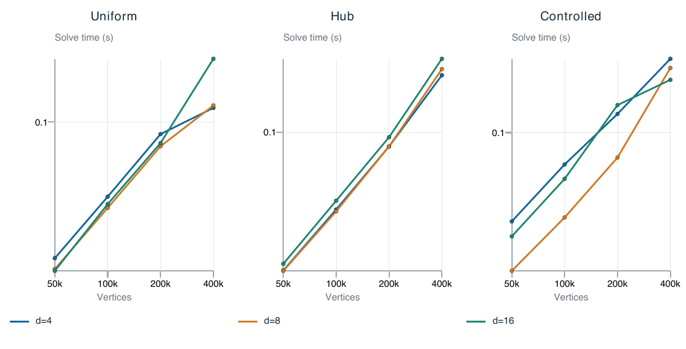
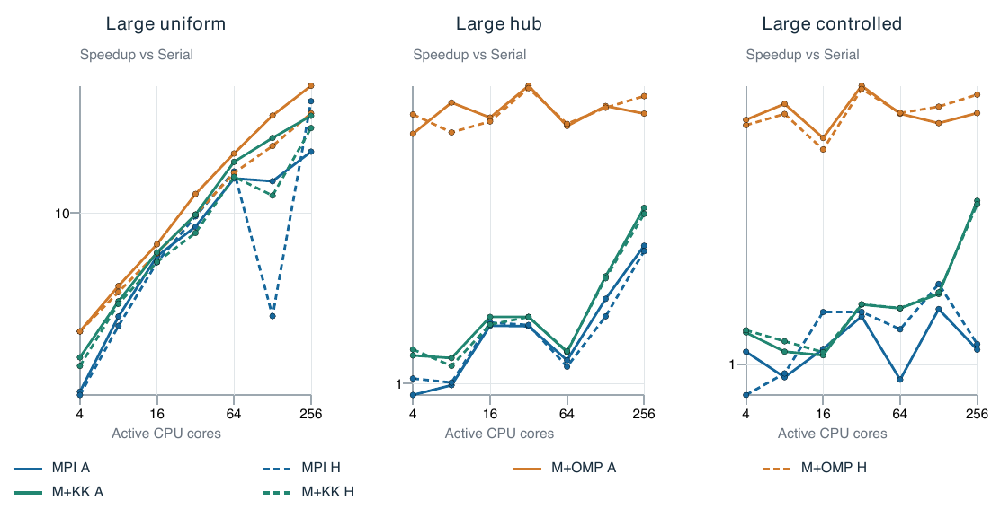
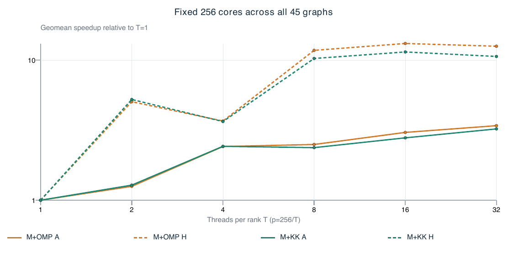
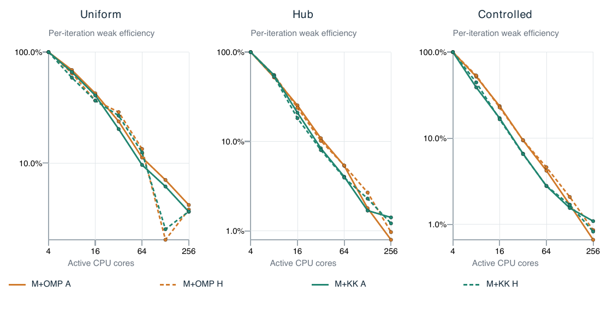

# Parallel PageRank on Vanda

Initial report - non-512 experiments - 16 November 2026

We evaluate synchronous PageRank on 45 directed graphs using Serial, OpenMP, MPI, MPI+OpenMP, native CUDA and Kokkos with OpenMP and CUDA backends. The audited dataset contains 19,530 fixed-graph configurations and 372 separate non-512 weak-suite configurations or controls. All fixed-graph targets in this scope are complete and independently validated. The report excludes every 512-core measurement and all queued work.

## 1 Introduction to the algorithm and data

### 1.1 PageRank and its relation to PPR

PageRank assigns a probability score to each vertex of a directed graph. A random surfer follows an outgoing edge with probability alpha and otherwise jumps according to a preference vector. Personalized PageRank (PPR) uses a query-specific preference vector. Our implementation uses the uniform preference vector and uniform redistribution of dangling-vertex mass: it is standard PageRank, equivalently the uniform-preference special case of PPR. We do not implement source-specific personalized queries.

$$r_v^{(k+1)}=(1-\alpha)/N+\alpha D_k/N+\alpha\sum_{u\to v}r_u^{(k)}/d_{out}(u).$$

Here D_k is the total score of vertices with zero out-degree. Scores start at 1/N; alpha=0.85; iteration stops when the global L1 change is at most 10^-8, with a cap of 1,000 iterations. All kernels use double precision and synchronous old/new score buffers. The pull formulation traverses incoming-edge CSR rows, avoiding simultaneous writes to a destination. An iteration costs O(N+E) work and O(N+E) storage in serial.

This is not embarrassingly parallel: each iteration needs remote source contributions, a global dangling-mass reduction, and a global convergence reduction. Unequal incoming-edge counts make equal vertex counts an imperfect proxy for equal work.

### 1.2 Three original graphs and 42 fixed extensions

| Source | Graphs | Vertices N | Directed edges E | Purpose |
| --- | --- | --- | --- | --- |
| Original Google | 1 | 875,713 | 5,105,039 | Real web-link graph |
| Original uniform and hub | 2 | 100,000 each | 1,000,000 each | Original synthetic controls |
| Canonical extensions | 3 | 100,000 | 1,000,000 | One per generated family |
| Size-density grid | 36 | 50k / 100k / 200k / 400k | N x 4 / 8 / 16 | 3 families x 4 sizes x 3 densities |
| Large extensions | 3 | 12,800,000 | 204,800,000 | One per generated family |
| Total fixed graphs | 45 |  |  | 3 original + 42 extensions |

The generated families use seed 5208 and deterministic integer mixing. Uniform spreads destinations across all vertices with fixed source degree. Hub directs approximately 80% of each source's edges to the first 1% of vertices. Controlled combines the hub destination pattern with two source-degree classes: 80% lower-degree sources and 20% higher-degree sources. Integer rounding and unique arithmetic progressions determine exact counts. The original uniform/hub files are retained unchanged; they are not interchangeable with the new canonical graphs of the same size.

Vertex count and average out-degree are crossed systematically, not changed together in a single size parameter. The three large graphs have identical N and E but different structural concentration, making them useful for separating graph size from load imbalance. All 45 fixed graphs are reused unchanged across the full fixed-graph configuration matrix.

### 1.3 Separate weak-scaling inputs

Weak scaling uses the same three generator families with 50,000 vertices and 800,000 edges per scaling unit. Rank-based series grow the graph with p; core-normalized series grow it with C=pT. Across the non-512 weak suites there are 27 distinct graph names. The GPU weak suite also runs standalone methods on both input sizes; these are fixed-resource size controls and are not labeled as resource-scaled weak-efficiency curves.

## 2 Methodology

### 2.1 Parallel implementations and design decisions

| Implementation | Compute and work distribution | MPI communication |
| --- | --- | --- |
| Serial | One CPU thread; incoming CSR pull | None |
| OpenMP | CPU threads; dynamic vertex schedule, chunk 64 | None |
| Kokkos OpenMP | CPU execution space; RangePolicy and parallel reductions | None |
| CUDA / Kokkos CUDA | One GPU; incoming-row vertex kernels | None |
| MPI | Contiguous destination partitions; one CPU thread/rank | Both modes |
| MPI+OpenMP | Same MPI partitions; threaded pull within each rank | Both modes; MPI_THREAD_FUNNELED |
| MPI+CUDA | One GPU/rank; host buffers between device and MPI | Both modes |
| MPI+Kokkos | Shared distributed driver; OpenMP or CUDA execution space | Both modes |

MPI partitions consecutive dense vertex IDs approximately equally. Each rank owns incoming rows and out-degrees for its vertices. Allgatherv replicates the complete vector of source contributions at every rank each iteration. Halo precomputes distinct remote source IDs, exchanges request metadata once, and then sends only requested values with Alltoallv. Both modes retain dangling-mass and convergence Allreduce calls. Halo is an exact dependency exchange, not approximate communication or dropped edges.

The counted per-iteration payload is the algorithm-level contribution-vector traffic, excluding collective implementation details, reduction traffic, and protocol overhead. Allgatherv counts 8N(p-1) aggregate bytes; Halo counts eight bytes per requested remote contribution. Metadata setup is recorded separately and lies outside solve time. Fewer counted bytes therefore need not imply lower measured latency.

The distributed device implementations stage contributions through host memory; they do not use CUDA-aware MPI or overlap communication with computation. The CUDA version uses 256-thread blocks and explicit kernels. Kokkos expresses comparable operations through Views, parallel_for/parallel_reduce and execution-space fences. Kokkos OpenMP and CUDA are two backends, not interchangeable hardware measurements.

### 2.2 Hardware, software and timing protocol

All reported measurements are from NUS Vanda. CPU comparisons use Intel Xeon Platinum 8452Y hosts, GCC 13.3.0, Open MPI 4.1.8 and Release builds. GPU comparisons use NVIDIA A40 nodes with Platinum 8452Y CPUs; archived build metadata identifies CUDA toolkit 12.4.1. Driver-reported CUDA compatibility is not treated as the compiler toolkit version. Original laptop and mixed-hardware exploratory measurements are excluded.

Every configuration has one warm-up and five measured runs. The primary statistic is solve_median_s, recomputed here from the five solve_s observations. MPI solve time is the maximum elapsed solver time across ranks. Graph input, partition distribution, backend construction and Halo setup are outside solve time; per-iteration MPI and host/device staging are inside the distributed solve. Standalone GPU setup and final rank copies are outside solve time. These are solver-time comparisons, not end-to-end application runtimes.

Twelve low-core MPI+Kokkos configurations use the recorded compact_setup initialization: redundant root edge storage is released after distribution, and replaced Halo edge IDs are released before backend allocation. The measured update/communication loop is unchanged; these configurations are flagged in the exported table. No recompiled variant is substituted silently into an existing measurement.

### 2.3 Fixed-graph configuration matrix

| Experiment | Node / rank / thread layout | 45-graph targets |
| --- | --- | --- |
| Serial CPU | n=1, p=1, T=1 | 45 |
| OpenMP; Kokkos OpenMP | n=1,p=1; T=1,2,4,8,16,32 | 270 each |
| MPI CPU | n=1,2,4,8; r=1,2,4,8,16,32; p=nr,T=1; two modes | 2,160 |
| MPI+OpenMP CPU | Same n,r; T=1,2,4,8,16,32 with rT<=32; two modes | 7,560 |
| MPI+Kokkos OpenMP CPU | Same 84 layouts and two modes | 7,560 |
| Standalone CUDA; Kokkos CUDA | n=1, one GPU | 45 each |
| MPI+CUDA; MPI+Kokkos CUDA | n=p=1,2; one rank/GPU/node; two modes | 180 each |
| GPU-node CPU controls | Serial45; OpenMP270; MPI180; hybrid720 | 1,215 |
| Total in this report |  | 19,530 |

For CPU configurations the active core budget is C=pT=n(rT). The matrix contains 24 pure-MPI layouts and 84 layouts for each CPU hybrid method; every MPI layout is paired across communication modes. The main full-per-node strong-scaling line uses C=32/64/128/256 on n=1/2/4/8 nodes. Lower-core points use one node. At a fixed C, hybrid methods test every legal T from the six-value set with p=C/T; a larger allocation is not counted as higher parallelism unless pT increases. The full table also contains other node layouts at equal C.

On GPU nodes the CPU-only MPI and OpenMP variants are controls on the same node layout, not GPU implementations. Distributed GPU comparisons use p=1 or 2 with one GPU per rank. The user removed 4/8-GPU runs from the scope. All 512-core fixed and weak results, including five previously valid fixed cells, are excluded from this report rather than mixed into an incomplete curve.

### 2.4 Strong scaling, weak scaling and aggregation

$$S(C)=T_{serial}/T(C),\qquad E(C)=S(C)/C.$$

Strong scaling holds the graph fixed and increases active resources. We also hold C=256 fixed and vary p/T to distinguish rank overhead from intra-rank threading. CPU speedup uses the matching CPU-node Serial reference; GPU-node acceleration uses its own Serial control. Two-GPU scaling uses each implementation's one-GPU solve time, not a different CPU baseline.

$$E_{weak,iter}(C)=\frac{T(C_0)/I(C_0)}{T(C)/I(C)}.$$

Weak scaling grows work with resources. The core-normalized curves use T=4, p=C/4 and C=4..256, with the 4-core point as baseline. We show per-iteration efficiency because convergence counts can change with graph size; total-solve efficiency is also exported. The separate completed inventory contains 150 rank-based CPU cells, 84 core-normalized CPU cells and 138 GPU-node weak-suite cells/controls. These 372 entries are not part of the 19,530 denominator.

Communication ratios always pair the same graph, method, backend, nodes, ranks and threads. Ratios across graphs are aggregated geometrically; raw seconds from different graph sizes are never averaged into a speedup. The 45-row runtime matrix reports the best observed configuration within each method and explicitly allows different resources per cell; it is an achievable-runtime envelope, not a fixed-budget comparison.

### 2.5 Correctness and reproducibility

The independent Python validators rebuild one PageRank update by streaming the original edge list, rather than sharing the C++ CSR traversal. Checks include vertex IDs/degrees, nonnegative finite ranks, total score within 10^-10 of one, residual within the stopping tolerance, full-vector L1 difference from Serial within 10^-8, history and repeated-run metadata. Allocation records and rank affinity maps verify the distributed layout. Raw rank vectors remain on Vanda; the repository holds summaries, timings, validation markers and provenance. This report checks those saved proofs and does not claim to rerun all full-vector validations locally.

The source manifest, each summary path, independent completion marker, graph dimensions, node/rank/thread split, original job identifiers and timing-range diagnostics are retained in the report data. Rebuilding the report reads these records; it submits no jobs and reruns no performance measurements.

### 2.6 AI usage

AI assistance was used for code adaptation within the existing project, experiment-matrix organization, job scripts, troubleshooting, result audits, visualization and this report draft. Runtime values come from compiled programs executed on Vanda. Report tables are derived from stored validated measurements, with 512-core and unvalidated work excluded. The group remains responsible for reviewing the code, analysis, final wording and attribution before submission.

## 3 Results

### 3.1 Complete coverage and validation audit

| Audit item | Observed result |
| --- | --- |
| Fixed graphs / validated configurations | 45 / 19,530 (100% of non-512 target) |
| Timed solve observations | 97,650; five per fixed configuration |
| Separate non-512 weak suite | 372 configurations or fixed-resource controls |
| Maximum fixed-result residual L1 | 7.520e-09 |
| Maximum fixed-result rank-sum error | 9.726e-12 |
| Summary median vs recomputed median | Exact match for all 19,530 configurations |
| Convergence counts at fixed graph/context | Identical across methods/configurations in all 90 graph-context groups |

The median relative five-run range (max-min)/median is 5.0%; its 95th percentile across configurations is 35.4%. This is observed run-to-run dispersion, not a confidence interval. Five repeats inside one allocation do not establish independent-job uncertainty; small differences and best-of-matrix selections should be interpreted cautiously.

### 3.2 Graph size and structural imbalance

| Graph | Vertices | Iterations | Serial s | Max/min rank edges at p=256 |
| --- | --- | --- | --- | --- |
| Google | 875,713 | 90 | 1.9 | 2.84 |
| Original uniform | 100,000 | 15 | 0.0373 | 1.11 |
| Original hub | 100,000 | 16 | 0.0255 | 459 |
| Large uniform | 12,800,000 | 12 | 15.9 | 1.01 |
| Large hub | 12,800,000 | 14 | 23.2 | 299 |
| Large controlled | 12,800,000 | 12 | 15.9 | 343 |

At identical 12.8M vertices and 204.8M edges, Uniform is almost edge-balanced across 256 ranks, while Hub and Controlled concentrate roughly 299x and 343x more incoming edges in the busiest rank than the least busy rank. This directly measures a limitation of contiguous equal-vertex partitioning. It provides a stronger explanation for structural scaling differences than graph size alone; it does not isolate every cache or runtime effect.

### 3.3 CPU strong scaling

More cores do not guarantee lower time. On Google, the best pure-MPI configuration is one node with p=32 and Halo: 0.149 s versus 1.896 s Serial (12.7x). At p=256 on eight nodes, pure MPI takes 0.799 s with Allgatherv and 1.462 s with Halo. The small original uniform and hub graphs show particularly poor 256-core efficiency: synchronization and distribution costs overwhelm the available work.

The large Uniform graph benefits from distributed resources: at 256 cores pure MPI+Halo reaches 24.9x Serial speedup, while MPI+OpenMP with p=64,T=4 and Allgatherv reaches 28.3x (11.0% CPU efficiency). The equal-size large Hub and Controlled graphs scale much less well under pure MPI. Within-node dynamic OpenMP is competitive: the best hybrid results for these graphs use a single 32-thread rank, at 28.7x and 24.9x Serial speedup respectively. These are different resource optima, not evidence that all methods should always use 256 cores.

| Graph | Communication | MPI p256 T1 (s) | M+OMP p64 T4 (s) | M+KK p64 T4 (s) |
| --- | --- | --- | --- | --- |
| Google | Allgatherv | 0.799 | 1.19 | 1.82 |
| Google | Halo | 1.46 | 0.358 | 0.509 |
| Original uniform | Allgatherv | 0.0931 | 0.0264 | 0.0269 |
| Original uniform | Halo | 0.235 | 0.0559 | 0.0469 |
| Original hub | Allgatherv | 0.076 | 0.028 | 0.0379 |
| Original hub | Halo | 0.277 | 0.0519 | 0.054 |
| Large uniform | Allgatherv | 0.962 | 0.561 | 0.718 |
| Large uniform | Halo | 0.637 | 0.703 | 0.793 |
| Large hub | Allgatherv | 10.6 | 5.04 | 8.59 |
| Large hub | Halo | 11 | 4.56 | 8.89 |
| Large controlled | Allgatherv | 14.7 | 3.78 | 6.24 |
| Large controlled | Halo | 14.2 | 3.4 | 6.37 |

### 3.4 Equal-core rank and thread decomposition

Changing p/T at fixed C has a large effect. With Allgatherv, T=32,p=8 improves the geometric-mean time by 3.41x for MPI+OpenMP and 3.23x for MPI+Kokkos relative to T=1,p=256. With Halo, the largest aggregate gains occur at T=16,p=16: 13.15x and 11.44x respectively. This is consistent with reducing many-rank exchange and synchronization overhead while retaining local parallelism. The best split remains graph-dependent; the figure is a complete paired aggregate, not a promise for every graph.

### 3.5 Allgatherv versus exact Halo exchange

| Context | Family | Pairs | Halo speedup | Payload reduction | Halo faster |
| --- | --- | --- | --- | --- | --- |
| cpu node | google | 179 | 1.89 | 58.6% | 87.2% |
| cpu node | uniform | 2685 | 1.23 | 28.6% | 62.9% |
| cpu node | hub | 2685 | 1.19 | 70.1% | 69.1% |
| cpu node | controlled | 2506 | 1.19 | 71.8% | 68.8% |
| gpu node | google | 7 | 0.969 | 27.7% | 14.3% |
| gpu node | uniform | 105 | 0.922 | 0.0% | 16.2% |
| gpu node | hub | 105 | 0.962 | 11.6% | 24.8% |
| gpu node | controlled | 98 | 0.975 | 14.8% | 32.7% |

On CPU, Google has the strongest aggregate Halo gain: 1.89x geometric-mean speedup over 179 paired configurations and 58.6% median payload reduction. Uniform, Hub and Controlled show 1.19-1.23x aggregate gains, but many individual configurations still favor Allgatherv. On GPU nodes, the two-rank Halo ensembles have ratios below one. Small p, host staging, synchronization and exchange setup constrain gains; lower logical payload is insufficient to predict solver time.

### 3.6 Standalone ablations and GPU-node comparisons

| Graph | CPU Serial s | OMP T32 s | KK OMP T32 s | GPU-node Serial s | CUDA 1GPU s | KK CUDA 1GPU s |
| --- | --- | --- | --- | --- | --- | --- |
| Google | 1.9 | 1.89 | 1.87 | 1.86 | 0.115 | 0.0936 |
| Original uniform | 0.0373 | 0.00267 | 0.00225 | 0.0288 | 0.00136 | 0.000999 |
| Original hub | 0.0255 | 0.00239 | 0.0101 | 0.0285 | 0.00616 | 0.00851 |
| Large uniform | 15.9 | 0.54 | 0.542 | 15.9 | 0.531 | 0.478 |
| Large hub | 23.2 | 0.704 | 16 | 17.1 | 0.755 | 2.03 |
| Large controlled | 15.9 | 0.537 | 11.8 | 12.9 | 0.594 | 1.77 |

Standalone CUDA/Kokkos CUDA can outperform their distributed p=1 versions because the distributed driver stages source contributions through host memory on every iteration. Google takes 0.115 s with standalone CUDA and 0.094 s with standalone Kokkos CUDA, compared with about 0.243 s and 0.383 s for their MPI Allgatherv p=1 variants. The standalone timings exclude setup transfers, so these ratios describe solver execution rather than full startup cost.

Two GPUs do not consistently beat one. For large Uniform, MPI+CUDA Allgatherv improves from 0.788 s to 0.705 s (1.12x), whereas Halo becomes slower. Kokkos CUDA's distributed Allgatherv variant improves from 1.368 s to 1.126 s (1.22x). On large Hub and Controlled, distributed Kokkos improves from one to two GPUs but remains slower than native CUDA at the same layouts. Backend implementation and graph structure both matter; Kokkos portability does not imply identical performance.

### 3.7 Weak scaling

| Family | Method | C256 Allgatherv efficiency | C256 Halo efficiency |
| --- | --- | --- | --- |
| uniform | MPI+OpenMP | 4.18% | 3.80% |
| uniform | MPI+Kokkos OpenMP | 3.63% | 3.66% |
| hub | MPI+OpenMP | 0.79% | 0.97% |
| hub | MPI+Kokkos OpenMP | 1.41% | 1.21% |
| controlled | MPI+OpenMP | 0.66% | 0.86% |
| controlled | MPI+Kokkos OpenMP | 1.09% | 0.83% |

Weak scaling is poor despite constant nominal work per core. At C=256, the core-normalized uniform curves retain roughly 3.6-4.2% per-iteration efficiency; the skewed families are around 0.7-1.4%. Replicated vectors and global synchronization grow with resource count, while equal-vertex partitioning does not preserve equal incoming-edge work on the concentrated families. These measurements reject a claim of near-ideal weak scaling. They motivate a future edge-aware partitioner and communication/staging redesign; they do not establish which unimplemented change would be fastest.

### 3.8 Full fixed-graph result matrix

The next table reports best observed solve medians within each method, over the complete non-512 sweep. Different cells can select different nodes, p/T and communication. The corresponding selected configurations are exported in runtime_matrix_45.csv; fixed-budget comparisons are given separately above. The associated heatmap uses matched Serial controls within each hardware context.

| Graph | Serial | OMP | KK-O | MPI | M-O | M-KO | CUDA | KK-C | M-C | M-KC |
| --- | --- | --- | --- | --- | --- | --- | --- | --- | --- | --- |
| Google | 1.9 | 0.146 | 0.136 | 0.149 | 0.146 | 0.146 | 0.115 | 0.0936 | 0.243 | 0.381 |
| o. hub | 0.0255 | 0.00239 | 0.00935 | 0.0173 | 0.00418 | 0.015 | 0.00616 | 0.00851 | 0.0101 | 0.0148 |
| o. uniform | 0.0373 | 0.00267 | 0.00225 | 0.00426 | 0.00416 | 0.00453 | 0.00136 | 0.000999 | 0.00514 | 0.00753 |
| s. controlled | 0.0497 | 0.00373 | 0.0119 | 0.0186 | 0.0054 | 0.0196 | 0.00689 | 0.00931 | 0.0123 | 0.0182 |
| s. hub | 0.0396 | 0.00301 | 0.00937 | 0.0172 | 0.0044 | 0.0162 | 0.00608 | 0.00844 | 0.0109 | 0.0171 |
| s. uniform | 0.0349 | 0.00244 | 0.0018 | 0.00422 | 0.00362 | 0.00433 | 0.00133 | 0.00102 | 0.00875 | 0.0121 |
| C 100k/16 | 0.0532 | 0.00302 | 0.0155 | 0.0266 | 0.00473 | 0.0205 | 0.00807 | 0.0114 | 0.0128 | 0.0175 |
| C 100k/4 | 0.0647 | 0.00555 | 0.00919 | 0.0184 | 0.00906 | 0.0194 | 0.00554 | 0.00667 | 0.0156 | 0.0252 |
| C 100k/8 | 0.0314 | 0.00321 | 0.0103 | 0.0137 | 0.00504 | 0.0147 | 0.00622 | 0.00834 | 0.0127 | 0.0192 |
| C 200k/16 | 0.146 | 0.00837 | 0.0428 | 0.0611 | 0.0108 | 0.0433 | 0.0101 | 0.0269 | 0.0256 | 0.0487 |
| C 200k/4 | 0.129 | 0.0119 | 0.0209 | 0.0396 | 0.0174 | 0.0333 | 0.00736 | 0.0136 | 0.0241 | 0.047 |
| C 200k/8 | 0.0712 | 0.00742 | 0.0265 | 0.0439 | 0.0122 | 0.0406 | 0.00816 | 0.0189 | 0.0189 | 0.0373 |
| C 400k/16 | 0.206 | 0.0174 | 0.124 | 0.159 | 0.0234 | 0.099 | 0.0135 | 0.0601 | 0.0264 | 0.0659 |
| C 400k/4 | 0.274 | 0.0219 | 0.0539 | 0.0768 | 0.0271 | 0.0861 | 0.0114 | 0.0276 | 0.0359 | 0.0802 |
| C 400k/8 | 0.242 | 0.0188 | 0.0797 | 0.107 | 0.0248 | 0.0845 | 0.0111 | 0.0397 | 0.0315 | 0.0761 |
| C 50k/16 | 0.0242 | 0.00212 | 0.00718 | 0.013 | 0.00286 | 0.0108 | 0.00626 | 0.00626 | 0.00839 | 0.0098 |
| C 50k/4 | 0.0297 | 0.0033 | 0.00415 | 0.00855 | 0.00457 | 0.0093 | 0.00412 | 0.00401 | 0.00964 | 0.0123 |
| C 50k/8 | 0.0151 | 0.00175 | 0.00489 | 0.0101 | 0.00518 | 0.0106 | 0.00475 | 0.00458 | 0.00824 | 0.00982 |
| H 100k/16 | 0.044 | 0.00254 | 0.0128 | 0.0215 | 0.00399 | 0.0187 | 0.00723 | 0.0104 | 0.0108 | 0.0171 |
| H 100k/4 | 0.0396 | 0.00376 | 0.0067 | 0.00908 | 0.0052 | 0.0101 | 0.0044 | 0.00556 | 0.011 | 0.0176 |
| H 100k/8 | 0.0387 | 0.00279 | 0.0111 | 0.0103 | 0.00398 | 0.0112 | 0.00514 | 0.00706 | 0.00929 | 0.0144 |
| H 200k/16 | 0.0942 | 0.00673 | 0.0296 | 0.0525 | 0.00888 | 0.0339 | 0.00885 | 0.0239 | 0.0149 | 0.0314 |
| H 200k/4 | 0.0843 | 0.00843 | 0.0163 | 0.0297 | 0.0122 | 0.0284 | 0.00573 | 0.0111 | 0.0169 | 0.0347 |
| H 200k/8 | 0.0844 | 0.00804 | 0.0198 | 0.0306 | 0.00979 | 0.0294 | 0.00655 | 0.0152 | 0.0136 | 0.0302 |
| H 400k/16 | 0.242 | 0.0173 | 0.15 | 0.157 | 0.0208 | 0.0897 | 0.0116 | 0.0505 | 0.0226 | 0.0578 |
| H 400k/4 | 0.198 | 0.018 | 0.0577 | 0.0893 | 0.023 | 0.0685 | 0.00829 | 0.0215 | 0.0254 | 0.058 |
| H 400k/8 | 0.214 | 0.0134 | 0.085 | 0.0993 | 0.0201 | 0.0703 | 0.00877 | 0.03 | 0.0242 | 0.0556 |
| H 50k/16 | 0.0206 | 0.00292 | 0.00566 | 0.00987 | 0.0023 | 0.00971 | 0.00527 | 0.00512 | 0.00703 | 0.00772 |
| H 50k/4 | 0.019 | 0.0021 | 0.00328 | 0.00621 | 0.00311 | 0.00658 | 0.00327 | 0.00316 | 0.00686 | 0.00862 |
| H 50k/8 | 0.0189 | 0.00155 | 0.00415 | 0.0075 | 0.00253 | 0.00765 | 0.00382 | 0.00371 | 0.00617 | 0.00712 |
| U 100k/16 | 0.0385 | 0.00222 | 0.00181 | 0.00434 | 0.00345 | 0.0047 | 0.00134 | 0.00106 | 0.00482 | 0.00717 |
| U 100k/4 | 0.042 | 0.00372 | 0.00245 | 0.0024 | 0.00253 | 0.00258 | 0.0016 | 0.0011 | 0.00693 | 0.0103 |
| U 100k/8 | 0.0369 | 0.00307 | 0.00222 | 0.0044 | 0.00439 | 0.00461 | 0.00133 | 0.000972 | 0.00537 | 0.0076 |
| U 200k/16 | 0.0782 | 0.00449 | 0.00444 | 0.00868 | 0.00663 | 0.0118 | 0.00251 | 0.00184 | 0.00754 | 0.0121 |
| U 200k/4 | 0.0868 | 0.00763 | 0.00494 | 0.00692 | 0.00704 | 0.00744 | 0.00286 | 0.00156 | 0.0121 | 0.0201 |
| U 200k/8 | 0.0754 | 0.00505 | 0.00362 | 0.00698 | 0.00705 | 0.00783 | 0.00248 | 0.00146 | 0.0104 | 0.0188 |
| U 400k/16 | 0.208 | 0.0135 | 0.0116 | 0.0236 | 0.0158 | 0.0216 | 0.00586 | 0.00436 | 0.0149 | 0.023 |
| U 400k/4 | 0.118 | 0.0123 | 0.00679 | 0.0115 | 0.0117 | 0.0133 | 0.00582 | 0.00269 | 0.026 | 0.0463 |
| U 400k/8 | 0.121 | 0.00992 | 0.00643 | 0.0141 | 0.0142 | 0.0185 | 0.00518 | 0.00301 | 0.0173 | 0.0277 |
| U 50k/16 | 0.0178 | 0.00122 | 0.00104 | 0.00137 | 0.00152 | 0.00153 | 0.000753 | 0.000704 | 0.00428 | 0.00535 |
| U 50k/4 | 0.0206 | 0.00221 | 0.00135 | 0.0014 | 0.00159 | 0.00159 | 0.00104 | 0.000852 | 0.00389 | 0.00506 |
| U 50k/8 | 0.0181 | 0.00171 | 0.00112 | 0.00137 | 0.00156 | 0.00155 | 0.000776 | 0.000674 | 0.00287 | 0.00368 |
| 12.8M controlled | 15.9 | 0.537 | 10.7 | 9.73 | 0.642 | 5.36 | 0.594 | 1.77 | 0.851 | 1.85 |
| 12.8M hub | 23.2 | 0.704 | 16 | 10.6 | 0.808 | 8.2 | 0.755 | 2.03 | 1.03 | 2.13 |
| 12.8M uniform | 15.9 | 0.54 | 0.542 | 0.637 | 0.515 | 0.635 | 0.531 | 0.478 | 0.705 | 1.13 |

All numeric cells are seconds. KK=Kokkos, M=MPI, O=OpenMP, C=CUDA. For grid names U/H/C is the family, followed by vertices and average out-degree. o.=original synthetic, s.=canonical synthetic. The table is descriptive best-observed performance, not an equal-core/GPU ranking.

## 4 Conclusions and insights

### 4.1 What the experiments establish

First, parallel degree is a choice, not a target to maximize unconditionally. Large balanced graphs exploit multiple nodes; small graphs and concentrated destination rows often favor fewer MPI ranks and more threads within a rank. At fixed 256 cores, rank/thread decomposition can change aggregate runtime by more than an order of magnitude.

Second, an exact Halo reduces contribution payload without guaranteeing faster execution. CPU and GPU-node observations differ, and even within the CPU matrix the large-graph best communication mode changes with structure and p/T. Communication must be evaluated with matched layouts and actual time, not bytes alone.

Third, Kokkos provides the same algorithm on CPU and GPU backends, while backend policy, staging and vertex work imbalance determine performance. The distributed device path has a substantial cost even at p=1. Multi-GPU performance cannot be inferred from a fast standalone kernel.

Fourth, equal-vertex partitioning is a clear structural limitation: extreme incoming-edge imbalance and weak-scaling degradation remain after all numerical checks pass. Edge-aware or reordered partitions, selective device/host staging, CUDA-aware MPI and overlap are reasonable future experiments. None is claimed as implemented or measured here.

### 4.2 Conclusions about the real Google graph

The refreshed validated Google Serial vector has 136,259 dangling vertices (15.6%), so dangling-mass redistribution is essential. The highest-scoring 1% of vertices carry 27.1% of the total probability mass. Pearson correlation between PageRank and in-degree is 0.901: incoming links are strongly associated with rank, but raw in-degree is not the complete weighting rule.

| Node ID | PageRank | In-degree | Out-degree |
| --- | --- | --- | --- |
| 597621 | 0.0009237 | 5354 | 22 |
| 41909 | 0.0009211 | 4219 | 10 |
| 163075 | 0.0009040 | 4731 | 36 |
| 537039 | 0.0008988 | 6326 | 27 |
| 384666 | 0.0007869 | 4010 | 20 |

These anonymized vertex IDs cannot be mapped to named websites from this edge-list dataset alone. The observed rank concentration supports a structural statement about this graph; it does not identify trustworthy content or establish a causal relationship between links and importance.

### 4.3 Limits, reproducibility and references

This is an initial report of measured non-512 results. The sweep is complete in that scope, but there are only five repeats per configuration within an allocation; graph placement and execution dates vary, and the best-observed matrix introduces selection effects. The report does not measure full application startup, device energy, communication overlap, source-specific PPR, or 4/8-GPU scaling. All 512-core results remain outside the reported comparisons. Names and student IDs must be added before Canvas submission.

Reproduction: analyze_report_results.py reads the validated inventory and all referenced summaries/timings; build_non512_report.py produces this PDF, the editable report text and nine vector figures. The data directory provides the full fixed and weak tables, paired communication ratios, equal-core decompositions, graph catalog and audit checks. Original raw results remain unchanged; the source-manifest SHA-256 is recorded in audit.json.

[1] Page, L., Brin, S., Motwani, R. and Winograd, T. The PageRank Citation Ranking: Bringing Order to the Web. Stanford, 1999. http://ilpubs.stanford.edu:8090/422/

[2] Stanford SNAP. Google web graph dataset. https://snap.stanford.edu/data/web-Google.html

[3] MPI Forum. MPI standard and collective communication. https://www.mpi-forum.org/docs/

[4] Kokkos documentation. Execution spaces, Views and parallel dispatch. https://kokkos.org/kokkos-core-wiki/

[5] Project source and Vanda result records, non-512 validated snapshot of 16 November 2026. https://github.com/rosesnack/DSA5208_PROJECT_3
