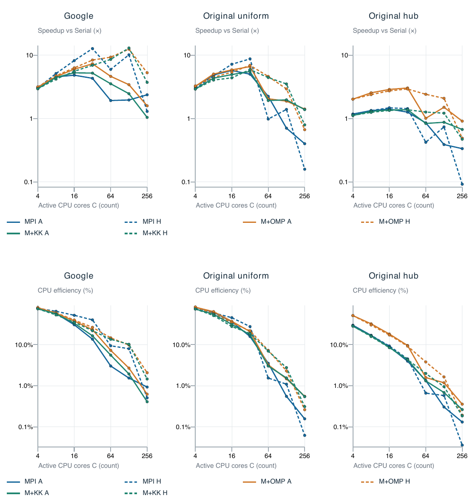

# Parallel PageRank on Vanda

Parallel PageRank experiments - 17 November 2026

CHEN Dedan (A0353553A); HE Xinyi (A0351082M); HONG Xinran (A0356216E)

We evaluate synchronous PageRank on 45 directed graphs using Serial, OpenMP, MPI, MPI+OpenMP, native CUDA and Kokkos with OpenMP and CUDA backends. The audited dataset contains 19,530 fixed-graph configurations and 372 separate non-512 weak-suite configurations or controls. All fixed-graph targets in this scope are complete and independently validated. Five available 512-core configurations are presented as a separate, explicitly incomplete supplement. Pending measurements are excluded.

## 1 Introduction to the algorithm and data

### 1.1 PageRank and its relation to PPR

PageRank assigns a probability score to each vertex of a directed graph. A random surfer follows an outgoing edge with probability alpha and otherwise jumps according to a preference vector. Personalized PageRank (PPR) uses a query-specific preference vector. Our implementation uses the uniform preference vector and uniform redistribution of dangling-vertex mass: it is standard PageRank, equivalently the uniform-preference special case of PPR. We do not implement source-specific personalized queries.

$$r_v^{(k+1)}=(1-\alpha)/N+\alpha D_k/N+\alpha\sum_{u\to v}r_u^{(k)}/d_{out}(u).$$

Here D_k is the total score of vertices with zero out-degree. Scores start at 1/N; alpha=0.85; iteration stops when the global L1 change is at most 10^-8, with a cap of 1,000 iterations. All kernels use double precision and synchronous old/new score buffers. The pull formulation traverses incoming-edge compressed sparse row (CSR) storage, avoiding simultaneous writes to a destination. An iteration costs O(N+E) work and O(N+E) storage in serial.

This is not embarrassingly parallel: each iteration needs remote source contributions, a global dangling-mass reduction, and a global convergence reduction. Unequal incoming-edge counts make equal vertex counts an imperfect proxy for equal work.

### 1.2 Three original graphs and 42 fixed extensions

| Source | Graphs | Vertices N | Directed edges E | Purpose |
| --- | --- | --- | --- | --- |
| Original Google | 1 | 875,713 | 5,105,039 | Real web-link graph |
| Original uniform and hub | 2 | 100,000 each | 1,000,000 each | Original synthetic controls |
| Canonical extensions | 3 | 100,000 | 1,000,000 | One per generated family |
| Size-density grid | 36 | 50k / 100k / 200k / 400k | N x 4 / 8 / 16 | 3 families x 4 sizes x 3 densities |
| Large extensions | 3 | 12,800,000 | 204,800,000 | One per generated family |
| Total fixed graphs | 45 |  |  | 3 original + 42 extensions |

The generated families use seed 5208 and deterministic integer mixing. Uniform spreads destinations across all vertices with fixed source degree. Hub directs approximately 80% of each source's edges to the first 1% of vertices. Controlled combines the hub destination pattern with two source-degree classes: 80% lower-degree sources and 20% higher-degree sources. Integer rounding and unique arithmetic progressions determine exact counts. The original uniform/hub files are retained unchanged; they are not interchangeable with the new canonical graphs of the same size.

For the three large graphs, E/N=16. The integer rule floor(4*d_out/5) sends exactly 75.0% of Hub edges and 77.5% of Controlled edges into the first 1% of destination IDs. These exact fractions, rather than an assumed 80%, are used in the workload model below. The concentration is deliberately aligned with contiguous vertex partitions; results therefore characterize this partitioner and vertex ordering as well as graph structure.

Integer rounding also qualifies the density-grid interpretation: Controlled sends 65.0% of its edges to the hot block at mean degree 4, and 77.5% at degrees 8 and 16. Changing density therefore changes this exact structural concentration as well as E. The grid is a reproducible generator-family study, not an intervention that isolates edge count from every other graph property.

Vertex count and average out-degree are crossed systematically, not changed together in a single size parameter. The three large graphs have identical N and E but different structural concentration, making them useful for separating graph size from load imbalance. All 45 fixed graphs are reused unchanged across the full fixed-graph configuration matrix.

### 1.3 Separate weak-scaling inputs

Weak scaling uses the same three generator families with 50,000 vertices and 800,000 edges per scaling unit. Rank-based series grow the graph with p; core-normalized series grow it with C=pT. Across the non-512 weak suites there are 27 distinct graph names. The GPU weak suite also runs standalone methods on both input sizes; these are fixed-resource size controls and are not labeled as resource-scaled weak-efficiency curves.

## 2 Methodology

### 2.1 Parallel implementations and design decisions

| Implementation | Compute and work distribution | MPI communication |
| --- | --- | --- |
| Serial | One CPU thread; incoming CSR pull | None |
| OpenMP | CPU threads; dynamic vertex schedule, chunk 64 | None |
| Kokkos OpenMP | CPU execution space; default static RangePolicy and reductions | None |
| CUDA / Kokkos CUDA | One GPU; incoming-row vertex kernels | None |
| MPI | Contiguous destination partitions; one CPU thread/rank | Both modes |
| MPI+OpenMP | Same MPI partitions; threaded pull within each rank | Both modes; MPI_THREAD_FUNNELED |
| MPI+CUDA | One GPU/rank; host buffers between device and MPI | Both modes |
| MPI+Kokkos | Shared distributed driver; OpenMP or CUDA execution space | Both modes |

MPI partitions consecutive dense vertex IDs approximately equally. Each rank owns incoming rows and out-degrees for its vertices. Allgatherv replicates the complete vector of source contributions at every rank each iteration. Halo precomputes distinct remote source IDs, exchanges request metadata once, and then sends only requested values with Alltoallv. Both modes retain dangling-mass and convergence Allreduce calls. Halo is an exact dependency exchange, not approximate communication or dropped edges.

The counted per-iteration payload is the algorithm-level contribution-vector traffic, excluding collective implementation details, reduction traffic, and protocol overhead. Allgatherv counts 8N(p-1) aggregate bytes; Halo counts eight bytes per requested remote contribution. Metadata setup is recorded separately and lies outside solve time. Fewer counted bytes therefore need not imply lower measured latency.

Two costs must be distinguished: local work is approximately a*N_i+b*E_i, while global progress waits for the slowest rank and collective completion. Incoming-edge imbalance changes E_i even when every N_i is equal. The MPI timer includes packing/copies, collectives and waiting at reductions; it is not a network-only timer. Solve and phase timings take separate maxima across ranks, then separate medians across five runs. They cannot be subtracted or added to reconstruct one critical-path trace.

The distributed device implementations stage contributions through host memory; they do not use CUDA-aware MPI or overlap communication with computation. The CUDA version uses 256-thread blocks and explicit kernels. Kokkos expresses comparable operations through Views, parallel_for/parallel_reduce and execution-space fences. Kokkos OpenMP and CUDA are two backends, not interchangeable hardware measurements.

### 2.2 Hardware, software and timing protocol

All reported measurements are from NUS Vanda. CPU comparisons use Intel Xeon Platinum 8452Y hosts, GCC 13.3.0, Open MPI 4.1.8 and Release builds. GPU comparisons use NVIDIA A40 nodes with Platinum 8452Y CPUs; archived build metadata identifies CUDA toolkit 12.4.1. Driver-reported CUDA compatibility is not treated as the compiler toolkit version. Original laptop and mixed-hardware exploratory measurements are excluded.

Every configuration has one warm-up followed by five timed runs. All primary solve-time tables and figures report the median of those five timed runs. The exported statistic solve_median_s is recomputed here from the five original solve_s observations. MPI solve time is the maximum elapsed solver time across ranks. Graph input, partition distribution, backend construction and Halo setup are outside solve time; per-iteration MPI and host/device staging are inside the distributed solve. Standalone GPU setup and final rank copies are outside solve time. These are solver-time comparisons, not end-to-end application runtimes.

OpenMP creates its persistent thread team inside the timed solver, while Kokkos runtime initialization precedes solver timing. Backend-compute phases use fenced host-clock intervals, including dispatch and reduction implementation costs; they are not CUDA-event measurements of pure kernel execution. Transfer phases measure explicit staging and need not capture every internal scalar-result copy. These boundaries should be considered when comparing backends or very small graph runtimes.

Twelve low-core MPI+Kokkos configurations use the recorded compact_setup initialization: redundant root edge storage is released after distribution, and replaced Halo edge IDs are released before backend allocation. The measured update/communication loop is unchanged; these configurations are flagged in the exported table. No recompiled variant is substituted silently into an existing measurement.

### 2.3 Fixed-graph configuration matrix

| Experiment | Node / rank / thread layout | 45-graph targets |
| --- | --- | --- |
| Serial CPU | n=1, p=1, T=1 | 45 |
| OpenMP; Kokkos OpenMP | n=1,p=1; T=1,2,4,8,16,32 | 270 each |
| MPI CPU | n=1,2,4,8; r=1,2,4,8,16,32; p=nr,T=1; two modes | 2,160 |
| MPI+OpenMP CPU | Same n,r; T=1,2,4,8,16,32 with rT<=32; two modes | 7,560 |
| MPI+Kokkos OpenMP CPU | Same 84 layouts and two modes | 7,560 |
| Standalone CUDA; Kokkos CUDA | n=1, one GPU | 45 each |
| MPI+CUDA; MPI+Kokkos CUDA | n=p=1,2; one rank/GPU/node; two modes | 180 each |
| GPU-node CPU controls | Serial45; OpenMP270; MPI180; hybrid720 | 1,215 |
| Complete main matrix |  | 19,530 |
| Partial CPU 512 supplement | n=8, 64 cores/node; available p/T and modes only | 5 / 1,170 |

For CPU configurations the active core budget is C=pT=n(rT). The matrix contains 24 pure-MPI layouts and 84 layouts for each CPU hybrid method; every MPI layout is paired across communication modes. The main full-per-node strong-scaling line uses C=32/64/128/256 on n=1/2/4/8 nodes. Lower-core points use one node. At a fixed C, hybrid methods test every legal T from the six-value set with p=C/T; a larger allocation is not counted as higher parallelism unless pT increases. The full table also contains other node layouts at equal C.

On GPU nodes the CPU-only MPI and OpenMP variants are controls on the same node layout, not GPU implementations. Distributed GPU comparisons use p=1 or 2 with one GPU per rank. The GPU scope is one or two A40 devices. The 512-core fixed-graph supplement contains five validated configurations on one graph; its missing combinations are not used to construct a complete scaling curve. Weak-scaling comparisons here stop at 256 CPU cores.

### 2.4 Strong scaling, weak scaling and aggregation

$$S(C)=T_{serial}/T(C),\qquad E(C)=S(C)/C.$$

Strong scaling holds the graph fixed and increases active resources. We also hold C=256 fixed and vary p/T to distinguish rank overhead from intra-rank threading. CPU speedup uses the matching CPU-node Serial reference; GPU-node acceleration uses its own Serial control. Two-GPU scaling uses each implementation's one-GPU solve time, not a different CPU baseline.

$$E_{weak,iter}(C)=\frac{T(C_0)/I(C_0)}{T(C)/I(C)}.$$

Weak scaling grows work with resources. The core-normalized curves use T=4, p=C/4 and C=4..256, with the 4-core point as baseline. We show per-iteration efficiency because convergence counts can change with graph size; total-solve efficiency is also exported. The separate completed inventory contains 150 rank-based CPU cells, 84 core-normalized CPU cells and 138 GPU-node weak-suite cells/controls. These 372 entries are not part of the 19,530 denominator.

Communication ratios always pair the same graph, method, backend, nodes, ranks and threads. The geometric mean treats reciprocal proportional changes symmetrically: a 2x improvement and a 2x slowdown average to 1x. It also gives each graph equal multiplicative weight. Raw seconds from different graph sizes are never averaged into a speedup. The 45-row runtime matrix selects the best observed configuration within each method and permits different resource budgets. It is a runtime envelope; strong-scaling lines and equal-core comparisons carry the scaling argument.

### 2.5 Correctness and reproducibility

The independent Python validators rebuild one PageRank update by streaming the original edge list, rather than sharing the C++ CSR traversal. Checks include vertex IDs/degrees, nonnegative finite ranks, total score within 10^-10 of one, residual within the stopping tolerance, full-vector L1 difference from Serial within 10^-8, history and repeated-run metadata. Allocation records and rank affinity maps verify the distributed layout. Raw rank vectors remain on Vanda; the repository holds summaries, timings, validation markers and provenance. The local analysis checks these saved proofs.

The source manifest, each summary path, independent completion marker, graph dimensions, node/rank/thread split, original job identifiers and timing-range diagnostics are retained in the report data. Report generation reads these records without executing performance measurements.

### 2.6 AI usage

AI assistance was used for code adaptation within the existing project, experiment-matrix organization, job scripts, troubleshooting, result audits, visualization and this report draft. Runtime values come from compiled programs executed on Vanda. Report tables are derived from stored validated measurements; incomplete 512-core coverage is labeled separately and unvalidated work is excluded. The group remains responsible for reviewing the code, analysis, final wording and attribution before submission.

## 3 Results

### 3.1 Complete coverage and validation audit

| Audit item | Observed result |
| --- | --- |
| Fixed graphs / validated configurations | 45 / 19,530 (100% of non-512 target) |
| Timed solve observations | 97,650; five per fixed configuration |
| Separate non-512 weak suite | 372 configurations or fixed-resource controls |
| Maximum fixed-result residual L1 | 7.520e-09 |
| Maximum fixed-result rank-sum error | 9.726e-12 |
| Summary median vs recomputed median | Exact match for all 19,530 configurations |
| Convergence counts at fixed graph/context | Identical across methods/configurations in all 90 graph-context groups |

The median relative five-run range (max-min)/median is 5.0%; its 95th percentile across configurations is 35.4%. This is observed run-to-run dispersion, not a confidence interval. Five repeats inside one allocation do not establish independent-job uncertainty; small differences and best-of-matrix selections should be interpreted cautiously.

### 3.2 Graph size and structural imbalance

| Fixed N=100,000 | Edges | Iterations | Serial s | Milliseconds / iteration |
| --- | --- | --- | --- | --- |
| Controlled | 400000 | 35 | 0.0647 | 1.85 |
| Controlled | 800000 | 22 | 0.0314 | 1.43 |
| Controlled | 1600000 | 17 | 0.0532 | 3.13 |

Sparsity affects edge traversal and remote-source dependencies. At fixed vertex count, changing E/N changes the work per iteration, while E/(N*N) describes directed graph density. Total solve time also includes the number of convergence iterations, which changes with graph structure. Consequently, more edges need not produce a monotonic increase in total solve time; per-iteration time and iteration count must be inspected together. Hub concentration further changes load balance even at identical N and E.

| Graph | Vertices | Iterations | Serial s | Max/min rank edges at p=256 |
| --- | --- | --- | --- | --- |
| Google | 875,713 | 90 | 1.9 | 2.84 |
| Original uniform | 100,000 | 15 | 0.0373 | 1.11 |
| Original hub | 100,000 | 16 | 0.0255 | 459 |
| Large uniform | 12,800,000 | 12 | 15.9 | 1.01 |
| Large hub | 12,800,000 | 14 | 23.2 | 299 |
| Large controlled | 12,800,000 | 12 | 15.9 | 343 |

At identical 12.8M vertices and 204.8M edges, Uniform is almost edge-balanced across 256 ranks, while Hub and Controlled concentrate roughly 299x and 343x more incoming edges in the busiest rank than the least busy rank. This directly measures a limitation of contiguous equal-vertex partitioning. It provides a stronger explanation for structural scaling differences than graph size alone; it does not isolate every cache or runtime effect.

$$B_E=\frac{\max_i E_i}{E/p},\qquad p_{edge}=\frac{E}{\max_i E_i}=\frac{p}{B_E}.$$

| Large graph, p=256 | Max / mean edges | Busiest rank edge share | Equivalent balanced ranks |
| --- | --- | --- | --- |
| Large uniform | 1.002 | 0.39% | 255 |
| Large hub | 75.002 | 29.30% | 3.41 |
| Large controlled | 77.508 | 30.28% | 3.3 |

The edge-work equivalent is an equal-rate model, not a measured speedup ceiling across different cache layouts or backends. At p=256, Hub and Controlled provide only about 3.4 and 3.3 balanced-rank equivalents for edge traversal. A single rank owns roughly 29%-30% of all edges; hundreds of lightly loaded ranks cannot shorten that rank's row scans. Halo changes which values move, while destination ownership stays fixed, so it cannot remove this imbalance.

The generator explains the shape quantitatively. A partition of width 1/p contains all hot destination IDs while p<=100; beyond that, several ranks share the hot block. If q is its edge fraction and h=0.01 its vertex fraction, the maximum edge share is approximately q+(1-q)*(1/p-h)/(1-h) for 1/p>=h, and q/(p*h) otherwise. The model predicts B_E near 75 and 77.5 at p=256, matching the observed 75.002 and 77.508. This links the slowdown to a concrete graph-ordering/partition interaction.

| Large graph; T=32 | OpenMP s | Kokkos OpenMP s | Kokkos / OpenMP | 32-block max edge share |
| --- | --- | --- | --- | --- |
| Large uniform | 0.54 | 0.542 | 1 | 3.1% |
| Large hub | 0.704 | 16 | 22.8 | 75.5% |
| Large controlled | 0.537 | 11.8 | 22 | 78.0% |

Scheduling also matters within a node. OpenMP uses schedule(dynamic,64) for destination updates. The compiled Kokkos 4.5.01 sources default RangePolicy to Schedule<Static>; its OpenMP reduction assigns a vertex interval to each worker and enables stealing only for Dynamic [6]. Each vertex still scans its incoming row sequentially. The 32-block proxy above comes from saved equal-vertex rank partitions, not a per-thread trace. It places 75.5%-78.0% of the skewed graphs' edges in one block, while Uniform is balanced. Kokkos and OpenMP take similar time on Uniform but differ by about 22x on the skewed graphs. Static row assignment is therefore a strong mechanism-level explanation; a dynamic-policy ablation would quantify its share separately from reduction and locality costs.

This comparison evaluates the implemented scheduling policies together with their runtimes. It cannot be read as a controlled measurement of intrinsic Kokkos framework overhead.

### 3.3 CPU strong scaling

More cores do not guarantee lower time. On Google, the best pure-MPI configuration is one node with p=32 and Halo: 0.149 s versus 1.896 s Serial (12.7x). At p=256 on eight nodes, pure MPI takes 0.799 s with Allgatherv and 1.462 s with Halo. The small original uniform and hub graphs show particularly poor 256-core efficiency: synchronization and contribution exchange outweigh the available per-rank work.

The large Uniform graph benefits from distributed resources: at 256 cores pure MPI with Halo reaches 28.6x Serial speedup (11.2% CPU efficiency). MPI+OpenMP with p=64,T=4 and Allgatherv reaches 28.3x (11.0% efficiency). The equal-size large Hub and Controlled graphs scale less well under pure MPI. Within-node dynamic OpenMP is competitive: the best hybrid results for these graphs use a single 32-thread rank, at 28.7x and 24.9x Serial speedup. These are different resource optima.

| Nodes | CPU cores | MPI H speedup | MPI H efficiency | M+OMP A speedup | M+OMP A efficiency |
| --- | --- | --- | --- | --- | --- |
| 1 | 32 | 9.72 | 30.4% | 11.7 | 36.4% |
| 2 | 64 | 14 | 21.9% | 16.2 | 25.4% |
| 4 | 128 | 3.69 | 2.9% | 22.2 | 17.3% |
| 8 | 256 | 28.6 | 11.2% | 28.3 | 11.0% |

The preceding table holds the large Uniform graph fixed. MPI uses p=C,T=1; MPI+OpenMP uses p=C/4,T=4. Efficiency is speedup divided by active CPU cores. Non-monotonic points are retained. MPI phase timing includes synchronization and waiting, so a high communication fraction cannot alone identify network congestion.

| Large Uniform cores | Solve s | Communication s | Median comm / solve | Payload MB / rank | Max / mean edges |
| --- | --- | --- | --- | --- | --- |
| 64 | 1.132 | 0.676 | 59.8% | 25.20 | 1.0011 |
| 128 | 4.297 | 4.122 | 96.1% | 12.70 | 1.0015 |
| 256 | 0.554 | 0.511 | 92.2% | 6.37 | 1.0023 |

Solve and communication seconds are separate five-run medians; the percentage is the median of the five communication/solve ratios. The 128-core point is communication-dominated despite near-uniform edge work. The recorded communication scope includes packing, exchange, reductions and waiting; the solve and phase timers also take separate rank maxima. Thus the measurements locate a bottleneck in the communication/synchronization path without proving a single network cause. Collective message-size regimes, placement and contention are plausible mechanisms; distinguishing them requires controlled transport or collective-algorithm experiments.

At 128 cores all five solve times lie between 3.947 and 4.330 s. The graph, 12-iteration convergence count and full rank vector agree with Serial, and the affinity map contains 128 distinct CPU assignments over four hosts. Its payload per rank is smaller than at 64 cores, and B_E remains near one. Extra edge work, extra iterations and a single slow repeat do not explain the peak. The unresolved factor is the communication/runtime environment: existing timers combine packing, Alltoallv, reductions and rank waiting. A defensible next control would replay the same counts and buffers within one allocation, separate those timers, and compare fixed NUMA (non-uniform memory access) and host placement and MPI collective settings. No such counterfactual is claimed as measured.

| MPI ranks | Strong comm ms / iter | Weak comm ms / iter | Weak payload MB / rank | Upstream tuned candidate |
| --- | --- | --- | --- | --- |
| 64 | 56.37 | 17.28 | 6.30 | pairwise |
| 128 | 343.53 | 271.01 | 6.35 | basic_linear |
| 256 | 42.58 | 38.07 | 6.37 | pairwise |

A version-specific mechanism makes this more precise. The upstream Open MPI 4.1.8 fixed tuned selector uses pairwise Alltoallv for 64<=p<128, basic_linear for 128<=p<256, and pairwise for 256<=p<1024 [7]. Pairwise schedules rank-step exchanges; basic_linear starts peer requests together and waits for completion [8]. These are different progress/concurrency regimes even at similar byte counts. The Uniform weak series, with half the strong graph size at p=128, also shows a large 128-rank communication peak while its payload stays close to 6.35 MB/rank. The two series therefore support a collective-selection hypothesis more specifically than a byte-volume explanation.

The table lists a candidate from upstream default rules, not a recorded runtime algorithm. The saved runs do not identify the selected collective component, vendor patches or dynamic-rule overrides, and the two graph-size series use different allocations. The leading hypothesis is therefore an Alltoallv selection/progress effect interacting with placement or contention; it is not a demonstrated unique cause. The most discriminating control would first log the selected component, then force basic_linear and pairwise at p=128 in the same allocation with identical counts and CPU placement, while timing packing, Alltoallv and reductions separately.

| Graph | Communication | MPI p256 T1 (s) | M+OMP p64 T4 (s) | M+KK p64 T4 (s) |
| --- | --- | --- | --- | --- |
| Google | Allgatherv | 0.799 | 1.19 | 1.82 |
| Google | Halo | 1.46 | 0.358 | 0.509 |
| Original uniform | Allgatherv | 0.0931 | 0.0264 | 0.0269 |
| Original uniform | Halo | 0.235 | 0.0559 | 0.0469 |
| Original hub | Allgatherv | 0.076 | 0.028 | 0.0379 |
| Original hub | Halo | 0.277 | 0.0519 | 0.054 |
| Large uniform | Allgatherv | 1.05 | 0.561 | 0.718 |
| Large uniform | Halo | 0.554 | 0.703 | 0.793 |
| Large hub | Allgatherv | 8.93 | 5.04 | 8.59 |
| Large hub | Halo | 9.47 | 4.56 | 8.89 |
| Large controlled | Allgatherv | 6.6 | 3.78 | 6.24 |
| Large controlled | Halo | 6.88 | 3.4 | 6.37 |

### 3.4 Equal-core rank and thread decomposition

Changing p/T at fixed C has a large effect. With Allgatherv, T=32,p=8 improves geometric-mean time by 3.40x for MPI+OpenMP and 3.20x for MPI+Kokkos relative to T=1,p=256. The best aggregate Halo splits use T=16 and T=16, with improvements of 13.12x and 11.35x. Reducing rank count changes both collective participation and local work; these measurements do not isolate one mechanism. The best split remains graph-dependent.

The split has a workload effect as well as a message effect. With ideal sharing of each rank's edge work over T threads, the edge-only equivalent core count is T*E/max(E_i)=C/B_E(p). For large Hub at C=256 this proxy rises from 3.4 with p256,T1 to about 41 with p8,T32: dynamic threads can share the hot rows owned by one rank. Static contiguous thread subdivision can preserve the original edge skew even as ranks decrease. This explains why fewer ranks plus more threads is a substantive design choice. C verifies assigned parallelism; it does not imply C equally productive workers, and the proxy does not predict a measured runtime by itself.

### 3.5 Allgatherv versus exact Halo exchange

| Context | Family | Pairs | Halo speedup | Payload reduction | Halo faster |
| --- | --- | --- | --- | --- | --- |
| cpu node | google | 179 | 1.89 | 58.6% | 87.2% |
| cpu node | uniform | 2685 | 1.23 | 28.6% | 62.9% |
| cpu node | hub | 2685 | 1.19 | 70.1% | 69.1% |
| cpu node | controlled | 2506 | 1.19 | 71.8% | 68.8% |
| gpu node | google | 7 | 0.969 | 27.7% | 14.3% |
| gpu node | uniform | 105 | 0.922 | 0.0% | 16.2% |
| gpu node | hub | 105 | 0.962 | 11.6% | 24.8% |
| gpu node | controlled | 98 | 0.975 | 14.8% | 32.7% |

On CPU, Google has the strongest aggregate Halo gain: 1.89x geometric-mean speedup over 179 paired configurations and 58.6% median payload reduction. Uniform, Hub and Controlled show 1.19-1.23x aggregate gains, but many individual configurations still favor Allgatherv. On GPU nodes, the two-rank Halo ensembles have ratios below one. Small p, host staging, packing and synchronization constrain gains; one-time Halo setup is excluded from solve time. Thus its setup cost cannot explain a measured solve-time slowdown.

Halo exploits repeated use of the same remote source by local destination rows: each distinct remote contribution is sent once. It does not communicate a fixed spatial boundary on these non-geometric graphs. Uniform edges spread dependencies widely; skewed destination rows can reuse more source IDs and reduce payload substantially, yet also concentrate computation. Payload savings and workload balance are different properties. The paired ratios hold graph and p/T fixed, but separate allocations can still differ in placement and contention; the comparison does not isolate a pure network-bandwidth effect.

### 3.6 Standalone ablations and GPU-node comparisons

| Graph | CPU Serial s | OMP T32 s | KK OMP T32 s | GPU-node Serial s | CUDA 1GPU s | KK CUDA 1GPU s |
| --- | --- | --- | --- | --- | --- | --- |
| Google | 1.9 | 0.125 | 0.104 | 1.86 | 0.115 | 0.0936 |
| Original uniform | 0.0373 | 0.00267 | 0.00225 | 0.0288 | 0.00136 | 0.000999 |
| Original hub | 0.0255 | 0.00239 | 0.0101 | 0.0285 | 0.00616 | 0.00851 |
| Large uniform | 15.9 | 0.54 | 0.542 | 15.9 | 0.531 | 0.478 |
| Large hub | 23.2 | 0.704 | 16 | 17.1 | 0.755 | 2.03 |
| Large controlled | 15.9 | 0.537 | 11.8 | 12.9 | 0.594 | 1.77 |

Standalone CUDA/Kokkos CUDA can outperform their distributed p=1 versions because the distributed driver stages source contributions through host memory on every iteration. Google takes 0.115 s with standalone CUDA and 0.094 s with standalone Kokkos CUDA, compared with about 0.243 s and 0.383 s for their MPI Allgatherv p=1 variants. The standalone timings exclude setup transfers, so these ratios describe solver execution rather than full startup cost.

Two GPUs do not consistently beat one. For large Uniform, MPI+CUDA Allgatherv improves from 0.788 s to 0.705 s (1.12x), whereas Halo becomes slower. Kokkos CUDA's distributed Allgatherv variant improves from 1.368 s to 1.126 s (1.22x). On large Hub and Controlled, distributed Kokkos improves from one to two GPUs but remains slower than native CUDA at the same layouts. Backend implementation and graph structure both matter; Kokkos portability does not imply identical performance.

| Large graph | Backend | p2 max edge share | Compute speedup 1 to 2 | Solve p1 s | Solve p2 s |
| --- | --- | --- | --- | --- | --- |
| uniform | CUDA | 50.0% | 2 | 0.788 | 0.705 |
| uniform | Kokkos CUDA | 50.0% | 1.99 | 1.37 | 1.13 |
| hub | CUDA | 87.4% | 1.11 | 1.05 | 1.15 |
| hub | Kokkos CUDA | 87.4% | 1.88 | 3.1 | 2.13 |
| controlled | CUDA | 88.6% | 1.1 | 0.851 | 0.965 |
| controlled | Kokkos CUDA | 88.6% | 1.89 | 2.7 | 1.85 |

The two-rank partition leaves 88.6% of Controlled edges on one GPU. Under equal edge-processing rates, the edge-only speedup proxy is just 1.13x; native CUDA's measured compute speedup is 1.10x. Its compute median falls from 0.538 to 0.489 s, while Allgatherv communication rises from 0.118 to 0.755 s and solve time increases. Uniform instead divides edges nearly in half and both backends achieve about 2x compute acceleration. The structure of the partition therefore explains a concrete part of native CUDA's scaling limit.

Kokkos CUDA on Controlled reduces compute from 1.8 to 0.955 s and staging from 0.777 to 0.586 s; its solve improves despite rising communication. Its 1.89x compute change exceeds the equal-edge-rate proxy. That proxy is not a universal runtime bound: vertex reductions, kernel mapping and memory locality also change with partition size. The records cannot separate those contributions. Both device implementations traverse each incoming row within one GPU work item; a team/warp-per-row variant would test the remaining long-row bottleneck, but is not measured here.

### 3.7 Weak scaling

| MPI at p=256 | Allgatherv: p1 ref | Halo: p1 ref | Allgatherv: p32 ref | Halo: p32 ref |
| --- | --- | --- | --- | --- |
| uniform | 1.46% | 3.12% | 14.69% | 22.82% |
| hub | 0.23% | 0.22% | 12.19% | 11.33% |
| controlled | 0.27% | 0.25% | 13.23% | 12.13% |

The primary weak-efficiency reference is p=1, where contribution exchange has no remote payload. The p=32 columns are a baseline-sensitivity analysis of the same saved series, with inter-rank communication already present. They quantify further degradation from 32 to 256 ranks without replacing the primary definition. Baseline choice changes the percentage; neither comparison supports near-ideal scaling.

Rank-normalized weak scaling keeps nominal local vertices and edges constant, but not the communication problem: the global contribution vector and collective participant count grow with resources. On the concentrated families, equal vertex partitions also produce severe incoming-edge imbalance. Communication timers include waiting for slow ranks and cannot be interpreted solely as network transmission time.

| Family | Method | C256 Allgatherv efficiency | C256 Halo efficiency |
| --- | --- | --- | --- |
| uniform | MPI+OpenMP | 4.18% | 3.80% |
| uniform | MPI+Kokkos OpenMP | 3.63% | 3.66% |
| hub | MPI+OpenMP | 0.79% | 0.97% |
| hub | MPI+Kokkos OpenMP | 1.41% | 1.21% |
| controlled | MPI+OpenMP | 0.66% | 0.86% |
| controlled | MPI+Kokkos OpenMP | 1.09% | 0.83% |

Weak scaling is poor despite constant nominal work per core. At C=256, the core-normalized uniform curves retain roughly 3.6-4.2% per-iteration efficiency; the skewed families are around 0.7-1.4%. Replicated vectors and global synchronization grow with resource count, while equal-vertex partitioning does not preserve equal incoming-edge work on the concentrated families. These measurements reject a claim of near-ideal weak scaling. They motivate a future edge-aware partitioner and communication/staging redesign; they do not establish which unimplemented change would be fastest.

The weak-scaling problem is structural for Allgatherv. With N=n0*p and E=e0*p, nominal local graph work is fixed, but each rank receives 8*n0*(p-1) contribution bytes and stores an O(p*n0) source vector. Aggregate counted traffic is O(p^2); dividing time by the iteration count cannot remove this communication growth. At p=256 the Uniform contribution vector costs 102.0 MB per rank per iteration, despite only 50,000 owned vertices.

Halo improves the byte scaling: a rank needs no more distinct remote sources than its incoming edges, so for balanced Uniform its counted payload is bounded by roughly 8*800,000=6.4 MB per rank. Observed Halo payload grows only from 6.30 to 6.37 MB between p=64 and 256, yet communication/waiting rises from 17.28 to 38.07 ms per iteration. Growing peer participation, collective/reduction latency, packing and resource contention remain plausible; a byte-only model is insufficient. On Hub and Controlled, nominal work per rank also hides a 75x-78x busiest-rank excess at p=256, so their near-zero efficiency has an additional load-balance mechanism. A high MPI timer on these graphs includes fast ranks waiting for the loaded ranks.

| Uniform ranks | Communication | Payload MB / rank | Comm + waiting ms / iter |
| --- | --- | --- | --- |
| 16 | Allgatherv | 6.00 | 2.56 |
| 16 | Halo | 4.40 | 3.25 |
| 64 | Allgatherv | 25.20 | 14.89 |
| 64 | Halo | 6.30 | 17.28 |
| 256 | Allgatherv | 102.00 | 85.76 |
| 256 | Halo | 6.37 | 38.07 |

### 3.8 Full fixed-graph result matrix

The two tables contain all 45 graphs and each method's best observed five-run solve median (s). Cells may select different node counts, p/T and communication. Selected configurations are in runtime_matrix_45.csv; these envelopes complement the matched-layout and equal-core comparisons above. CPU-S and GPU-S are different matched Serial controls.

| Graph | CPU-S | OMP | KK-O | MPI | M-O | M-KO | 512* |
| --- | --- | --- | --- | --- | --- | --- | --- |
| Google | 1.9 | 0.125 | 0.104 | 0.149 | 0.146 | 0.146 | - |
| o. hub | 0.0255 | 0.00239 | 0.00935 | 0.0173 | 0.00418 | 0.015 | - |
| o. uniform | 0.0373 | 0.00267 | 0.00225 | 0.00426 | 0.00416 | 0.00453 | - |
| s. controlled | 0.0497 | 0.00373 | 0.0119 | 0.0186 | 0.0054 | 0.0196 | - |
| s. hub | 0.0396 | 0.00301 | 0.00937 | 0.0172 | 0.0044 | 0.0162 | - |
| s. uniform | 0.0349 | 0.00244 | 0.0018 | 0.00422 | 0.00362 | 0.00433 | - |
| C 100k/16 | 0.0532 | 0.00302 | 0.0155 | 0.0266 | 0.00473 | 0.0205 | - |
| C 100k/4 | 0.0647 | 0.00555 | 0.00919 | 0.0184 | 0.00906 | 0.0194 | - |
| C 100k/8 | 0.0314 | 0.00321 | 0.0103 | 0.0137 | 0.00504 | 0.0147 | - |
| C 200k/16 | 0.146 | 0.00837 | 0.0428 | 0.0611 | 0.0108 | 0.0433 | - |
| C 200k/4 | 0.129 | 0.0119 | 0.0209 | 0.0396 | 0.0174 | 0.0333 | - |
| C 200k/8 | 0.0712 | 0.00742 | 0.0265 | 0.0439 | 0.0122 | 0.0406 | - |
| C 400k/16 | 0.206 | 0.0174 | 0.124 | 0.159 | 0.0234 | 0.099 | - |
| C 400k/4 | 0.274 | 0.0219 | 0.0539 | 0.0768 | 0.0271 | 0.0861 | - |
| C 400k/8 | 0.242 | 0.0188 | 0.0797 | 0.107 | 0.0248 | 0.0845 | - |
| C 50k/16 | 0.0242 | 0.00212 | 0.00718 | 0.013 | 0.00286 | 0.0108 | - |
| C 50k/4 | 0.0297 | 0.0033 | 0.00415 | 0.00855 | 0.00457 | 0.0093 | 0.12 |
| C 50k/8 | 0.0151 | 0.00175 | 0.00489 | 0.0101 | 0.00518 | 0.0106 | - |
| H 100k/16 | 0.044 | 0.00254 | 0.0128 | 0.0215 | 0.00399 | 0.0187 | - |
| H 100k/4 | 0.0396 | 0.00376 | 0.0067 | 0.00908 | 0.0052 | 0.0101 | - |
| H 100k/8 | 0.0387 | 0.00279 | 0.0111 | 0.0103 | 0.00398 | 0.0112 | - |
| H 200k/16 | 0.0942 | 0.00673 | 0.0296 | 0.0525 | 0.00888 | 0.0339 | - |
| H 200k/4 | 0.0843 | 0.00843 | 0.0163 | 0.0297 | 0.0122 | 0.0284 | - |
| H 200k/8 | 0.0844 | 0.00804 | 0.0198 | 0.0306 | 0.00979 | 0.0294 | - |
| H 400k/16 | 0.242 | 0.0173 | 0.15 | 0.157 | 0.0208 | 0.0897 | - |
| H 400k/4 | 0.198 | 0.018 | 0.0577 | 0.0893 | 0.023 | 0.0685 | - |
| H 400k/8 | 0.214 | 0.0134 | 0.085 | 0.0993 | 0.0201 | 0.0703 | - |
| H 50k/16 | 0.0206 | 0.00292 | 0.00566 | 0.00987 | 0.0023 | 0.00971 | - |
| H 50k/4 | 0.019 | 0.0021 | 0.00328 | 0.00621 | 0.00311 | 0.00658 | - |
| H 50k/8 | 0.0189 | 0.00155 | 0.00415 | 0.0075 | 0.00253 | 0.00765 | - |
| U 100k/16 | 0.0385 | 0.00222 | 0.00181 | 0.00434 | 0.00345 | 0.0047 | - |
| U 100k/4 | 0.042 | 0.00372 | 0.00245 | 0.0024 | 0.00253 | 0.00258 | - |
| U 100k/8 | 0.0369 | 0.00307 | 0.00222 | 0.0044 | 0.00439 | 0.00461 | - |
| U 200k/16 | 0.0782 | 0.00449 | 0.00444 | 0.00868 | 0.00663 | 0.0118 | - |
| U 200k/4 | 0.0868 | 0.00763 | 0.00494 | 0.00692 | 0.00704 | 0.00744 | - |
| U 200k/8 | 0.0754 | 0.00505 | 0.00362 | 0.00698 | 0.00705 | 0.00783 | - |
| U 400k/16 | 0.208 | 0.0135 | 0.0116 | 0.0236 | 0.0158 | 0.0216 | - |
| U 400k/4 | 0.118 | 0.0123 | 0.00679 | 0.0115 | 0.0117 | 0.0133 | - |
| U 400k/8 | 0.121 | 0.00992 | 0.00643 | 0.0141 | 0.0142 | 0.0185 | - |
| U 50k/16 | 0.0178 | 0.00122 | 0.00104 | 0.00137 | 0.00152 | 0.00153 | - |
| U 50k/4 | 0.0206 | 0.00221 | 0.00135 | 0.0014 | 0.00159 | 0.00159 | - |
| U 50k/8 | 0.0181 | 0.00171 | 0.00112 | 0.00137 | 0.00156 | 0.00155 | - |
| 12.8M controlled | 15.9 | 0.537 | 10.7 | 6.6 | 0.642 | 5.36 | - |
| 12.8M hub | 23.2 | 0.704 | 16 | 8.93 | 0.808 | 8.2 | - |
| 12.8M uniform | 15.9 | 0.54 | 0.542 | 0.554 | 0.519 | 0.574 | - |

CPU-node methods. KK=Kokkos; M=MPI; O=OpenMP. U/H/C identify graph families, then vertices and mean out-degree; o./s. mean original/canonical. 512* is the best of five available cases on C 50k/4, not a complete comparison. A hyphen marks unmeasured cells.

| Graph | GPU-S | CUDA | KK-CUDA | MPI+CUDA | MPI+KK CUDA |
| --- | --- | --- | --- | --- | --- |
| Google | 1.86 | 0.115 | 0.0936 | 0.243 | 0.381 |
| o. hub | 0.0285 | 0.00616 | 0.00851 | 0.0101 | 0.0148 |
| o. uniform | 0.0288 | 0.00136 | 0.000999 | 0.00514 | 0.00753 |
| s. controlled | 0.0358 | 0.00689 | 0.00931 | 0.0123 | 0.0182 |
| s. hub | 0.0398 | 0.00608 | 0.00844 | 0.0109 | 0.0171 |
| s. uniform | 0.037 | 0.00133 | 0.00102 | 0.00875 | 0.0121 |
| C 100k/16 | 0.053 | 0.00807 | 0.0114 | 0.0128 | 0.0175 |
| C 100k/4 | 0.0634 | 0.00554 | 0.00667 | 0.0156 | 0.0252 |
| C 100k/8 | 0.0496 | 0.00622 | 0.00834 | 0.0127 | 0.0192 |
| C 200k/16 | 0.117 | 0.0101 | 0.0269 | 0.0256 | 0.0487 |
| C 200k/4 | 0.129 | 0.00736 | 0.0136 | 0.0241 | 0.047 |
| C 200k/8 | 0.109 | 0.00816 | 0.0189 | 0.0189 | 0.0373 |
| C 400k/16 | 0.286 | 0.0135 | 0.0601 | 0.0264 | 0.0659 |
| C 400k/4 | 0.179 | 0.0114 | 0.0276 | 0.0359 | 0.0802 |
| C 400k/8 | 0.169 | 0.0111 | 0.0397 | 0.0315 | 0.0761 |
| C 50k/16 | 0.0245 | 0.00626 | 0.00626 | 0.00839 | 0.0098 |
| C 50k/4 | 0.0302 | 0.00412 | 0.00401 | 0.00964 | 0.0123 |
| C 50k/8 | 0.0246 | 0.00475 | 0.00458 | 0.00824 | 0.00982 |
| H 100k/16 | 0.0312 | 0.00723 | 0.0104 | 0.0108 | 0.0171 |
| H 100k/4 | 0.0399 | 0.0044 | 0.00556 | 0.011 | 0.0176 |
| H 100k/8 | 0.0246 | 0.00514 | 0.00706 | 0.00929 | 0.0144 |
| H 200k/16 | 0.0741 | 0.00885 | 0.0239 | 0.0149 | 0.0314 |
| H 200k/4 | 0.0848 | 0.00573 | 0.0111 | 0.0169 | 0.0347 |
| H 200k/8 | 0.0553 | 0.00655 | 0.0152 | 0.0136 | 0.0302 |
| H 400k/16 | 0.226 | 0.0116 | 0.0505 | 0.0226 | 0.0578 |
| H 400k/4 | 0.136 | 0.00829 | 0.0215 | 0.0254 | 0.058 |
| H 400k/8 | 0.212 | 0.00877 | 0.03 | 0.0242 | 0.0556 |
| H 50k/16 | 0.0124 | 0.00527 | 0.00512 | 0.00703 | 0.00772 |
| H 50k/4 | 0.0192 | 0.00327 | 0.00316 | 0.00686 | 0.00862 |
| H 50k/8 | 0.0139 | 0.00382 | 0.00371 | 0.00617 | 0.00712 |
| U 100k/16 | 0.0359 | 0.00134 | 0.00106 | 0.00482 | 0.00717 |
| U 100k/4 | 0.0266 | 0.0016 | 0.0011 | 0.00693 | 0.0103 |
| U 100k/8 | 0.0232 | 0.00133 | 0.000972 | 0.00537 | 0.0076 |
| U 200k/16 | 0.0495 | 0.00251 | 0.00184 | 0.00754 | 0.0121 |
| U 200k/4 | 0.0551 | 0.00286 | 0.00156 | 0.0121 | 0.0201 |
| U 200k/8 | 0.0759 | 0.00248 | 0.00146 | 0.0104 | 0.0188 |
| U 400k/16 | 0.176 | 0.00586 | 0.00436 | 0.0149 | 0.023 |
| U 400k/4 | 0.179 | 0.00582 | 0.00269 | 0.026 | 0.0463 |
| U 400k/8 | 0.125 | 0.00518 | 0.00301 | 0.0173 | 0.0277 |
| U 50k/16 | 0.0182 | 0.000753 | 0.000704 | 0.00428 | 0.00535 |
| U 50k/4 | 0.0129 | 0.00104 | 0.000852 | 0.00389 | 0.00506 |
| U 50k/8 | 0.0115 | 0.000776 | 0.000674 | 0.00287 | 0.00368 |
| 12.8M controlled | 12.9 | 0.594 | 1.77 | 0.851 | 1.85 |
| 12.8M hub | 17.1 | 0.755 | 2.03 | 1.03 | 2.13 |
| 12.8M uniform | 15.9 | 0.531 | 0.478 | 0.705 | 1.13 |

GPU-node device methods and their own Serial control. Five-run median solve times (s); the distributed variants select over one/two GPUs and both communication modes. CPU controls on GPU nodes remain in the full record export and the optimum-count analysis below.

### 3.9 Partial 512-core supplement

The complete main matrix stops at 256 CPU cores. The supplement below contains five validated 512-core configurations out of 1,170 planned combinations, all on Controlled N=50,000 and E=200,000. Each uses eight nodes with 64 active cores per node. Missing methods, layouts and graphs are unmeasured, not zero-time results.

| Method | p / T | Communication | Solve s | Speedup | Efficiency |
| --- | --- | --- | --- | --- | --- |
| MPI | 512 / 1 | Allgatherv | 0.131 | 0.227 | 0.044% |
| MPI+Kokkos OpenMP | 512 / 1 | Allgatherv | 0.13 | 0.229 | 0.045% |
| MPI+OpenMP | 512 / 1 | Allgatherv | 0.142 | 0.21 | 0.041% |
| MPI+OpenMP | 128 / 4 | Allgatherv | 0.12 | 0.247 | 0.048% |
| MPI | 512 / 1 | Halo | 1.6 | 0.0185 | 0.004% |

Every row reports the median of five timed runs after one warm-up and uses the matching CPU Serial baseline. All five cases are slower than Serial on this small graph, and Halo is particularly costly at p=512. This illustrates the cost of distributing a small workload; five cases on one graph do not support a general conclusion about 512-core scaling. This supplement is excluded from the main matrix best-time selection, geometric communication aggregates and weak-scaling curves.

## 4 Conclusions and insights

### 4.1 What the experiments establish

On CPU nodes, standalone OpenMP or Kokkos OpenMP is fastest on 42/45 graphs; only 2 winning configurations use multiple MPI ranks. Among the four actual GPU implementations, standalone CUDA/Kokkos CUDA wins all 45 graphs. With the GPU-node CPU controls included, however, OpenMP wins 18/45 graphs, native CUDA 11, and Kokkos CUDA 16. These are observed optima over different budgets, not hardware cost rankings. The result supports graph-dependent selection and does not justify a general claim that GPU-node workloads always favor GPU computation.

First, parallel degree is a choice, not a target to maximize unconditionally. Large balanced graphs exploit multiple nodes; small graphs and concentrated destination rows often favor fewer MPI ranks and more threads within a rank. At fixed 256 cores, rank/thread decomposition can change aggregate runtime by more than an order of magnitude.

Second, an exact Halo reduces contribution payload without guaranteeing faster execution. CPU and GPU-node observations differ, and even within the CPU matrix the large-graph best communication mode changes with structure and p/T. Communication must be evaluated with matched layouts and actual time, not bytes alone.

Third, Kokkos provides the same algorithm on CPU and GPU backends, while backend policy, staging and vertex work imbalance determine performance. The distributed device path has a substantial cost even at p=1. Multi-GPU performance cannot be inferred from a fast standalone kernel.

Fourth, equal-vertex partitioning is a clear structural limitation: extreme incoming-edge imbalance and weak-scaling degradation remain after all numerical checks pass. Edge-aware or reordered partitions, selective device/host staging, CUDA-aware MPI and overlap are reasonable future experiments. None is claimed as implemented or measured here.

### 4.2 Attribution: established mechanisms and remaining uncertainty

| Observation | Supported explanation | Unmeasured discriminating control |
| --- | --- | --- |
| Skewed graphs scale poorly | Direct: equal-vertex ownership places 29%-30% of all edges on one of 256 ranks. Static Kokkos worker ranges also align with the hot destination block. | Reorder vertices or balance incoming-edge counts while keeping the edge set and solver fixed; measure per-rank and per-thread work/time. |
| MPI timer approaches total solve on skewed graphs | Direct timer scope: collectives include waiting for late ranks. Work imbalance makes this mechanism credible; a large MPI timer does not identify transmitted-byte cost. | Record each rank's packing, exchange, row scan and reductions separately; compare arrival-time spread. |
| Uniform Halo is slow at 128 cores | Version-specific candidate: upstream tuned rules switch from pairwise to basic_linear at p128, then back at p256. Both input-size series peak at p128. Actual selected component and causality remain unrecorded. | Log the collective component; force each Alltoallv algorithm at p128 in the same allocation with fixed counts/CPU placement and separate phase timers. |
| Poor weak efficiency | Direct design cost: Allgatherv per-rank vector traffic grows O(p). Halo limits bytes but keeps collective participation and synchronization; skew adds unequal actual work. | Hold payload and graph work separately fixed in a collective microbenchmark; compare peer counts and measured rank arrival times. |
| Two GPUs do not always improve solve time | Measured: native CUDA gets little compute relief when one rank still owns 87%-89% of edges; added exchange offsets it. Kokkos shows additional backend-dependent effects. | Compare an edge-balanced partition, row/team scheduling and staged versus device-aware exchange on the same nodes. |

These proposed controls have not been performed. Numerical agreement establishes correctness of the saved outputs; it does not prove the absence of every performance defect. The strongest supported causes are explicit ownership, scheduling and communication-volume choices. Network congestion, NUMA penalties, cache behavior and a particular MPI algorithm are not asserted as individually demonstrated causes.

Optimization priority follows the evidence. For Hub/Controlled, first redistribute incoming-edge work and test dynamic or team-based row scheduling; reducing bytes alone leaves the straggler in place. For balanced Uniform, first separate collective latency, packing and staging, then test overlap or transport settings. An edge-balanced partition must also be checked for increased remote-source dependencies: balancing computation can worsen communication. Finally, an MPI speedup on one large graph should not replace a simple one-node method on the many smaller graphs where it loses.

### 4.3 Conclusions about the real Google graph

The validated Google Serial vector has 136,259 dangling vertices (15.6%), so dangling-mass redistribution is essential. The highest-scoring 1% of vertices carry 27.1% of the total probability mass. Pearson correlation between PageRank and in-degree is 0.901: incoming links are strongly associated with rank, but raw in-degree is not the complete weighting rule.

| Node ID | PageRank | In-degree | Out-degree |
| --- | --- | --- | --- |
| 597621 | 0.0009237 | 5354 | 22 |
| 41909 | 0.0009211 | 4219 | 10 |
| 163075 | 0.0009040 | 4731 | 36 |
| 537039 | 0.0008988 | 6326 | 27 |
| 384666 | 0.0007869 | 4010 | 20 |

These anonymized vertex IDs cannot be mapped to named websites from this edge-list dataset alone. The observed rank concentration supports a structural statement about this graph; it does not identify trustworthy content or establish a causal relationship between links and importance.

### 4.4 Limits and reproducibility

This report presents measured Vanda results with a complete main matrix and a partial 512-core supplement. There are five repeats per configuration within an allocation; placement and execution dates vary, and the best-observed matrix introduces selection effects. Shared-node allocations can span NUMA regions; NUMA locality is not fixed across every allocation. These are observed shared-cluster measurements. Full application startup, energy, communication overlap, source-specific PPR and 4/8-GPU scaling are outside scope. The partial 512-core table does not establish a complete high-core scaling curve.

Reproduction: analyze_report_results.py reads the validated inventory and referenced summaries/timings; build_non512_report.py produces this PDF, editable report text and ten vector figures. The exported fixed, weak and partial-512 tables map measurements to source summaries and validation markers. Additional diagnostic tables retain rank-edge shares, static-block proxies, weak payload/phase medians, GPU work changes and the three explicitly defined optimum populations. The selection file records 27 selected sources. Raw records are preserved; audit.json records manifest and selection SHA-256 values. No new performance run is required to reproduce these derivations.

### 4.5 References

[1] Page, L., Brin, S., Motwani, R. and Winograd, T. The PageRank Citation Ranking: Bringing Order to the Web. Stanford, 1999. http://ilpubs.stanford.edu:8090/422/

[2] Stanford SNAP. Google web graph dataset. https://snap.stanford.edu/data/web-Google.html

[3] MPI Forum. MPI standard and collective communication. https://www.mpi-forum.org/docs/

[4] Kokkos documentation. RangePolicy and execution policies. https://kokkos.org/kokkos-core-wiki/API/core/policies/RangePolicy.html

[5] Project source and Vanda result records, validated measurement collection of 17 November 2026. https://github.com/rosesnack/DSA5208_PROJECT_3

[6] Kokkos 4.5.01 source, commit 175257a51ff29a0059ec48bcd233ee096b2c0438: traits/Kokkos_ScheduleTrait.hpp and OpenMP/Kokkos_OpenMP_Parallel_Reduce.hpp. https://github.com/kokkos/kokkos/tree/4.5.01/core/src

[7] Open MPI v4.1.8. Fixed Alltoallv algorithm selection, coll_tuned_decision_fixed.c. https://github.com/open-mpi/ompi/blob/v4.1.8/ompi/mca/coll/tuned/coll_tuned_decision_fixed.c

[8] Open MPI v4.1.8. Pairwise and basic-linear implementations, coll_base_alltoallv.c. https://github.com/open-mpi/ompi/blob/v4.1.8/ompi/mca/coll/base/coll_base_alltoallv.c
